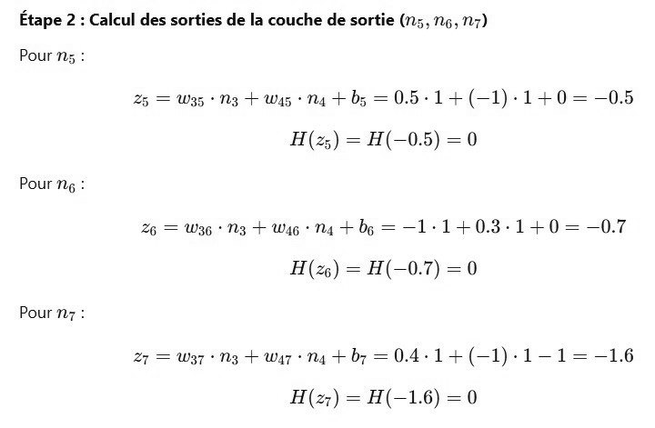

# DS DM 24 Exo 3_6.jpg

[Ouvrir l’original](https://drive.google.com/open?id=1gARjhh4uiluk9xXqmViqENKijx76j5IG) · Les pages signalées comprennent du texte reconnu automatiquement ou des éléments graphiques. Le fac-similé permet de vérifier chaque lecture.

**Pages avec fac-similé ou lecture OCR** — 1.

~~~text
Étape 2 : Calcul des sorties de la couche de sortie (n5, 5,7)

Pour 75 :
25 = W35 + Ng + Was + Na + b5 = 0.5-1+(—1)-1+0 = -0.5
H(25) = H(-0.5) = 0
Pour 1g :
26 = Wg + N3 + Wag Ng + bg = —1-14+0.3-1+0=—-0.7
H(z) = H(-0.7) =0
Pour 77:

27 = W373 + waz Na + by = 0.4-14+(-1)-1-1= -16
H(z) = H(-1.6) =0
~~~
