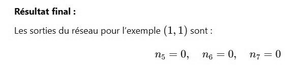

# DS DM 24 Exo 3_7.jpg

[Ouvrir l’original](https://drive.google.com/open?id=1_oFWieT7LNZzSLeUuA6gt8gclzygzV1W) · Les pages signalées comprennent du texte reconnu automatiquement ou des éléments graphiques. Le fac-similé permet de vérifier chaque lecture.

**Pages avec fac-similé ou lecture OCR** — 1.

~~~text
Résultat final :

Les sorties du réseau pour l'exemple (1, 1) sont:

0, ng =0,
~~~
