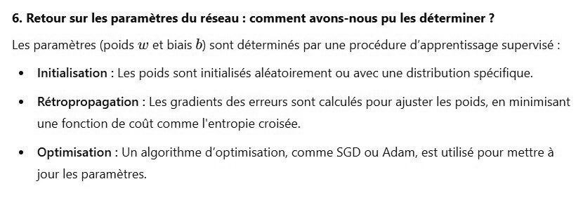

# DS DM 24 Exo 3_8.jpg

[Ouvrir l’original](https://drive.google.com/open?id=19zk-nO06ROYVY7xTZtqkZ9wrblArE7Q_) · Les pages signalées comprennent du texte reconnu automatiquement ou des éléments graphiques. Le fac-similé permet de vérifier chaque lecture.

**Pages avec fac-similé ou lecture OCR** — 1.

~~~text
6. Retour sur les paramètres du réseau : comment avons-nous pu les déterminer ?
Les paramètres (poids w et biais b) sont déterminés par une procédure d'apprentissage supervisé :
+ _Initialisation : Les poids sont initialisés aléatoirement ou avec une distribution spécifique.

+ Rétropropagation : Les gradients des erreurs sont calculés pour ajuster les poids, en minimisant

une fonction de coût comme l'entropie croisée.

* Optimisation : Un algorithme d'optimisation, comme SGD ou Adam, est utilisé pour mettre à

jour les paramètres.
~~~
