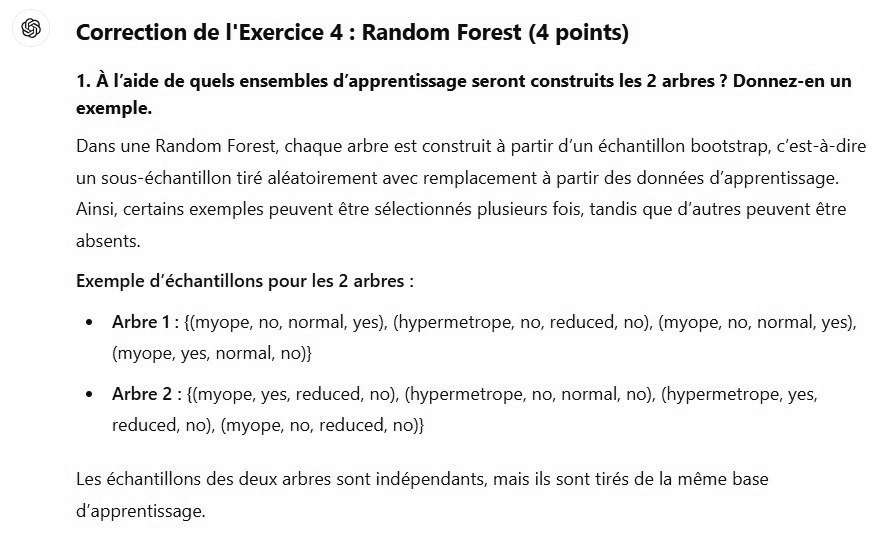

# DS DM 24 Exo 4_1.jpg

[Ouvrir l’original](https://drive.google.com/open?id=1v4UTc6ISscAQe28Xfpbxx79ezudz3b0l) · Les pages signalées comprennent du texte reconnu automatiquement ou des éléments graphiques. Le fac-similé permet de vérifier chaque lecture.

**Pages avec fac-similé ou lecture OCR** — 1.

~~~text
Correction de l'Exercice 4 : Random Forest (4 points)

1. À l'aide de quels ensembles d'apprentissage seront construits les 2 arbres ? Donnez-en un
exemple.

Dans une Random Forest, chaque arbre est construit à partir d'un échantillon bootstrap, c'est-à-dire
un sous-échantillon tiré aléatoirement avec remplacement à partir des données d'apprentissage.
Ainsi, certains exemples peuvent être sélectionnés plusieurs fois, tandis que d'autres peuvent être

absents.
Exemple d'échantillons pour les 2 arbres :

+ Arbre 1: {(myope, no, normal, yes), (hypermetrope, no, reduced, no), (myope, no, normal, yes),

(myope, yes, normal, no)}

* Arbre 2 : {(myope, yes, reduced, no), (hypermetrope, no, normal, no), (hypermetrope, yes,

reduced, no), (myope, no, reduced, no)}

Les échantillons des deux arbres sont indépendants, mais ils sont tirés de la même base

d'apprentissage
~~~
