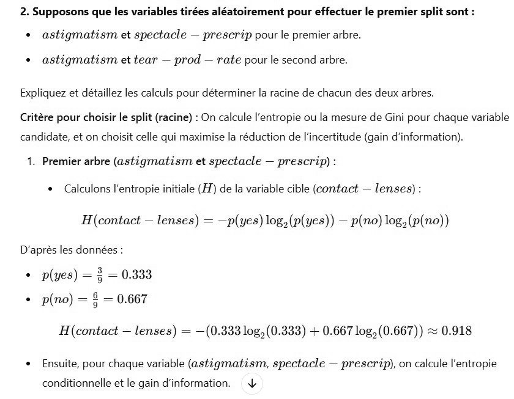

# DS DM 24 Exo 4_2.jpg

[Ouvrir l’original](https://drive.google.com/open?id=1Zp-AT4h3S5vygsBSu6efHae9VnK7Fwzv) · Les pages signalées comprennent du texte reconnu automatiquement ou des éléments graphiques. Le fac-similé permet de vérifier chaque lecture.

**Pages avec fac-similé ou lecture OCR** — 1.

~~~text
2. Supposons que les variables tirées aléatoirement pour effectuer le premier split sont :
+ astigmatism et spectacle — prescrip pour le premier arbre.

+ astigmatism et tear — prod — rate pour le second arbre.

Expliquez et détaillez les calculs pour déterminer la racine de chacun des deux arbres.

Critère pour choisir le split (racine) : On calcule l'entropie ou la mesure de Gini pour chaque variable

candidate, et on choisit celle qui maximise la réduction de l'incertitude (gain d'information).

1. Premier arbre (astigmatism et spectacle — prescrip) :
* Calculons l'entropie initiale (H) de la variable cible (contact — lenses) :
H(contact — lenses) = —p(yes) log, (p(yes)) — p(no) log,(p(no))

D'après les données :
+ p(yes) = à = 0.333
+ p(no) = § = 0.667

H(contact — lenses) = —(0.333 log, (0.333) + 0.667 log, (0.667)) ~ 0.918

* Ensuite, pour chaque variable (astigmatism, spectacle — prescrip), on calcule l'entropie

conditionnelle et le gain d'information.
~~~
