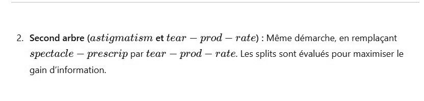

# DS DM 24 Exo 4_3.jpg

[Ouvrir l’original](https://drive.google.com/open?id=1P0Ek8eGYD73MtNOGb_99cp1vytmCFHI0) · Les pages signalées comprennent du texte reconnu automatiquement ou des éléments graphiques. Le fac-similé permet de vérifier chaque lecture.

**Pages avec fac-similé ou lecture OCR** — 1.

~~~text
2. Second arbre (astigmatism et tear — prod — rate) : Même démarche, en remplaçant
spectacle — prescrip par tear — prod — rate. Les splits sont évalués pour maximiser le

gain d'information.
~~~
