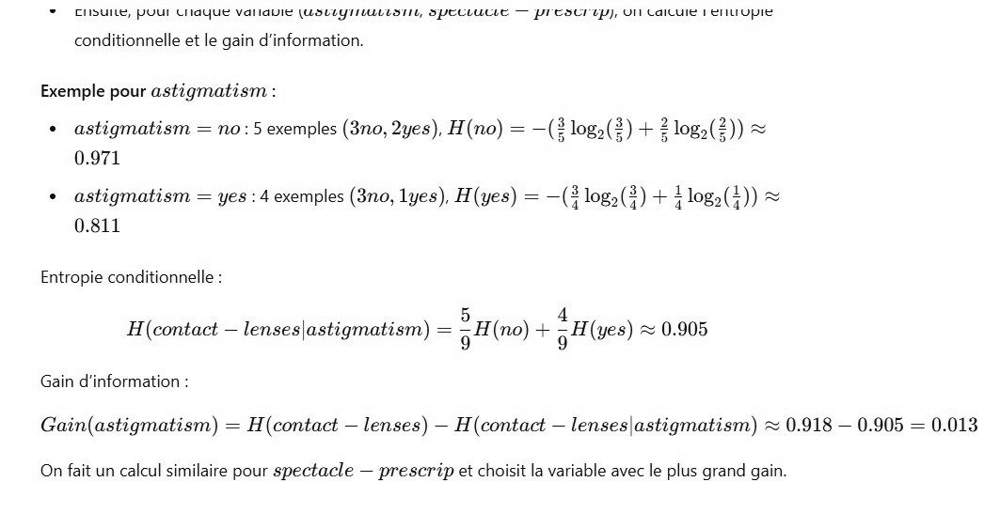

# DS DM 24 Exo 4_4.jpg

[Ouvrir l’original](https://drive.google.com/open?id=1ucw-8-2yjW9uJOw-AIYMIxU6xpIJoiFY) · Les pages signalées comprennent du texte reconnu automatiquement ou des éléments graphiques. Le fac-similé permet de vérifier chaque lecture.

**Pages avec fac-similé ou lecture OCR** — 1.

~~~text
+ Cibuité, POUT CHAQUE Varlabié (USLEYIULLS TL, SPECLUULE — PI ESCI LU), VII LAILUIS 1 ÉTILUUpIE

conditionnelle et le gain d'information.

Exemple pour astigmatism :

+ astigmatism = no: 5 exemples (3no, 2yes), H(no) = —(# log,(#) + 2 log, (2)) &
0.971

+ astigmatism = yes : 4 exemples (3no, lyes), H(yes) = —(À log: (4) + log,(1)) ©
0.811

Entropie conditionnelle :
à : 5 4
H(contact — lenses|astigmatism) = gti (no) + gH (ves) & 0.905
Gain d'information :

Gain(astigmatism) = H(contact — lenses) — H(contact — lenses|astigmatism) ~ 0.918 — 0.905 = 0.013

On fait un calcul similaire pour spectacle — prescrip et choisit la variable avec le plus grand gain.
~~~
