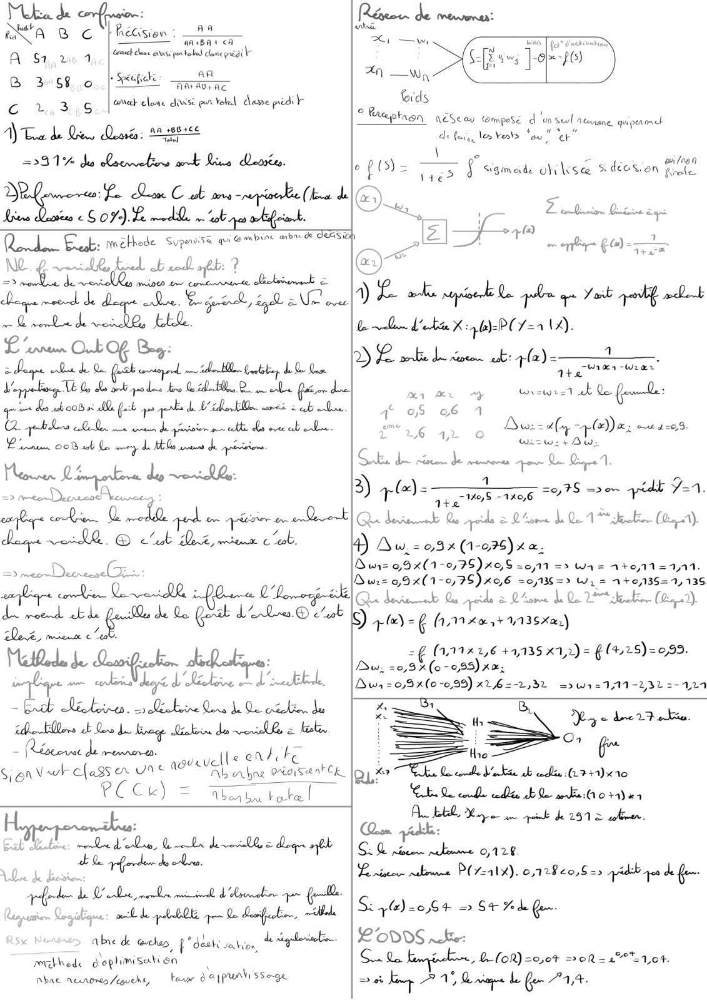
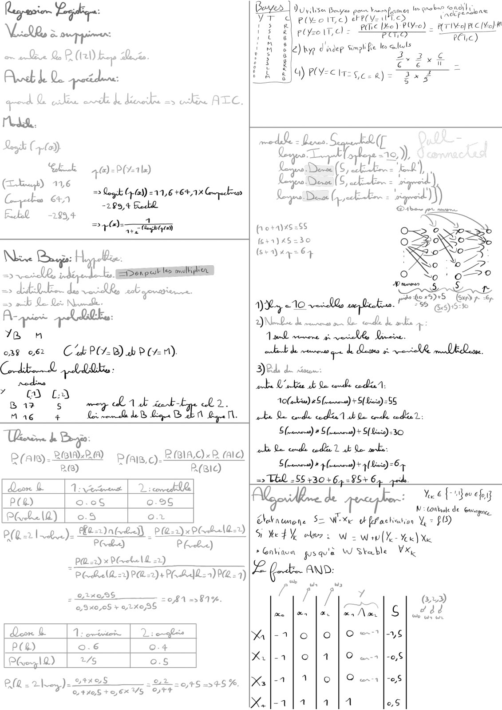
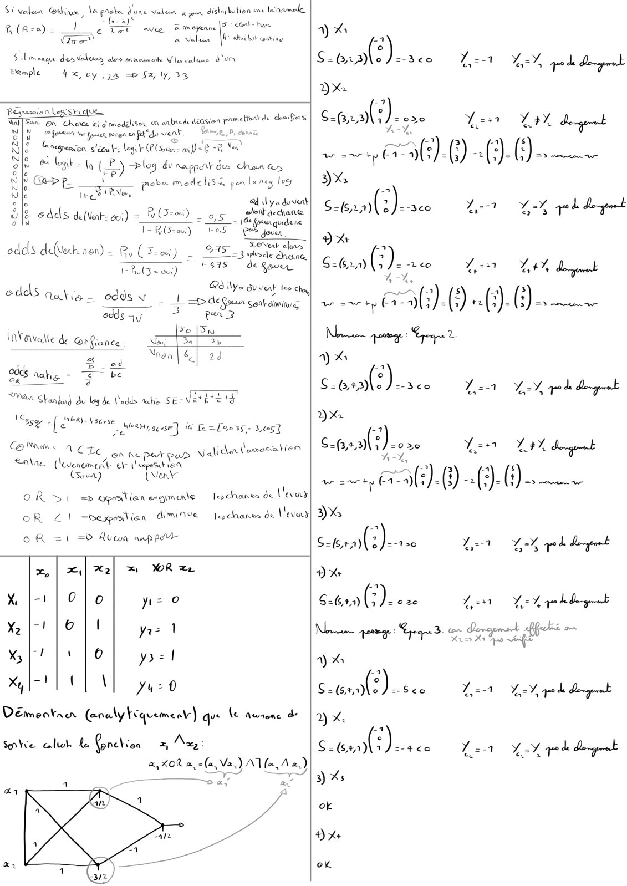
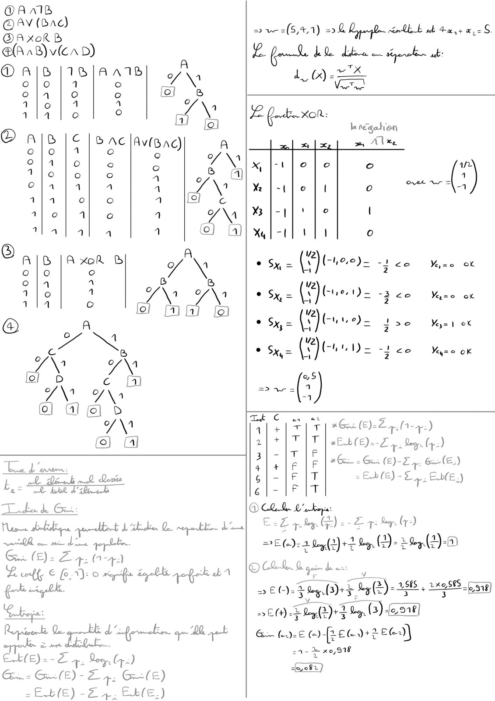
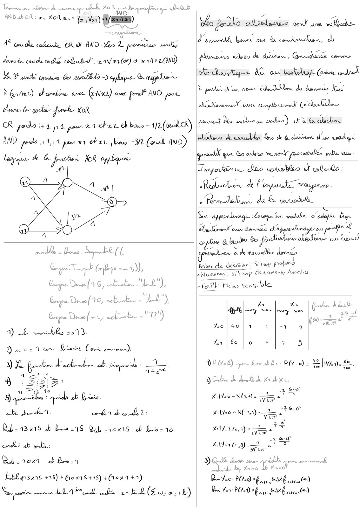
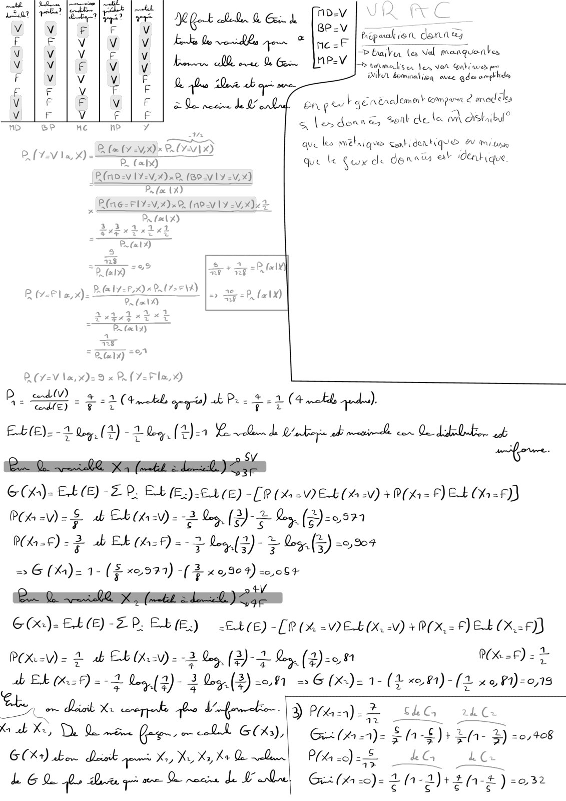

# Fiche Data insuffisante pour DS 25.PDF

[Ouvrir l’original](https://drive.google.com/open?id=19LI4GZFNkjTKzJmIS3bHMz1G_du2dYXU) · Les pages signalées comprennent du texte reconnu automatiquement ou des éléments graphiques. Le fac-similé permet de vérifier chaque lecture.

**Pages avec fac-similé ou lecture OCR** — 1–6.

## Page 1

**Lecture OCR à contrôler**

~~~text
Melia de
an Sots ul

aaabaa cA
dime dax ported clane prégi

Rien 4

A $1, 2% 1
ect a
B 3 S80, | Sei: —
CU 3G Wet else dis en tole dape pred

Tu de Qi Qene: a2 s8806
2591% du Raeweliow ok Lire dense.

Le Man C uk am ke (de
Le 5 OF). Le med. “al pea ok

ù
Line

Rod Ereats: melhode Supavise ei @ambire ab ee

NZ. pute El Hd ?
oe “te

à nine tw crtorote liobrivimek à

cheque med de Dee Sue. a ee UR over

oh medoed~sile, ER.

L erro Ou

+ Pape Gent ww ide. Lk Ce
TV de Le ob yuo “rca 2 ce fairer de

NSP ER EL Wi ls bo

mT IR OT OT

Lu 008 sob Le my L thle vues de priricions

Fee 24 dg woul.
ae Ca Det
coe se ewes:
de LQ (©) ie aa cet.
= ron Darter

ds 0e : OLoweeg ik
LITE L gaffe de de Goh d Lrw.® ot

ML
Pr LEE TT

Tre Lever
dede de Le ag Linkin de vel à lots
eonh te

baba | oxevsant Ck

- Réserve de memneren.
Sen Vwhcfass ex urs 4
PECK) Abba to kel

oucuell

he

Ci —uw

A NW,
fords

©
Preptron Réseau Compose d'un seul aeerene qui permet

de feu, le Yeats ‘ou! er”

\
efO= TS § sigmoide obi ise 5 décsien Be
Eu. a a ae

nm Sow end GG) -—
1) Lo oh pet Le pale qe ait perf melt

De debe x: PO 22 LA.
DR be Le ur la) -—

z

Poco Wiar

Wrswre1 mn Le foule:

Ma Kr Ay
oS 06 1
aa à © Bor= ely +): cu 4-09

Wiz Wi: + Dw:

GE de oc Je nee que Qe Die 1
3) FO os mem pid Yor.

at
Que hub the aed 8 Rome be Qe A HR (0 1).
4) A w.=03%x (1-035) x a.
Bunz o9x(1-0,9S)K0,S =0,11 => W4 = 140112411.
Durs 99 X(1-0, PS) X06 =0/236=> Wy = 140,135= 7,135
Qe bani nk Qe aed 8 Rome de Qe he (0 7).
iS) +0 =¢ (11 404+ Y13SXm,)

= (1,1142,6 44,135 x12) = § (428) =0,99.
Du, =0,3x(0-0,55) xx;
Dur=o93x(0-099) x26 2-2,32 =5w1=111-231=-121

Bi
th Be Xe deer Fabio.

On
ANR CNET

ART rie. bte dote
ren cons nes tra
te mi 1 ae ante nab Atma fet
Legion Dylan. ible ble que Qe douche, He
Abe de @chun, f "dah: sation, dll

mrhede d'oplimisatt sn
tae a ypunli sage

Q<

RD eu cada HR eabinsla 0 rh
Cn Babble, Maye im qeink de 2975 color,
GR re ie 0128

Lean rabomane P(7=a1%). 0,128 20,8 => pd qos dh fem
Si y@)=0b4 = St Hd Qe.

LOWS wake:
Cw We DR) 20,0% = 02 = 2°" 1,04.

AAC Aurore) Kcguoht,

Be bg 71 Bas be Que 774.
~~~

## Page 2

**Lecture OCR à contrôler**

~~~text
à upper
om ale Q R (RD bao Le.

Ath Qe poids

de Os le rte Le Bexathirwsrathine AEC.

°
é

flo POCHE Ge a) a

DU pile Bayer pou Van le rober Oadby a,
ON OES ARCS ESS" TT éndert ten
Lee ite) _ pee) PYe) _ ATIVE) PLC (KR

RiyselT Cl = pen — ic)

les eleuls

as

Jay dindep Simpl Re

x
In

aw

Foret ze
CP RRAee SORA p

2
€
x

Mil x

2
5

T
FA.
RTC)
27 4@-P1l)

(buy) 116

i => Qogsk C do) =11,6 +641 Compecton
Che a Poe Fed
Fucked 1994

à
DTA

NEA a
= ve LS opt les milligion
os A QE LR base
wo nth CE Niwa. Mines

Ares Rte Es:
78 n

Ck PO/-B) ab ® 211).

039 062
Chk Db on.
wae
“mae ee Lb ab 2
17 _ .
mae + Dub éme Te

Ts & Bago:
A.C) xR (alo)

P(algy- 22M Pa. Riel
RG)

pio+1)x6255
fesr)45=30

(seayep= 64

DH 210 vail exp iatine. ee.
Ne des ne Le conde de ain:
sink une male foie.
bd en que de Does ot We mince.
DEL de rétton:
uote L'ete cb Qe ce de.
AOC) #5 (unes) + S{Leis)-66
abe Qe ed hin ab de ele dut:
Genet) # 5 (ronnerss) + S{ Lixie)=30
ak De cod) codlin À sk Qo sorte:
Sn) à lon) + pli) O7

(BIC)
dose D vous | DV scored
PCR) CHS o-26
Probe 2) o.3 O.u
: 22. - 2-1)
P(L 2120.) Head) | P(R-2)x PC
(0 ) PE) PAbx)
_ PQ2)™ Piet I -2)
© PE BeelQ =r) PR-2)+ PR AxlR22) PQ = 1)
= 222898 = 081 =>81%.
0,9x0,08 + 1 2X0/3S
dore Le Vi owinsot | Dieppe
PCR) 0.6 O.4
Phoorgl2) | 2% 0.5
+48 A2 046-5469
ea = he PAPE ore +5 =>45 %

=> TEL -66:30+6,-95+6,
Yoo € [oitfove by

q M: Unbole de Grp.

Chobknunene S= WX of fuachiabion Ve = $U)
St Med ns: ow = wep (Ye Yer) Xe
PGnkinun psquia W Stable VX,

2 fein AND:
/ fh 4 1 (323)
we fer far [arAw} Sf ue?
Allo fo fom jays
x. 2 1 lo ls
x ]-2 | 1 Jo | Oa ]es
X.l-111 [1/1 oS
~~~

## Page 3

**Lecture OCR à contrôler**

~~~text
Sivelun Grue, a pnabe dune valun à gun distribution ene loinamule
rs
sR-)e |

fea + écnt- Hype
Te tet
rot

ave BR moyenne
sde Mobile
Sil manque des Voluur als snirarmente Ve valuns d'or

Bemple x, oy 25 => Sx, ly, 2%

Régemen Leg shi que.

Wake En Cherce cid modeliser on arbrede deainen
Sih Ve ren en Pek du vent .
pee forse men ef vent §

regremon sleouk: legit lun ai) = 8 +8 Vas

64 logit - Py) 4
3 VE) >

pameltent de chmifies

À

log du napparr dus Chen &s

ote ZZZeoZZzo

BOSS ES ze.

=P P_ be ISK pen lanes log
Gt tT pote models pates ls
' . Sd lye dove
odds de(Vent-o;) = =) _ og pathdechane
(Vent 60) ee Le. = pam asdete
v ‘ (io SES
: 36 vent al,
edds deWerk. non) By (See) _ 27523 sde chet
Heu) "RR ego
0 Nya Qu vaut les
odds au, 2 2 “ln
alia = odds \ | Lap dégoun coat amines
odds ay = per
Se [Fo
(n¥awalle de @r fiance New [3a ET
Non FP

AE aati -

han Stanton} Au les de odds raho SE=V

a be
ri

3

\c, be
54 [ER ee Moai see] ie aL
i“ me Oy gevse | 16 Te=Le03s- 3,57

BRL ACTE où ne per pur Valiclatlamoation
ae (levencment OF topes 104.

Geva) (war
OR 1 =v agestienegmente  lechancs de Veveny
OR 21 =Dexpeation Amiave —lochance de Vevens
OR = =O Ruwa aap pee
x, | il %2] > WR ee
X |-' | Oo yz 0
X%|-! |e || yes 1
oa cr |1/o yoel
Xl LL NE yyeo

Deëmentae Gnalykrquemenv) qv le nunone d-

salve eut te fonction

Va) AV (aA 2)
Na al Cail

a

LES :

sal) Le 12, pile Ding
DX

ra: = e2e Yen PDA } LE

we exe ty (979)

3%

Setaa(s)esce er Yh ptits
x

$262) eves L251 Eh deu

we zac tp a). “(3 () Su

LES 4

ao ee Le HY, rode Derg
3x

coral?) er. Yes 24 dget

=
we at (1-2)

).0-(

DX

Gtn()ene Les Yh ged dg
Dx

S=G 40) G). e2e Len YA qed dergeect
Non arma: Sp > Pepe) _

DES

strn(2)-see Let Led degret
2) x:

done A2 LV qd del
3) %

ok

Dx

ok
~~~

## Page 4

**Lecture OCR à contrôler**

~~~text
@AAIB

ow = (5,41) 20 pe LE tasses.

Lt Le té meshene dE:
1)

Ye =

o of

Va-e of
À
z

Mey= 1 ok

Yy=e ok

@Av (Bac)
@A xoRB
@AnB)v(crd)
OAIS|18|AaATR A
olo | à
© A 2 2 fo]
à
1 q © ° Ly
Oajoajc B AC |Av(BAC) a
o lo | © eB afin
fe} A fo) - é \
1 lo © © A > fal
aA ° o 4 o 3
1/0 1 e a y\
Tlalal a 1 ©) {4
8 A B |A xoRr B J\
o lo ©
BL? LA À
1 la o ww ef
A
< 8
dy ZX
ce} D C Er
7\ S\A
(0) al @] D
Y\
©) al
a ere
L _  dDéuh mh Doni
e wk bte
Tinden be Gi:

Mane die que bab Oo nga LE

ses mule
oe 24: (1 7)

ef € (6,1): © rege Elle pop cb 1
PA

re. en | Den Cy.)
Œ..- GE). Z +: G-(E)
-E.b(E) -£ +. EEE.)

«Eb (£)- Ep Dar (2)
#6 = Gi (E)-Z 3. 6 (€)
= EX(E) Ep EME.)

Qaorwnsh

DADA 442

+ +0 a4

ZT: hy lr)
Dr

EZ 7. by. Ge) -

PEC) 2 hs
OC Q goin dee J
Se Ons, © Dey (2) = 2565 2,585 + 22958 fom]

_
a

>E()-

Gx ()-€ erate D+2E 2.5)

=1- + x0,918
~~~

## Page 5

**Lecture OCR à contrôler**

~~~text
Louer ns Abate de Lumens quid LL xo. 0 MON ES r

AND AE OR: ay KO à + = CC D | et Fiz a a=

=m bard A
A qu cote CRA INO Ho L pendu made d
done ta œude coches, cobeulon: ma x28) & x 17200)
BY an ombre Bo arte > eplque Graphe
À Gr) dfombine. anse Gare) cont fedf AND jour
dun 6 ge Joke KOR
CR: pedo HA A poured ekxr d bus “(ul
AND. perde 147 pawn xr Chr ja -V2 Cait AND)

‘ons Vases mn Oe coder. de

hameau ass de durer, Garde Comme
de parka eh es do. dada Kss
AG Kenred ant amant (6 Pandan:
used de and ou wedlus) ura ta sdliclion
ohio de vores Lo de de clvicner d'un no qu
pron que Go ed ne at yaocasvsles ou eus

lys > te A fynvtion. YoR cylqua
/ myotonia clas vouvble Ff coQudo :

RAY,

EM
PATES
med, fe SE
it so va ies
Corpo. Devoe (1G, bte on
erp. Dinee(10, octet = EL")
Byes Delays webaialen =" T2")
A) L etes 2913.
ee Lise Cori owner).
DH ptet ad: maps as
J SSR
Me bd Li.
uk ed: wher bvded:
Dia uk bee 1S Qu sons ob Lo
cd? db ke:
Sd -1o%1 ob Bu

Ebb p3.as +15) + Gour $418) (04141)

A

Radio. de l'impante oreuprne
Raman de & vouoble
Sue -oypontirage ‘Coreg in masala. 0 ‘ap Le

Anbre de démon: Si lop profend
Nues. Si Vance Ae nwr6 ro lache

° Fox Mow sens ble.

A Xr pt. de dk
PP QE Ave | 6 us
ge coe

yo | 4e} 4 4 |-1

31160 | © + a à

DD (20) je Led ls PO =e) = EE [Pane &.
DEL de Les de Kr sb Xe

X20 ~N(vs)= =

Lo NE 2
ve

ale,

Lal 7/2 (0,4) ="
iViw

a ey

ul

Abe 3e

ms Dame pre / pété ee ae reed
» ibed. bay Xr z0 ¥

Dw 720: PU en VE parol)

Don Zo PUD Bye CET rsa

Rp weaned Meade edhe: 2= EL (Eu «, +L)
~~~

## Page 6

**Lecture OCR à contrôler**

~~~text
ere ee | je 0.0.0 Cec. [OV VI RC
Vv "M F F V @ BP-V - =
Fle y Vio] Vv | Ed ble jen © Ine hegealien ay ah
q 7 oh > braver le Val manquenbes
M Vv iG V Vv Krone Me ovec De Geen [MPV F5 nmeuis ei Lex Vor nb aves per
F viv Yi F 0. 4. “0. Misi MA bominalign aves qderampblede
fe |e |v fé Boa - -
Vv Fr | V | © | eQe neene de g bn get generalemal compra 2 mod ils
V F Vv F F — a and ANT
MD oP MC MP 7 , & les denre seal de Le am aistabal
IT les mélaique gentiden tique ev my
; AAA) ave ve Sn a A] >
PO a que Le Guy de donate oF dent ique
R(no-V1Y-V,2)x2 (BP-V1Y-V x)
Pr (oe (x)
a PNG = FLAN, 4) x2, (AP VY VX) 3
: Pa {œil x)
expr Pndet
7 : BR atx)
723
PL (oIX)
Pt Flux), REY: AP. (72 F VA) =
2, 1)

AG °°

D (Y=V lu, x)= 9 x PR Y=Flx,X)
P ad) 4 4

+22 (tb géo) ob Pas & 24 (4 motile quel).

VS dE) #7

Eb(E)=- 2 Qog, (2) -2 leg, (Ten Bud php db mani cor dde ecb

Bu Q ve X 4 faute dere OSL

Gh) - ELE) -ZP. Eb (E.)-£4(€) - (9 (4 -V Eb (6 AN) + PO: F) EL OG =F)
Pa =V) a. ab Eb (ks =V) = a Le. DZ La (D-°27

PO =€) = = ab BL (h12F) = + Le(2)- > Qos.

=> G (ka) = 1- ($ x2 979) -( 2 x9 904) -c.084

Ba el x, (mob adore VIE

GCe)- EL(E) -ZP. LE.)

ess CE

PES

=E4(E) -[P (% VELUX AN) + PIX. ELK -F)

POV) = À db Eb XV) = 3 Le, (2)-2 Bog (2)-01
Qos, (3) 0,1 = G(x.)=1- (4 x28) -(2 xo P1)=0,13

P(X =F) =>

3

ee do x

Kr ob Xi, D Qe more Geen, cob Gs),
GX) Low dit que Ka, Xo, Xr, hr D D
bh GQ Pe Dee gt are Qe racine LE be

et 4e di ” ko. 3) Phivsa)= 2 Sho 2h Cr

os
Gx (% 2)- È i -£)+ Efh- à) =0,408
Pa): LG an

G(h-)- 2 n-2)+ 2 (r-#)-032
~~~
