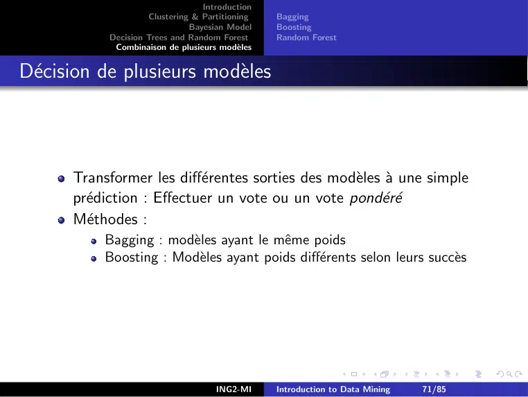
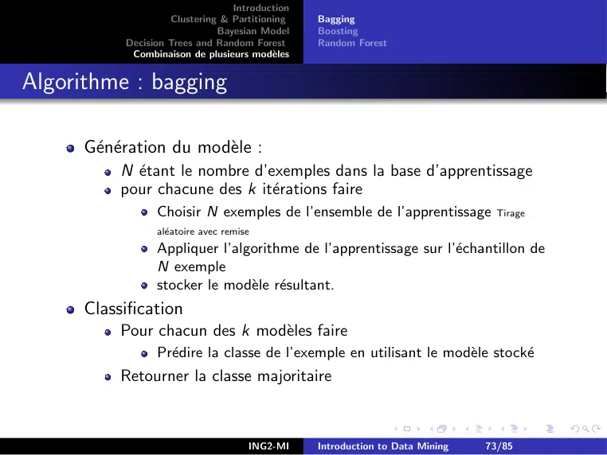
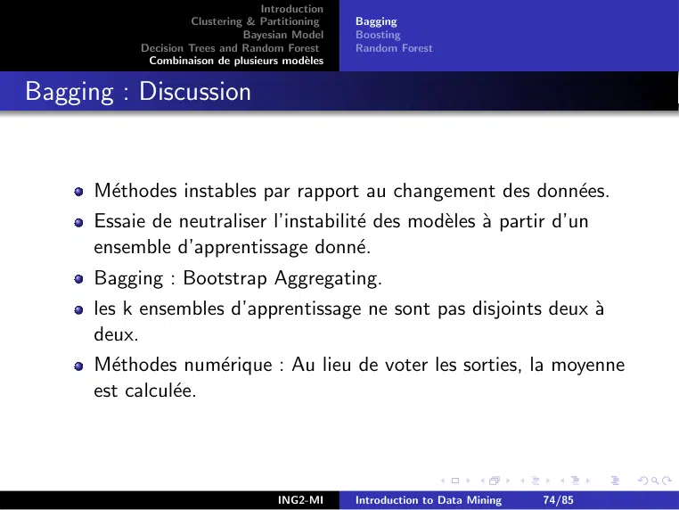
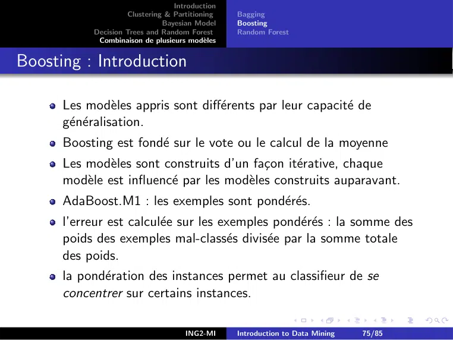
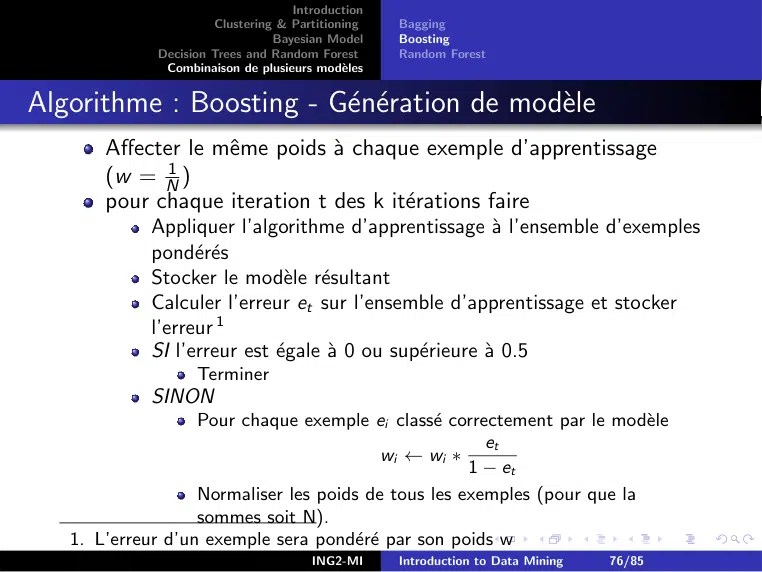
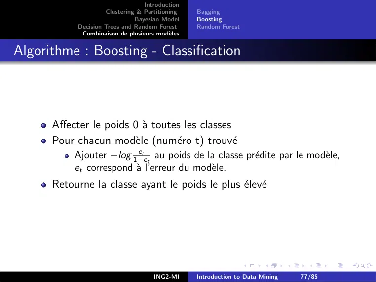
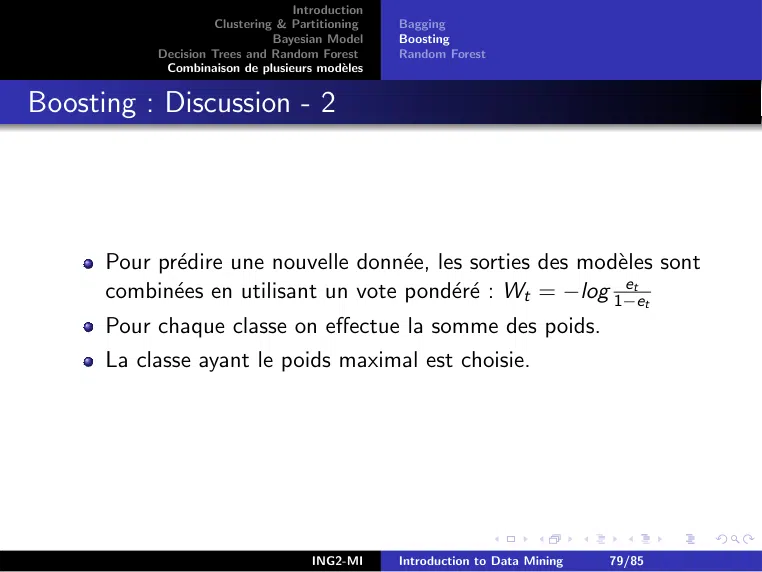
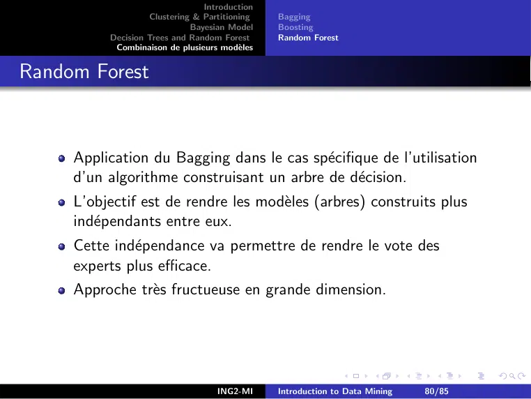
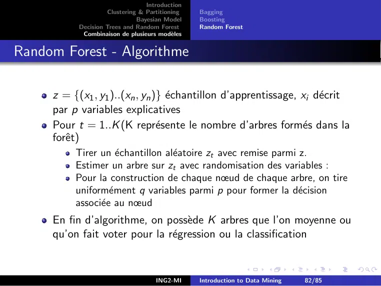

# IntroDataMining.pdf

[Ouvrir l’original](https://drive.google.com/open?id=15VUOM_VMeA5lnDqPkLwUtRGR3M3992fW) · Les deux lectures automatiques du PDF divergent sur les pages indiquées. Leur fac-similé accompagne le texte.

**Pages présentant un écart entre les deux extractions** — 71–80, 82.

## Page 1

~~~text
                      Introduction
         Clustering & Partitioning
                   Bayesian Model
Decision Trees and Random Forest
 Combinaison de plusieurs modèles

       Introduction to Data Mining

                          Maria Malek

                     16 septembre 2024

                         ING2-MI     Introduction to Data Mining   1/85
~~~

## Page 2

~~~text
                                 Introduction
                    Clustering & Partitioning
                              Bayesian Model
           Decision Trees and Random Forest
            Combinaison de plusieurs modèles

1   Introduction

2   Clustering & Partitioning

3   Bayesian Model

4   Decision Trees and Random Forest
      The ID3 algorithm
      The CART algorithm

5   Combinaison de plusieurs modèles
      Bagging
      Boosting
      Random Forest

                                    ING2-MI     Introduction to Data Mining   2/85
~~~

## Page 3

~~~text
                               Introduction
                  Clustering & Partitioning
                            Bayesian Model
         Decision Trees and Random Forest
          Combinaison de plusieurs modèles

Data Mining versus Machine Learning

     Data Mining ..
         Knowledge discovery from Data
         Data mining uses information from past data to analyze the
         outcome of a particular problem or situation that may arise
         [Fayyad et al., 1995].
         ”How to make Data speaking about themselve ? ”
     Machine Learning ..
         Given an experiment or observation E (provided as a data set)
         a task, and a performance measure M :
         a computer system is said to learn from experiment E to
         perform the task T if after learning the system’s performance
         on T improves as measured by M [Michell,1997 ]

                                  ING2-MI     Introduction to Data Mining   3/85
~~~

## Page 4

~~~text
                              Introduction
                 Clustering & Partitioning
                           Bayesian Model
        Decision Trees and Random Forest
         Combinaison de plusieurs modèles

DM and ML Fields

                                 ING2-MI     Introduction to Data Mining   4/85
~~~

## Page 5

~~~text
                                  Introduction
                     Clustering & Partitioning
                               Bayesian Model
            Decision Trees and Random Forest
             Combinaison de plusieurs modèles

Data

       An exemple a structure, an observation (statistics), an
       instance (object), a point, a vector.
       An attribute can be qualitative or quantitative, or a
       structure.
       Data base : a set of examples
           an example/case/observation = A p-attributes vector,
           each attribute is associated to a given predefined area (domain)

                                     ING2-MI     Introduction to Data Mining   5/85
~~~

## Page 6

~~~text
                               Introduction
                  Clustering & Partitioning
                            Bayesian Model
         Decision Trees and Random Forest
          Combinaison de plusieurs modèles

The weather examples
      NUM      Outlook          TEMP.         HUMI. Wind CLASS
      1         sunny            high          strong       no        N
      2         sunny            high          strong       yes       N
      3        overcast          high          strong       no        P
      4         rainy            mild          strong       no        P
      5         rainy             low         normal        no        P
      6         rainy             low         normal        yes       N
      7        overcast           low         normal        yes       P
      8         sunny            mild          strong       no        N
      9         sunny             low         normal        no        P
      10        rainy            mild         normale       no        P
      11        sunny            mild         normal        yes       P
      12       overcast          mild          strong       yes       P
      13       overcast          high         normal        no        P
      14        rainy            mild
                                 ING2-MI       strong to Data
                                               Introduction yesMining N6/85
~~~

## Page 7

~~~text
                               Introduction
                  Clustering & Partitioning
                            Bayesian Model
         Decision Trees and Random Forest
          Combinaison de plusieurs modèles

DM versus ML Process

                                  ING2-MI     Introduction to Data Mining   7/85
~~~

## Page 8

~~~text
                                Introduction
                   Clustering & Partitioning
                             Bayesian Model
          Decision Trees and Random Forest
           Combinaison de plusieurs modèles

DM and ML Process-1

     Problem Analysis.
     Data selection and Exploration
         Data Quality evaluation,
         Data clustering and visualisation,
         Data pathology detection.
     Data pre-processing
        Cleaning noise, missing values, aberrant values,
       Reduction instances selection, extraction, variables
                  combination,
     Transformation discretisation of continuous variables, nominal
                  variables binarisation, adding of new variables.

                                   ING2-MI     Introduction to Data Mining   8/85
~~~

## Page 9

~~~text
                                Introduction
                   Clustering & Partitioning
                             Bayesian Model
          Decision Trees and Random Forest
           Combinaison de plusieurs modèles

DM and ML Process-2

     The ≪data mining≫ algorithm or the machine learning one.
     Results evaluation and Interpretation

                                   ING2-MI     Introduction to Data Mining   9/85
~~~

## Page 10

~~~text
                                 Introduction
                    Clustering & Partitioning
                              Bayesian Model
           Decision Trees and Random Forest
            Combinaison de plusieurs modèles

Variables Nature

      Independents and dependents
      Independents : predictive or explicative Variable : The value is
                   obtained by observation.
      Dependent : target Variable : The value of this variable
                   depends of some others.
      Machine Learning : supervised and unsupervised methods
      Unsupervised Learning : no target variable, ex.clustering.
      Supervised Learning : Target Variable (value to predict) ex.
                   classification.

                                    ING2-MI     Introduction to Data Mining   10/85
~~~

## Page 11

~~~text
                                 Introduction
                    Clustering & Partitioning
                              Bayesian Model
           Decision Trees and Random Forest
            Combinaison de plusieurs modèles

Process Result

      Extracted knowledge in the form of :
          Model : global overview of the data set relevant to
                   examples domain.
         Pattern : local description of subsets of data, example :
                   rules.

                                    ING2-MI     Introduction to Data Mining   11/85
~~~

## Page 12

~~~text
                                  Introduction
                     Clustering & Partitioning
                               Bayesian Model
            Decision Trees and Random Forest
             Combinaison de plusieurs modèles

Example of a model : a decision Tree

    NUM   Outlook    TEMP.      HUMI.      Wind   CLASS
    1      sunny      high       strong     no      N
    2      sunny      high       strong     yes     N
    3     overcast    high       strong     no      P
    4      rainy      mild       strong     no      P
    5      rainy      low       normal      no      P
    6      rainy      low       normal      yes     N
    7     overcast    low       normal      yes     P
    8      sunny      mild       strong     no      N
    9      sunny      low       normal      no      P
    10     rainy      mild      normale     no      P
    11     sunny      mild      normal      yes     P
    12    overcast    mild       strong     yes     P
    13    overcast    high      normal      no      P
    14     rainy      mild       strong     yes     N

                                     ING2-MI      Introduction to Data Mining   12/85
~~~

## Page 13

~~~text
                                Introduction
                   Clustering & Partitioning
                             Bayesian Model
          Decision Trees and Random Forest
           Combinaison de plusieurs modèles

Example of Rules

     A decision tree can be represented as a set of rules :
         IF OUTLOOK= sunny& HUMI=strong THEN CLASS=N
         IF OUTLOOK= sunny & HUMI=normal THEN CLASS=P
         IF OUTLOOK= overcast THEN CLASSE=P
         IF OUTLOOK= rainy & WIND=yes THEN CLASS=N
         IF OUTLOOK= rainy & WIND=no THEN CLASS=P

                                   ING2-MI     Introduction to Data Mining   13/85
~~~

## Page 14

~~~text
                                Introduction
                   Clustering & Partitioning
                             Bayesian Model
          Decision Trees and Random Forest
           Combinaison de plusieurs modèles

DM and ML Tasks

     Supervised approaches :
     each instance = p predictive variables + 1 target variable (to
     predict)
     Classification : Discret target variable Example : disease
                    diagnosis, etc.
     Regression : Continuous target variable Example : price
                    estimation, etc.
     Unsupervised approaches :
     segmentation (clustering) Example : user profile detection,etc.
      Association Example : analysis of web server Log, etc.

                                   ING2-MI     Introduction to Data Mining   14/85
~~~

## Page 15

~~~text
                              Introduction
                 Clustering & Partitioning
                           Bayesian Model
        Decision Trees and Random Forest
         Combinaison de plusieurs modèles

DM and ML Tasks

                                 ING2-MI     Introduction to Data Mining   15/85
~~~

## Page 16

~~~text
                              Introduction
                 Clustering & Partitioning
                           Bayesian Model
        Decision Trees and Random Forest
         Combinaison de plusieurs modèles

DM and ML Tasks

                                 ING2-MI     Introduction to Data Mining   16/85
~~~

## Page 17

~~~text
                               Introduction
                  Clustering & Partitioning
                            Bayesian Model
         Decision Trees and Random Forest
          Combinaison de plusieurs modèles

Supervised ML Process

                                  ING2-MI     Introduction to Data Mining   17/85
~~~

## Page 18

~~~text
                                 Introduction
                    Clustering & Partitioning
                              Bayesian Model
           Decision Trees and Random Forest
            Combinaison de plusieurs modèles

Classification

      Classifier Types
          Construction of a model (a decision tree for example) in order
          to predict the target class values.
          Direct estimation of the target class value in function of
          examples.
          Construction of a parameterizable model (Neural Networks,
          support Vector Machines).

                                    ING2-MI     Introduction to Data Mining   18/85
~~~

## Page 19

~~~text
                                Introduction
                   Clustering & Partitioning
                             Bayesian Model
          Decision Trees and Random Forest
           Combinaison de plusieurs modèles

K-Nearest Neighbours Classifier
     Data set with two numerical attributes(X1 ,X2 ) and two class
     values (A,B).

                                   ING2-MI     Introduction to Data Mining   19/85
~~~

## Page 20

~~~text
                                 Introduction
                    Clustering & Partitioning
                              Bayesian Model
           Decision Trees and Random Forest
            Combinaison de plusieurs modèles

Classifier Validation -1

      The classifier error Er is the probability that the classifier does
      not predict correctly the target value of a given data.
      Success ratio is 1 − Er .
      The training error is measured on the training set (used to
      construct the classifier).
      To estimate the classifier quality we need :
           A training set Xtrain ;
           A test set Xtest in order to estimante the classification error,
           the target value is given in the test set for each example.

                                    ING2-MI     Introduction to Data Mining   20/85
~~~

## Page 21

~~~text
                                 Introduction
                    Clustering & Partitioning
                              Bayesian Model
           Decision Trees and Random Forest
            Combinaison de plusieurs modèles

Classifier Validation : illustration

                                    ING2-MI     Introduction to Data Mining   21/85
~~~

## Page 22

~~~text
                                 Introduction
                    Clustering & Partitioning
                              Bayesian Model
           Decision Trees and Random Forest
            Combinaison de plusieurs modèles

Classifier Validation-2

      Quality classification measures : for each target value :
        TP/TN : True positive/negative frequency :
                     positive/negative examples’ number that have a
                     positive/negative target value.
         FP/FN : The negative/positive examples’ number whose
                     predicted target values are positive/negative.
      Confusion Matrix
                                                + Pred       - Pred
                               Real +            TP            FN
                               Real -            FP            TN

                                    ING2-MI       Introduction to Data Mining   22/85
~~~

## Page 23

~~~text
                                 Introduction
                    Clustering & Partitioning
                              Bayesian Model
           Decision Trees and Random Forest
            Combinaison de plusieurs modèles

Classifier Validation-3

                                          + Pred       - Pred
                           Real +          TP            FN
                           Real -          FP            TN

      Model Quality measures, for each target value :
      We define 4 measures :
                                                  TP        TN
          Precision for positive and negative : TP+FP   , TN+FN ;
                                               TP        TN
          Recall for positive and negative : TP+FN , : TN+FP .
          The (positive) precision measures the ratio of really positive
          examples among those classified positive by the classifier.
          The (positive) recall measure the ratio of found positive
          examples among all positives examples.

                                    ING2-MI     Introduction to Data Mining   23/85
~~~

## Page 24

~~~text
                                 Introduction
                    Clustering & Partitioning
                              Bayesian Model
           Decision Trees and Random Forest
            Combinaison de plusieurs modèles

Classifier Validation-4

      Cross Validation Technics :
          Cut up the data set to n disjoint subsets of the same size.
          Each target value have to appear in the n subsets.
                 Let A,B,C are 3 subsets :
                 The classifier build from A ∪ B is named CLA∪B ,
                 The test error computed on C is named ErC .
                 Three tests are done : (CLA∪B ,ErC ),
                 (CLC ∪A ,ErB ),(CLC ∪B ,ErA ).
                 The global error rate is given by par Er = ErA +Er3B +ErC

                                    ING2-MI     Introduction to Data Mining   24/85
~~~

## Page 25

~~~text
                                  Introduction
                     Clustering & Partitioning
                               Bayesian Model
            Decision Trees and Random Forest
             Combinaison de plusieurs modèles

Classifier Validation-5
  Cross Validation : illustration

                                     ING2-MI     Introduction to Data Mining   25/85
~~~

## Page 26

~~~text
                                  Introduction
                     Clustering & Partitioning
                               Bayesian Model
            Decision Trees and Random Forest
             Combinaison de plusieurs modèles

Practical Works : Classification Problem

    Data sets Weather (qualitative attributes), IRIS (quantitative
              ones).
  Data exploration and visualisation
     Methods K-nearest neighbours, Decision trees
    Validation          Strategies : training set, test set, cross validation
                        Measures : confusion matrix, error, precision,
                        recall, F-score,
    Softwares Weka, R, Python

                                     ING2-MI     Introduction to Data Mining   26/85
~~~

## Page 27

~~~text
                                  Introduction
                     Clustering & Partitioning
                               Bayesian Model
            Decision Trees and Random Forest
             Combinaison de plusieurs modèles

Clustering & Partitioning
      Given a data set of unlabeled examples X, Find a partition of
      X into k clusters verifying the following proprieties :
        1   Data belonging to one cluster Gi , (i ∈ 1..k) are similar.
        2   2 different examples belonging to different clusters are not
            similar.
      Example : E-commerce web sites’s Log analysis : user profile
      detection.

                                     ING2-MI     Introduction to Data Mining   27/85
~~~

## Page 28

~~~text
                                 Introduction
                    Clustering & Partitioning
                              Bayesian Model
           Decision Trees and Random Forest
            Combinaison de plusieurs modèles

Definitions & Notations

           X : Examples set | X | = N (cardinality de X).
           K : Clusters number (an algorithm parameter).
      Given an examples set X, each of them characterized by P
      attributes : the centroid of X named g, is a synthetical
      example described by : g = {a¯1 ...a¯i } where a¯i is the average
      of all ai values in X.
      Aim : Find K cluster : each cluster will be represented by its
      centroid gi .
           Non hierarchical approaches (k-means).
           Hierarchical approaches.

                                    ING2-MI     Introduction to Data Mining   28/85
~~~

## Page 29

~~~text
                                Introduction
                   Clustering & Partitioning
                             Bayesian Model
          Decision Trees and Random Forest
           Combinaison de plusieurs modèles

K-Means Method
     Definition :
          The inertia
                  PN of a data set X containing N examples :
          I = N1 i=1 d 2 (xi , g ) where g is the centroid of X. and d is a
          distance function   qP  :
                                    n             2
               Euclidian                (xi − yi )
                              Pn i=1
              Manhatan           i=1 | xi − yi |
              Hamming
                          ...
          Let I1 , .., In inertias of clusters (groups) g1 ...gk the intra-cluster
                              Pk
          inertia : Iw = i=1 Ik
          Let I1 ...Ik inertias of clusters (groups) g1 ...gk the inter-cluster
          inertia : IB = i=1 wi d 2 (gi , g ) with wi = |gNi |
                              Pk
          I = IW + IB
          Aim : get dense clusters (groups), well separated if possible :
          Minimise Iw .
                                   ING2-MI     Introduction to Data Mining   29/85
~~~

## Page 30

~~~text
                                Introduction
                   Clustering & Partitioning
                             Bayesian Model
          Decision Trees and Random Forest
           Combinaison de plusieurs modèles

K-means Algorithm
     (Input : A data set X K ∈ N (I ← ∞)).
     Randomly choose K centroids Ck ∈ X
     REPEAT
     For k ∈ {1..K } Do
         Gk ← Φ
         For i ∈ {1..N}
                K ∗ ← argmink∈{1..K } d(xi , Ck )
                Gk∗ ← Gk∗ ∪ xi
         For k ∈ {1..k}
                Ck ← centroid of Gk
         I ← Iw
         Compute Iw
     UNTIL |I − IW | < ϵ

                                   ING2-MI     Introduction to Data Mining   30/85
~~~

## Page 31

~~~text
                                Introduction
                   Clustering & Partitioning
                             Bayesian Model
          Decision Trees and Random Forest
           Combinaison de plusieurs modèles

K-means : Illustration

                                   ING2-MI     Introduction to Data Mining   31/85
~~~

## Page 32

~~~text
                                 Introduction
                    Clustering & Partitioning
                              Bayesian Model
           Decision Trees and Random Forest
            Combinaison de plusieurs modèles

Hierarchical clustering

    Down-Top Approaches that
    allow to group examples
    progressively in clusters.
    N-1 groups, N-2 groups,..,1
    group.
    We get a tree
        Leaves are examples
        (Nleaves )
        The root represent X.
        An horizontal cut of the
        tree allows to obtain
        K-groups (clusters)

                                    ING2-MI     Introduction to Data Mining   32/85
~~~

## Page 33

~~~text
                                 Introduction
                    Clustering & Partitioning
                              Bayesian Model
           Decision Trees and Random Forest
            Combinaison de plusieurs modèles

Hiererachical clustering Algorithm

    Input : N examples
    N clusters Gi ← xi
    Label Gi .
    For d=1 to N-1
        Chose Gi , Gj labaled.
        Merge them :
        Gd ← Gi ∪ Gj .
        Unlabel Gi , Gj .
        Label Gd .

                                    ING2-MI     Introduction to Data Mining   33/85
~~~

## Page 34

~~~text
                                 Introduction
                    Clustering & Partitioning
                              Bayesian Model
           Decision Trees and Random Forest
            Combinaison de plusieurs modèles

How to choose clusters to merge
    Choose (Gi , Gj ) to merge, 4
    approaches are possible :
        Minimal Jump : the
        smallest distance is
        minimal.
        Maximal Jump : the
        largest distance is
        minimal.
        Average Jump : the
        distance between the
        centroids is minimal.
        Ward Method : minimal
        loose of Iw .
              SGi ,Gj =
               wi wj
              wi +wj
                     d 2 (gi , gj )
              wi = |GNi |             ING2-MI   Introduction to Data Mining   34/85
~~~

## Page 35

~~~text
                                    Introduction
                       Clustering & Partitioning
                                 Bayesian Model
              Decision Trees and Random Forest
               Combinaison de plusieurs modèles

Exercices

  Let the following points in R : x1 = 1, x2 = 2, x3 = 9, x4 = 12 and
                               t x5 = 20.
    1 Apply the k-means algorithm with :

          1   k=2, g1 = 1 et g2 = 20
          2   k=2, g1 = 2 et g2 = 9
          3   k=3, g1 = 1 , g2 = 9 et g3 = 12
    2   Apply the ascendant hierarchical classification method using
        the minimal jump

                                       ING2-MI     Introduction to Data Mining   35/85
~~~

## Page 36

~~~text
                                  Introduction
                     Clustering & Partitioning
                               Bayesian Model
            Decision Trees and Random Forest
             Combinaison de plusieurs modèles

Gool

       The principal of the bayesian classifier is to classify a given
       data x in class y using a data set (labeled data) : X, by
       applying Bayes rule.
            X : A labeled data set. Example : Weather.
       Given an example x : find and associate à class value y.

       x = ((outlook = overcast)∧(Temperature = high)∧(wind = yes))

            y = P?
            y = N?

                                     ING2-MI     Introduction to Data Mining   36/85
~~~

## Page 37

~~~text
                               Introduction
                  Clustering & Partitioning
                            Bayesian Model
         Decision Trees and Random Forest
          Combinaison de plusieurs modèles

The weather example
      NUM      Outlook          TEMP.          HUMI. Wind CLASS
      1         sunny             high         strong       no       N
      2         sunny             high         strong      yes       N
      3        overcast           high         strong       no       P
      4         rainy             mild         strong       no       P
      5         rainy             low          normal       no       P
      6         rainy             low          normal      yes       N
      7        overcast           low          normal      yes       P
      8         sunny             mild         strong       no       N
      9         sunny             low          normal       no       P
      10        rainy             mild        normale       no       P
      11        sunny             mild         normal      yes       P
      12       overcast           mild         strong      yes       P
      13       overcast           high         normal       no       P
      14        rainy             mild
                                 ING2-MI       strong to Data
                                              Introduction yesMining N37/85
~~~

## Page 38

~~~text
                                 Introduction
                    Clustering & Partitioning
                              Bayesian Model
           Decision Trees and Random Forest
            Combinaison de plusieurs modèles

Bayes Theorem & classification - 1

      Bayes Theorem (Conditional Probabilities )

                                                 Pr (B|A) ∗ Pr (A)
                            Pr (A|B) =
                                                      Pr (B)
                                                Pr (B|A, C ) ∗ Pr (A|C )
                      Pr (A|B, C ) =
                                                      Pr (B|C )
      Application on classification Problem :
          C ←X
          Pr (y |x, X )?
                                      )∗Pr (y |X )
          Pr (y |x, X ) = Pr (x|yPr,X(x|X )
          with X is the dataset, x is a given example and y is the class

                                    ING2-MI        Introduction to Data Mining   38/85
~~~

## Page 39

~~~text
                                   Introduction
                      Clustering & Partitioning
                                Bayesian Model
             Decision Trees and Random Forest
              Combinaison de plusieurs modèles

Bayes Theorem & classification - 2

                                  )∗Pr (y |X )
      Pr (y |x, X ) = Pr (x|yPr,X(x|X )
      The term Pr (y |X ) in the probability to have the class value yi
      taking into consideration the data set X.
                                   9
            y1 = P : Pr (y1 |X ) = 14
                                    5
            y2 = N : Pr (y2 |X ) = 14

                                      ING2-MI     Introduction to Data Mining   39/85
~~~

## Page 40

~~~text
                                   Introduction
                      Clustering & Partitioning
                                Bayesian Model
             Decision Trees and Random Forest
              Combinaison de plusieurs modèles

Bayes Therorem & classification - 3

  x = ((outlook = overcast) ∧ (Temperature = high) ∧ (wind = yes))

                                  )∗Pr (y |X )
      Pr (y |x, X ) = Pr (x|yPr,X(x|X )
      The term Pr (x|yi , X ) is computed assuming the attributes
      describing x are independent :
            a1 = v1 , a2 = vQ
                            2 , ..., ai , vi
                               n
            Pr (x|yi , X ) = i=1 P(ai = vi |yi , X )
            Pr (x|y = P, X ) = 49 ∗ 29 ∗ 39
      And Finally ..
                            P
            Pr (x|X ) =         yi ∈γ Pr (x|yi , X )Pr (yi |X )

                                      ING2-MI     Introduction to Data Mining   40/85
~~~

## Page 41

~~~text
                                Introduction
                   Clustering & Partitioning
                             Bayesian Model
          Decision Trees and Random Forest
           Combinaison de plusieurs modèles

Example - 1

     Given the following example :
         x = ((outlook=sunny), (temperature = cold) , (Humidity =
         high) , (wind = yes))
     What lis the class value of x (P or N) ?
         Pr (y = P|x, X )? Bayes Rule
         Pr (y = N|x, X )? Bayes Rule

                                         Pr (x|y = PX ) ∗ Pr (y = P|X )
           Pr (y = P|x, X ) =
                                                   Pr (x|X )
                                               2 3 3 3   2
                   Pr (x|y = P, X ) =           ∗ ∗ ∗ =
                                               9 9 9 9  243

                                   ING2-MI     Introduction to Data Mining   41/85
~~~

## Page 42

~~~text
                                Introduction
                   Clustering & Partitioning
                             Bayesian Model
          Decision Trees and Random Forest
           Combinaison de plusieurs modèles

Example - 2

     Given the following example :
         x = ((outlook=sunny), (temperature = cold) , (Humidity =
         high) , (wind = yes))
         Pr (y = P|x, X ) = Pr (x|y =P,X  )∗Pr (y =P|X )
                                      Pr (x|X )
         Pr (x|y = P, X ) = 29 ∗ 39 ∗ 39 ∗ 39 = 2432
                             3    1    4    3      36
         Pr (x|y = N,PX ) = 5 ∗ 5 ∗ 5 ∗ 5 = 625
         Pr (x|X ) = yi ∈γ Pr (x|yi , X )Pr (yi |X )
                                            2    9
                                           243 ∗ 14
         Pr (y = P|x, X ) =           2     9    36   5    = 0.205
                                     243 ∗ 14 + 625 ∗ 14
                                            36    5
                                           625 ∗ 14
         Pr (y = N|x, X ) =           2     9     36   5   = 0.795
                                     243 ∗ 14 + 625 ∗ 14

                                   ING2-MI         Introduction to Data Mining   42/85
~~~

## Page 43

~~~text
                                 Introduction
                    Clustering & Partitioning
                              Bayesian Model
           Decision Trees and Random Forest
            Combinaison de plusieurs modèles

Numerical attributes - 1

      We suppose that the distribution is normal :

                                                    1           (a−a)2
                            Pr (A = a) = √                 e − 2σ2
                                                  2πσ 2
          where A is a continuous attribute (a is a value).
          a : the average of the variable of A values computed from the
          dataset X.
          σ : the standard variation.

                                    ING2-MI     Introduction to Data Mining   43/85
~~~

## Page 44

~~~text
                                 Introduction
                    Clustering & Partitioning
                              Bayesian Model
           Decision Trees and Random Forest
            Combinaison de plusieurs modèles

Numerical attributes - 2

      Example :
                                                                              1
      Pr (Temperature = 18|play = P, X ) =                                        (18−21.5)2
                                                             √                            2
                                                                 2∗π∗(2.91)2 ∗e 2∗(2.91)
          σ (temperature, play= P) = 2.91
          v (temperature,play = P) = 21.5

                                    ING2-MI     Introduction to Data Mining       44/85
~~~

## Page 45

~~~text
                                 Introduction
                    Clustering & Partitioning
                              Bayesian Model
           Decision Trees and Random Forest
            Combinaison de plusieurs modèles

Missing Values- 1

      Missing Attribute values in example to predict
          Example : x=(outlook=sunny, Humidity= high)
          Pr (x|y , X ) = Pr (outlook = sunny |y , X ) ∗ Pr (Humidity =
          high|y , X )
      Missing values in training set
          Example : Pr (outlook = overcast|play = N) ? ?

                                    ING2-MI     Introduction to Data Mining   45/85
~~~

## Page 46

~~~text
                                 Introduction
                    Clustering & Partitioning
                              Bayesian Model
           Decision Trees and Random Forest
            Combinaison de plusieurs modèles

Missing Values - 2

      Missing Attribute values in example to predict
      Missing values in training set
          Example : Pr (outlook = overcast|play = N) ? ?
          Laplace estimator Technics.
          We increment from 0 to 1 as well as all the attribute values
          In the class play=N, we have : 3 sunny, 0 overcast and 2 rainy.
          We modify : 4 sunny, 1 overcast and 3 rainy.
          Here : µ = 3

                                    ING2-MI     Introduction to Data Mining   46/85
~~~

## Page 47

~~~text
                                 Introduction
                    Clustering & Partitioning
                              Bayesian Model
           Decision Trees and Random Forest
            Combinaison de plusieurs modèles

Missing Values - 3

      Missing values in training set
          Exemple : Pr (outlook = ouversacst|play = N) ? ?
          Pr (play = P|outlook = overcast) =
           Pr (outlook=overcast|play =P)∗Pr (play =P)
                      Pr (outlook=overcast)
                                                                     5
                                                                          ∗ 12
          Pr (play = P|outlook = overcast) = Pr (outlook=overcast)
                                                      12 20

          Pr (play = N|outlook = overcast) =
           Pr (outlook=overcast|play =N)∗Pr (play =N)
                      Pr (outlook=overcast)
                                                                      1
                                                                          ∗8
          Pr (play = N|outlook = overcast) = Pr (outlook=overcast)
                                                      8 20

                                    ING2-MI     Introduction to Data Mining      47/85
~~~

## Page 48

~~~text
                                 Introduction
                    Clustering & Partitioning
                                                The ID3 algorithm
                              Bayesian Model
                                                The CART algorithm
           Decision Trees and Random Forest
            Combinaison de plusieurs modèles

Inductive approaches

      Knowledge discovery from data : Decision trees
      A leaf indicates a given class value,
      A node represents a test to apply to a given attribute, an edge
      is associated to a given value from the domain of the
      attribute.
      The training set must cover the data domain (even unusual
      example must be represented).

                                    ING2-MI     Introduction to Data Mining   48/85
~~~

## Page 49

~~~text
                               Introduction
                  Clustering & Partitioning
                                               The ID3 algorithm
                            Bayesian Model
                                               The CART algorithm
         Decision Trees and Random Forest
          Combinaison de plusieurs modèles

The weather example
      NUM     Outlook          TEMP.          HUMI. Wind CLASS
      1        sunny            high           strong           no        N
      2        sunny            high           strong           yes       N
      3       overcast          high           strong           no        P
      4        rainy            mild           strong           no        P
      5        rainy            low           normal            no        P
      6        rainy            low           normal            yes       N
      7       overcast          low           normal            yes       P
      8        sunny            mild           strong           no        N
      9        sunny            low           normal            no        P
      10       rainy            mild          normale           no        P
      11       sunny            mild          normal            yes       P
      12      overcast          mild           strong           yes       P
      13      overcast          high          normal            no        P
      14       rainy            mild
                                ING2-MI        strong           yesMining N49/85
                                               Introduction to Data
~~~

## Page 50

~~~text
                                 Introduction
                    Clustering & Partitioning
                                                The ID3 algorithm
                              Bayesian Model
                                                The CART algorithm
           Decision Trees and Random Forest
            Combinaison de plusieurs modèles

A decision Tree ? !

                                    ING2-MI     Introduction to Data Mining   50/85
~~~

## Page 51

~~~text
                                Introduction
                   Clustering & Partitioning
                                               The ID3 algorithm
                             Bayesian Model
                                               The CART algorithm
          Decision Trees and Random Forest
           Combinaison de plusieurs modèles

Applying the algorithm ID3

                                   ING2-MI     Introduction to Data Mining   51/85
~~~

## Page 52

~~~text
                                Introduction
                   Clustering & Partitioning
                                               The ID3 algorithm
                             Bayesian Model
                                               The CART algorithm
          Decision Trees and Random Forest
           Combinaison de plusieurs modèles

Applying the algorithm ID3 : finding the root

                                   ING2-MI     Introduction to Data Mining   52/85
~~~

## Page 53

~~~text
                                Introduction
                   Clustering & Partitioning
                                               The ID3 algorithm
                             Bayesian Model
                                               The CART algorithm
          Decision Trees and Random Forest
           Combinaison de plusieurs modèles

A decision Tree

          Figure – Discovered tree from the weather data set

                                   ING2-MI     Introduction to Data Mining   53/85
~~~

## Page 54

~~~text
                                 Introduction
                    Clustering & Partitioning
                                                The ID3 algorithm
                              Bayesian Model
                                                The CART algorithm
           Decision Trees and Random Forest
            Combinaison de plusieurs modèles

How to interpret the decision tree ?

      A decision tree can be represented as a set of rules :
          IF OUTLOOK= sunny& HUMI=strong THEN PLAY=N
          IF OUTLOOK= sunny & HUMI=normal THEN PLAY=P
          IF OUTLOOK= overcast THEN CLASSE=P
          IF OUTLOOK= rainy & WIND=yes THEN PLAY=N
          IF OUTLOOK= rainy & WIND=no THEN PLAY=P
      The class value Play=P is described by :
          (OUTLOOK = overcast ∧ HUMI = normal) ∨ (OUTLOOK =
          overcast) ∨ (OUTLOOK = rainy ∧ WIND = no)

                                    ING2-MI     Introduction to Data Mining   54/85
~~~

## Page 55

~~~text
                                Introduction
                   Clustering & Partitioning
                                               The ID3 algorithm
                             Bayesian Model
                                               The CART algorithm
          Decision Trees and Random Forest
           Combinaison de plusieurs modèles

The ID3 Algorithm -1

     Let E = {ei } be a training set :
     each example is defined by a vector of attributes, and its class
     value ci .
     To each attribute j is associated a test Tj :

                                  Tj : E → Vj = {Vji }
     Example : Test of the attribute OUTLOOK is given by :
     T1 : E → {sunny , overcast, rainy }.

                                   ING2-MI     Introduction to Data Mining   55/85
~~~

## Page 56

~~~text
                                Introduction
                   Clustering & Partitioning
                                               The ID3 algorithm
                             Bayesian Model
                                               The CART algorithm
          Decision Trees and Random Forest
           Combinaison de plusieurs modèles

The ID3 Algorithm -2

     FUNCTION construct − tree(E : exemples, {T1 , .., Tm } :
     tests) : decisionTree
         IFall examples are from the same class
         construct − tree ← a leaf labeled by the class value
         ELSE
                Tj ← Info − choose({T1 , .., Tm })
                let {Ej1 , .., Ejk } the partition of E according to Tj
                construct − tree ← tree of root Tj
                l ←1
                WHILE l <= k
                sub − treel ← construct − tree(Ejl , {T1 , .., Tm }\Tj )
                l ←l +1
                                   ING2-MI     Introduction to Data Mining   56/85
~~~

## Page 57

~~~text
                                Introduction
                   Clustering & Partitioning
                                                 The ID3 algorithm
                             Bayesian Model
                                                 The CART algorithm
          Decision Trees and Random Forest
           Combinaison de plusieurs modèles

The ID3 Algorithm -3

     info-choice ? ?
          The information quantity given by a sub-set of cardinality n
          extracted from a set of N events is :
                                               N
                                               Q = log2                  (1)
                                               n
          The entropy of a partition E1 ,..,Ek of a set E of cardinality N
          with card(Ei ) =
                         Pnmi is :
          I (partition) = i=1 ( nNi ) log2 nNi
          pi = nNi :
                         Pk
          I (partition) = i=1 (pi ) log2 p1i
                                   ING2-MI       Introduction to Data Mining   57/85
~~~

## Page 58

~~~text
                                Introduction
                   Clustering & Partitioning
                                                 The ID3 algorithm
                             Bayesian Model
                                                 The CART algorithm
          Decision Trees and Random Forest
           Combinaison de plusieurs modèles

The ID3 Algorithm -4
     The decision tree is an information source that emits the
     following quantity of information :
                                               NC
                                               X                  1
                                I (E ) =             (pi ) log2                        (2)
                                                                  pi
                                               i=1

     where pi is the frequency of class i in the training set E and
     NC is the number of the class values
     The average of information given Pby k sub-sets obtained from
     E according to a given test T is : kl=1 Wl I (ElT ) where Wl is
     the ratio of examples represented by the subset ElT .
     The information gain
                        Pkfor a test TT is defined by :
     gain(T ) = I (E ) − l=1 Wl I (El )

                                   ING2-MI       Introduction to Data Mining   58/85
~~~

## Page 59

~~~text
                                 Introduction
                    Clustering & Partitioning
                                                The ID3 algorithm
                              Bayesian Model
                                                The CART algorithm
           Decision Trees and Random Forest
            Combinaison de plusieurs modèles

The ID3 Algorithm -5
     In case of classification problem with two class values, a
     decision tree is an information source that emits the following
     quantity of information :

                      p            p+n               n             p+n
        I (p, n) = (      ) log2 (        )+(             ) log2 (      ) (3)
                    p+n             p             p+n               n
     where p is the number of positive examples and n is the
     number of negative ones
     The average of information
                              P given        by sub-trees obtained from
     the tree of root T is : ki=1 ( pp+ni +ni
                                              )I (pi , ni ) where pi ,ni are
     (resp.) the numbers of positive and negative examples in the
     sub-tree i
     The information gainP   for a test T is defined by :
     gain(T ) = I (p, n) − ki=1 ( pp+n
                                     i +ni
                                           )I (pi , ni )
                                    ING2-MI     Introduction to Data Mining   59/85
~~~

## Page 60

~~~text
                                Introduction
                   Clustering & Partitioning
                                               The ID3 algorithm
                             Bayesian Model
                                               The CART algorithm
          Decision Trees and Random Forest
           Combinaison de plusieurs modèles

The ID3 Algorithm -6
     Example (PlayTennis)
         gain(OUTLOOK) = 0.246 bits,
                                               5             4             5
                gain(OUTLOOK ) = I (9, 5) − ( 14 I (2, 3) + 14 I (4, 0) + 14 I (3, 2))
         comparing to the other possible tests :
                gain(TEMP.) = 0.029 bits,
                gain(HUMI.) = 0.151 bits,
                gain(WIND) = 0.048 bits

                                   ING2-MI     Introduction to Data Mining   60/85
~~~

## Page 61

~~~text
                                Introduction
                   Clustering & Partitioning
                                               The ID3 algorithm
                             Bayesian Model
                                               The CART algorithm
          Decision Trees and Random Forest
           Combinaison de plusieurs modèles

The C4.5 Algorithm - 1

     A Descendent of ID3 ..
         Handles with continuous attributes : using of discretizing
         methods.
         Gain normalisation :
                                                  k
                                                  X ∥Ti ∥              ∥Ti ∥
                           SplitInfo(T ) = −                    log2                   (4)
                                                        ∥T ∥           ∥T ∥
                                                  i=1

                                                              gain(T )
         The gain is normalised as follow : GainRatio(T ) = SplitInfo(T )
         Attributes value Grouping.

                                   ING2-MI     Introduction to Data Mining     61/85
~~~

## Page 62

~~~text
                               Introduction
                  Clustering & Partitioning
                                              The ID3 algorithm
                            Bayesian Model
                                              The CART algorithm
         Decision Trees and Random Forest
          Combinaison de plusieurs modèles

The C4.5 Algorithm - 2

         Handles with missing values : assume that the value of the
         attribute ai is missing in a given example :
               the training set is partitioned into n groups according to the n
               possible values of ai ,
               the given example is affected to each one of the n groups with
               a probability estimated as the frequency of the group..
               the probability is considered when the gain is computed
               the probability is propagated in the tree.
         Pruning of the decision tree.

                                  ING2-MI     Introduction to Data Mining   62/85
~~~

## Page 63

~~~text
                                 Introduction
                    Clustering & Partitioning
                                                The ID3 algorithm
                              Bayesian Model
                                                The CART algorithm
           Decision Trees and Random Forest
            Combinaison de plusieurs modèles

Decision Trees : Cart algorithm

      Classification and Regression Tree
          1984, L. Breiman, J.H Friedman, R.A. Olshen et C.J. Stone
          Binary : Two child nodes for each parent nodes
          Accept all types of variables
          Separation : GINI Index

                                    ING2-MI     Introduction to Data Mining   63/85
~~~

## Page 64

~~~text
                                 Introduction
                    Clustering & Partitioning
                                                The ID3 algorithm
                              Bayesian Model
                                                The CART algorithm
           Decision Trees and Random Forest
            Combinaison de plusieurs modèles

CART algorithm -Gini Index

                                                   NC
                                                   X
                               IG (No) = 1 −             pi2                   (5)
                                                     1

     No : A node that represents a subset of the data
     NC : Number of classes
     pi : Frequency of class i in the subset associated to the node
     No.
     More the Gini index is small, more the node is pure.
     Splitting one node to two nodes : we search to maximise the
     purity gain
     Search discrimination variable ; maximising :
         IG (beforeSplit.) − [W1 ∗ IG (child1) + W2 ∗ IG (child2)]
     Wi is the ratio of examples
                           ING2-MI represented
                                      Introduction to by
                                                      Datachild
                                                           Mining i.   64/85
~~~

## Page 65

~~~text
                                 Introduction
                    Clustering & Partitioning
                                                    The ID3 algorithm
                              Bayesian Model
                                                    The CART algorithm
           Decision Trees and Random Forest
            Combinaison de plusieurs modèles

Gini Index - Weather example

                         PNC
     IG (No) = 1 −           1    pi2
                          9        5    2           2
     IG (windy ) = 1 − [( 14 ) + ( 14 ) ]
                                    2           2                                  2      2
     IG (child1) = 1 − [( 28 ) + ( 86 ) ], IG (child2) = 1 − [( 36 ) + ( 63 ) ]
                                    8                  6
     Gain(windy ) = IG (windy ) − [ 14 ∗ IG (child1) + 14 ∗ IG (child2)]

                                    ING2-MI         Introduction to Data Mining   65/85
~~~

## Page 66

~~~text
                                Introduction
                   Clustering & Partitioning
                                               The ID3 algorithm
                             Bayesian Model
                                               The CART algorithm
          Decision Trees and Random Forest
           Combinaison de plusieurs modèles

Gini index : curve

                                   ING2-MI     Introduction to Data Mining   66/85
~~~

## Page 67

~~~text
                                Introduction
                   Clustering & Partitioning
                                               The ID3 algorithm
                             Bayesian Model
                                               The CART algorithm
          Decision Trees and Random Forest
           Combinaison de plusieurs modèles

CART algorithm - Tree construction
     Tree Construction
         While stop conditions are not verified
            1   Find the variable X as well as the positive and negative
                conditions corresponding to the better separation (maximising
                Gini index)
            2   Split the data into two subsets according to this variable :
            3   A node representing the variable X is constructed with left
                child and right child.
            4   Repeat the splitting for each child (go to step 1).
         Prune the tree (optional)
     Stop conditions :
         Depth level of the tree ( related to the number of used
         variables).
         Leaves number is limited.
         Population represented by a child is limited.
         Sufficient performance (training error is small)
         No performance improvement
                                   ING2-MI     Introduction to Data Mining   67/85
~~~

## Page 68

~~~text
                                Introduction
                   Clustering & Partitioning
                                               The ID3 algorithm
                             Bayesian Model
                                               The CART algorithm
          Decision Trees and Random Forest
           Combinaison de plusieurs modèles

CART algorithm - Tree Pruning and Class values
assignment

     Tree Pruning
         Construct the whole tree
         Successif pruning of the tree (by deleting two leaves that
         correspond to two Childs of a node).
         Keep the pruned tree having the better performance (smaller
         error on the test set).
     Class values assignment
         For each leaf
                For each class value ci :Pci is the ratio of the leaf examples
                that belong to the class ci
                Assign to the leaf the class value ck whose Pck value is
                maximal.

                                   ING2-MI     Introduction to Data Mining   68/85
~~~

## Page 69

~~~text
                                Introduction
                   Clustering & Partitioning
                                               The ID3 algorithm
                             Bayesian Model
                                               The CART algorithm
          Decision Trees and Random Forest
           Combinaison de plusieurs modèles

Class assignment - Example

     No is the node windy (from the dataset weather)
         child1 [wind=false] as a leaf : P(6), N(2)
                PP = 68 , PN = 28
                Affected class : P
                Error rate = 82
         child2 [wind=true] as a leaf : P(3), N(3)
                PP = 36 , PN = 36
                Affected class : P ? ?
                Error rate = 63
     Global Error rate= Weighted sum of leaves errors
                                   ING2-MI     Introduction to Data Mining   69/85
~~~

## Page 70

~~~text
                                Introduction
                   Clustering & Partitioning   Bagging
                             Bayesian Model    Boosting
          Decision Trees and Random Forest     Random Forest
           Combinaison de plusieurs modèles

Combinaison de Plusieurs modèles

                                   ING2-MI     Introduction to Data Mining   70/85
~~~

## Page 71

~~~text
                                 Introduction
                    Clustering & Partitioning   Bagging
                              Bayesian Model    Boosting
           Decision Trees and Random Forest     Random Forest
            Combinaison de plusieurs modèles

Décision de plusieurs modèles

      Transformer les différentes sorties des modèles à une simple
      prédiction : Effectuer un vote ou un vote pondéré
      Méthodes :
           Bagging : modèles ayant le même poids
           Boosting : Modèles ayant poids différents selon leurs succès

                                    ING2-MI     Introduction to Data Mining   71/85
~~~

## Page 72

~~~text
                                 Introduction
                    Clustering & Partitioning   Bagging
                              Bayesian Model    Boosting
           Decision Trees and Random Forest     Random Forest
            Combinaison de plusieurs modèles

Bagging : Introduction

      A partir de k ensemble d’apprentissage ayant la même taille :
      les exemples sont choisis d’une manière aléatoire pour chacun.
      Un modèle est appris à partir de chaque ensemble (ex. un
      arbre de décision).
      les k modèles résultants ne prédisent pas de la même façon un
      exemple de test !
      Solution démocratique : Effectuer un vote.

                                    ING2-MI     Introduction to Data Mining   72/85
~~~

## Page 73

~~~text
                                 Introduction
                    Clustering & Partitioning   Bagging
                              Bayesian Model    Boosting
           Decision Trees and Random Forest     Random Forest
            Combinaison de plusieurs modèles

Algorithme : bagging

      Génération du modèle :
           N étant le nombre d’exemples dans la base d’apprentissage
           pour chacune des k itérations faire
                 Choisir N exemples de l’ensemble de l’apprentissage Tirage
                 aléatoire avec remise
                 Appliquer l’algorithme de l’apprentissage sur l’échantillon de
                 N exemple
                 stocker le modèle résultant.
      Classification
           Pour chacun des k modèles faire
                 Prédire la classe de l’exemple en utilisant le modèle stocké
           Retourner la classe majoritaire

                                      ING2-MI   Introduction to Data Mining   73/85
~~~

## Page 74

~~~text
                                  Introduction
                     Clustering & Partitioning   Bagging
                               Bayesian Model    Boosting
            Decision Trees and Random Forest     Random Forest
             Combinaison de plusieurs modèles

Bagging : Discussion

      Méthodes instables par rapport au changement des données.
      Essaie de neutraliser l’instabilité des modèles à partir d’un
      ensemble d’apprentissage donné.
      Bagging : Bootstrap Aggregating.
      les k ensembles d’apprentissage ne sont pas disjoints deux à
      deux.
      Méthodes numérique : Au lieu de voter les sorties, la moyenne
      est calculée.

                                     ING2-MI     Introduction to Data Mining   74/85
~~~

## Page 75

~~~text
                                 Introduction
                    Clustering & Partitioning   Bagging
                              Bayesian Model    Boosting
           Decision Trees and Random Forest     Random Forest
            Combinaison de plusieurs modèles

Boosting : Introduction

      Les modèles appris sont différents par leur capacité de
      généralisation.
      Boosting est fondé sur le vote ou le calcul de la moyenne
      Les modèles sont construits d’un façon itérative, chaque
      modèle est influencé par les modèles construits auparavant.
      AdaBoost.M1 : les exemples sont pondérés.
      l’erreur est calculée sur les exemples pondérés : la somme des
      poids des exemples mal-classés divisée par la somme totale
      des poids.
      la pondération des instances permet au classifieur de se
      concentrer sur certains instances.

                                    ING2-MI     Introduction to Data Mining   75/85
~~~

## Page 76

~~~text
                                   Introduction
                      Clustering & Partitioning   Bagging
                                Bayesian Model    Boosting
             Decision Trees and Random Forest     Random Forest
              Combinaison de plusieurs modèles

Algorithme : Boosting - Génération de modèle
       Affecter le même poids à chaque exemple d’apprentissage
       (w = N1 )
       pour chaque iteration t des k itérations faire
             Appliquer l’algorithme d’apprentissage à l’ensemble d’exemples
             pondérés
             Stocker le modèle résultant
             Calculer l’erreur et sur l’ensemble d’apprentissage et stocker
             l’erreur 1
             SI l’erreur est égale à 0 ou supérieure à 0.5
                   Terminer
             SINON
                   Pour chaque exemple ei classé correctement par le modèle
                                                       et
                                          wi ← wi ∗
                                                     1 − et
                   Normaliser les poids de tous les exemples (pour que la
                   sommes soit N).
   1. L’erreur d’un exemple sera pondéré par son poids w
                                      ING2-MI     Introduction to Data Mining   76/85
~~~

## Page 77

~~~text
                                 Introduction
                    Clustering & Partitioning   Bagging
                              Bayesian Model    Boosting
           Decision Trees and Random Forest     Random Forest
            Combinaison de plusieurs modèles

Algorithme : Boosting - Classification

      Affecter le poids 0 à toutes les classes
      Pour chacun modèle (numéro t) trouvé
                          et
           Ajouter −log 1−e  t
                               au poids de la classe prédite par le modèle,
           et correspond à l’erreur du modèle.
      Retourne la classe ayant le poids le plus élevé

                                    ING2-MI     Introduction to Data Mining   77/85
~~~

## Page 78

~~~text
                                 Introduction
                    Clustering & Partitioning   Bagging
                              Bayesian Model    Boosting
           Decision Trees and Random Forest     Random Forest
            Combinaison de plusieurs modèles

Boosting : Discussion - 1

      Les exemples sont re-pondérés après chaque itération
                                                                   et
           Pour chaque exemple bien classé nous avons :wi ← wi ∗ 1−e t
           Normalisation des poids (pour que la somme reste la même
           pour toutes les itérations)
      Par conséquence :
           Les poids des exemples correctement classés seront
           décrémentés : les exemples faciles.
           Les poids des exemples mal classés seront incrémentés : les
           exemples difficiles.

                                    ING2-MI     Introduction to Data Mining   78/85
~~~

## Page 79

~~~text
                                 Introduction
                    Clustering & Partitioning   Bagging
                              Bayesian Model    Boosting
           Decision Trees and Random Forest     Random Forest
            Combinaison de plusieurs modèles

Boosting : Discussion - 2

      Pour prédire une nouvelle donnée, les sorties des modèles sont
                                                              et
      combinées en utilisant un vote pondéré : Wt = −log 1−e  t
      Pour chaque classe on effectue la somme des poids.
      La classe ayant le poids maximal est choisie.

                                    ING2-MI     Introduction to Data Mining   79/85
~~~

## Page 80

~~~text
                                Introduction
                   Clustering & Partitioning   Bagging
                             Bayesian Model    Boosting
          Decision Trees and Random Forest     Random Forest
           Combinaison de plusieurs modèles

Random Forest

     Application du Bagging dans le cas spécifique de l’utilisation
     d’un algorithme construisant un arbre de décision.
     L’objectif est de rendre les modèles (arbres) construits plus
     indépendants entre eux.
     Cette indépendance va permettre de rendre le vote des
     experts plus efficace.
     Approche très fructueuse en grande dimension.

                                   ING2-MI     Introduction to Data Mining   80/85
~~~

## Page 81

~~~text
                                Introduction
                   Clustering & Partitioning   Bagging
                             Bayesian Model    Boosting
          Decision Trees and Random Forest     Random Forest
           Combinaison de plusieurs modèles

Random Forest

      Figure – Combinaison de plusieurs modèles : Random Forest

                                   ING2-MI     Introduction to Data Mining   81/85
~~~

## Page 82

~~~text
                                 Introduction
                    Clustering & Partitioning   Bagging
                              Bayesian Model    Boosting
           Decision Trees and Random Forest     Random Forest
            Combinaison de plusieurs modèles

Random Forest - Algorithme

     z = {(x1 , y1 )..(xn , yn )} échantillon d’apprentissage, xi décrit
     par p variables explicatives
     Pour t = 1..K (K représente le nombre d’arbres formés dans la
     forêt)
          Tirer un échantillon aléatoire zt avec remise parmi z.
          Estimer un arbre sur zt avec randomisation des variables :
          Pour la construction de chaque nœud de chaque arbre, on tire
          uniformément q variables parmi p pour former la décision
          associée au nœud
     En fin d’algorithme, on possède K arbres que l’on moyenne ou
     qu’on fait voter pour la régression ou la classification

                                    ING2-MI     Introduction to Data Mining   82/85
~~~

## Page 83

~~~text
                                    Introduction
                       Clustering & Partitioning   Bagging
                                 Bayesian Model    Boosting
              Decision Trees and Random Forest     Random Forest
               Combinaison de plusieurs modèles

Exercice - 1

           Find decision trees of the following Boolean formula :
    1    A ∧ ¬B
    2    A ∨ (B ∧ C )
    3    A XOR B
    4    (A ∧ B) ∨ (C ∧ D)
        Apply ID3 (via Weka) on the precedent examples. Comment.

                                       ING2-MI     Introduction to Data Mining   83/85
~~~

## Page 84

~~~text
                                   Introduction
                      Clustering & Partitioning   Bagging
                                Bayesian Model    Boosting
             Decision Trees and Random Forest     Random Forest
              Combinaison de plusieurs modèles

Exercice - 2
                       We have the following examples :

                            Instance         Classe     a1        a2
                            1                  +        T         T
                            2                  +        T         T
                            3                  -        T         F
                            4                  +        F         F
                            5                  -        F         T
                            6                  -        F         T

    1   Compute the entropy of the set of examples according to the
        class value.
    2   Find the gain of the attribute a2 ?

                                      ING2-MI     Introduction to Data Mining   84/85
~~~

## Page 85

~~~text
                                 Introduction
                    Clustering & Partitioning   Bagging
                              Bayesian Model    Boosting
           Decision Trees and Random Forest     Random Forest
            Combinaison de plusieurs modèles

Exercice - 3

    Apply ID3 to the wether set in order to find the decision tree.

                                    ING2-MI     Introduction to Data Mining   85/85
~~~
