# RéseauxNeurone.pdf

[Ouvrir l’original](https://drive.google.com/open?id=15zFz6kzA9MBPCZup-Auh4i6NVzEhrUv3) · Les deux lectures automatiques du PDF divergent sur les pages indiquées. Leur fac-similé accompagne le texte.

**Pages présentant un écart entre les deux extractions** — 1–3, 6, 8–19, 23–26.

## Page 1

~~~text
                                 Modèle de neurone
Typologie et fonctionnement des réseaux de neurones
                                       Le perceptron

                              Les réseaux de neurones
                                Le perceptron multicouches

                                            Maria Malek

                                         6 novembre 2024

                                       Maria Malek     Le perceptron   1/26
~~~

## Page 2

~~~text
                                 Modèle de neurone
Typologie et fonctionnement des réseaux de neurones
                                       Le perceptron

 1   Modèle de neurone

 2   Typologie et fonctionnement des réseaux de neurones

 3   Le perceptron

                                       Maria Malek     Le perceptron   2/26
~~~

## Page 3

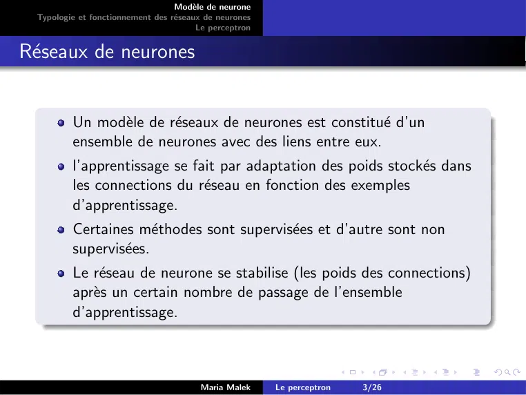

~~~text
                                   Modèle de neurone
  Typologie et fonctionnement des réseaux de neurones
                                         Le perceptron

Réseaux de neurones

          Un modèle de réseaux de neurones est constitué d’un
          ensemble de neurones avec des liens entre eux.
          l’apprentissage se fait par adaptation des poids stockés dans
          les connections du réseau en fonction des exemples
          d’apprentissage.
          Certaines méthodes sont supervisées et d’autre sont non
          supervisées.
          Le réseau de neurone se stabilise (les poids des connections)
          après un certain nombre de passage de l’ensemble
          d’apprentissage.

                                         Maria Malek     Le perceptron   3/26
~~~

## Page 4

~~~text
                                  Modèle de neurone
 Typologie et fonctionnement des réseaux de neurones
                                        Le perceptron

Le neurone de McCulloch Pitts
         x1 , ..xn : les entrées du neurone.
         w1 , ..wn : les poids des connections entrantes.
         θ un seuil de comparaison.
       f est la fonction d’activation du neurone.
                                               n
                                               P
  La sortie du neurone se calcule par : x = f ( wi xi − θ)
                                                                        i

                                        Maria Malek     Le perceptron       4/26
~~~

## Page 5

~~~text
                                   Modèle de neurone
  Typologie et fonctionnement des réseaux de neurones
                                         Le perceptron

Les fonctions d’activation binaires

                                         Maria Malek     Le perceptron   5/26
~~~

## Page 6

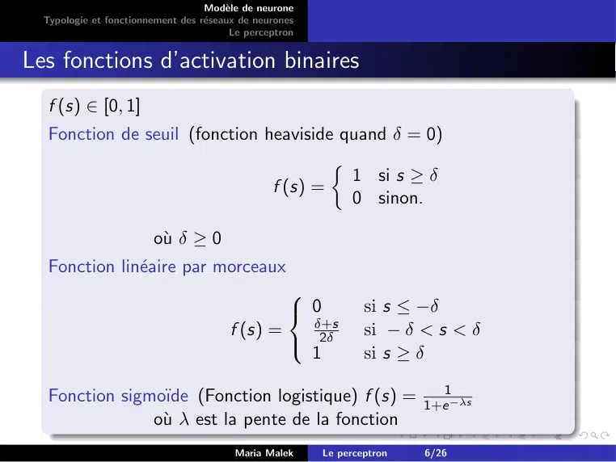

~~~text
                                   Modèle de neurone
  Typologie et fonctionnement des réseaux de neurones
                                         Le perceptron

Les fonctions d’activation binaires
   f (s) ∈ [0, 1]
   Fonction de seuil (fonction heaviside quand δ = 0)
                                        
                                          1 si s ≥ δ
                                f (s) =
                                          0 sinon.

                        où δ ≥ 0
   Fonction linéaire par morceaux
                                                    
                                                     0              si s ≤ −δ
                                                         δ+s
                                        f (s) =           2δ         si − δ < s < δ
                                                         1           si s ≥ δ
                                                    

   Fonction sigmoı̈de (Fonction logistique) f (s) = 1+e1−λs
                où λ est la pente de la fonction
                                         Maria Malek         Le perceptron   6/26
~~~

## Page 7

~~~text
                                   Modèle de neurone
  Typologie et fonctionnement des réseaux de neurones
                                         Le perceptron

les fonctions d’activation bipolaires

                                         Maria Malek     Le perceptron   7/26
~~~

## Page 8

~~~text
                                   Modèle de neurone
  Typologie et fonctionnement des réseaux de neurones
                                         Le perceptron

Les fonctions d’activation bipolaires

   f (s) ∈ [−1, 1]
   Fonction de seuil                                      
                                                              1  si s ≥ δ
                                                f (s) =
                                                              −1 sinon.
                        où δ ≥ 0
   Fonction linéaire par morceaux
                                                     
                                                      −1        si s ≤ −δ
                                                         s
                                         f (s) =         δ       si − δ < s < δ
                                                         1       si s ≥ δ
                                                     

                                                   −s
   Fonction sigmoı̈de f (s) = 1−e
                              1+e −s
                où λ est la pente de la fonction

                                         Maria Malek      Le perceptron   8/26
~~~

## Page 9

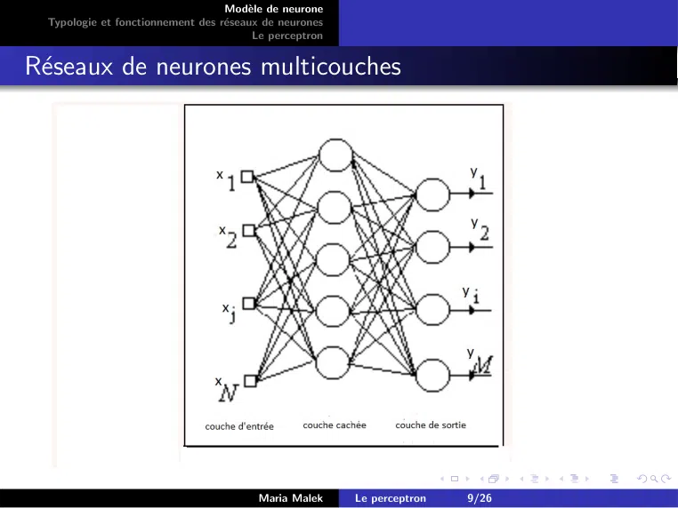

~~~text
                                   Modèle de neurone
  Typologie et fonctionnement des réseaux de neurones
                                         Le perceptron

Réseaux de neurones multicouches

                                         Maria Malek     Le perceptron   9/26
~~~

## Page 10

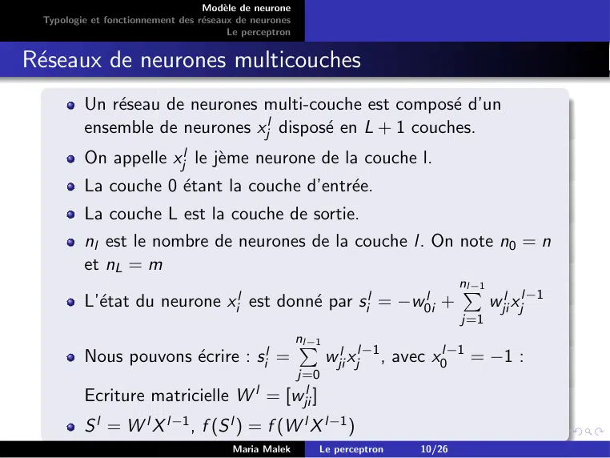

~~~text
                                   Modèle de neurone
  Typologie et fonctionnement des réseaux de neurones
                                         Le perceptron

Réseaux de neurones multicouches
          Un réseau de neurones multi-couche est composé d’un
          ensemble de neurones xjl disposé en L + 1 couches.
          On appelle xjl le jème neurone de la couche l.
          La couche 0 étant la couche d’entrée.
          La couche L est la couche de sortie.
          nl est le nombre de neurones de la couche l. On note n0 = n
          et nL = m
                                                              nP
                                                               l−1
          L’état du neurone xil est donné par sil = −w0il +      wjil xjl−1
                                                                                      j=1
                                                         nP
                                                          l−1
          Nous pouvons écrire : sil =                          wjil xjl−1 , avec x0l−1 = −1 :
                                                         j=0
          Ecriture matricielle W l = [wjil ]
          S l = W l X l−1 , f (S l ) = f (W l X l−1 )
                                         Maria Malek        Le perceptron     10/26
~~~

## Page 11

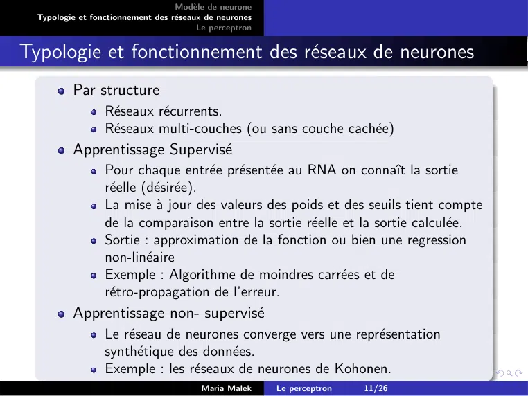

~~~text
                                   Modèle de neurone
  Typologie et fonctionnement des réseaux de neurones
                                         Le perceptron

Typologie et fonctionnement des réseaux de neurones
          Par structure
                  Réseaux récurrents.
                  Réseaux multi-couches (ou sans couche cachée)
          Apprentissage Supervisé
                  Pour chaque entrée présentée au RNA on connaı̂t la sortie
                  réelle (désirée).
                  La mise à jour des valeurs des poids et des seuils tient compte
                  de la comparaison entre la sortie réelle et la sortie calculée.
                  Sortie : approximation de la fonction ou bien une regression
                  non-linéaire
                  Exemple : Algorithme de moindres carrées et de
                  rétro-propagation de l’erreur.
          Apprentissage non- supervisé
                  Le réseau de neurones converge vers une représentation
                  synthétique des données.
                  Exemple : les réseaux de neurones de Kohonen.
                                         Maria Malek     Le perceptron   11/26
~~~

## Page 12

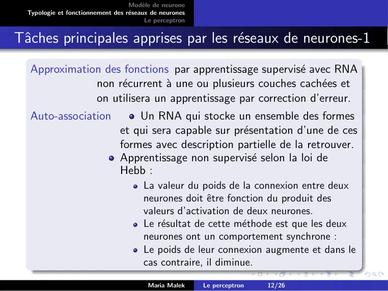

~~~text
                                   Modèle de neurone
  Typologie et fonctionnement des réseaux de neurones
                                         Le perceptron

Tâches principales apprises par les réseaux de neurones-1
   Approximation des fonctions par apprentissage supervisé avec RNA
               non récurrent à une ou plusieurs couches cachées et
               on utilisera un apprentissage par correction d’erreur.
   Auto-association                 Un RNA qui stocke un ensemble des formes
                                et qui sera capable sur présentation d’une de ces
                                formes avec description partielle de la retrouver.
                                Apprentissage non supervisé selon la loi de
                                Hebb :
                                        La valeur du poids de la connexion entre deux
                                        neurones doit être fonction du produit des
                                        valeurs d’activation de deux neurones.
                                        Le résultat de cette méthode est que les deux
                                        neurones ont un comportement synchrone :
                                        Le poids de leur connexion augmente et dans le
                                        cas contraire, il diminue.

                                         Maria Malek     Le perceptron   12/26
~~~

## Page 13

~~~text
                                   Modèle de neurone
  Typologie et fonctionnement des réseaux de neurones
                                         Le perceptron

Tâches principales apprises par les réseaux de neurones-2

   Classification Nous disposons d’un ensemble des classes
                  préexistantes. La tâche du RNA est d’attribuer à un
                  exemple la classe à laquelle il appartient. On peut
                  appliquer un apprentissage supervisé.
   Segmentation La tâche du RNA est de représenter les données par
               des groupes (clusters), des mesures de similarités ou
               de distance sont utilisés lors du fonctionnement du
               réseau : Il s’agit d’un apprentissage non supervisé.

                                         Maria Malek     Le perceptron   13/26
~~~

## Page 14

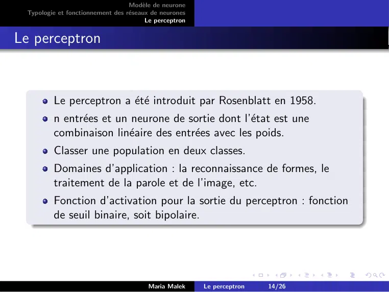

~~~text
                                  Modèle de neurone
 Typologie et fonctionnement des réseaux de neurones
                                        Le perceptron

Le perceptron

         Le perceptron a été introduit par Rosenblatt en 1958.
         n entrées et un neurone de sortie dont l’état est une
         combinaison linéaire des entrées avec les poids.
         Classer une population en deux classes.
         Domaines d’application : la reconnaissance de formes, le
         traitement de la parole et de l’image, etc.
         Fonction d’activation pour la sortie du perceptron : fonction
         de seuil binaire, soit bipolaire.

                                        Maria Malek     Le perceptron   14/26
~~~

## Page 15

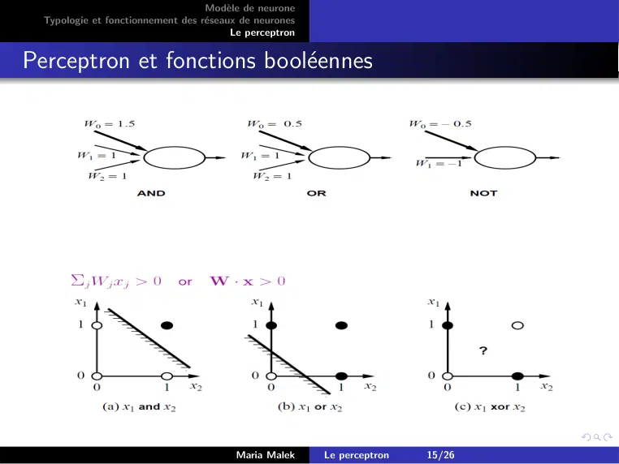

~~~text
                                   Modèle de neurone
  Typologie et fonctionnement des réseaux de neurones
                                         Le perceptron

Perceptron et fonctions booléennes

                                         Maria Malek     Le perceptron   15/26
~~~

## Page 16

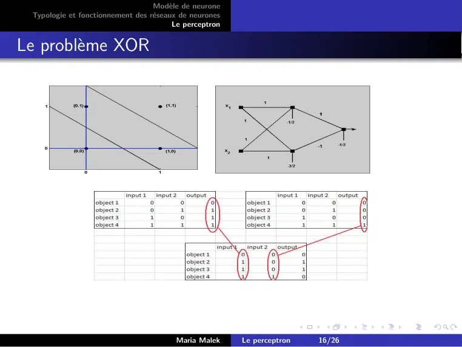

~~~text
                                  Modèle de neurone
 Typologie et fonctionnement des réseaux de neurones
                                        Le perceptron

Le problème XOR

                                        Maria Malek     Le perceptron   16/26
~~~

## Page 17

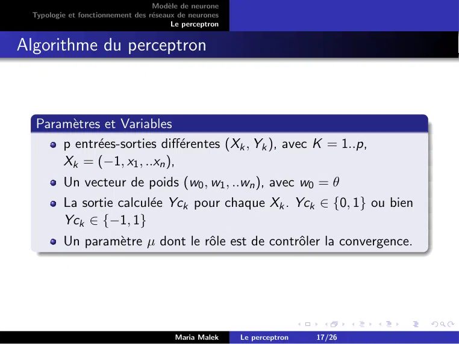

~~~text
                                  Modèle de neurone
 Typologie et fonctionnement des réseaux de neurones
                                        Le perceptron

Algorithme du perceptron

  Paramètres et Variables
      p entrées-sorties différentes (Xk , Yk ), avec K = 1..p,
      Xk = (−1, x1 , ..xn ),
         Un vecteur de poids (w0 , w1 , ..wn ), avec w0 = θ
         La sortie calculée Yck pour chaque Xk . Yck ∈ {0, 1} ou bien
         Yck ∈ {−1, 1}
         Un paramètre µ dont le rôle est de contrôler la convergence.

                                        Maria Malek     Le perceptron   17/26
~~~

## Page 18

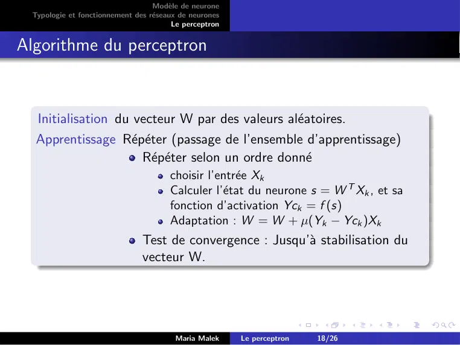

~~~text
                                  Modèle de neurone
 Typologie et fonctionnement des réseaux de neurones
                                        Le perceptron

Algorithme du perceptron

  Initialisation du vecteur W par des valeurs aléatoires.
  Apprentissage Répéter (passage de l’ensemble d’apprentissage)
                    Répéter selon un ordre donné
                                       choisir l’entrée Xk
                                       Calculer l’état du neurone s = W T Xk , et sa
                                       fonction d’activation Yck = f (s)
                                       Adaptation : W = W + µ(Yk − Yck )Xk
                               Test de convergence : Jusqu’à stabilisation du
                               vecteur W.

                                        Maria Malek     Le perceptron   18/26
~~~

## Page 19

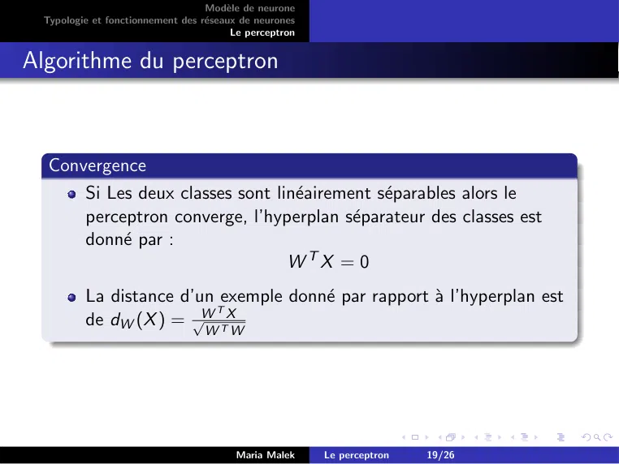

~~~text
                                  Modèle de neurone
 Typologie et fonctionnement des réseaux de neurones
                                        Le perceptron

Algorithme du perceptron

  Convergence
      Si Les deux classes sont linéairement séparables alors le
      perceptron converge, l’hyperplan séparateur des classes est
      donné par :
                                 WTX = 0
         La distance d’un exemple donné par rapport à l’hyperplan est
                         T
         de dW (X ) = √W TX
                                  W W

                                        Maria Malek     Le perceptron   19/26
~~~

## Page 20

~~~text
                                  Modèle de neurone
 Typologie et fonctionnement des réseaux de neurones
                                        Le perceptron

Algorithme du perceptron

  Erreur quadratique
         Err = (Y − Yc) pour l’exemple (X,Y).
         Minimisation de l’erreur quadratique (Loss function) :
                                                            n
         E = 21 Err 2 = 12 × (Y − Yc)2 avec Yc = f (s) = f ( wi xi − θ)
                                                            P
                                                                                i
         pour l’exemple (X,Y).
         Application de l’optimisation avec l’algorithme de descente du
         gradient.
                                                                                n
                                                                                P
                                                                        ∂(Y −f ( wi xi −θ))
          ∂E          ∂Err        ∂(Y −f (s))                                       i
          ∂wj = Err × ∂wj = Err ×    ∂wj      = Err ×                           ∂wj
         ∂E             ′
         ∂wj = −Err × f (s) × xj
         wj = wj + µErr × f ′ (s) × xj

                                        Maria Malek     Le perceptron   20/26
~~~

## Page 21

~~~text
                                  Modèle de neurone
 Typologie et fonctionnement des réseaux de neurones
                                        Le perceptron

Perceptron multi-couches

                                        Maria Malek     Le perceptron   21/26
~~~

## Page 22

~~~text
                                   Modèle de neurone
  Typologie et fonctionnement des réseaux de neurones
                                         Le perceptron

Perceptron multi-couches (sans biais)

                                  x5 = f (w35 x3 + w45 x4 − θ5 )
   x5 = f (w35 ×f (w13 x1 +w23 x2 −θ3 )+w45 ×f (w14 x1 +w24 x2 −θ4 )−θ5 )

                                         Maria Malek     Le perceptron   22/26
~~~

## Page 23

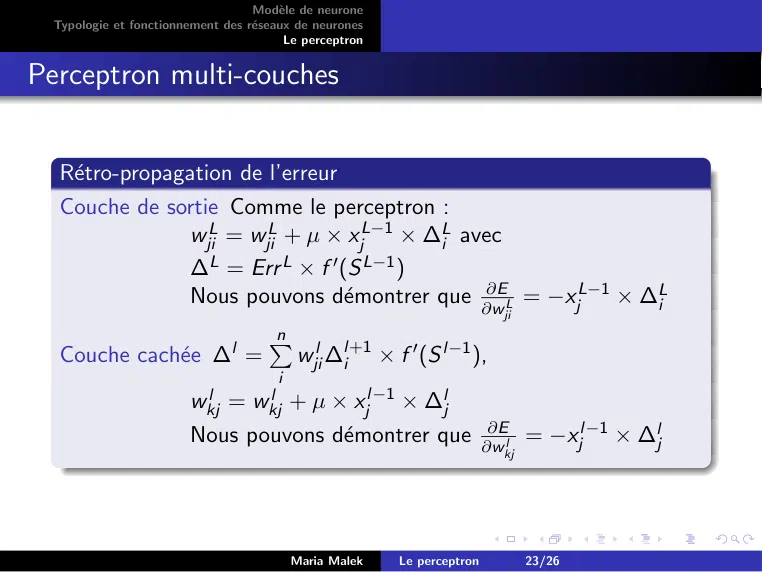

~~~text
                                  Modèle de neurone
 Typologie et fonctionnement des réseaux de neurones
                                        Le perceptron

Perceptron multi-couches

  Rétro-propagation de l’erreur
  Couche de sortie Comme le perceptron :
                wjiL = wjiL + µ × xjL−1 × ∆Li avec
                ∆L = Err L × f ′ (S L−1 )
                                                ∂E       L−1
                Nous pouvons démontrer que ∂w     L = −xj   × ∆Li
                                                                        ji
                                     n
  Couche cachée ∆l =                     wjil ∆l+1 × f ′ (S l−1 ),
                                     P
                                                i
                                      i
                       wkjl = wkjl + µ × xjl−1 × ∆lj
                                                     ∂E      l−1
                       Nous pouvons démontrer que ∂w  l = −xj   × ∆lj
                                                                        kj

                                          Maria Malek   Le perceptron        23/26
~~~

## Page 24

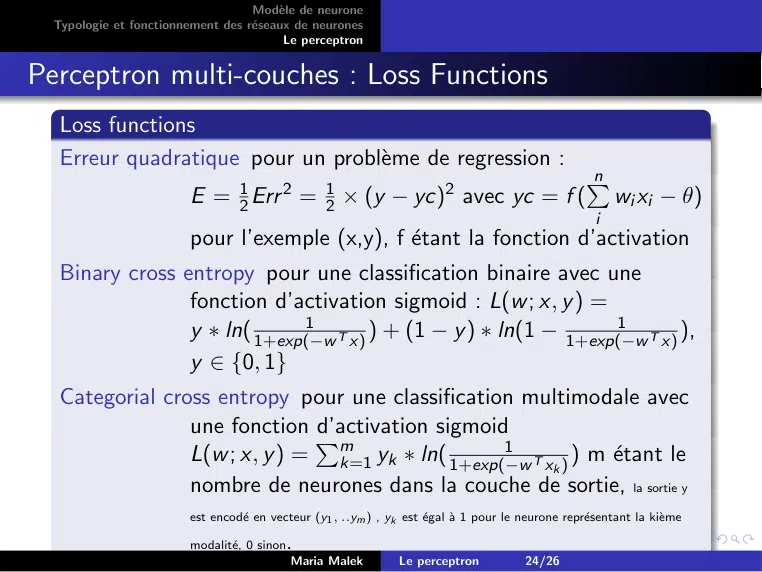

~~~text
                                   Modèle de neurone
  Typologie et fonctionnement des réseaux de neurones
                                         Le perceptron

Perceptron multi-couches : Loss Functions
   Loss functions
   Erreur quadratique pour un problème de regression :
                                                                                                    n
                        E = 12 Err 2 = 21 × (y − yc)2 avec yc = f (
                                                                                                    P
                                                                                                          wi xi − θ)
                                                                                                      i
                        pour l’exemple (x,y), f étant la fonction d’activation
   Binary cross entropy pour une classification binaire avec une
                 fonction d’activation sigmoid : L(w ; x, y ) =
                              1                                   1
                 y ∗ ln( 1+exp(−w T x) ) + (1 − y ) ∗ ln(1 − 1+exp(−w T x) ),

                 y ∈ {0, 1}
   Categorial cross entropy pour une classification multimodale avec
                 une fonction Pd’activation sigmoid
                 L(w ; x, y ) = m                   1
                                 k=1 yk ∗ ln( 1+exp(−w T xk ) ) m étant le
                 nombre de neurones dans la couche de sortie, la sortie y
                        est encodé en vecteur (y1 , ..ym ) , yk est égal à 1 pour le neurone représentant la kième

                        modalité, 0 sinon   .
                                             Maria Malek        Le perceptron           24/26
~~~

## Page 25

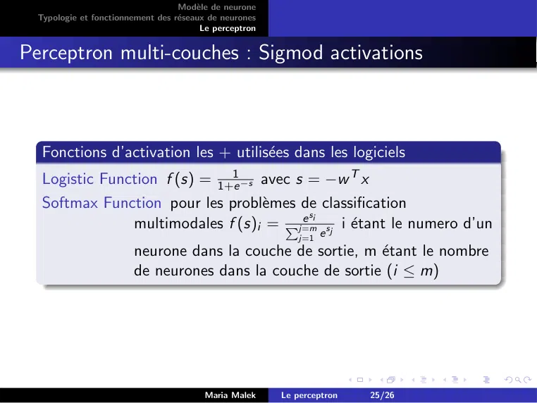

~~~text
                                   Modèle de neurone
  Typologie et fonctionnement des réseaux de neurones
                                         Le perceptron

Perceptron multi-couches : Sigmod activations

   Fonctions d’activation les + utilisées dans les logiciels
   Logistic Function f (s) = 1+e1 −s avec s = −w T x
   Softmax Function pour les problèmes de classification
                                        e si
               multimodales f (s)i = Pj=m    sj i étant le numero d’un
                                                             j=1 e
                        neurone dans la couche de sortie, m étant le nombre
                        de neurones dans la couche de sortie (i ≤ m)

                                         Maria Malek     Le perceptron   25/26
~~~

## Page 26

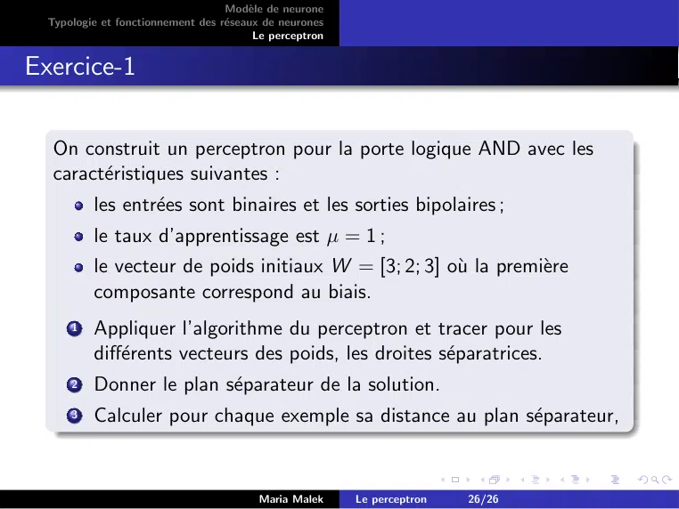

~~~text
                                   Modèle de neurone
  Typologie et fonctionnement des réseaux de neurones
                                         Le perceptron

Exercice-1

   On construit un perceptron pour la porte logique AND avec les
   caractéristiques suivantes :
          les entrées sont binaires et les sorties bipolaires ;
          le taux d’apprentissage est µ = 1 ;
          le vecteur de poids initiaux W = [3; 2; 3] où la première
          composante correspond au biais.
      1   Appliquer l’algorithme du perceptron et tracer pour les
          différents vecteurs des poids, les droites séparatrices.
      2   Donner le plan séparateur de la solution.
      3   Calculer pour chaque exemple sa distance au plan séparateur,

                                         Maria Malek     Le perceptron   26/26
~~~
