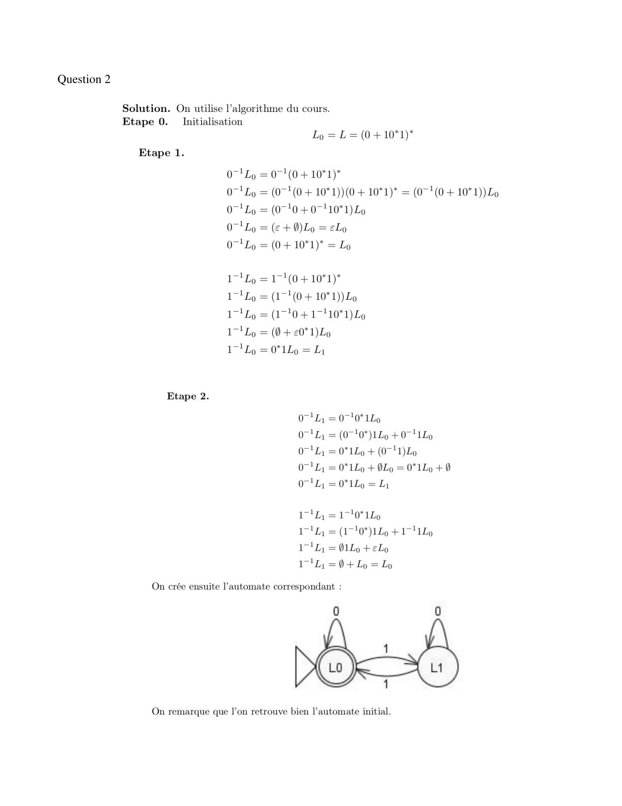
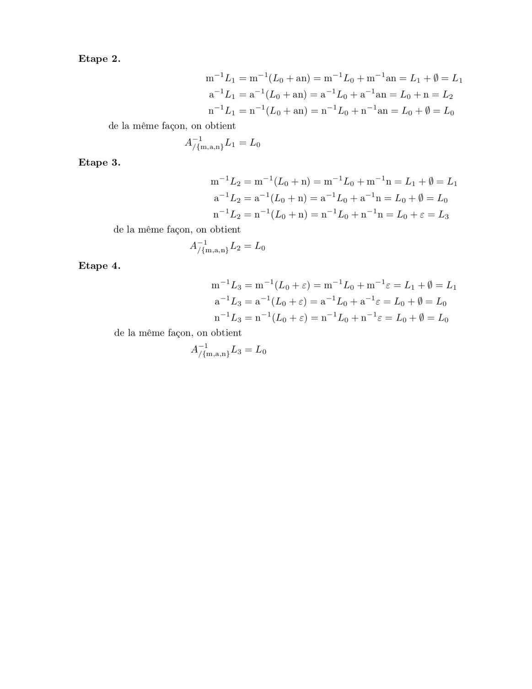
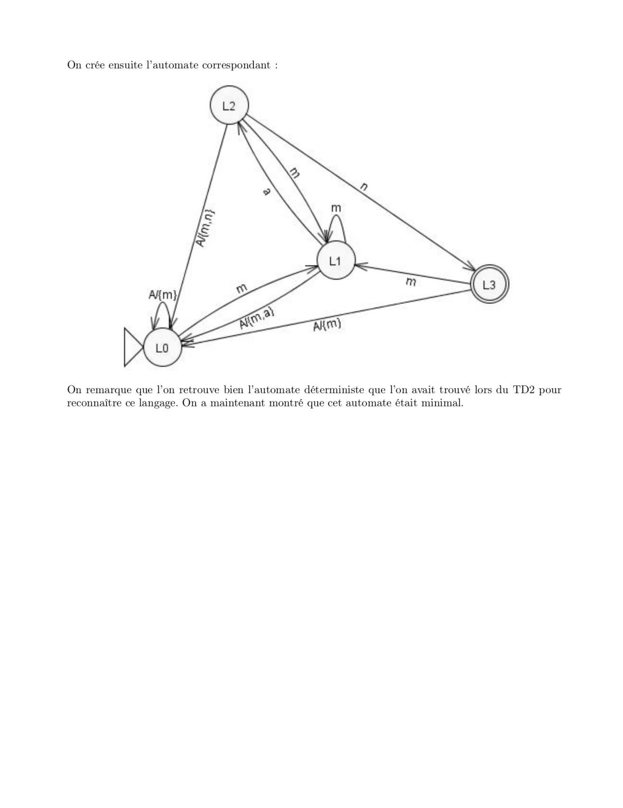

# Corrige TD03.pdf

[Ouvrir l’original](https://drive.google.com/open?id=1MDOdXjgYVwQ7_borhMEyoLFOYG72OwuB) · Les pages signalées comprennent du texte reconnu automatiquement ou des éléments graphiques. Le fac-similé permet de vérifier chaque lecture.

**Pages avec fac-similé ou lecture OCR** — 3, 5–6.

## Page 1

~~~text
                                     TD03 – Théorie des Langages

Exercice 1

Question 2

Solution. Si L est un langage ne contenant pas ε et x ≠ y deux lettres, on peut commencer par
remarquer les lemmes suivants :

On utilise l’algorithme du cours :
~~~

## Page 2

~~~text
Pour construire notre automate, il nous suffit de construire un état pour chaque sous-langage trouvé
et de suivre le résultat des quotients gauche de chaque sous-langage par tous les terminaux pour en
déduire les transitions.

Les langages L0 et L1 contiennent le mot ε, les états de l’automate associés sont donc des états
finaux.

L’automate trouvé par les quotients gauches est donc :

L’état L2 est l’état poubelle. L’algorithme des quotients gauche nous génère toujours un automate
déterministe avec état poubelle.

Exercice 2

Question 1
~~~

## Page 3

~~~text
Question 2
~~~

**Lecture OCR à contrôler**

~~~text
Question 2

Solution. On utilise l'algorithme du cours.
Etape 0. Initialisation
Lo = L=(0+10*1)*

Etape 1.
0-1 Lo = 0-1(0 + 10*1)*
071 Lo = (071 (0 + 10*1))(0 + 10*1)* = (07! (0 + 10*1))Lo
07! Lo = (0710 +071 10"1) Lo
07! Lo = (€ + O) Ly = Lo
07! Lo = (0 + 10°1)* = Lo
171Lo = 171(0+10*1)*
171Lo = (1710+ 10*1))Lo
171Lo = (17-10 +17110*1) Lo
17! Lo = (0 + €0*1)Lo
171Lo = 0*1Lo = Ly

Etape 2.

0-1L,; = 0710*1Lo

071Z, = (0710*)1Lo + 0711Lo
071Ly = 0*1Lo + (0711) Lo

071L1 = 0*1Lo + OLo = 0*1Lo +0
OL = 0"1Lo = La

171L, =170*1Lo

17! L, = (1710*)1Lo +17 1Lo
171L; = 01Lo +eLo

171L, = 0 + Lo = Lo

On crée ensuite l’automate correspondant :

On remarque que l’on retrouve bien l’automate initial.
~~~

## Page 4

~~~text
Exercice 3

Question 1

Question 2

Solution. On utilise l’algorithme du cours.
Etape 0. Initialisation

L0 = L = A*man
~~~

## Page 5

**Lecture OCR à contrôler**

~~~text
Etape 2.

motL=m t(Lo+an)=m !Lo+m lan= Li + 0=L1
a tL, = a t(Lo+an) =a !Lo+a lan = Lo +n = Lo
nL, =n7!(Lo + an) =n 'Lo+n tan = Lo+0= Lo

de la même façon, on obtient
Aj tmjam}yE2 = Lo
Etape 3.

mL) =m "(Lo +n) =m Ep tm in= Li +=
a-!Dy =a} (Lp +n) =a !Lo+a in = Lop + 0 = Lo
nl = n-!(Lo +n)= n-lLotn in=Lote=Ls

de la même façon, on obtient

A7{mam L2 = Lo
Etape 4.

Il

m "(Zo +¢e) =m Lo+m te=L+0=1
a l(Lo+e)=a Lo tate = Lo+0= Lo
3a=n (Lo+e)=n Lo tn le = Lo+0= Lo
de la même façon, on obtient

-1
A {man} 3 = Lo
~~~

## Page 6

**Lecture OCR à contrôler**

~~~text
On crée ensuite l’automate correspondant :

On remarque que l’on retrouve bien l’automate déterministe que l'on avait trouvé lors du TD2 pour
reconnaître ce langage. On a maintenant montré que cet automate était minimal.
~~~
