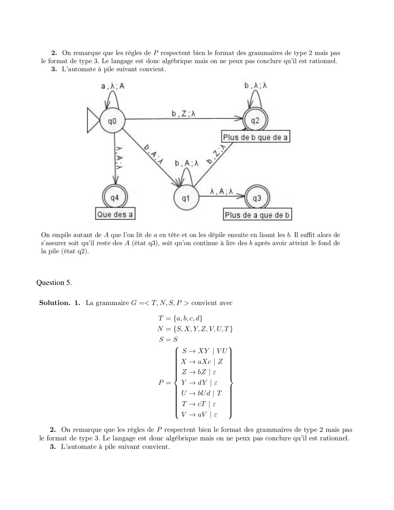
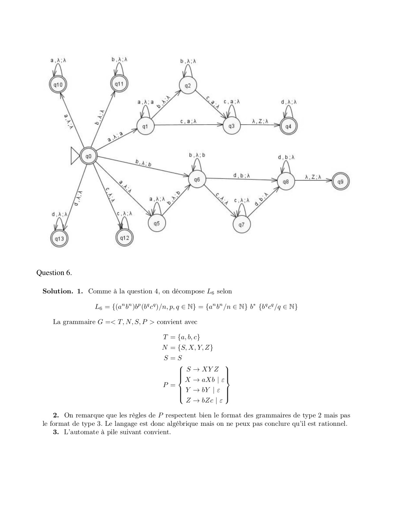
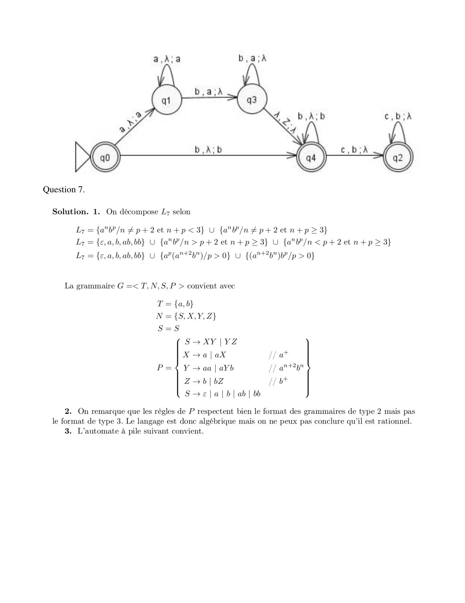
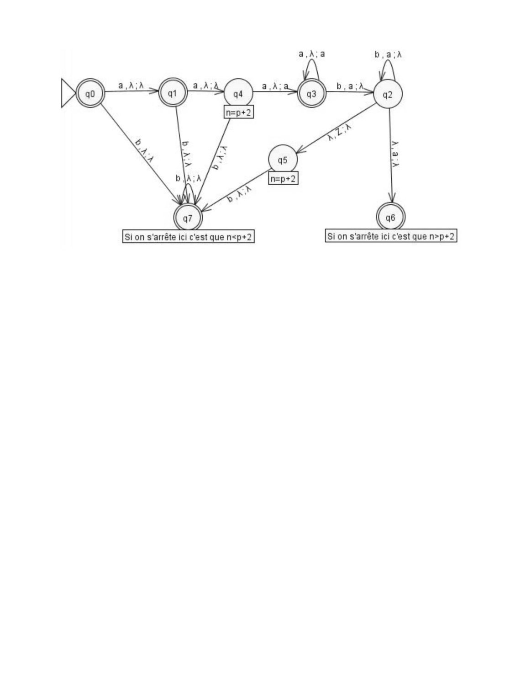

# Corrige TD04-v2.pdf

[Ouvrir l’original](https://drive.google.com/open?id=1En7X7HzVMcuENszMfPJjbEtPrg1ycFYq) · Les pages signalées comprennent du texte reconnu automatiquement ou des éléments graphiques. Le fac-similé permet de vérifier chaque lecture.

**Pages avec fac-similé ou lecture OCR** — 2–5.

## Page 1

~~~text
              TD04 – Théorie des Langages

Exercice 1.

Solution.

Question 4.
~~~

## Page 2

~~~text
Question 5.
~~~

**Lecture OCR à contrôler**

~~~text
2. On remarque que les règles de P respectent bien le format des grammaires de type 2 mais pas
le format de type 3. Le langage est donc algébrique mais on ne peux pas conclure qu'il est rationnel.
3. L’automate à pile suivant convient.

(x)

On empile autant de A que l’on lit de a en tête et on les dépile ensuite en lisant les b. Il suffit alors de
s'assurer soit qu'il reste des A (état q3), soit qu'on continue à lire des b après avoir atteint le fond de

la pile (état q2).

Question 5.

Solution. 1. La grammaire G =< T, N, 8, P > convient avec

T = {a,b,c,d}

N ={S,X,Y,Z,V,U,T}

S=8S
S— XY | VU
X —aXc|Z
Z—bZl|e

P=4{Y-dY|e
UbUd|T
TocT le
VoaVie

2. On remarque que les régles de P respectent bien le format des grammaires de type 2 mais pas
le format de type 3. Le langage est donc algébrique mais on ne peux pas conclure qu'il est rationnel.
3. L’automate à pile suivant convient.
~~~

## Page 3

~~~text
Question 6.
~~~

**Lecture OCR à contrôler**

~~~text
Question 6.
Solution. 1. Comme à la question 4, on décompose Lg selon
L = {(a"b")bP (bte) /n, p,q € N} = {a"b" /n € N} b* {b4c4/q € N}

La grammaire G =< T, N,S,P > convient avec

T = {a,b,c}
N={5,X,Y,Z}
S=s
S— XYZ
X—aXb|e
P=
Y 3bY |e
Z—bZele

2. On remarque que les règles de P respectent bien le format des grammaires de type 2 mais pas
le format de type 3. Le langage est donc algébrique mais on ne peux pas conclure qu'il est rationnel.
3. L’automate à pile suivant convient.
~~~

## Page 4

~~~text
Question 7.
~~~

**Lecture OCR à contrôler**

~~~text
Question 7.

Solution. 1. On décompose L7 selon

Ly = {a"b/n £p+2etn+p<3} U {a"W/n£p+2etn+p>3}
Lz = {e,a,b, ab,bb} U {a"W/n>p+2etn+p>3} U {a"W/n <p+2etn+p>3}
Lz = {e,a,6,ab,bb} U {a?(a"+2%")/p > 0} U {(a"*2b")b? /p > 0}

La grammaire G =< T, N,S, P > convient avec

T = {a,b}
N ={S,X,Y,Z}
S=8
S—XY]|YZ
X—alaX // at
P=¢ Y -aa|aYb // at*2p"
Z—>b|bZ // o*

S—ela|b|ab| bb

2. On remarque que les régles de P respectent bien le format des grammaires de type 2 mais pas
le format de type 3. Le langage est donc algébrique mais on ne peux pas conclure qu'il est rationnel.
3. L’automate à pile suivant convient.
~~~

## Page 5

**Lecture OCR à contrôler**

~~~text
Si on s'arrête ici c'est que n>p+2

Si on s'arrête ici c'est que n<p+2
~~~
