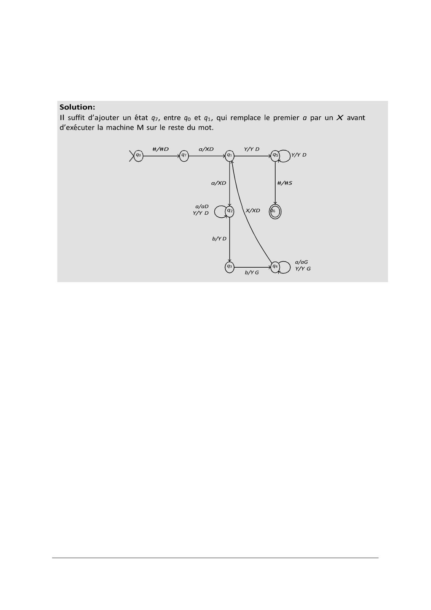

# correctionEx-Decidabilite22-23.pdf

[Ouvrir l’original](https://drive.google.com/open?id=1u71c-mhZ0E1zmfLiht_2mPpz9y_zEMTf) · Les pages signalées comprennent du texte reconnu automatiquement ou des éléments graphiques. Le fac-similé permet de vérifier chaque lecture.

**Pages avec fac-similé ou lecture OCR** — 2.

## Page 1

~~~text
             Eléments de Correction Examen session principale
                               2022-2023

Exercice 1 : Machines de Turing

   1. Soient a et b deux symbôles et soit L le langage = {anb2n | n ∈ℕ}.
     Définir une machine de Turing permettant de 'reconnaître' les mots de ce langage.

   2. Modifier cette machine pour reconnaître le langage {an+1b2n | n ≥ 1}.
 Correction question 1

 Soit M = (K, Σ, Γ, δ, q0 , F ) la machine de Turing :
     • d’état initial q0 ,
     • avec acceptation par état final (unique état acceptant q6 ),
     • d’alphabet Σ = {a, b}, d’alphabet de ruban Γ = {a, b, X, Y, #},
     • avec la fonction de transition δ schématisée par le dessin ci-dessous :

                              #/#D               Y/Y D
                        q0                q1                 q5      Y/Y D

                                     a/XD                      #/#S

                              a/aD        q2                 q6
                                                  X/XD
                             Y/Y D

                                     b/Y D
~~~

## Page 2

~~~text
         premie
ecuter
~~~

**Lecture OCR à contrôler**

~~~text
Solution:
Il suffit d'ajouter un état q7, entre qo et qi, qui remplace le premier a par un X avant
d’exécuter la machine M sur le reste du mot.

#/#D

a/xD

a/XD

a/aD
Y/Y D

b/yo
~~~

## Page 3

~~~text
Exercice 2
Idem réduction depuis arrêt existenciel ou universel vers H_empty (cf TD3) par effaçage du ruban

Exercice 3
Considerons l’algorithme suivant:
Pour tout 4-uplets de sommets (x, y, z, t) verifier s’il est un cycle de de longueur egale a 4.

Si c’est un cas, pour un seul 4−uplets, alors repondre oui sinon repondre non.
La complexite de cet algorithme est O(n^5) (il y a O(n^4) 4 − uplets et tester s’il est un cycle de de
longueur egale a 4 necessite O(n) operations).

Exercice 4
Le probleme est dans NP car etant donnee une suite de sommets s, on peut verifier
en temps polynomial si s est un cycle de de longueur egale a |V|/2 dans G (en O(n^2) operations).

Exercice 5
— Le probleme est dans NP car etant donne un plan de table, on peut verifier en temps
polynomial si pour chaque chevalier, il n’est pas a cote d’un ennemi.
— Nous allons faire la reduction a partir du probleme du cycle hamiltonien
Soit I = <G =(V, E)> une instance du probleme du cycle hamiltonien.
Maintenant, nous allons transformer cette instance en une instance I2 du probleme
des Chevaliers de la table ronde de la facon suivante :
— chaque sommet du graphe est un chevalier.
— Deux chevaliers sont des ennemis si et seulement si il n’existe pas une arete dans
G impliquant les deux sommets representes par ces deux chevaliers

Cette transformation peut se faire en temps polynomial (nous avons construit le
complementaire du graphe G).
Il est facile de prouver que :
— Si il existe un cycle hamiltonien dans G, alors il existe un plan de table. Il suffit
de voir qu’une arete dans G correspond au fait que les deux chevaliers ne sont
pas ennemis. Donc le plan de table correspond au cycle hamiltonien.
— Si il existe un plan de table alors il existe un cycle hamiltonien dans G.
Donc le probleme des Chevaliers de la table ronde est plus difficile que le
probleme du cycle hamiltonien.
Donc le probleme des Chevaliers de la table ronde est NP-complet.
  q3
           b/Y G

Exercice 2
Idem réduction depuis arrêt existenciel ou universel vers H_empty (cf TD3) par effaçage du ruban

Exercice 3
Considerons l’algorithme suivant:
Pour tout 4-uplets de sommets (x, y, z, t) verifier s’il est un cycle de de longueur egale a 4.

Si c’est un cas, pour un seul 4−uplets, alors repondre oui sinon repondre non.
La complexite de cet algorithme est O(n^5) (il y a O(n^4) 4 − uplets et tester s’il est un cycle de de
longueur egale a 4 necessite O(n) operations).
~~~

## Page 4

~~~text
Exercice 4
Le probleme est dans NP car etant donnee une suite de sommets s, on peut verifier
en temps polynomial si s est un cycle de de longueur egale a |V|/2 dans G (en O(n^2)
operations).

Exercice 5
— Le probleme est dans NP car etant donne un plan de table, on peut verifier en temps
polynomial si pour chaque chevalier, il n’est pas a cote d’un ennemi.
— Nous allons faire la reduction a partir du probleme du cycle hamiltonien
Soit I = <G =(V, E)> une instance du probleme du cycle hamiltonien.

Maintenant, nous allons transformer cette instance en une instance I2 du probleme
des Chevaliers de la table ronde de la facon suivante :
— chaque sommet du graphe est un chevalier.
— Deux chevaliers sont des ennemis si et seulement si il n’existe pas une arete dans
G impliquant les deux sommets representes par ces deux chevaliers

Cette transformation peut se faire en temps polynomial (nous avons construit le
complementaire du graphe G).
Il est facile de prouver que :
— Si il existe un cycle hamiltonien dans G, alors il existe un plan de table. Il suffit
de voir qu’une arete dans G correspond au fait que les deux chevaliers ne sont
pas ennemis. Donc le plan de table correspond au cycle hamiltonien.
— Si il existe un plan de table alors il existe un cycle hamiltonien dans G.
Donc le probleme des Chevaliers de la table ronde est plus difficile que le
probleme du cycle hamiltonien.
Donc le probleme des Chevaliers de la table ronde est NP-complet.
~~~
