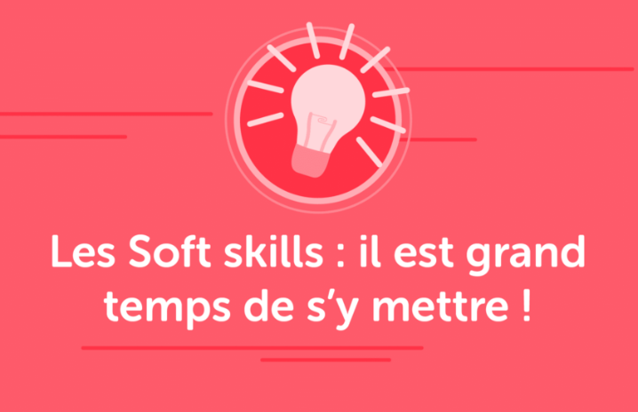
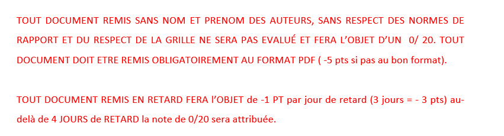
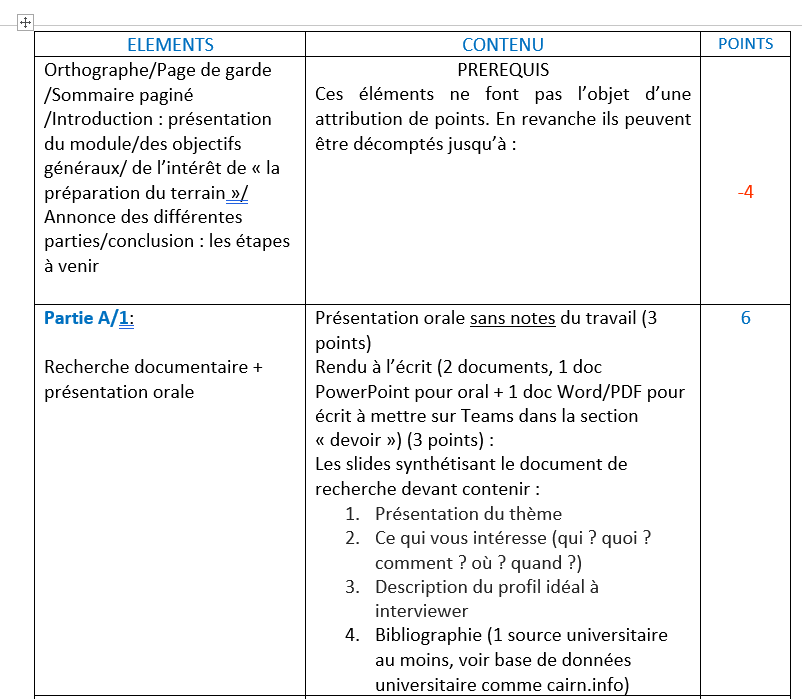
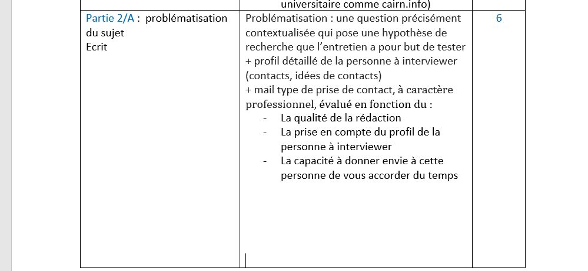
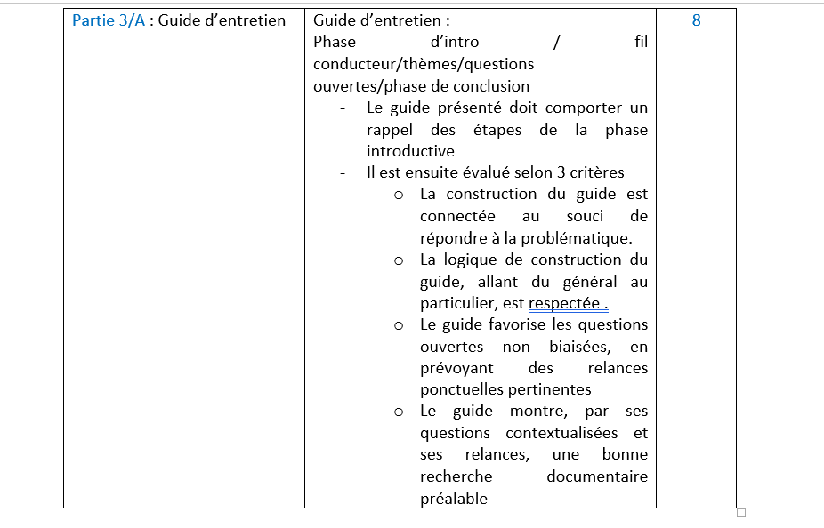
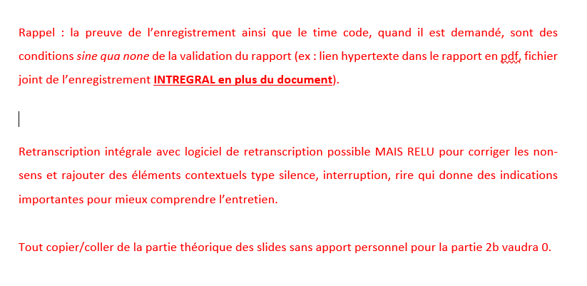
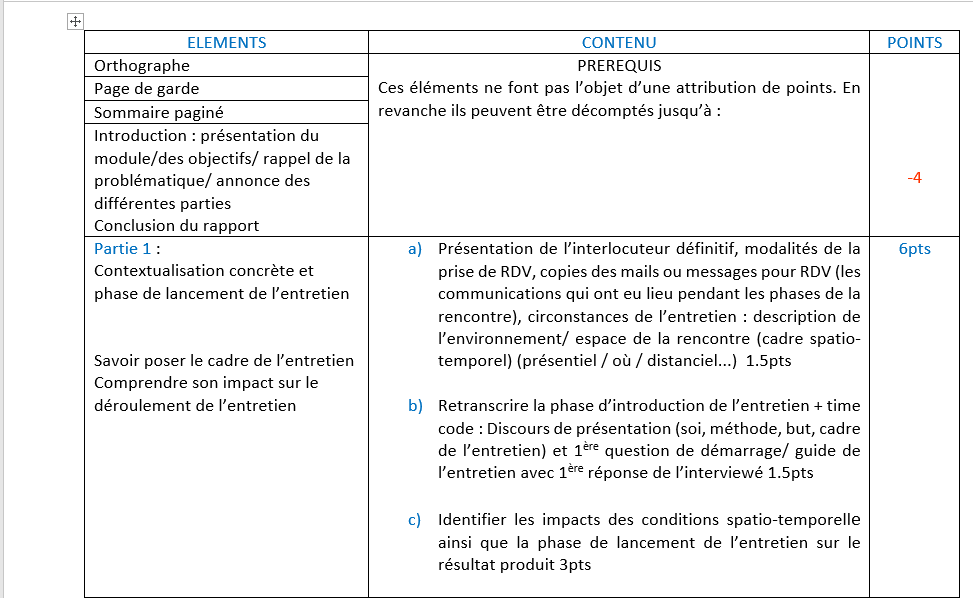
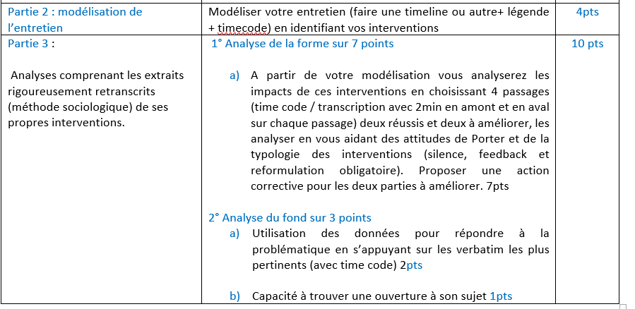

# ECE - 1. présentation du module - 30-09-24.pptx

[Ouvrir l’original](https://drive.google.com/open?id=1bdoz7YvzDQREBLNRL2FQD6bXc0MoRT59) · Texte structuré depuis le fichier original. Les mises en page complexes peuvent nécessiter une vérification.

## Diapositive 1

Ecoute et Conduite d’Entretien

Séance 1 – Présentation du module

## Diapositive 2

1. PRESENTATION DU MODULE

Ecoute et Conduite d'Entretien

11/10/2024

2

## Diapositive 3

Codes Teams

p5v4dd3

11/10/2024

Pôle Humanités Design

3

## Diapositive 4

Points abordés

1° 	Pourquoi ce module?

2° 	Le cadre et objectif général du module

3°	Les compétences développées

4° 	Le découpage des séances

5° 	Pourquoi DD/ODD/RSE?

6° 	Présentation des documents supports

7° 	Validation du Module

11/10/2024

Pôle Humanités Design

4

## Diapositive 5

POURQUOI CE MODULE? 

1° Continuité du programme de formation en relations humaines

2° Constat en entreprise 

3° Acquis de soft skills indispensables au statut de cadre

11/10/2024

Pôle Humanités Design

5

**Notes**

1° prérequis: sensibilisation à la com, outils de com professionnel, expression orale et écrite, communication interculturelle, ouverture culturelle
Postrequis: Animation de réunion
2°Plus d’un tiers des salariés français (36%) s’accordent à le dire, la qualité qui manque le plus à leur manager est celle de l’écoute et de la communication. Le constat est fort parmi les femmes comme parmi les hommes et ce manque se fait d’autant plus sentir parmi les jeunes générations. En effet, un professionnel de moins de 29 ans sur deux (51%) considère que son manager n’est pas suffisamment à l’écoute et communicatif.
Étude réalisée auprès de 1 001 salariés français. L'échantillon est représentatif du salariat français sur les critères de sexe, d'âge, de catégorie socioprofessionnelle, de taille d'entreprise, de secteur d'activité de l'entreprise, de statut de l’employeur (public/privé) et de région de résidence. Les salariés ont été interrogés en ligne sur système CAWI (Computer Assistance for Web Interview). Le terrain a été réalisé du 17 au 20 mars 2015. OpinionWay a réalisé cette enquête en appliquant les procédures et règles de la norme ISO 20252 (exigences applicables aux études sociales, de marché et d'opinion et permet d'harmoniser les différentes normes locales déjà existantes dans ce secteur d'activité.
3° savoir écouter fait partie du top 10 des soft skills selon les cadres français. 

## Diapositive 6

OBJECTIF DU MODULE

OBJECTIF GENERAL

 Réalisation d’un mini projet dont le but est d’apprendre à recueillir et traiter une information qualitative relative à son futur métier ou monde du travail en général, en appliquant une méthode en situation de relation interpersonnelle professionnelle dans un cadre de terrain orienté sur la RSE et/ou ODD.

11/10/2024

Pôle Humanités Design

6

**Notes**

Faire du terrain en sciences sociales c’est aller «  chercher de la matière » en observant, questionnant, dans le but de comprendre cette matière et de la rendre intelligible. 

## Diapositive 7

LES COMPETENCES

| COMPETENCES CTI  | COMPETENCES spécifiques liées au module   |
| --- | --- |
|   8 l’aptitude à prendre en compte les enjeux des relations au travail   9 l’aptitude à prendre en compte les enjeux environnementaux…   10 l’aptitude à prendre en compte les enjeux et les besoins de la société   14 la capacité à se connaitre, à s’autoévaluer, à gérer ses compétences… | Recueillir des informations référencées sur la RSE et les ODD dans le but de préparer son terrain    |
|  | Identifier et comprendre les dynamiques d’entretien interpersonnelle  |
|  | Comprendre et appliquer l’écoute active |
|  | Savoir se présenter et présenter l’objet de sa démarche en des termes formels pour prendre contact avec un professionnel |
|  | Appliquer les méthodes d’entretien semi-directif  |
|  | Apprendre à analyser une information qualitative issue du terrain  |
|  | Savoir s’autoévaluer lors d’une relation interpersonnelle professionnelle |
|  | Appliquer les normes de rédaction d’un rapport professionnel  |

11/10/2024

Pôle Humanités Design

7

## Diapositive 8

DÉCOUPAGE DES SÉANCES

|   10 HEURES 30  |  |  |  |  |  |  |  |
| --- | --- | --- | --- | --- | --- | --- | --- |
| S1 / 1h30 | S2 / 1h30 | S3 / 1h30 | S4/1h30 | S5/1h30  | S6/1h30 | S7/1h30 | RENDU B |
| Présentation du module Démarche de l’entretien semi-directif Mise en groupe/recherche ODD/ restitution en classe | Rendu 1/A Restitution des recherches des groupes + feedback direct  Cours sur la problématique  | Groupes de travail sur la problématique Cours sur le guide d’entretien + modèle de prise de contact  | Rendu 2/A Fabrication du guide d’entretien (dont exo sur les questions)   | Rendu 3/A Ecoute active + exo   | Réajustement en fonction de l’avancé du programme point retranscription /analyse | Debrief des entretiens réalisés et identification et analyse en classe    | Analyse entretien |
| 2/9 sept | 23 Sept | 30 sept | 7 0ct | 14 oct | 4 Nov | 25 Nov | 2 Dec |

11/10/2024

Pôle Humanités Design

8

TP : semaine du 21/10 et du 28/11

## Diapositive 9

POURQUOI DD/ODD/RSE?

Les problématiques liées au développement durable demandent une réflexion et des solutions que les ingénieurs peuvent apporter. 

Le choix de ce thème pour le module est une première approche pour confronter sa recherche théorique avec la réalité professionnelle par le biais de la réalisation d’un entretien ciblé.   

11/10/2024

Pôle Humanités Design

9

## Diapositive 10

Documents supports

Support de cours

Guide du module

Modalités de transcription 

Grilles d’évaluation des rendus

11/10/2024

Pôle Humanités Design

10

**Notes**

Présentation du guide  le document de Damien Time line peut être aussi utiliser pour ceux qui le souhaite 

## Diapositive 11

VALIDATION DU MODULE

11/10/2024

Pôle Humanités Design

11

Travail en groupe sur la partie A/ travail individuel sur la partie B

Moyenne des notes de rendus sur 20 points aucun coefficient n’est appliqué

Rendus à déposer dans les devoirs des classes TEAMS En PDF + AUDIO pour la partie B

| Rendu A : Préparation de l’entretien  |  rendu B: analyses de l’entretien |
| --- | --- |
| Rendu 1/A 6pts présentation du thème en groupe. Rendu 2/A 4 pts problématique définitive + profil de la personne à interviewer + mail type de prise de contact  Rendu 3/A 10pts guide d’entretien | Rendu B 20 pts La transcription de l’entretien pour l’analyse L’analyse des interactions en référence à Porter L’analyse du contenu en réponse à la problématique |

## Diapositive 12

Les grilles d’évaluation des rendus

11/10/2024

Pôle Humanités Design

12

## Diapositive 13

11/10/2024

Pôle Humanités Design

13

Pour tous les rendus

## Diapositive 14

11/10/2024

Ecoute et Conduite d'Entretien

14

Rendu 1A : Fin de semaine du 23 septembre

## Diapositive 15

11/10/2024

Ecoute et Conduite d'Entretien

15

Rendu 2A : Fin de semaine du 7 octobre

## Diapositive 16

11/10/2024

Ecoute et Conduite d'Entretien

16

Rendu 3A : Fin de semaine du 14 octobre

## Diapositive 17

Rendu B : fin de semaine du 4 décembre

11/10/2024

Pôle Humanités Design

17

## Diapositive 18

11/10/2024

Pôle Humanités Design

18

## Diapositive 19

11/10/2024

Pôle Humanités Design

19

