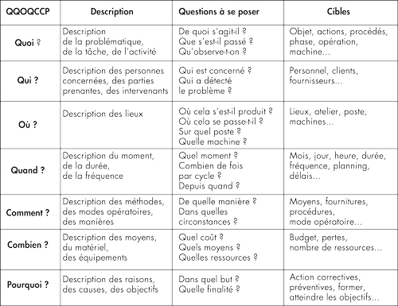
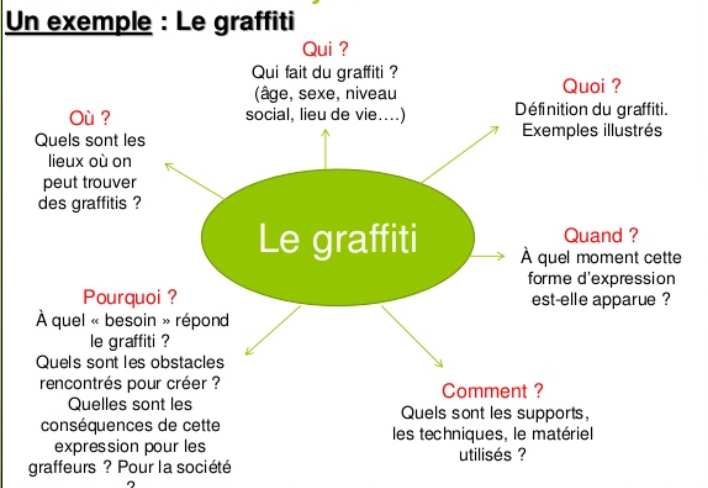

# ECE - 3. La problématique -24-09-24.pptx

[Ouvrir l’original](https://drive.google.com/open?id=1agB_z8lhfaR8IcUBFi9R8ZjFsGv-G8pD) · Texte structuré depuis le fichier original. Les mises en page complexes peuvent nécessiter une vérification.

## Diapositive 1

Ecoute et Conduite d’Entretien

Support de cours

04/10/2024

Ecoute et Conduite d'Entretien

1

## Diapositive 2

3. LA PROBLEMATIQUE 

Ecoute et Conduite d'Entretien

04/10/2024

2

## Diapositive 3

OBJECTIF 

Être capable de problématiser, à partir de la synthèse déjà effectuée

Ecoute et Conduite d'Entretien

04/10/2024

3

## Diapositive 4

Ecoute et Conduite d'Entretien

4

2.Construction du guide : du thème à la problématisation

La préparation de l’entretien commence avec une analyse du thème souhaité (dans le cadre du DD) et se continue avec la problématisation

La problématisation émerge d’une création de liens spécifiques entre les notions envisagées (= catégories)

Identifier les facteurs contextuels :

  - personnes ressources

  - contextes sociaux

  - faisabilité du projet

  - données spatio-temporelles

/!\ Méthode Lasswell (5W1H)

04/10/2024

**Notes**

De votre thème découlera vos questions semi-directives

Rappel Lasswell
Qui : pourquoi choisir telle ou telle personne, quelles sont les informations qu’elle peut m’apporter, sa fonction, ses responsabilités, son statut hiérarchique, son appartenance à tel ou tel réseau, clan… son rôle par rapport au thème de l'entretien, son cadre de référence, sa culture, sa langue, sa personnalité, ses craintes éventuelles... 
Quoi : contenu, points à ne pas oublier, thèmes à aborder, dans quel ordre, sujets à éviter, questionnaire ou guide d'entretien. 
Comment : la stratégie : quel style d'entretien je choisis, quelles attitudes je dois adopter, quels types d'intervention... 
Quand : échéancier / projet, Les contraintes horaires mutuelles,  y a-t-il un moment favorable ? prendre rendez-vous suffisamment à l’avance. 
Où : dans son milieu, dans le mien, ou dans un lieu neutre ? Aménager le cadre et l'environnement, pour faciliter la confidentialité, le bien-être et la bonne distance avec votre interlocuteur. Tout faire pour éviter les interruptions (téléphone...), les bruits parasites, les contre-jours. Eviter de se protéger (derrière un bureau...) 

## Diapositive 5

Ecoute et Conduite d'Entretien

5

2.Construction du guide : du thème à la problématisation

La problématique est une question complexe (#thématique)

Elle nécessite une hypothèse (réponse possible à la problématique) sous-jacente, qui sera confirmée/infirmée grâce aux données recueillies

Problématiser = faire ressortir les nuances/tensions/conflits possibles entre les notions importantes de la thématique

Au travers du guide d’entretien, elle est soutenue initialement par une réflexion liée à la recherche sur le DD, puis par la constitution de questions cohérentes

Le recueil des informations pourra permettre de répondre – partiellement – à la problématique initiale

04/10/2024

## Diapositive 6

04/10/2024

Pole Humanités Design – Département des Relations Humaines Introduction aux SHS

6

Marquet Jacques, Van Campenhoudt Luc, Quivy Raymond, Manuel de recherche en sciences sociales, Paris, Armand Colin, 6ème éd., 2022.

Etape 1 La question de départ / la demande / les objectifs

Etape 2 L’exploration

Les lectures / Les entretiens exploratoires

Etape 3 La problématique

Etape 4 La construction du modèle d’analyse , échantillonnage et modalités de recueil

Etape 5 L’observation / le recueil de l’information

Etape 6 L’analyse des informations

Etape 7 La conclusion

Quels facteurs ont un effet sur tel phénomène ?

## Diapositive 7

04/10/2024

Pole Humanités Design – Département des Relations Humaines

7

Etape 3 La problématique

Quels facteurs ont un effet sur tel phénomène ?

Emettre des hypothèses formulées de manière claire, plausible, afin de les tester.

Si le projet d’enquête se fait en réponse à la demande d’un tiers (un client, par exemple), il est indispensable de bien comprendre ses objectifs. 

## Diapositive 8

Définir sa problématique

Ecoute et Conduite d'Entretien

04/10/2024

8

## Diapositive 9

2 – Définir sa problématique

Ecoute et Conduite d'Entretien

A transformer en problématique

04/10/2024

9

## Diapositive 10

Ecoute et Conduite d'Entretien

La RSE est un thème complexe, où des tensions peuvent apparaître entre exigences éthiques et contraintes économiques ; entre les discours, l’affichage et les pratiques réelles (« greenwashing », par exemple).

Que voulez-vous connaître ? élucider ? comprendre ? A quoi cet entretien peut-il vous servir ? Qu’est-ce qu’il peut vous apporter comme connaissance et comme compréhension, que vous ne pourriez pas obtenir par une recherche strictement documentaire ?

Dites-vous que l’entretien semi-directif vous donne la possibilité d’aller au-delà d’un relevé simplement descriptif des usages, bonnes et mauvaises pratiques (relevé certes important à établir dans un premier temps), pour investiguer les représentations, les motivations et l’ensemble des aspects psychologiques de la question chez votre interlocuteur, depuis sa situation.

04/10/2024

10

## Diapositive 11

04/10/2024

Ecoute et Conduite d'Entretien

11

Ce qu’EST une problématique

Une problématique est donc une question contextualisée, mettant en avant des difficultés et enjeux précis et posant une hypothèse quant à l’impact d’un ou plusieurs facteurs sur la réalité étudiée. Elle émet une ou plusieurs hypothèse(s) que le recueil d’informations sur le terrain testera

Ce que N’EST PAS une problématique

Une question vague, très générale, portant sur un grand thème, pris de manière abstraite, sans réelle contextualisation.

 C’est pourquoi la problématisation s’appuie sur le travail de recherche documentaire préalablement réalisé.

## Diapositive 12

04/10/2024

Ecoute et Conduite d'Entretien

12

Exemples

« Quel est l’impact de la transition sur la finance ? » n’est pas une problématique.

« Comment le secteur des études de marché est-il affecté par l’IA et le Big data, à travers l’évolution des méthodes traditionnelles et la naissance de nouveaux acteurs plus spécialisés ? Les acteurs traditionnels sont obligés d’intégrer ces nouveaux outils à leur offre, tout en étant concurrencés par des acteurs plus spécialisés. Cette dernière hypothèse est-elle exacte ? Dans quelle mesure et selon quelles modalités ? » est un début de problématisation, qui reste à préciser.
