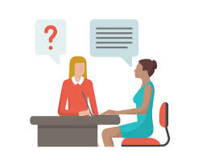
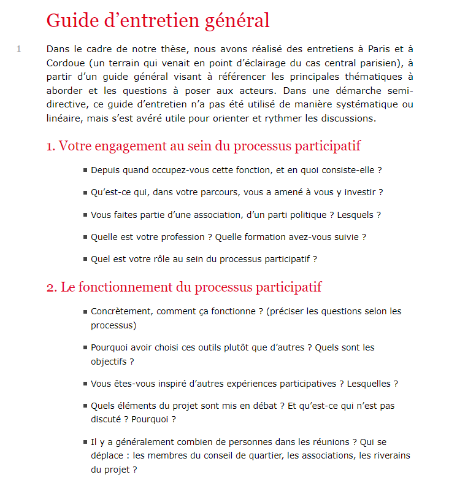
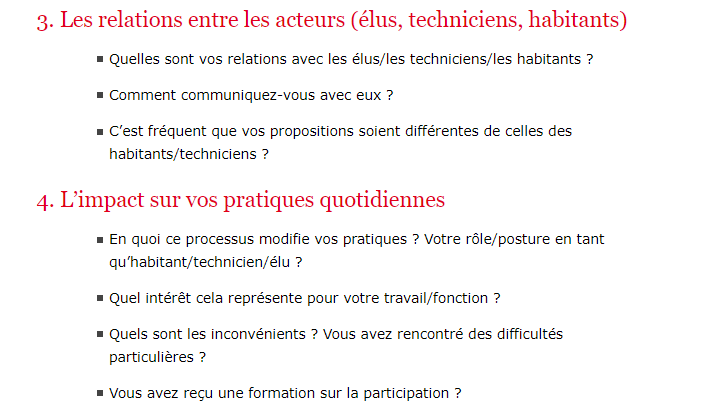
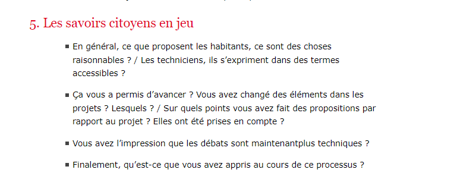
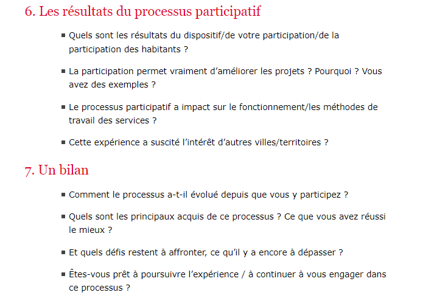
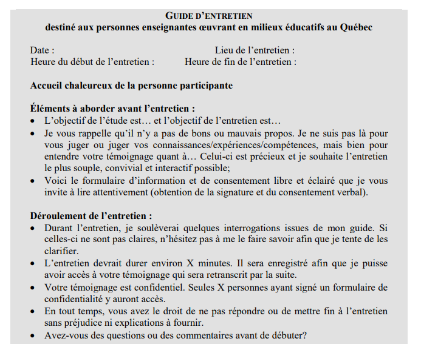
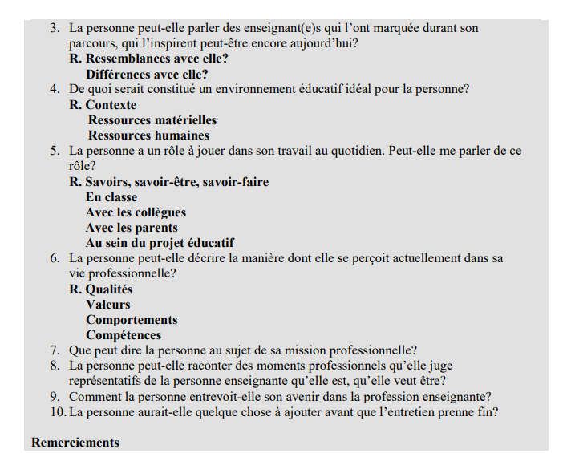

# ECE - 5. La guide d_entretien -24-09-24.pptx

[Ouvrir l’original](https://drive.google.com/open?id=1CA_TGHg7v0iYk7mujmG6ziU7SbBLKmBV) · Texte structuré depuis le fichier original. Les mises en page complexes peuvent nécessiter une vérification.

## Diapositive 1

Ecoute et Conduite d’Entretien

Support de cours

11/10/2024

Ecoute et Conduite d'Entretien

1

## Diapositive 2

5. LE GUIDE D’ENTRETIEN

Ecoute et Conduite d'Entretien

11/10/2024

2

## Diapositive 3

Etablir le guide d’entretien

Ecoute et Conduite d'Entretien

Le guide 

= Fil directeur

= protocole de questions ordonnées, mais pas nécessairement à suivre tel quel  Une aide, mais un questionnaire standardisé

Méthode de l’entonnoir ou du sablier = réflexion sur l’ordre des questions

  - du général au particulier

  - chronologie d’événements

  - problème/effet/solution

Anticiper les transitions (passage d’un thème à l’autre)

Rappel : les questions ouvertes augmentent la validité des réponses

11/10/2024

3

**Notes**

Toujours en binôme construire son guide d’entretien au regard de sa thématique 
 6 questions du plus général au plus particulier…

## Diapositive 4

Etablir le guide d’entretien

Ecoute et Conduite d'Entretien

4 parties : 

1- Introduction : présentation de soi, du contexte, du travail de recherche et de son thème, explication de ce que l’entretien doit apporter à ce travail, dire que ça prend la forme d’une conversation libre, rappel de la durée, rappel de l’enregistrement, rappel de la confidentialité, demande si la personne a des questions

2- Présentation de l’interviewé.e : La personne se présente professionnellement

3- Liste des thèmes / questions : écrire les thèmes à aborder et/ou les questions à poser.

4- Conclusion / Remerciements (préparer et … improviser selon le déroulé de l’entretien)

Rappel : les questions ouvertes augmentent la validité des réponses

11/10/2024

4

## Diapositive 5

Exemple : recommandations pour l’élaboration d’un guide d’entretien semi directif autour d’une problématique Développement durable ou RSE

L’accueil/l’introduction

  - Se présenter

  - Rappel du cadre, de l’objectif pédagogique de l’entretien, de la méthode

  - Rappel de la durée de l’entretien (> 30 minutes)

  - Confirmation d’autorisation d’enregistrement pour la retranscription, rappel de la confidentialité, mettre en marche l’enregistrement une fois l’autorisation acquise

  - Demander à la personne de se présenter professionnellement : poste, ancienneté dans l’entreprise, formation

Ecoute et Conduite d'Entretien

11/10/2024

5

## Diapositive 6

Parler de choses et d'autres, mettre à l'aise, remercier, détendre l'atmosphère, installer le magnétophone et rassurer/dédramatiser si nécessaire.

Pourquoi cet entretien et comment on va procéder. Expliquer le but et les objectifs (même si on l'a déjà expliqué lors de la prise de contact), délimiter le champ, rassurer, lever les obstacles, fournir des garanties (anonymat par exemple...), s'entendre sur la méthode, le plan de travail... Autrement dit, établir un véritable contrat de communication et s'assurer de la compréhension et de l'accord de votre interlocuteur.

Ecoute et Conduite d'Entretien

11/10/2024

6

## Diapositive 7

Le démarrage

  - Ouvrir sur le thème principal de l’entretien. Le thème doit être suffisamment large pour laisser toute marge de manœuvre à la personne pour structurer sa réponse comme elle l’entend.

  - Exemple : « Si vous le voulez bien, on pourrait commencer par évoquer… »

  - A la fin de chaque séquence, faire une synthèse, ce qui vous permet d’avoir du feedback et de rectifier les points mal compris.

Ecoute et Conduite d'Entretien

11/10/2024

7

## Diapositive 8

Ecoute et Conduite d'Entretien

A la fin de chaque thème, procéder à une synthèse partielle, un résumé, et le faire valider par votre interlocuteur, avant d’aborder le thème suivant : - « Donc là, vous venez d’expliquer les avantages d’adopter cette formule qui sont, si j’ai bien compris, la rentabilité et l’efficacité. C’est bien ça ? D’accord. Mais j’ai cru comprendre que vous craignez aussi certains inconvénients ». - « Vous avez évoqué deux avantages et vous m’avez parlé de la rentabilité… » (Normalement, vous n’aurez pas besoin de demander : « c’est quoi, le deuxième avantage ? ») - « Nous n’avons pas encore parlé de… »

Attention, il s'agit d'un processus circulaire, avec des réitérations possibles, des retours en arrière, des associations d'idées. Plus l'information est riche et confuse, plus les thèmes vont se mélanger. Suivre le plus possible la pensée de son interlocuteur sans vouloir lui imposer notre logique, ce qui peut nous obliger parfois à une véritable gymnastique intellectuelle. 

11/10/2024

8

## Diapositive 9

Conclusion

Faire le résumé des points abordés

Faire valider les points par la personne 

Vérifier s’il y a d’autres choses à dire

Ecoute et Conduite d'Entretien

Synthèse globale, faire un résumé exhaustif des points essentiels qui ont été abordés demander la validation de l’émetteur et vérifier s’il a d’autres choses à dire : « Y a-t-il d’autres points qu’on aurait oubliés ? »

Couper l'enregistrement.

11/10/2024

9

## Diapositive 10

La séparation

Remercier !!!!!

Rester attentif car informations souvent pertinentes données de manière informelle !

Toujours polie, remerciements... Il est fréquent qu'après l'entretien l’émetteur désire renverser la situation et vous poser à son tour des questions sur le projet, sur vous... Cette réaction est tout à fait compréhensible dans une logique donner-recevoir. Si cette demande survient pendant l'entretien, dire que vous y répondrez avec plaisir à la fin, pour ne pas influencer ses réponses. Il est également fréquent qu'une fois le magnéto coupé, l’émetteur se mette à aborder des sujets fort intéressants pour votre enquête. Bien écouter et enregistrer mentalement.

Ecoute et Conduite d'Entretien

11/10/2024

10

## Diapositive 11

Ce qui suit n’est pas un guide !!!Seulement une source possible d’inspiration pour construire son propre guidePar ailleurs, ces points seraient à traduire dans des questions ouvertes et relances dans un guide d’entretien correctement établi !!!

11/10/2024

Ecoute et Conduite d'Entretien

11

## Diapositive 12

| Quelques suggestions de thèmes et de relances, à adapter bien entendu à la thématique choisie et la dynamique de l’entretien Place de la thématique DD et/ou RSE choisie pour cet entretien dans l’entreprise où travaille la personne interrogée Place de cette thématique spécifique dans l’ensemble de la problématique DD/RSE de l’entreprise : Cette thématique = aspect principal de la problématique DD/RSE ou bien un aspect parmi d’autres Quels autres aspects importants du DD/RSE dans l’entreprise Pour la thématique choisie, implication de l’entreprise : moyens déployés, humains, matériels, implications budgétaires Facilité ou difficulté à faire avancer cette problématique Performance de l’entreprise dans le domaine (benchmark métier ou sectoriel, comparaison avec d’autres acteurs) Evolution de cette place dans les derniers mois, les dernières années Degré et nature de la communication autour de cette problématique   |
| --- |

Pôle Humanités Design - Département des Relations Humaines

## Diapositive 13

|   Importance de la thématique DD et/ou RSE choisie dans les missions de la personne interrogée  Mission principale/secondaire, etc. Formation en amont à ces missions / apprentissage sur le tas Degré d’importance de ces missions Importance objective, personne évaluée sur ce critère Importance subjective, niveau de motivation, sensibilité personnelle au sujet Evolution de cette importance, dans les derniers mois, les dernières années    |
| --- |

Pôle Humanités Design - Département des Relations Humaines

## Diapositive 14

| Description précise de ces missions consacrées au DD et/ou RSE En quoi précisément elles consistent, les faire expliquer clairement Degré de formalisation : cadre juridique à respecter, reporting opérationnel, normes ISO, … Organisation du temps et calendrier, place prise dans la journée, la semaine, le mois, l’année, etc. Interlocuteurs et parties prenantes, en interne : fonctions opérationnelles, fonctions support (RH, comptabilité, etc.), en externe : clients, fournisseurs, experts, etc. En quoi le DD et/ou la RSE ont fait évoluer  le secteur  le métier de la personne interrogée Difficultés rencontrées / sources de satisfaction |
| --- |

Pôle Humanités Design - Département des Relations Humaines

## Diapositive 15

|  Evolution de la problématique, projection dans l’avenir Le DD et/ou la RSE dans 1, 3, 5, 10 ans Implications pour l’entreprise, le métier, le secteur concerné Positionnement de la personne interrogée par rapport à ces évolutions |
| --- |

Pôle Humanités Design - Département des Relations Humaines

## Diapositive 16

Exemples de guide d’entretien

11/10/2024

Ecoute et Conduite d'Entretien

16

## Diapositive 17

D’autres exemples de guides d’entretien

Héloïse Nez, « Annexe 1 : Guide d’entretien », Sociologie [En ligne], N°4, vol. 2 | 2011, mis en ligne le 27 janvier 2012, consulté le 07 octobre 2023. URL : http://journals.openedition.org/sociologie/1132

Rondeau, K., Paillé, P. & Bédard, E. (2023). La confection d’un guide d’entretien pas à pas dans l’enquête qualitative. Recherches qualitatives, 42(1), 5–29. https://doi.org/10.7202/1100242ar 

11/10/2024

Ecoute et Conduite d'Entretien

17

## Diapositive 18

D’autres exemples de guides d’entretien

Héloïse Nez, « Annexe 1 : Guide d’entretien », Sociologie [En ligne], N°4, vol. 2 | 2011, mis en ligne le 27 janvier 2012, consulté le 07 octobre 2023. URL : http://journals.openedition.org/sociologie/1132

Rondeau, K., Paillé, P. & Bédard, E. (2023). La confection d’un guide d’entretien pas à pas dans l’enquête qualitative. Recherches qualitatives, 42(1), 5–29. https://doi.org/10.7202/1100242ar 

11/10/2024

Ecoute et Conduite d'Entretien

18

## Diapositive 19

11/10/2024

Ecoute et Conduite d'Entretien

19

## Diapositive 20

11/10/2024

Ecoute et Conduite d'Entretien

20

## Diapositive 21

11/10/2024

Ecoute et Conduite d'Entretien

21

## Diapositive 22

11/10/2024

Ecoute et Conduite d'Entretien

22

## Diapositive 23

11/10/2024

Ecoute et Conduite d'Entretien

23

## Diapositive 24

D’autres exemples de guides d’entretien

Héloïse Nez, « Annexe 1 : Guide d’entretien », Sociologie [En ligne], N°4, vol. 2 | 2011, mis en ligne le 27 janvier 2012, consulté le 07 octobre 2023. URL : http://journals.openedition.org/sociologie/1132

Rondeau, K., Paillé, P. & Bédard, E. (2023). La confection d’un guide d’entretien pas à pas dans l’enquête qualitative. Recherches qualitatives, 42(1), 5–29. https://doi.org/10.7202/1100242ar 

11/10/2024

Ecoute et Conduite d'Entretien

24

## Diapositive 25

11/10/2024

Ecoute et Conduite d'Entretien

25

## Diapositive 26

11/10/2024

Ecoute et Conduite d'Entretien

26

## Diapositive 27

11/10/2024

Ecoute et Conduite d'Entretien

27

## Diapositive 28

11/10/2024

Ecoute et Conduite d'Entretien

28

## Diapositive 29

Exercice de mise en situation de la phase introductive

On joue deux ou trois fois la phase introductive, la classe vérifie à chaque fois que rien a été oublié par l’étudiant.e mis.e en situation.

11/10/2024

Ecoute et Conduite d'Entretien

29

## Diapositive 30

Travail sur le guide d’entretien et mise en commun

11/10/2024

Ecoute et Conduite d'Entretien

30
