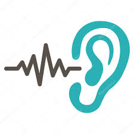
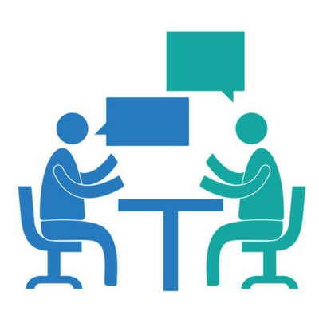
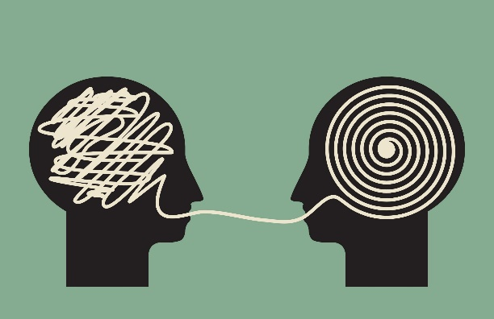
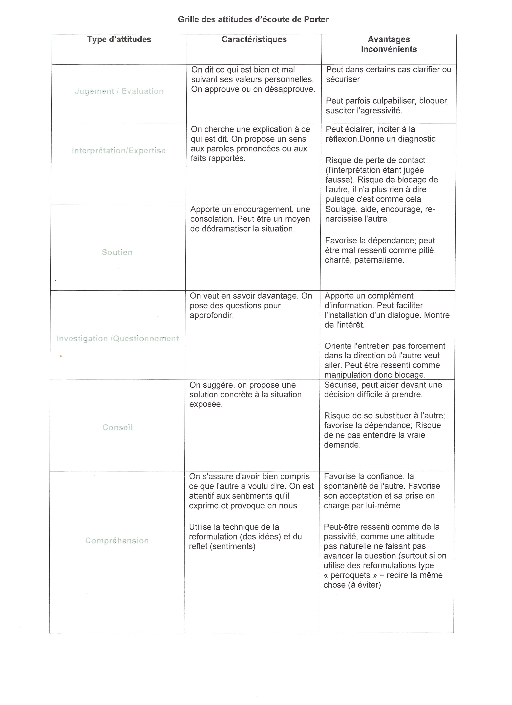
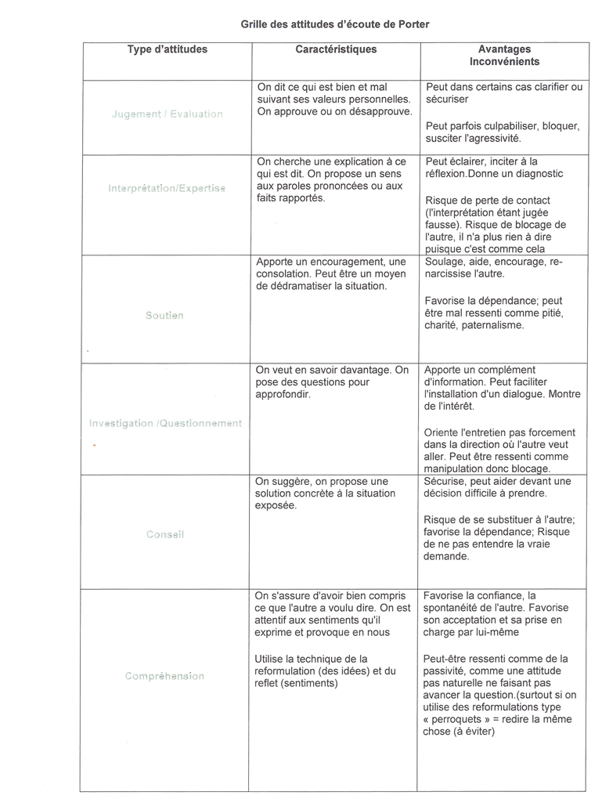
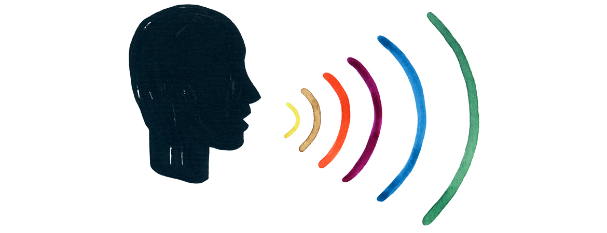

# ECE - 6. Attitudes et interventions -13-10-24.pptx

[Ouvrir l’original](https://drive.google.com/open?id=1k_m6v-owrPwT3hMF2xPS-bvw7IqkfzBP) · Texte structuré depuis le fichier original. Les mises en page complexes peuvent nécessiter une vérification.

## Diapositive 1

Ecoute et Conduite d’Entretien

Support de cours

18/10/2024

Ecoute et Conduite d'Entretien

1

## Diapositive 2

6. ATTITUDES ET INTERVENTIONS

18/10/2024

Ecoute et Conduite d'Entretien

2

## Diapositive 3

ATTITUDES ET COMPORTEMENTS

Ecoute et Conduite d'Entretien

18/10/2024

3

## Diapositive 4

CONSTAT

Ecoute et Conduite d'Entretien

Dans un monde de plus en plus bruyant….

Nous perdons notre capacité à écouter….

Voir  et débattre de : https://www.ted.com/talks/julian_treasure_5_ways_to_listen_better?language=fr 

18/10/2024

4

**Notes**

Projection du TED JulianTreasure_2011G-low-fr  (les étudiants doivent prendre note pour débattre : les fondamentaux à retenir/ ce qui a surpris…) possibilité de faire l’exercice du silence durant 3 min et analyser le ressenti  
Garder en tête les 5 manières de réaccorder nos oreilles durant toute la séance…

## Diapositive 5

Dans quelles circonstance / à quelles occasions sommes-nous amenés à véritablement écrouter ?

18/10/2024

Ecoute et Conduite d'Entretien

5

## Diapositive 6

ATTITUDES ET COMPORTEMENTS

Quelle différence entre attitude et comportement? 

Quelle définition donner à ATTITUDE? 

Quelle définition donner à COMPORTEMENT? 

Ecoute et Conduite d'Entretien

18/10/2024

6

**Notes**

A première vue attitude et comportement désignent la même chose: « l'état d'esprit qui caractérise la réaction d'une personne face à une situation ou une interaction interpersonnelle ». on comprend très bien cette définition lorsque l’on dit «  je n’aime pas ce comportement », « il n’a pas la bonne attitude » Cela fait souvent référence à une réaction inappropriée face à un événement, souvent une difficulté. 

Pourtant il existe une différence: 

L’attitude : 
est une manière d’être et de définir ses opinions / ex : « son attitude à l’égard de son chef de projet est intransigeante »
Une sorte de masque derrière lequel on cache ses réelles pensées et intentions/ ex: » il fait le gros dur pour se donner un genre…ce n’est qu’une attitude…car vraiment quand on le connait il n’est pas du tout comme ça! »

L'attitude est un état mental prédisposé à réagir d'une certaine manière devant les circonstances. Cet état mental est le fruit de la génétique, de l'éducation mais aussi de la volonté propre de l'individu. On peut faire évoluer son attitude.

Ex: elle a une attitude totalement passive quand il s’agit de défendre le budget concernant les loisirs/ j’adore son attitude elle est toujours partante pour tout! 

Comportement: 

Un comportement est l'action ou la réaction observable d'une personne (mais aussi des êtres vivants en général et des objets inertes) dans un environnement.

Ex: Devant les discours politiques, il adopte toujours un comportement méfiant./ Il aime étudier le comportement des planètes (synonyme de fonctionnement).

Pour conclure: 

L’attitude est plutôt réservée aux personnes ( on ne parle pas de l’attitude de la faune ou de la flore mais plutôt du comportement des espèces…)
Par contre, le comportement se réfère le plus souvent à un fonctionnement permanent, Une attitude peut être circonstancielle et masquée le réel comportement de quelqu'un.

L'attitude, bien qu'elle puisse désigner une action ou une réaction, se réfère très souvent à une posture mentale : une expression de visage (même impassible ou froide) et une opinion ou au contraire une réserve. On parle d'attitude mentale. Un comportement est toujours dirigé vers l'extérieur et l'action. 

Cela dit dans le sens commun, attitude et comportement sont des synonymes et, dans de nombreux contextes, on peut remplacer l'un par l'autre.

## Diapositive 7

ATTITUDES ET COMPORTEMENTS

Nous avons donc des attitudes spontanées!

Nos attitudes les plus                              facilitent nos interactions interpersonnelles 

Nos attitudes peuvent induire des biais importants lors de la collecte d’information: 

Du plus bloquant au plus facilitant

De la centration sur soi à la centration sur l’autre

De l’expression à l’écoute 

Ecoute et Conduite d'Entretien

18/10/2024

7

**Notes**

Quand je suis en relation avec une autre personne, ma manière d'agir ou de réagir avec lui va influencer son comportement. On constate qu'on a souvent un style privilégié, une prédisposition permanente à agir d'une certaine manière vis-à-vis d'autrui, dans une situation donnée. Ce qui permet à quelqu'un qui me connaît bien de prévoir mes réactions. C'est ce qu'on appelle notre attitude. 
Je peux être plus spontanément porté à évaluer ou à interpréter ce que l'autre me dit, à lui proposer des solutions, à lui poser des questions, à faire des blagues, à lui manifester ma sympathie, à pleurer avec lui, ou à essayer de le comprendre vraiment. 
Il est important de découvrir quelle est l'attitude qui me vient spontanément, sans réfléchir, parfois même sans en être conscient, quand je suis en interaction avec une autre personne. En effet, certaines attitudes facilitent plus ou moins la communication. 
Mon attitude est sous-jacente à mon comportement. Elle s'exprime, elle transpire à travers mes comportements verbaux (le contenu de mes paroles) et non verbaux (le ton de ma voix, l’expression de mon visage et mes postures corporelles). 
Il faut savoir que, dans la collecte d’information, mes attitudes peuvent introduire des biais importants, c’est à dire modifier les informations que je vais recueillir. Plus une personne aborde des sujets qualitatifs, subjectifs, plus ce qu'elle pourra dire va dépendre de la situation, du contexte, de la manière dont je vais m'adresser à elle, lui répondre... 
Un mot, un geste, un sourire, un froncement de sourcil peuvent modifier radicalement la réponse. 
L'ensemble de ces comportements VERBAUX et NON-VERBAUX qui extériorisent une attitude interne constitue un type d'intervention. C'est ce qui va être perçu par notre interlocuteur comme le message que nous lui envoyons. 
On peut classer les types d'intervention sur une échelle qui irait du plus bloquant au plus facilitant, de la centration sur soi à la centration sur l'autre, de l’expression à l’écoute. Evidemment il ne s'agit pas d'une science exacte mais d'une probabilité plus ou moins grande de faciliter l'expression de l'autre. 

## Diapositive 8

ATTITUDES ET COMPORTEMENTS

Quand je suis en relation avec une autre personne, ma manière d'agir ou de réagir avec lui va influencer son comportement.

On constate qu'on a souvent un style privilégié, une prédisposition permanente à agir d'une certaine manière vis-à-vis d'autrui, dans une situation donnée.

Ce qui permet à quelqu'un qui me connaît bien de prévoir mes réactions. C'est ce qu'on appelle notre attitude. 

Je peux être plus spontanément porté à évaluer ou à interpréter ce que l'autre me dit, à lui proposer des solutions, à lui poser des questions, à faire des blagues, à lui manifester ma sympathie, à pleurer avec lui, ou à essayer de le comprendre vraiment. 

18/10/2024

Ecoute et Conduite d'Entretien

8

## Diapositive 9

ATTITUDES ET COMPORTEMENTS

Il est important de découvrir quelle est l'attitude qui me vient spontanément, sans réfléchir, parfois même sans en être conscient, quand je suis en interaction avec une autre personne.

En effet, certaines attitudes facilitent plus ou moins la communication. 

Mon attitude est sous-jacente à mon comportement. Elle s'exprime, elle transpire à travers mes comportements verbaux (le contenu de mes paroles) et non verbaux (le ton de ma voix, l’expression de mon visage et mes postures corporelles). 

18/10/2024

Ecoute et Conduite d'Entretien

9

## Diapositive 10

ATTITUDES ET COMPORTEMENTS

Il faut savoir que, dans la collecte d’information, mes attitudes peuvent introduire des biais importants, c’est à dire modifier les informations que je vais recueillir.

Plus une personne aborde des sujets qualitatifs, subjectifs, plus ce qu'elle pourra dire va dépendre de la situation, du contexte, de la manière dont je vais m'adresser à elle, lui répondre... 

Un mot, un geste, un sourire, un froncement de sourcil peuvent modifier radicalement la réponse. 

18/10/2024

Ecoute et Conduite d'Entretien

10

## Diapositive 11

ATTITUDES ET COMPORTEMENTS

L'ensemble de ces comportements VERBAUX et NON-VERBAUX qui extériorisent une attitude interne constitue un type d'intervention. C'est ce qui va être perçu par notre interlocuteur comme le message que nous lui envoyons. 

On peut classer les types d'intervention sur une échelle qui irait du plus bloquant au plus facilitant, de la centration sur soi à la centration sur l'autre, de l’expression à l’écoute.

Evidemment il ne s'agit pas d'une science exacte mais d'une probabilité plus ou moins grande de faciliter l'expression de l'autre. 

18/10/2024

Ecoute et Conduite d'Entretien

11

## Diapositive 12

ATTITUDES ET COMPORTEMENTSLes 6 attitudes de Porter

EMPATHIE

CONSEIL SOLUTION

AIDE SOUTIEN

JUGEMENT

INTERPRETATION

ENQUETE

Ecoute et Conduite d'Entretien

18/10/2024

12

**Notes**

Activités 
Faire voir la Video : https://www.youtube.com/watch?v=9lRfpQ-rXoQ
Faire étudier le Document sur teams: les 6 attitudes de porter et ou les attitudes de porter Anzieu/martin  mettre les étudiants en 6 groupes pour chacun étudies une attitude et puisse l’expliquer au groupe ( travailler de transmission de l’information et d’écoute…) 
Exercice : vrai ou faux les attitudes 

Elias Porter – collaborateur de Carl Rogers

ATTITUDES DE PORTER 
ATTITUDE DE JUGEMENT (EVALUATION)
Elle repose, crée ou renforce une différence de statut entre les acteurs qui privilégie l’évaluateur par rapport à l’évalué. 
Elle favorise une relation de dépendance
EFFETS POSITIFS: Si je suis sincère, en donnant raison à l’autre, je m’engage à ses côtés, au moins moralement. C’est aussi grâce à la critique que l’interlocuteur peut comprendre et reconnaître ses erreurs, à condition qu’il ne soit pas attaqué personnellement.
EFFETS NEGATIFS: J’incite l’autre à considérer sa position actuelle comme la meilleure et à s’y tenir sans faire l’examen critique du problème. Peut provoquer chez l’interlocuteur la défense, la justification, l’agressivité, d’où une surenchère de part et d’autre. 

ATTITUDE DENQUETE (INVESTIGATION - EXPLORATION)
Celui qui l’adopte pose de nombreuses questions, cherche à en savoir plus, demande des détails...
EFFETS POSITIFS: Permet d’aborder tous les aspects, de rassembler le maximum d’informations et de ne pas conclure trop vite sur des apparences. Je manifeste mon intérêt pour le problème posé et le désir de comprendre.
EFFETS NEGATIFS: Risque d’impatienter ceux qui voudraient aller droit aux conclusions. Certains vivent cela comme un interrogatoire. 

ATTITUDE D’INTERPRETATION
Elle consiste à verbaliser à l’autre les raisons cachées qui sous-tendent son expression ou son comportement. :Si vous avez échoué à votre examen, c’est à cause de vos histoires d’argent...Comme pour l’évaluation, l’interprétation crée une différence de statut. La différence de statut ne se fait pas par rapport à une norme comme dans l’évaluation, mais par rapport au savoir : relation de dépendance.
EFFETS POSITIFS : Permet de traiter un problème avec l’autre en lui proposant des solutions. Je reformule ce qui est dit dune autre façon pour donner plusieurs éclairages et approches du problème. Mais en fait, le fonctionnement psychologique de l’individu est tel que plus l’interprétation est juste, plus elle risque de générer le blocage ou l’agressivité. Elle facilite le développement des mécanismes de défense.
EFFETS NEGATIFS: Risque de formuler des interprétations erronées sur ce qui est dit et surtout sur les sentiments et opinions de l’interlocuteur. La personne refuse de parler si les interprétations sont trop hâtives. 

ATTITUDE D’AIDE ET SOUTIEN 
Ne t’en fais pas, ce n’est pas grave, çà s’arrangera... Je vais te prêter ma voiture en attendant que la tienne soit retrouvée...
EFFETS POSITIFS :Si ce que ressent l’autre est tellement fort (colère, dépression, peur,...),l’attitude de soutien le rassure et il se sent pris en charge moralement.
EFFETS NEGATIFS: Cette attitude ne permet pas de s’occuper réellement du problème; c’est une façon de s’en débarrasser à bon compte, avec des "bons sentiments". 

ATTITUDE DE CONSEIL
Elle consiste à proposer à l’autre des solutions ou des éléments de solutions par rapport à ce qui semble être son problème ou sa demande : moi, à ta place, voilà ce que je ferais...
EFFETS POSITIFS:
Je propose une solution, je suis constructif. Je donne des idées à celui qui n’a pas pensé à tel ou tel aspect d’un problème, permettant une plus grande rapidité dans l’application.
EFFETS NEGATIFS: Si ma solution vient trop tôt ou est inappropriée, elle suscite plus de résistance que de conviction et limite l’autonomie de l’autre. 

ATTITUDE DE COMPREHENSION (REFLET).Il s’agit de manifester un intérêt à ce que dit l’autre et un souci, une volonté de comprendre ce que l’autre exprime, ce qui exclut toute volonté ou connotation d’évaluation.Elle consiste principalement à "refléter" ce que l’autre me dit, en utilisant principalement la technique de la reformulation .
EFFETS POSITIFS: L’autre sent que je l’écoute car je me fais l’écho de ce quil dit. Il perçoit que je suis prêt à comprendre et non à juger. Je facilite ma propre écoute, j’incite mon interlocuteur à s’exprimer davantage à mieux poser son problème et à cherche rlui-même ses propres solutions.
EFFETS NEGATIFS: Pour certaines personnes et dans des cas particuliers, je montre un refus de m’engager, de dire ce que je pense réellement. Mon interlocuteur peut se sentir en insécurité. 

Résumé succinct des 6 attitudes de PORTER :
ATTITUDES SPONTANEES JUGEMENT je trouve que vous avez raison, ou tort,... 
INTERPRETATION Si vous ..., c’est parce que... 
AIDE ET SOUTIEN Je vous comprends, ce n’est pas grave, ça va s’arranger, ne vous en faites pas,....Je vais vous donner un coup de main, laissez moi faire... 
ENQUETE Pourquoi, comment, avec qui, combien???????? 
DECISON Voilà ce qu’il faut faire !:... 
COMPREHENSION Si je vous entends bien, vous pensez que...(reformulation), Vous me dites que....(reformulation

## Diapositive 13

Quelles attitudes de Porter vous semblent appropriées à la démarche de l’entretien semi-directif, dans le cadre d’une recherche d’informations ?

18/10/2024

Ecoute et Conduite d'Entretien

13

## Diapositive 14

18/10/2024

Ecoute et Conduite d'Entretien

14

Jugement / Evaluation

## Diapositive 15

18/10/2024

Ecoute et Conduite d'Entretien

15

Interprétation / Expertise

## Diapositive 16

18/10/2024

Ecoute et Conduite d'Entretien

16

Soutien

## Diapositive 17

18/10/2024

Ecoute et Conduite d'Entretien

17

Investigation / questionnement

## Diapositive 18

18/10/2024

Ecoute et Conduite d'Entretien

18

Conseil

## Diapositive 19

18/10/2024

Ecoute et Conduite d'Entretien

19

Empathie / Compréhension

## Diapositive 20

TYPOLOGIE DES INTERVENTIONS

Ecoute et Conduite d'Entretien

18/10/2024

20

## Diapositive 21

Quels sont tous les types d’interventions possibles en entretien semi-directif ?

18/10/2024

Ecoute et Conduite d'Entretien

21

## Diapositive 22

TYPOLOGIE DES INTERVENTIONS

Imaginez-vous en situation d’entretien … vous menez l’entretien…

Quels types d’interventions pouvez-vous faire pour maintenir une interaction interpersonnelle? 

Ecoute et Conduite d'Entretien

18/10/2024

22

## Diapositive 23

TYPOLOGIE DES INTERVENTIONSLes prises de position

Ecoute et Conduite d'Entretien

| Type  | REACTIONS |
| --- | --- |
| Agression  | ridiculiser (humour mal placé), disputer, menacer, chantage  |
| Evitement | dévier, parler d'autre chose, faire comme si on n’avait pas entendu...  |
| Jugement | évaluation positive ou négative, féliciter, blâmer, faire la morale...  |
| Pitié  | plaindre, consoler, rassurer, dédramatiser => réduire ou nier l'intensité du sentiment exprimé...  |
| Interprétation  | expliquer à l'autre les raisons de son comportement, jouer au psychologue  |
| Solution  | ordres, conseils, argumentation...  |

18/10/2024

23

**Notes**

Exercice : les attitudes d’écoute ( utilisation du tableau prise de position) 
On peut également remarquer qu'on trouve beaucoup plus d'exemples de prise de position que de feed back. Je ne suis jamais obligé d'écouter l'autre. J'ai le droit de prendre position, de le juger, de le plaindre, de l'envoyer balader, ou de trouver des solutions à sa place. Simplement il faut savoir que ces types d'intervention ne facilitent pas la communication, ne favorisent pas l'autonomie de notre interlocuteur et ont tendance à développer chez lui des réactions de passivité, de dépendance ou d'hostilité. 
Dans certaines situations, quand je conduis un entretien ou quand j'anime une réunion par exemple, ma responsabilité, mon rôle est de faciliter au maximum la parole de l'autre. Chacune de mes paroles, chacun de mes comportements, peut y contribuer ou, au contraire, y faire obstacle. Plus je prends position, plus je m’exprime et plus je risque d’influencer mon interlocuteur. Ce type d’intervention peut être très efficace dans un exposé, une négociation ou un débat contradictoire, mais il paraît assez évident qu’il est à proscrire dans un entretien de collecte d’information. 
Méfions-nous du fameux « oui, mais... », qui est un bon échappatoire pour ne pas écouter, et revenir subrepticement à la prise de position. 

## Diapositive 24

TYPOLOGIE DES INTERVENTIONSLes Questions

Ecoute et Conduite d'Entretien

Entretien d’enquête = recherche d’informations

On distingue les questions ouvertes des questions fermées

Les contenus neutres, orientés ou inductifs…

	       La question qui tue:  Question interro-négative (fermée et orientée) 

18/10/2024

24

**Notes**

Donnez un exemple de question interro-négative fermée et orientée: Ah bon, vous n’aimez pas ma solution ? 

## Diapositive 25

TYPOLOGIE DES INTERVENTIONSLes Questions

Ecoute et Conduite d'Entretien

Les questions ouvertes permettent : 

 Des réponses longues et personnelles

À l’interlocuteur de structurer sa réponse selon sa propre logique

18/10/2024

25

**Notes**

Comment formuler une question ouverte? 

Personnellement je ne pose jamais des questions ouvertes en entretien semi-directif commençant par «  que pensez-vous »…cela induit une opinion et l’idée justement et d’avoir un contenu le plus objectif possible je favorise les formulations du type: 

Pourriez-vous expliquer les dernières innovations de l’iphone X? 
Quelles sont les attitudes que vous attendez de vos collaborateurs en réunion? 
Quelle est l’intérêt du télétravail? 
Pourriez-vous décrire votre activité professionnelle? 
 

## Diapositive 26

TYPOLOGIE DES INTERVENTIONSLes Questions

Ecoute et Conduite d'Entretien

Les questions fermées : 

 Des réponses courtes

Enferme l’interlocuteur dans une logique dichotomique

PAS LA BONNE FORMULATION pour obtenir de l’information dans le cadre d’un entretien d’enquête 

18/10/2024

26

**Notes**

Exemple de question fermé « Aimez-vous les caractères italiques ? 
« Préférez-vous les caractères italiques ou les caractères gras ? 

Cependant la question fermée n’est pas à rejeter totalement… elle peut être utile pour préciser certains points ou prendre un rdv comme:  Préférez-vous qu’on se voie mardi midi ou mercredi à 16 heures ? » 

Une condition indispensable pour se permettre de fermer une question : 
avoir envisagé tous les cas de réponse possible. 

## Diapositive 27

TYPOLOGIE DES INTERVENTIONSLes Questions

Ecoute et Conduite d'Entretien

Les questions au contenu inducteur 

                                                          A BANIR 

Attention l’induction peut se manifester dans le ton de la voix!

18/10/2024

27

**Notes**

Exemple de question inductrice, que l’on peut aussi appeler question biaisée:   Pensez-vous acheter prochainement une voiture électrique, sachant que ce type de véhicule émet deux fois moins de C02 et réduit vos dépenses énergétiques, alors? ». 

## Diapositive 28

TYPOLOGIE DES INTERVENTIONSLes Questions

Ecoute et Conduite d'Entretien

Les questions interro-négative (fermée et orientée) 

« Ah bon, vous n’aimez pas ma solution ? 

« Vous n’allez quand même pas me dire que vous n’aimez pas ça ? » 

« Ne pensez-vous pas que ce serait quand même plus efficace d’utiliser cet outil ? » 

« Il est pas beau, ce logarithme ? » 

18/10/2024

28

**Notes**

une prise de position hypocritement déguisée

## Diapositive 29

TYPOLOGIE DES INTERVENTIONSLes Questions

Ecoute et Conduite d'Entretien

Attention trop de questions…. TUENT les interactions! 

Surtout les questions fermées 

Moins de questions …. Mais……  mieux formulées

18/10/2024

29

**Notes**

Contrairement à nos idées reçues, la question n'est pas la seule manière, ni la meilleure, d'aller chercher des informations. Sous l'influence de l'environnement scolaire ou médiatique qui nous modèle, nous voyons l'interview comme une suite de questions-réponses. L’interview journalistique consiste à poser des questions, rien que des questions et toujours des questions. A l’inverse, le véritable entretien doit s’efforcer d’utiliser le moins de questions possible. 
L’excès de questions, et a fortiori les questions fermées, induit notre interlocuteur à la passivité : il n’a plus à réfléchir, à prendre position, il se contente de répondre de plus en plus brièvement aux questions posées en d’attendant la suivante. 
C’est cette idée qu’exprime très bien un pédiatre parisien, Aldo NAOURI : 
« J’ai été contraint de mener un interrogatoire serré, comme je déteste le faire parce que je sais depuis longtemps déjà que lorsqu’on pose des questions on n’obtient que des réponses et rien de plus. » (Les filles et leur mère, Odile Jacob, 1998) 

Lors de la dernière séance nous verrons que bien poser son introduction est essentielle pour conduire un entretien de qualité…

## Diapositive 30

TYPOLOGIE DES INTERVENTIONSLes Silences

Ecoute et Conduite d'Entretien

Que dire  des silences ?

Quoi en faire? 

La Maitrise de la parole passe par celle du silence

18/10/2024

30

**Notes**

Test sur le silence: 
Durant 1min30 tout le monde en mode silence sans rien faire…juste écouter le silence… 
En situation interpersonnelle la gestion des silence est plus complexe: 

Un cabinet de consultants témoigne: 
Lors de nos jeux de rôles, nous constatons que les managers ont beaucoup de difficultés à gérer les silences supérieurs à … trois/quatre secondes (faites le test !). Du coup, pour combler ce qui est souvent interprété comme un refus d’échanger, le manager pose une nouvelle question (fermée dans 80% des cas et systématiquement éloignée du sens de la première question). Exemple : « Pourquoi souhaites-tu suivre une formation aux fondamentaux du management ? » … 1, 2, 3 secondes puis le manager reprend la parole « Parce que moi (avec un grand M), je pense qu’une formation de base - message subliminal - en communication te serait davantage profitable. Es-tu d’accord ? » Les expressions autour du silence sont nombreuses : - "la parole est d’argent, mais le silence est d’or" - "son silence en dit long" - "un court silence vaut toujours mieux qu’un long discours" - "silence vaut accord/accepetation" - "être murer dans son silence" - "s'obstiner sans son silence" - "meubler le silence" - .. Alors n’oublions pas le silence fait partie de la communication. Le silence est constitutif du langage. Il ne faut pas en avoir peur lors de vos entretiens individuels. Il est nécessaire à l’échange et permet, tout simplement, à votre interlocuteur de réfléchir. 

## Diapositive 31

TYPOLOGIE DES INTERVENTIONSLes Silences

Ecoute et Conduite d'Entretien

Le silence externe certes…. Avec le sourire = signe d’encouragement à se confier…. Et de disponibilité

Mais aussi le silence interne: faire silence en soi, suspendre mes interprétations, mes préjugés, mes réponses toutes faites. 

18/10/2024

31

**Notes**

Mon silence peut indiquer à l'autre ma disponibilité, mon ouverture, si mon comportement non-verbal exprime l'accueil et l'attention. Le plus difficile dans l’écoute est de savoir respecter les silences de mon interlocuteur, de ne pas le couper, de lui laisser l’espace de la réflexion, de la respiration. Le silence est la grande terreur du récepteur débutant, qui est prêt à tout pour l’éviter, y compris à brusquer son interlocuteur ou même à perdre une information capitale. Avec un peu d’entraînement, on peut repérer assez facilement si notre interlocuteur est en train de réfléchir, d’hésiter, ou s’il attend que nous reprenions la main. Dans le premier cas, surtout ne pas le couper. Un sourire, un petit geste d’encouragement lui permettra de continuer, de reprendre son fil à lui. 
Le silence est une condition nécessaire pour pouvoir écouter l'autre, mais non suffisante. 
Il faut aussi lui manifester clairement qu'on l'écoute et qu'on le comprend. 
C'est justement l’intérêt du feed back. 

## Diapositive 32

TYPOLOGIE DES INTERVENTIONSLes Feedbacks

Ecoute et Conduite d'Entretien

Plusieurs intérêts au feedback 

Montrer de l’intérêt à la personne

Démontrer à son interlocuteur qu’on l’écoute réellement

Vérifier que l’on a bien compris

Permettre à l’interlocuteur qu’on le suit 

Permettre à l’interlocuteur de poursuivre sa réflexion grâce aux synthèses réalisées lors du Feedback 

18/10/2024

32

**Notes**

Indispensable pour sortir du mode dichotomique question/réponse … 
La rétroaction offre plusieurs intérêts : 
- Je démontre à mon interlocuteur que j'écoute réellement ce qu'il dit et que j'accepte qu'il le dise, même si je ne suis pas d’accord avec ses idées. 

- Je lui montre mon intérêt pour sa personne. 

- Je peux vérifier si j'ai bien compris. 

- Grâce au miroir que je lui renvoie, mon interlocuteur peut savoir ce que j’ai réellement compris, ou même parfois ce qu'il a dit. Il peut ainsi corriger, clarifier, compléter, préciser ou valider ce qu’il a dit : 

« Voilà, vous avez compris exactement le fond de ma pensée » 
« Non, ce n’est pas précisément ce que je voulais dire, en fait… » 
- Il peut avancer dans sa réflexion et de ne pas tourner en rond, grâce à mes synthèses successives. 

## Diapositive 33

TYPOLOGIE DES INTERVENTIONSLes Feedbacks

Ecoute et Conduite d'Entretien

Les différents types de Feedback

De réception (encouragement, relance)

  - Accusé de réception, onomatopées

  - Question-ricochet

  - Demande de précision et écho (répéter le dernier mot)

De compréhension (reformulation, résumé)

      « Si j’ai bien compris… »

  - D’empathie (ressenti en reflet, écoute active) 

     « J’ai l’impression que … »

Attention! Vérifiez la compréhension réciproque du vocabulaire … 

18/10/2024

33

**Notes**

Mise en situation avec les étudiants en trinome: ( deux en situation, 1 en observateur)
Simuler un entretien avec rédaction de la première question ouverte…  puis éprouver les différents types de feedback… 
Plus exercice sur la reformulation document sur AREL:  exercice de formulation

## Diapositive 34

LES CONDITIONS DE BASE DE L’ECOUTE

Ecoute et Conduite d'Entretien

18/10/2024

34

## Diapositive 35

LES CONDITIONS DE BASE DE L’ECOUTE

Ecoute et Conduite d'Entretien

  - Le vouloir (accepter de se laisser envahir par l’univers de l’autre) et le pouvoir (travailler cette compétence)

  - Etre disponible mentalement et physiquement

  - Etre conscient de ses propres préjugés, de ce que l’on peut induire chez l’autre, même involontairement

  - Etre présent totalement à l’autre

  - Respecter l’autre dans sa différence

  - Ne porter aucun jugement

  - Ne pas interrompre l’autre

  - Ne pas orienter le contenu

18/10/2024

35

**Notes**

En résumé, pour véritablement écouter l’autre : 
- D'abord le vouloir et le pouvoir : accepter de se laisser envahir par son univers. 
- Etre disponible mentalement et physiquement (fatigue, préoccupations, urgences, ressentiments...) 
- Se rendre totalement présent à l'autre. 
- Etablir une relation qui engage les deux personnes, avec toute leur personnalité, dépasser les rôles, les fonctions sociales, les positions hiérarchiques, mais en respectant le cadre et les contraintes de la situation. 
- Respect absolu de l'originalité de l'autre, de sa différence. 
- Ne pas porter de jugement sur la personne. 
- Ne pas intervenir sur le fond, laisser l'autre trouver sa propre solution. 
- S'engager dans la relation sans orienter le contenu. 
Etre conscient de ses préjugés, de ce qu'on peut induire chez l'autre, même involontairement. 

Faire le jeu du sous-marin choisir son dessin ou sur AREL  document dessin ECE
Plus lecture en groupe et synthèse du document sur AREL:  écoute active 

## Diapositive 36

LES CONDITIONS DE BASE DE L’ECOUTEL’empathie et l’écoute 

Ecoute et Conduite d'Entretien

écoute / empathie= écoute active et bienveillante

18/10/2024

36

**Notes**

Étude des dernières pages du poly sur sur Edgar Poe/Rogers…
Plus exercice sur document Ecoute 

## Diapositive 37

BILANEntretien et écoute

Ecoute et Conduite d'Entretien

Qu’avez-vous retenu? 

18/10/2024

37

## Diapositive 38

Activités en classe

18/10/2024

Ecoute et Conduite d'Entretien

38

## Diapositive 39

Comment formuler une question en entretien semi-directif ?

18/10/2024

Ecoute et Conduite d'Entretien

39

## Diapositive 40

Voici une question posée dans le cadre d’un entretien semi-directif auprès d’un professionnel :

« L’activité de la filiale en Ile-de-France a-t-elle un impact négatif sur la conservation de la biodiversité du site industriel ? »

Que pensez-vous de cette question dans sa formulation ?

Recensez les défauts éventuels d’une telle formulation.

Proposez le cas échéant une formulation alternative.

18/10/2024

Ecoute et Conduite d'Entretien

40

## Diapositive 41

Les défauts de la question ainsi formulée seraient les suivants* :

La question est fermée, ce qui oblige l’interlocuteur à répondre par oui ou par non.

La question est doublement orientée par :

  - l’expression « impact négatif », accusatrice ou en en tout cas négative, qui induit une réponse biaisée.

  - plus subtilement, le terme « conservation » qui limite peut-être inutilement le champ de la réponse.

* : Tout dépend évidemment du contexte, aucune question n’est a priori totalement exclue.

18/10/2024

Ecoute et Conduite d'Entretien

41

## Diapositive 42

Une formulation à envisager, à la fois ouverte, relativement neutre et suffisamment précise serait :

« Quels seraient, à votre avis, les impacts de l’activité de la filiale en Ile-de-France sur la biodiversité autour du site industriel ? »

18/10/2024

Ecoute et Conduite d'Entretien

42

## Diapositive 43

Quelles interventions faire en entretien semi-directif ?Exercice de mise en situation : silence, feedback, reformulation

18/10/2024

Ecoute et Conduite d'Entretien

43

## Diapositive 44

MOI : « Comment s’est déroulée la mise en place des normes ISO 14 000 et ISO 26 000 ? »

INTERVIEWE.E : « Dans le contexte des nouvelles normes ISO 14000 et ISO 26000 mises en place, nous avons dû revoir tous nos processus opérationnels. C’est vraiment un énorme chantier, extrêmement chronophage ! Nous avons constitué des équipes projets réunissant différentes compétences, terrain mais aussi support, pour atteindre nos objectifs, avec un calendrier précis à respecter. Cela a causé une grosse surcharge de travail, certains collègues sont au bord du burn out, je vous laisse imaginer… En même temps, c’est vraiment une étape importante pour l’entreprise, ce sont des questions fondamentales qui nous obligent à nous projeter à moyen et à long terme… ce que par ailleurs on ne fait pas très souvent dans la vie des entreprises. » (Rire… Silence)

MOI : ???

Comment poursuivre ici ?

Quelles interventions sont-elles envisageables ?

Dans quel(s) but(s)?

Imaginez la suite immédiate de cet entretien et rédigez les interventions auxquelles vous pensez.

18/10/2024

Ecoute et Conduite d'Entretien

44

## Diapositive 45

Ici, il me semble qu’il faudrait d’abord attendre de voir si l’interlocuteur poursuit de lui-même le propos ou bien si le silence se prolonge.

Dans un premier temps, on pourrait simplement acquiescer ou reformuler en écho une partie de la dernière phrase, par exemple : « vous projeter à moyen et long terme… ».

18/10/2024

Ecoute et Conduite d'Entretien

45

## Diapositive 46

On pourrait ensuite, si le silence s’est installé, proposer une reformulation sous forme de synthèse :

« Si je comprends bien, la mise en place des normes ISO de portée environnementale et sociétale* a demandé une organisation spécifique qui induit une surcharge de travail importante, mais c’est également, vous m’avez dit il me semble, une étape stratégique pour votre entreprise… ».

On verrait ensuite si l’interlocuteur est relancé. 

* : Ce qui suppose de les avoir bien identifiées comme telles en amont, dans le travail de recherche préalable. Sinon, il faudra demander des précisions sur ces normes.

18/10/2024

Ecoute et Conduite d'Entretien

46

## Diapositive 47

Si l’interlocuteur se contente d’acquiescer, on pourrait formuler une (ou plusieurs) demande(s) de précisions sur un (ou plusieurs) point(s), selon la dynamique de l’entretien :

Quels processus opérationnels sont ici concernés, en particulier ?

Et comment, alors, fonctionnent ces équipes projets qui ont été créées ? 

Vous m’avez parlé de « burn out ». Comment la direction réagit-elle à cet épuisement de certains salariés ?

Sans oublier de recentrer sur l’interlocuteur :

Et vous, en particulier, comment intervenez-vous dans ce dossier ?

18/10/2024

Ecoute et Conduite d'Entretien

47

## Diapositive 48

Cette demande de précisions pourrait enfin servir de transition pour aborder l’avenir de l’entreprise et l’évolution des missions de l’interlocuteur, dans le cadre de la RSE.

Et vous, quelles réflexions à moyen et long terme sur l’avenir de l’entreprise menez-vous, dans une telle perspective ? Sur quels aspects, plus précisément ?

En quoi cela change-t-il votre manière de considérer vos missions ?

18/10/2024

Ecoute et Conduite d'Entretien

48

## Diapositive 49

Analyse d’un extrait d’entretien

18/10/2024

Ecoute et Conduite d'Entretien

49

## Diapositive 50

Analyse d’un extrait d’entretien

18/10/2024

Ecoute et Conduite d'Entretien

50

Quelles remarques peut-on faire sur cette séquence d’entretien semi-directif ?

Repérez les principales interventions ?

Aurait-on pu en faire de meilleures ?

## Diapositive 51

Mise en situation

18/10/2024

Ecoute et Conduite d'Entretien

51

## Diapositive 52

Mise en situation

Vous allez réaliser un mini-guide d’entretien, avec 3 questions ouvertes, portant sur les raisons pour lesquelles un.e étudiant.e peut choisir CY TECH.

Vous fonctionnerez ensuite en binôme, vous ferez passer un entretien de 5 minutes à un camarade, et vous conclurez cet entretien par une synthèse-reformulation.

Votre camarade vous dira si cette synthèse est satisfaisante ou pas.

Nous ferons un debrief de cette activité avec toute la classe.

18/10/2024

Ecoute et Conduite d'Entretien

52
