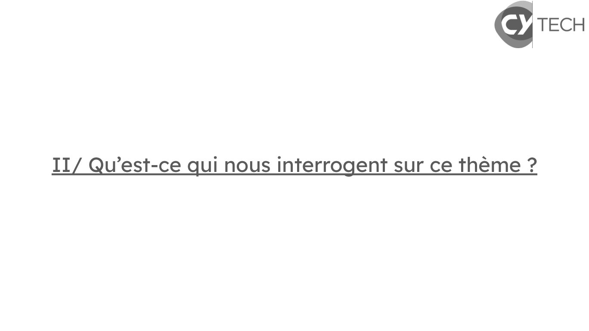
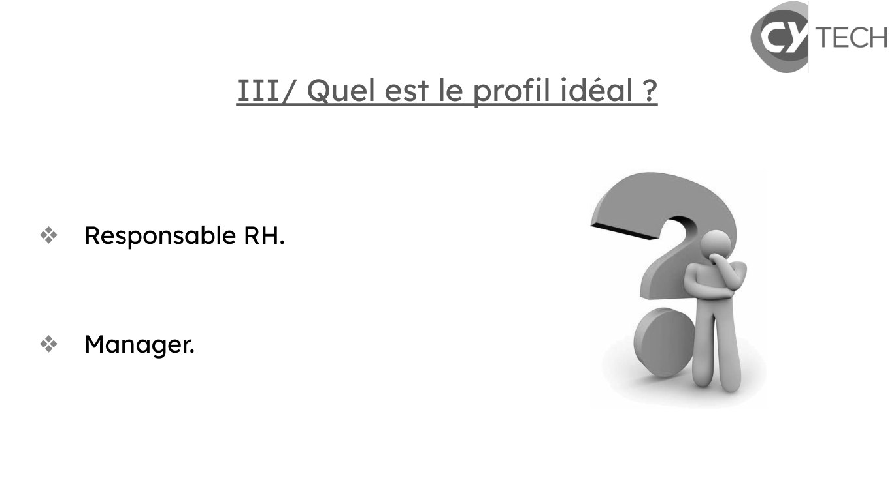
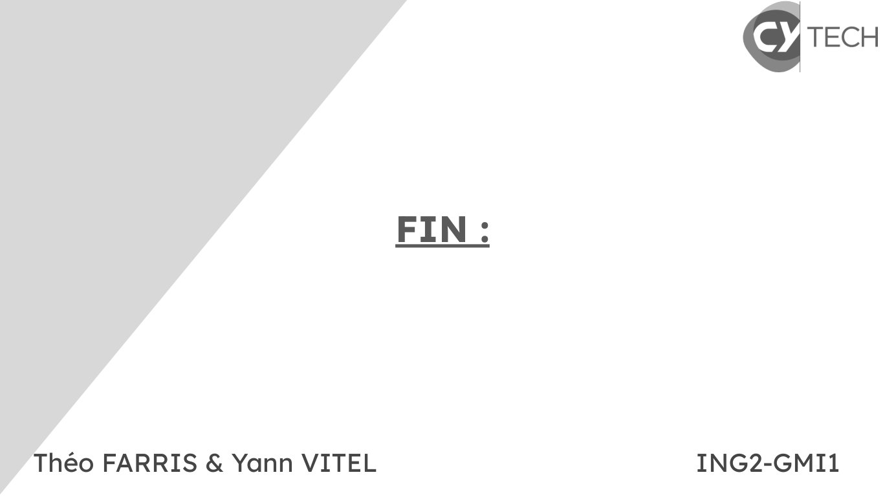

# FARRIS-VITEL-Oral 1.pdf

[Ouvrir l’original](https://drive.google.com/open?id=1tKG5wxK4cTSE6DNn-WOKcWk7HDTzH8eK) · Les pages signalées comprennent du texte reconnu automatiquement ou des éléments graphiques. Le fac-similé permet de vérifier chaque lecture.

**Pages avec fac-similé ou lecture OCR** — 4–5, 8.

## Page 1

~~~text
       La transition écologique dans le
             domaine bancaire :

Théo FARRIS & Yann VITEL            ING2-GMI1
~~~

## Page 2

~~~text
 La transition écologique dans le domaine bancaire :

I/ Présentation du thème.
   a. Contexte.
   b. Lien avec le domaine bancaire.
II/ Qu’est-ce qui nous interrogent sur ce thème.
III/ Quel est le profil idéal.
IV/ Piste de recherches.
V/ Bibliographie.
~~~

## Page 3

~~~text
                        I/ Présentation du thème :

 a. Contexte :
❖ Les enjeux de la transition écologique.
      ○   Environnementaux.
      ○   Économique.
      ○   Sociaux.
 b. Lien avec le domaine bancaire :
❖ Acteurs financiers majeurs.
❖ Financement des projets écologiques / polluant.
~~~

## Page 4

~~~text
II/ Qu’est-ce qui nous interrogent sur ce thème ?
~~~

**Lecture OCR à contrôler**

~~~text
S TECH

II/ Qu’est-ce qui nous interrogent sur ce theme ?
~~~

## Page 5

~~~text
             III/ Quel est le profil idéal ?

❖ Responsable RH.

❖ Manager.
~~~

**Lecture OCR à contrôler**

~~~text
S TECH

III/ Quel est le profil idéal ?

“Responsable RH.

“ Manager.
~~~

## Page 6

~~~text
                IV/ Piste de recherches :

❖ Réseau Personnel.

❖ Réseau Professionnel.
~~~

## Page 7

~~~text
                                          V/Bibliographie :
❖   https://oeconomicus.fr/les-banques-centrales-acteurs-cles-de-la-transition-ecologique/

❖   Responsabilité Sociétale d'Entreprise - SFIL

❖   Principles for Responsible Banking – United Nations Environment – Finance Initiative (unepfi.org)

❖   https://www.credit-agricole.com/responsable-et-engage/notre-strategie-rse-etre-acteur-d-une-societe-durable

❖   Le projet sociétal du groupe Crédit Agricole | Crédit Agricole 1re banque1 (credit-agricole.com)

❖   « Sur les routes des Transitions » | Crédit Agricole (credit-agricole.com)

❖   ChatGPT

❖   https://www.labanquepostale.com/responsabilite-societale-des-entreprises/nos-engagements/engagements-envers-la-plan
    ete/transition-ecologique-bancaire.html

❖   Rapport Oxfam France : Notation des banques françaises, critère « changement climatique

❖   https://www.banque-france.fr/fr/banque-de-france/banque-centrale-engagee/changement-climatique-finance-durable
~~~

## Page 8

~~~text
                           FIN :

Théo FARRIS & Yann VITEL           ING2-GMI1
~~~

**Lecture OCR à contrôler**

~~~text
€ TECH

héo FARRIS & Yann VITEL ING2-GMI1
~~~
