# Chapitre_1_Offre_et_Demande.pdf

[Ouvrir l’original](https://drive.google.com/open?id=1ncQ5XF6WTg_uJeFLN8yNttTEAUUW_EOe) · Les deux lectures automatiques du PDF divergent sur les pages indiquées. Leur fac-similé accompagne le texte.

**Pages présentant un écart entre les deux extractions** — 1–32.

## Page 1

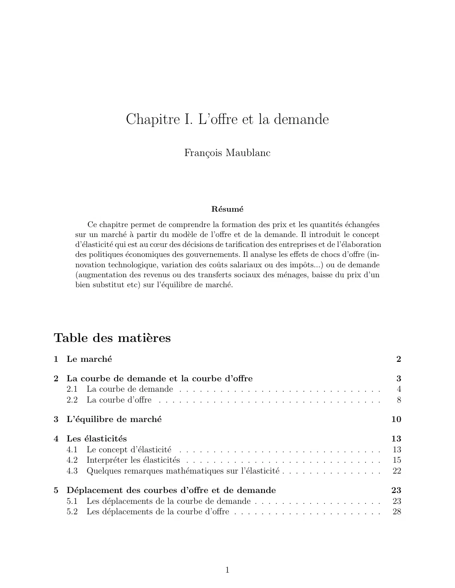

~~~text
                      Chapitre I. L’offre et la demande

                                        François Maublanc

                                                 Résumé
           Ce chapitre permet de comprendre la formation des prix et les quantités échangées
      sur un marché à partir du modèle de l’offre et de la demande. Il introduit le concept
      d’élasticité qui est au cœur des décisions de tarification des entreprises et de l’élaboration
      des politiques économiques des gouvernements. Il analyse les effets de chocs d’offre (in-
      novation technologique, variation des coûts salariaux ou des impôts...) ou de demande
      (augmentation des revenus ou des transferts sociaux des ménages, baisse du prix d’un
      bien substitut etc) sur l’équilibre de marché.

Table des matières
1 Le marché                                                                                                2

2 La courbe de demande et la courbe d’offre                                                                 3
  2.1 La courbe de demande . . . . . . . . . . . . . . . . . . . . . . . . . . . . . .                      4
  2.2 La courbe d’offre . . . . . . . . . . . . . . . . . . . . . . . . . . . . . . . . .                   8

3 L’équilibre de marché                                                                                  10

4 Les élasticités                                                                                        13
  4.1 Le concept d’élasticité . . . . . . . . . . . . . . . . . . . . . . . . . . . . . .                13
  4.2 Interpréter les élasticités . . . . . . . . . . . . . . . . . . . . . . . . . . . . .             15
  4.3 Quelques remarques mathématiques sur l’élasticité . . . . . . . . . . . . . . .                   22

5 Déplacement des courbes d’offre et de demande                                                           23
  5.1 Les déplacements de la courbe de demande . . . . . . . . . . . . . . . . . . .                      23
  5.2 Les déplacements de la courbe d’offre . . . . . . . . . . . . . . . . . . . . . .                   28

                                                      1
~~~

## Page 2

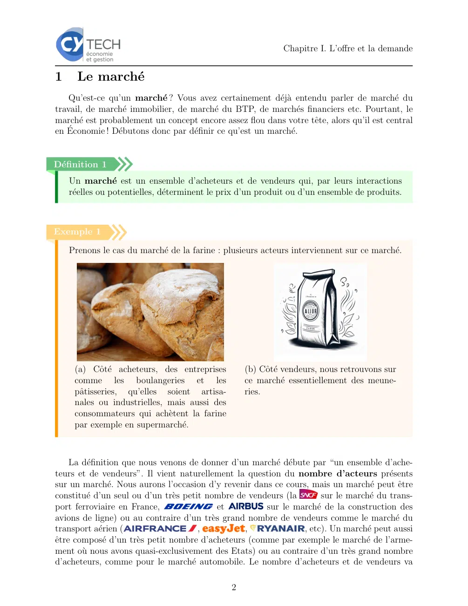

~~~text
                                                             Chapitre I. L’offre et la demande

1     Le marché
    Qu’est-ce qu’un marché ? Vous avez certainement déjà entendu parler de marché du
travail, de marché immobilier, de marché du BTP, de marchés financiers etc. Pourtant, le
marché est probablement un concept encore assez flou dans votre tête, alors qu’il est central
en Économie ! Débutons donc par définir ce qu’est un marché.

Définition 1
    Un marché est un ensemble d’acheteurs et de vendeurs qui, par leurs interactions
    réelles ou potentielles, déterminent le prix d’un produit ou d’un ensemble de produits.

Exemple 1
    Prenons le cas du marché de la farine : plusieurs acteurs interviennent sur ce marché.

     (a) Côté acheteurs, des entreprises         (b) Côté vendeurs, nous retrouvons sur
     comme les boulangeries et les                 ce marché essentiellement des meune-
     pâtisseries, qu’elles soient artisa-         ries.
     nales ou industrielles, mais aussi des
     consommateurs qui achètent la farine
     par exemple en supermarché.

     La définition que nous venons de donner d’un marché débute par “un ensemble d’ache-
teurs et de vendeurs”. Il vient naturellement la question du nombre d’acteurs présents
sur un marché. Nous aurons l’occasion d’y revenir dans ce cours, mais un marché peut être
constitué d’un seul ou d’un très petit nombre de vendeurs (la       sur le marché du trans-
port ferroviaire en France,                et          sur le marché de la construction des
avions de ligne) ou au contraire d’un très grand nombre de vendeurs comme le marché du
transport aérien (                    ,          ,              , etc). Un marché peut aussi
être composé d’un très petit nombre d’acheteurs (comme par exemple le marché de l’arme-
ment où nous avons quasi-exclusivement des Etats) ou au contraire d’un très grand nombre
d’acheteurs, comme pour le marché automobile. Le nombre d’acheteurs et de vendeurs va

                                               2
~~~

## Page 3

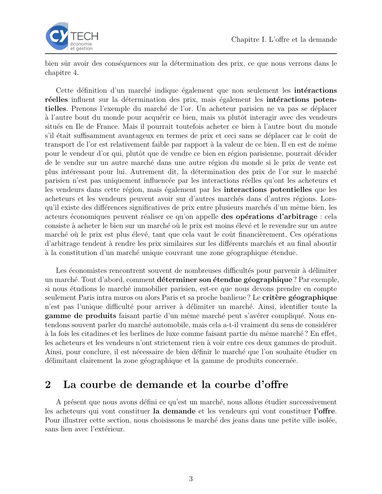

~~~text
                                                               Chapitre I. L’offre et la demande

bien sûr avoir des conséquences sur la détermination des prix, ce que nous verrons dans le
chapitre 4.

     Cette définition d’un marché indique également que non seulement les intéractions
réelles influent sur la détermination des prix, mais également les intéractions poten-
tielles. Prenons l’exemple du marché de l’or. Un acheteur parisien ne va pas se déplacer
à l’autre bout du monde pour acquérir ce bien, mais va plutôt interagir avec des vendeurs
situés en Ile de France. Mais il pourrait toutefois acheter ce bien à l’autre bout du monde
s’il était suffisamment avantageux en termes de prix et ceci sans se déplacer car le coût de
transport de l’or est relativement faible par rapport à la valeur de ce bien. Il en est de même
pour le vendeur d’or qui, plutôt que de vendre ce bien en région parisienne, pourrait décider
de le vendre sur un autre marché dans une autre région du monde si le prix de vente est
plus intéressant pour lui. Autrement dit, la détermination des prix de l’or sur le marché
parisien n’est pas uniquement influencée par les interactions réelles qu’ont les acheteurs et
les vendeurs dans cette région, mais également par les interactions potentielles que les
acheteurs et les vendeurs peuvent avoir sur d’autres marchés dans d’autres régions. Lors-
qu’il existe des différences significatives de prix entre plusieurs marchés d’un même bien, les
acteurs économiques peuvent réaliser ce qu’on appelle des opérations d’arbitrage : cela
consiste à acheter le bien sur un marché où le prix est moins élevé et le revendre sur un autre
marché où le prix est plus élevé, tant que cela vaut le coût financièrement. Ces opérations
d’arbitrage tendent à rendre les prix similaires sur les différents marchés et au final aboutir
à la constitution d’un marché unique couvrant une zone géographique étendue.

     Les économistes rencontrent souvent de nombreuses difficultés pour parvenir à délimiter
un marché. Tout d’abord, comment déterminer son étendue géographique ? Par exemple,
si nous étudions le marché immobilier parisien, est-ce que nous devons prendre en compte
seulement Paris intra muros ou alors Paris et sa proche banlieue ? Le critère géographique
n’est pas l’unique difficulté pour arriver à délimiter un marché. Ainsi, identifier toute la
gamme de produits faisant partie d’un même marché peut s’avérer compliqué. Nous en-
tendons souvent parler du marché automobile, mais cela a-t-il vraiment du sens de considérer
à la fois les citadines et les berlines de luxe comme faisant partie du même marché ? En effet,
les acheteurs et les vendeurs n’ont strictement rien à voir entre ces deux gammes de produit.
Ainsi, pour conclure, il est nécessaire de bien définir le marché que l’on souhaite étudier en
délimitant clairement la zone géographique et la gamme de produits concernée.

2     La courbe de demande et la courbe d’offre
    A présent que nous avons défini ce qu’est un marché, nous allons étudier successivement
les acheteurs qui vont constituer la demande et les vendeurs qui vont constituer l’offre.
Pour illustrer cette section, nous choisissons le marché des jeans dans une petite ville isolée,
sans lien avec l’extérieur.

                                                 3
~~~

## Page 4

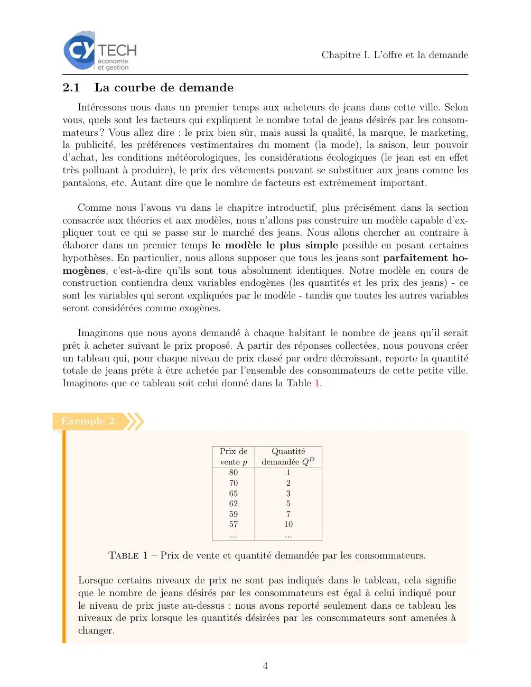

~~~text
                                                               Chapitre I. L’offre et la demande

2.1    La courbe de demande
     Intéressons nous dans un premier temps aux acheteurs de jeans dans cette ville. Selon
vous, quels sont les facteurs qui expliquent le nombre total de jeans désirés par les consom-
mateurs ? Vous allez dire : le prix bien sûr, mais aussi la qualité, la marque, le marketing,
la publicité, les préférences vestimentaires du moment (la mode), la saison, leur pouvoir
d’achat, les conditions météorologiques, les considérations écologiques (le jean est en effet
très polluant à produire), le prix des vêtements pouvant se substituer aux jeans comme les
pantalons, etc. Autant dire que le nombre de facteurs est extrêmement important.

    Comme nous l’avons vu dans le chapitre introductif, plus précisément dans la section
consacrée aux théories et aux modèles, nous n’allons pas construire un modèle capable d’ex-
pliquer tout ce qui se passe sur le marché des jeans. Nous allons chercher au contraire à
élaborer dans un premier temps le modèle le plus simple possible en posant certaines
hypothèses. En particulier, nous allons supposer que tous les jeans sont parfaitement ho-
mogènes, c’est-à-dire qu’ils sont tous absolument identiques. Notre modèle en cours de
construction contiendra deux variables endogènes (les quantités et les prix des jeans) - ce
sont les variables qui seront expliquées par le modèle - tandis que toutes les autres variables
seront considérées comme exogènes.

    Imaginons que nous ayons demandé à chaque habitant le nombre de jeans qu’il serait
prêt à acheter suivant le prix proposé. A partir des réponses collectées, nous pouvons créer
un tableau qui, pour chaque niveau de prix classé par ordre décroissant, reporte la quantité
totale de jeans prête à être achetée par l’ensemble des consommateurs de cette petite ville.
Imaginons que ce tableau soit celui donné dans la Table 1.

Exemple 2

                                     Prix de      Quantité
                                     vente p    demandée QD
                                       80             1
                                       70             2
                                       65             3
                                       62             5
                                       59             7
                                       57           10
                                       ...           ...

           Table 1 – Prix de vente et quantité demandée par les consommateurs.

   Lorsque certains niveaux de prix ne sont pas indiqués dans le tableau, cela signifie
   que le nombre de jeans désirés par les consommateurs est égal à celui indiqué pour
   le niveau de prix juste au-dessus : nous avons reporté seulement dans ce tableau les
   niveaux de prix lorsque les quantités désirées par les consommateurs sont amenées à
   changer.

                                                4
~~~

## Page 5

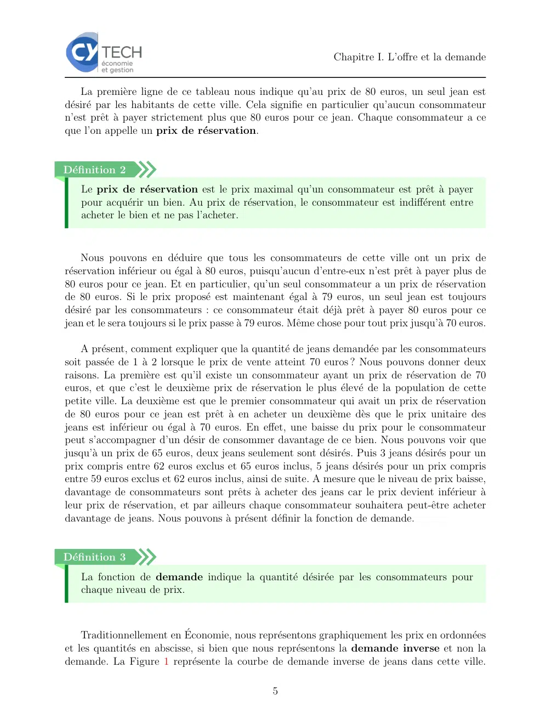

~~~text
                                                               Chapitre I. L’offre et la demande

    La première ligne de ce tableau nous indique qu’au prix de 80 euros, un seul jean est
désiré par les habitants de cette ville. Cela signifie en particulier qu’aucun consommateur
n’est prêt à payer strictement plus que 80 euros pour ce jean. Chaque consommateur a ce
que l’on appelle un prix de réservation.

Définition 2
   Le prix de réservation est le prix maximal qu’un consommateur est prêt à payer
   pour acquérir un bien. Au prix de réservation, le consommateur est indifférent entre
   acheter le bien et ne pas l’acheter.

     Nous pouvons en déduire que tous les consommateurs de cette ville ont un prix de
réservation inférieur ou égal à 80 euros, puisqu’aucun d’entre-eux n’est prêt à payer plus de
80 euros pour ce jean. Et en particulier, qu’un seul consommateur a un prix de réservation
de 80 euros. Si le prix proposé est maintenant égal à 79 euros, un seul jean est toujours
désiré par les consommateurs : ce consommateur était déjà prêt à payer 80 euros pour ce
jean et le sera toujours si le prix passe à 79 euros. Même chose pour tout prix jusqu’à 70 euros.

    A présent, comment expliquer que la quantité de jeans demandée par les consommateurs
soit passée de 1 à 2 lorsque le prix de vente atteint 70 euros ? Nous pouvons donner deux
raisons. La première est qu’il existe un consommateur ayant un prix de réservation de 70
euros, et que c’est le deuxième prix de réservation le plus élevé de la population de cette
petite ville. La deuxième est que le premier consommateur qui avait un prix de réservation
de 80 euros pour ce jean est prêt à en acheter un deuxième dès que le prix unitaire des
jeans est inférieur ou égal à 70 euros. En effet, une baisse du prix pour le consommateur
peut s’accompagner d’un désir de consommer davantage de ce bien. Nous pouvons voir que
jusqu’à un prix de 65 euros, deux jeans seulement sont désirés. Puis 3 jeans désirés pour un
prix compris entre 62 euros exclus et 65 euros inclus, 5 jeans désirés pour un prix compris
entre 59 euros exclus et 62 euros inclus, ainsi de suite. A mesure que le niveau de prix baisse,
davantage de consommateurs sont prêts à acheter des jeans car le prix devient inférieur à
leur prix de réservation, et par ailleurs chaque consommateur souhaitera peut-être acheter
davantage de jeans. Nous pouvons à présent définir la fonction de demande.

Définition 3
   La fonction de demande indique la quantité désirée par les consommateurs pour
   chaque niveau de prix.

    Traditionnellement en Économie, nous représentons graphiquement les prix en ordonnées
et les quantités en abscisse, si bien que nous représentons la demande inverse et non la
demande. La Figure 1 représente la courbe de demande inverse de jeans dans cette ville.

                                                 5
~~~

## Page 6

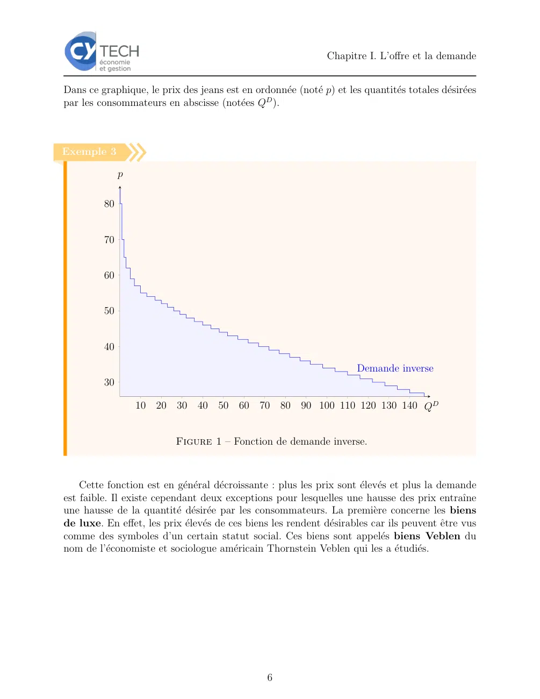

~~~text
                                                               Chapitre I. L’offre et la demande

Dans ce graphique, le prix des jeans est en ordonnée (noté p) et les quantités totales désirées
par les consommateurs en abscisse (notées QD ).

Exemple 3

              p

         80

         70

         60

         50

         40

                                                                       Demande inverse
         30

                  10 20 30 40 50 60 70 80 90 100 110 120 130 140 QD

                           Figure 1 – Fonction de demande inverse.

    Cette fonction est en général décroissante : plus les prix sont élevés et plus la demande
est faible. Il existe cependant deux exceptions pour lesquelles une hausse des prix entraı̂ne
une hausse de la quantité désirée par les consommateurs. La première concerne les biens
de luxe. En effet, les prix élevés de ces biens les rendent désirables car ils peuvent être vus
comme des symboles d’un certain statut social. Ces biens sont appelés biens Veblen du
nom de l’économiste et sociologue américain Thornstein Veblen qui les a étudiés.

                                                 6
~~~

## Page 7

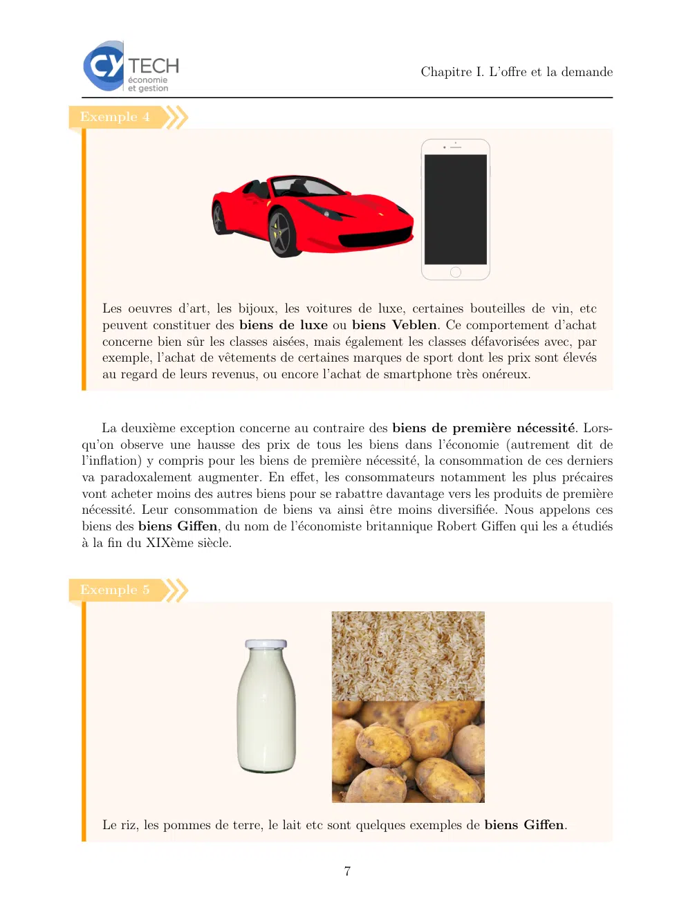

~~~text
                                                              Chapitre I. L’offre et la demande

Exemple 4

   Les oeuvres d’art, les bijoux, les voitures de luxe, certaines bouteilles de vin, etc
   peuvent constituer des biens de luxe ou biens Veblen. Ce comportement d’achat
   concerne bien sûr les classes aisées, mais également les classes défavorisées avec, par
   exemple, l’achat de vêtements de certaines marques de sport dont les prix sont élevés
   au regard de leurs revenus, ou encore l’achat de smartphone très onéreux.

     La deuxième exception concerne au contraire des biens de première nécessité. Lors-
qu’on observe une hausse des prix de tous les biens dans l’économie (autrement dit de
l’inflation) y compris pour les biens de première nécessité, la consommation de ces derniers
va paradoxalement augmenter. En effet, les consommateurs notamment les plus précaires
vont acheter moins des autres biens pour se rabattre davantage vers les produits de première
nécessité. Leur consommation de biens va ainsi être moins diversifiée. Nous appelons ces
biens des biens Giffen, du nom de l’économiste britannique Robert Giffen qui les a étudiés
à la fin du XIXème siècle.

Exemple 5

   Le riz, les pommes de terre, le lait etc sont quelques exemples de biens Giffen.

                                               7
~~~

## Page 8

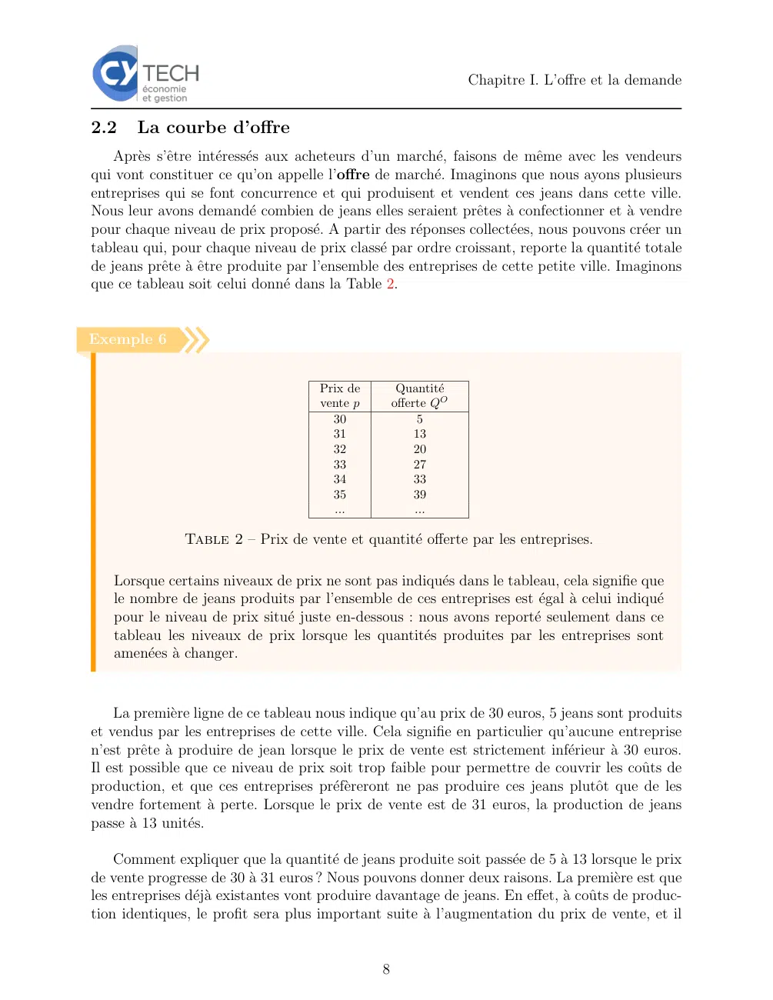

~~~text
                                                                 Chapitre I. L’offre et la demande

2.2    La courbe d’offre
    Après s’être intéressés aux acheteurs d’un marché, faisons de même avec les vendeurs
qui vont constituer ce qu’on appelle l’offre de marché. Imaginons que nous ayons plusieurs
entreprises qui se font concurrence et qui produisent et vendent ces jeans dans cette ville.
Nous leur avons demandé combien de jeans elles seraient prêtes à confectionner et à vendre
pour chaque niveau de prix proposé. A partir des réponses collectées, nous pouvons créer un
tableau qui, pour chaque niveau de prix classé par ordre croissant, reporte la quantité totale
de jeans prête à être produite par l’ensemble des entreprises de cette petite ville. Imaginons
que ce tableau soit celui donné dans la Table 2.

Exemple 6

                                     Prix de         Quantité
                                     vente p        offerte QO
                                       30                 5
                                       31                13
                                       32                20
                                       33                27
                                       34                33
                                       35                39
                                       ...               ...

               Table 2 – Prix de vente et quantité offerte par les entreprises.

   Lorsque certains niveaux de prix ne sont pas indiqués dans le tableau, cela signifie que
   le nombre de jeans produits par l’ensemble de ces entreprises est égal à celui indiqué
   pour le niveau de prix situé juste en-dessous : nous avons reporté seulement dans ce
   tableau les niveaux de prix lorsque les quantités produites par les entreprises sont
   amenées à changer.

    La première ligne de ce tableau nous indique qu’au prix de 30 euros, 5 jeans sont produits
et vendus par les entreprises de cette ville. Cela signifie en particulier qu’aucune entreprise
n’est prête à produire de jean lorsque le prix de vente est strictement inférieur à 30 euros.
Il est possible que ce niveau de prix soit trop faible pour permettre de couvrir les coûts de
production, et que ces entreprises préfèreront ne pas produire ces jeans plutôt que de les
vendre fortement à perte. Lorsque le prix de vente est de 31 euros, la production de jeans
passe à 13 unités.

    Comment expliquer que la quantité de jeans produite soit passée de 5 à 13 lorsque le prix
de vente progresse de 30 à 31 euros ? Nous pouvons donner deux raisons. La première est que
les entreprises déjà existantes vont produire davantage de jeans. En effet, à coûts de produc-
tion identiques, le profit sera plus important suite à l’augmentation du prix de vente, et il

                                                8
~~~

## Page 9

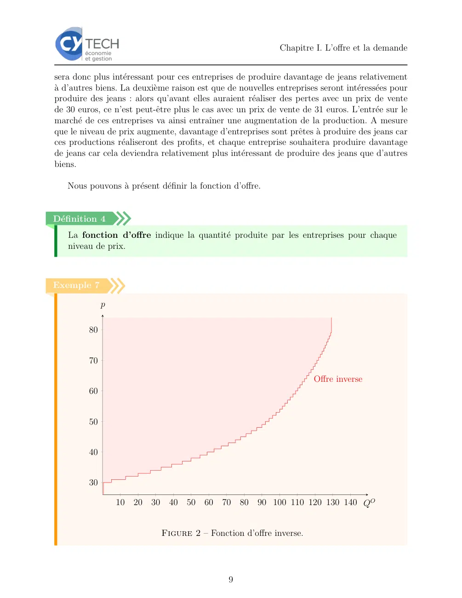

~~~text
                                                             Chapitre I. L’offre et la demande

sera donc plus intéressant pour ces entreprises de produire davantage de jeans relativement
à d’autres biens. La deuxième raison est que de nouvelles entreprises seront intéressées pour
produire des jeans : alors qu’avant elles auraient réaliser des pertes avec un prix de vente
de 30 euros, ce n’est peut-être plus le cas avec un prix de vente de 31 euros. L’entrée sur le
marché de ces entreprises va ainsi entraı̂ner une augmentation de la production. A mesure
que le niveau de prix augmente, davantage d’entreprises sont prêtes à produire des jeans car
ces productions réaliseront des profits, et chaque entreprise souhaitera produire davantage
de jeans car cela deviendra relativement plus intéressant de produire des jeans que d’autres
biens.

   Nous pouvons à présent définir la fonction d’offre.

Définition 4
   La fonction d’offre indique la quantité produite par les entreprises pour chaque
   niveau de prix.

Exemple 7

              p

         80

         70

                                                                       Offre inverse
         60

         50

         40

         30

                  10 20 30 40 50 60 70 80 90 100 110 120 130 140 QO

                             Figure 2 – Fonction d’offre inverse.

                                                9
~~~

## Page 10

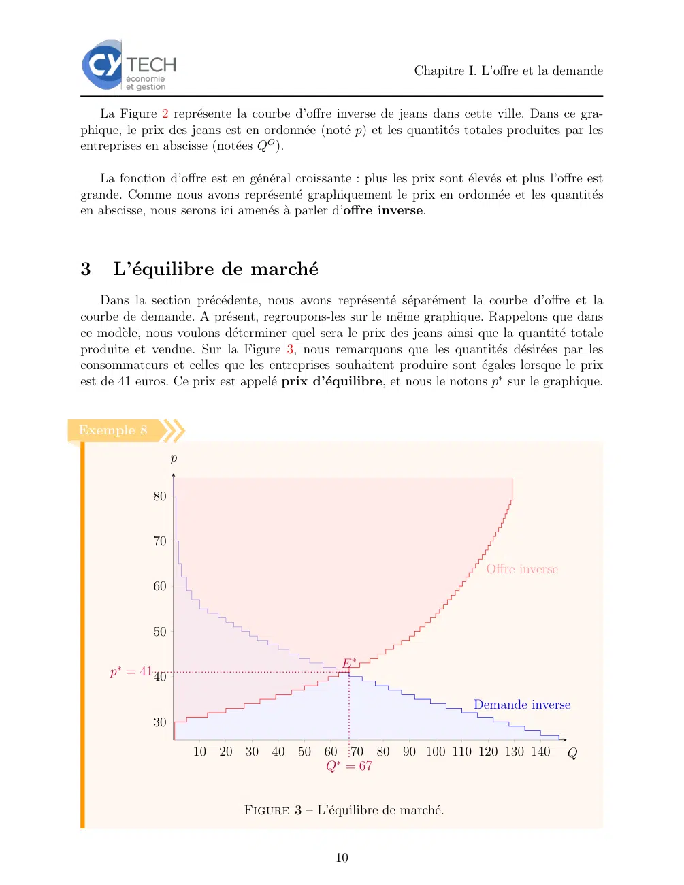

~~~text
                                                               Chapitre I. L’offre et la demande

   La Figure 2 représente la courbe d’offre inverse de jeans dans cette ville. Dans ce gra-
phique, le prix des jeans est en ordonnée (noté p) et les quantités totales produites par les
entreprises en abscisse (notées QO ).

   La fonction d’offre est en général croissante : plus les prix sont élevés et plus l’offre est
grande. Comme nous avons représenté graphiquement le prix en ordonnée et les quantités
en abscisse, nous serons ici amenés à parler d’offre inverse.

3     L’équilibre de marché
    Dans la section précédente, nous avons représenté séparément la courbe d’offre et la
courbe de demande. A présent, regroupons-les sur le même graphique. Rappelons que dans
ce modèle, nous voulons déterminer quel sera le prix des jeans ainsi que la quantité totale
produite et vendue. Sur la Figure 3, nous remarquons que les quantités désirées par les
consommateurs et celles que les entreprises souhaitent produire sont égales lorsque le prix
est de 41 euros. Ce prix est appelé prix d’équilibre, et nous le notons p∗ sur le graphique.

Exemple 8

                  p

             80

             70

                                                                             Offre inverse
             60

             50

                                                 E∗
     p∗ = 41 40

                                                                           Demande inverse
             30

                      10 20 30 40 50 60 70 80 90 100 110 120 130 140                         Q
                                     Q∗ = 67

                               Figure 3 – L’équilibre de marché.

                                                10
~~~

## Page 11

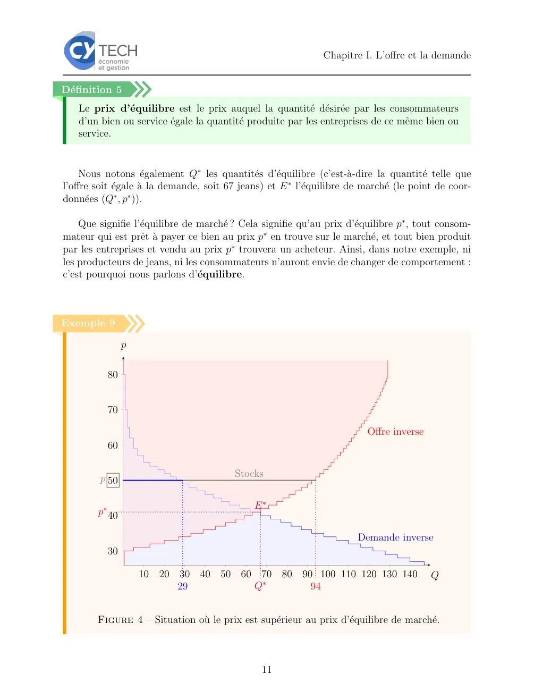

~~~text
                                                               Chapitre I. L’offre et la demande

Définition 5
   Le prix d’équilibre est le prix auquel la quantité désirée par les consommateurs
   d’un bien ou service égale la quantité produite par les entreprises de ce même bien ou
   service.

     Nous notons également Q∗ les quantités d’équilibre (c’est-à-dire la quantité telle que
l’offre soit égale à la demande, soit 67 jeans) et E ∗ l’équilibre de marché (le point de coor-
données (Q∗ , p∗ )).

    Que signifie l’équilibre de marché ? Cela signifie qu’au prix d’équilibre p∗ , tout consom-
mateur qui est prêt à payer ce bien au prix p∗ en trouve sur le marché, et tout bien produit
par les entreprises et vendu au prix p∗ trouvera un acheteur. Ainsi, dans notre exemple, ni
les producteurs de jeans, ni les consommateurs n’auront envie de changer de comportement :
c’est pourquoi nous parlons d’équilibre.

Exemple 9

                p

          80

          70

                                                                         Offre inverse
          60

         p 50                            Stocks

                                              E∗
        p∗ 40

                                                                       Demande inverse
          30

                    10 20 30 40 50 60 70 80 90 100 110 120 130 140                       Q
                          29         Q∗       94

        Figure 4 – Situation où le prix est supérieur au prix d’équilibre de marché.

                                                11
~~~

## Page 12

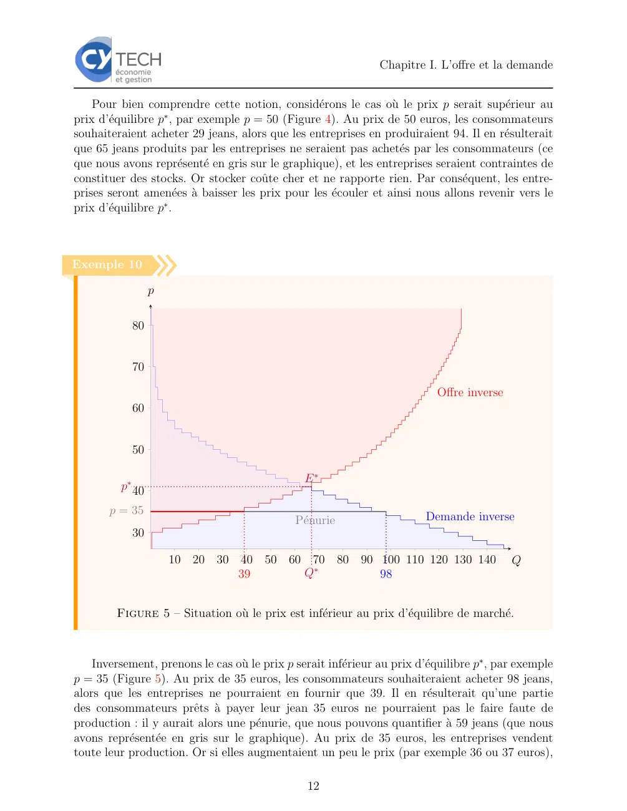

~~~text
                                                                Chapitre I. L’offre et la demande

    Pour bien comprendre cette notion, considérons le cas où le prix p serait supérieur au
prix d’équilibre p∗ , par exemple p = 50 (Figure 4). Au prix de 50 euros, les consommateurs
souhaiteraient acheter 29 jeans, alors que les entreprises en produiraient 94. Il en résulterait
que 65 jeans produits par les entreprises ne seraient pas achetés par les consommateurs (ce
que nous avons représenté en gris sur le graphique), et les entreprises seraient contraintes de
constituer des stocks. Or stocker coûte cher et ne rapporte rien. Par conséquent, les entre-
prises seront amenées à baisser les prix pour les écouler et ainsi nous allons revenir vers le
prix d’équilibre p∗ .

Exemple 10

                 p

            80

            70

                                                                            Offre inverse
            60

            50

                                                E∗
         p∗ 40

       p = 35                                                             Demande inverse
                                              Pénurie
            30

                     10 20 30 40 50 60 70 80 90 100 110 120 130 140                         Q
                              39      Q∗        98

         Figure 5 – Situation où le prix est inférieur au prix d’équilibre de marché.

    Inversement, prenons le cas où le prix p serait inférieur au prix d’équilibre p∗ , par exemple
p = 35 (Figure 5). Au prix de 35 euros, les consommateurs souhaiteraient acheter 98 jeans,
alors que les entreprises ne pourraient en fournir que 39. Il en résulterait qu’une partie
des consommateurs prêts à payer leur jean 35 euros ne pourraient pas le faire faute de
production : il y aurait alors une pénurie, que nous pouvons quantifier à 59 jeans (que nous
avons représentée en gris sur le graphique). Au prix de 35 euros, les entreprises vendent
toute leur production. Or si elles augmentaient un peu le prix (par exemple 36 ou 37 euros),

                                                 12
~~~

## Page 13

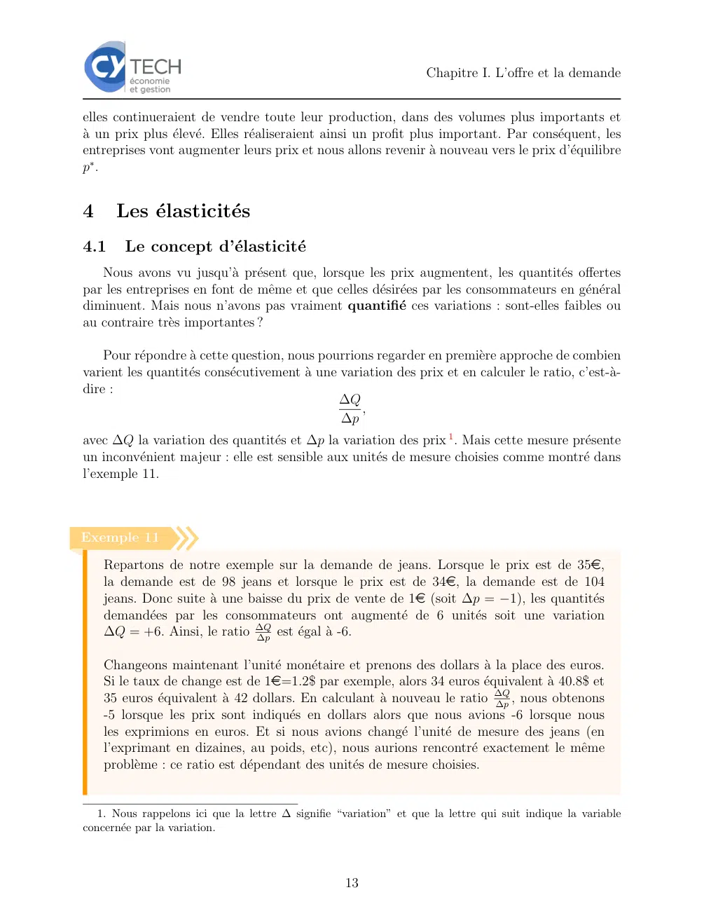

~~~text
                                                                    Chapitre I. L’offre et la demande

elles continueraient de vendre toute leur production, dans des volumes plus importants et
à un prix plus élevé. Elles réaliseraient ainsi un profit plus important. Par conséquent, les
entreprises vont augmenter leurs prix et nous allons revenir à nouveau vers le prix d’équilibre
p∗ .

4     Les élasticités
4.1     Le concept d’élasticité
   Nous avons vu jusqu’à présent que, lorsque les prix augmentent, les quantités offertes
par les entreprises en font de même et que celles désirées par les consommateurs en général
diminuent. Mais nous n’avons pas vraiment quantifié ces variations : sont-elles faibles ou
au contraire très importantes ?

    Pour répondre à cette question, nous pourrions regarder en première approche de combien
varient les quantités consécutivement à une variation des prix et en calculer le ratio, c’est-à-
dire :
                                               ∆Q
                                                   ,
                                               ∆p
avec ∆Q la variation des quantités et ∆p la variation des prix 1 . Mais cette mesure présente
un inconvénient majeur : elle est sensible aux unités de mesure choisies comme montré dans
l’exemple 11.

Exemple 11
    Repartons de notre exemple sur la demande de jeans. Lorsque le prix est de 35e,
    la demande est de 98 jeans et lorsque le prix est de 34e, la demande est de 104
    jeans. Donc suite à une baisse du prix de vente de 1e (soit ∆p = −1), les quantités
    demandées par les consommateurs ont augmenté de 6 unités soit une variation
    ∆Q = +6. Ainsi, le ratio ∆Q
                              ∆p
                                  est égal à -6.

    Changeons maintenant l’unité monétaire et prenons des dollars à la place des euros.
    Si le taux de change est de 1e=1.2$ par exemple, alors 34 euros équivalent à 40.8$ et
    35 euros équivalent à 42 dollars. En calculant à nouveau le ratio ∆Q
                                                                         ∆p
                                                                            , nous obtenons
    -5 lorsque les prix sont indiqués en dollars alors que nous avions -6 lorsque nous
    les exprimions en euros. Et si nous avions changé l’unité de mesure des jeans (en
    l’exprimant en dizaines, au poids, etc), nous aurions rencontré exactement le même
    problème : ce ratio est dépendant des unités de mesure choisies.

   1. Nous rappelons ici que la lettre ∆ signifie “variation” et que la lettre qui suit indique la variable
concernée par la variation.

                                                    13
~~~

## Page 14

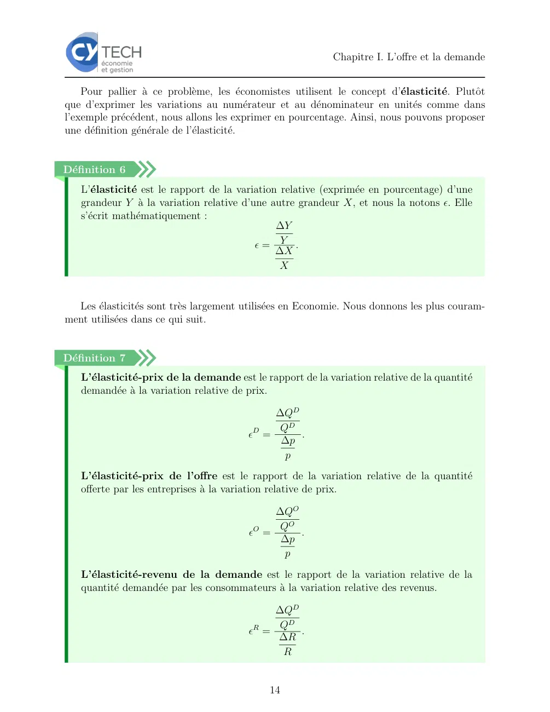

~~~text
                                                            Chapitre I. L’offre et la demande

    Pour pallier à ce problème, les économistes utilisent le concept d’élasticité. Plutôt
que d’exprimer les variations au numérateur et au dénominateur en unités comme dans
l’exemple précédent, nous allons les exprimer en pourcentage. Ainsi, nous pouvons proposer
une définition générale de l’élasticité.

Définition 6
   L’élasticité est le rapport de la variation relative (exprimée en pourcentage) d’une
   grandeur Y à la variation relative d’une autre grandeur X, et nous la notons ϵ. Elle
   s’écrit mathématiquement :
                                                ∆Y
                                           ϵ= Y .
                                                ∆X
                                                 X

  Les élasticités sont très largement utilisées en Economie. Nous donnons les plus couram-
ment utilisées dans ce qui suit.

Définition 7
   L’élasticité-prix de la demande est le rapport de la variation relative de la quantité
   demandée à la variation relative de prix.

                                              ∆QD
                                               QD
                                         ϵD =     .
                                               ∆p
                                                p
   L’élasticité-prix de l’offre est le rapport de la variation relative de la quantité
   offerte par les entreprises à la variation relative de prix.

                                              ∆QO
                                               QO
                                         ϵO =     .
                                               ∆p
                                                p
   L’élasticité-revenu de la demande est le rapport de la variation relative de la
   quantité demandée par les consommateurs à la variation relative des revenus.

                                              ∆QD
                                               QD
                                         ϵR =     .
                                              ∆R
                                               R

                                              14
~~~

## Page 15

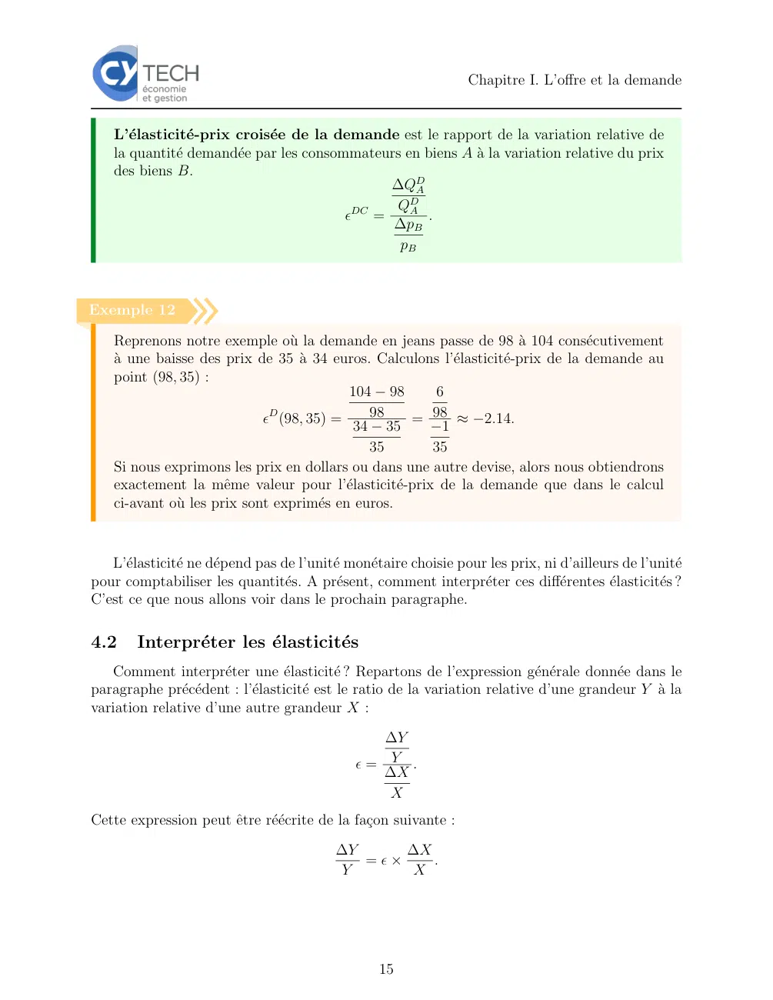

~~~text
                                                                  Chapitre I. L’offre et la demande

    L’élasticité-prix croisée de la demande est le rapport de la variation relative de
    la quantité demandée par les consommateurs en biens A à la variation relative du prix
    des biens B.
                                               ∆QD A
                                                  D
                                                Q
                                         ϵDC =    A
                                                     .
                                               ∆pB
                                                pB

Exemple 12
    Reprenons notre exemple où la demande en jeans passe de 98 à 104 consécutivement
    à une baisse des prix de 35 à 34 euros. Calculons l’élasticité-prix de la demande au
    point (98, 35) :
                                           104 − 98    6
                             ϵD (98, 35) =    98    = 98 ≈ −2.14.
                                           34 − 35     −1
                                              35       35
    Si nous exprimons les prix en dollars ou dans une autre devise, alors nous obtiendrons
    exactement la même valeur pour l’élasticité-prix de la demande que dans le calcul
    ci-avant où les prix sont exprimés en euros.

   L’élasticité ne dépend pas de l’unité monétaire choisie pour les prix, ni d’ailleurs de l’unité
pour comptabiliser les quantités. A présent, comment interpréter ces différentes élasticités ?
C’est ce que nous allons voir dans le prochain paragraphe.

4.2     Interpréter les élasticités
   Comment interpréter une élasticité ? Repartons de l’expression générale donnée dans le
paragraphe précédent : l’élasticité est le ratio de la variation relative d’une grandeur Y à la
variation relative d’une autre grandeur X :
                                                 ∆Y
                                              ϵ= Y .
                                                 ∆X
                                                 X
Cette expression peut être réécrite de la façon suivante :
                                           ∆Y     ∆X
                                              =ϵ×    .
                                            Y      X

                                                  15
~~~

## Page 16

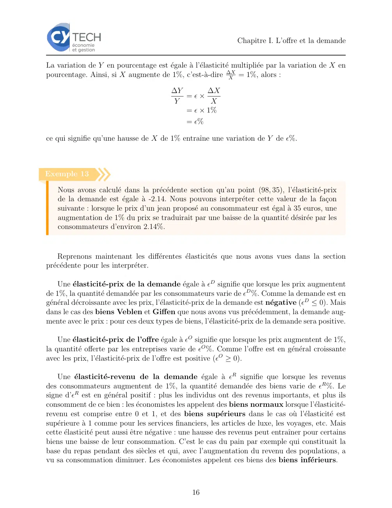

~~~text
                                                                Chapitre I. L’offre et la demande

La variation de Y en pourcentage est égale à l’élasticité multipliée par la variation de X en
pourcentage. Ainsi, si X augmente de 1%, c’est-à-dire ∆X    X
                                                               = 1%, alors :

                                          ∆Y       ∆X
                                             =ϵ×
                                          Y         X
                                             = ϵ × 1%
                                             = ϵ%

ce qui signifie qu’une hausse de X de 1% entraı̂ne une variation de Y de ϵ%.

Exemple 13

   Nous avons calculé dans la précédente section qu’au point (98, 35), l’élasticité-prix
   de la demande est égale à -2.14. Nous pouvons interpréter cette valeur de la façon
   suivante : lorsque le prix d’un jean proposé au consommateur est égal à 35 euros, une
   augmentation de 1% du prix se traduirait par une baisse de la quantité désirée par les
   consommateurs d’environ 2.14%.

    Reprenons maintenant les différentes élasticités que nous avons vues dans la section
précédente pour les interpréter.

    Une élasticité-prix de la demande égale à ϵD signifie que lorsque les prix augmentent
de 1%, la quantité demandée par les consommateurs varie de ϵD %. Comme la demande est en
général décroissante avec les prix, l’élasticité-prix de la demande est négative (ϵD ≤ 0). Mais
dans le cas des biens Veblen et Giffen que nous avons vus précédemment, la demande aug-
mente avec le prix : pour ces deux types de biens, l’élasticité-prix de la demande sera positive.

    Une élasticité-prix de l’offre égale à ϵO signifie que lorsque les prix augmentent de 1%,
la quantité offerte par les entreprises varie de ϵO %. Comme l’offre est en général croissante
avec les prix, l’élasticité-prix de l’offre est positive (ϵO ≥ 0).

    Une élasticité-revenu de la demande égale à ϵR signifie que lorsque les revenus
des consommateurs augmentent de 1%, la quantité demandée des biens varie de ϵR %. Le
signe d’ϵR est en général positif : plus les individus ont des revenus importants, et plus ils
consomment de ce bien : les économistes les appelent des biens normaux lorsque l’élasticité-
revenu est comprise entre 0 et 1, et des biens supérieurs dans le cas où l’élasticité est
supérieure à 1 comme pour les services financiers, les articles de luxe, les voyages, etc. Mais
cette élasticité peut aussi être négative : une hausse des revenus peut entraı̂ner pour certains
biens une baisse de leur consommation. C’est le cas du pain par exemple qui constituait la
base du repas pendant des siècles et qui, avec l’augmentation du revenu des populations, a
vu sa consommation diminuer. Les économistes appelent ces biens des biens inférieurs.

                                                 16
~~~

## Page 17

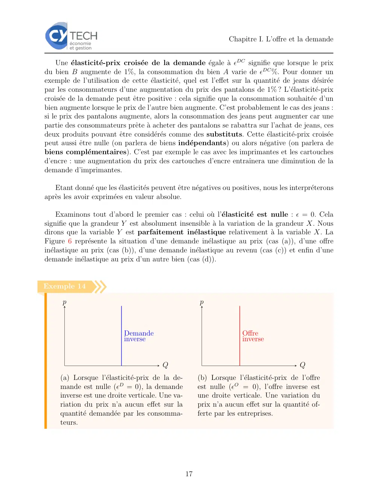

~~~text
                                                                Chapitre I. L’offre et la demande

    Une élasticité-prix croisée de la demande égale à ϵDC signifie que lorsque le prix
du bien B augmente de 1%, la consommation du bien A varie de ϵDC %. Pour donner un
exemple de l’utilisation de cette élasticité, quel est l’effet sur la quantité de jeans désirée
par les consommateurs d’une augmentation du prix des pantalons de 1% ? L’élasticité-prix
croisée de la demande peut être positive : cela signifie que la consommation souhaitée d’un
bien augmente lorsque le prix de l’autre bien augmente. C’est probablement le cas des jeans :
si le prix des pantalons augmente, alors la consommation des jeans peut augmenter car une
partie des consommateurs prête à acheter des pantalons se rabattra sur l’achat de jeans, ces
deux produits pouvant être considérés comme des substituts. Cette élasticité-prix croisée
peut aussi être nulle (on parlera de biens indépendants) ou alors négative (on parlera de
biens complémentaires). C’est par exemple le cas avec les imprimantes et les cartouches
d’encre : une augmentation du prix des cartouches d’encre entraı̂nera une diminution de la
demande d’imprimantes.

   Etant donné que les élasticités peuvent être négatives ou positives, nous les interpréterons
après les avoir exprimées en valeur absolue.

     Examinons tout d’abord le premier cas : celui où l’élasticité est nulle : ϵ = 0. Cela
signifie que la grandeur Y est absolument insensible à la variation de la grandeur X. Nous
dirons que la variable Y est parfaitement inélastique relativement à la variable X. La
Figure 6 représente la situation d’une demande inélastique au prix (cas (a)), d’une offre
inélastique au prix (cas (b)), d’une demande inélastique au revenu (cas (c)) et enfin d’une
demande inélastique au prix d’un autre bien (cas (d)).

Exemple 14

      p                                               p

                           Demande                                   Offre
                           inverse                                   inverse

                                         Q                                               Q
     (a) Lorsque l’élasticité-prix de la de-        (b) Lorsque l’élasticité-prix de l’offre
     mande est nulle (ϵD = 0), la demande             est nulle (ϵO = 0), l’offre inverse est
     inverse est une droite verticale. Une va-        une droite verticale. Une variation du
     riation du prix n’a aucun effet sur la           prix n’a aucun effet sur la quantité of-
     quantité demandée par les consomma-            ferte par les entreprises.
     teurs.

                                                 17
~~~

## Page 18

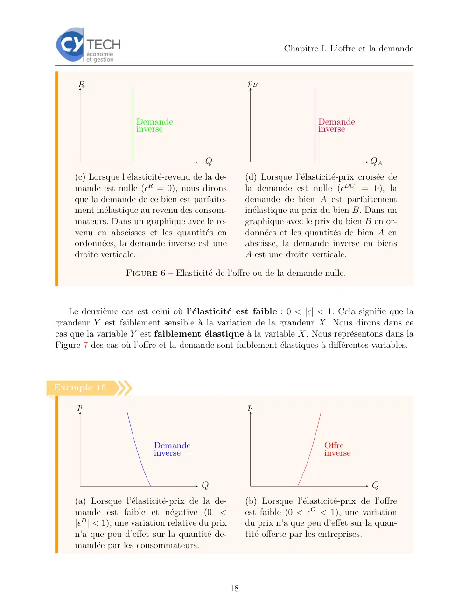

~~~text
                                                                   Chapitre I. L’offre et la demande

      R                                                 pB

                      Demande                                               Demande
                      inverse                                               inverse

                                         Q                                                 QA
     (c) Lorsque l’élasticité-revenu de la de-        (d) Lorsque l’élasticité-prix croisée de
     mande est nulle (ϵR = 0), nous dirons              la demande est nulle (ϵDC = 0), la
     que la demande de ce bien est parfaite-            demande de bien A est parfaitement
     ment inélastique au revenu des consom-            inélastique au prix du bien B. Dans un
     mateurs. Dans un graphique avec le re-             graphique avec le prix du bien B en or-
     venu en abscisses et les quantités en             données et les quantités de bien A en
     ordonnées, la demande inverse est une             abscisse, la demande inverse en biens
     droite verticale.                                  A est une droite verticale.

                   Figure 6 – Elasticité de l’offre ou de la demande nulle.

   Le deuxième cas est celui où l’élasticité est faible : 0 < |ϵ| < 1. Cela signifie que la
grandeur Y est faiblement sensible à la variation de la grandeur X. Nous dirons dans ce
cas que la variable Y est faiblement élastique à la variable X. Nous représentons dans la
Figure 7 des cas où l’offre et la demande sont faiblement élastiques à différentes variables.

Exemple 15

      p                                                 p

                           Demande                                            Offre
                           inverse                                            inverse

                                        Q                                                  Q
     (a) Lorsque l’élasticité-prix de la de-          (b) Lorsque l’élasticité-prix de l’offre
     mande est faible et négative (0 <                 est faible (0 < ϵO < 1), une variation
     |ϵD | < 1), une variation relative du prix         du prix n’a que peu d’effet sur la quan-
     n’a que peu d’effet sur la quantité de-           tité offerte par les entreprises.
     mandée par les consommateurs.

                                                   18
~~~

## Page 19

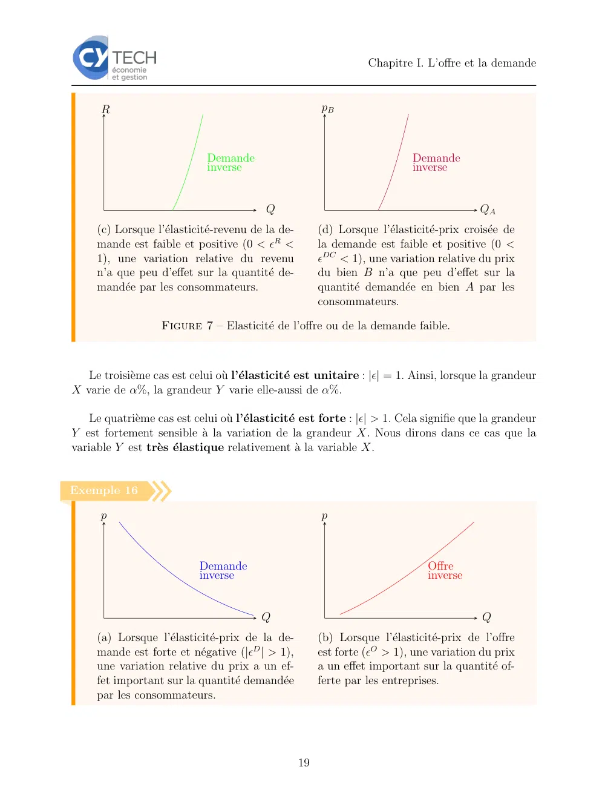

~~~text
                                                                   Chapitre I. L’offre et la demande

      R                                                 pB

                             Demande                                        Demande
                             inverse                                        inverse

                                         Q                                                 QA
     (c) Lorsque l’élasticité-revenu de la de-        (d) Lorsque l’élasticité-prix croisée de
     mande est faible et positive (0 < ϵR <             la demande est faible et positive (0 <
     1), une variation relative du revenu               ϵDC < 1), une variation relative du prix
     n’a que peu d’effet sur la quantité de-           du bien B n’a que peu d’effet sur la
     mandée par les consommateurs.                     quantité demandée en bien A par les
                                                        consommateurs.

                   Figure 7 – Elasticité de l’offre ou de la demande faible.

   Le troisième cas est celui où l’élasticité est unitaire : |ϵ| = 1. Ainsi, lorsque la grandeur
X varie de α%, la grandeur Y varie elle-aussi de α%.

   Le quatrième cas est celui où l’élasticité est forte : |ϵ| > 1. Cela signifie que la grandeur
Y est fortement sensible à la variation de la grandeur X. Nous dirons dans ce cas que la
variable Y est très élastique relativement à la variable X.

Exemple 16

      p                                                 p

                           Demande                                              Offre
                           inverse                                              inverse

                                        Q                                                  Q
     (a) Lorsque l’élasticité-prix de la de-          (b) Lorsque l’élasticité-prix de l’offre
     mande est forte et négative (|ϵD | > 1),          est forte (ϵO > 1), une variation du prix
     une variation relative du prix a un ef-            a un effet important sur la quantité of-
     fet important sur la quantité demandée           ferte par les entreprises.
     par les consommateurs.

                                                   19
~~~

## Page 20

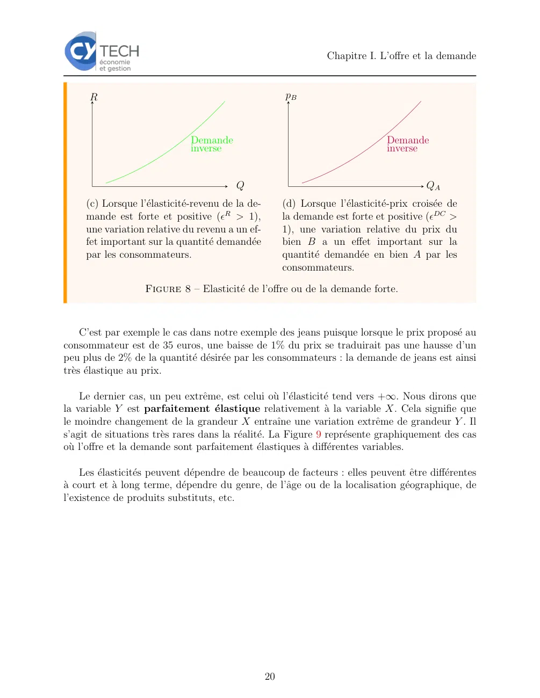

~~~text
                                                                   Chapitre I. L’offre et la demande

      R                                                 pB

                              Demande                                            Demande
                              inverse                                            inverse

                                         Q                                                 QA
     (c) Lorsque l’élasticité-revenu de la de-        (d) Lorsque l’élasticité-prix croisée de
     mande est forte et positive (ϵR > 1),              la demande est forte et positive (ϵDC >
     une variation relative du revenu a un ef-          1), une variation relative du prix du
     fet important sur la quantité demandée           bien B a un effet important sur la
     par les consommateurs.                             quantité demandée en bien A par les
                                                        consommateurs.

                   Figure 8 – Elasticité de l’offre ou de la demande forte.

     C’est par exemple le cas dans notre exemple des jeans puisque lorsque le prix proposé au
consommateur est de 35 euros, une baisse de 1% du prix se traduirait pas une hausse d’un
peu plus de 2% de la quantité désirée par les consommateurs : la demande de jeans est ainsi
très élastique au prix.

    Le dernier cas, un peu extrême, est celui où l’élasticité tend vers +∞. Nous dirons que
la variable Y est parfaitement élastique relativement à la variable X. Cela signifie que
le moindre changement de la grandeur X entraı̂ne une variation extrême de grandeur Y . Il
s’agit de situations très rares dans la réalité. La Figure 9 représente graphiquement des cas
où l’offre et la demande sont parfaitement élastiques à différentes variables.

    Les élasticités peuvent dépendre de beaucoup de facteurs : elles peuvent être différentes
à court et à long terme, dépendre du genre, de l’âge ou de la localisation géographique, de
l’existence de produits substituts, etc.

                                                   20
~~~

## Page 21

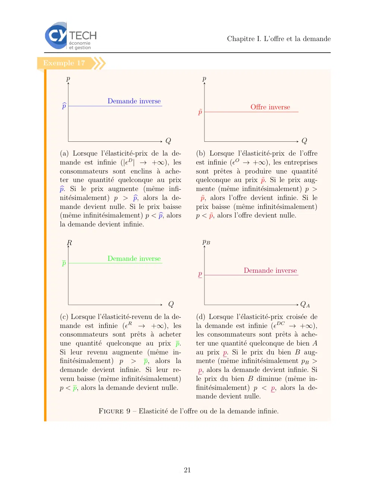

~~~text
                                                                 Chapitre I. L’offre et la demande

Exemple 17

        p                                                  p

                   Demande inverse
    pb                                                                   Offre inverse
                                                      p̃

                                        Q                                                  Q
   (a) Lorsque l’élasticité-prix de la de-          (b) Lorsque l’élasticité-prix de l’offre
   mande est infinie (|ϵD | → +∞), les                est infinie (ϵO → +∞), les entreprises
   consommateurs sont enclins à ache-                sont prêtes à produire une quantité
   ter une quantité quelconque au prix               quelconque au prix p̃. Si le prix aug-
   pb. Si le prix augmente (même infi-               mente (même infinitésimalement) p >
   nitésimalement) p > pb, alors la de-                p̃, alors l’offre devient infinie. Si le
   mande devient nulle. Si le prix baisse             prix baisse (même infinitésimalement)
   (même infinitésimalement) p < pb, alors          p < p̃, alors l’offre devient nulle.
   la demande devient infinie.

        R                                                  pB

                   Demande inverse
    p
                                                      p               Demande inverse

                                         Q                                                QA
   (c) Lorsque l’élasticité-revenu de la de-        (d) Lorsque l’élasticité-prix croisée de
   mande est infinie (ϵR → +∞), les                   la demande est infinie (ϵDC → +∞),
   consommateurs sont prêts à acheter               les consommateurs sont prêts à ache-
   une quantité quelconque au prix p.                ter une quantité quelconque de bien A
   Si leur revenu augmente (même in-                 au prix p. Si le prix du bien B aug-
   finitésimalement) p > p, alors la                 mente (même infinitésimalement pB >
   demande devient infinie. Si leur re-                p, alors la demande devient infinie. Si
   venu baisse (même infinitésimalement)            le prix du bien B diminue (même in-
   p < p, alors la demande devient nulle.             finitésimalement) p < p, alors la de-
                                                      mande devient nulle.

                Figure 9 – Elasticité de l’offre ou de la demande infinie.

                                                 21
~~~

## Page 22

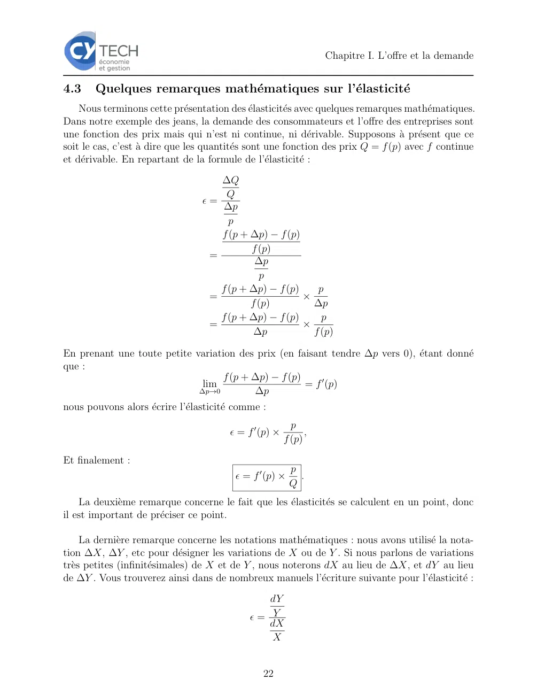

~~~text
                                                                  Chapitre I. L’offre et la demande

4.3    Quelques remarques mathématiques sur l’élasticité
    Nous terminons cette présentation des élasticités avec quelques remarques mathématiques.
Dans notre exemple des jeans, la demande des consommateurs et l’offre des entreprises sont
une fonction des prix mais qui n’est ni continue, ni dérivable. Supposons à présent que ce
soit le cas, c’est à dire que les quantités sont une fonction des prix Q = f (p) avec f continue
et dérivable. En repartant de la formule de l’élasticité :
                                    ∆Q
                                     Q
                                 ϵ=
                                     ∆p
                                      p
                                    f (p + ∆p) − f (p)
                                           f (p)
                                  =
                                            ∆p
                                             p
                                    f (p + ∆p) − f (p)    p
                                  =                    ×
                                           f (p)         ∆p
                                    f (p + ∆p) − f (p)     p
                                  =                    ×
                                            ∆p           f (p)

En prenant une toute petite variation des prix (en faisant tendre ∆p vers 0), étant donné
que :
                                  f (p + ∆p) − f (p)
                              lim                    = f ′ (p)
                             ∆p→0        ∆p
nous pouvons alors écrire l’élasticité comme :
                                                          p
                                        ϵ = f ′ (p) ×         ,
                                                        f (p)

Et finalement :
                                                         p
                                         ϵ = f ′ (p) ×     .
                                                         Q
    La deuxième remarque concerne le fait que les élasticités se calculent en un point, donc
il est important de préciser ce point.

     La dernière remarque concerne les notations mathématiques : nous avons utilisé la nota-
tion ∆X, ∆Y , etc pour désigner les variations de X ou de Y . Si nous parlons de variations
très petites (infinitésimales) de X et de Y , nous noterons dX au lieu de ∆X, et dY au lieu
de ∆Y . Vous trouverez ainsi dans de nombreux manuels l’écriture suivante pour l’élasticité :
                                                dY
                                             ϵ= Y
                                                dX
                                                X

                                                22
~~~

## Page 23

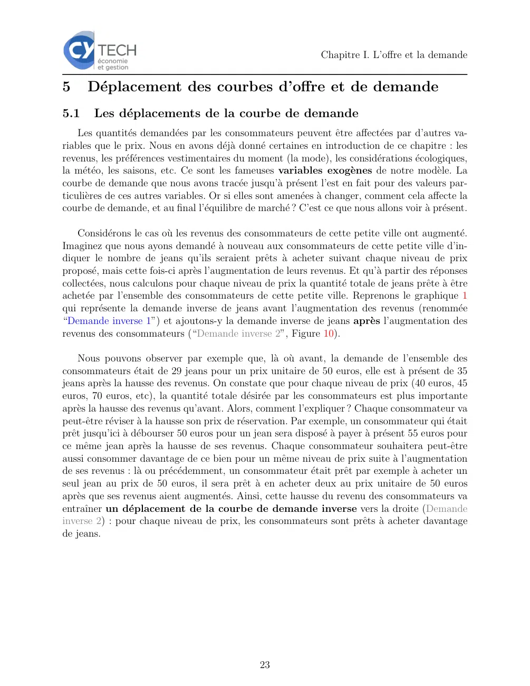

~~~text
                                                               Chapitre I. L’offre et la demande

5     Déplacement des courbes d’offre et de demande
5.1    Les déplacements de la courbe de demande
    Les quantités demandées par les consommateurs peuvent être affectées par d’autres va-
riables que le prix. Nous en avons déjà donné certaines en introduction de ce chapitre : les
revenus, les préférences vestimentaires du moment (la mode), les considérations écologiques,
la météo, les saisons, etc. Ce sont les fameuses variables exogènes de notre modèle. La
courbe de demande que nous avons tracée jusqu’à présent l’est en fait pour des valeurs par-
ticulières de ces autres variables. Or si elles sont amenées à changer, comment cela affecte la
courbe de demande, et au final l’équilibre de marché ? C’est ce que nous allons voir à présent.

    Considérons le cas où les revenus des consommateurs de cette petite ville ont augmenté.
Imaginez que nous ayons demandé à nouveau aux consommateurs de cette petite ville d’in-
diquer le nombre de jeans qu’ils seraient prêts à acheter suivant chaque niveau de prix
proposé, mais cette fois-ci après l’augmentation de leurs revenus. Et qu’à partir des réponses
collectées, nous calculons pour chaque niveau de prix la quantité totale de jeans prête à être
achetée par l’ensemble des consommateurs de cette petite ville. Reprenons le graphique 1
qui représente la demande inverse de jeans avant l’augmentation des revenus (renommée
“Demande inverse 1”) et ajoutons-y la demande inverse de jeans après l’augmentation des
revenus des consommateurs (“Demande inverse 2”, Figure 10).

    Nous pouvons observer par exemple que, là où avant, la demande de l’ensemble des
consommateurs était de 29 jeans pour un prix unitaire de 50 euros, elle est à présent de 35
jeans après la hausse des revenus. On constate que pour chaque niveau de prix (40 euros, 45
euros, 70 euros, etc), la quantité totale désirée par les consommateurs est plus importante
après la hausse des revenus qu’avant. Alors, comment l’expliquer ? Chaque consommateur va
peut-être réviser à la hausse son prix de réservation. Par exemple, un consommateur qui était
prêt jusqu’ici à débourser 50 euros pour un jean sera disposé à payer à présent 55 euros pour
ce même jean après la hausse de ses revenus. Chaque consommateur souhaitera peut-être
aussi consommer davantage de ce bien pour un même niveau de prix suite à l’augmentation
de ses revenus : là ou précédemment, un consommateur était prêt par exemple à acheter un
seul jean au prix de 50 euros, il sera prêt à en acheter deux au prix unitaire de 50 euros
après que ses revenus aient augmentés. Ainsi, cette hausse du revenu des consommateurs va
entraı̂ner un déplacement de la courbe de demande inverse vers la droite (Demande
inverse 2) : pour chaque niveau de prix, les consommateurs sont prêts à acheter davantage
de jeans.

                                                23
~~~

## Page 24

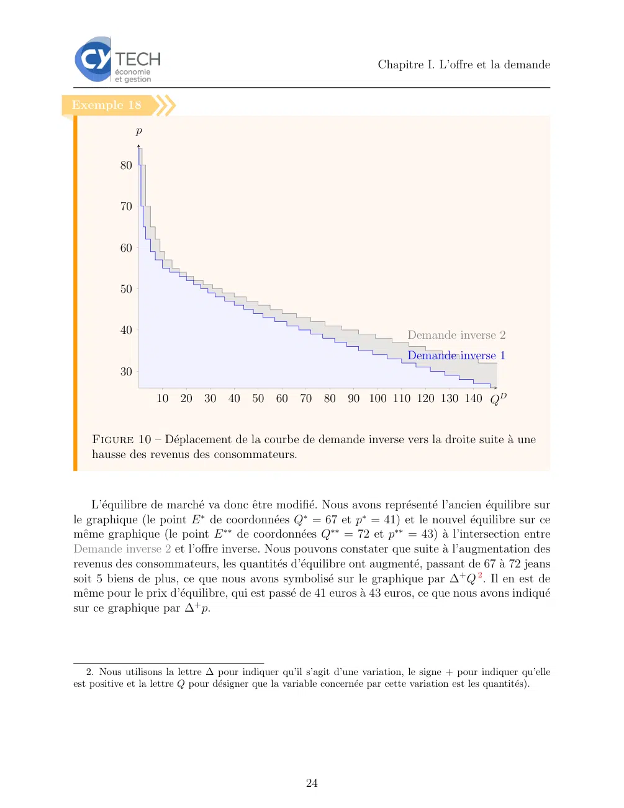

~~~text
                                                                      Chapitre I. L’offre et la demande

Exemple 18

               p

          80

          70

          60

          50

          40                                                                 Demande inverse 2
                                                                             Demande inverse 1
          30

                   10 20 30 40 50 60 70 80 90 100 110 120 130 140 QD

    Figure 10 – Déplacement de la courbe de demande inverse vers la droite suite à une
    hausse des revenus des consommateurs.

    L’équilibre de marché va donc être modifié. Nous avons représenté l’ancien équilibre sur
le graphique (le point E ∗ de coordonnées Q∗ = 67 et p∗ = 41) et le nouvel équilibre sur ce
même graphique (le point E ∗∗ de coordonnées Q∗∗ = 72 et p∗∗ = 43) à l’intersection entre
Demande inverse 2 et l’offre inverse. Nous pouvons constater que suite à l’augmentation des
revenus des consommateurs, les quantités d’équilibre ont augmenté, passant de 67 à 72 jeans
soit 5 biens de plus, ce que nous avons symbolisé sur le graphique par ∆+ Q 2 . Il en est de
même pour le prix d’équilibre, qui est passé de 41 euros à 43 euros, ce que nous avons indiqué
sur ce graphique par ∆+ p.

   2. Nous utilisons la lettre ∆ pour indiquer qu’il s’agit d’une variation, le signe + pour indiquer qu’elle
est positive et la lettre Q pour désigner que la variable concernée par cette variation est les quantités).

                                                     24
~~~

## Page 25

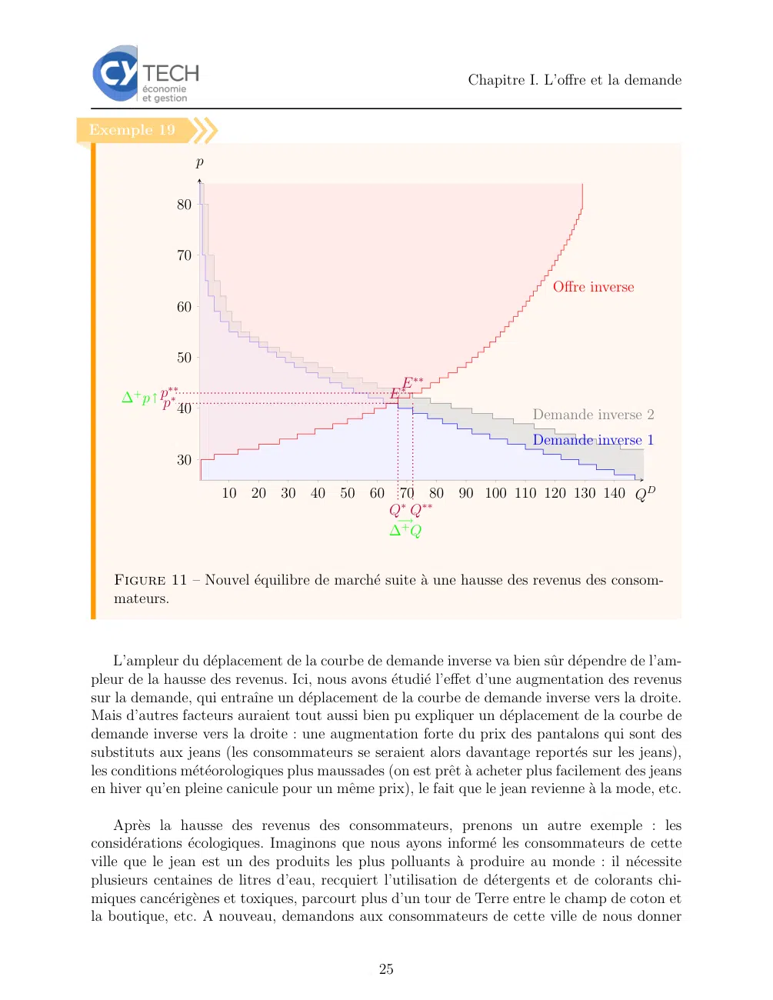

~~~text
                                                              Chapitre I. L’offre et la demande

Exemple 19

                   p

              80

              70

                                                                            Offre inverse
              60

              50
           ∗∗                                     E ∗∗
     ∆ p pp∗
       +                                         E∗
             40                                                          Demande inverse 2
                                                                         Demande inverse 1
              30

                       10 20 30 40 50 60 70 80 90 100 110 120 130 140 QD
                                        Q∗ Q∗∗
                                        ∆+ Q

   Figure 11 – Nouvel équilibre de marché suite à une hausse des revenus des consom-
   mateurs.

    L’ampleur du déplacement de la courbe de demande inverse va bien sûr dépendre de l’am-
pleur de la hausse des revenus. Ici, nous avons étudié l’effet d’une augmentation des revenus
sur la demande, qui entraı̂ne un déplacement de la courbe de demande inverse vers la droite.
Mais d’autres facteurs auraient tout aussi bien pu expliquer un déplacement de la courbe de
demande inverse vers la droite : une augmentation forte du prix des pantalons qui sont des
substituts aux jeans (les consommateurs se seraient alors davantage reportés sur les jeans),
les conditions météorologiques plus maussades (on est prêt à acheter plus facilement des jeans
en hiver qu’en pleine canicule pour un même prix), le fait que le jean revienne à la mode, etc.

    Après la hausse des revenus des consommateurs, prenons un autre exemple : les
considérations écologiques. Imaginons que nous ayons informé les consommateurs de cette
ville que le jean est un des produits les plus polluants à produire au monde : il nécessite
plusieurs centaines de litres d’eau, recquiert l’utilisation de détergents et de colorants chi-
miques cancérigènes et toxiques, parcourt plus d’un tour de Terre entre le champ de coton et
la boutique, etc. A nouveau, demandons aux consommateurs de cette ville de nous donner

                                               25
~~~

## Page 26

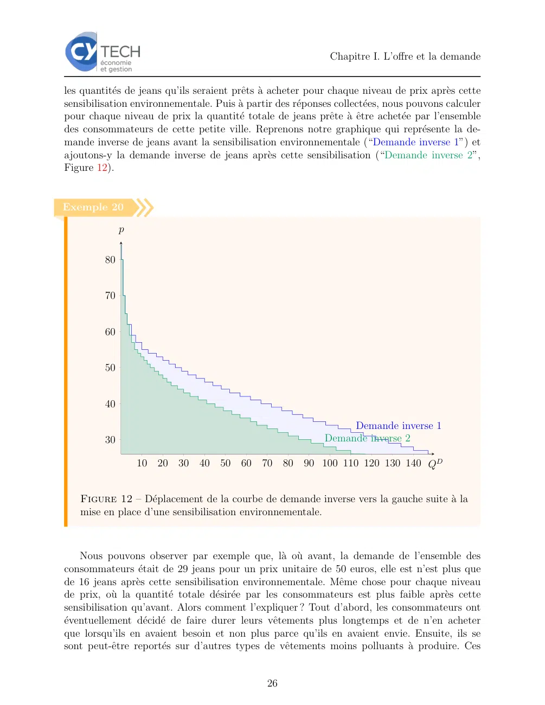

~~~text
                                                             Chapitre I. L’offre et la demande

les quantités de jeans qu’ils seraient prêts à acheter pour chaque niveau de prix après cette
sensibilisation environnementale. Puis à partir des réponses collectées, nous pouvons calculer
pour chaque niveau de prix la quantité totale de jeans prête à être achetée par l’ensemble
des consommateurs de cette petite ville. Reprenons notre graphique qui représente la de-
mande inverse de jeans avant la sensibilisation environnementale (“Demande inverse 1”) et
ajoutons-y la demande inverse de jeans après cette sensibilisation (“Demande inverse 2”,
Figure 12).

Exemple 20

              p

         80

         70

         60

         50

         40

                                                                 Demande inverse 1
         30                                                 Demande inverse 2

                  10 20 30 40 50 60 70 80 90 100 110 120 130 140 QD

   Figure 12 – Déplacement de la courbe de demande inverse vers la gauche suite à la
   mise en place d’une sensibilisation environnementale.

    Nous pouvons observer par exemple que, là où avant, la demande de l’ensemble des
consommateurs était de 29 jeans pour un prix unitaire de 50 euros, elle est n’est plus que
de 16 jeans après cette sensibilisation environnementale. Même chose pour chaque niveau
de prix, où la quantité totale désirée par les consommateurs est plus faible après cette
sensibilisation qu’avant. Alors comment l’expliquer ? Tout d’abord, les consommateurs ont
éventuellement décidé de faire durer leurs vêtements plus longtemps et de n’en acheter
que lorsqu’ils en avaient besoin et non plus parce qu’ils en avaient envie. Ensuite, ils se
sont peut-être reportés sur d’autres types de vêtements moins polluants à produire. Ces

                                               26
~~~

## Page 27

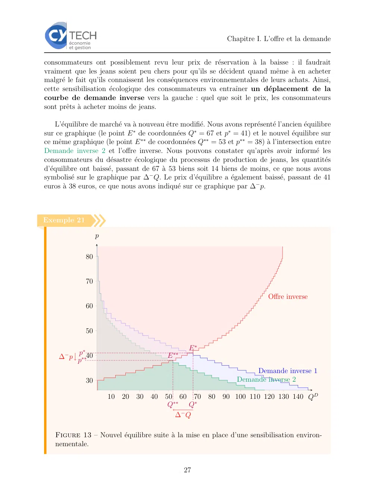

~~~text
                                                                Chapitre I. L’offre et la demande

consommateurs ont possiblement revu leur prix de réservation à la baisse : il faudrait
vraiment que les jeans soient peu chers pour qu’ils se décident quand même à en acheter
malgré le fait qu’ils connaissent les conséquences environnementales de leurs achats. Ainsi,
cette sensibilisation écologique des consommateurs va entraı̂ner un déplacement de la
courbe de demande inverse vers la gauche : quel que soit le prix, les consommateurs
sont prêts à acheter moins de jeans.

    L’équilibre de marché va à nouveau être modifié. Nous avons représenté l’ancien équilibre
sur ce graphique (le point E ∗ de coordonnées Q∗ = 67 et p∗ = 41) et le nouvel équilibre sur
ce même graphique (le point E ∗∗ de coordonnées Q∗∗ = 53 et p∗∗ = 38) à l’intersection entre
Demande inverse 2 et l’offre inverse. Nous pouvons constater qu’après avoir informé les
consommateurs du désastre écologique du processus de production de jeans, les quantités
d’équilibre ont baissé, passant de 67 à 53 biens soit 14 biens de moins, ce que nous avons
symbolisé sur le graphique par ∆− Q. Le prix d’équilibre a également baissé, passant de 41
euros à 38 euros, ce que nous avons indiqué sur ce graphique par ∆− p.

Exemple 21

                   p

              80

              70

                                                                              Offre inverse
              60

              50

                                                   E∗
          p∗                               E ∗∗
     ∆− p p∗∗40
                                                                        Demande inverse 1
              30                                                   Demande inverse 2

                       10 20 30 40 50 60 70 80 90 100 110 120 130 140 QD
                                    Q∗∗ Q∗
                                      ∆− Q

   Figure 13 – Nouvel équilibre suite à la mise en place d’une sensibilisation environ-
   nementale.

                                                  27
~~~

## Page 28

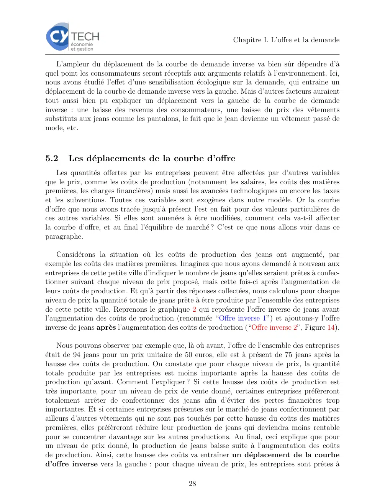

~~~text
                                                               Chapitre I. L’offre et la demande

    L’ampleur du déplacement de la courbe de demande inverse va bien sûr dépendre d’à
quel point les consommateurs seront réceptifs aux arguments relatifs à l’environnement. Ici,
nous avons étudié l’effet d’une sensibilisation écologique sur la demande, qui entraı̂ne un
déplacement de la courbe de demande inverse vers la gauche. Mais d’autres facteurs auraient
tout aussi bien pu expliquer un déplacement vers la gauche de la courbe de demande
inverse : une baisse des revenus des consommateurs, une baisse du prix des vêtements
substituts aux jeans comme les pantalons, le fait que le jean devienne un vêtement passé de
mode, etc.

5.2    Les déplacements de la courbe d’offre
    Les quantités offertes par les entreprises peuvent être affectées par d’autres variables
que le prix, comme les coûts de production (notamment les salaires, les coûts des matières
premières, les charges financières) mais aussi les avancées technologiques ou encore les taxes
et les subventions. Toutes ces variables sont exogènes dans notre modèle. Or la courbe
d’offre que nous avons tracée jusqu’à présent l’est en fait pour des valeurs particulières de
ces autres variables. Si elles sont amenées à être modifiées, comment cela va-t-il affecter
la courbe d’offre, et au final l’équilibre de marché ? C’est ce que nous allons voir dans ce
paragraphe.

    Considérons la situation où les coûts de production des jeans ont augmenté, par
exemple les coûts des matières premières. Imaginez que nous ayons demandé à nouveau aux
entreprises de cette petite ville d’indiquer le nombre de jeans qu’elles seraient prêtes à confec-
tionner suivant chaque niveau de prix proposé, mais cette fois-ci après l’augmentation de
leurs coûts de production. Et qu’à partir des réponses collectées, nous calculons pour chaque
niveau de prix la quantité totale de jeans prête à être produite par l’ensemble des entreprises
de cette petite ville. Reprenons le graphique 2 qui représente l’offre inverse de jeans avant
l’augmentation des coûts de production (renommée “Offre inverse 1”) et ajoutons-y l’offre
inverse de jeans après l’augmentation des coûts de production (“Offre inverse 2”, Figure 14).

     Nous pouvons observer par exemple que, là où avant, l’offre de l’ensemble des entreprises
était de 94 jeans pour un prix unitaire de 50 euros, elle est à présent de 75 jeans après la
hausse des coûts de production. On constate que pour chaque niveau de prix, la quantité
totale produite par les entreprises est moins importante après la hausse des coûts de
production qu’avant. Comment l’expliquer ? Si cette hausse des coûts de production est
très importante, pour un niveau de prix de vente donné, certaines entreprises préfèreront
totalement arrêter de confectionner des jeans afin d’éviter des pertes financières trop
importantes. Et si certaines entreprises présentes sur le marché de jeans confectionnent par
ailleurs d’autres vêtements qui ne sont pas touchés par cette hausse du coûts des matières
premières, elles préfèreront réduire leur production de jeans qui deviendra moins rentable
pour se concentrer davantage sur les autres productions. Au final, ceci explique que pour
un niveau de prix donné, la production de jeans baisse suite à l’augmentation des coûts
de production. Ainsi, cette hausse des coûts va entraı̂ner un déplacement de la courbe
d’offre inverse vers la gauche : pour chaque niveau de prix, les entreprises sont prêtes à

                                                28
~~~

## Page 29

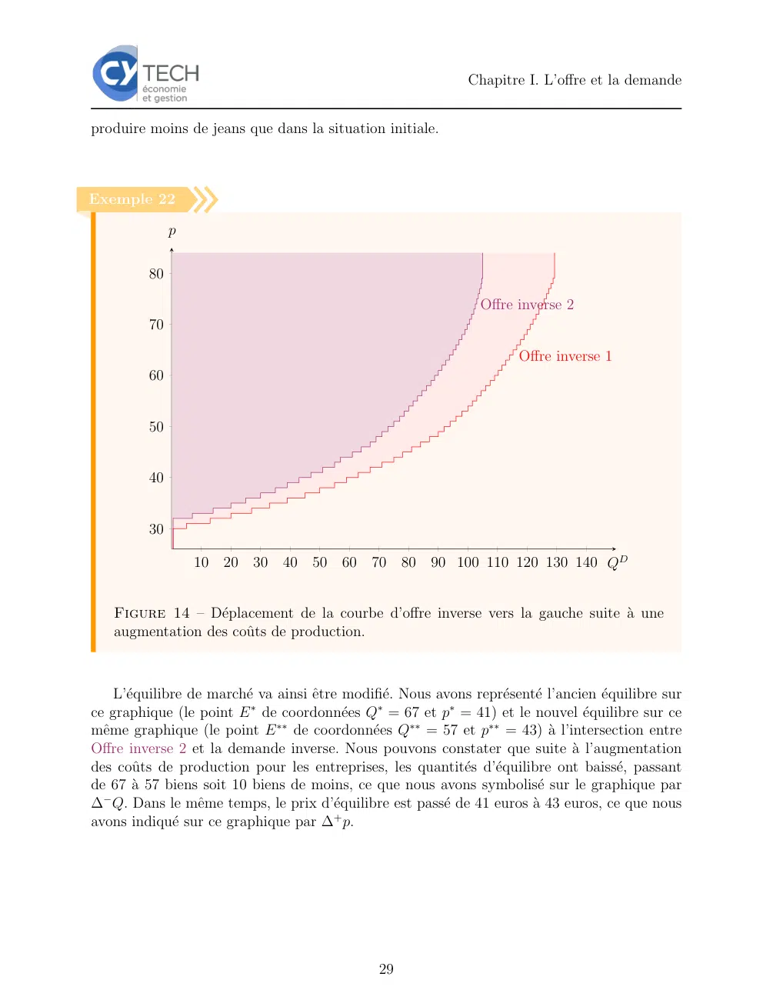

~~~text
                                                               Chapitre I. L’offre et la demande

produire moins de jeans que dans la situation initiale.

Exemple 22

              p

         80

                                                                 Offre inverse 2
         70

                                                                        Offre inverse 1
         60

         50

         40

         30

                  10 20 30 40 50 60 70 80 90 100 110 120 130 140 QD

   Figure 14 – Déplacement de la courbe d’offre inverse vers la gauche suite à une
   augmentation des coûts de production.

    L’équilibre de marché va ainsi être modifié. Nous avons représenté l’ancien équilibre sur
ce graphique (le point E ∗ de coordonnées Q∗ = 67 et p∗ = 41) et le nouvel équilibre sur ce
même graphique (le point E ∗∗ de coordonnées Q∗∗ = 57 et p∗∗ = 43) à l’intersection entre
Offre inverse 2 et la demande inverse. Nous pouvons constater que suite à l’augmentation
des coûts de production pour les entreprises, les quantités d’équilibre ont baissé, passant
de 67 à 57 biens soit 10 biens de moins, ce que nous avons symbolisé sur le graphique par
∆− Q. Dans le même temps, le prix d’équilibre est passé de 41 euros à 43 euros, ce que nous
avons indiqué sur ce graphique par ∆+ p.

                                                29
~~~

## Page 30

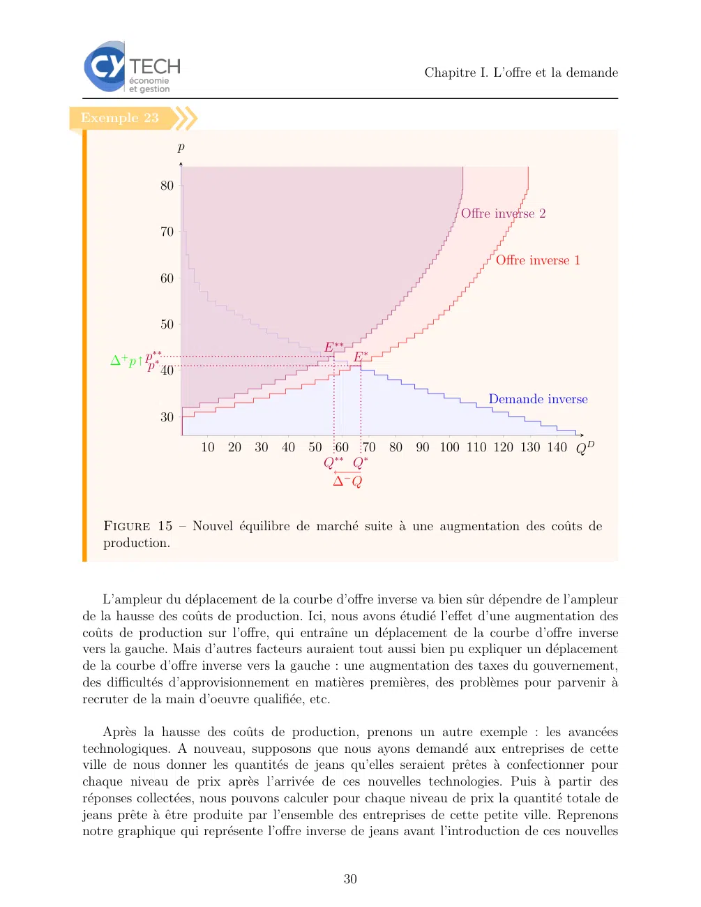

~~~text
                                                            Chapitre I. L’offre et la demande

Exemple 23

                  p

             80

                                                                  Offre inverse 2
             70

                                                                        Offre inverse 1
             60

             50
          ∗∗                              E ∗∗
    ∆ p pp∗
      +                                          E∗
            40

                                                                       Demande inverse
             30

                      10 20 30 40 50 60 70 80 90 100 110 120 130 140 QD
                                    Q∗∗ Q∗
                                     ∆− Q

   Figure 15 – Nouvel équilibre de marché suite à une augmentation des coûts de
   production.

    L’ampleur du déplacement de la courbe d’offre inverse va bien sûr dépendre de l’ampleur
de la hausse des coûts de production. Ici, nous avons étudié l’effet d’une augmentation des
coûts de production sur l’offre, qui entraı̂ne un déplacement de la courbe d’offre inverse
vers la gauche. Mais d’autres facteurs auraient tout aussi bien pu expliquer un déplacement
de la courbe d’offre inverse vers la gauche : une augmentation des taxes du gouvernement,
des difficultés d’approvisionnement en matières premières, des problèmes pour parvenir à
recruter de la main d’oeuvre qualifiée, etc.

    Après la hausse des coûts de production, prenons un autre exemple : les avancées
technologiques. A nouveau, supposons que nous ayons demandé aux entreprises de cette
ville de nous donner les quantités de jeans qu’elles seraient prêtes à confectionner pour
chaque niveau de prix après l’arrivée de ces nouvelles technologies. Puis à partir des
réponses collectées, nous pouvons calculer pour chaque niveau de prix la quantité totale de
jeans prête à être produite par l’ensemble des entreprises de cette petite ville. Reprenons
notre graphique qui représente l’offre inverse de jeans avant l’introduction de ces nouvelles

                                             30
~~~

## Page 31

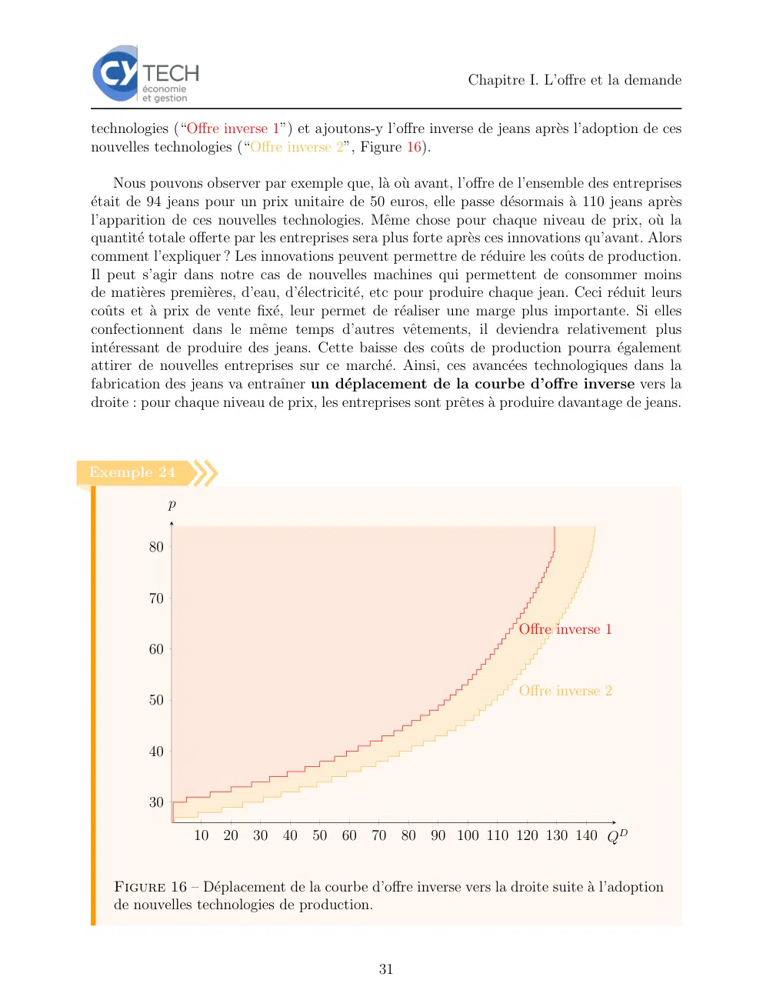

~~~text
                                                               Chapitre I. L’offre et la demande

technologies (“Offre inverse 1”) et ajoutons-y l’offre inverse de jeans après l’adoption de ces
nouvelles technologies (“Offre inverse 2”, Figure 16).

     Nous pouvons observer par exemple que, là où avant, l’offre de l’ensemble des entreprises
était de 94 jeans pour un prix unitaire de 50 euros, elle passe désormais à 110 jeans après
l’apparition de ces nouvelles technologies. Même chose pour chaque niveau de prix, où la
quantité totale offerte par les entreprises sera plus forte après ces innovations qu’avant. Alors
comment l’expliquer ? Les innovations peuvent permettre de réduire les coûts de production.
Il peut s’agir dans notre cas de nouvelles machines qui permettent de consommer moins
de matières premières, d’eau, d’électricité, etc pour produire chaque jean. Ceci réduit leurs
coûts et à prix de vente fixé, leur permet de réaliser une marge plus importante. Si elles
confectionnent dans le même temps d’autres vêtements, il deviendra relativement plus
intéressant de produire des jeans. Cette baisse des coûts de production pourra également
attirer de nouvelles entreprises sur ce marché. Ainsi, ces avancées technologiques dans la
fabrication des jeans va entraı̂ner un déplacement de la courbe d’offre inverse vers la
droite : pour chaque niveau de prix, les entreprises sont prêtes à produire davantage de jeans.

Exemple 24

              p

         80

         70

                                                                       Offre inverse 1
         60

                                                                       Offre inverse 2
         50

         40

         30

                  10 20 30 40 50 60 70 80 90 100 110 120 130 140 QD

   Figure 16 – Déplacement de la courbe d’offre inverse vers la droite suite à l’adoption
   de nouvelles technologies de production.

                                                31
~~~

## Page 32

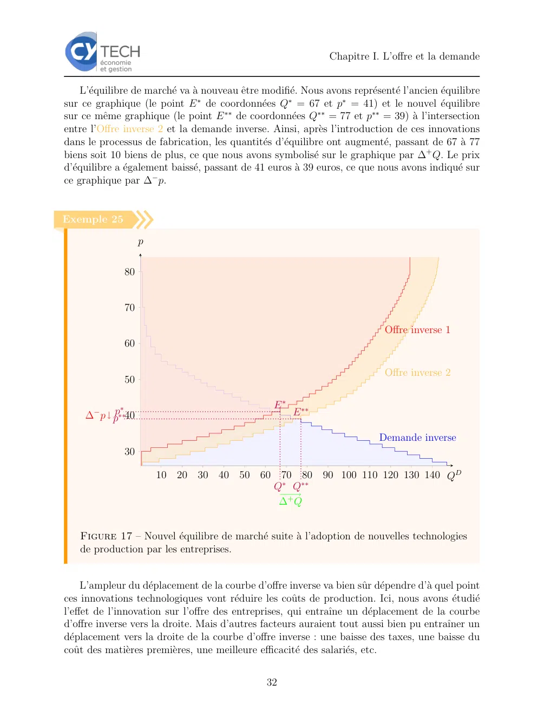

~~~text
                                                                Chapitre I. L’offre et la demande

    L’équilibre de marché va à nouveau être modifié. Nous avons représenté l’ancien équilibre
sur ce graphique (le point E ∗ de coordonnées Q∗ = 67 et p∗ = 41) et le nouvel équilibre
sur ce même graphique (le point E ∗∗ de coordonnées Q∗∗ = 77 et p∗∗ = 39) à l’intersection
entre l’Offre inverse 2 et la demande inverse. Ainsi, après l’introduction de ces innovations
dans le processus de fabrication, les quantités d’équilibre ont augmenté, passant de 67 à 77
biens soit 10 biens de plus, ce que nous avons symbolisé sur le graphique par ∆+ Q. Le prix
d’équilibre a également baissé, passant de 41 euros à 39 euros, ce que nous avons indiqué sur
ce graphique par ∆− p.

Exemple 25

                   p

              80

              70

                                                                             Offre inverse 1
              60

                                                                             Offre inverse 2
              50

           ∗                                      E∗
     ∆ p pp∗∗40
       −                                               E ∗∗

                                                                            Demande inverse
              30

                       10 20 30 40 50 60 70 80 90 100 110 120 130 140 QD
                                        Q∗ Q∗∗
                                         ∆+ Q

   Figure 17 – Nouvel équilibre de marché suite à l’adoption de nouvelles technologies
   de production par les entreprises.

     L’ampleur du déplacement de la courbe d’offre inverse va bien sûr dépendre d’à quel point
ces innovations technologiques vont réduire les coûts de production. Ici, nous avons étudié
l’effet de l’innovation sur l’offre des entreprises, qui entraı̂ne un déplacement de la courbe
d’offre inverse vers la droite. Mais d’autres facteurs auraient tout aussi bien pu entraı̂ner un
déplacement vers la droite de la courbe d’offre inverse : une baisse des taxes, une baisse du
coût des matières premières, une meilleure efficacité des salariés, etc.

                                                 32
~~~
