# Chapitre_2_La_Theorie_du_consommateur.pdf

[Ouvrir l’original](https://drive.google.com/open?id=1hARuyVoHacVm8ATkX5aBlEbouXk1uhd0) · Les deux lectures automatiques du PDF divergent sur les pages indiquées. Leur fac-similé accompagne le texte.

**Pages présentant un écart entre les deux extractions** — 1–29.

## Page 1

~~~text
             Chapitre 2. La théorie du consommateur
                                     François Maublanc

                                             Résumé
         Ce chapitre introduit les théories économiques derrière la prise de décision des
     consommateurs. Après avoir modélisé leurs préférences et leur contrainte de budget,
     il montre comment le consommateur maximise sa satisfaction (utilité) sous contrainte
     de budget. Cette théorie économique aide à prédire les réactions de consommation face
     aux variations des prix et des revenus.

Table des matières
1 Les hypothèses sur les préférences des consommateurs                                          2

2 La fonction d’utilité                                                                           4

3 Les courbes d’indifférence                                                                      7
  3.1 Définition et représentation graphique . . . . . . . . . . . . . . . . . . . . . .         7
  3.2 L’absence d’intersection des courbes d’indifférence . . . . . . . . . . . . . . .          10
  3.3 La décroissance des courbes d’indifférence . . . . . . . . . . . . . . . . . . .          11
  3.4 La convexité des courbes d’indifférence . . . . . . . . . . . . . . . . . . . . .         13
  3.5 Les préférences normales . . . . . . . . . . . . . . . . . . . . . . . . . . . . .        15

4 Le taux marginal de substitution                                                                16

5 L’utilité marginale                                                                            18

6 Biens substituables et biens complémentaires                                                   20

7 La contrainte budgétaire                                                                       22
  7.1 Définitions et représentation graphique . . . . . . . . . . . . . . . . . . . . .         22
  7.2 Modification du revenu du consommateur . . . . . . . . . . . . . . . . . . . .              24
  7.3 Modification du prix du bien 1 (p1 ) . . . . . . . . . . . . . . . . . . . . . . .          25
  7.4 Modification du prix du bien 2 (p2 ) . . . . . . . . . . . . . . . . . . . . . . .          27

8 Le choix optimal du consommateur                                                                28

                                                 1
~~~

## Page 2

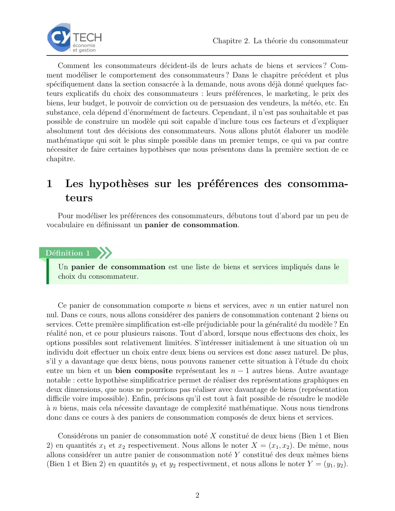

~~~text
                                                        Chapitre 2. La théorie du consommateur

    Comment les consommateurs décident-ils de leurs achats de biens et services ? Com-
ment modéliser le comportement des consommateurs ? Dans le chapitre précédent et plus
spécifiquement dans la section consacrée à la demande, nous avons déjà donné quelques fac-
teurs explicatifs du choix des consommateurs : leurs préférences, le marketing, le prix des
biens, leur budget, le pouvoir de conviction ou de persuasion des vendeurs, la météo, etc. En
substance, cela dépend d’énormément de facteurs. Cependant, il n’est pas souhaitable et pas
possible de construire un modèle qui soit capable d’inclure tous ces facteurs et d’expliquer
absolument tout des décisions des consommateurs. Nous allons plutôt élaborer un modèle
mathématique qui soit le plus simple possible dans un premier temps, ce qui va par contre
nécessiter de faire certaines hypothèses que nous présentons dans la première section de ce
chapitre.

1     Les hypothèses sur les préférences des consomma-
      teurs
   Pour modéliser les préférences des consommateurs, débutons tout d’abord par un peu de
vocabulaire en définissant un panier de consommation.

Définition 1
    Un panier de consommation est une liste de biens et services impliqués dans le
    choix du consommateur.

     Ce panier de consommation comporte n biens et services, avec n un entier naturel non
nul. Dans ce cours, nous allons considérer des paniers de consommation contenant 2 biens ou
services. Cette première simplification est-elle préjudiciable pour la généralité du modèle ? En
réalité non, et ce pour plusieurs raisons. Tout d’abord, lorsque nous effectuons des choix, les
options possibles sont relativement limitées. S’intéresser initialement à une situation où un
individu doit effectuer un choix entre deux biens ou services est donc assez naturel. De plus,
s’il y a davantage que deux biens, nous pouvons ramener cette situation à l’étude du choix
entre un bien et un bien composite représentant les n − 1 autres biens. Autre avantage
notable : cette hypothèse simplificatrice permet de réaliser des représentations graphiques en
deux dimensions, que nous ne pourrions pas réaliser avec davantage de biens (représentation
difficile voire impossible). Enfin, précisons qu’il est tout à fait possible de résoudre le modèle
à n biens, mais cela nécessite davantage de complexité mathématique. Nous nous tiendrons
donc dans ce cours à des paniers de consommation composés de deux biens et services.

    Considérons un panier de consommation noté X constitué de deux biens (Bien 1 et Bien
2) en quantités x1 et x2 respectivement. Nous allons le noter X = (x1 , x2 ). De même, nous
allons considérer un autre panier de consommation noté Y constitué des deux mêmes biens
(Bien 1 et Bien 2) en quantités y1 et y2 respectivement, et nous allons le noter Y = (y1 , y2 ).

                                                  2
~~~

## Page 3

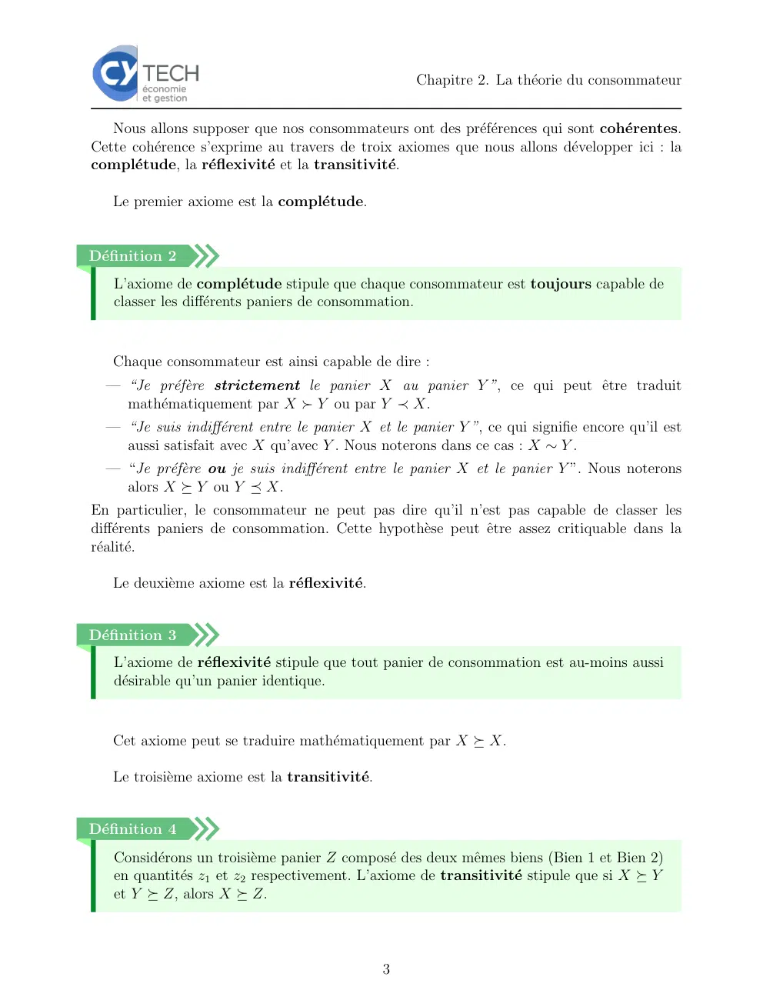

~~~text
                                                    Chapitre 2. La théorie du consommateur

   Nous allons supposer que nos consommateurs ont des préférences qui sont cohérentes.
Cette cohérence s’exprime au travers de troix axiomes que nous allons développer ici : la
complétude, la réflexivité et la transitivité.

   Le premier axiome est la complétude.

Définition 2
   L’axiome de complétude stipule que chaque consommateur est toujours capable de
   classer les différents paniers de consommation.

   Chaque consommateur est ainsi capable de dire :
  — “Je préfère strictement le panier X au panier Y ”, ce qui peut être traduit
    mathématiquement par X ≻ Y ou par Y ≺ X.
  — “Je suis indifférent entre le panier X et le panier Y ”, ce qui signifie encore qu’il est
    aussi satisfait avec X qu’avec Y . Nous noterons dans ce cas : X ∼ Y .
  — “Je préfère ou je suis indifférent entre le panier X et le panier Y ”. Nous noterons
    alors X ⪰ Y ou Y ⪯ X.
En particulier, le consommateur ne peut pas dire qu’il n’est pas capable de classer les
différents paniers de consommation. Cette hypothèse peut être assez critiquable dans la
réalité.

   Le deuxième axiome est la réflexivité.

Définition 3
   L’axiome de réflexivité stipule que tout panier de consommation est au-moins aussi
   désirable qu’un panier identique.

   Cet axiome peut se traduire mathématiquement par X ⪰ X.

   Le troisième axiome est la transitivité.

Définition 4
   Considérons un troisième panier Z composé des deux mêmes biens (Bien 1 et Bien 2)
   en quantités z1 et z2 respectivement. L’axiome de transitivité stipule que si X ⪰ Y
   et Y ⪰ Z, alors X ⪰ Z.

                                                3
~~~

## Page 4

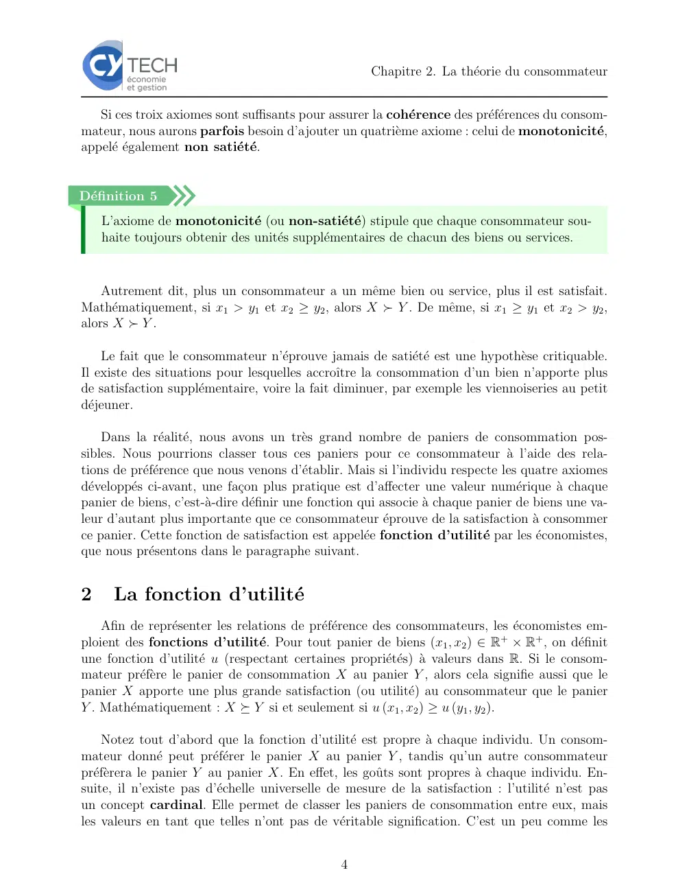

~~~text
                                                     Chapitre 2. La théorie du consommateur

   Si ces troix axiomes sont suffisants pour assurer la cohérence des préférences du consom-
mateur, nous aurons parfois besoin d’ajouter un quatrième axiome : celui de monotonicité,
appelé également non satiété.

Définition 5
    L’axiome de monotonicité (ou non-satiété) stipule que chaque consommateur sou-
    haite toujours obtenir des unités supplémentaires de chacun des biens ou services.

    Autrement dit, plus un consommateur a un même bien ou service, plus il est satisfait.
Mathématiquement, si x1 > y1 et x2 ≥ y2 , alors X ≻ Y . De même, si x1 ≥ y1 et x2 > y2 ,
alors X ≻ Y .

    Le fait que le consommateur n’éprouve jamais de satiété est une hypothèse critiquable.
Il existe des situations pour lesquelles accroı̂tre la consommation d’un bien n’apporte plus
de satisfaction supplémentaire, voire la fait diminuer, par exemple les viennoiseries au petit
déjeuner.

    Dans la réalité, nous avons un très grand nombre de paniers de consommation pos-
sibles. Nous pourrions classer tous ces paniers pour ce consommateur à l’aide des rela-
tions de préférence que nous venons d’établir. Mais si l’individu respecte les quatre axiomes
développés ci-avant, une façon plus pratique est d’affecter une valeur numérique à chaque
panier de biens, c’est-à-dire définir une fonction qui associe à chaque panier de biens une va-
leur d’autant plus importante que ce consommateur éprouve de la satisfaction à consommer
ce panier. Cette fonction de satisfaction est appelée fonction d’utilité par les économistes,
que nous présentons dans le paragraphe suivant.

2     La fonction d’utilité
    Afin de représenter les relations de préférence des consommateurs, les économistes em-
ploient des fonctions d’utilité. Pour tout panier de biens (x1 , x2 ) ∈ R+ × R+ , on définit
une fonction d’utilité u (respectant certaines propriétés) à valeurs dans R. Si le consom-
mateur préfère le panier de consommation X au panier Y , alors cela signifie aussi que le
panier X apporte une plus grande satisfaction (ou utilité) au consommateur que le panier
Y . Mathématiquement : X ⪰ Y si et seulement si u (x1 , x2 ) ≥ u (y1 , y2 ).

    Notez tout d’abord que la fonction d’utilité est propre à chaque individu. Un consom-
mateur donné peut préférer le panier X au panier Y , tandis qu’un autre consommateur
préfèrera le panier Y au panier X. En effet, les goûts sont propres à chaque individu. En-
suite, il n’existe pas d’échelle universelle de mesure de la satisfaction : l’utilité n’est pas
un concept cardinal. Elle permet de classer les paniers de consommation entre eux, mais
les valeurs en tant que telles n’ont pas de véritable signification. C’est un peu comme les

                                                4
~~~

## Page 5

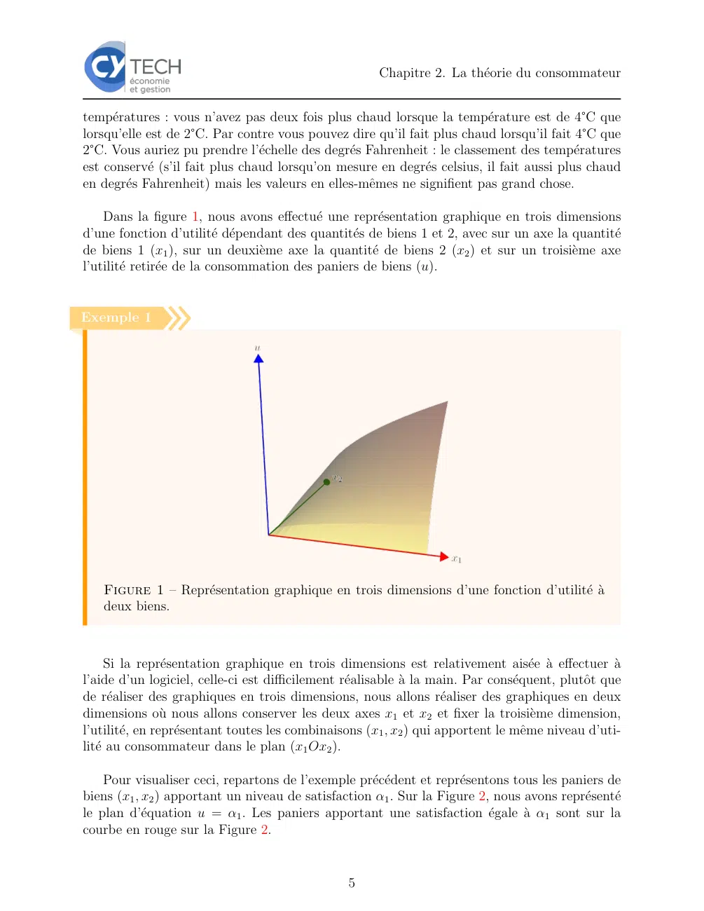

~~~text
                                                       Chapitre 2. La théorie du consommateur

températures : vous n’avez pas deux fois plus chaud lorsque la température est de 4°C que
lorsqu’elle est de 2°C. Par contre vous pouvez dire qu’il fait plus chaud lorsqu’il fait 4°C que
2°C. Vous auriez pu prendre l’échelle des degrés Fahrenheit : le classement des températures
est conservé (s’il fait plus chaud lorsqu’on mesure en degrés celsius, il fait aussi plus chaud
en degrés Fahrenheit) mais les valeurs en elles-mêmes ne signifient pas grand chose.

    Dans la figure 1, nous avons effectué une représentation graphique en trois dimensions
d’une fonction d’utilité dépendant des quantités de biens 1 et 2, avec sur un axe la quantité
de biens 1 (x1 ), sur un deuxième axe la quantité de biens 2 (x2 ) et sur un troisième axe
l’utilité retirée de la consommation des paniers de biens (u).

Exemple 1

   Figure 1 – Représentation graphique en trois dimensions d’une fonction d’utilité à
   deux biens.

     Si la représentation graphique en trois dimensions est relativement aisée à effectuer à
l’aide d’un logiciel, celle-ci est difficilement réalisable à la main. Par conséquent, plutôt que
de réaliser des graphiques en trois dimensions, nous allons réaliser des graphiques en deux
dimensions où nous allons conserver les deux axes x1 et x2 et fixer la troisième dimension,
l’utilité, en représentant toutes les combinaisons (x1 , x2 ) qui apportent le même niveau d’uti-
lité au consommateur dans le plan (x1 Ox2 ).

    Pour visualiser ceci, repartons de l’exemple précédent et représentons tous les paniers de
biens (x1 , x2 ) apportant un niveau de satisfaction α1 . Sur la Figure 2, nous avons représenté
le plan d’équation u = α1 . Les paniers apportant une satisfaction égale à α1 sont sur la
courbe en rouge sur la Figure 2.

                                                 5
~~~

## Page 6

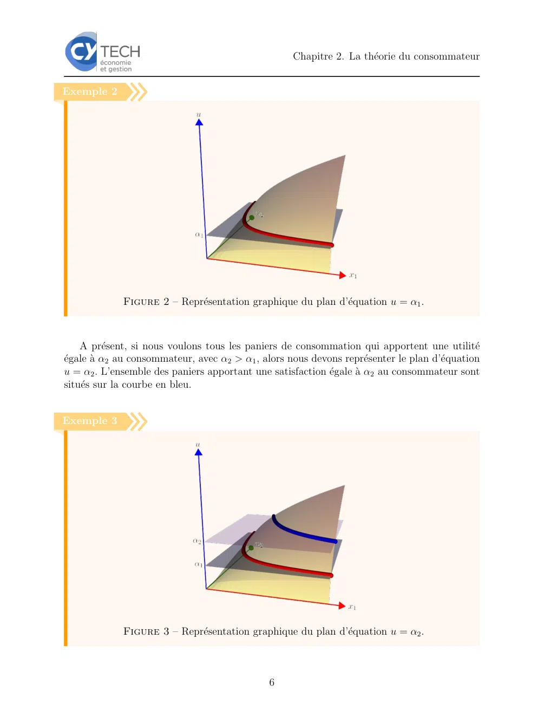

~~~text
                                                    Chapitre 2. La théorie du consommateur

Exemple 2

             Figure 2 – Représentation graphique du plan d’équation u = α1 .

    A présent, si nous voulons tous les paniers de consommation qui apportent une utilité
égale à α2 au consommateur, avec α2 > α1 , alors nous devons représenter le plan d’équation
u = α2 . L’ensemble des paniers apportant une satisfaction égale à α2 au consommateur sont
situés sur la courbe en bleu.

Exemple 3

             Figure 3 – Représentation graphique du plan d’équation u = α2 .

                                              6
~~~

## Page 7

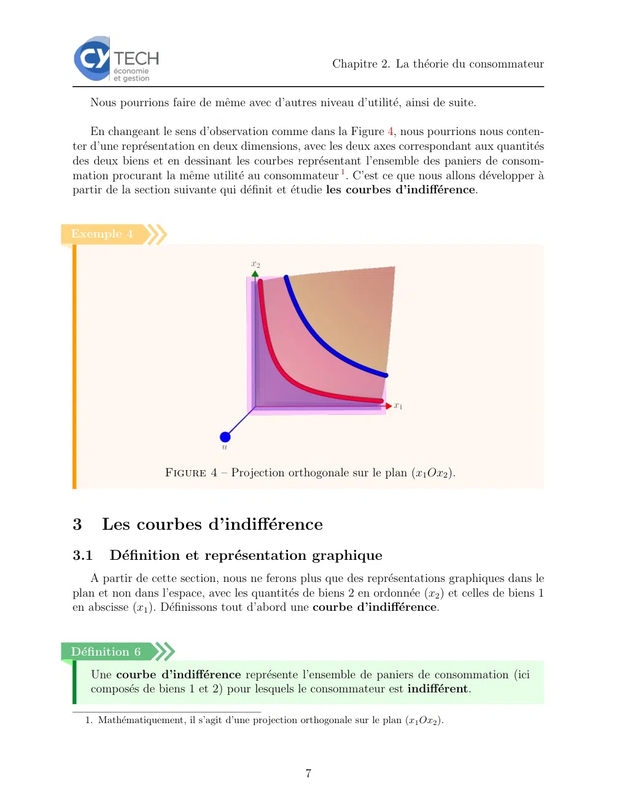

~~~text
                                                             Chapitre 2. La théorie du consommateur

     Nous pourrions faire de même avec d’autres niveau d’utilité, ainsi de suite.

    En changeant le sens d’observation comme dans la Figure 4, nous pourrions nous conten-
ter d’une représentation en deux dimensions, avec les deux axes correspondant aux quantités
des deux biens et en dessinant les courbes représentant l’ensemble des paniers de consom-
mation procurant la même utilité au consommateur 1 . C’est ce que nous allons développer à
partir de la section suivante qui définit et étudie les courbes d’indifférence.

Exemple 4

                      Figure 4 – Projection orthogonale sur le plan (x1 Ox2 ).

3      Les courbes d’indifférence
3.1      Définition et représentation graphique
   A partir de cette section, nous ne ferons plus que des représentations graphiques dans le
plan et non dans l’espace, avec les quantités de biens 2 en ordonnée (x2 ) et celles de biens 1
en abscisse (x1 ). Définissons tout d’abord une courbe d’indifférence.

Définition 6
     Une courbe d’indifférence représente l’ensemble de paniers de consommation (ici
     composés de biens 1 et 2) pour lesquels le consommateur est indifférent.

    1. Mathématiquement, il s’agit d’une projection orthogonale sur le plan (x1 Ox2 ).

                                                      7
~~~

## Page 8

~~~text
                                                      Chapitre 2. La théorie du consommateur

    Ceci signifie que n’importe quel panier situé sur une courbe d’indifférence donnée apporte
au consommateur exactement la même utilité. Les courbes d’indifférence sont des courbes de
niveau, comme les isobares en météorologie qui relient les points où la pression atmosphérique
est la même ou les isoplèthes d’altitude qui relient tous les points situés à la même altitude
sur les cartes topographiques (Figure 5).

Exemple 5

       (a) Isobares (courbes qui relient des points de pression atmosphérique égale).

       (b) Isoplèthes d’altitude (ligne tracée sur une carte topographique qui relie
       tous les points ayant la même altitude par rapport au niveau de la mer).

                         Figure 5 – Isobares et Isoplèthes d’altitude.

                                                8
~~~

## Page 9

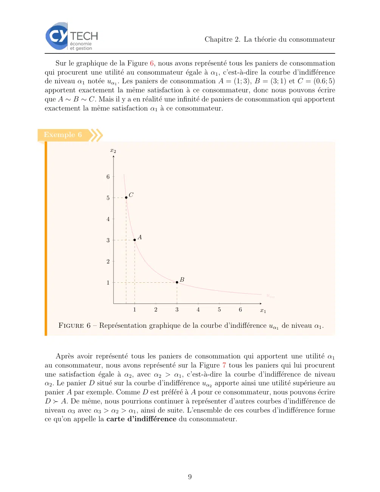

~~~text
                                                         Chapitre 2. La théorie du consommateur

   Sur le graphique de la Figure 6, nous avons représenté tous les paniers de consommation
qui procurent une utilité au consommateur égale à α1 , c’est-à-dire la courbe d’indifférence
de niveau α1 notée uα1 . Les paniers de consommation A = (1; 3), B = (3; 1) et C = (0.6; 5)
apportent exactement la même satisfaction à ce consommateur, donc nous pouvons écrire
que A ∼ B ∼ C. Mais il y a en réalité une infinité de paniers de consommation qui apportent
exactement la même satisfaction α1 à ce consommateur.

Exemple 6
                         x2

                     6

                     5        •C

                     4

                     3         •A

                     2

                     1                      •B

                                                                              uα1

                               1     2      3        4      5      6     x1

    Figure 6 – Représentation graphique de la courbe d’indifférence uα1 de niveau α1 .

     Après avoir représenté tous les paniers de consommation qui apportent une utilité α1
au consommateur, nous avons représenté sur la Figure 7 tous les paniers qui lui procurent
une satisfaction égale à α2 , avec α2 > α1 , c’est-à-dire la courbe d’indifférence de niveau
α2 . Le panier D situé sur la courbe d’indifférence uα2 apporte ainsi une utilité supérieure au
panier A par exemple. Comme D est préféré à A pour ce consommateur, nous pouvons écrire
D ≻ A. De même, nous pourrions continuer à représenter d’autres courbes d’indifférence de
niveau α3 avec α3 > α2 > α1 , ainsi de suite. L’ensemble de ces courbes d’indifférence forme
ce qu’on appelle la carte d’indifférence du consommateur.

                                                 9
~~~

## Page 10

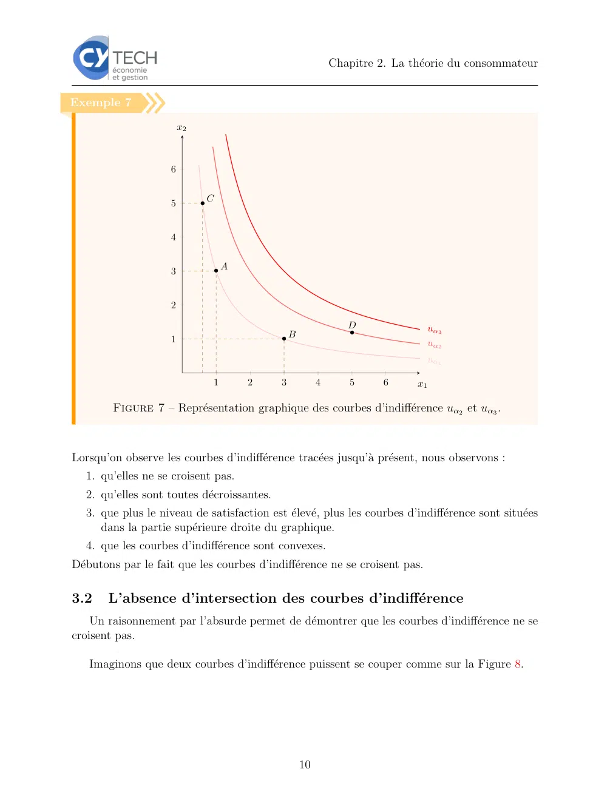

~~~text
                                                          Chapitre 2. La théorie du consommateur

Exemple 7
                        x2

                    6

                    5        •C

                    4

                    3         •A

                    2

                                                             D                 uα3
                                                             •
                    1                       •B                                 uα2
                                                                               uα1

                              1     2       3         4      5      6     x1

        Figure 7 – Représentation graphique des courbes d’indifférence uα2 et uα3 .

Lorsqu’on observe les courbes d’indifférence tracées jusqu’à présent, nous observons :
  1. qu’elles ne se croisent pas.
  2. qu’elles sont toutes décroissantes.
  3. que plus le niveau de satisfaction est élevé, plus les courbes d’indifférence sont situées
     dans la partie supérieure droite du graphique.
  4. que les courbes d’indifférence sont convexes.
Débutons par le fait que les courbes d’indifférence ne se croisent pas.

3.2    L’absence d’intersection des courbes d’indifférence
    Un raisonnement par l’absurde permet de démontrer que les courbes d’indifférence ne se
croisent pas.

   Imaginons que deux courbes d’indifférence puissent se couper comme sur la Figure 8.

                                                 10
~~~

## Page 11

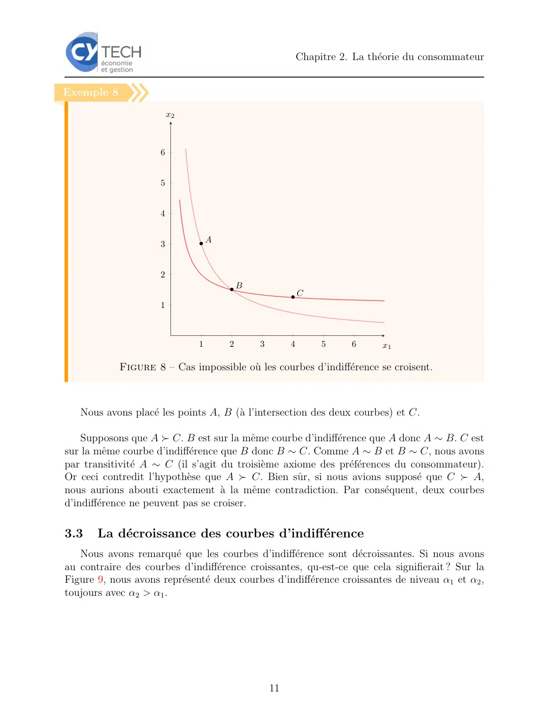

~~~text
                                                         Chapitre 2. La théorie du consommateur

Exemple 8
                         x2

                     6

                     5

                     4

                     3        •A

                     2
                                     •B
                                                     •C
                     1

                              1      2      3        4        5     6     x1

            Figure 8 – Cas impossible où les courbes d’indifférence se croisent.

   Nous avons placé les points A, B (à l’intersection des deux courbes) et C.

    Supposons que A ≻ C. B est sur la même courbe d’indifférence que A donc A ∼ B. C est
sur la même courbe d’indifférence que B donc B ∼ C. Comme A ∼ B et B ∼ C, nous avons
par transitivité A ∼ C (il s’agit du troisième axiome des préférences du consommateur).
Or ceci contredit l’hypothèse que A ≻ C. Bien sûr, si nous avions supposé que C ≻ A,
nous aurions abouti exactement à la même contradiction. Par conséquent, deux courbes
d’indifférence ne peuvent pas se croiser.

3.3    La décroissance des courbes d’indifférence
   Nous avons remarqué que les courbes d’indifférence sont décroissantes. Si nous avons
au contraire des courbes d’indifférence croissantes, qu-est-ce que cela signifierait ? Sur la
Figure 9, nous avons représenté deux courbes d’indifférence croissantes de niveau α1 et α2 ,
toujours avec α2 > α1 .

                                                11
~~~

## Page 12

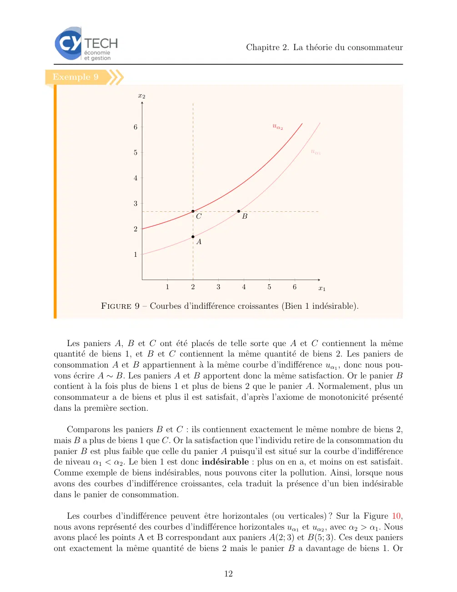

~~~text
                                                               Chapitre 2. La théorie du consommateur

Exemple 9
                          x2

                      6                                                 uα2

                      5                                                           uα1

                      4

                      3
                                      •                •
                                          C                B
                      2
                                      •
                                          A
                      1

                               1      2       3            4        5         6     x1

             Figure 9 – Courbes d’indifférence croissantes (Bien 1 indésirable).

   Les paniers A, B et C ont été placés de telle sorte que A et C contiennent la même
quantité de biens 1, et B et C contiennent la même quantité de biens 2. Les paniers de
consommation A et B appartiennent à la même courbe d’indifférence uα1 , donc nous pou-
vons écrire A ∼ B. Les paniers A et B apportent donc la même satisfaction. Or le panier B
contient à la fois plus de biens 1 et plus de biens 2 que le panier A. Normalement, plus un
consommateur a de biens et plus il est satisfait, d’après l’axiome de monotonicité présenté
dans la première section.

   Comparons les paniers B et C : ils contiennent exactement le même nombre de biens 2,
mais B a plus de biens 1 que C. Or la satisfaction que l’individu retire de la consommation du
panier B est plus faible que celle du panier A puisqu’il est situé sur la courbe d’indifférence
de niveau α1 < α2 . Le bien 1 est donc indésirable : plus on en a, et moins on est satisfait.
Comme exemple de biens indésirables, nous pouvons citer la pollution. Ainsi, lorsque nous
avons des courbes d’indifférence croissantes, cela traduit la présence d’un bien indésirable
dans le panier de consommation.

   Les courbes d’indifférence peuvent être horizontales (ou verticales) ? Sur la Figure 10,
nous avons représenté des courbes d’indifférence horizontales uα1 et uα2 , avec α2 > α1 . Nous
avons placé les points A et B correspondant aux paniers A(2; 3) et B(5; 3). Ces deux paniers
ont exactement la même quantité de biens 2 mais le panier B a davantage de biens 1. Or

                                                  12
~~~

## Page 13

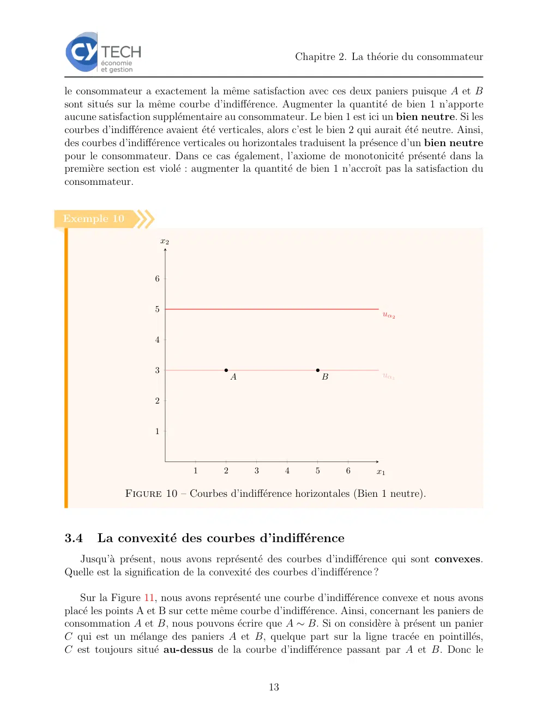

~~~text
                                                            Chapitre 2. La théorie du consommateur

le consommateur a exactement la même satisfaction avec ces deux paniers puisque A et B
sont situés sur la même courbe d’indifférence. Augmenter la quantité de bien 1 n’apporte
aucune satisfaction supplémentaire au consommateur. Le bien 1 est ici un bien neutre. Si les
courbes d’indifférence avaient été verticales, alors c’est le bien 2 qui aurait été neutre. Ainsi,
des courbes d’indifférence verticales ou horizontales traduisent la présence d’un bien neutre
pour le consommateur. Dans ce cas également, l’axiome de monotonicité présenté dans la
première section est violé : augmenter la quantité de bien 1 n’accroı̂t pas la satisfaction du
consommateur.

Exemple 10
                          x2

                      6

                      5                                                       uα2

                      4

                      3                •                        •
                                           A                        B         uα1

                      2

                      1

                               1       2       3        4       5       6   x1

              Figure 10 – Courbes d’indifférence horizontales (Bien 1 neutre).

3.4     La convexité des courbes d’indifférence
  Jusqu’à présent, nous avons représenté des courbes d’indifférence qui sont convexes.
Quelle est la signification de la convexité des courbes d’indifférence ?

   Sur la Figure 11, nous avons représenté une courbe d’indifférence convexe et nous avons
placé les points A et B sur cette même courbe d’indifférence. Ainsi, concernant les paniers de
consommation A et B, nous pouvons écrire que A ∼ B. Si on considère à présent un panier
C qui est un mélange des paniers A et B, quelque part sur la ligne tracée en pointillés,
C est toujours situé au-dessus de la courbe d’indifférence passant par A et B. Donc le

                                                   13
~~~

## Page 14

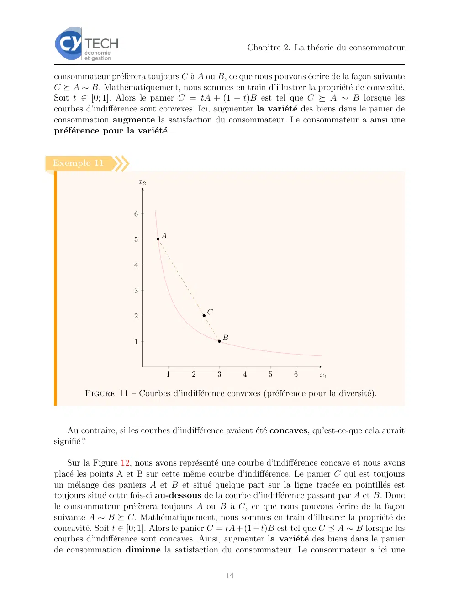

~~~text
                                                            Chapitre 2. La théorie du consommateur

consommateur préfèrera toujours C à A ou B, ce que nous pouvons écrire de la façon suivante
C ⪰ A ∼ B. Mathématiquement, nous sommes en train d’illustrer la propriété de convexité.
Soit t ∈ [0; 1]. Alors le panier C = tA + (1 − t)B est tel que C ⪰ A ∼ B lorsque les
courbes d’indifférence sont convexes. Ici, augmenter la variété des biens dans le panier de
consommation augmente la satisfaction du consommateur. Le consommateur a ainsi une
préférence pour la variété.

Exemple 11
                          x2

                      6

                      5        •A

                      4

                      3

                      2                   •C

                      1                        •B

                                1     2        3        4        5     6     x1

        Figure 11 – Courbes d’indifférence convexes (préférence pour la diversité).

    Au contraire, si les courbes d’indifférence avaient été concaves, qu’est-ce-que cela aurait
signifié ?

    Sur la Figure 12, nous avons représenté une courbe d’indifférence concave et nous avons
placé les points A et B sur cette même courbe d’indifférence. Le panier C qui est toujours
un mélange des paniers A et B et situé quelque part sur la ligne tracée en pointillés est
toujours situé cette fois-ci au-dessous de la courbe d’indifférence passant par A et B. Donc
le consommateur préfèrera toujours A ou B à C, ce que nous pouvons écrire de la façon
suivante A ∼ B ⪰ C. Mathématiquement, nous sommes en train d’illustrer la propriété de
concavité. Soit t ∈ [0; 1]. Alors le panier C = tA + (1 − t)B est tel que C ⪯ A ∼ B lorsque les
courbes d’indifférence sont concaves. Ainsi, augmenter la variété des biens dans le panier
de consommation diminue la satisfaction du consommateur. Le consommateur a ici une

                                                   14
~~~

## Page 15

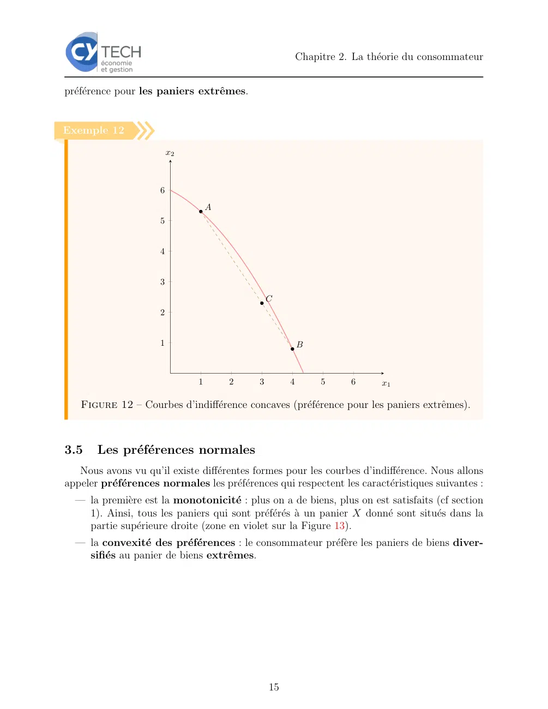

~~~text
                                                          Chapitre 2. La théorie du consommateur

préférence pour les paniers extrêmes.

Exemple 12
                          x2

                      6

                               •A
                      5

                      4

                      3

                                             •C
                      2

                      1
                                                      •B

                               1      2      3        4        5     6     x1

   Figure 12 – Courbes d’indifférence concaves (préférence pour les paniers extrêmes).

3.5    Les préférences normales
   Nous avons vu qu’il existe différentes formes pour les courbes d’indifférence. Nous allons
appeler préférences normales les préférences qui respectent les caractéristiques suivantes :
  — la première est la monotonicité : plus on a de biens, plus on est satisfaits (cf section
    1). Ainsi, tous les paniers qui sont préférés à un panier X donné sont situés dans la
    partie supérieure droite (zone en violet sur la Figure 13).
  — la convexité des préférences : le consommateur préfère les paniers de biens diver-
    sifiés au panier de biens extrêmes.

                                                 15
~~~

## Page 16

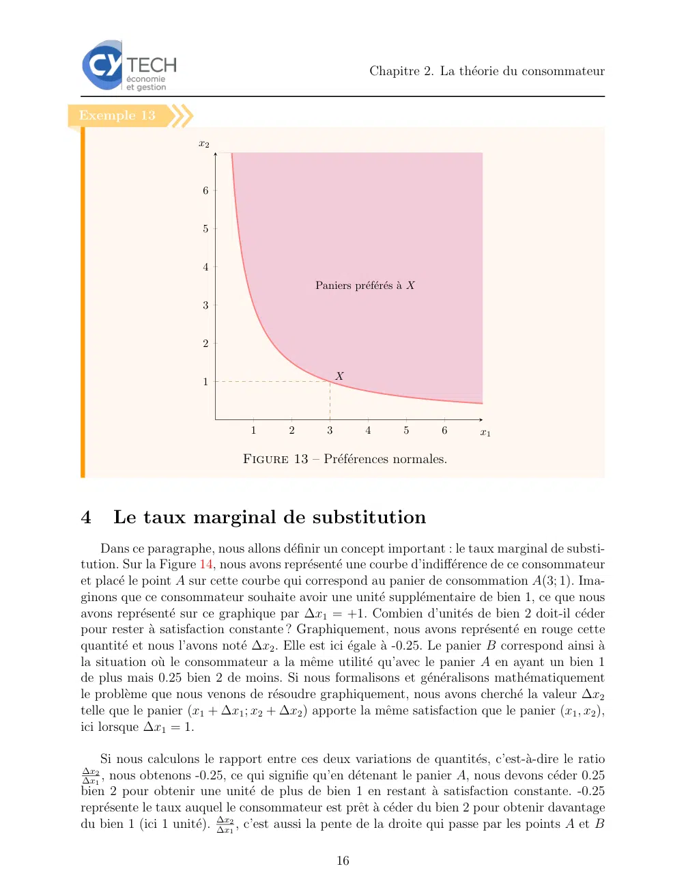

~~~text
                                                         Chapitre 2. La théorie du consommateur

Exemple 13
                      x2

                       6

                       5

                       4
                                            Paniers préférés à X
                       3

                       2

                       1                          X

                                1      2      3         4        5     6   x1

                              Figure 13 – Préférences normales.

4     Le taux marginal de substitution
     Dans ce paragraphe, nous allons définir un concept important : le taux marginal de substi-
tution. Sur la Figure 14, nous avons représenté une courbe d’indifférence de ce consommateur
et placé le point A sur cette courbe qui correspond au panier de consommation A(3; 1). Ima-
ginons que ce consommateur souhaite avoir une unité supplémentaire de bien 1, ce que nous
avons représenté sur ce graphique par ∆x1 = +1. Combien d’unités de bien 2 doit-il céder
pour rester à satisfaction constante ? Graphiquement, nous avons représenté en rouge cette
quantité et nous l’avons noté ∆x2 . Elle est ici égale à -0.25. Le panier B correspond ainsi à
la situation où le consommateur a la même utilité qu’avec le panier A en ayant un bien 1
de plus mais 0.25 bien 2 de moins. Si nous formalisons et généralisons mathématiquement
le problème que nous venons de résoudre graphiquement, nous avons cherché la valeur ∆x2
telle que le panier (x1 + ∆x1 ; x2 + ∆x2 ) apporte la même satisfaction que le panier (x1 , x2 ),
ici lorsque ∆x1 = 1.

    Si nous calculons le rapport entre ces deux variations de quantités, c’est-à-dire le ratio
∆x2
∆x1
    , nous obtenons -0.25, ce qui signifie qu’en détenant le panier A, nous devons céder 0.25
bien 2 pour obtenir une unité de plus de bien 1 en restant à satisfaction constante. -0.25
représente le taux auquel le consommateur est prêt à céder du bien 2 pour obtenir davantage
du bien 1 (ici 1 unité). ∆x
                          ∆x1
                             2
                               , c’est aussi la pente de la droite qui passe par les points A et B

                                                  16
~~~

## Page 17

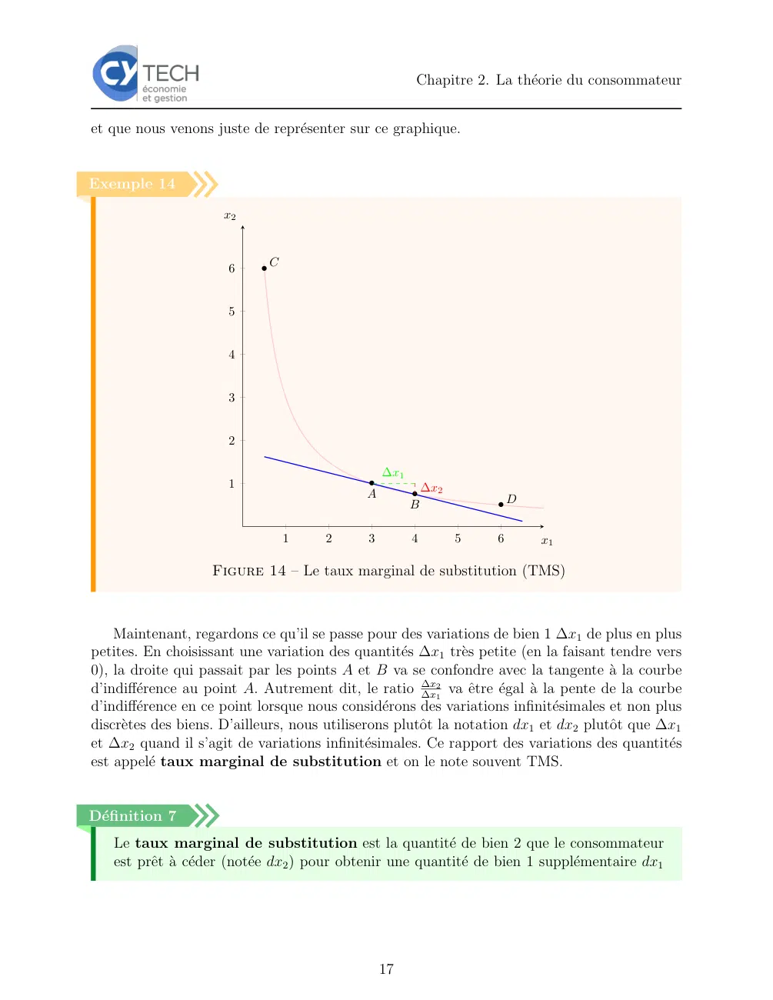

~~~text
                                                         Chapitre 2. La théorie du consommateur

et que nous venons juste de représenter sur ce graphique.

Exemple 14
                      x2

                       6    •C

                       5

                       4

                       3

                       2

                                                   ∆x1
                       1                      •
                                              A          • ∆x2
                                                         B           •D

                                 1     2       3         4       5   6      x1

                    Figure 14 – Le taux marginal de substitution (TMS)

    Maintenant, regardons ce qu’il se passe pour des variations de bien 1 ∆x1 de plus en plus
petites. En choisissant une variation des quantités ∆x1 très petite (en la faisant tendre vers
0), la droite qui passait par les points A et B va se confondre avec la tangente à la courbe
d’indifférence au point A. Autrement dit, le ratio ∆x ∆x1
                                                           2
                                                             va être égal à la pente de la courbe
d’indifférence en ce point lorsque nous considérons des variations infinitésimales et non plus
discrètes des biens. D’ailleurs, nous utiliserons plutôt la notation dx1 et dx2 plutôt que ∆x1
et ∆x2 quand il s’agit de variations infinitésimales. Ce rapport des variations des quantités
est appelé taux marginal de substitution et on le note souvent TMS.

Définition 7
   Le taux marginal de substitution est la quantité de bien 2 que le consommateur
   est prêt à céder (notée dx2 ) pour obtenir une quantité de bien 1 supplémentaire dx1

                                                   17
~~~

## Page 18

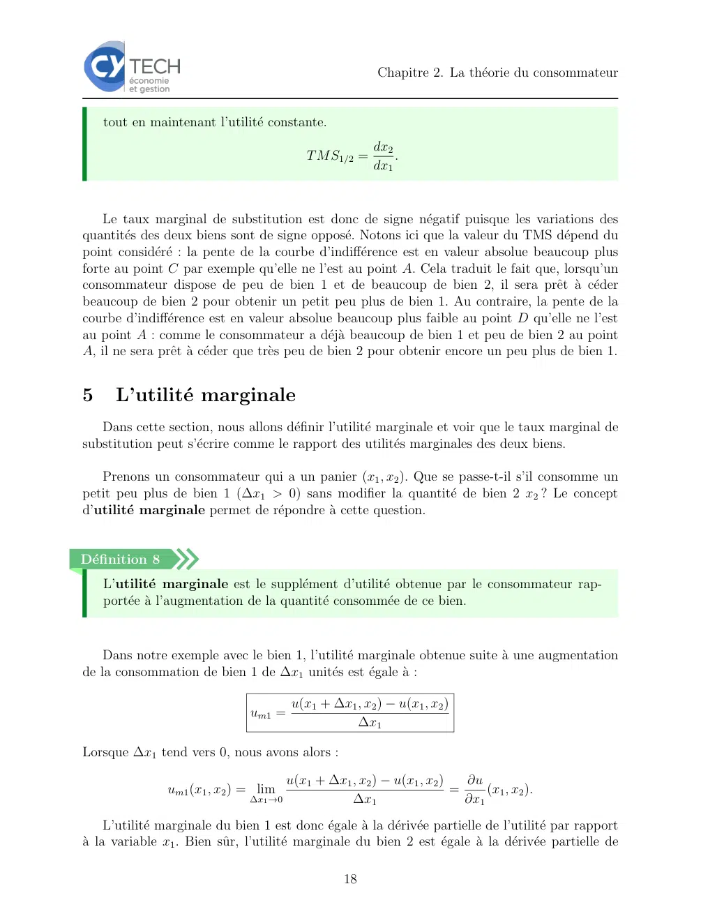

~~~text
                                                         Chapitre 2. La théorie du consommateur

    tout en maintenant l’utilité constante.
                                                        dx2
                                           T M S1/2 =       .
                                                        dx1

    Le taux marginal de substitution est donc de signe négatif puisque les variations des
quantités des deux biens sont de signe opposé. Notons ici que la valeur du TMS dépend du
point considéré : la pente de la courbe d’indifférence est en valeur absolue beaucoup plus
forte au point C par exemple qu’elle ne l’est au point A. Cela traduit le fait que, lorsqu’un
consommateur dispose de peu de bien 1 et de beaucoup de bien 2, il sera prêt à céder
beaucoup de bien 2 pour obtenir un petit peu plus de bien 1. Au contraire, la pente de la
courbe d’indifférence est en valeur absolue beaucoup plus faible au point D qu’elle ne l’est
au point A : comme le consommateur a déjà beaucoup de bien 1 et peu de bien 2 au point
A, il ne sera prêt à céder que très peu de bien 2 pour obtenir encore un peu plus de bien 1.

5     L’utilité marginale
   Dans cette section, nous allons définir l’utilité marginale et voir que le taux marginal de
substitution peut s’écrire comme le rapport des utilités marginales des deux biens.

   Prenons un consommateur qui a un panier (x1 , x2 ). Que se passe-t-il s’il consomme un
petit peu plus de bien 1 (∆x1 > 0) sans modifier la quantité de bien 2 x2 ? Le concept
d’utilité marginale permet de répondre à cette question.

Définition 8
    L’utilité marginale est le supplément d’utilité obtenue par le consommateur rap-
    portée à l’augmentation de la quantité consommée de ce bien.

    Dans notre exemple avec le bien 1, l’utilité marginale obtenue suite à une augmentation
de la consommation de bien 1 de ∆x1 unités est égale à :

                                        u(x1 + ∆x1 , x2 ) − u(x1 , x2 )
                                um1 =
                                                   ∆x1

Lorsque ∆x1 tend vers 0, nous avons alors :

                                       u(x1 + ∆x1 , x2 ) − u(x1 , x2 )   ∂u
                um1 (x1 , x2 ) = lim                                   =     (x1 , x2 ).
                                ∆x1 →0            ∆x1                    ∂x1
     L’utilité marginale du bien 1 est donc égale à la dérivée partielle de l’utilité par rapport
à la variable x1 . Bien sûr, l’utilité marginale du bien 2 est égale à la dérivée partielle de

                                                  18
~~~

## Page 19

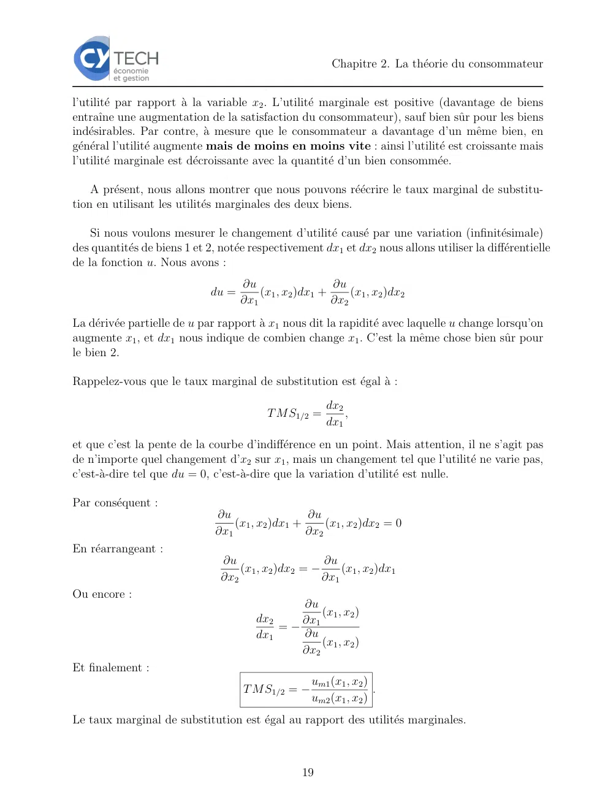

~~~text
                                                          Chapitre 2. La théorie du consommateur

l’utilité par rapport à la variable x2 . L’utilité marginale est positive (davantage de biens
entraı̂ne une augmentation de la satisfaction du consommateur), sauf bien sûr pour les biens
indésirables. Par contre, à mesure que le consommateur a davantage d’un même bien, en
général l’utilité augmente mais de moins en moins vite : ainsi l’utilité est croissante mais
l’utilité marginale est décroissante avec la quantité d’un bien consommée.

    A présent, nous allons montrer que nous pouvons réécrire le taux marginal de substitu-
tion en utilisant les utilités marginales des deux biens.

    Si nous voulons mesurer le changement d’utilité causé par une variation (infinitésimale)
des quantités de biens 1 et 2, notée respectivement dx1 et dx2 nous allons utiliser la différentielle
de la fonction u. Nous avons :
                                     ∂u                  ∂u
                              du =       (x1 , x2 )dx1 +     (x1 , x2 )dx2
                                     ∂x1                 ∂x2
La dérivée partielle de u par rapport à x1 nous dit la rapidité avec laquelle u change lorsqu’on
augmente x1 , et dx1 nous indique de combien change x1 . C’est la même chose bien sûr pour
le bien 2.

Rappelez-vous que le taux marginal de substitution est égal à :
                                                        dx2
                                           T M S1/2 =       ,
                                                        dx1
et que c’est la pente de la courbe d’indifférence en un point. Mais attention, il ne s’agit pas
de n’importe quel changement d’x2 sur x1 , mais un changement tel que l’utilité ne varie pas,
c’est-à-dire tel que du = 0, c’est-à-dire que la variation d’utilité est nulle.

Par conséquent :
                               ∂u                  ∂u
                                   (x1 , x2 )dx1 +     (x1 , x2 )dx2 = 0
                               ∂x1                 ∂x2
En réarrangeant :
                                ∂u                    ∂u
                                    (x1 , x2 )dx2 = −     (x1 , x2 )dx1
                                ∂x2                   ∂x1
Ou encore :
                                               ∂u
                                                   (x1 , x2 )
                                        dx2    ∂x1
                                            =−
                                        dx1    ∂u
                                                   (x1 , x2 )
                                               ∂x2
Et finalement :
                                                     um1 (x1 , x2 )
                                     T M S1/2 = −                   .
                                                     um2 (x1 , x2 )
Le taux marginal de substitution est égal au rapport des utilités marginales.

                                                  19
~~~

## Page 20

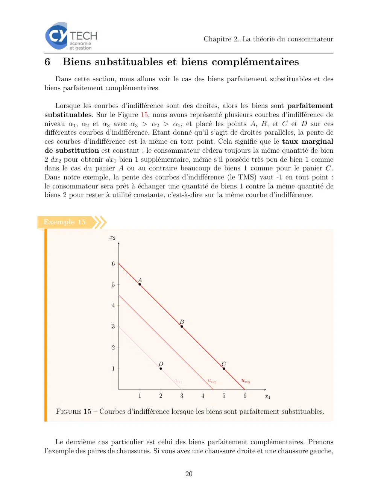

~~~text
                                                       Chapitre 2. La théorie du consommateur

6     Biens substituables et biens complémentaires
   Dans cette section, nous allons voir le cas des biens parfaitement substituables et des
biens parfaitement complémentaires.

    Lorsque les courbes d’indifférence sont des droites, alors les biens sont parfaitement
substituables. Sur le Figure 15, nous avons représenté plusieurs courbes d’indifférence de
niveau α1 , α2 et α3 avec α3 > α2 > α1 , et placé les points A, B, et C et D sur ces
différentes courbes d’indifférence. Etant donné qu’il s’agit de droites parallèles, la pente de
ces courbes d’indifférence est la même en tout point. Cela signifie que le taux marginal
de substitution est constant : le consommateur cèdera toujours la même quantité de bien
2 dx2 pour obtenir dx1 bien 1 supplémentaire, même s’il possède très peu de bien 1 comme
dans le cas du panier A ou au contraire beaucoup de biens 1 comme pour le panier C.
Dans notre exemple, la pente des courbes d’indifférence (le TMS) vaut -1 en tout point :
le consommateur sera prêt à échanger une quantité de biens 1 contre la même quantité de
biens 2 pour rester à utilité constante, c’est-à-dire sur la même courbe d’indifférence.

Exemple 15
                      x2

                       6

                               A
                       5       •

                       4

                                              B
                       3                      •

                       2

                                      D                          C
                       1              •                          •
                                            uα1            uα2       uα3

                                1      2      3        4         5   6     x1

    Figure 15 – Courbes d’indifférence lorsque les biens sont parfaitement substituables.

    Le deuxième cas particulier est celui des biens parfaitement complémentaires. Prenons
l’exemple des paires de chaussures. Si vous avez une chaussure droite et une chaussure gauche,

                                                  20
~~~

## Page 21

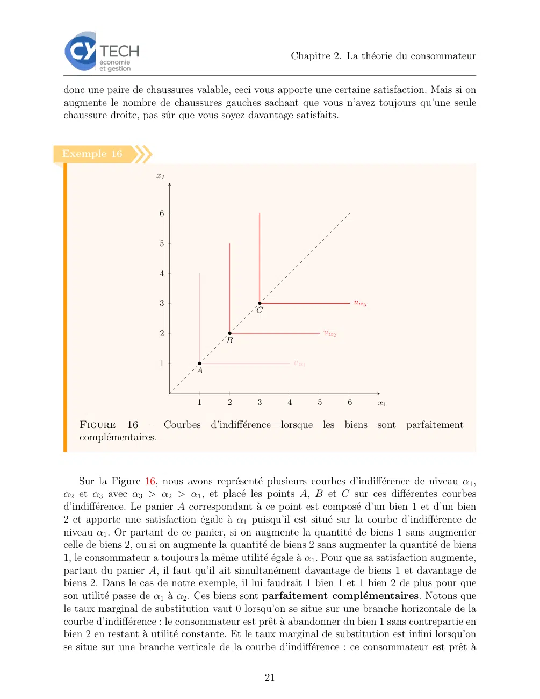

~~~text
                                                      Chapitre 2. La théorie du consommateur

donc une paire de chaussures valable, ceci vous apporte une certaine satisfaction. Mais si on
augmente le nombre de chaussures gauches sachant que vous n’avez toujours qu’une seule
chaussure droite, pas sûr que vous soyez davantage satisfaits.

Exemple 16
                     x2

                      6

                      5

                      4

                      3                      •                                uα3
                                             C

                      2               •                             uα2
                                      B

                      1        •                          uα1
                               A

                               1      2      3        4         5         6         x1

   Figure 16 – Courbes d’indifférence lorsque les biens sont parfaitement
   complémentaires.

    Sur la Figure 16, nous avons représenté plusieurs courbes d’indifférence de niveau α1 ,
α2 et α3 avec α3 > α2 > α1 , et placé les points A, B et C sur ces différentes courbes
d’indifférence. Le panier A correspondant à ce point est composé d’un bien 1 et d’un bien
2 et apporte une satisfaction égale à α1 puisqu’il est situé sur la courbe d’indifférence de
niveau α1 . Or partant de ce panier, si on augmente la quantité de biens 1 sans augmenter
celle de biens 2, ou si on augmente la quantité de biens 2 sans augmenter la quantité de biens
1, le consommateur a toujours la même utilité égale à α1 . Pour que sa satisfaction augmente,
partant du panier A, il faut qu’il ait simultanément davantage de biens 1 et davantage de
biens 2. Dans le cas de notre exemple, il lui faudrait 1 bien 1 et 1 bien 2 de plus pour que
son utilité passe de α1 à α2 . Ces biens sont parfaitement complémentaires. Notons que
le taux marginal de substitution vaut 0 lorsqu’on se situe sur une branche horizontale de la
courbe d’indifférence : le consommateur est prêt à abandonner du bien 1 sans contrepartie en
bien 2 en restant à utilité constante. Et le taux marginal de substitution est infini lorsqu’on
se situe sur une branche verticale de la courbe d’indifférence : ce consommateur est prêt à

                                                 21
~~~

## Page 22

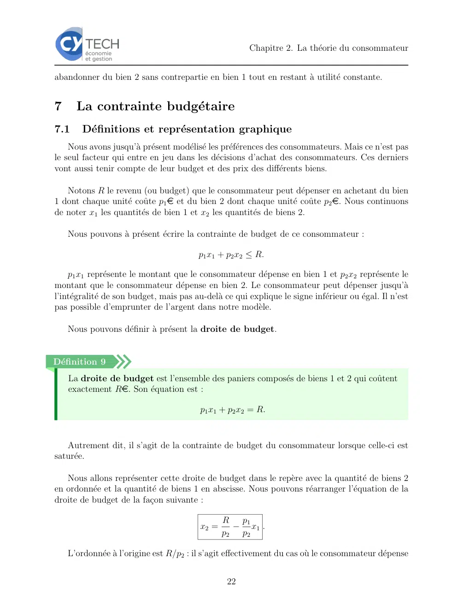

~~~text
                                                        Chapitre 2. La théorie du consommateur

abandonner du bien 2 sans contrepartie en bien 1 tout en restant à utilité constante.

7     La contrainte budgétaire
7.1     Définitions et représentation graphique
    Nous avons jusqu’à présent modélisé les préférences des consommateurs. Mais ce n’est pas
le seul facteur qui entre en jeu dans les décisions d’achat des consommateurs. Ces derniers
vont aussi tenir compte de leur budget et des prix des différents biens.

   Notons R le revenu (ou budget) que le consommateur peut dépenser en achetant du bien
1 dont chaque unité coûte p1 e et du bien 2 dont chaque unité coûte p2 e. Nous continuons
de noter x1 les quantités de bien 1 et x2 les quantités de biens 2.

    Nous pouvons à présent écrire la contrainte de budget de ce consommateur :

                                         p1 x1 + p2 x2 ≤ R.

    p1 x1 représente le montant que le consommateur dépense en bien 1 et p2 x2 représente le
montant que le consommateur dépense en bien 2. Le consommateur peut dépenser jusqu’à
l’intégralité de son budget, mais pas au-delà ce qui explique le signe inférieur ou égal. Il n’est
pas possible d’emprunter de l’argent dans notre modèle.

    Nous pouvons définir à présent la droite de budget.

Définition 9
    La droite de budget est l’ensemble des paniers composés de biens 1 et 2 qui coûtent
    exactement Re. Son équation est :

                                          p1 x1 + p2 x2 = R.

   Autrement dit, il s’agit de la contrainte de budget du consommateur lorsque celle-ci est
saturée.

   Nous allons représenter cette droite de budget dans le repère avec la quantité de biens 2
en ordonnée et la quantité de biens 1 en abscisse. Nous pouvons réarranger l’équation de la
droite de budget de la façon suivante :

                                                 R p1
                                          x2 =      − x1 .
                                                 p 2 p2

    L’ordonnée à l’origine est R/p2 : il s’agit effectivement du cas où le consommateur dépense

                                                  22
~~~

## Page 23

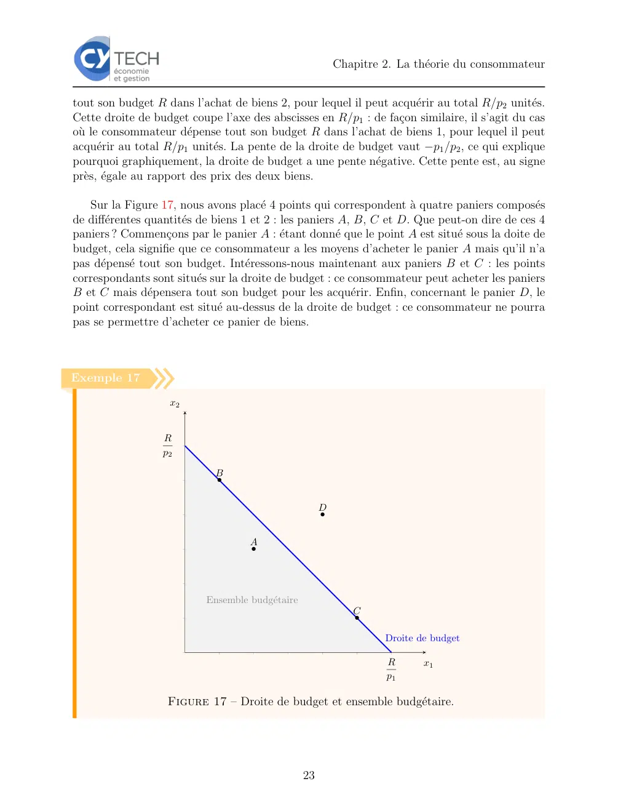

~~~text
                                                           Chapitre 2. La théorie du consommateur

tout son budget R dans l’achat de biens 2, pour lequel il peut acquérir au total R/p2 unités.
Cette droite de budget coupe l’axe des abscisses en R/p1 : de façon similaire, il s’agit du cas
où le consommateur dépense tout son budget R dans l’achat de biens 1, pour lequel il peut
acquérir au total R/p1 unités. La pente de la droite de budget vaut −p1 /p2 , ce qui explique
pourquoi graphiquement, la droite de budget a une pente négative. Cette pente est, au signe
près, égale au rapport des prix des deux biens.

   Sur la Figure 17, nous avons placé 4 points qui correspondent à quatre paniers composés
de différentes quantités de biens 1 et 2 : les paniers A, B, C et D. Que peut-on dire de ces 4
paniers ? Commençons par le panier A : étant donné que le point A est situé sous la doite de
budget, cela signifie que ce consommateur a les moyens d’acheter le panier A mais qu’il n’a
pas dépensé tout son budget. Intéressons-nous maintenant aux paniers B et C : les points
correspondants sont situés sur la droite de budget : ce consommateur peut acheter les paniers
B et C mais dépensera tout son budget pour les acquérir. Enfin, concernant le panier D, le
point correspondant est situé au-dessus de la droite de budget : ce consommateur ne pourra
pas se permettre d’acheter ce panier de biens.

Exemple 17
                   x2

                  R
                  p2

                            B
                            •

                                                       D
                                                       •

                                    A
                                    •

                           Ensemble budgétaire
                                                              C
                                                              •

                                                                    Droite de budget

                                                                    R       x1
                                                                    p1

                   Figure 17 – Droite de budget et ensemble budgétaire.

                                                  23
~~~

## Page 24

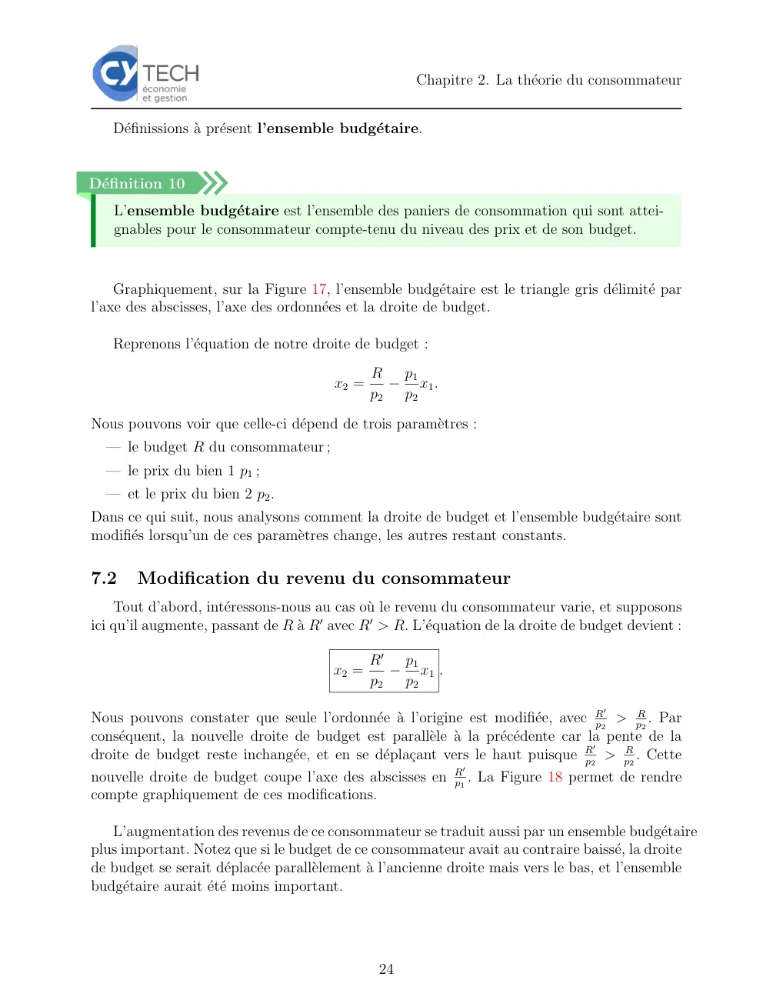

~~~text
                                                     Chapitre 2. La théorie du consommateur

   Définissions à présent l’ensemble budgétaire.

Définition 10
   L’ensemble budgétaire est l’ensemble des paniers de consommation qui sont attei-
   gnables pour le consommateur compte-tenu du niveau des prix et de son budget.

    Graphiquement, sur la Figure 17, l’ensemble budgétaire est le triangle gris délimité par
l’axe des abscisses, l’axe des ordonnées et la droite de budget.

   Reprenons l’équation de notre droite de budget :
                                               R p1
                                        x2 =      − x1 .
                                               p 2 p2
Nous pouvons voir que celle-ci dépend de trois paramètres :
  — le budget R du consommateur ;
  — le prix du bien 1 p1 ;
  — et le prix du bien 2 p2 .
Dans ce qui suit, nous analysons comment la droite de budget et l’ensemble budgétaire sont
modifiés lorsqu’un de ces paramètres change, les autres restant constants.

7.2    Modification du revenu du consommateur
    Tout d’abord, intéressons-nous au cas où le revenu du consommateur varie, et supposons
ici qu’il augmente, passant de R à R′ avec R′ > R. L’équation de la droite de budget devient :

                                               R ′ p1
                                        x2 =      − x1 .
                                               p2  p2
                                                                                    ′
Nous pouvons constater que seule l’ordonnée à l’origine est modifiée, avec R    p2
                                                                                      > pR2 . Par
conséquent, la nouvelle droite de budget est parallèle à la précédente car la pente de la
                                                                                 ′
droite de budget reste inchangée, et en se déplaçant vers le haut puisque R  p2
                                                                                     > pR2 . Cette
                                                           ′
nouvelle droite de budget coupe l’axe des abscisses en R  p1
                                                             . La Figure 18 permet de rendre
compte graphiquement de ces modifications.

   L’augmentation des revenus de ce consommateur se traduit aussi par un ensemble budgétaire
plus important. Notez que si le budget de ce consommateur avait au contraire baissé, la droite
de budget se serait déplacée parallèlement à l’ancienne droite mais vers le bas, et l’ensemble
budgétaire aurait été moins important.

                                                24
~~~

## Page 25

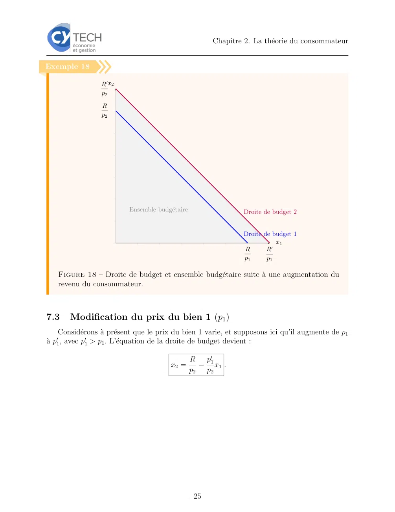

~~~text
                                                       Chapitre 2. La théorie du consommateur

Exemple 18

                 R′x2
                 p2

                 R
                 p2

                          Ensemble budgétaire                 Droite de budget 2

                                                               Droite de budget 1
                                                                          x1
                                                               R       R′
                                                               p1      p1

   Figure 18 – Droite de budget et ensemble budgétaire suite à une augmentation du
   revenu du consommateur.

7.3    Modification du prix du bien 1 (p1 )
     Considérons à présent que le prix du bien 1 varie, et supposons ici qu’il augmente de p1
à p′1 , avec p′1 > p1 . L’équation de la droite de budget devient :

                                                 R p′1
                                        x2 =        − x1 .
                                                 p 2 p2

                                                  25
~~~

## Page 26

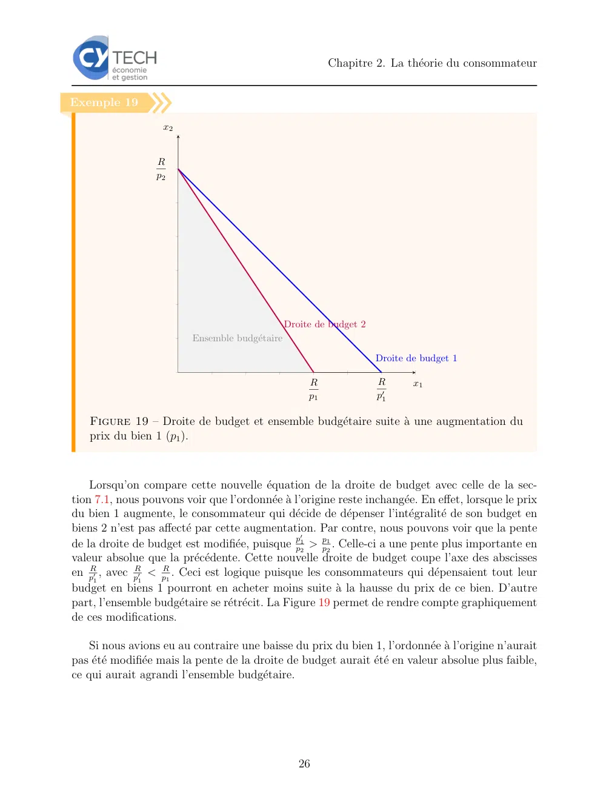

~~~text
                                                          Chapitre 2. La théorie du consommateur

Exemple 19
                   x2

                  R
                  p2

                                                Droite de budget 2
                         Ensemble budgétaire

                                                                     Droite de budget 1

                                                     R               R       x1
                                                     p1              p′1

   Figure 19 – Droite de budget et ensemble budgétaire suite à une augmentation du
   prix du bien 1 (p1 ).

    Lorsqu’on compare cette nouvelle équation de la droite de budget avec celle de la sec-
tion 7.1, nous pouvons voir que l’ordonnée à l’origine reste inchangée. En effet, lorsque le prix
du bien 1 augmente, le consommateur qui décide de dépenser l’intégralité de son budget en
biens 2 n’est pas affecté par cette augmentation. Par contre, nous pouvons voir que la pente
                                                 p′
de la droite de budget est modifiée, puisque p12 > pp12 . Celle-ci a une pente plus importante en
valeur absolue que la précédente. Cette nouvelle droite de budget coupe l’axe des abscisses
en pR′ , avec pR′ < pR1 . Ceci est logique puisque les consommateurs qui dépensaient tout leur
     1          1
budget en biens 1 pourront en acheter moins suite à la hausse du prix de ce bien. D’autre
part, l’ensemble budgétaire se rétrécit. La Figure 19 permet de rendre compte graphiquement
de ces modifications.

    Si nous avions eu au contraire une baisse du prix du bien 1, l’ordonnée à l’origine n’aurait
pas été modifiée mais la pente de la droite de budget aurait été en valeur absolue plus faible,
ce qui aurait agrandi l’ensemble budgétaire.

                                                   26
~~~

## Page 27

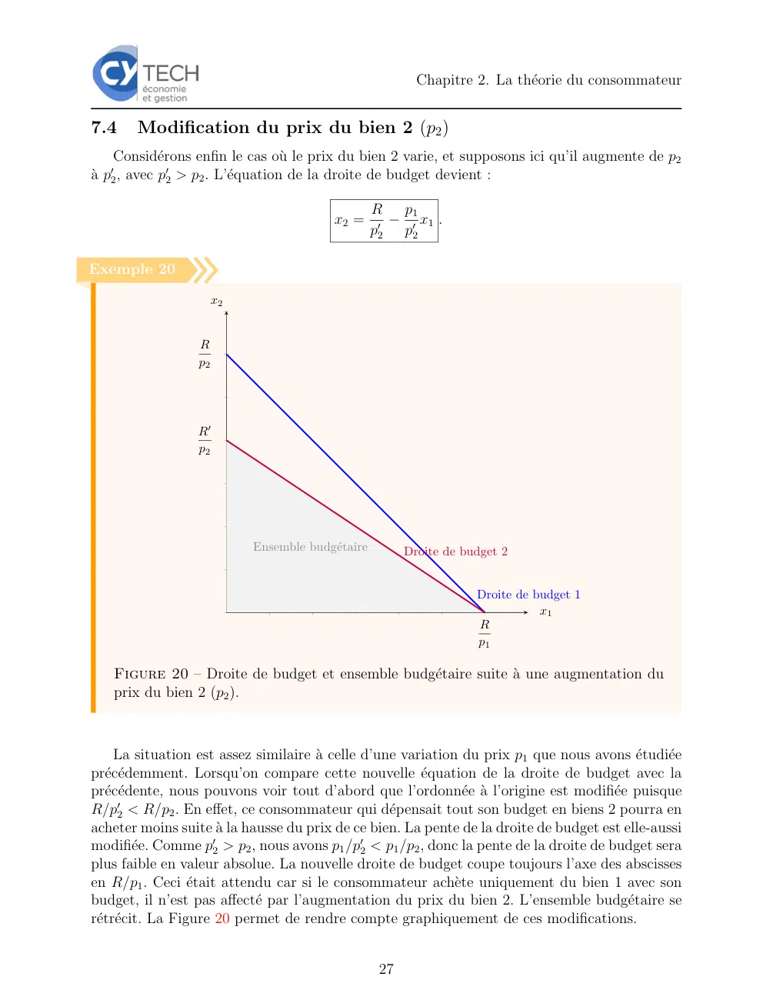

~~~text
                                                           Chapitre 2. La théorie du consommateur

7.4     Modification du prix du bien 2 (p2 )
   Considérons enfin le cas où le prix du bien 2 varie, et supposons ici qu’il augmente de p2
à p′2 , avec p′2 > p2 . L’équation de la droite de budget devient :

                                                   R p1
                                          x2 =        − x1 .
                                                   p′2 p′2

Exemple 20
                       x2

                  R
                  p2

                  R′
                  p2

                            Ensemble budgétaire         Droite de budget 2

                                                                     Droite de budget 1
                                                                                x1
                                                                     R
                                                                     p1

   Figure 20 – Droite de budget et ensemble budgétaire suite à une augmentation du
   prix du bien 2 (p2 ).

     La situation est assez similaire à celle d’une variation du prix p1 que nous avons étudiée
précédemment. Lorsqu’on compare cette nouvelle équation de la droite de budget avec la
précédente, nous pouvons voir tout d’abord que l’ordonnée à l’origine est modifiée puisque
R/p′2 < R/p2 . En effet, ce consommateur qui dépensait tout son budget en biens 2 pourra en
acheter moins suite à la hausse du prix de ce bien. La pente de la droite de budget est elle-aussi
modifiée. Comme p′2 > p2 , nous avons p1 /p′2 < p1 /p2 , donc la pente de la droite de budget sera
plus faible en valeur absolue. La nouvelle droite de budget coupe toujours l’axe des abscisses
en R/p1 . Ceci était attendu car si le consommateur achète uniquement du bien 1 avec son
budget, il n’est pas affecté par l’augmentation du prix du bien 2. L’ensemble budgétaire se
rétrécit. La Figure 20 permet de rendre compte graphiquement de ces modifications.

                                                    27
~~~

## Page 28

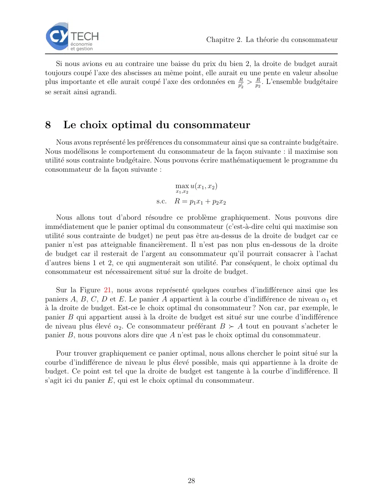

~~~text
                                                     Chapitre 2. La théorie du consommateur

    Si nous avions eu au contraire une baisse du prix du bien 2, la droite de budget aurait
toujours coupé l’axe des abscisses au même point, elle aurait eu une pente en valeur absolue
plus importante et elle aurait coupé l’axe des ordonnées en pR′ > pR2 . L’ensemble budgétaire
                                                                2
se serait ainsi agrandi.

8     Le choix optimal du consommateur
    Nous avons représenté les préférences du consommateur ainsi que sa contrainte budgétaire.
Nous modélisons le comportement du consommateur de la façon suivante : il maximise son
utilité sous contrainte budgétaire. Nous pouvons écrire mathématiquement le programme du
consommateur de la façon suivante :

                                           max u(x1 , x2 )
                                           x1 ,x2

                                     s.c. R = p1 x1 + p2 x2

    Nous allons tout d’abord résoudre ce problème graphiquement. Nous pouvons dire
immédiatement que le panier optimal du consommateur (c’est-à-dire celui qui maximise son
utilité sous contrainte de budget) ne peut pas être au-dessus de la droite de budget car ce
panier n’est pas atteignable financièrement. Il n’est pas non plus en-dessous de la droite
de budget car il resterait de l’argent au consommateur qu’il pourrait consacrer à l’achat
d’autres biens 1 et 2, ce qui augmenterait son utilité. Par conséquent, le choix optimal du
consommateur est nécessairement situé sur la droite de budget.

     Sur la Figure 21, nous avons représenté quelques courbes d’indifférence ainsi que les
paniers A, B, C, D et E. Le panier A appartient à la courbe d’indifférence de niveau α1 et
à la droite de budget. Est-ce le choix optimal du consommateur ? Non car, par exemple, le
panier B qui appartient aussi à la droite de budget est situé sur une courbe d’indifférence
de niveau plus élevé α2 . Ce consommateur préférant B ≻ A tout en pouvant s’acheter le
panier B, nous pouvons alors dire que A n’est pas le choix optimal du consommateur.

    Pour trouver graphiquement ce panier optimal, nous allons chercher le point situé sur la
courbe d’indifférence de niveau le plus élevé possible, mais qui appartienne à la droite de
budget. Ce point est tel que la droite de budget est tangente à la courbe d’indifférence. Il
s’agit ici du panier E, qui est le choix optimal du consommateur.

                                                28
~~~

## Page 29

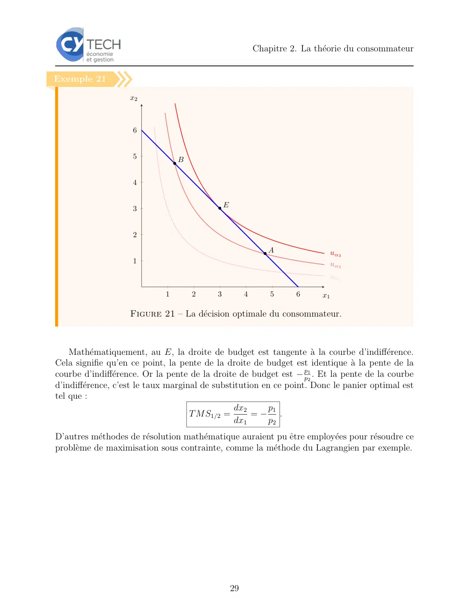

~~~text
                                                         Chapitre 2. La théorie du consommateur

Exemple 21
                    x2

                    6

                    5
                                 •B

                    4

                    3                      •E

                    2

                                                           •A                 uα3
                    1                                                         uα2
                                                                              uα1

                             1        2    3         4       5     6     x1

                    Figure 21 – La décision optimale du consommateur.

    Mathématiquement, au E, la droite de budget est tangente à la courbe d’indifférence.
Cela signifie qu’en ce point, la pente de la droite de budget est identique à la pente de la
courbe d’indifférence. Or la pente de la droite de budget est − pp21 . Et la pente de la courbe
d’indifférence, c’est le taux marginal de substitution en ce point. Donc le panier optimal est
tel que :
                                                 dx2      p1
                                     T M S1/2 =      =− .
                                                 dx1      p2
D’autres méthodes de résolution mathématique auraient pu être employées pour résoudre ce
problème de maximisation sous contrainte, comme la méthode du Lagrangien par exemple.

                                                29
~~~
