# Chapitre_3_La_Theorie_du_producteur.pdf

[Ouvrir l’original](https://drive.google.com/open?id=1IdCMmOfs_TK5LjG3ZOGpJEBnp_OFkZCS) · Les deux lectures automatiques du PDF divergent sur les pages indiquées. Leur fac-similé accompagne le texte.

**Pages présentant un écart entre les deux extractions** — 1–29.

## Page 1

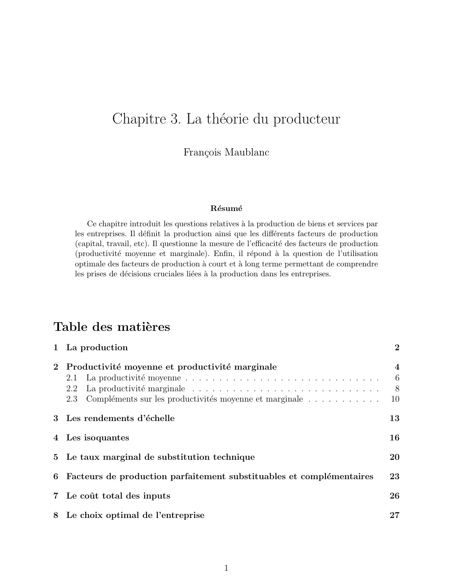

~~~text
                Chapitre 3. La théorie du producteur

                                     François Maublanc

                                              Résumé
         Ce chapitre introduit les questions relatives à la production de biens et services par
     les entreprises. Il définit la production ainsi que les différents facteurs de production
     (capital, travail, etc). Il questionne la mesure de l’efficacité des facteurs de production
     (productivité moyenne et marginale). Enfin, il répond à la question de l’utilisation
     optimale des facteurs de production à court et à long terme permettant de comprendre
     les prises de décisions cruciales liées à la production dans les entreprises.

Table des matières
1 La production                                                                                      2

2 Productivité moyenne et productivité marginale                                                   4
  2.1 La productivité moyenne . . . . . . . . . . . . . . . . . . . . . . . . . . . . .             6
  2.2 La productivité marginale . . . . . . . . . . . . . . . . . . . . . . . . . . . .             8
  2.3 Compléments sur les productivités moyenne et marginale . . . . . . . . . . .                10

3 Les rendements d’échelle                                                                         13

4 Les isoquantes                                                                                    16

5 Le taux marginal de substitution technique                                                        20

6 Facteurs de production parfaitement substituables et complémentaires                             23

7 Le coût total des inputs                                                                         26

8 Le choix optimal de l’entreprise                                                                  27

                                                  1
~~~

## Page 2

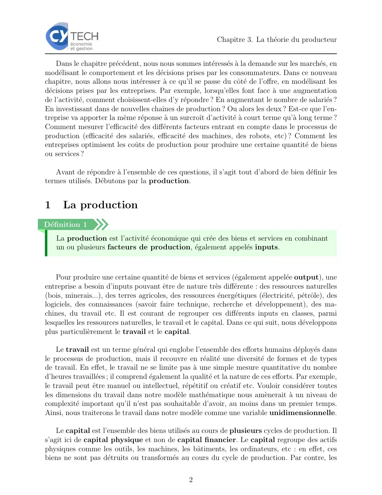

~~~text
                                                             Chapitre 3. La théorie du producteur

    Dans le chapitre précédent, nous nous sommes intéressés à la demande sur les marchés, en
modélisant le comportement et les décisions prises par les consommateurs. Dans ce nouveau
chapitre, nous allons nous intéresser à ce qu’il se passe du côté de l’offre, en modélisant les
décisions prises par les entreprises. Par exemple, lorsqu’elles font face à une augmentation
de l’activité, comment choisissent-elles d’y répondre ? En augmentant le nombre de salariés ?
En investissant dans de nouvelles chaı̂nes de production ? Ou alors les deux ? Est-ce que l’en-
treprise va apporter la même réponse à un surcroı̂t d’activité à court terme qu’à long terme ?
Comment mesurer l’efficacité des différents facteurs entrant en compte dans le processus de
production (efficacité des salariés, efficacité des machines, des robots, etc) ? Comment les
entreprises optimisent les coûts de production pour produire une certaine quantité de biens
ou services ?

   Avant de répondre à l’ensemble de ces questions, il s’agit tout d’abord de bien définir les
termes utilisés. Débutons par la production.

1     La production
Définition 1
    La production est l’activité économique qui crée des biens et services en combinant
    un ou plusieurs facteurs de production, également appelés inputs.

    Pour produire une certaine quantité de biens et services (également appelée output), une
entreprise a besoin d’inputs pouvant être de nature très différente : des ressources naturelles
(bois, minerais...), des terres agricoles, des ressources énergétiques (électricité, pétrôle), des
logiciels, des connaissances (savoir faire technique, recherche et développement), des ma-
chines, du travail etc. Il est courant de regrouper ces différents inputs en classes, parmi
lesquelles les ressources naturelles, le travail et le capital. Dans ce qui suit, nous développons
plus particulièrement le travail et le capital.

    Le travail est un terme général qui englobe l’ensemble des efforts humains déployés dans
le processus de production, mais il recouvre en réalité une diversité de formes et de types
de travail. En effet, le travail ne se limite pas à une simple mesure quantitative du nombre
d’heures travaillées ; il comprend également la qualité et la nature de ces efforts. Par exemple,
le travail peut être manuel ou intellectuel, répétitif ou créatif etc. Vouloir considérer toutes
les dimensions du travail dans notre modèle mathématique nous amènerait à un niveau de
complexité important qu’il n’est pas souhaitable d’avoir, au moins dans un premier temps.
Ainsi, nous traiterons le travail dans notre modèle comme une variable unidimensionnelle.

    Le capital est l’ensemble des biens utilisés au cours de plusieurs cycles de production. Il
s’agit ici de capital physique et non de capital financier. Le capital regroupe des actifs
physiques comme les outils, les machines, les bâtiments, les ordinateurs, etc : en effet, ces
biens ne sont pas détruits ou transformés au cours du cycle de production. Par contre, les

                                                   2
~~~

## Page 3

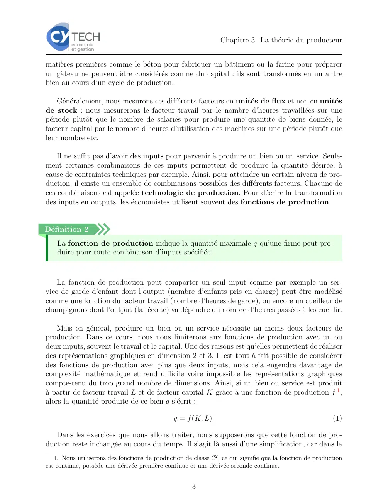

~~~text
                                                                 Chapitre 3. La théorie du producteur

matières premières comme le béton pour fabriquer un bâtiment ou la farine pour préparer
un gâteau ne peuvent être considérés comme du capital : ils sont transformés en un autre
bien au cours d’un cycle de production.

    Généralement, nous mesurons ces différents facteurs en unités de flux et non en unités
de stock : nous mesurerons le facteur travail par le nombre d’heures travaillées sur une
période plutôt que le nombre de salariés pour produire une quantité de biens donnée, le
facteur capital par le nombre d’heures d’utilisation des machines sur une période plutôt que
leur nombre etc.

    Il ne suffit pas d’avoir des inputs pour parvenir à produire un bien ou un service. Seule-
ment certaines combinaisons de ces inputs permettent de produire la quantité désirée, à
cause de contraintes techniques par exemple. Ainsi, pour atteindre un certain niveau de pro-
duction, il existe un ensemble de combinaisons possibles des différents facteurs. Chacune de
ces combinaisons est appelée technologie de production. Pour décrire la transformation
des inputs en outputs, les économistes utilisent souvent des fonctions de production.

Définition 2
    La fonction de production indique la quantité maximale q qu’une firme peut pro-
    duire pour toute combinaison d’inputs spécifiée.

    La fonction de production peut comporter un seul input comme par exemple un ser-
vice de garde d’enfant dont l’output (nombre d’enfants pris en charge) peut être modélisé
comme une fonction du facteur travail (nombre d’heures de garde), ou encore un cueilleur de
champignons dont l’output (la récolte) va dépendre du nombre d’heures passées à les cueillir.

    Mais en général, produire un bien ou un service nécessite au moins deux facteurs de
production. Dans ce cours, nous nous limiterons aux fonctions de production avec un ou
deux inputs, souvent le travail et le capital. Une des raisons est qu’elles permettent de réaliser
des représentations graphiques en dimension 2 et 3. Il est tout à fait possible de considérer
des fonctions de production avec plus que deux inputs, mais cela engendre davantage de
complexité mathématique et rend difficile voire impossible les représentations graphiques
compte-tenu du trop grand nombre de dimensions. Ainsi, si un bien ou service est produit
à partir de facteur travail L et de facteur capital K grâce à une fonction de production f 1 ,
alors la quantité produite de ce bien q s’écrit :

                                                q = f (K, L).                                               (1)

   Dans les exercices que nous allons traiter, nous supposerons que cette fonction de pro-
duction reste inchangée au cours du temps. Il s’agit là aussi d’une simplification, car dans la
   1. Nous utiliserons des fonctions de production de classe C 2 , ce qui signifie que la fonction de production
est continue, possède une dérivée première continue et une dérivée seconde continue.

                                                       3
~~~

## Page 4

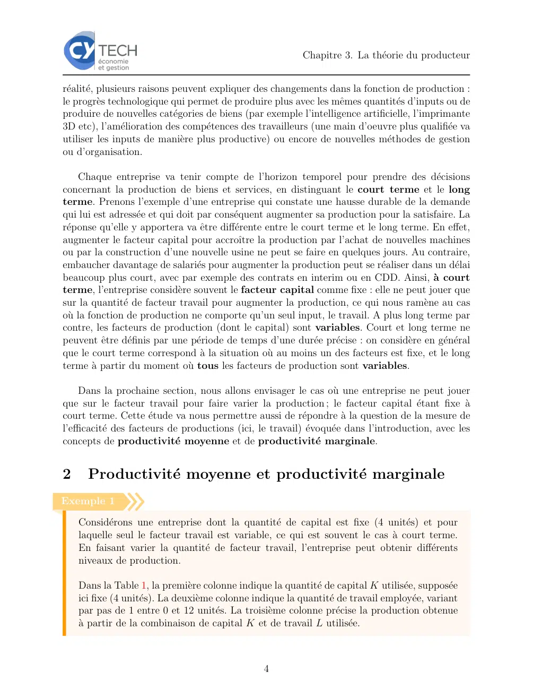

~~~text
                                                          Chapitre 3. La théorie du producteur

réalité, plusieurs raisons peuvent expliquer des changements dans la fonction de production :
le progrès technologique qui permet de produire plus avec les mêmes quantités d’inputs ou de
produire de nouvelles catégories de biens (par exemple l’intelligence artificielle, l’imprimante
3D etc), l’amélioration des compétences des travailleurs (une main d’oeuvre plus qualifiée va
utiliser les inputs de manière plus productive) ou encore de nouvelles méthodes de gestion
ou d’organisation.

    Chaque entreprise va tenir compte de l’horizon temporel pour prendre des décisions
concernant la production de biens et services, en distinguant le court terme et le long
terme. Prenons l’exemple d’une entreprise qui constate une hausse durable de la demande
qui lui est adressée et qui doit par conséquent augmenter sa production pour la satisfaire. La
réponse qu’elle y apportera va être différente entre le court terme et le long terme. En effet,
augmenter le facteur capital pour accroı̂tre la production par l’achat de nouvelles machines
ou par la construction d’une nouvelle usine ne peut se faire en quelques jours. Au contraire,
embaucher davantage de salariés pour augmenter la production peut se réaliser dans un délai
beaucoup plus court, avec par exemple des contrats en interim ou en CDD. Ainsi, à court
terme, l’entreprise considère souvent le facteur capital comme fixe : elle ne peut jouer que
sur la quantité de facteur travail pour augmenter la production, ce qui nous ramène au cas
où la fonction de production ne comporte qu’un seul input, le travail. A plus long terme par
contre, les facteurs de production (dont le capital) sont variables. Court et long terme ne
peuvent être définis par une période de temps d’une durée précise : on considère en général
que le court terme correspond à la situation où au moins un des facteurs est fixe, et le long
terme à partir du moment où tous les facteurs de production sont variables.

     Dans la prochaine section, nous allons envisager le cas où une entreprise ne peut jouer
que sur le facteur travail pour faire varier la production ; le facteur capital étant fixe à
court terme. Cette étude va nous permettre aussi de répondre à la question de la mesure de
l’efficacité des facteurs de productions (ici, le travail) évoquée dans l’introduction, avec les
concepts de productivité moyenne et de productivité marginale.

2     Productivité moyenne et productivité marginale
Exemple 1

    Considérons une entreprise dont la quantité de capital est fixe (4 unités) et pour
    laquelle seul le facteur travail est variable, ce qui est souvent le cas à court terme.
    En faisant varier la quantité de facteur travail, l’entreprise peut obtenir différents
    niveaux de production.

    Dans la Table 1, la première colonne indique la quantité de capital K utilisée, supposée
    ici fixe (4 unités). La deuxième colonne indique la quantité de travail employée, variant
    par pas de 1 entre 0 et 12 unités. La troisième colonne précise la production obtenue
    à partir de la combinaison de capital K et de travail L utilisée.

                                                 4
~~~

## Page 5

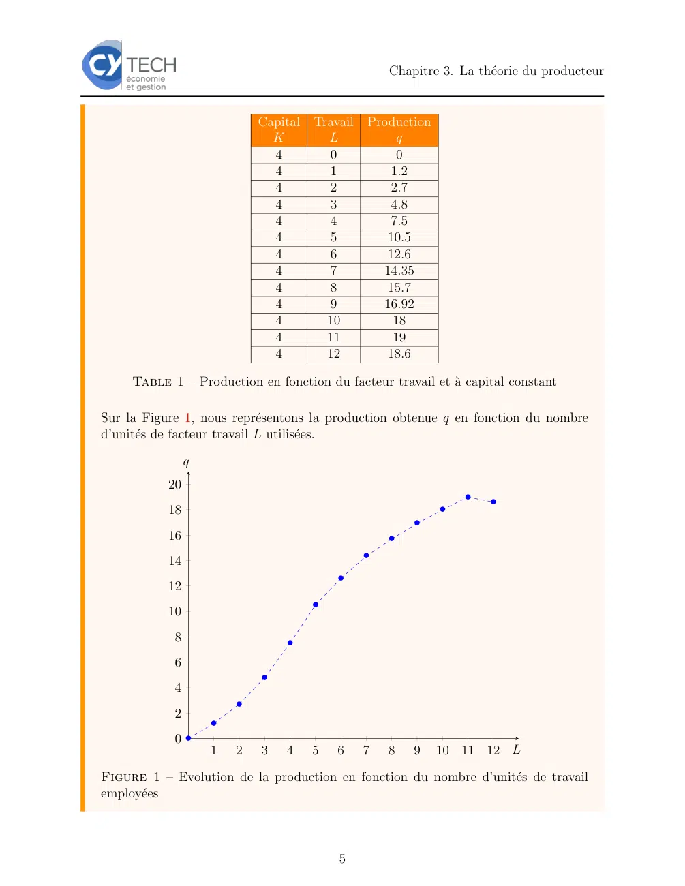

~~~text
                                                    Chapitre 3. La théorie du producteur

                            Capital   Travail   Production
                              K         L            q
                              4          0           0
                              4          1         1.2
                              4          2         2.7
                              4          3         4.8
                              4          4         7.5
                              4          5         10.5
                              4          6         12.6
                              4          7        14.35
                              4          8         15.7
                              4          9        16.92
                              4         10          18
                              4         11          19
                              4         12         18.6

     Table 1 – Production en fonction du facteur travail et à capital constant

Sur la Figure 1, nous représentons la production obtenue q en fonction du nombre
d’unités de facteur travail L utilisées.

                q
           20
                                                                 •   •
           18                                                •
                                                        •
           16                                       •
           14                                   •
                                          •
           12
                                      •
           10
            8                   •
            6
                            •
            4
                        •
            2
                    •
            0•
                    1   2   3   4     5   6     7   8   9    10 11 12 L

Figure 1 – Evolution de la production en fonction du nombre d’unités de travail
employées

                                          5
~~~

## Page 6

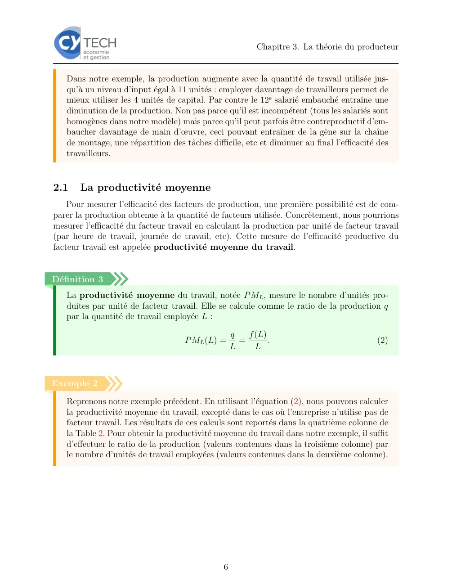

~~~text
                                                           Chapitre 3. La théorie du producteur

   Dans notre exemple, la production augmente avec la quantité de travail utilisée jus-
   qu’à un niveau d’input égal à 11 unités : employer davantage de travailleurs permet de
   mieux utiliser les 4 unités de capital. Par contre le 12e salarié embauché entraı̂ne une
   diminution de la production. Non pas parce qu’il est incompétent (tous les salariés sont
   homogènes dans notre modèle) mais parce qu’il peut parfois être contreproductif d’em-
   baucher davantage de main d’œuvre, ceci pouvant entraı̂ner de la gêne sur la chaı̂ne
   de montage, une répartition des tâches difficile, etc et diminuer au final l’efficacité des
   travailleurs.

2.1    La productivité moyenne
    Pour mesurer l’efficacité des facteurs de production, une première possibilité est de com-
parer la production obtenue à la quantité de facteurs utilisée. Concrètement, nous pourrions
mesurer l’efficacité du facteur travail en calculant la production par unité de facteur travail
(par heure de travail, journée de travail, etc). Cette mesure de l’efficacité productive du
facteur travail est appelée productivité moyenne du travail.

Définition 3
   La productivité moyenne du travail, notée P ML , mesure le nombre d’unités pro-
   duites par unité de facteur travail. Elle se calcule comme le ratio de la production q
   par la quantité de travail employée L :

                                                    q   f (L)
                                     P ML (L) =       =       .                              (2)
                                                    L     L

Exemple 2

   Reprenons notre exemple précédent. En utilisant l’équation (2), nous pouvons calculer
   la productivité moyenne du travail, excepté dans le cas où l’entreprise n’utilise pas de
   facteur travail. Les résultats de ces calculs sont reportés dans la quatrième colonne de
   la Table 2. Pour obtenir la productivité moyenne du travail dans notre exemple, il suffit
   d’effectuer le ratio de la production (valeurs contenues dans la troisième colonne) par
   le nombre d’unités de travail employées (valeurs contenues dans la deuxième colonne).

                                                6
~~~

## Page 7

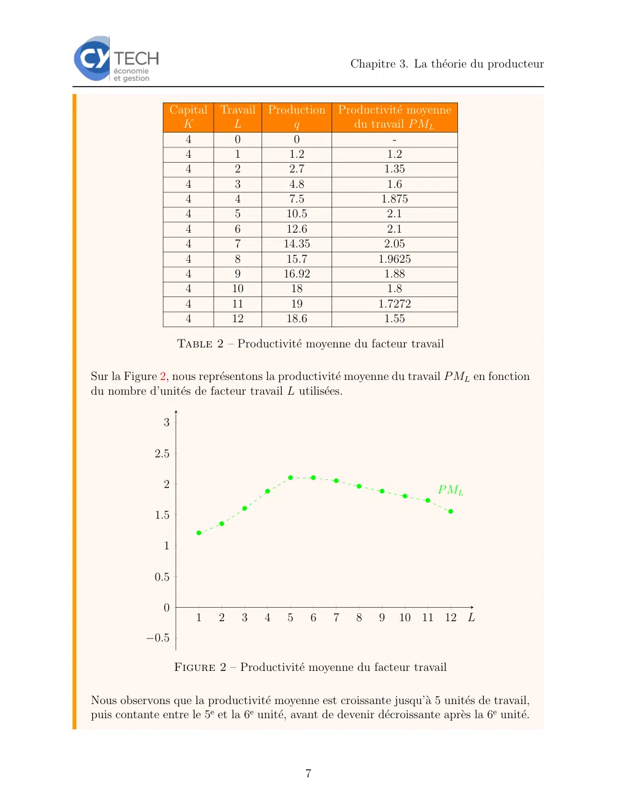

~~~text
                                                       Chapitre 3. La théorie du producteur

                Capital    Travail   Production     Productivité moyenne
                  K          L            q            du travail P ML
                  4           0           0                    -
                  4           1          1.2                  1.2
                  4           2         2.7                  1.35
                  4           3         4.8                   1.6
                  4           4         7.5                  1.875
                  4           5         10.5                  2.1
                  4           6         12.6                  2.1
                  4           7        14.35                 2.05
                  4           8         15.7                1.9625
                  4           9        16.92                 1.88
                  4          10          18                   1.8
                  4          11          19                 1.7272
                  4          12         18.6                 1.55

                   Table 2 – Productivité moyenne du facteur travail

Sur la Figure 2, nous représentons la productivité moyenne du travail P ML en fonction
du nombre d’unités de facteur travail L utilisées.

               3

             2.5
                                          •   •    •
               2                                        •                  P ML
                                     •                       •    •    •
                                •                                           •
             1.5
                           •
                       •
               1

             0.5

               0
                       1   2    3    4    5    6   7    8    9   10 11 12 L
           −0.5

                   Figure 2 – Productivité moyenne du facteur travail

Nous observons que la productivité moyenne est croissante jusqu’à 5 unités de travail,
puis contante entre le 5e et la 6e unité, avant de devenir décroissante après la 6e unité.

                                              7
~~~

## Page 8

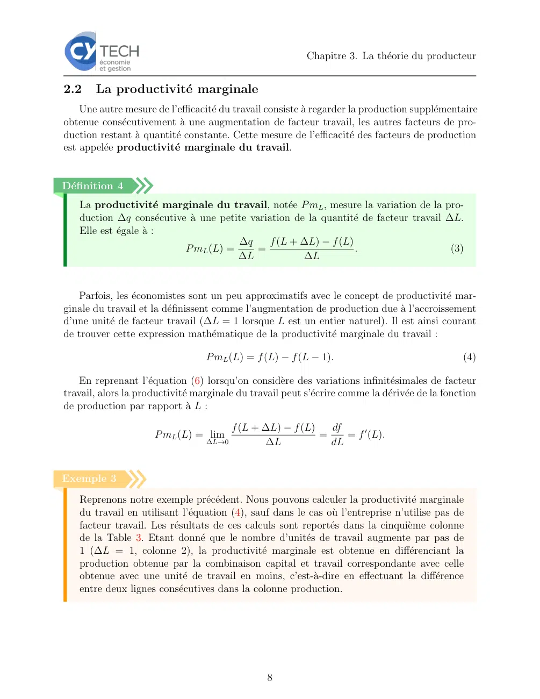

~~~text
                                                           Chapitre 3. La théorie du producteur

2.2    La productivité marginale
    Une autre mesure de l’efficacité du travail consiste à regarder la production supplémentaire
obtenue consécutivement à une augmentation de facteur travail, les autres facteurs de pro-
duction restant à quantité constante. Cette mesure de l’efficacité des facteurs de production
est appelée productivité marginale du travail.

Définition 4
   La productivité marginale du travail, notée P mL , mesure la variation de la pro-
   duction ∆q consécutive à une petite variation de la quantité de facteur travail ∆L.
   Elle est égale à :
                                      ∆q      f (L + ∆L) − f (L)
                          P mL (L) =       =                     .                     (3)
                                      ∆L             ∆L

   Parfois, les économistes sont un peu approximatifs avec le concept de productivité mar-
ginale du travail et la définissent comme l’augmentation de production due à l’accroissement
d’une unité de facteur travail (∆L = 1 lorsque L est un entier naturel). Il est ainsi courant
de trouver cette expression mathématique de la productivité marginale du travail :

                                  P mL (L) = f (L) − f (L − 1).                                  (4)

    En reprenant l’équation (6) lorsqu’on considère des variations infinitésimales de facteur
travail, alors la productivité marginale du travail peut s’écrire comme la dérivée de la fonction
de production par rapport à L :

                                       f (L + ∆L) − f (L)   df
                      P mL (L) = lim                      =    = f ′ (L).
                                  ∆L→0        ∆L            dL

Exemple 3
   Reprenons notre exemple précédent. Nous pouvons calculer la productivité marginale
   du travail en utilisant l’équation (4), sauf dans le cas où l’entreprise n’utilise pas de
   facteur travail. Les résultats de ces calculs sont reportés dans la cinquième colonne
   de la Table 3. Etant donné que le nombre d’unités de travail augmente par pas de
   1 (∆L = 1, colonne 2), la productivité marginale est obtenue en différenciant la
   production obtenue par la combinaison capital et travail correspondante avec celle
   obtenue avec une unité de travail en moins, c’est-à-dire en effectuant la différence
   entre deux lignes consécutives dans la colonne production.

                                                 8
~~~

## Page 9

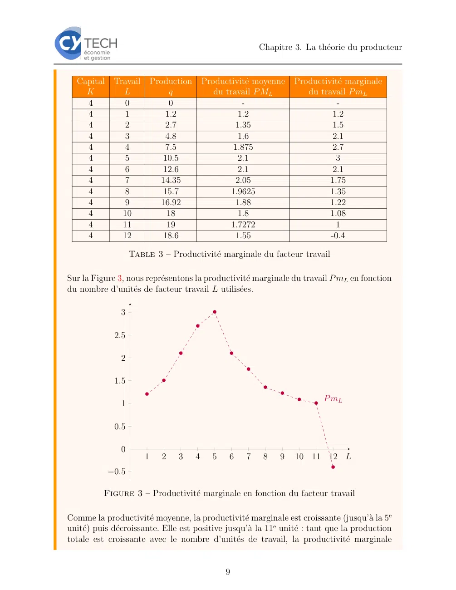

~~~text
                                                           Chapitre 3. La théorie du producteur

  Capital    Travail       Production       Productivité moyenne   Productivité marginale
    K          L                q              du travail P ML         du travail P mL
    4           0               0                       -                      -
    4           1             1.2                     1.2                    1.2
    4           2             2.7                    1.35                    1.5
    4           3             4.8                     1.6                    2.1
    4           4             7.5                    1.875                   2.7
    4           5             10.5                     2.1                     3
    4           6             12.6                     2.1                    2.1
    4           7            14.35                    2.05                   1.75
    4           8             15.7                  1.9625                   1.35
    4           9            16.92                    1.88                   1.22
    4          10              18                      1.8                   1.08
    4          11              19                   1.7272                     1
    4          12             18.6                   1.55                    -0.4

                   Table 3 – Productivité marginale du facteur travail

Sur la Figure 3, nous représentons la productivité marginale du travail P mL en fonction
du nombre d’unités de facteur travail L utilisées.

               3                              •
                                        •
             2.5
                                 •                 •
               2
                                                       •
             1.5             •
                                                            •
                       •                                        •
               1
                                                                    •    • P mL

             0.5

               0
                       1     2   3      4     5    6   7    8   9   10 11 12 L
                                                                          •
            −0.5

          Figure 3 – Productivité marginale en fonction du facteur travail

Comme la productivité moyenne, la productivité marginale est croissante (jusqu’à la 5e
unité) puis décroissante. Elle est positive jusqu’à la 11e unité : tant que la production
totale est croissante avec le nombre d’unités de travail, la productivité marginale

                                                  9
~~~

## Page 10

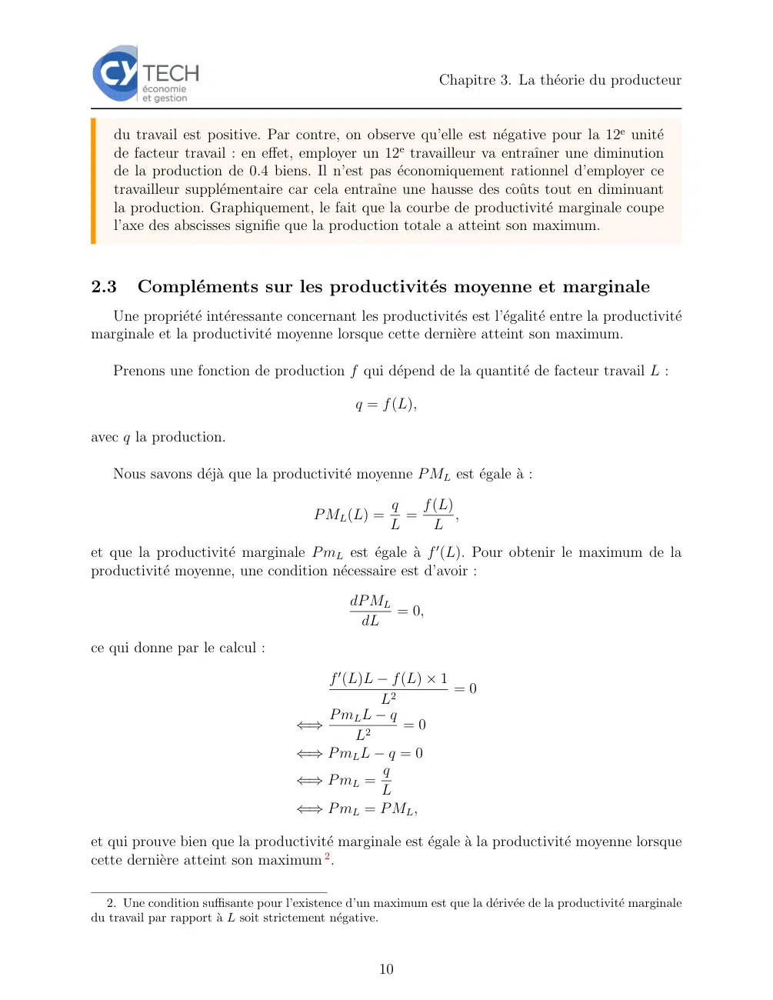

~~~text
                                                                Chapitre 3. La théorie du producteur

    du travail est positive. Par contre, on observe qu’elle est négative pour la 12e unité
    de facteur travail : en effet, employer un 12e travailleur va entraı̂ner une diminution
    de la production de 0.4 biens. Il n’est pas économiquement rationnel d’employer ce
    travailleur supplémentaire car cela entraı̂ne une hausse des coûts tout en diminuant
    la production. Graphiquement, le fait que la courbe de productivité marginale coupe
    l’axe des abscisses signifie que la production totale a atteint son maximum.

2.3     Compléments sur les productivités moyenne et marginale
  Une propriété intéressante concernant les productivités est l’égalité entre la productivité
marginale et la productivité moyenne lorsque cette dernière atteint son maximum.

    Prenons une fonction de production f qui dépend de la quantité de facteur travail L :

                                                 q = f (L),

avec q la production.

    Nous savons déjà que la productivité moyenne P ML est égale à :

                                                       q   f (L)
                                         P ML (L) =      =       ,
                                                       L     L
et que la productivité marginale P mL est égale à f ′ (L). Pour obtenir le maximum de la
productivité moyenne, une condition nécessaire est d’avoir :
                                                dP ML
                                                      = 0,
                                                 dL
ce qui donne par le calcul :

                                         f ′ (L)L − f (L) × 1
                                                              =0
                                                  L2
                                         P mL L − q
                                      ⇐⇒              =0
                                               L2
                                      ⇐⇒ P mL L − q = 0
                                                   q
                                      ⇐⇒ P mL =
                                                  L
                                      ⇐⇒ P mL = P ML ,

et qui prouve bien que la productivité marginale est égale à la productivité moyenne lorsque
cette dernière atteint son maximum 2 .

  2. Une condition suffisante pour l’existence d’un maximum est que la dérivée de la productivité marginale
du travail par rapport à L soit strictement négative.

                                                     10
~~~

## Page 11

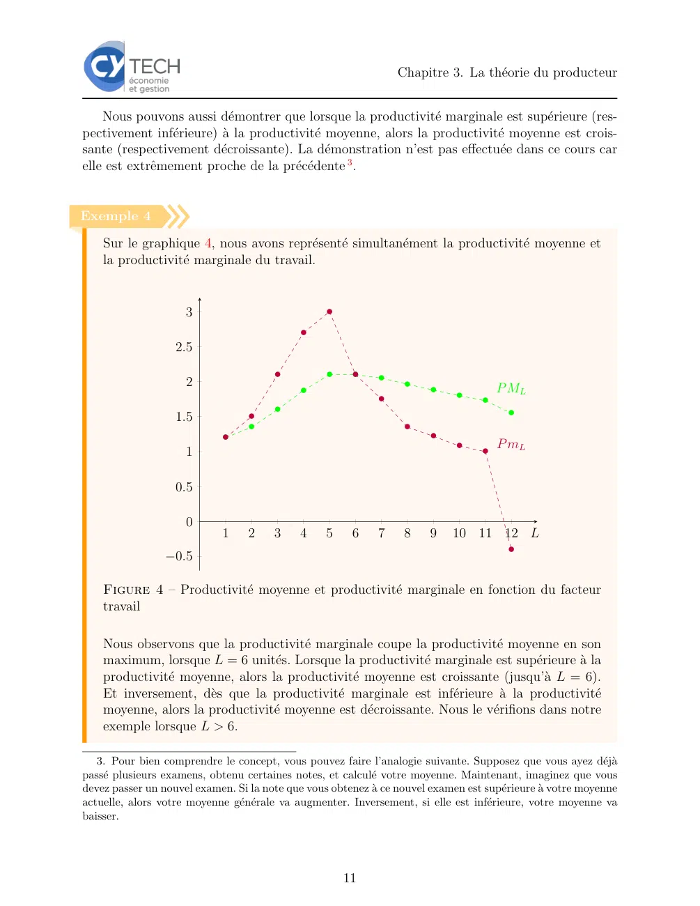

~~~text
                                                                 Chapitre 3. La théorie du producteur

    Nous pouvons aussi démontrer que lorsque la productivité marginale est supérieure (res-
pectivement inférieure) à la productivité moyenne, alors la productivité moyenne est crois-
sante (respectivement décroissante). La démonstration n’est pas effectuée dans ce cours car
elle est extrêmement proche de la précédente 3 .

Exemple 4
    Sur le graphique 4, nous avons représenté simultanément la productivité moyenne et
    la productivité marginale du travail.

                     3                            •
                                             •
                   2.5
                                       •          •    •     •
                     2                                            •                   P ML
                                             •                          •    •
                                                             •                    •
                                       •                                                •
                   1.5            •
                                  •                               •
                             •                                          •
                     1
                                                                             •    • P mL

                   0.5

                     0
                             1    2    3     4    5    6     7    8     9   10 11 12 L
                                                                                  •
                 −0.5

    Figure 4 – Productivité moyenne et productivité marginale en fonction du facteur
    travail

    Nous observons que la productivité marginale coupe la productivité moyenne en son
    maximum, lorsque L = 6 unités. Lorsque la productivité marginale est supérieure à la
    productivité moyenne, alors la productivité moyenne est croissante (jusqu’à L = 6).
    Et inversement, dès que la productivité marginale est inférieure à la productivité
    moyenne, alors la productivité moyenne est décroissante. Nous le vérifions dans notre
    exemple lorsque L > 6.

   3. Pour bien comprendre le concept, vous pouvez faire l’analogie suivante. Supposez que vous ayez déjà
passé plusieurs examens, obtenu certaines notes, et calculé votre moyenne. Maintenant, imaginez que vous
devez passer un nouvel examen. Si la note que vous obtenez à ce nouvel examen est supérieure à votre moyenne
actuelle, alors votre moyenne générale va augmenter. Inversement, si elle est inférieure, votre moyenne va
baisser.

                                                      11
~~~

## Page 12

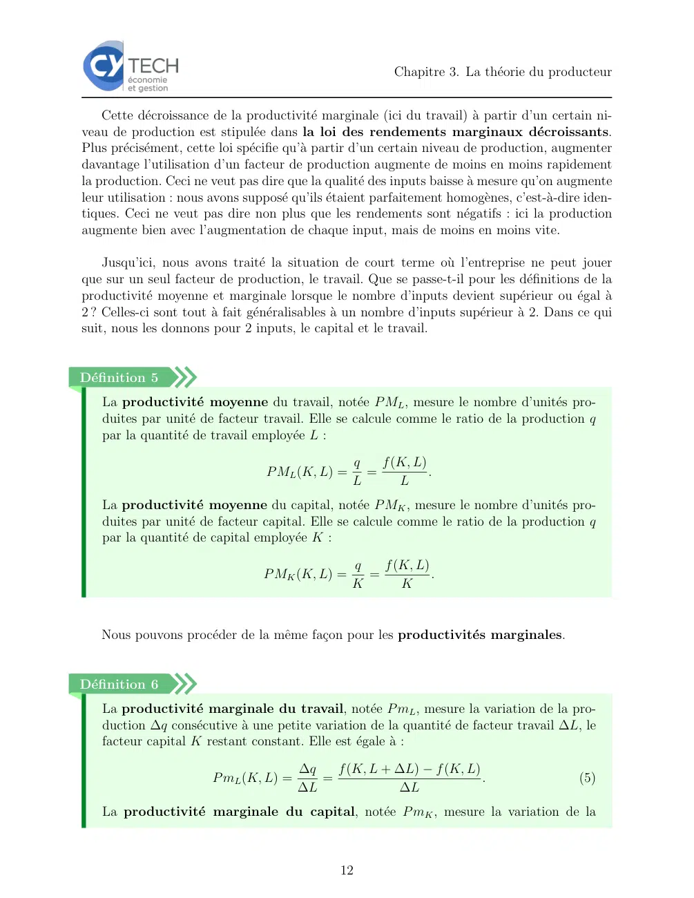

~~~text
                                                          Chapitre 3. La théorie du producteur

    Cette décroissance de la productivité marginale (ici du travail) à partir d’un certain ni-
veau de production est stipulée dans la loi des rendements marginaux décroissants.
Plus précisément, cette loi spécifie qu’à partir d’un certain niveau de production, augmenter
davantage l’utilisation d’un facteur de production augmente de moins en moins rapidement
la production. Ceci ne veut pas dire que la qualité des inputs baisse à mesure qu’on augmente
leur utilisation : nous avons supposé qu’ils étaient parfaitement homogènes, c’est-à-dire iden-
tiques. Ceci ne veut pas dire non plus que les rendements sont négatifs : ici la production
augmente bien avec l’augmentation de chaque input, mais de moins en moins vite.

    Jusqu’ici, nous avons traité la situation de court terme où l’entreprise ne peut jouer
que sur un seul facteur de production, le travail. Que se passe-t-il pour les définitions de la
productivité moyenne et marginale lorsque le nombre d’inputs devient supérieur ou égal à
2 ? Celles-ci sont tout à fait généralisables à un nombre d’inputs supérieur à 2. Dans ce qui
suit, nous les donnons pour 2 inputs, le capital et le travail.

Définition 5
   La productivité moyenne du travail, notée P ML , mesure le nombre d’unités pro-
   duites par unité de facteur travail. Elle se calcule comme le ratio de la production q
   par la quantité de travail employée L :

                                                  q   f (K, L)
                                  P ML (K, L) =     =          .
                                                  L      L
   La productivité moyenne du capital, notée P MK , mesure le nombre d’unités pro-
   duites par unité de facteur capital. Elle se calcule comme le ratio de la production q
   par la quantité de capital employée K :

                                                  q   f (K, L)
                                 P MK (K, L) =      =          .
                                                  K      K

   Nous pouvons procéder de la même façon pour les productivités marginales.

Définition 6
   La productivité marginale du travail, notée P mL , mesure la variation de la pro-
   duction ∆q consécutive à une petite variation de la quantité de facteur travail ∆L, le
   facteur capital K restant constant. Elle est égale à :

                                        ∆q   f (K, L + ∆L) − f (K, L)
                        P mL (K, L) =      =                          .                     (5)
                                        ∆L             ∆L
   La productivité marginale du capital, notée P mK , mesure la variation de la

                                                12
~~~

## Page 13

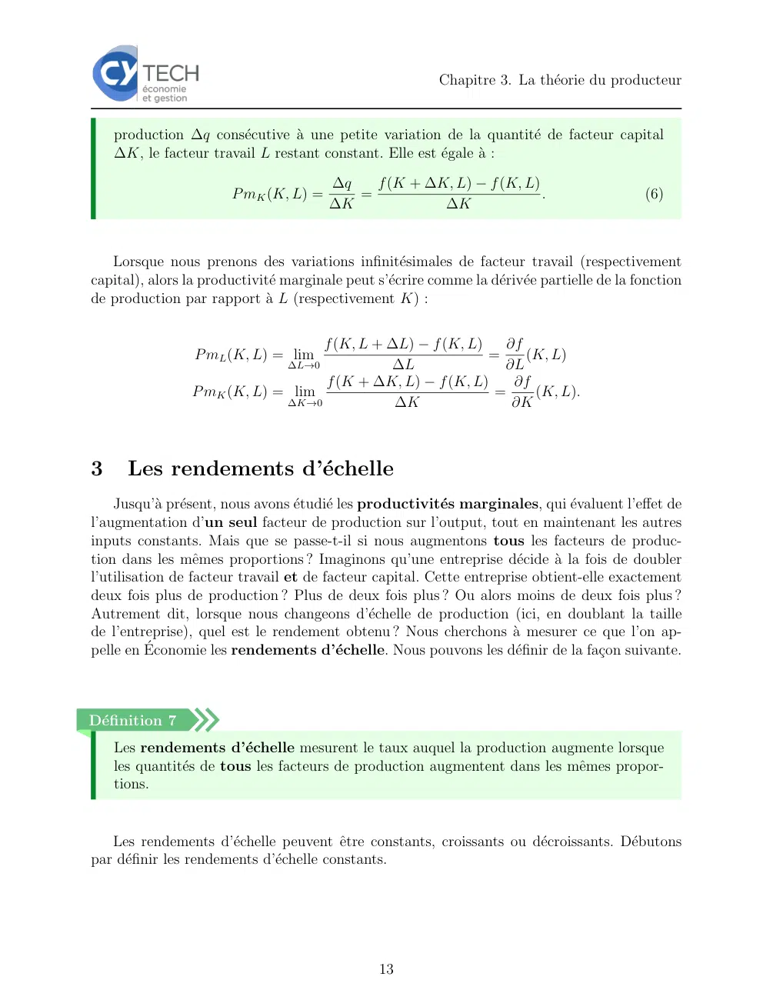

~~~text
                                                           Chapitre 3. La théorie du producteur

    production ∆q consécutive à une petite variation de la quantité de facteur capital
    ∆K, le facteur travail L restant constant. Elle est égale à :

                                        ∆q   f (K + ∆K, L) − f (K, L)
                        P mK (K, L) =      =                          .                       (6)
                                        ∆K            ∆K

   Lorsque nous prenons des variations infinitésimales de facteur travail (respectivement
capital), alors la productivité marginale peut s’écrire comme la dérivée partielle de la fonction
de production par rapport à L (respectivement K) :

                                   f (K, L + ∆L) − f (K, L)    ∂f
                 P mL (K, L) = lim                          =     (K, L)
                                 ∆L→0        ∆L               ∂L
                                   f (K + ∆K, L) − f (K, L)     ∂f
                 P mK (K, L) = lim                           =     (K, L).
                              ∆K→0            ∆K                ∂K

3     Les rendements d’échelle
    Jusqu’à présent, nous avons étudié les productivités marginales, qui évaluent l’effet de
l’augmentation d’un seul facteur de production sur l’output, tout en maintenant les autres
inputs constants. Mais que se passe-t-il si nous augmentons tous les facteurs de produc-
tion dans les mêmes proportions ? Imaginons qu’une entreprise décide à la fois de doubler
l’utilisation de facteur travail et de facteur capital. Cette entreprise obtient-elle exactement
deux fois plus de production ? Plus de deux fois plus ? Ou alors moins de deux fois plus ?
Autrement dit, lorsque nous changeons d’échelle de production (ici, en doublant la taille
de l’entreprise), quel est le rendement obtenu ? Nous cherchons à mesurer ce que l’on ap-
pelle en Économie les rendements d’échelle. Nous pouvons les définir de la façon suivante.

Définition 7
    Les rendements d’échelle mesurent le taux auquel la production augmente lorsque
    les quantités de tous les facteurs de production augmentent dans les mêmes propor-
    tions.

   Les rendements d’échelle peuvent être constants, croissants ou décroissants. Débutons
par définir les rendements d’échelle constants.

                                                 13
~~~

## Page 14

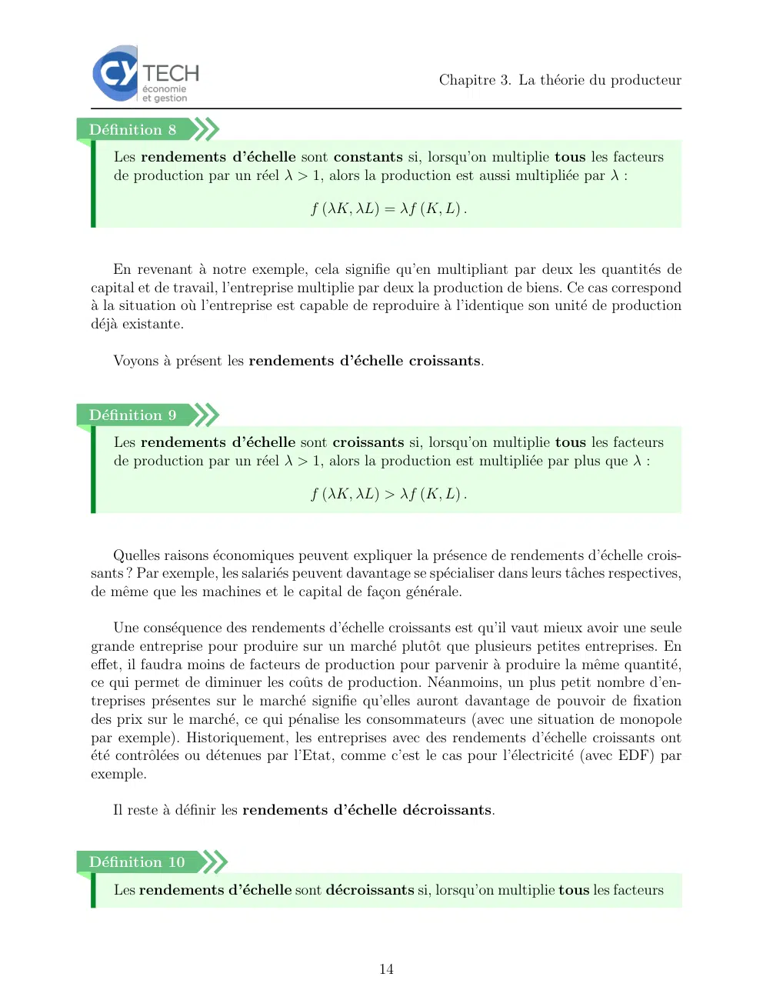

~~~text
                                                          Chapitre 3. La théorie du producteur

Définition 8
   Les rendements d’échelle sont constants si, lorsqu’on multiplie tous les facteurs
   de production par un réel λ > 1, alors la production est aussi multipliée par λ :

                                     f (λK, λL) = λf (K, L) .

     En revenant à notre exemple, cela signifie qu’en multipliant par deux les quantités de
capital et de travail, l’entreprise multiplie par deux la production de biens. Ce cas correspond
à la situation où l’entreprise est capable de reproduire à l’identique son unité de production
déjà existante.

   Voyons à présent les rendements d’échelle croissants.

Définition 9
   Les rendements d’échelle sont croissants si, lorsqu’on multiplie tous les facteurs
   de production par un réel λ > 1, alors la production est multipliée par plus que λ :

                                     f (λK, λL) > λf (K, L) .

   Quelles raisons économiques peuvent expliquer la présence de rendements d’échelle crois-
sants ? Par exemple, les salariés peuvent davantage se spécialiser dans leurs tâches respectives,
de même que les machines et le capital de façon générale.

      Une conséquence des rendements d’échelle croissants est qu’il vaut mieux avoir une seule
grande entreprise pour produire sur un marché plutôt que plusieurs petites entreprises. En
effet, il faudra moins de facteurs de production pour parvenir à produire la même quantité,
ce qui permet de diminuer les coûts de production. Néanmoins, un plus petit nombre d’en-
treprises présentes sur le marché signifie qu’elles auront davantage de pouvoir de fixation
des prix sur le marché, ce qui pénalise les consommateurs (avec une situation de monopole
par exemple). Historiquement, les entreprises avec des rendements d’échelle croissants ont
été contrôlées ou détenues par l’Etat, comme c’est le cas pour l’électricité (avec EDF) par
exemple.

   Il reste à définir les rendements d’échelle décroissants.

Définition 10
   Les rendements d’échelle sont décroissants si, lorsqu’on multiplie tous les facteurs

                                                14
~~~

## Page 15

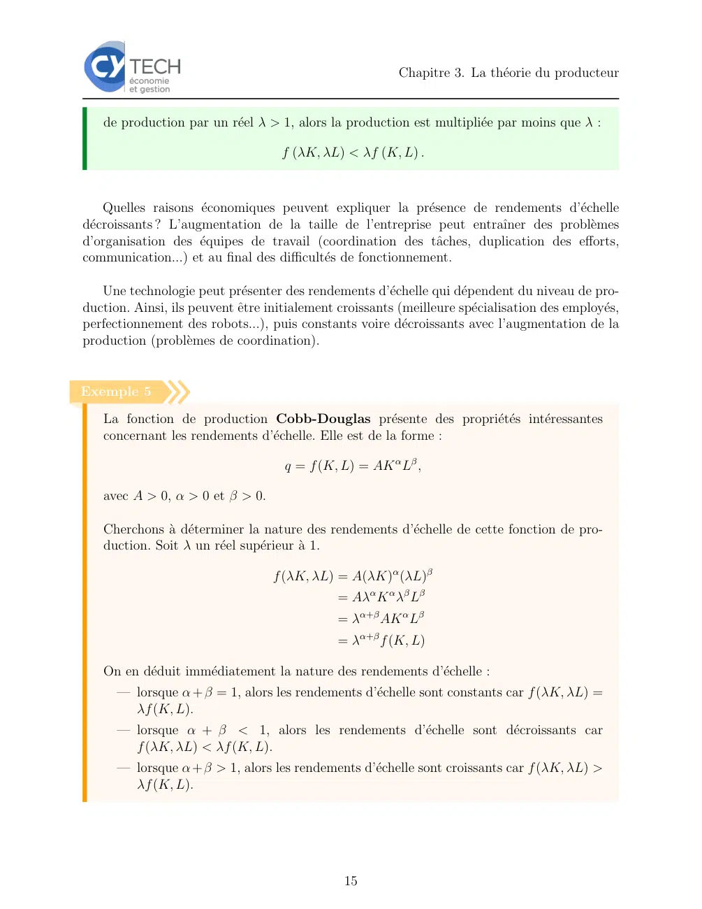

~~~text
                                                          Chapitre 3. La théorie du producteur

   de production par un réel λ > 1, alors la production est multipliée par moins que λ :

                                    f (λK, λL) < λf (K, L) .

    Quelles raisons économiques peuvent expliquer la présence de rendements d’échelle
décroissants ? L’augmentation de la taille de l’entreprise peut entraı̂ner des problèmes
d’organisation des équipes de travail (coordination des tâches, duplication des efforts,
communication...) et au final des difficultés de fonctionnement.

   Une technologie peut présenter des rendements d’échelle qui dépendent du niveau de pro-
duction. Ainsi, ils peuvent être initialement croissants (meilleure spécialisation des employés,
perfectionnement des robots...), puis constants voire décroissants avec l’augmentation de la
production (problèmes de coordination).

Exemple 5
   La fonction de production Cobb-Douglas présente des propriétés intéressantes
   concernant les rendements d’échelle. Elle est de la forme :

                                     q = f (K, L) = AK α Lβ ,

   avec A > 0, α > 0 et β > 0.

   Cherchons à déterminer la nature des rendements d’échelle de cette fonction de pro-
   duction. Soit λ un réel supérieur à 1.

                                   f (λK, λL) = A(λK)α (λL)β
                                               = Aλα K α λβ Lβ
                                               = λα+β AK α Lβ
                                               = λα+β f (K, L)

   On en déduit immédiatement la nature des rendements d’échelle :
      — lorsque α + β = 1, alors les rendements d’échelle sont constants car f (λK, λL) =
        λf (K, L).
      — lorsque α + β < 1, alors les rendements d’échelle sont décroissants car
        f (λK, λL) < λf (K, L).
      — lorsque α +β > 1, alors les rendements d’échelle sont croissants car f (λK, λL) >
        λf (K, L).

                                                15
~~~

## Page 16

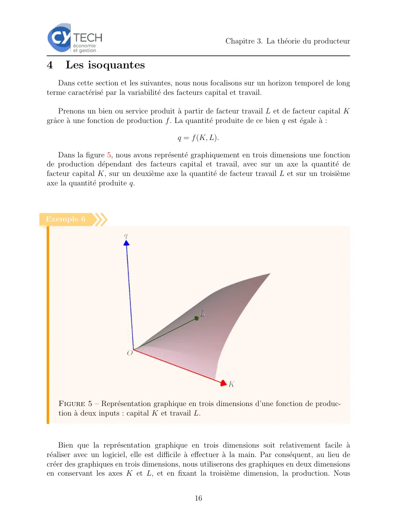

~~~text
                                                          Chapitre 3. La théorie du producteur

4     Les isoquantes
   Dans cette section et les suivantes, nous nous focalisons sur un horizon temporel de long
terme caractérisé par la variabilité des facteurs capital et travail.

    Prenons un bien ou service produit à partir de facteur travail L et de facteur capital K
grâce à une fonction de production f . La quantité produite de ce bien q est égale à :

                                          q = f (K, L).

    Dans la figure 5, nous avons représenté graphiquement en trois dimensions une fonction
de production dépendant des facteurs capital et travail, avec sur un axe la quantité de
facteur capital K, sur un deuxième axe la quantité de facteur travail L et sur un troisième
axe la quantité produite q.

Exemple 6

    Figure 5 – Représentation graphique en trois dimensions d’une fonction de produc-
    tion à deux inputs : capital K et travail L.

     Bien que la représentation graphique en trois dimensions soit relativement facile à
réaliser avec un logiciel, elle est difficile à effectuer à la main. Par conséquent, au lieu de
créer des graphiques en trois dimensions, nous utiliserons des graphiques en deux dimensions
en conservant les axes K et L, et en fixant la troisième dimension, la production. Nous

                                                16
~~~

## Page 17

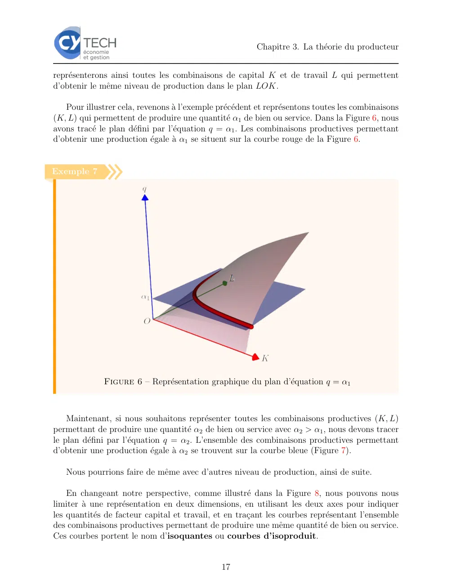

~~~text
                                                         Chapitre 3. La théorie du producteur

représenterons ainsi toutes les combinaisons de capital K et de travail L qui permettent
d’obtenir le même niveau de production dans le plan LOK.

   Pour illustrer cela, revenons à l’exemple précédent et représentons toutes les combinaisons
(K, L) qui permettent de produire une quantité α1 de bien ou service. Dans la Figure 6, nous
avons tracé le plan défini par l’équation q = α1 . Les combinaisons productives permettant
d’obtenir une production égale à α1 se situent sur la courbe rouge de la Figure 6.

Exemple 7

              Figure 6 – Représentation graphique du plan d’équation q = α1

    Maintenant, si nous souhaitons représenter toutes les combinaisons productives (K, L)
permettant de produire une quantité α2 de bien ou service avec α2 > α1 , nous devons tracer
le plan défini par l’équation q = α2 . L’ensemble des combinaisons productives permettant
d’obtenir une production égale à α2 se trouvent sur la courbe bleue (Figure 7).

   Nous pourrions faire de même avec d’autres niveau de production, ainsi de suite.

    En changeant notre perspective, comme illustré dans la Figure 8, nous pouvons nous
limiter à une représentation en deux dimensions, en utilisant les deux axes pour indiquer
les quantités de facteur capital et travail, et en traçant les courbes représentant l’ensemble
des combinaisons productives permettant de produire une même quantité de bien ou service.
Ces courbes portent le nom d’isoquantes ou courbes d’isoproduit.

                                               17
~~~

## Page 18

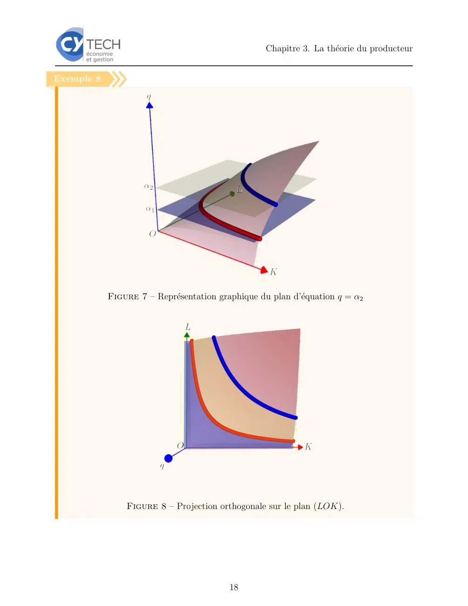

~~~text
                                                   Chapitre 3. La théorie du producteur

Exemple 8

            Figure 7 – Représentation graphique du plan d’équation q = α2

                Figure 8 – Projection orthogonale sur le plan (LOK).

                                          18
~~~

## Page 19

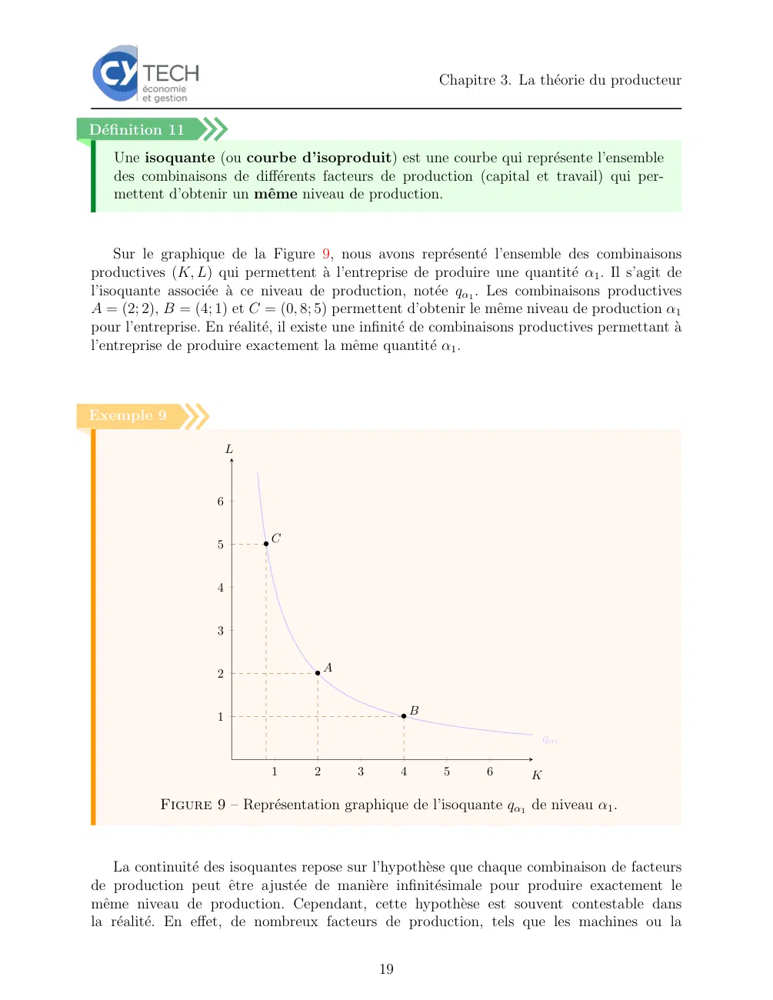

~~~text
                                                          Chapitre 3. La théorie du producteur

Définition 11
   Une isoquante (ou courbe d’isoproduit) est une courbe qui représente l’ensemble
   des combinaisons de différents facteurs de production (capital et travail) qui per-
   mettent d’obtenir un même niveau de production.

     Sur le graphique de la Figure 9, nous avons représenté l’ensemble des combinaisons
productives (K, L) qui permettent à l’entreprise de produire une quantité α1 . Il s’agit de
l’isoquante associée à ce niveau de production, notée qα1 . Les combinaisons productives
A = (2; 2), B = (4; 1) et C = (0, 8; 5) permettent d’obtenir le même niveau de production α1
pour l’entreprise. En réalité, il existe une infinité de combinaisons productives permettant à
l’entreprise de produire exactement la même quantité α1 .

Exemple 9

                         L

                     6

                     5       •C

                     4

                     3

                     2               •A

                     1                               •B
                                                                             qα1

                             1       2      3        4    5      6       K

           Figure 9 – Représentation graphique de l’isoquante qα1 de niveau α1 .

   La continuité des isoquantes repose sur l’hypothèse que chaque combinaison de facteurs
de production peut être ajustée de manière infinitésimale pour produire exactement le
même niveau de production. Cependant, cette hypothèse est souvent contestable dans
la réalité. En effet, de nombreux facteurs de production, tels que les machines ou la

                                                19
~~~

## Page 20

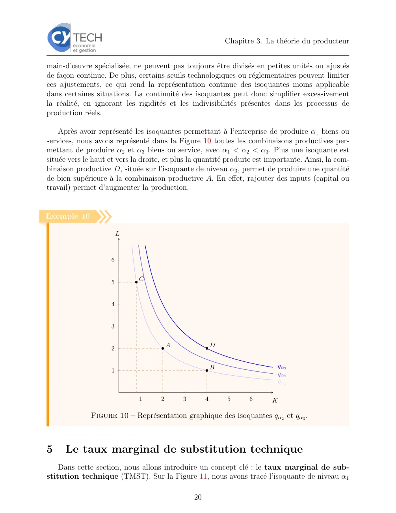

~~~text
                                                           Chapitre 3. La théorie du producteur

main-d’œuvre spécialisée, ne peuvent pas toujours être divisés en petites unités ou ajustés
de façon continue. De plus, certains seuils technologiques ou réglementaires peuvent limiter
ces ajustements, ce qui rend la représentation continue des isoquantes moins applicable
dans certaines situations. La continuité des isoquantes peut donc simplifier excessivement
la réalité, en ignorant les rigidités et les indivisibilités présentes dans les processus de
production réels.

    Après avoir représenté les isoquantes permettant à l’entreprise de produire α1 biens ou
services, nous avons représenté dans la Figure 10 toutes les combinaisons productives per-
mettant de produire α2 et α3 biens ou service, avec α1 < α2 < α3 . Plus une isoquante est
située vers le haut et vers la droite, et plus la quantité produite est importante. Ainsi, la com-
binaison productive D, située sur l’isoquante de niveau α3 , permet de produire une quantité
de bien supérieure à la combinaison productive A. En effet, rajouter des inputs (capital ou
travail) permet d’augmenter la production.

Exemple 10

                         L

                     6

                     5       •C

                     4

                     3

                     2               •A               •D

                                                                              qα3
                     1                                •B
                                                                              qα2
                                                                              qα1

                              1      2       3        4    5       6      K

              Figure 10 – Représentation graphique des isoquantes qα2 et qα3 .

5     Le taux marginal de substitution technique
    Dans cette section, nous allons introduire un concept clé : le taux marginal de sub-
stitution technique (TMST). Sur la Figure 11, nous avons tracé l’isoquante de niveau α1

                                                 20
~~~

## Page 21

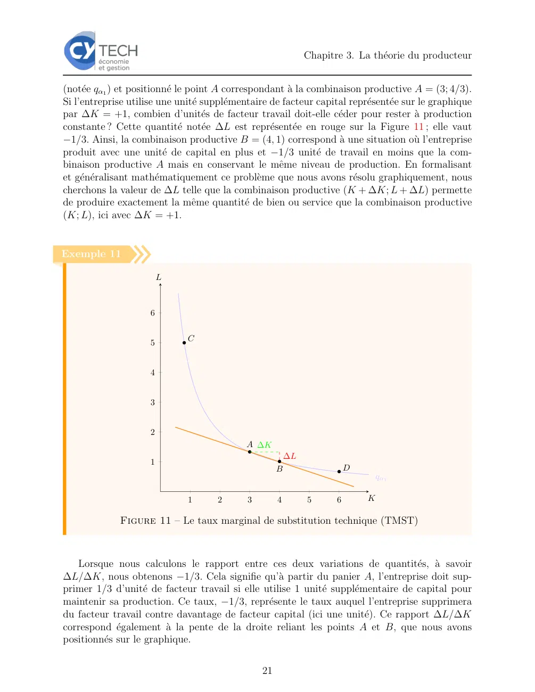

~~~text
                                                               Chapitre 3. La théorie du producteur

(notée qα1 ) et positionné le point A correspondant à la combinaison productive A = (3; 4/3).
Si l’entreprise utilise une unité supplémentaire de facteur capital représentée sur le graphique
par ∆K = +1, combien d’unités de facteur travail doit-elle céder pour rester à production
constante ? Cette quantité notée ∆L est représentée en rouge sur la Figure 11 ; elle vaut
−1/3. Ainsi, la combinaison productive B = (4, 1) correspond à une situation où l’entreprise
produit avec une unité de capital en plus et −1/3 unité de travail en moins que la com-
binaison productive A mais en conservant le même niveau de production. En formalisant
et généralisant mathématiquement ce problème que nous avons résolu graphiquement, nous
cherchons la valeur de ∆L telle que la combinaison productive (K + ∆K; L + ∆L) permette
de produire exactement la même quantité de bien ou service que la combinaison productive
(K; L), ici avec ∆K = +1.

Exemple 11

                         L

                     6

                     5       •C

                     4

                     3

                     2
                                            A ∆K
                                            •
                                                          ∆L
                     1                                •
                                                      B               •D
                                                                                 qα1

                              1      2       3        4        5      6      K

             Figure 11 – Le taux marginal de substitution technique (TMST)

   Lorsque nous calculons le rapport entre ces deux variations de quantités, à savoir
∆L/∆K, nous obtenons −1/3. Cela signifie qu’à partir du panier A, l’entreprise doit sup-
primer 1/3 d’unité de facteur travail si elle utilise 1 unité supplémentaire de capital pour
maintenir sa production. Ce taux, −1/3, représente le taux auquel l’entreprise supprimera
du facteur travail contre davantage de facteur capital (ici une unité). Ce rapport ∆L/∆K
correspond également à la pente de la droite reliant les points A et B, que nous avons
positionnés sur le graphique.

                                                 21
~~~

## Page 22

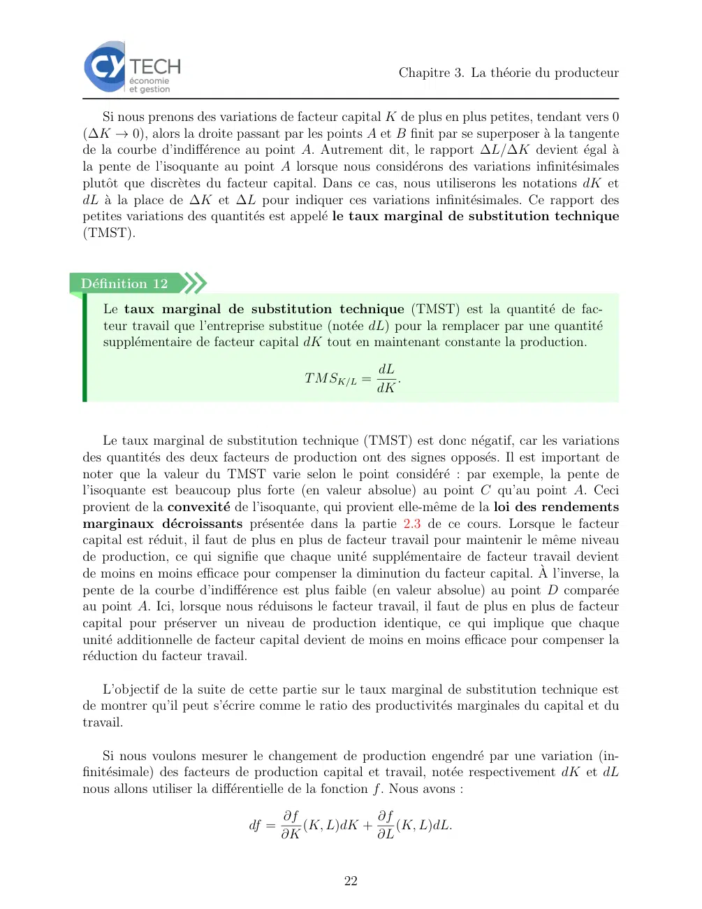

~~~text
                                                       Chapitre 3. La théorie du producteur

    Si nous prenons des variations de facteur capital K de plus en plus petites, tendant vers 0
(∆K → 0), alors la droite passant par les points A et B finit par se superposer à la tangente
de la courbe d’indifférence au point A. Autrement dit, le rapport ∆L/∆K devient égal à
la pente de l’isoquante au point A lorsque nous considérons des variations infinitésimales
plutôt que discrètes du facteur capital. Dans ce cas, nous utiliserons les notations dK et
dL à la place de ∆K et ∆L pour indiquer ces variations infinitésimales. Ce rapport des
petites variations des quantités est appelé le taux marginal de substitution technique
(TMST).

Définition 12
   Le taux marginal de substitution technique (TMST) est la quantité de fac-
   teur travail que l’entreprise substitue (notée dL) pour la remplacer par une quantité
   supplémentaire de facteur capital dK tout en maintenant constante la production.
                                                    dL
                                       T M SK/L =      .
                                                    dK

     Le taux marginal de substitution technique (TMST) est donc négatif, car les variations
des quantités des deux facteurs de production ont des signes opposés. Il est important de
noter que la valeur du TMST varie selon le point considéré : par exemple, la pente de
l’isoquante est beaucoup plus forte (en valeur absolue) au point C qu’au point A. Ceci
provient de la convexité de l’isoquante, qui provient elle-même de la loi des rendements
marginaux décroissants présentée dans la partie 2.3 de ce cours. Lorsque le facteur
capital est réduit, il faut de plus en plus de facteur travail pour maintenir le même niveau
de production, ce qui signifie que chaque unité supplémentaire de facteur travail devient
de moins en moins efficace pour compenser la diminution du facteur capital. À l’inverse, la
pente de la courbe d’indifférence est plus faible (en valeur absolue) au point D comparée
au point A. Ici, lorsque nous réduisons le facteur travail, il faut de plus en plus de facteur
capital pour préserver un niveau de production identique, ce qui implique que chaque
unité additionnelle de facteur capital devient de moins en moins efficace pour compenser la
réduction du facteur travail.

    L’objectif de la suite de cette partie sur le taux marginal de substitution technique est
de montrer qu’il peut s’écrire comme le ratio des productivités marginales du capital et du
travail.

    Si nous voulons mesurer le changement de production engendré par une variation (in-
finitésimale) des facteurs de production capital et travail, notée respectivement dK et dL
nous allons utiliser la différentielle de la fonction f . Nous avons :
                                    ∂f            ∂f
                             df =      (K, L)dK +    (K, L)dL.
                                    ∂K            ∂L

                                              22
~~~

## Page 23

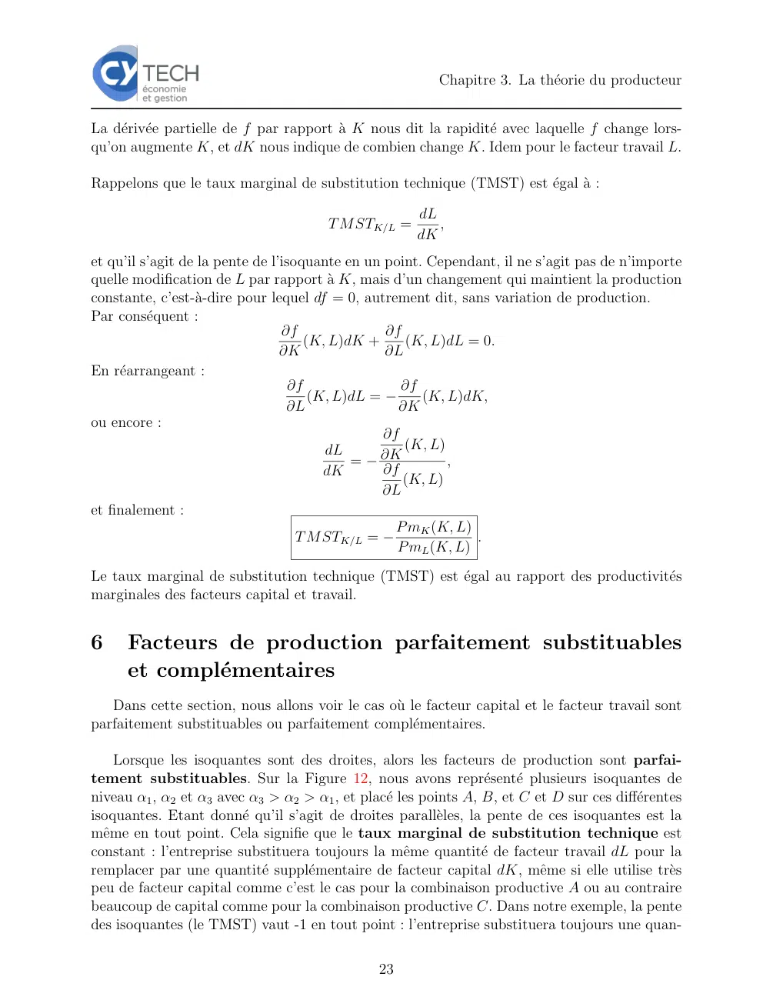

~~~text
                                                         Chapitre 3. La théorie du producteur

La dérivée partielle de f par rapport à K nous dit la rapidité avec laquelle f change lors-
qu’on augmente K, et dK nous indique de combien change K. Idem pour le facteur travail L.

Rappelons que le taux marginal de substitution technique (TMST) est égal à :

                                                      dL
                                       T M STK/L =       ,
                                                      dK
et qu’il s’agit de la pente de l’isoquante en un point. Cependant, il ne s’agit pas de n’importe
quelle modification de L par rapport à K, mais d’un changement qui maintient la production
constante, c’est-à-dire pour lequel df = 0, autrement dit, sans variation de production.
Par conséquent :
                                 ∂f              ∂f
                                     (K, L)dK +     (K, L)dL = 0.
                                 ∂K              ∂L
En réarrangeant :
                                   ∂f               ∂f
                                      (K, L)dL = −     (K, L)dK,
                                  ∂L               ∂K
ou encore :
                                                 ∂f
                                        dL          (K, L)
                                            =−  ∂K         ,
                                        dK       ∂f
                                                    (K, L)
                                                ∂L
et finalement :
                                                   P mK (K, L)
                                    T M STK/L = −              .
                                                   P mL (K, L)
Le taux marginal de substitution technique (TMST) est égal au rapport des productivités
marginales des facteurs capital et travail.

6     Facteurs de production parfaitement substituables
      et complémentaires
   Dans cette section, nous allons voir le cas où le facteur capital et le facteur travail sont
parfaitement substituables ou parfaitement complémentaires.

    Lorsque les isoquantes sont des droites, alors les facteurs de production sont parfai-
tement substituables. Sur la Figure 12, nous avons représenté plusieurs isoquantes de
niveau α1 , α2 et α3 avec α3 > α2 > α1 , et placé les points A, B, et C et D sur ces différentes
isoquantes. Etant donné qu’il s’agit de droites parallèles, la pente de ces isoquantes est la
même en tout point. Cela signifie que le taux marginal de substitution technique est
constant : l’entreprise substituera toujours la même quantité de facteur travail dL pour la
remplacer par une quantité supplémentaire de facteur capital dK, même si elle utilise très
peu de facteur capital comme c’est le cas pour la combinaison productive A ou au contraire
beaucoup de capital comme pour la combinaison productive C. Dans notre exemple, la pente
des isoquantes (le TMST) vaut -1 en tout point : l’entreprise substituera toujours une quan-

                                               23
~~~

## Page 24

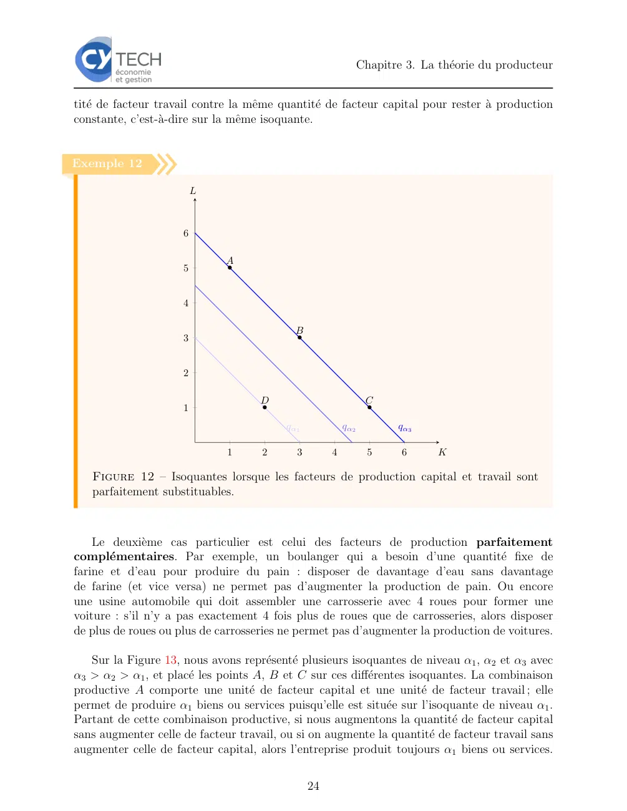

~~~text
                                                               Chapitre 3. La théorie du producteur

tité de facteur travail contre la même quantité de facteur capital pour rester à production
constante, c’est-à-dire sur la même isoquante.

Exemple 12

                         L

                     6

                              A
                     5        •

                     4

                                            B
                     3                      •

                     2

                                     D                          C
                     1               •                          •
                                          qα1            qα2          qα3

                              1      2      3        4           5     6      K

   Figure 12 – Isoquantes lorsque les facteurs de production capital et travail sont
   parfaitement substituables.

    Le deuxième cas particulier est celui des facteurs de production parfaitement
complémentaires. Par exemple, un boulanger qui a besoin d’une quantité fixe de
farine et d’eau pour produire du pain : disposer de davantage d’eau sans davantage
de farine (et vice versa) ne permet pas d’augmenter la production de pain. Ou encore
une usine automobile qui doit assembler une carrosserie avec 4 roues pour former une
voiture : s’il n’y a pas exactement 4 fois plus de roues que de carrosseries, alors disposer
de plus de roues ou plus de carrosseries ne permet pas d’augmenter la production de voitures.

   Sur la Figure 13, nous avons représenté plusieurs isoquantes de niveau α1 , α2 et α3 avec
α3 > α2 > α1 , et placé les points A, B et C sur ces différentes isoquantes. La combinaison
productive A comporte une unité de facteur capital et une unité de facteur travail ; elle
permet de produire α1 biens ou services puisqu’elle est située sur l’isoquante de niveau α1 .
Partant de cette combinaison productive, si nous augmentons la quantité de facteur capital
sans augmenter celle de facteur travail, ou si on augmente la quantité de facteur travail sans
augmenter celle de facteur capital, alors l’entreprise produit toujours α1 biens ou services.

                                                24
~~~

## Page 25

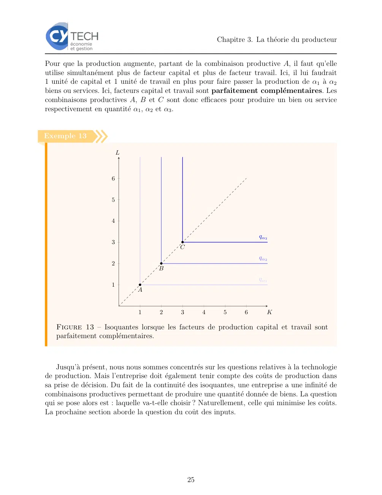

~~~text
                                                          Chapitre 3. La théorie du producteur

Pour que la production augmente, partant de la combinaison productive A, il faut qu’elle
utilise simultanément plus de facteur capital et plus de facteur travail. Ici, il lui faudrait
1 unité de capital et 1 unité de travail en plus pour faire passer la production de α1 à α2
biens ou services. Ici, facteurs capital et travail sont parfaitement complémentaires. Les
combinaisons productives A, B et C sont donc efficaces pour produire un bien ou service
respectivement en quantité α1 , α2 et α3 .

Exemple 13

                          L

                      6

                      5

                      4

                                                                       qα3
                      3                      •
                                             C
                                                                       qα2
                      2               •
                                      B
                                                                       qα1
                      1        •
                               A

                               1      2      3        4     5      6      K

   Figure 13 – Isoquantes lorsque les facteurs de production capital et travail sont
   parfaitement complémentaires.

   Jusqu’à présent, nous nous sommes concentrés sur les questions relatives à la technologie
de production. Mais l’entreprise doit également tenir compte des coûts de production dans
sa prise de décision. Du fait de la continuité des isoquantes, une entreprise a une infinité de
combinaisons productives permettant de produire une quantité donnée de biens. La question
qui se pose alors est : laquelle va-t-elle choisir ? Naturellement, celle qui minimise les coûts.
La prochaine section aborde la question du coût des inputs.

                                                 25
~~~

## Page 26

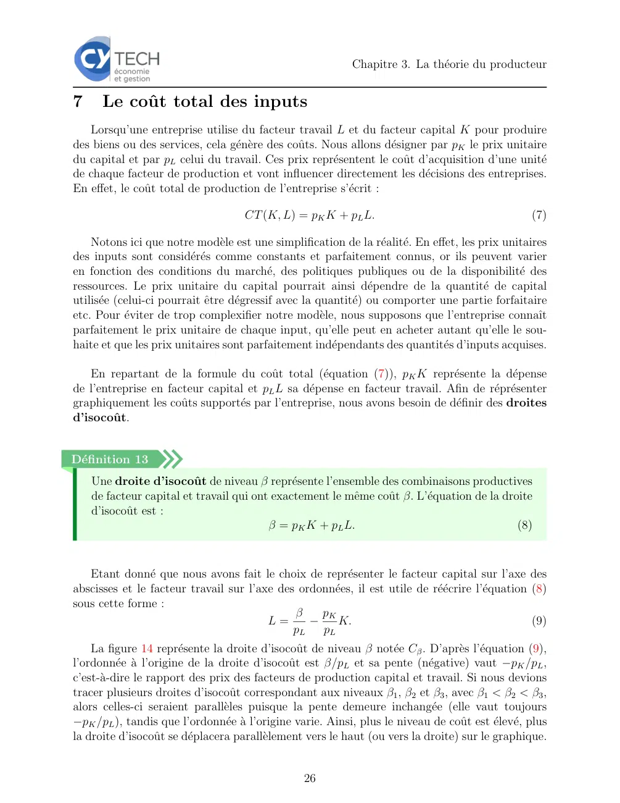

~~~text
                                                            Chapitre 3. La théorie du producteur

7     Le coût total des inputs
   Lorsqu’une entreprise utilise du facteur travail L et du facteur capital K pour produire
des biens ou des services, cela génère des coûts. Nous allons désigner par pK le prix unitaire
du capital et par pL celui du travail. Ces prix représentent le coût d’acquisition d’une unité
de chaque facteur de production et vont influencer directement les décisions des entreprises.
En effet, le coût total de production de l’entreprise s’écrit :

                                    CT (K, L) = pK K + pL L.                                      (7)

    Notons ici que notre modèle est une simplification de la réalité. En effet, les prix unitaires
des inputs sont considérés comme constants et parfaitement connus, or ils peuvent varier
en fonction des conditions du marché, des politiques publiques ou de la disponibilité des
ressources. Le prix unitaire du capital pourrait ainsi dépendre de la quantité de capital
utilisée (celui-ci pourrait être dégressif avec la quantité) ou comporter une partie forfaitaire
etc. Pour éviter de trop complexifier notre modèle, nous supposons que l’entreprise connaı̂t
parfaitement le prix unitaire de chaque input, qu’elle peut en acheter autant qu’elle le sou-
haite et que les prix unitaires sont parfaitement indépendants des quantités d’inputs acquises.

   En repartant de la formule du coût total (équation (7)), pK K représente la dépense
de l’entreprise en facteur capital et pL L sa dépense en facteur travail. Afin de réprésenter
graphiquement les coûts supportés par l’entreprise, nous avons besoin de définir des droites
d’isocoût.

Définition 13
    Une droite d’isocoût de niveau β représente l’ensemble des combinaisons productives
    de facteur capital et travail qui ont exactement le même coût β. L’équation de la droite
    d’isocoût est :
                                         β = pK K + pL L.                                   (8)

   Etant donné que nous avons fait le choix de représenter le facteur capital sur l’axe des
abscisses et le facteur travail sur l’axe des ordonnées, il est utile de réécrire l’équation (8)
sous cette forme :
                                             β    pK
                                        L=      −    K.                                          (9)
                                             pL   pL
    La figure 14 représente la droite d’isocoût de niveau β notée Cβ . D’après l’équation (9),
l’ordonnée à l’origine de la droite d’isocoût est β/pL et sa pente (négative) vaut −pK /pL ,
c’est-à-dire le rapport des prix des facteurs de production capital et travail. Si nous devions
tracer plusieurs droites d’isocoût correspondant aux niveaux β1 , β2 et β3 , avec β1 < β2 < β3 ,
alors celles-ci seraient parallèles puisque la pente demeure inchangée (elle vaut toujours
−pK /pL ), tandis que l’ordonnée à l’origine varie. Ainsi, plus le niveau de coût est élevé, plus
la droite d’isocoût se déplacera parallèlement vers le haut (ou vers la droite) sur le graphique.

                                                 26
~~~

## Page 27

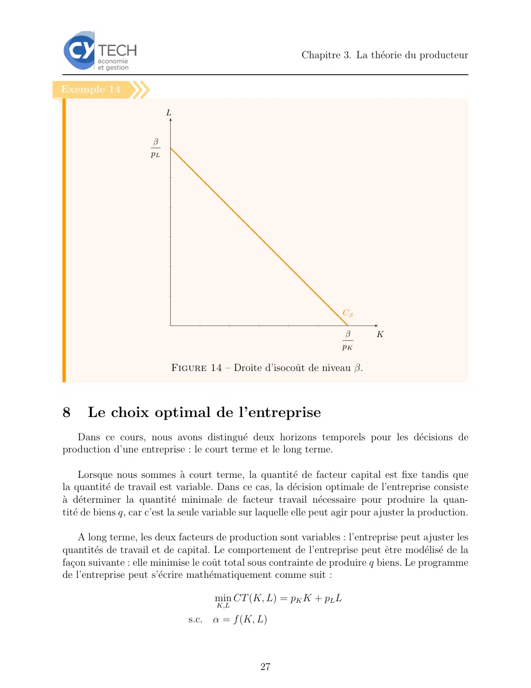

~~~text
                                                           Chapitre 3. La théorie du producteur

Exemple 14

                           L

                      β
                      pL

                                                                     Cβ

                                                                      β       K
                                                                     pK

                           Figure 14 – Droite d’isocoût de niveau β.

8     Le choix optimal de l’entreprise
   Dans ce cours, nous avons distingué deux horizons temporels pour les décisions de
production d’une entreprise : le court terme et le long terme.

     Lorsque nous sommes à court terme, la quantité de facteur capital est fixe tandis que
la quantité de travail est variable. Dans ce cas, la décision optimale de l’entreprise consiste
à déterminer la quantité minimale de facteur travail nécessaire pour produire la quan-
tité de biens q, car c’est la seule variable sur laquelle elle peut agir pour ajuster la production.

    A long terme, les deux facteurs de production sont variables : l’entreprise peut ajuster les
quantités de travail et de capital. Le comportement de l’entreprise peut être modélisé de la
façon suivante : elle minimise le coût total sous contrainte de produire q biens. Le programme
de l’entreprise peut s’écrire mathématiquement comme suit :

                                     min CT (K, L) = pK K + pL L
                                      K,L

                               s.c. α = f (K, L)

                                                 27
~~~

## Page 28

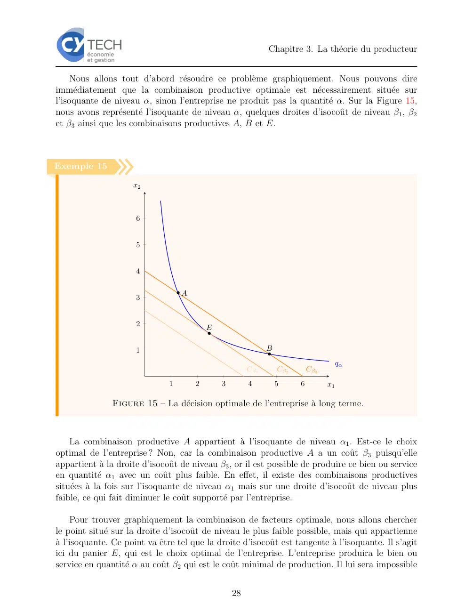

~~~text
                                                               Chapitre 3. La théorie du producteur

     Nous allons tout d’abord résoudre ce problème graphiquement. Nous pouvons dire
immédiatement que la combinaison productive optimale est nécessairement située sur
l’isoquante de niveau α, sinon l’entreprise ne produit pas la quantité α. Sur la Figure 15,
nous avons représenté l’isoquante de niveau α, quelques droites d’isocoût de niveau β1 , β2
et β3 ainsi que les combinaisons productives A, B et E.

Exemple 15
                     x2

                      6

                      5

                      4

                                   •A
                      3

                      2
                                            E
                                            •

                      1                                        B
                                                               •
                                                                                        qα
                                                         Cβ1       Cβ2       Cβ3
                               1        2       3        4         5     6         x1

               Figure 15 – La décision optimale de l’entreprise à long terme.

    La combinaison productive A appartient à l’isoquante de niveau α1 . Est-ce le choix
optimal de l’entreprise ? Non, car la combinaison productive A a un coût β3 puisqu’elle
appartient à la droite d’isocoût de niveau β3 , or il est possible de produire ce bien ou service
en quantité α1 avec un coût plus faible. En effet, il existe des combinaisons productives
situées à la fois sur l’isoquante de niveau α1 mais sur une droite d’isocoût de niveau plus
faible, ce qui fait diminuer le coût supporté par l’entreprise.

     Pour trouver graphiquement la combinaison de facteurs optimale, nous allons chercher
le point situé sur la droite d’isocoût de niveau le plus faible possible, mais qui appartienne
à l’isoquante. Ce point va être tel que la droite d’isocoût est tangente à l’isoquante. Il s’agit
ici du panier E, qui est le choix optimal de l’entreprise. L’entreprise produira le bien ou
service en quantité α au coût β2 qui est le coût minimal de production. Il lui sera impossible

                                                    28
~~~

## Page 29

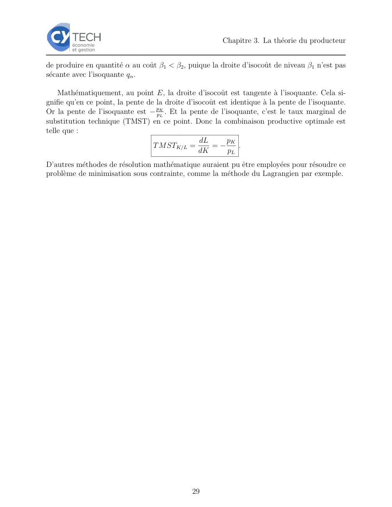

~~~text
                                                         Chapitre 3. La théorie du producteur

de produire en quantité α au coût β1 < β2 , puique la droite d’isocoût de niveau β1 n’est pas
sécante avec l’isoquante qα .

    Mathématiquement, au point E, la droite d’isocoût est tangente à l’isoquante. Cela si-
gnifie qu’en ce point, la pente de la droite d’isocoût est identique à la pente de l’isoquante.
Or la pente de l’isoquante est − ppKL . Et la pente de l’isoquante, c’est le taux marginal de
substitution technique (TMST) en ce point. Donc la combinaison productive optimale est
telle que :
                                                 dL        pK
                                  T M STK/L =        =−        .
                                                 dK        pL
D’autres méthodes de résolution mathématique auraient pu être employées pour résoudre ce
problème de minimisation sous contrainte, comme la méthode du Lagrangien par exemple.

                                               29
~~~
