# Chapitre_4_La_concurrence.pdf

[Ouvrir l’original](https://drive.google.com/open?id=1JVQbaSRyi9H02Heu1abWy-QPNaSMcEkO) · Les deux lectures automatiques du PDF divergent sur les pages indiquées. Leur fac-similé accompagne le texte.

**Pages présentant un écart entre les deux extractions** — 1–29.

## Page 1

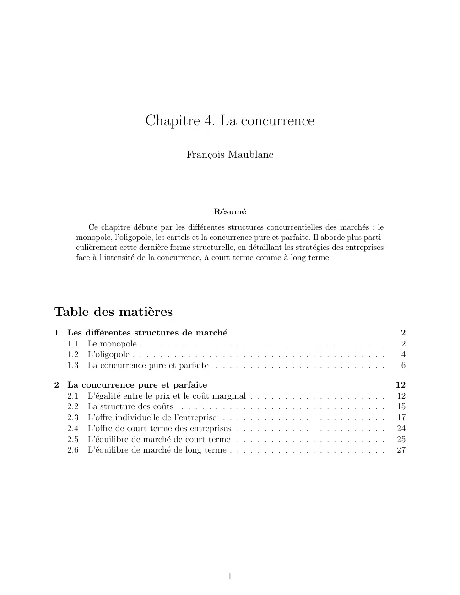

~~~text
                           Chapitre 4. La concurrence

                                        François Maublanc

                                                Résumé
          Ce chapitre débute par les différentes structures concurrentielles des marchés : le
      monopole, l’oligopole, les cartels et la concurrence pure et parfaite. Il aborde plus parti-
      culièrement cette dernière forme structurelle, en détaillant les stratégies des entreprises
      face à l’intensité de la concurrence, à court terme comme à long terme.

Table des matières
1 Les différentes structures de marché                                                                 2
  1.1 Le monopole . . . . . . . . . . . . . . . . . . . . . . . . . . . . . . . . . . . .                2
  1.2 L’oligopole . . . . . . . . . . . . . . . . . . . . . . . . . . . . . . . . . . . . .              4
  1.3 La concurrence pure et parfaite . . . . . . . . . . . . . . . . . . . . . . . . .                  6

2 La concurrence pure et parfaite                                                                       12
  2.1 L’égalité entre le prix et le coût marginal . . . . . . . . . . . . . . . . . . . .            12
  2.2 La structure des coûts . . . . . . . . . . . . . . . . . . . . . . . . . . . . . .               15
  2.3 L’offre individuelle de l’entreprise . . . . . . . . . . . . . . . . . . . . . . . .              17
  2.4 L’offre de court terme des entreprises . . . . . . . . . . . . . . . . . . . . . .                24
  2.5 L’équilibre de marché de court terme . . . . . . . . . . . . . . . . . . . . . .                25
  2.6 L’équilibre de marché de long terme . . . . . . . . . . . . . . . . . . . . . . .               27

                                                    1
~~~

## Page 2

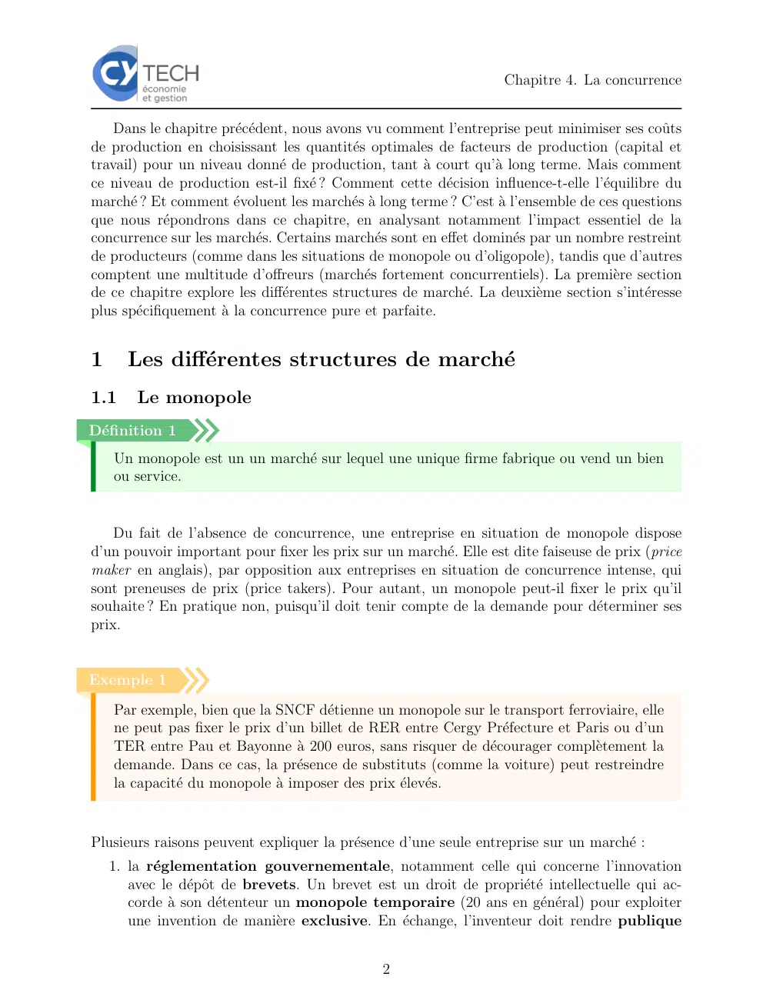

~~~text
                                                                   Chapitre 4. La concurrence

    Dans le chapitre précédent, nous avons vu comment l’entreprise peut minimiser ses coûts
de production en choisissant les quantités optimales de facteurs de production (capital et
travail) pour un niveau donné de production, tant à court qu’à long terme. Mais comment
ce niveau de production est-il fixé ? Comment cette décision influence-t-elle l’équilibre du
marché ? Et comment évoluent les marchés à long terme ? C’est à l’ensemble de ces questions
que nous répondrons dans ce chapitre, en analysant notamment l’impact essentiel de la
concurrence sur les marchés. Certains marchés sont en effet dominés par un nombre restreint
de producteurs (comme dans les situations de monopole ou d’oligopole), tandis que d’autres
comptent une multitude d’offreurs (marchés fortement concurrentiels). La première section
de ce chapitre explore les différentes structures de marché. La deuxième section s’intéresse
plus spécifiquement à la concurrence pure et parfaite.

1     Les différentes structures de marché
1.1     Le monopole
Définition 1
    Un monopole est un un marché sur lequel une unique firme fabrique ou vend un bien
    ou service.

    Du fait de l’absence de concurrence, une entreprise en situation de monopole dispose
d’un pouvoir important pour fixer les prix sur un marché. Elle est dite faiseuse de prix (price
maker en anglais), par opposition aux entreprises en situation de concurrence intense, qui
sont preneuses de prix (price takers). Pour autant, un monopole peut-il fixer le prix qu’il
souhaite ? En pratique non, puisqu’il doit tenir compte de la demande pour déterminer ses
prix.

Exemple 1
    Par exemple, bien que la SNCF détienne un monopole sur le transport ferroviaire, elle
    ne peut pas fixer le prix d’un billet de RER entre Cergy Préfecture et Paris ou d’un
    TER entre Pau et Bayonne à 200 euros, sans risquer de décourager complètement la
    demande. Dans ce cas, la présence de substituts (comme la voiture) peut restreindre
    la capacité du monopole à imposer des prix élevés.

Plusieurs raisons peuvent expliquer la présence d’une seule entreprise sur un marché :
    1. la réglementation gouvernementale, notamment celle qui concerne l’innovation
       avec le dépôt de brevets. Un brevet est un droit de propriété intellectuelle qui ac-
       corde à son détenteur un monopole temporaire (20 ans en général) pour exploiter
       une invention de manière exclusive. En échange, l’inventeur doit rendre publique

                                               2
~~~

## Page 3

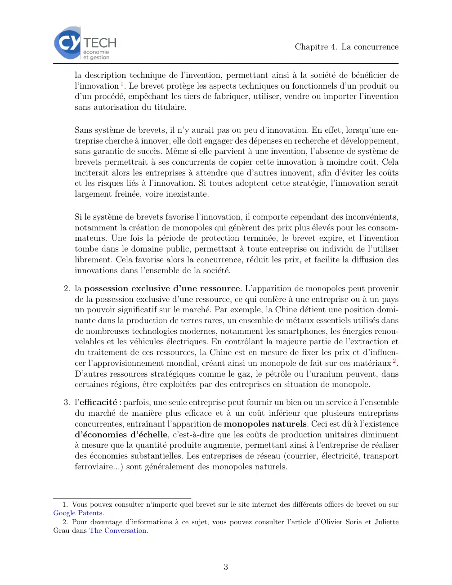

~~~text
                                                                            Chapitre 4. La concurrence

      la description technique de l’invention, permettant ainsi à la société de bénéficier de
      l’innovation 1 . Le brevet protège les aspects techniques ou fonctionnels d’un produit ou
      d’un procédé, empêchant les tiers de fabriquer, utiliser, vendre ou importer l’invention
      sans autorisation du titulaire.

      Sans système de brevets, il n’y aurait pas ou peu d’innovation. En effet, lorsqu’une en-
      treprise cherche à innover, elle doit engager des dépenses en recherche et développement,
      sans garantie de succès. Même si elle parvient à une invention, l’absence de système de
      brevets permettrait à ses concurrents de copier cette innovation à moindre coût. Cela
      inciterait alors les entreprises à attendre que d’autres innovent, afin d’éviter les coûts
      et les risques liés à l’innovation. Si toutes adoptent cette stratégie, l’innovation serait
      largement freinée, voire inexistante.

      Si le système de brevets favorise l’innovation, il comporte cependant des inconvénients,
      notamment la création de monopoles qui génèrent des prix plus élevés pour les consom-
      mateurs. Une fois la période de protection terminée, le brevet expire, et l’invention
      tombe dans le domaine public, permettant à toute entreprise ou individu de l’utiliser
      librement. Cela favorise alors la concurrence, réduit les prix, et facilite la diffusion des
      innovations dans l’ensemble de la société.

   2. la possession exclusive d’une ressource. L’apparition de monopoles peut provenir
      de la possession exclusive d’une ressource, ce qui confère à une entreprise ou à un pays
      un pouvoir significatif sur le marché. Par exemple, la Chine détient une position domi-
      nante dans la production de terres rares, un ensemble de métaux essentiels utilisés dans
      de nombreuses technologies modernes, notamment les smartphones, les énergies renou-
      velables et les véhicules électriques. En contrôlant la majeure partie de l’extraction et
      du traitement de ces ressources, la Chine est en mesure de fixer les prix et d’influen-
      cer l’approvisionnement mondial, créant ainsi un monopole de fait sur ces matériaux 2 .
      D’autres ressources stratégiques comme le gaz, le pétrôle ou l’uranium peuvent, dans
      certaines régions, être exploitées par des entreprises en situation de monopole.

   3. l’efficacité : parfois, une seule entreprise peut fournir un bien ou un service à l’ensemble
      du marché de manière plus efficace et à un coût inférieur que plusieurs entreprises
      concurrentes, entraı̂nant l’apparition de monopoles naturels. Ceci est dû à l’existence
      d’économies d’échelle, c’est-à-dire que les coûts de production unitaires diminuent
      à mesure que la quantité produite augmente, permettant ainsi à l’entreprise de réaliser
      des économies substantielles. Les entreprises de réseau (courrier, électricité, transport
      ferroviaire...) sont généralement des monopoles naturels.

  1. Vous pouvez consulter n’importe quel brevet sur le site internet des différents offices de brevet ou sur
Google Patents.
  2. Pour davantage d’informations à ce sujet, vous pouvez consulter l’article d’Olivier Soria et Juliette
Grau dans The Conversation.

                                                      3
~~~

## Page 4

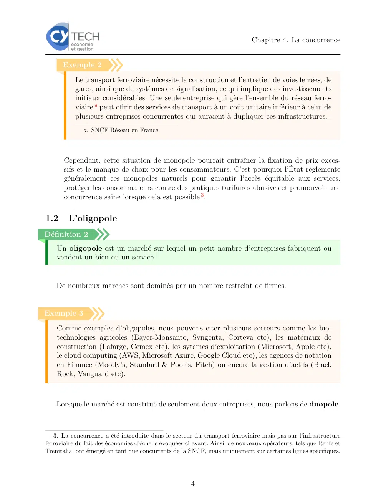

~~~text
                                                                                 Chapitre 4. La concurrence

      Exemple 2
           Le transport ferroviaire nécessite la construction et l’entretien de voies ferrées, de
           gares, ainsi que de systèmes de signalisation, ce qui implique des investissements
           initiaux considérables. Une seule entreprise qui gère l’ensemble du réseau ferro-
           viaire a peut offrir des services de transport à un coût unitaire inférieur à celui de
           plusieurs entreprises concurrentes qui auraient à dupliquer ces infrastructures.
              a. SNCF Réseau en France.

       Cependant, cette situation de monopole pourrait entraı̂ner la fixation de prix exces-
       sifs et le manque de choix pour les consommateurs. C’est pourquoi l’État réglemente
       généralement ces monopoles naturels pour garantir l’accès équitable aux services,
       protéger les consommateurs contre des pratiques tarifaires abusives et promouvoir une
       concurrence saine lorsque cela est possible 3 .

1.2      L’oligopole
Définition 2
    Un oligopole est un marché sur lequel un petit nombre d’entreprises fabriquent ou
    vendent un bien ou un service.

    De nombreux marchés sont dominés par un nombre restreint de firmes.

Exemple 3
    Comme exemples d’oligopoles, nous pouvons citer plusieurs secteurs comme les bio-
    technologies agricoles (Bayer-Monsanto, Syngenta, Corteva etc), les matériaux de
    construction (Lafarge, Cemex etc), les sytèmes d’exploitation (Microsoft, Apple etc),
    le cloud computing (AWS, Microsoft Azure, Google Cloud etc), les agences de notation
    en Finance (Moody’s, Standard & Poor’s, Fitch) ou encore la gestion d’actifs (Black
    Rock, Vanguard etc).

    Lorsque le marché est constitué de seulement deux entreprises, nous parlons de duopole.

   3. La concurrence a été introduite dans le secteur du transport ferroviaire mais pas sur l’infrastructure
ferroviaire du fait des économies d’échelle évoquées ci-avant. Ainsi, de nouveaux opérateurs, tels que Renfe et
Trenitalia, ont émergé en tant que concurrents de la SNCF, mais uniquement sur certaines lignes spécifiques.

                                                         4
~~~

## Page 5

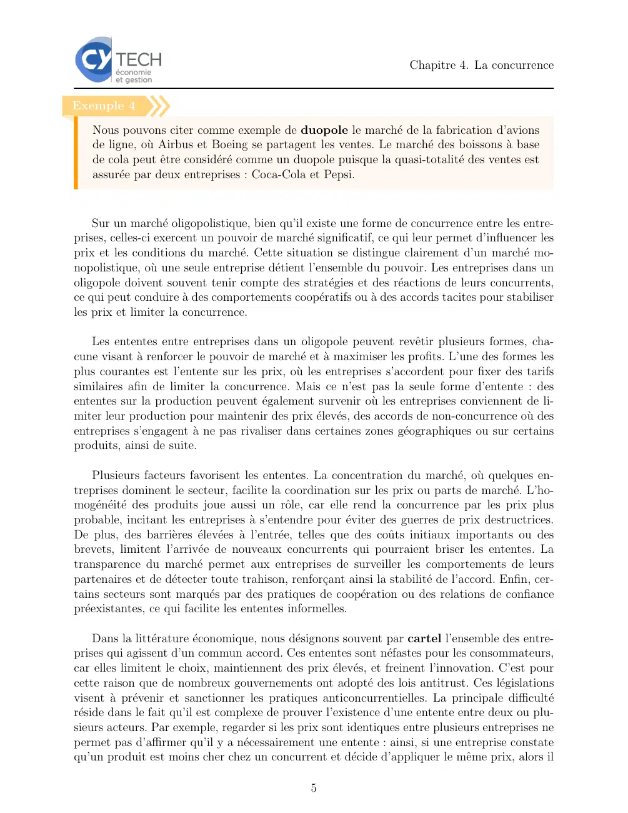

~~~text
                                                                     Chapitre 4. La concurrence

Exemple 4
   Nous pouvons citer comme exemple de duopole le marché de la fabrication d’avions
   de ligne, où Airbus et Boeing se partagent les ventes. Le marché des boissons à base
   de cola peut être considéré comme un duopole puisque la quasi-totalité des ventes est
   assurée par deux entreprises : Coca-Cola et Pepsi.

    Sur un marché oligopolistique, bien qu’il existe une forme de concurrence entre les entre-
prises, celles-ci exercent un pouvoir de marché significatif, ce qui leur permet d’influencer les
prix et les conditions du marché. Cette situation se distingue clairement d’un marché mo-
nopolistique, où une seule entreprise détient l’ensemble du pouvoir. Les entreprises dans un
oligopole doivent souvent tenir compte des stratégies et des réactions de leurs concurrents,
ce qui peut conduire à des comportements coopératifs ou à des accords tacites pour stabiliser
les prix et limiter la concurrence.

   Les ententes entre entreprises dans un oligopole peuvent revêtir plusieurs formes, cha-
cune visant à renforcer le pouvoir de marché et à maximiser les profits. L’une des formes les
plus courantes est l’entente sur les prix, où les entreprises s’accordent pour fixer des tarifs
similaires afin de limiter la concurrence. Mais ce n’est pas la seule forme d’entente : des
ententes sur la production peuvent également survenir où les entreprises conviennent de li-
miter leur production pour maintenir des prix élevés, des accords de non-concurrence où des
entreprises s’engagent à ne pas rivaliser dans certaines zones géographiques ou sur certains
produits, ainsi de suite.

    Plusieurs facteurs favorisent les ententes. La concentration du marché, où quelques en-
treprises dominent le secteur, facilite la coordination sur les prix ou parts de marché. L’ho-
mogénéité des produits joue aussi un rôle, car elle rend la concurrence par les prix plus
probable, incitant les entreprises à s’entendre pour éviter des guerres de prix destructrices.
De plus, des barrières élevées à l’entrée, telles que des coûts initiaux importants ou des
brevets, limitent l’arrivée de nouveaux concurrents qui pourraient briser les ententes. La
transparence du marché permet aux entreprises de surveiller les comportements de leurs
partenaires et de détecter toute trahison, renforçant ainsi la stabilité de l’accord. Enfin, cer-
tains secteurs sont marqués par des pratiques de coopération ou des relations de confiance
préexistantes, ce qui facilite les ententes informelles.

     Dans la littérature économique, nous désignons souvent par cartel l’ensemble des entre-
prises qui agissent d’un commun accord. Ces ententes sont néfastes pour les consommateurs,
car elles limitent le choix, maintiennent des prix élevés, et freinent l’innovation. C’est pour
cette raison que de nombreux gouvernements ont adopté des lois antitrust. Ces législations
visent à prévenir et sanctionner les pratiques anticoncurrentielles. La principale difficulté
réside dans le fait qu’il est complexe de prouver l’existence d’une entente entre deux ou plu-
sieurs acteurs. Par exemple, regarder si les prix sont identiques entre plusieurs entreprises ne
permet pas d’affirmer qu’il y a nécessairement une entente : ainsi, si une entreprise constate
qu’un produit est moins cher chez un concurrent et décide d’appliquer le même prix, alors il

                                                 5
~~~

## Page 6

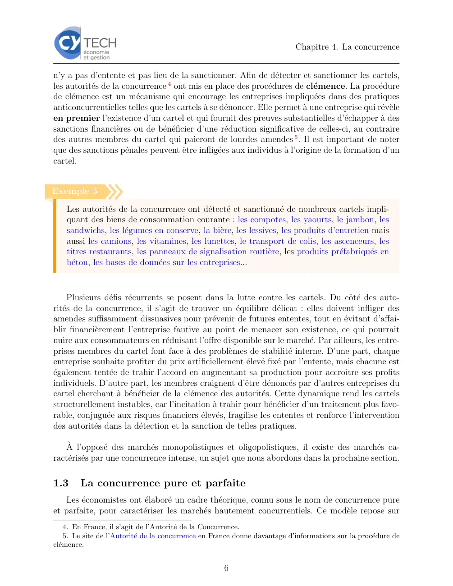

~~~text
                                                                            Chapitre 4. La concurrence

n’y a pas d’entente et pas lieu de la sanctionner. Afin de détecter et sanctionner les cartels,
les autorités de la concurrence 4 ont mis en place des procédures de clémence. La procédure
de clémence est un mécanisme qui encourage les entreprises impliquées dans des pratiques
anticoncurrentielles telles que les cartels à se dénoncer. Elle permet à une entreprise qui révèle
en premier l’existence d’un cartel et qui fournit des preuves substantielles d’échapper à des
sanctions financières ou de bénéficier d’une réduction significative de celles-ci, au contraire
des autres membres du cartel qui paieront de lourdes amendes 5 . Il est important de noter
que des sanctions pénales peuvent être infligées aux individus à l’origine de la formation d’un
cartel.

Exemple 5
    Les autorités de la concurrence ont détecté et sanctionné de nombreux cartels impli-
    quant des biens de consommation courante : les compotes, les yaourts, le jambon, les
    sandwichs, les légumes en conserve, la bière, les lessives, les produits d’entretien mais
    aussi les camions, les vitamines, les lunettes, le transport de colis, les ascenceurs, les
    titres restaurants, les panneaux de signalisation routière, les produits préfabriqués en
    béton, les bases de données sur les entreprises...

     Plusieurs défis récurrents se posent dans la lutte contre les cartels. Du côté des auto-
rités de la concurrence, il s’agit de trouver un équilibre délicat : elles doivent infliger des
amendes suffisamment dissuasives pour prévenir de futures ententes, tout en évitant d’affai-
blir financièrement l’entreprise fautive au point de menacer son existence, ce qui pourrait
nuire aux consommateurs en réduisant l’offre disponible sur le marché. Par ailleurs, les entre-
prises membres du cartel font face à des problèmes de stabilité interne. D’une part, chaque
entreprise souhaite profiter du prix artificiellement élevé fixé par l’entente, mais chacune est
également tentée de trahir l’accord en augmentant sa production pour accroı̂tre ses profits
individuels. D’autre part, les membres craignent d’être dénoncés par d’autres entreprises du
cartel cherchant à bénéficier de la clémence des autorités. Cette dynamique rend les cartels
structurellement instables, car l’incitation à trahir pour bénéficier d’un traitement plus favo-
rable, conjuguée aux risques financiers élevés, fragilise les ententes et renforce l’intervention
des autorités dans la détection et la sanction de telles pratiques.

   À l’opposé des marchés monopolistiques et oligopolistiques, il existe des marchés ca-
ractérisés par une concurrence intense, un sujet que nous abordons dans la prochaine section.

1.3     La concurrence pure et parfaite
   Les économistes ont élaboré un cadre théorique, connu sous le nom de concurrence pure
et parfaite, pour caractériser les marchés hautement concurrentiels. Ce modèle repose sur
    4. En France, il s’agit de l’Autorité de la Concurrence.
    5. Le site de l’Autorité de la concurrence en France donne davantage d’informations sur la procédure de
clémence.

                                                     6
~~~

## Page 7

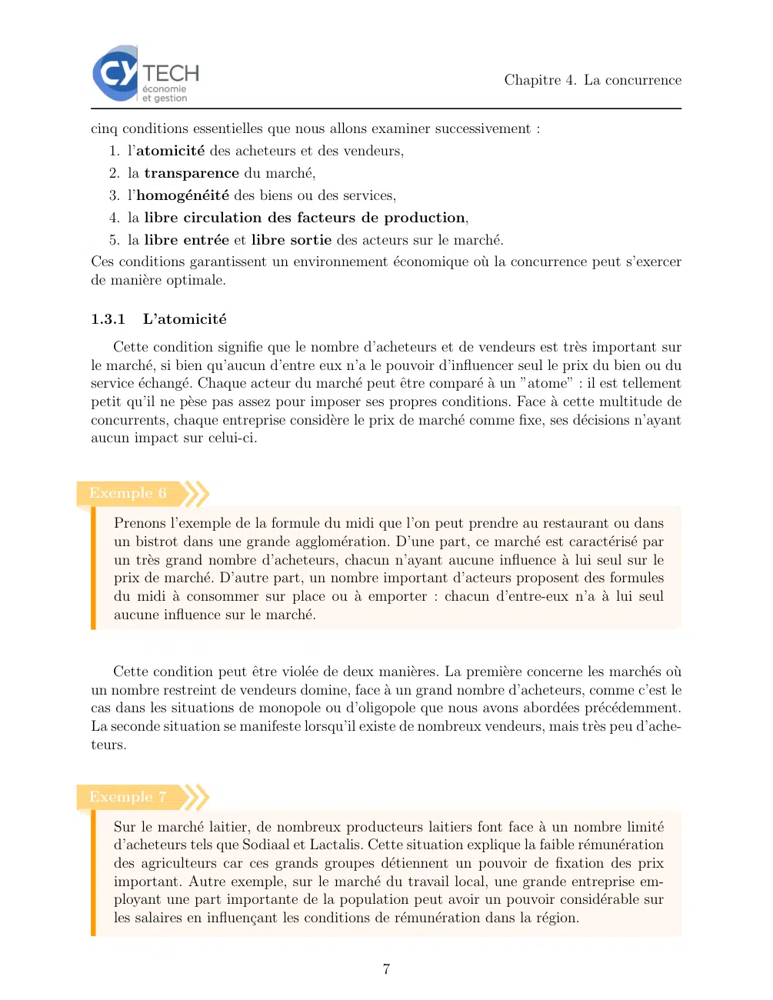

~~~text
                                                                   Chapitre 4. La concurrence

cinq conditions essentielles que nous allons examiner successivement :
   1. l’atomicité des acheteurs et des vendeurs,
   2. la transparence du marché,
   3. l’homogénéité des biens ou des services,
   4. la libre circulation des facteurs de production,
   5. la libre entrée et libre sortie des acteurs sur le marché.
Ces conditions garantissent un environnement économique où la concurrence peut s’exercer
de manière optimale.

1.3.1   L’atomicité
    Cette condition signifie que le nombre d’acheteurs et de vendeurs est très important sur
le marché, si bien qu’aucun d’entre eux n’a le pouvoir d’influencer seul le prix du bien ou du
service échangé. Chaque acteur du marché peut être comparé à un ”atome” : il est tellement
petit qu’il ne pèse pas assez pour imposer ses propres conditions. Face à cette multitude de
concurrents, chaque entreprise considère le prix de marché comme fixe, ses décisions n’ayant
aucun impact sur celui-ci.

Exemple 6
   Prenons l’exemple de la formule du midi que l’on peut prendre au restaurant ou dans
   un bistrot dans une grande agglomération. D’une part, ce marché est caractérisé par
   un très grand nombre d’acheteurs, chacun n’ayant aucune influence à lui seul sur le
   prix de marché. D’autre part, un nombre important d’acteurs proposent des formules
   du midi à consommer sur place ou à emporter : chacun d’entre-eux n’a à lui seul
   aucune influence sur le marché.

   Cette condition peut être violée de deux manières. La première concerne les marchés où
un nombre restreint de vendeurs domine, face à un grand nombre d’acheteurs, comme c’est le
cas dans les situations de monopole ou d’oligopole que nous avons abordées précédemment.
La seconde situation se manifeste lorsqu’il existe de nombreux vendeurs, mais très peu d’ache-
teurs.

Exemple 7
   Sur le marché laitier, de nombreux producteurs laitiers font face à un nombre limité
   d’acheteurs tels que Sodiaal et Lactalis. Cette situation explique la faible rémunération
   des agriculteurs car ces grands groupes détiennent un pouvoir de fixation des prix
   important. Autre exemple, sur le marché du travail local, une grande entreprise em-
   ployant une part importante de la population peut avoir un pouvoir considérable sur
   les salaires en influençant les conditions de rémunération dans la région.

                                               7
~~~

## Page 8

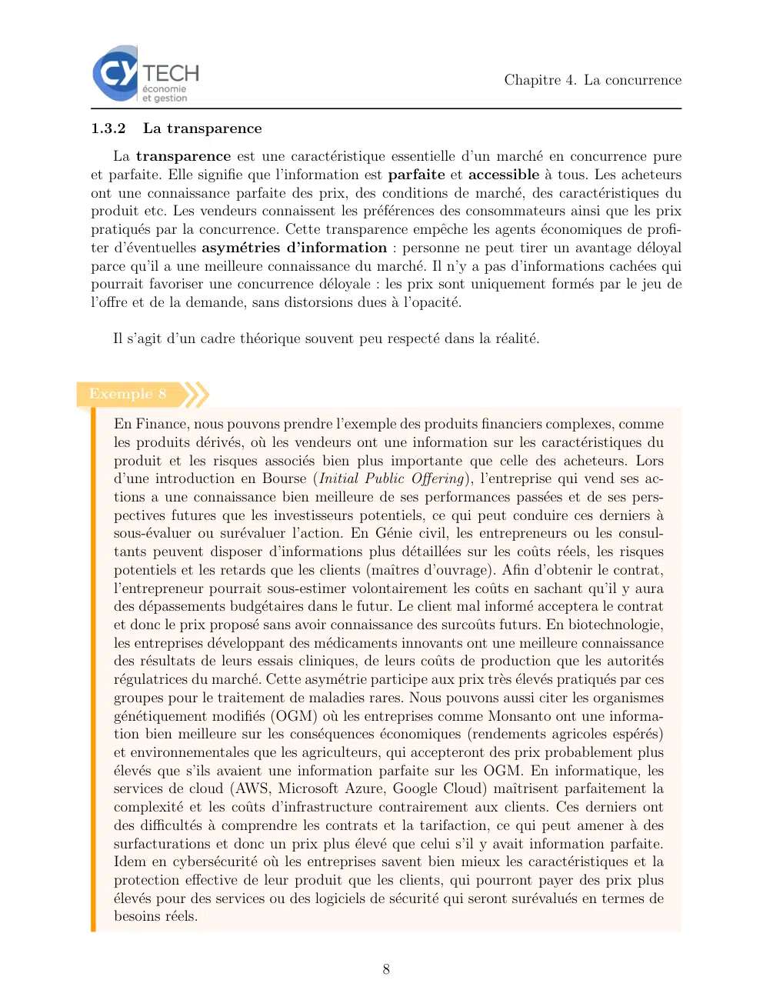

~~~text
                                                                      Chapitre 4. La concurrence

1.3.2   La transparence
     La transparence est une caractéristique essentielle d’un marché en concurrence pure
et parfaite. Elle signifie que l’information est parfaite et accessible à tous. Les acheteurs
ont une connaissance parfaite des prix, des conditions de marché, des caractéristiques du
produit etc. Les vendeurs connaissent les préférences des consommateurs ainsi que les prix
pratiqués par la concurrence. Cette transparence empêche les agents économiques de profi-
ter d’éventuelles asymétries d’information : personne ne peut tirer un avantage déloyal
parce qu’il a une meilleure connaissance du marché. Il n’y a pas d’informations cachées qui
pourrait favoriser une concurrence déloyale : les prix sont uniquement formés par le jeu de
l’offre et de la demande, sans distorsions dues à l’opacité.

   Il s’agit d’un cadre théorique souvent peu respecté dans la réalité.

Exemple 8
   En Finance, nous pouvons prendre l’exemple des produits financiers complexes, comme
   les produits dérivés, où les vendeurs ont une information sur les caractéristiques du
   produit et les risques associés bien plus importante que celle des acheteurs. Lors
   d’une introduction en Bourse (Initial Public Offering), l’entreprise qui vend ses ac-
   tions a une connaissance bien meilleure de ses performances passées et de ses pers-
   pectives futures que les investisseurs potentiels, ce qui peut conduire ces derniers à
   sous-évaluer ou surévaluer l’action. En Génie civil, les entrepreneurs ou les consul-
   tants peuvent disposer d’informations plus détaillées sur les coûts réels, les risques
   potentiels et les retards que les clients (maı̂tres d’ouvrage). Afin d’obtenir le contrat,
   l’entrepreneur pourrait sous-estimer volontairement les coûts en sachant qu’il y aura
   des dépassements budgétaires dans le futur. Le client mal informé acceptera le contrat
   et donc le prix proposé sans avoir connaissance des surcoûts futurs. En biotechnologie,
   les entreprises développant des médicaments innovants ont une meilleure connaissance
   des résultats de leurs essais cliniques, de leurs coûts de production que les autorités
   régulatrices du marché. Cette asymétrie participe aux prix très élevés pratiqués par ces
   groupes pour le traitement de maladies rares. Nous pouvons aussi citer les organismes
   génétiquement modifiés (OGM) où les entreprises comme Monsanto ont une informa-
   tion bien meilleure sur les conséquences économiques (rendements agricoles espérés)
   et environnementales que les agriculteurs, qui accepteront des prix probablement plus
   élevés que s’ils avaient une information parfaite sur les OGM. En informatique, les
   services de cloud (AWS, Microsoft Azure, Google Cloud) maı̂trisent parfaitement la
   complexité et les coûts d’infrastructure contrairement aux clients. Ces derniers ont
   des difficultés à comprendre les contrats et la tarifaction, ce qui peut amener à des
   surfacturations et donc un prix plus élevé que celui s’il y avait information parfaite.
   Idem en cybersécurité où les entreprises savent bien mieux les caractéristiques et la
   protection effective de leur produit que les clients, qui pourront payer des prix plus
   élevés pour des services ou des logiciels de sécurité qui seront surévalués en termes de
   besoins réels.

                                                 8
~~~

## Page 9

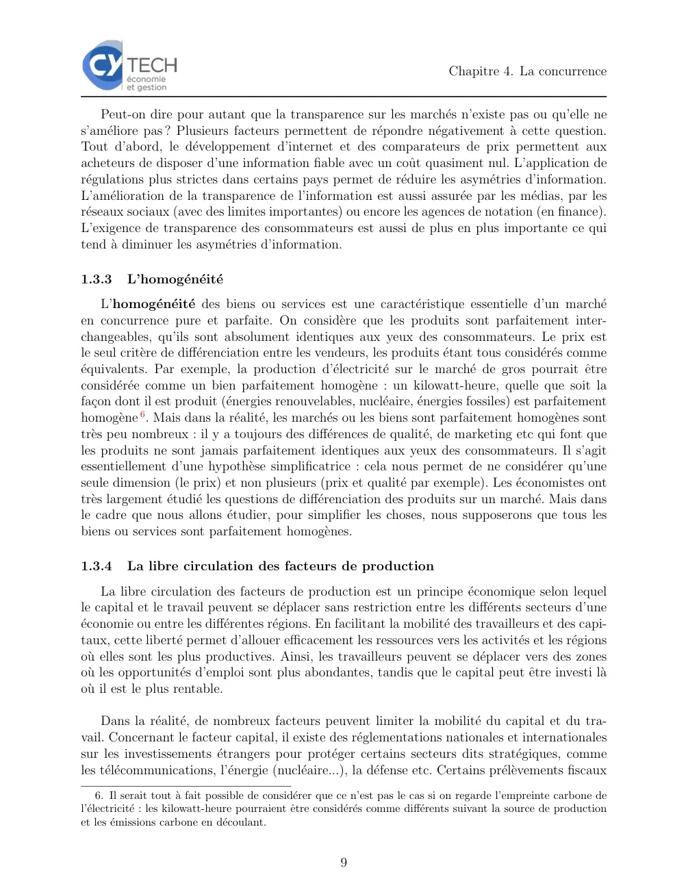

~~~text
                                                                                 Chapitre 4. La concurrence

     Peut-on dire pour autant que la transparence sur les marchés n’existe pas ou qu’elle ne
s’améliore pas ? Plusieurs facteurs permettent de répondre négativement à cette question.
Tout d’abord, le développement d’internet et des comparateurs de prix permettent aux
acheteurs de disposer d’une information fiable avec un coût quasiment nul. L’application de
régulations plus strictes dans certains pays permet de réduire les asymétries d’information.
L’amélioration de la transparence de l’information est aussi assurée par les médias, par les
réseaux sociaux (avec des limites importantes) ou encore les agences de notation (en finance).
L’exigence de transparence des consommateurs est aussi de plus en plus importante ce qui
tend à diminuer les asymétries d’information.

1.3.3     L’homogénéité
     L’homogénéité des biens ou services est une caractéristique essentielle d’un marché
en concurrence pure et parfaite. On considère que les produits sont parfaitement inter-
changeables, qu’ils sont absolument identiques aux yeux des consommateurs. Le prix est
le seul critère de différenciation entre les vendeurs, les produits étant tous considérés comme
équivalents. Par exemple, la production d’électricité sur le marché de gros pourrait être
considérée comme un bien parfaitement homogène : un kilowatt-heure, quelle que soit la
façon dont il est produit (énergies renouvelables, nucléaire, énergies fossiles) est parfaitement
homogène 6 . Mais dans la réalité, les marchés ou les biens sont parfaitement homogènes sont
très peu nombreux : il y a toujours des différences de qualité, de marketing etc qui font que
les produits ne sont jamais parfaitement identiques aux yeux des consommateurs. Il s’agit
essentiellement d’une hypothèse simplificatrice : cela nous permet de ne considérer qu’une
seule dimension (le prix) et non plusieurs (prix et qualité par exemple). Les économistes ont
très largement étudié les questions de différenciation des produits sur un marché. Mais dans
le cadre que nous allons étudier, pour simplifier les choses, nous supposerons que tous les
biens ou services sont parfaitement homogènes.

1.3.4     La libre circulation des facteurs de production
    La libre circulation des facteurs de production est un principe économique selon lequel
le capital et le travail peuvent se déplacer sans restriction entre les différents secteurs d’une
économie ou entre les différentes régions. En facilitant la mobilité des travailleurs et des capi-
taux, cette liberté permet d’allouer efficacement les ressources vers les activités et les régions
où elles sont les plus productives. Ainsi, les travailleurs peuvent se déplacer vers des zones
où les opportunités d’emploi sont plus abondantes, tandis que le capital peut être investi là
où il est le plus rentable.

    Dans la réalité, de nombreux facteurs peuvent limiter la mobilité du capital et du tra-
vail. Concernant le facteur capital, il existe des réglementations nationales et internationales
sur les investissements étrangers pour protéger certains secteurs dits stratégiques, comme
les télécommunications, l’énergie (nucléaire...), la défense etc. Certains prélèvements fiscaux
     6. Il serait tout à fait possible de considérer que ce n’est pas le cas si on regarde l’empreinte carbone de
l’électricité : les kilowatt-heure pourraient être considérés comme différents suivant la source de production
et les émissions carbone en découlant.

                                                         9
~~~

## Page 10

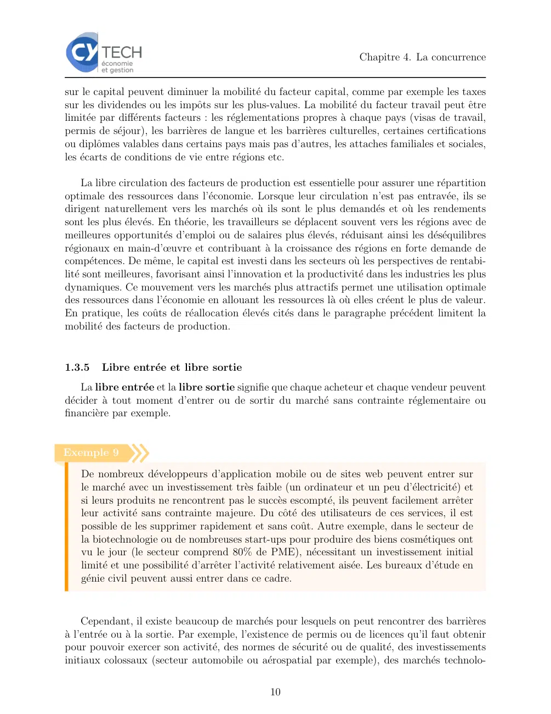

~~~text
                                                                      Chapitre 4. La concurrence

sur le capital peuvent diminuer la mobilité du facteur capital, comme par exemple les taxes
sur les dividendes ou les impôts sur les plus-values. La mobilité du facteur travail peut être
limitée par différents facteurs : les réglementations propres à chaque pays (visas de travail,
permis de séjour), les barrières de langue et les barrières culturelles, certaines certifications
ou diplômes valables dans certains pays mais pas d’autres, les attaches familiales et sociales,
les écarts de conditions de vie entre régions etc.

     La libre circulation des facteurs de production est essentielle pour assurer une répartition
optimale des ressources dans l’économie. Lorsque leur circulation n’est pas entravée, ils se
dirigent naturellement vers les marchés où ils sont le plus demandés et où les rendements
sont les plus élevés. En théorie, les travailleurs se déplacent souvent vers les régions avec de
meilleures opportunités d’emploi ou de salaires plus élevés, réduisant ainsi les déséquilibres
régionaux en main-d’œuvre et contribuant à la croissance des régions en forte demande de
compétences. De même, le capital est investi dans les secteurs où les perspectives de rentabi-
lité sont meilleures, favorisant ainsi l’innovation et la productivité dans les industries les plus
dynamiques. Ce mouvement vers les marchés plus attractifs permet une utilisation optimale
des ressources dans l’économie en allouant les ressources là où elles créent le plus de valeur.
En pratique, les coûts de réallocation élevés cités dans le paragraphe précédent limitent la
mobilité des facteurs de production.

1.3.5   Libre entrée et libre sortie
    La libre entrée et la libre sortie signifie que chaque acheteur et chaque vendeur peuvent
décider à tout moment d’entrer ou de sortir du marché sans contrainte réglementaire ou
financière par exemple.

Exemple 9
   De nombreux développeurs d’application mobile ou de sites web peuvent entrer sur
   le marché avec un investissement très faible (un ordinateur et un peu d’électricité) et
   si leurs produits ne rencontrent pas le succès escompté, ils peuvent facilement arrêter
   leur activité sans contrainte majeure. Du côté des utilisateurs de ces services, il est
   possible de les supprimer rapidement et sans coût. Autre exemple, dans le secteur de
   la biotechnologie ou de nombreuses start-ups pour produire des biens cosmétiques ont
   vu le jour (le secteur comprend 80% de PME), nécessitant un investissement initial
   limité et une possibilité d’arrêter l’activité relativement aisée. Les bureaux d’étude en
   génie civil peuvent aussi entrer dans ce cadre.

     Cependant, il existe beaucoup de marchés pour lesquels on peut rencontrer des barrières
à l’entrée ou à la sortie. Par exemple, l’existence de permis ou de licences qu’il faut obtenir
pour pouvoir exercer son activité, des normes de sécurité ou de qualité, des investissements
initiaux colossaux (secteur automobile ou aérospatial par exemple), des marchés technolo-

                                                 10
~~~

## Page 11

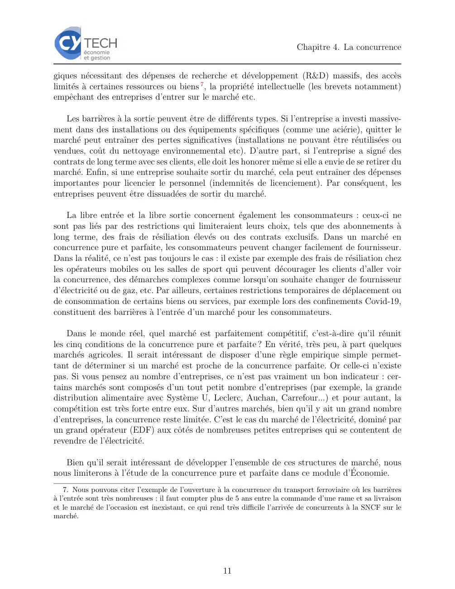

~~~text
                                                                                Chapitre 4. La concurrence

giques nécessitant des dépenses de recherche et développement (R&D) massifs, des accès
limités à certaines ressources ou biens 7 , la propriété intellectuelle (les brevets notamment)
empêchant des entreprises d’entrer sur le marché etc.

   Les barrières à la sortie peuvent être de différents types. Si l’entreprise a investi massive-
ment dans des installations ou des équipements spécifiques (comme une aciérie), quitter le
marché peut entraı̂ner des pertes significatives (installations ne pouvant être réutilisées ou
vendues, coût du nettoyage environnemental etc). D’autre part, si l’entreprise a signé des
contrats de long terme avec ses clients, elle doit les honorer même si elle a envie de se retirer du
marché. Enfin, si une entreprise souhaite sortir du marché, cela peut entraı̂ner des dépenses
importantes pour licencier le personnel (indemnités de licenciement). Par conséquent, les
entreprises peuvent être dissuadées de sortir du marché.

     La libre entrée et la libre sortie concernent également les consommateurs : ceux-ci ne
sont pas liés par des restrictions qui limiteraient leurs choix, tels que des abonnements à
long terme, des frais de résiliation élevés ou des contrats exclusifs. Dans un marché en
concurrence pure et parfaite, les consommateurs peuvent changer facilement de fournisseur.
Dans la réalité, ce n’est pas toujours le cas : il existe par exemple des frais de résiliation chez
les opérateurs mobiles ou les salles de sport qui peuvent décourager les clients d’aller voir
la concurrence, des démarches complexes comme lorsqu’on souhaite changer de fournisseur
d’électricité ou de gaz, etc. Par ailleurs, certaines restrictions temporaires de déplacement ou
de consommation de certains biens ou services, par exemple lors des confinements Covid-19,
constituent des barrières à l’entrée d’un marché pour les consommateurs.

    Dans le monde réel, quel marché est parfaitement compétitif, c’est-à-dire qu’il réunit
les cinq conditions de la concurrence pure et parfaite ? En vérité, très peu, à part quelques
marchés agricoles. Il serait intéressant de disposer d’une règle empirique simple permet-
tant de déterminer si un marché est proche de la concurrence parfaite. Or celle-ci n’existe
pas. Si vous pensez au nombre d’entreprises, ce n’est pas vraiment un bon indicateur : cer-
tains marchés sont composés d’un tout petit nombre d’entreprises (par exemple, la grande
distribution alimentaire avec Système U, Leclerc, Auchan, Carrefour...) et pour autant, la
compétition est très forte entre eux. Sur d’autres marchés, bien qu’il y ait un grand nombre
d’entreprises, la concurrence reste limitée. C’est le cas du marché de l’électricité, dominé par
un grand opérateur (EDF) aux côtés de nombreuses petites entreprises qui se contentent de
revendre de l’électricité.

   Bien qu’il serait intéressant de développer l’ensemble de ces structures de marché, nous
nous limiterons à l’étude de la concurrence pure et parfaite dans ce module d’Économie.
     7. Nous pouvons citer l’exemple de l’ouverture à la concurrence du transport ferroviaire où les barrières
à l’entrée sont très nombreuses : il faut compter plus de 5 ans entre la commande d’une rame et sa livraison
et le marché de l’occasion est inexistant, ce qui rend très difficile l’arrivée de concurrents à la SNCF sur le
marché.

                                                        11
~~~

## Page 12

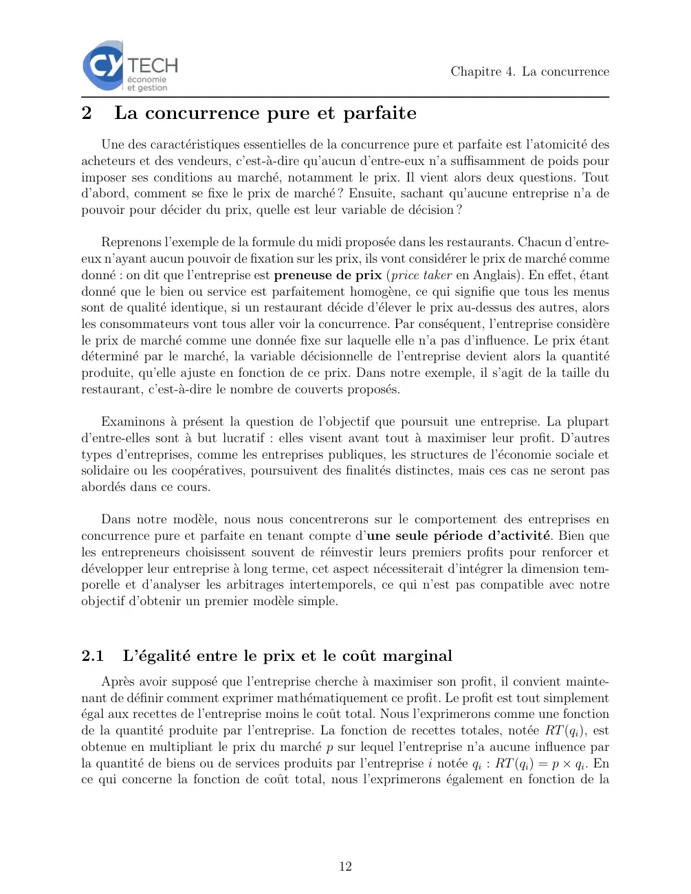

~~~text
                                                                     Chapitre 4. La concurrence

2     La concurrence pure et parfaite
   Une des caractéristiques essentielles de la concurrence pure et parfaite est l’atomicité des
acheteurs et des vendeurs, c’est-à-dire qu’aucun d’entre-eux n’a suffisamment de poids pour
imposer ses conditions au marché, notamment le prix. Il vient alors deux questions. Tout
d’abord, comment se fixe le prix de marché ? Ensuite, sachant qu’aucune entreprise n’a de
pouvoir pour décider du prix, quelle est leur variable de décision ?

    Reprenons l’exemple de la formule du midi proposée dans les restaurants. Chacun d’entre-
eux n’ayant aucun pouvoir de fixation sur les prix, ils vont considérer le prix de marché comme
donné : on dit que l’entreprise est preneuse de prix (price taker en Anglais). En effet, étant
donné que le bien ou service est parfaitement homogène, ce qui signifie que tous les menus
sont de qualité identique, si un restaurant décide d’élever le prix au-dessus des autres, alors
les consommateurs vont tous aller voir la concurrence. Par conséquent, l’entreprise considère
le prix de marché comme une donnée fixe sur laquelle elle n’a pas d’influence. Le prix étant
déterminé par le marché, la variable décisionnelle de l’entreprise devient alors la quantité
produite, qu’elle ajuste en fonction de ce prix. Dans notre exemple, il s’agit de la taille du
restaurant, c’est-à-dire le nombre de couverts proposés.

    Examinons à présent la question de l’objectif que poursuit une entreprise. La plupart
d’entre-elles sont à but lucratif : elles visent avant tout à maximiser leur profit. D’autres
types d’entreprises, comme les entreprises publiques, les structures de l’économie sociale et
solidaire ou les coopératives, poursuivent des finalités distinctes, mais ces cas ne seront pas
abordés dans ce cours.

    Dans notre modèle, nous nous concentrerons sur le comportement des entreprises en
concurrence pure et parfaite en tenant compte d’une seule période d’activité. Bien que
les entrepreneurs choisissent souvent de réinvestir leurs premiers profits pour renforcer et
développer leur entreprise à long terme, cet aspect nécessiterait d’intégrer la dimension tem-
porelle et d’analyser les arbitrages intertemporels, ce qui n’est pas compatible avec notre
objectif d’obtenir un premier modèle simple.

2.1    L’égalité entre le prix et le coût marginal
    Après avoir supposé que l’entreprise cherche à maximiser son profit, il convient mainte-
nant de définir comment exprimer mathématiquement ce profit. Le profit est tout simplement
égal aux recettes de l’entreprise moins le coût total. Nous l’exprimerons comme une fonction
de la quantité produite par l’entreprise. La fonction de recettes totales, notée RT (qi ), est
obtenue en multipliant le prix du marché p sur lequel l’entreprise n’a aucune influence par
la quantité de biens ou de services produits par l’entreprise i notée qi : RT (qi ) = p × qi . En
ce qui concerne la fonction de coût total, nous l’exprimerons également en fonction de la

                                                12
~~~

## Page 13

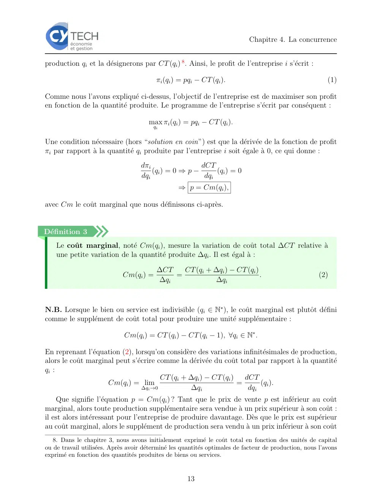

~~~text
                                                                               Chapitre 4. La concurrence

production qi et la désignerons par CT (qi ) 8 . Ainsi, le profit de l’entreprise i s’écrit :

                                           πi (qi ) = pqi − CT (qi ).                                         (1)

Comme nous l’avons expliqué ci-dessus, l’objectif de l’entreprise est de maximiser son profit
en fonction de la quantité produite. Le programme de l’entreprise s’écrit par conséquent :

                                        max πi (qi ) = pqi − CT (qi ).
                                          qi

Une condition nécessaire (hors “solution en coin”) est que la dérivée de la fonction de profit
πi par rapport à la quantité qi produite par l’entreprise i soit égale à 0, ce qui donne :
                                     dπi                 dCT
                                         (qi ) = 0 ⇒ p −      (qi ) = 0
                                     dqi                  dqi
                                                    ⇒ p = Cm(qi ),

avec Cm le coût marginal que nous définissons ci-après.

Définition 3
    Le coût marginal, noté Cm(qi ), mesure la variation de coût total ∆CT relative à
    une petite variation de la quantité produite ∆qi . Il est égal à :

                                           ∆CT   CT (qi + ∆qi ) − CT (qi )
                              Cm(qi ) =        =                           .                              (2)
                                           ∆qi            ∆qi

N.B. Lorsque le bien ou service est indivisible (qi ∈ N∗ ), le coût marginal est plutôt défini
comme le supplément de coût total pour produire une unité supplémentaire :

                              Cm(qi ) = CT (qi ) − CT (qi − 1), ∀qi ∈ N∗ .

En reprenant l’équation (2), lorsqu’on considère des variations infinitésimales de production,
alors le coût marginal peut s’écrire comme la dérivée du coût total par rapport à la quantité
qi :
                                        CT (qi + ∆qi ) − CT (qi )   dCT
                     Cm(qi ) = lim                                =       (qi ).
                                 ∆qi →0          ∆qi                 dqi
    Que signifie l’équation p = Cm(qi ) ? Tant que le prix de vente p est inférieur au coût
marginal, alors toute production supplémentaire sera vendue à un prix supérieur à son coût :
il est alors intéressant pour l’entreprise de produire davantage. Dès que le prix est supérieur
au coût marginal, alors le supplément de production sera vendu à un prix inférieur à son coût
   8. Dans le chapitre 3, nous avons initialement exprimé le coût total en fonction des unités de capital
ou de travail utilisées. Après avoir déterminé les quantités optimales de facteur de production, nous l’avons
exprimé en fonction des quantités produites de biens ou services.

                                                       13
~~~

## Page 14

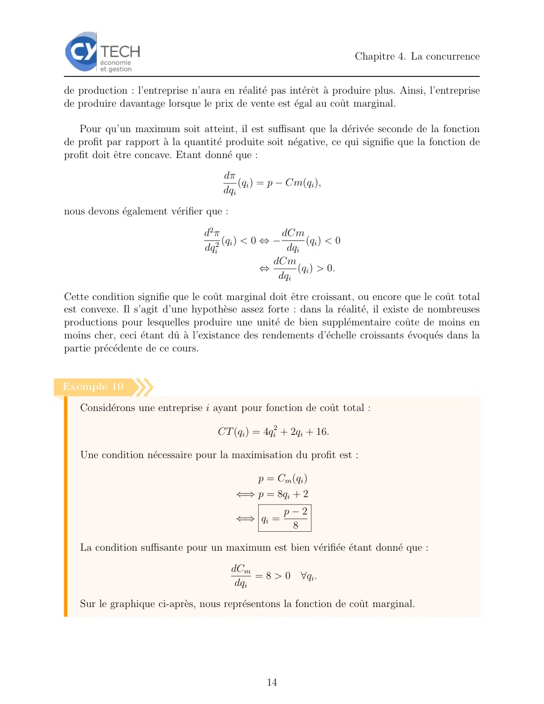

~~~text
                                                                     Chapitre 4. La concurrence

de production : l’entreprise n’aura en réalité pas intérêt à produire plus. Ainsi, l’entreprise
de produire davantage lorsque le prix de vente est égal au coût marginal.

   Pour qu’un maximum soit atteint, il est suffisant que la dérivée seconde de la fonction
de profit par rapport à la quantité produite soit négative, ce qui signifie que la fonction de
profit doit être concave. Etant donné que :
                                      dπ
                                          (qi ) = p − Cm(qi ),
                                      dqi
nous devons également vérifier que :

                                 d2 π               dCm
                                    2
                                      (qi ) < 0 ⇔ −      (qi ) < 0
                                 dqi                 dqi
                                                  dCm
                                                ⇔      (qi ) > 0.
                                                   dqi
Cette condition signifie que le coût marginal doit être croissant, ou encore que le coût total
est convexe. Il s’agit d’une hypothèse assez forte : dans la réalité, il existe de nombreuses
productions pour lesquelles produire une unité de bien supplémentaire coûte de moins en
moins cher, ceci étant dû à l’existance des rendements d’échelle croissants évoqués dans la
partie précédente de ce cours.

Exemple 10
   Considérons une entreprise i ayant pour fonction de coût total :

                                     CT (qi ) = 4qi2 + 2qi + 16.

   Une condition nécessaire pour la maximisation du profit est :

                                            p = Cm (qi )
                                         ⇐⇒ p = 8qi + 2
                                                     p−2
                                         ⇐⇒ qi =
                                                      8

   La condition suffisante pour un maximum est bien vérifiée étant donné que :
                                         dCm
                                              = 8 > 0 ∀qi .
                                          dqi
   Sur le graphique ci-après, nous représentons la fonction de coût marginal.

                                                14
~~~

## Page 15

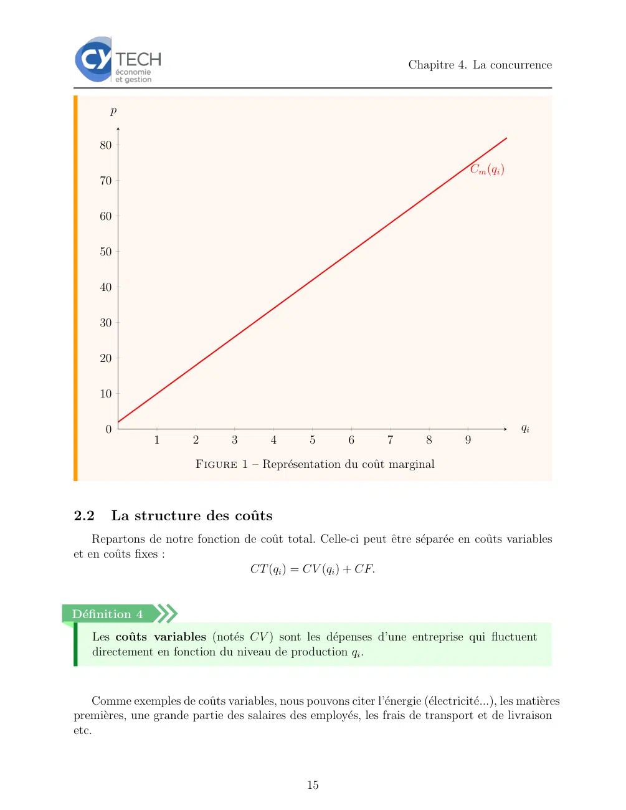

~~~text
                                                                      Chapitre 4. La concurrence

       p

      80
                                                                                    Cm (qi )
      70

      60

      50

      40

      30

      20

      10

      0                                                                                        qi
                 1       2       3       4       5        6       7       8       9

                         Figure 1 – Représentation du coût marginal

2.2    La structure des coûts
    Repartons de notre fonction de coût total. Celle-ci peut être séparée en coûts variables
et en coûts fixes :
                                 CT (qi ) = CV (qi ) + CF.

Définition 4
   Les coûts variables (notés CV ) sont les dépenses d’une entreprise qui fluctuent
   directement en fonction du niveau de production qi .

    Comme exemples de coûts variables, nous pouvons citer l’énergie (électricité...), les matières
premières, une grande partie des salaires des employés, les frais de transport et de livraison
etc.

                                                 15
~~~

## Page 16

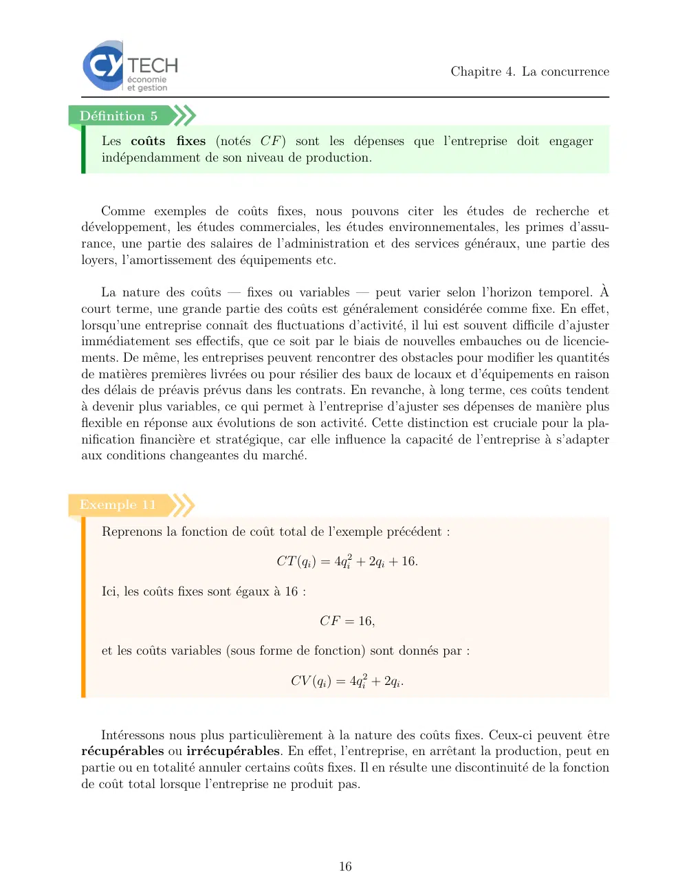

~~~text
                                                                       Chapitre 4. La concurrence

Définition 5
   Les coûts fixes (notés CF ) sont les dépenses que l’entreprise doit engager
   indépendamment de son niveau de production.

    Comme exemples de coûts fixes, nous pouvons citer les études de recherche et
développement, les études commerciales, les études environnementales, les primes d’assu-
rance, une partie des salaires de l’administration et des services généraux, une partie des
loyers, l’amortissement des équipements etc.

    La nature des coûts — fixes ou variables — peut varier selon l’horizon temporel. À
court terme, une grande partie des coûts est généralement considérée comme fixe. En effet,
lorsqu’une entreprise connaı̂t des fluctuations d’activité, il lui est souvent difficile d’ajuster
immédiatement ses effectifs, que ce soit par le biais de nouvelles embauches ou de licencie-
ments. De même, les entreprises peuvent rencontrer des obstacles pour modifier les quantités
de matières premières livrées ou pour résilier des baux de locaux et d’équipements en raison
des délais de préavis prévus dans les contrats. En revanche, à long terme, ces coûts tendent
à devenir plus variables, ce qui permet à l’entreprise d’ajuster ses dépenses de manière plus
flexible en réponse aux évolutions de son activité. Cette distinction est cruciale pour la pla-
nification financière et stratégique, car elle influence la capacité de l’entreprise à s’adapter
aux conditions changeantes du marché.

Exemple 11
   Reprenons la fonction de coût total de l’exemple précédent :

                                      CT (qi ) = 4qi2 + 2qi + 16.

   Ici, les coûts fixes sont égaux à 16 :

                                               CF = 16,

   et les coûts variables (sous forme de fonction) sont donnés par :

                                        CV (qi ) = 4qi2 + 2qi .

    Intéressons nous plus particulièrement à la nature des coûts fixes. Ceux-ci peuvent être
récupérables ou irrécupérables. En effet, l’entreprise, en arrêtant la production, peut en
partie ou en totalité annuler certains coûts fixes. Il en résulte une discontinuité de la fonction
de coût total lorsque l’entreprise ne produit pas.

                                                 16
~~~

## Page 17

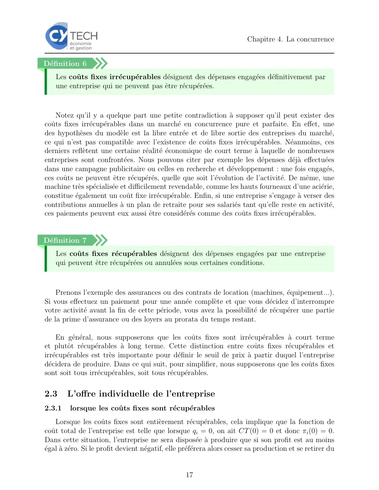

~~~text
                                                                          Chapitre 4. La concurrence

Définition 6
    Les coûts fixes irrécupérables désignent des dépenses engagées définitivement par
    une entreprise qui ne peuvent pas être récupérées.

    Notez qu’il y a quelque part une petite contradiction à supposer qu’il peut exister des
coûts fixes irrécupérables dans un marché en concurrence pure et parfaite. En effet, une
des hypothèses du modèle est la libre entrée et de libre sortie des entreprises du marché,
ce qui n’est pas compatible avec l’existence de coûts fixes irrécupérables. Néanmoins, ces
derniers reflètent une certaine réalité économique de court terme à laquelle de nombreuses
entreprises sont confrontées. Nous pouvons citer par exemple les dépenses déjà effectuées
dans une campagne publicitaire ou celles en recherche et développement : une fois engagés,
ces coûts ne peuvent être récupérés, quelle que soit l’évolution de l’activité. De même, une
machine très spécialisée et difficilement revendable, comme les hauts fourneaux d’une aciérie,
constitue également un coût fixe irrécupérable. Enfin, si une entreprise s’engage à verser des
contributions annuelles à un plan de retraite pour ses salariés tant qu’elle reste en activité,
ces paiements peuvent eux aussi être considérés comme des coûts fixes irrécupérables.

Définition 7
    Les coûts fixes récupérables désignent des dépenses engagées par une entreprise
    qui peuvent être récupérées ou annulées sous certaines conditions.

    Prenons l’exemple des assurances ou des contrats de location (machines, équipement...).
Si vous effectuez un paiement pour une année complète et que vous décidez d’interrompre
votre activité avant la fin de cette période, vous avez la possibilité de récupérer une partie
de la prime d’assurance ou des loyers au prorata du temps restant.

     En général, nous supposerons que les coûts fixes sont irrécupérables à court terme
et plutôt récupérables à long terme. Cette distinction entre coûts fixes récupérables et
irrécupérables est très importante pour définir le seuil de prix à partir duquel l’entreprise
décidera de produire. Dans ce qui suit, pour simplifier, nous supposerons que les coûts fixes
sont soit tous irrécupérables, soit tous récupérables.

2.3     L’offre individuelle de l’entreprise
2.3.1    lorsque les coûts fixes sont récupérables
    Lorsque les coûts fixes sont entièrement récupérables, cela implique que la fonction de
coût total de l’entreprise est telle que lorsque qi = 0, on ait CT (0) = 0 et donc πi (0) = 0.
Dans cette situation, l’entreprise ne sera disposée à produire que si son profit est au moins
égal à zéro. Si le profit devient négatif, elle préférera alors cesser sa production et se retirer du

                                                    17
~~~

## Page 18

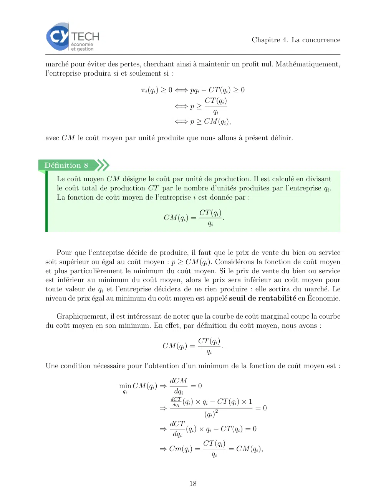

~~~text
                                                                     Chapitre 4. La concurrence

marché pour éviter des pertes, cherchant ainsi à maintenir un profit nul. Mathématiquement,
l’entreprise produira si et seulement si :

                              πi (qi ) ≥ 0 ⇐⇒ pqi − CT (qi ) ≥ 0
                                                   CT (qi )
                                           ⇐⇒ p ≥
                                                     qi
                                           ⇐⇒ p ≥ CM (qi ),

avec CM le coût moyen par unité produite que nous allons à présent définir.

Définition 8
   Le coût moyen CM désigne le coût par unité de production. Il est calculé en divisant
   le coût total de production CT par le nombre d’unités produites par l’entreprise qi .
   La fonction de coût moyen de l’entreprise i est donnée par :

                                                    CT (qi )
                                      CM (qi ) =             .
                                                      qi

    Pour que l’entreprise décide de produire, il faut que le prix de vente du bien ou service
soit supérieur ou égal au coût moyen : p ≥ CM (qi ). Considérons la fonction de coût moyen
et plus particulièrement le minimum du coût moyen. Si le prix de vente du bien ou service
est inférieur au minimum du coût moyen, alors le prix sera inférieur au coût moyen pour
toute valeur de qi et l’entreprise décidera de ne rien produire : elle sortira du marché. Le
niveau de prix égal au minimum du coût moyen est appelé seuil de rentabilité en Économie.

   Graphiquement, il est intéressant de noter que la courbe de coût marginal coupe la courbe
du coût moyen en son minimum. En effet, par définition du coût moyen, nous avons :

                                                    CT (qi )
                                     CM (qi ) =              .
                                                      qi
Une condition nécessaire pour l’obtention d’un minimum de la fonction de coût moyen est :
                                        dCM
                       min CM (qi ) ⇒            =0
                         qi               dqi
                                        dCT
                                         dqi
                                             (qi ) × qi − CT (qi ) × 1
                                    ⇒                                    =0
                                                      (qi )2
                                      dCT
                                    ⇒      (qi ) × qi − CT (qi ) = 0
                                       dqi
                                                  CT (qi )
                                    ⇒ Cm(qi ) =            = CM (qi ),
                                                     qi

                                               18
~~~

## Page 19

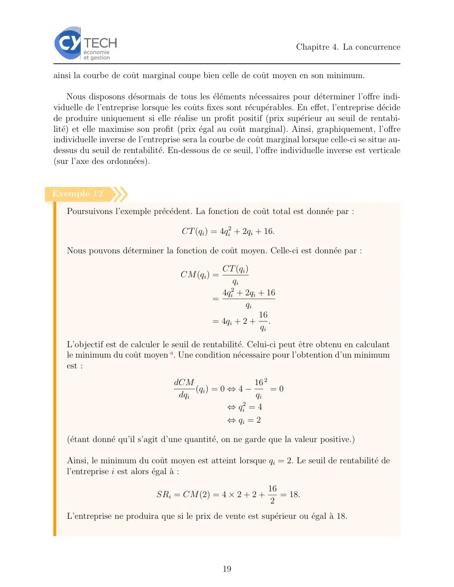

~~~text
                                                                      Chapitre 4. La concurrence

ainsi la courbe de coût marginal coupe bien celle de coût moyen en son minimum.

     Nous disposons désormais de tous les éléments nécessaires pour déterminer l’offre indi-
viduelle de l’entreprise lorsque les coûts fixes sont récupérables. En effet, l’entreprise décide
de produire uniquement si elle réalise un profit positif (prix supérieur au seuil de rentabi-
lité) et elle maximise son profit (prix égal au coût marginal). Ainsi, graphiquement, l’offre
individuelle inverse de l’entreprise sera la courbe de coût marginal lorsque celle-ci se situe au-
dessus du seuil de rentabilité. En-dessous de ce seuil, l’offre individuelle inverse est verticale
(sur l’axe des ordonnées).

Exemple 12
   Poursuivons l’exemple précédent. La fonction de coût total est donnée par :

                                     CT (qi ) = 4qi2 + 2qi + 16.

   Nous pouvons déterminer la fonction de coût moyen. Celle-ci est donnée par :

                                                CT (qi )
                                     CM (qi ) =
                                                   qi
                                                   2
                                                4q + 2qi + 16
                                              = i
                                                       qi
                                                          16
                                              = 4qi + 2 + .
                                                          qi
   L’objectif est de calculer le seuil de rentabilité. Celui-ci peut être obtenu en calculant
   le minimum du coût moyen a . Une condition nécessaire pour l’obtention d’un minimum
   est :
                                   dCM                   16 2
                                        (qi ) = 0 ⇔ 4 −       =0
                                    dqi                  qi
                                                  ⇔ qi2 = 4
                                                  ⇔ qi = 2

   (étant donné qu’il s’agit d’une quantité, on ne garde que la valeur positive.)

   Ainsi, le minimum du coût moyen est atteint lorsque qi = 2. Le seuil de rentabilité de
   l’entreprise i est alors égal à :
                                                              16
                             SRi = CM (2) = 4 × 2 + 2 +          = 18.
                                                              2
   L’entreprise ne produira que si le prix de vente est supérieur ou égal à 18.

                                                  19
~~~

## Page 20

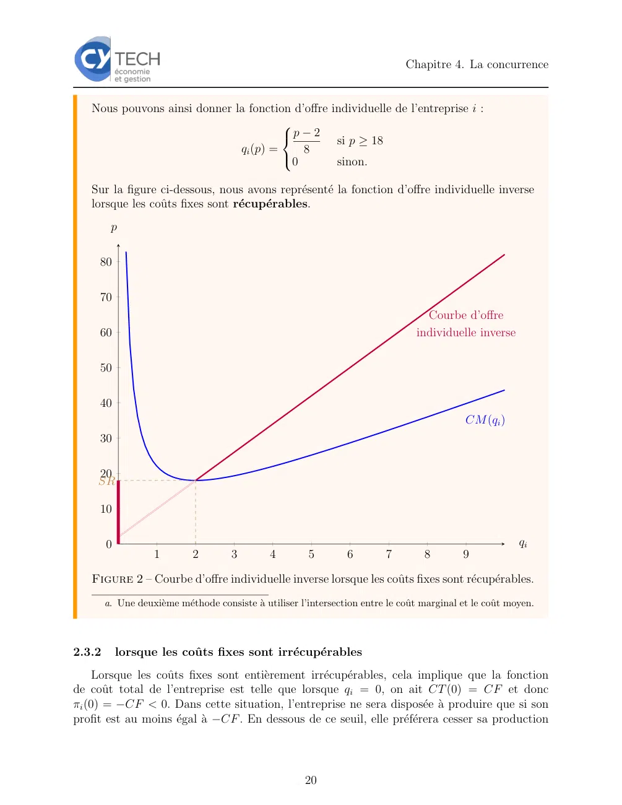

~~~text
                                                                                Chapitre 4. La concurrence

   Nous pouvons ainsi donner la fonction d’offre individuelle de l’entreprise i :
                                       
                                        p − 2 si p ≥ 18
                              qi (p) =     8
                                       0         sinon.

   Sur la figure ci-dessous, nous avons représenté la fonction d’offre individuelle inverse
   lorsque les coûts fixes sont récupérables.
         p

     80

     70
                                                                                     Courbe d’offre
     60                                                                            individuelle inverse

     50

     40
                                                                                               CM (qi )
     30

     20
     SR

     10

        0                                                                                                   qi
                    1        2        3         4        5        6         7        8        9

   Figure 2 – Courbe d’offre individuelle inverse lorsque les coûts fixes sont récupérables.
        a. Une deuxième méthode consiste à utiliser l’intersection entre le coût marginal et le coût moyen.

2.3.2       lorsque les coûts fixes sont irrécupérables
     Lorsque les coûts fixes sont entièrement irrécupérables, cela implique que la fonction
de coût total de l’entreprise est telle que lorsque qi = 0, on ait CT (0) = CF et donc
πi (0) = −CF < 0. Dans cette situation, l’entreprise ne sera disposée à produire que si son
profit est au moins égal à −CF . En dessous de ce seuil, elle préférera cesser sa production

                                                        20
~~~

## Page 21

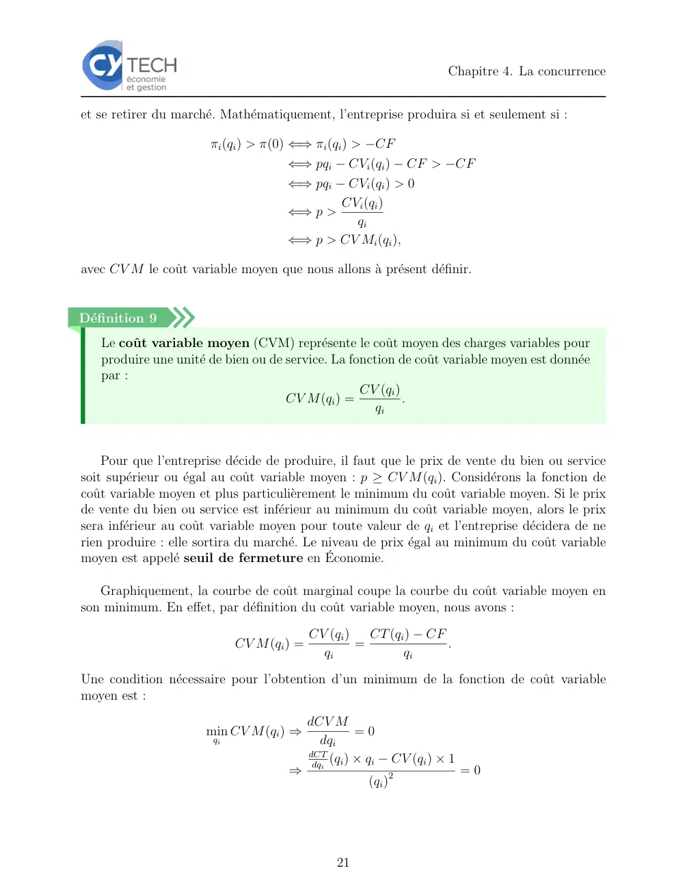

~~~text
                                                                        Chapitre 4. La concurrence

et se retirer du marché. Mathématiquement, l’entreprise produira si et seulement si :

                       πi (qi ) > π(0) ⇐⇒ πi (qi ) > −CF
                                       ⇐⇒ pqi − CVi (qi ) − CF > −CF
                                       ⇐⇒ pqi − CVi (qi ) > 0
                                                CVi (qi )
                                       ⇐⇒ p >
                                                    qi
                                       ⇐⇒ p > CV Mi (qi ),

avec CV M le coût variable moyen que nous allons à présent définir.

Définition 9
   Le coût variable moyen (CVM) représente le coût moyen des charges variables pour
   produire une unité de bien ou de service. La fonction de coût variable moyen est donnée
   par :
                                                   CV (qi )
                                     CV M (qi ) =           .
                                                      qi

    Pour que l’entreprise décide de produire, il faut que le prix de vente du bien ou service
soit supérieur ou égal au coût variable moyen : p ≥ CV M (qi ). Considérons la fonction de
coût variable moyen et plus particulièrement le minimum du coût variable moyen. Si le prix
de vente du bien ou service est inférieur au minimum du coût variable moyen, alors le prix
sera inférieur au coût variable moyen pour toute valeur de qi et l’entreprise décidera de ne
rien produire : elle sortira du marché. Le niveau de prix égal au minimum du coût variable
moyen est appelé seuil de fermeture en Économie.

   Graphiquement, la courbe de coût marginal coupe la courbe du coût variable moyen en
son minimum. En effet, par définition du coût variable moyen, nous avons :

                                            CV (qi )   CT (qi ) − CF
                             CV M (qi ) =            =               .
                                              qi             qi
Une condition nécessaire pour l’obtention d’un minimum de la fonction de coût variable
moyen est :
                                            dCV M
                      min CV M (qi ) ⇒                 =0
                        qi                     dqi
                                            dCT
                                             dqi
                                                 (qi ) × qi − CV (qi ) × 1
                                      ⇒                                      =0
                                                        (qi )2

                                                 21
~~~

## Page 22

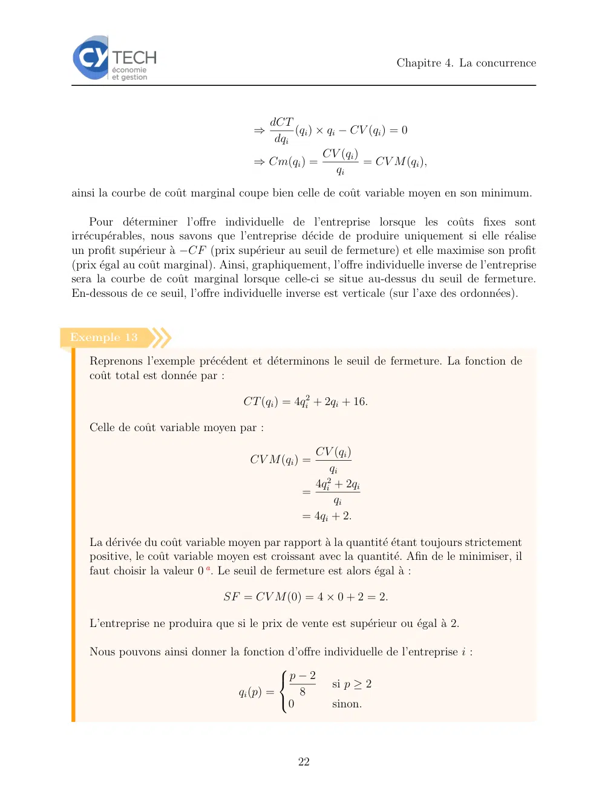

~~~text
                                                                    Chapitre 4. La concurrence

                                        dCT
                      min CV M (qi ) ⇒       (qi ) × qi − CV (qi ) = 0
                        qi               dqi
                                                    CV (qi )
                                      ⇒ Cm(qi ) =            = CV M (qi ),
                                                       qi
ainsi la courbe de coût marginal coupe bien celle de coût variable moyen en son minimum.

     Pour déterminer l’offre individuelle de l’entreprise lorsque les coûts fixes sont
irrécupérables, nous savons que l’entreprise décide de produire uniquement si elle réalise
un profit supérieur à −CF (prix supérieur au seuil de fermeture) et elle maximise son profit
(prix égal au coût marginal). Ainsi, graphiquement, l’offre individuelle inverse de l’entreprise
sera la courbe de coût marginal lorsque celle-ci se situe au-dessus du seuil de fermeture.
En-dessous de ce seuil, l’offre individuelle inverse est verticale (sur l’axe des ordonnées).

Exemple 13
   Reprenons l’exemple précédent et déterminons le seuil de fermeture. La fonction de
   coût total est donnée par :

                                    CT (qi ) = 4qi2 + 2qi + 16.

   Celle de coût variable moyen par :

                                                  CV (qi )
                                     CV M (qi ) =
                                                      qi
                                                     2
                                                  4q + 2qi
                                                = i
                                                       qi
                                                = 4qi + 2.

   La dérivée du coût variable moyen par rapport à la quantité étant toujours strictement
   positive, le coût variable moyen est croissant avec la quantité. Afin de le minimiser, il
   faut choisir la valeur 0 a . Le seuil de fermeture est alors égal à :

                                SF = CV M (0) = 4 × 0 + 2 = 2.

   L’entreprise ne produira que si le prix de vente est supérieur ou égal à 2.

   Nous pouvons ainsi donner la fonction d’offre individuelle de l’entreprise i :
                                        
                                         p − 2 si p ≥ 2
                               qi (p) =     8
                                        0         sinon.

                                               22
~~~

## Page 23

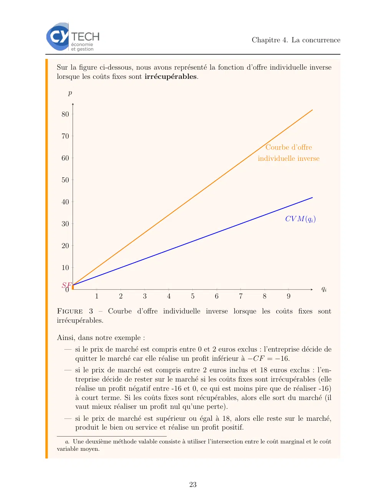

~~~text
                                                                            Chapitre 4. La concurrence

Sur la figure ci-dessous, nous avons représenté la fonction d’offre individuelle inverse
lorsque les coûts fixes sont irrécupérables.

    p

 80

 70
                                                                                 Courbe d’offre
 60                                                                            individuelle inverse

 50

 40

                                                                                         CV M (qi )
 30

 20

 10

 SF                                                                                                     qi
  0
               1        2        3         4        5         6        7         8        9

Figure 3 – Courbe d’offre individuelle inverse lorsque les coûts fixes sont
irrécupérables.

Ainsi, dans notre exemple :
  — si le prix de marché est compris entre 0 et 2 euros exclus : l’entreprise décide de
    quitter le marché car elle réalise un profit inférieur à −CF = −16.
  — si le prix de marché est compris entre 2 euros inclus et 18 euros exclus : l’en-
    treprise décide de rester sur le marché si les coûts fixes sont irrécupérables (elle
    réalise un profit négatif entre -16 et 0, ce qui est moins pire que de réaliser -16)
    à court terme. Si les coûts fixes sont récupérables, alors elle sort du marché (il
    vaut mieux réaliser un profit nul qu’une perte).
  — si le prix de marché est supérieur ou égal à 18, alors elle reste sur le marché,
    produit le bien ou service et réalise un profit positif.
   a. Une deuxième méthode valable consiste à utiliser l’intersection entre le coût marginal et le coût
variable moyen.

                                                    23
~~~

## Page 24

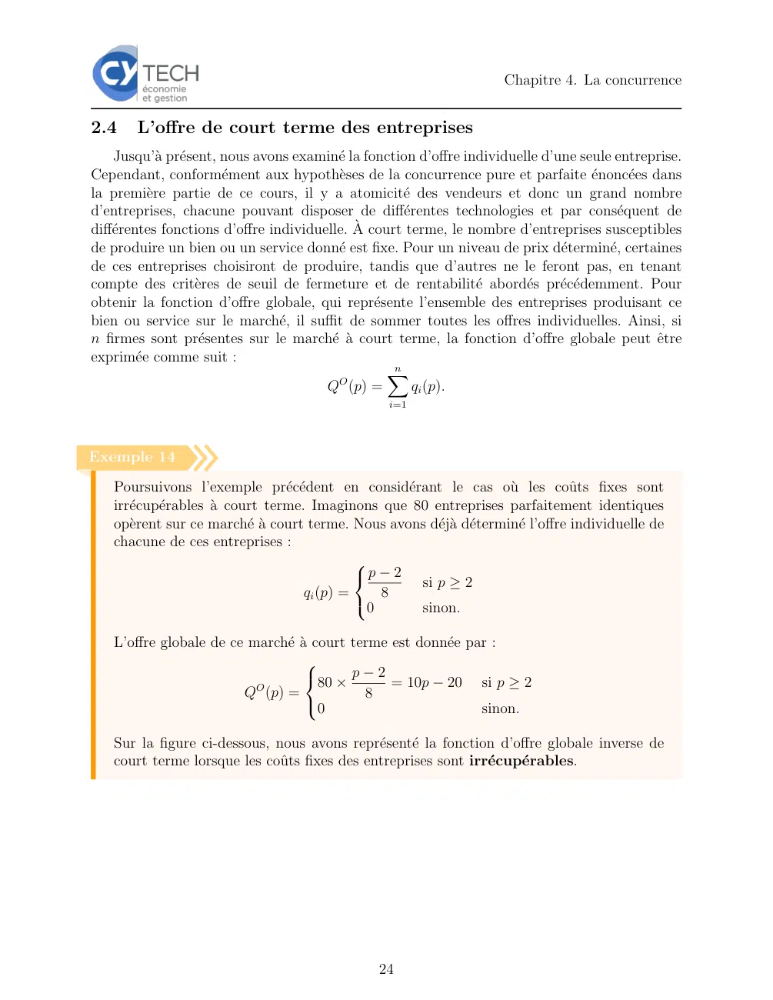

~~~text
                                                                     Chapitre 4. La concurrence

2.4    L’offre de court terme des entreprises
    Jusqu’à présent, nous avons examiné la fonction d’offre individuelle d’une seule entreprise.
Cependant, conformément aux hypothèses de la concurrence pure et parfaite énoncées dans
la première partie de ce cours, il y a atomicité des vendeurs et donc un grand nombre
d’entreprises, chacune pouvant disposer de différentes technologies et par conséquent de
différentes fonctions d’offre individuelle. À court terme, le nombre d’entreprises susceptibles
de produire un bien ou un service donné est fixe. Pour un niveau de prix déterminé, certaines
de ces entreprises choisiront de produire, tandis que d’autres ne le feront pas, en tenant
compte des critères de seuil de fermeture et de rentabilité abordés précédemment. Pour
obtenir la fonction d’offre globale, qui représente l’ensemble des entreprises produisant ce
bien ou service sur le marché, il suffit de sommer toutes les offres individuelles. Ainsi, si
n firmes sont présentes sur le marché à court terme, la fonction d’offre globale peut être
exprimée comme suit :
                                                   Xn
                                          O
                                        Q (p) =        qi (p).
                                                 i=1

Exemple 14
   Poursuivons l’exemple précédent en considérant le cas où les coûts fixes sont
   irrécupérables à court terme. Imaginons que 80 entreprises parfaitement identiques
   opèrent sur ce marché à court terme. Nous avons déjà déterminé l’offre individuelle de
   chacune de ces entreprises :
                                            
                                             p − 2 si p ≥ 2
                                   qi (p) =     8
                                            0      sinon.

   L’offre globale de ce marché à court terme est donnée par :
                                  
                                  80 × p − 2 = 10p − 20 si p ≥ 2
                          O
                        Q (p) =             8
                                  0                          sinon.

   Sur la figure ci-dessous, nous avons représenté la fonction d’offre globale inverse de
   court terme lorsque les coûts fixes des entreprises sont irrécupérables.

                                                24
~~~

## Page 25

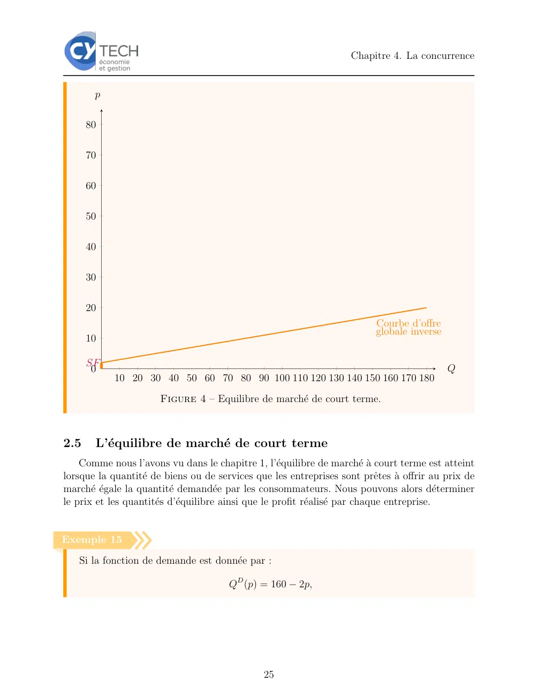

~~~text
                                                                    Chapitre 4. La concurrence

       p

      80

      70

      60

      50

      40

      30

      20
                                                                          Courbe d’offre
                                                                          globale inverse
      10

      SF                                                                                    Q
       0
            10 20 30 40 50 60 70 80 90 100 110 120 130 140 150 160 170 180

                       Figure 4 – Equilibre de marché de court terme.

2.5    L’équilibre de marché de court terme
    Comme nous l’avons vu dans le chapitre 1, l’équilibre de marché à court terme est atteint
lorsque la quantité de biens ou de services que les entreprises sont prêtes à offrir au prix de
marché égale la quantité demandée par les consommateurs. Nous pouvons alors déterminer
le prix et les quantités d’équilibre ainsi que le profit réalisé par chaque entreprise.

Exemple 15
   Si la fonction de demande est donnée par :

                                       QD (p) = 160 − 2p,

                                               25
~~~

## Page 26

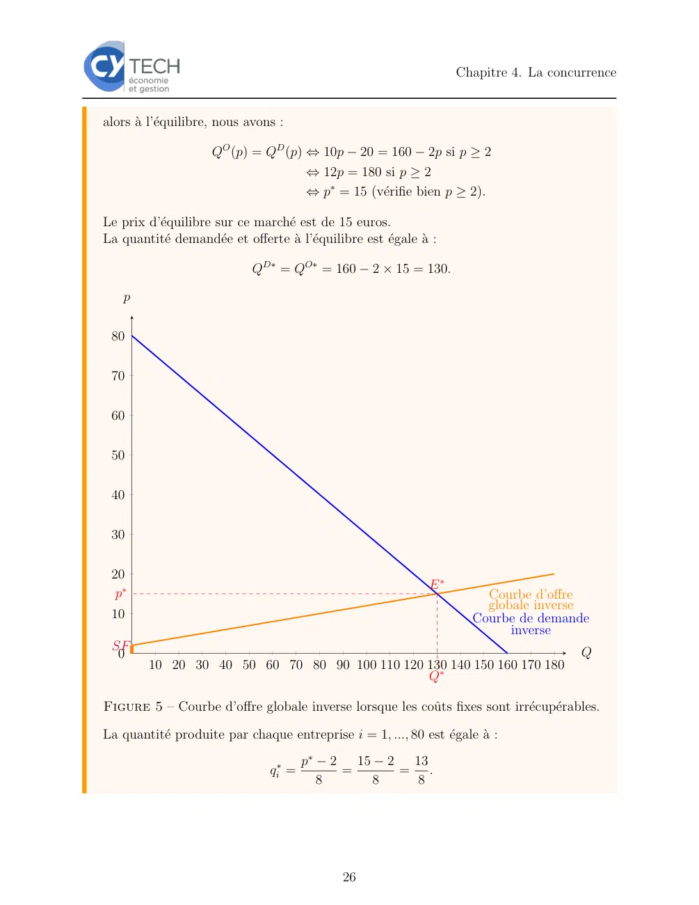

~~~text
                                                                    Chapitre 4. La concurrence

alors à l’équilibre, nous avons :

                     QO (p) = QD (p) ⇔ 10p − 20 = 160 − 2p si p ≥ 2
                                     ⇔ 12p = 180 si p ≥ 2
                                     ⇔ p∗ = 15 (vérifie bien p ≥ 2).

Le prix d’équilibre sur ce marché est de 15 euros.
La quantité demandée et offerte à l’équilibre est égale à :

                             QD∗ = QO∗ = 160 − 2 × 15 = 130.

    p

 80

 70

 60

 50

 40

 30

 20
                                                               E∗
  p∗                                                                    Courbe d’offre
                                                                        globale inverse
 10                                                                   Courbe de demande
                                                                            inverse
 SF                                                                                     Q
  0
        10 20 30 40 50 60 70 80 90 100 110 120 130 140 150 160 170 180
                                               Q∗

Figure 5 – Courbe d’offre globale inverse lorsque les coûts fixes sont irrécupérables.

La quantité produite par chaque entreprise i = 1, ..., 80 est égale à :
                                        p∗ − 2   15 − 2  13
                                qi∗ =          =        = .
                                           8        8     8

                                              26
~~~

## Page 27

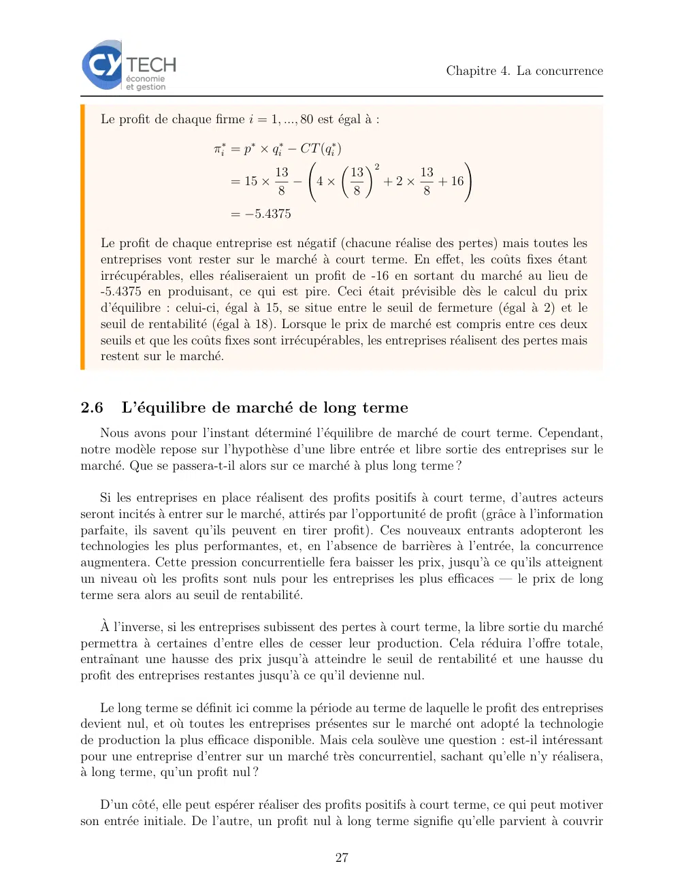

~~~text
                                                                        Chapitre 4. La concurrence

    Le profit de chaque firme i = 1, ..., 80 est égal à :

                          πi∗ = p∗ × qi∗ − CT (qi∗ )
                                                    2             !
                                     13              13     13
                              = 15 ×      − 4×          +2×    + 16
                                      8               8     8
                             = −5.4375

    Le profit de chaque entreprise est négatif (chacune réalise des pertes) mais toutes les
    entreprises vont rester sur le marché à court terme. En effet, les coûts fixes étant
    irrécupérables, elles réaliseraient un profit de -16 en sortant du marché au lieu de
    -5.4375 en produisant, ce qui est pire. Ceci était prévisible dès le calcul du prix
    d’équilibre : celui-ci, égal à 15, se situe entre le seuil de fermeture (égal à 2) et le
    seuil de rentabilité (égal à 18). Lorsque le prix de marché est compris entre ces deux
    seuils et que les coûts fixes sont irrécupérables, les entreprises réalisent des pertes mais
    restent sur le marché.

2.6     L’équilibre de marché de long terme
   Nous avons pour l’instant déterminé l’équilibre de marché de court terme. Cependant,
notre modèle repose sur l’hypothèse d’une libre entrée et libre sortie des entreprises sur le
marché. Que se passera-t-il alors sur ce marché à plus long terme ?

    Si les entreprises en place réalisent des profits positifs à court terme, d’autres acteurs
seront incités à entrer sur le marché, attirés par l’opportunité de profit (grâce à l’information
parfaite, ils savent qu’ils peuvent en tirer profit). Ces nouveaux entrants adopteront les
technologies les plus performantes, et, en l’absence de barrières à l’entrée, la concurrence
augmentera. Cette pression concurrentielle fera baisser les prix, jusqu’à ce qu’ils atteignent
un niveau où les profits sont nuls pour les entreprises les plus efficaces — le prix de long
terme sera alors au seuil de rentabilité.

   À l’inverse, si les entreprises subissent des pertes à court terme, la libre sortie du marché
permettra à certaines d’entre elles de cesser leur production. Cela réduira l’offre totale,
entraı̂nant une hausse des prix jusqu’à atteindre le seuil de rentabilité et une hausse du
profit des entreprises restantes jusqu’à ce qu’il devienne nul.

     Le long terme se définit ici comme la période au terme de laquelle le profit des entreprises
devient nul, et où toutes les entreprises présentes sur le marché ont adopté la technologie
de production la plus efficace disponible. Mais cela soulève une question : est-il intéressant
pour une entreprise d’entrer sur un marché très concurrentiel, sachant qu’elle n’y réalisera,
à long terme, qu’un profit nul ?

   D’un côté, elle peut espérer réaliser des profits positifs à court terme, ce qui peut motiver
son entrée initiale. De l’autre, un profit nul à long terme signifie qu’elle parvient à couvrir

                                                  27
~~~

## Page 28

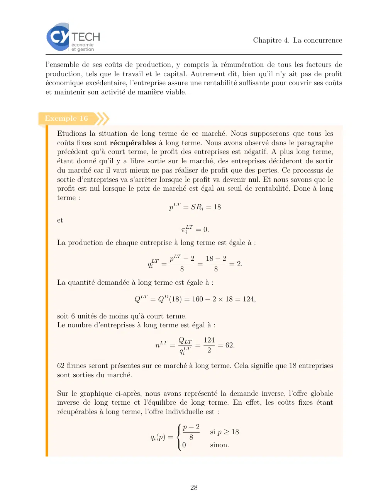

~~~text
                                                                    Chapitre 4. La concurrence

l’ensemble de ses coûts de production, y compris la rémunération de tous les facteurs de
production, tels que le travail et le capital. Autrement dit, bien qu’il n’y ait pas de profit
économique excédentaire, l’entreprise assure une rentabilité suffisante pour couvrir ses coûts
et maintenir son activité de manière viable.

Exemple 16
   Etudions la situation de long terme de ce marché. Nous supposerons que tous les
   coûts fixes sont récupérables à long terme. Nous avons observé dans le paragraphe
   précédent qu’à court terme, le profit des entreprises est négatif. A plus long terme,
   étant donné qu’il y a libre sortie sur le marché, des entreprises décideront de sortir
   du marché car il vaut mieux ne pas réaliser de profit que des pertes. Ce processus de
   sortie d’entreprises va s’arrêter lorsque le profit va devenir nul. Et nous savons que le
   profit est nul lorsque le prix de marché est égal au seuil de rentabilité. Donc à long
   terme :
                                         pLT = SRi = 18
   et
                                             πiLT = 0.
   La production de chaque entreprise à long terme est égale à :

                                          pLT − 2   18 − 2
                                 qiLT =           =        = 2.
                                             8         8
   La quantité demandée à long terme est égale à :

                             QLT = QD (18) = 160 − 2 × 18 = 124,

   soit 6 unités de moins qu’à court terme.
   Le nombre d’entreprises à long terme est égal à :
                                            QLT   124
                                    nLT =    LT
                                                =     = 62.
                                            qi     2

   62 firmes seront présentes sur ce marché à long terme. Cela signifie que 18 entreprises
   sont sorties du marché.

   Sur le graphique ci-après, nous avons représenté la demande inverse, l’offre globale
   inverse de long terme et l’équilibre de long terme. En effet, les coûts fixes étant
   récupérables à long terme, l’offre individuelle est :
                                            
                                             p − 2 si p ≥ 18
                                   qi (p) =     8
                                            0          sinon.

                                               28
~~~

## Page 29

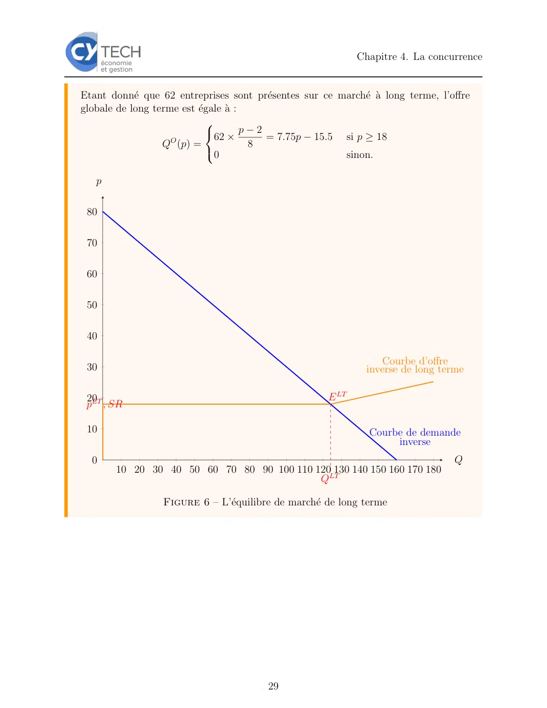

~~~text
                                                             Chapitre 4. La concurrence

Etant donné que 62 entreprises sont présentes sur ce marché à long terme, l’offre
globale de long terme est égale à :
                            
                            62 × p − 2 = 7.75p − 15.5 si p ≥ 18
                    O
                  Q (p) =             8
                            0                          sinon.

   p

 80

 70

 60

 50

 40

                                                                 Courbe d’offre
 30                                                           inverse de long terme

 20                                                   E LT
 pLT , SR

 10                                                            Courbe de demande
                                                                    inverse
  0                                                                              Q
       10 20 30 40 50 60 70 80 90 100 110 120 130 140 150 160 170 180
                                           QLT

                  Figure 6 – L’équilibre de marché de long terme

                                        29
~~~
