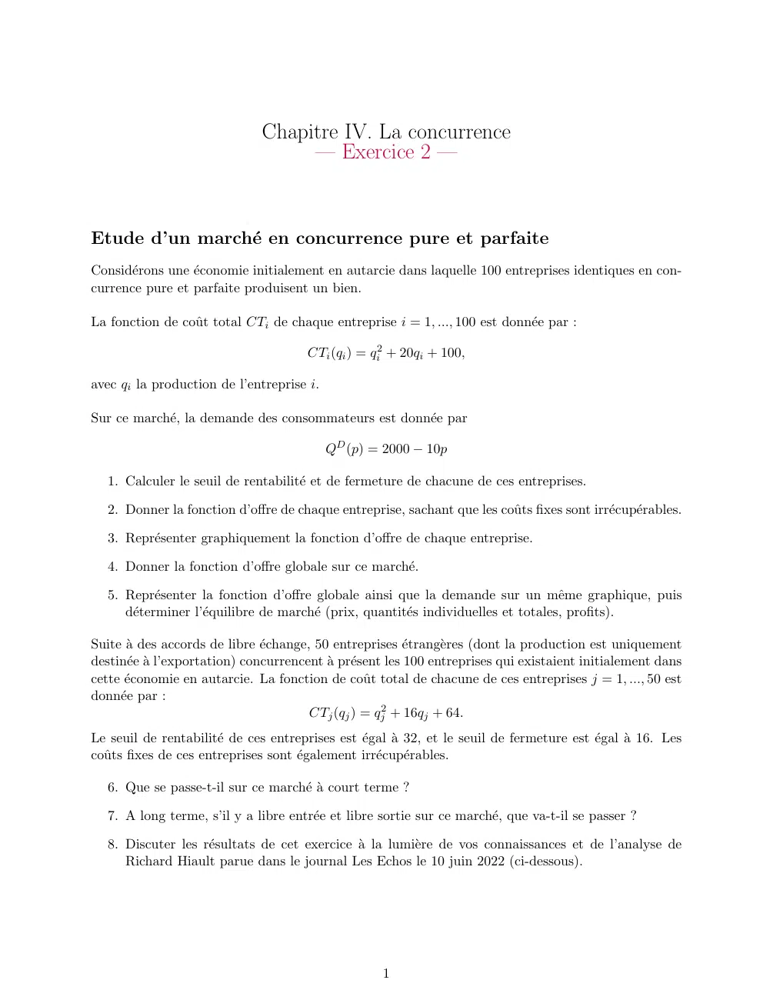
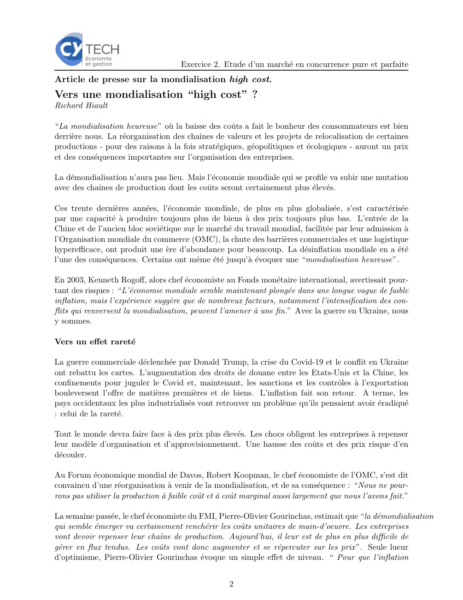
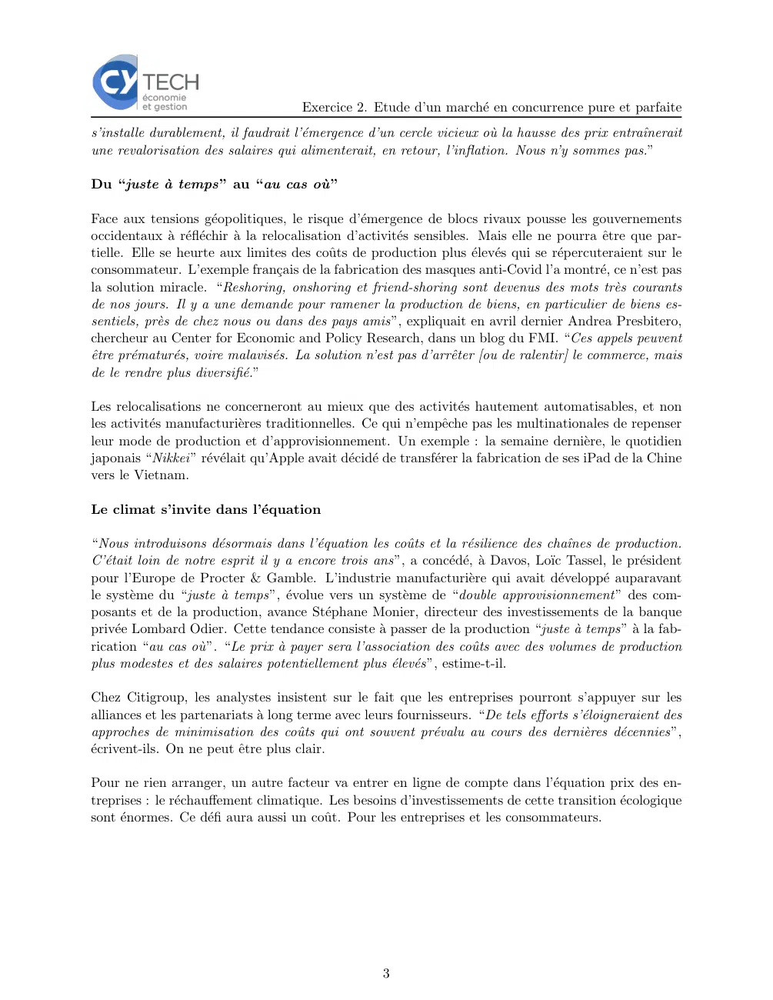

# Economie_I_2023_2024_exercices_04_02.pdf

[Ouvrir l’original](https://drive.google.com/open?id=1VKnNs9kzTXm8ZJzGTeOXHv1th1IlIQuN) · Les deux lectures automatiques du PDF divergent sur les pages indiquées. Leur fac-similé accompagne le texte.

**Pages présentant un écart entre les deux extractions** — 1–3.

## Page 1

~~~text
                              Chapitre IV. La concurrence
                                   — Exercice 2 —

Etude d’un marché en concurrence pure et parfaite
Considérons une économie initialement en autarcie dans laquelle 100 entreprises identiques en con-
currence pure et parfaite produisent un bien.

La fonction de coût total CTi de chaque entreprise i = 1, ..., 100 est donnée par :

                                      CTi (qi ) = qi2 + 20qi + 100,

avec qi la production de l’entreprise i.

Sur ce marché, la demande des consommateurs est donnée par

                                           QD (p) = 2000 − 10p

   1. Calculer le seuil de rentabilité et de fermeture de chacune de ces entreprises.

   2. Donner la fonction d’offre de chaque entreprise, sachant que les coûts fixes sont irrécupérables.

   3. Représenter graphiquement la fonction d’offre de chaque entreprise.

   4. Donner la fonction d’offre globale sur ce marché.

   5. Représenter la fonction d’offre globale ainsi que la demande sur un même graphique, puis
      déterminer l’équilibre de marché (prix, quantités individuelles et totales, profits).

Suite à des accords de libre échange, 50 entreprises étrangères (dont la production est uniquement
destinée à l’exportation) concurrencent à présent les 100 entreprises qui existaient initialement dans
cette économie en autarcie. La fonction de coût total de chacune de ces entreprises j = 1, ..., 50 est
donnée par :
                                       CTj (qj ) = qj2 + 16qj + 64.
Le seuil de rentabilité de ces entreprises est égal à 32, et le seuil de fermeture est égal à 16. Les
coûts fixes de ces entreprises sont également irrécupérables.

   6. Que se passe-t-il sur ce marché à court terme ?

   7. A long terme, s’il y a libre entrée et libre sortie sur ce marché, que va-t-il se passer ?

   8. Discuter les résultats de cet exercice à la lumière de vos connaissances et de l’analyse de
      Richard Hiault parue dans le journal Les Echos le 10 juin 2022 (ci-dessous).

                                                    1
~~~

## Page 2

~~~text
                                      Exercice 2. Etude d’un marché en concurrence pure et parfaite
Article de presse sur la mondialisation high cost.
Vers une mondialisation “high cost” ?
Richard Hiault

“La mondialisation heureuse” où la baisse des coûts a fait le bonheur des consommateurs est bien
derrière nous. La réorganisation des chaı̂nes de valeurs et les projets de relocalisation de certaines
productions - pour des raisons à la fois stratégiques, géopolitiques et écologiques - auront un prix
et des conséquences importantes sur l’organisation des entreprises.

La démondialisation n’aura pas lieu. Mais l’économie mondiale qui se profile va subir une mutation
avec des chaı̂nes de production dont les coûts seront certainement plus élevés.

Ces trente dernières années, l’économie mondiale, de plus en plus globalisée, s’est caractérisée
par une capacité à produire toujours plus de biens à des prix toujours plus bas. L’entrée de la
Chine et de l’ancien bloc soviétique sur le marché du travail mondial, facilitée par leur admission à
l’Organisation mondiale du commerce (OMC), la chute des barrières commerciales et une logistique
hyperefficace, ont produit une ère d’abondance pour beaucoup. La désinflation mondiale en a été
l’une des conséquences. Certains ont même été jusqu’à évoquer une “mondialisation heureuse”.

En 2003, Kenneth Rogoff, alors chef économiste au Fonds monétaire international, avertissait pour-
tant des risques : “L’économie mondiale semble maintenant plongée dans une longue vague de faible
inflation, mais l’expérience suggère que de nombreux facteurs, notamment l’intensification des con-
flits qui renversent la mondialisation, peuvent l’amener à une fin.” Avec la guerre en Ukraine, nous
y sommes.

Vers un effet rareté

La guerre commerciale déclenchée par Donald Trump, la crise du Covid-19 et le conflit en Ukraine
ont rebattu les cartes. L’augmentation des droits de douane entre les Etats-Unis et la Chine, les
confinements pour juguler le Covid et, maintenant, les sanctions et les contrôles à l’exportation
bouleversent l’offre de matières premières et de biens. L’inflation fait son retour. A terme, les
pays occidentaux les plus industrialisés vont retrouver un problème qu’ils pensaient avoir éradiqué
: celui de la rareté.

Tout le monde devra faire face à des prix plus élevés. Les chocs obligent les entreprises à repenser
leur modèle d’organisation et d’approvisionnement. Une hausse des coûts et des prix risque d’en
découler.

Au Forum économique mondial de Davos, Robert Koopman, le chef économiste de l’OMC, s’est dit
convaincu d’une réorganisation à venir de la mondialisation, et de sa conséquence : “Nous ne pour-
rons pas utiliser la production à faible coût et à coût marginal aussi largement que nous l’avons fait.”

La semaine passée, le chef économiste du FMI, Pierre-Olivier Gourinchas, estimait que “la démondialisation
qui semble émerger va certainement renchérir les coûts unitaires de main-d’oeuvre. Les entreprises
vont devoir repenser leur chaı̂ne de production. Aujourd’hui, il leur est de plus en plus difficile de
gérer en flux tendus. Les coûts vont donc augmenter et se répercuter sur les prix ”. Seule lueur
d’optimisme, Pierre-Olivier Gourinchas évoque un simple effet de niveau. “ Pour que l’inflation

                                                     2
~~~

## Page 3

~~~text
                                      Exercice 2. Etude d’un marché en concurrence pure et parfaite
s’installe durablement, il faudrait l’émergence d’un cercle vicieux où la hausse des prix entraı̂nerait
une revalorisation des salaires qui alimenterait, en retour, l’inflation. Nous n’y sommes pas.”

Du “juste à temps” au “au cas où”

Face aux tensions géopolitiques, le risque d’émergence de blocs rivaux pousse les gouvernements
occidentaux à réfléchir à la relocalisation d’activités sensibles. Mais elle ne pourra être que par-
tielle. Elle se heurte aux limites des coûts de production plus élevés qui se répercuteraient sur le
consommateur. L’exemple français de la fabrication des masques anti-Covid l’a montré, ce n’est pas
la solution miracle. “Reshoring, onshoring et friend-shoring sont devenus des mots très courants
de nos jours. Il y a une demande pour ramener la production de biens, en particulier de biens es-
sentiels, près de chez nous ou dans des pays amis”, expliquait en avril dernier Andrea Presbitero,
chercheur au Center for Economic and Policy Research, dans un blog du FMI. “Ces appels peuvent
être prématurés, voire malavisés. La solution n’est pas d’arrêter [ou de ralentir] le commerce, mais
de le rendre plus diversifié.”

Les relocalisations ne concerneront au mieux que des activités hautement automatisables, et non
les activités manufacturières traditionnelles. Ce qui n’empêche pas les multinationales de repenser
leur mode de production et d’approvisionnement. Un exemple : la semaine dernière, le quotidien
japonais “Nikkei ” révélait qu’Apple avait décidé de transférer la fabrication de ses iPad de la Chine
vers le Vietnam.

Le climat s’invite dans l’équation

“Nous introduisons désormais dans l’équation les coûts et la résilience des chaı̂nes de production.
C’était loin de notre esprit il y a encore trois ans”, a concédé, à Davos, Loı̈c Tassel, le président
pour l’Europe de Procter & Gamble. L’industrie manufacturière qui avait développé auparavant
le système du “juste à temps”, évolue vers un système de “double approvisionnement” des com-
posants et de la production, avance Stéphane Monier, directeur des investissements de la banque
privée Lombard Odier. Cette tendance consiste à passer de la production “juste à temps” à la fab-
rication “au cas où”. “Le prix à payer sera l’association des coûts avec des volumes de production
plus modestes et des salaires potentiellement plus élevés”, estime-t-il.

Chez Citigroup, les analystes insistent sur le fait que les entreprises pourront s’appuyer sur les
alliances et les partenariats à long terme avec leurs fournisseurs. “De tels efforts s’éloigneraient des
approches de minimisation des coûts qui ont souvent prévalu au cours des dernières décennies”,
écrivent-ils. On ne peut être plus clair.

Pour ne rien arranger, un autre facteur va entrer en ligne de compte dans l’équation prix des en-
treprises : le réchauffement climatique. Les besoins d’investissements de cette transition écologique
sont énormes. Ce défi aura aussi un coût. Pour les entreprises et les consommateurs.

                                                    3
~~~
