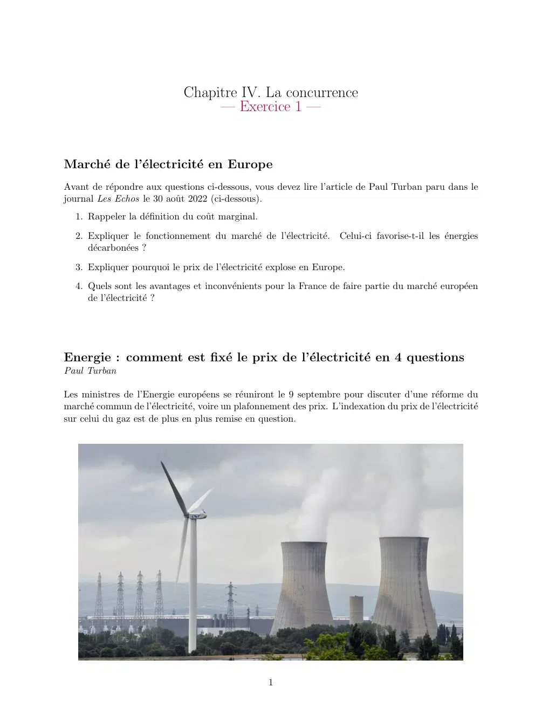
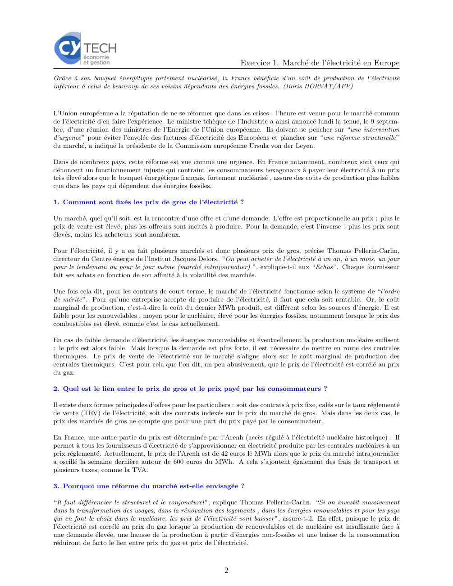
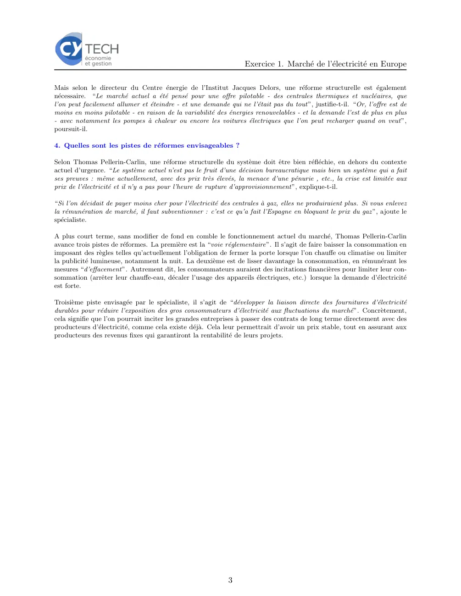

# Economie_I_2024_2025_exercices_04_01.pdf

[Ouvrir l’original](https://drive.google.com/open?id=1fW-m_5P59I87NKy-7ZhpcZaP0etx3DMM) · Les deux lectures automatiques du PDF divergent sur les pages indiquées. Leur fac-similé accompagne le texte.

**Pages présentant un écart entre les deux extractions** — 1–3.

## Page 1

~~~text
                              Chapitre IV. La concurrence
                                   — Exercice 1 —

Marché de l’électricité en Europe
Avant de répondre aux questions ci-dessous, vous devez lire l’article de Paul Turban paru dans le
journal Les Echos le 30 août 2022 (ci-dessous).
   1. Rappeler la définition du coût marginal.
   2. Expliquer le fonctionnement du marché de l’électricité. Celui-ci favorise-t-il les énergies
      décarbonées ?
   3. Expliquer pourquoi le prix de l’électricité explose en Europe.
   4. Quels sont les avantages et inconvénients pour la France de faire partie du marché européen
      de l’électricité ?

Energie : comment est fixé le prix de l’électricité en 4 questions
Paul Turban

Les ministres de l’Energie européens se réuniront le 9 septembre pour discuter d’une réforme du
marché commun de l’électricité, voire un plafonnement des prix. L’indexation du prix de l’électricité
sur celui du gaz est de plus en plus remise en question.

                                                    1
~~~

## Page 2

~~~text
                                                                      Exercice 1. Marché de l’électricité en Europe
Grâce à son bouquet énergétique fortement nucléarisé, la France bénéficie d’un coût de production de l’électricité
inférieur à celui de beaucoup de ses voisins dépendants des énergies fossiles. (Boris HORVAT/AFP)

L’Union européenne a la réputation de ne se réformer que dans les crises : l’heure est venue pour le marché commun
de l’électricité d’en faire l’expérience. Le ministre tchèque de l’Industrie a ainsi annoncé lundi la tenue, le 9 septem-
bre, d’une réunion des ministres de l’Energie de l’Union européenne. Ils doivent se pencher sur “une intervention
d’urgence” pour éviter l’envolée des factures d’électricité des Européens et plancher sur “une réforme structurelle”
du marché, a indiqué la présidente de la Commission européenne Ursula von der Leyen.

Dans de nombreux pays, cette réforme est vue comme une urgence. En France notamment, nombreux sont ceux qui
dénoncent un fonctionnement injuste qui contraint les consommateurs hexagonaux à payer leur électricité à un prix
très élevé alors que le bouquet énergétique français, fortement nucléarisé , assure des coûts de production plus faibles
que dans les pays qui dépendent des énergies fossiles.

1. Comment sont fixés les prix de gros de l’électricité ?

Un marché, quel qu’il soit, est la rencontre d’une offre et d’une demande. L’offre est proportionnelle au prix : plus le
prix de vente est élevé, plus les offreurs sont incités à produire. Pour la demande, c’est l’inverse : plus les prix sont
élevés, moins les acheteurs sont nombreux.

Pour l’électricité, il y a en fait plusieurs marchés et donc plusieurs prix de gros, précise Thomas Pellerin-Carlin,
directeur du Centre énergie de l’Institut Jacques Delors. “On peut acheter de l’électricité à un an, à un mois, un jour
pour le lendemain ou pour le jour même (marché intrajournalier) ”, explique-t-il aux “Echos”. Chaque fournisseur
fait ses achats en fonction de son affinité à la volatilité des marchés.

Une fois cela dit, pour les contrats de court terme, le marché de l’électricité fonctionne selon le système de “l’ordre
de mérite”. Pour qu’une entreprise accepte de produire de l’électricité, il faut que cela soit rentable. Or, le coût
marginal de production, c’est-à-dire le coût du dernier MWh produit, est différent selon les sources d’énergie. Il est
faible pour les renouvelables , moyen pour le nucléaire, élevé pour les énergies fossiles, notamment lorsque le prix des
combustibles est élevé, comme c’est le cas actuellement.

En cas de faible demande d’électricité, les énergies renouvelables et éventuellement la production nucléaire suffisent
: le prix est alors faible. Mais lorsque la demande est plus forte, il est nécessaire de mettre en route des centrales
thermiques. Le prix de vente de l’électricité sur le marché s’aligne alors sur le coût marginal de production des
centrales thermiques. C’est pour cela que l’on dit, un peu abusivement, que le prix de l’électricité est corrélé au prix
du gaz.

2. Quel est le lien entre le prix de gros et le prix payé par les consommateurs ?

Il existe deux formes principales d’offres pour les particuliers : soit des contrats à prix fixe, calés sur le taux réglementé
de vente (TRV) de l’électricité, soit des contrats indexés sur le prix du marché de gros. Mais dans les deux cas, le
prix des marchés de gros ne compte que pour une part du prix payé par le consommateur.

En France, une autre partie du prix est déterminée par l’Arenh (accès régulé à l’électricité nucléaire historique) . Il
permet à tous les fournisseurs d’électricité de s’approvisionner en électricité produite par les centrales nucléaires à un
prix réglementé. Actuellement, le prix de l’Arenh est de 42 euros le MWh alors que le prix du marché intrajournalier
a oscillé la semaine dernière autour de 600 euros du MWh. A cela s’ajoutent également des frais de transport et
plusieurs taxes, comme la TVA.

3. Pourquoi une réforme du marché est-elle envisagée ?

“Il faut différencier le structurel et le conjoncturel ”, explique Thomas Pellerin-Carlin. “Si on investit massivement
dans la transformation des usages, dans la rénovation des logements , dans les énergies renouvelables et pour les pays
qui en font le choix dans le nucléaire, les prix de l’électricité vont baisser ”, assure-t-il. En effet, puisque le prix de
l’électricité est corrélé au prix du gaz lorsque la production de renouvelables et de nucléaire est insuffisante face à
une demande élevée, une hausse de la production à partir d’énergies non-fossiles et une baisse de la consommation
réduiront de facto le lien entre prix du gaz et prix de l’électricité.

                                                                2
~~~

## Page 3

~~~text
                                                                   Exercice 1. Marché de l’électricité en Europe

Mais selon le directeur du Centre énergie de l’Institut Jacques Delors, une réforme structurelle est également
nécessaire. “Le marché actuel a été pensé pour une offre pilotable - des centrales thermiques et nucléaires, que
l’on peut facilement allumer et éteindre - et une demande qui ne l’était pas du tout”, justifie-t-il. “Or, l’offre est de
moins en moins pilotable - en raison de la variabilité des énergies renouvelables - et la demande l’est de plus en plus
- avec notamment les pompes à chaleur ou encore les voitures électriques que l’on peut recharger quand on veut”,
poursuit-il.

4. Quelles sont les pistes de réformes envisageables ?

Selon Thomas Pellerin-Carlin, une réforme structurelle du système doit être bien réfléchie, en dehors du contexte
actuel d’urgence. “Le système actuel n’est pas le fruit d’une décision bureaucratique mais bien un système qui a fait
ses preuves : même actuellement, avec des prix très élevés, la menace d’une pénurie , etc., la crise est limitée aux
prix de l’électricité et il n’y a pas pour l’heure de rupture d’approvisionnement”, explique-t-il.

“Si l’on décidait de payer moins cher pour l’électricité des centrales à gaz, elles ne produiraient plus. Si vous enlevez
la rémunération de marché, il faut subventionner : c’est ce qu’a fait l’Espagne en bloquant le prix du gaz ”, ajoute le
spécialiste.

A plus court terme, sans modifier de fond en comble le fonctionnement actuel du marché, Thomas Pellerin-Carlin
avance trois pistes de réformes. La première est la “voie réglementaire”. Il s’agit de faire baisser la consommation en
imposant des règles telles qu’actuellement l’obligation de fermer la porte lorsque l’on chauffe ou climatise ou limiter
la publicité lumineuse, notamment la nuit. La deuxième est de lisser davantage la consommation, en rémunérant les
mesures “d’effacement”. Autrement dit, les consommateurs auraient des incitations financières pour limiter leur con-
sommation (arrêter leur chauffe-eau, décaler l’usage des appareils électriques, etc.) lorsque la demande d’électricité
est forte.

Troisième piste envisagée par le spécialiste, il s’agit de “développer la liaison directe des fournitures d’électricité
durables pour réduire l’exposition des gros consommateurs d’électricité aux fluctuations du marché”. Concrètement,
cela signifie que l’on pourrait inciter les grandes entreprises à passer des contrats de long terme directement avec des
producteurs d’électricité, comme cela existe déjà. Cela leur permettrait d’avoir un prix stable, tout en assurant aux
producteurs des revenus fixes qui garantiront la rentabilité de leurs projets.

                                                             3
~~~
