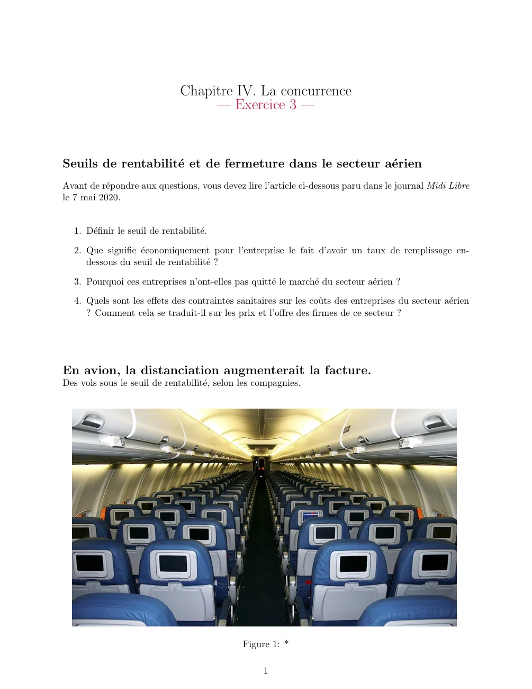
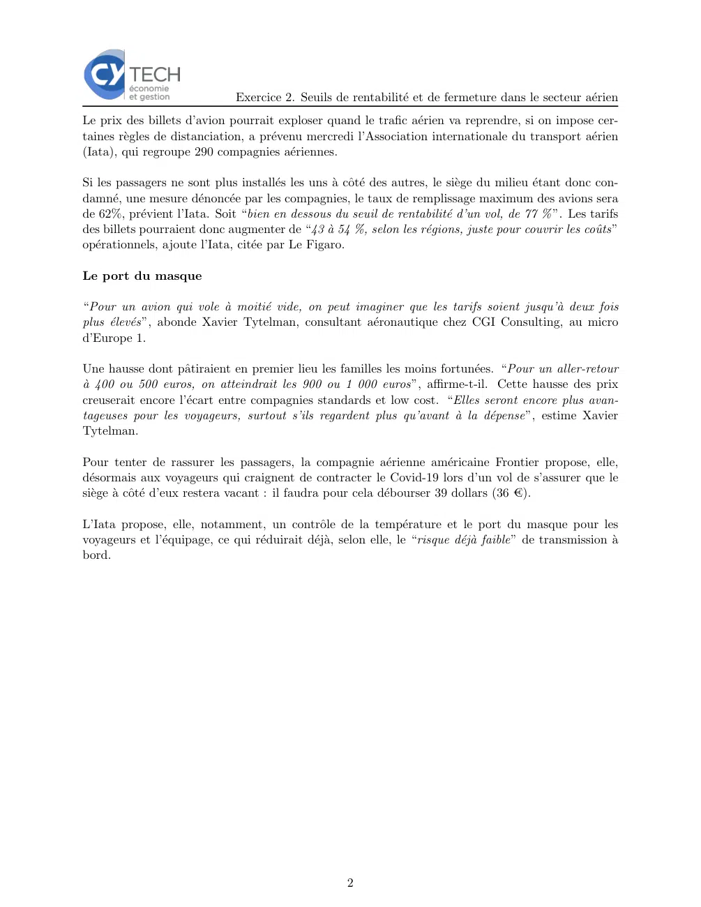

# Economie_I_2024_2025_exercices_04_03.pdf

[Ouvrir l’original](https://drive.google.com/open?id=1GRY05z4ukr4kSHZCiFZJv1Z8Et1NGbYZ) · Les deux lectures automatiques du PDF divergent sur les pages indiquées. Leur fac-similé accompagne le texte.

**Pages présentant un écart entre les deux extractions** — 1–2.

## Page 1

~~~text
                               Chapitre IV. La concurrence
                                    — Exercice 3 —

Seuils de rentabilité et de fermeture dans le secteur aérien
Avant de répondre aux questions, vous devez lire l’article ci-dessous paru dans le journal Midi Libre
le 7 mai 2020.

  1. Définir le seuil de rentabilité.

  2. Que signifie économiquement pour l’entreprise le fait d’avoir un taux de remplissage en-
     dessous du seuil de rentabilité ?

  3. Pourquoi ces entreprises n’ont-elles pas quitté le marché du secteur aérien ?

  4. Quels sont les effets des contraintes sanitaires sur les coûts des entreprises du secteur aérien
     ? Comment cela se traduit-il sur les prix et l’offre des firmes de ce secteur ?

En avion, la distanciation augmenterait la facture.
Des vols sous le seuil de rentabilité, selon les compagnies.

                                              Figure 1: *

                                                   1
~~~

## Page 2

~~~text
                              Exercice 2. Seuils de rentabilité et de fermeture dans le secteur aérien
Le prix des billets d’avion pourrait exploser quand le trafic aérien va reprendre, si on impose cer-
taines règles de distanciation, a prévenu mercredi l’Association internationale du transport aérien
(Iata), qui regroupe 290 compagnies aériennes.

Si les passagers ne sont plus installés les uns à côté des autres, le siège du milieu étant donc con-
damné, une mesure dénoncée par les compagnies, le taux de remplissage maximum des avions sera
de 62%, prévient l’Iata. Soit “bien en dessous du seuil de rentabilité d’un vol, de 77 % ”. Les tarifs
des billets pourraient donc augmenter de “43 à 54 %, selon les régions, juste pour couvrir les coûts”
opérationnels, ajoute l’Iata, citée par Le Figaro.

Le port du masque

“Pour un avion qui vole à moitié vide, on peut imaginer que les tarifs soient jusqu’à deux fois
plus élevés”, abonde Xavier Tytelman, consultant aéronautique chez CGI Consulting, au micro
d’Europe 1.

Une hausse dont pâtiraient en premier lieu les familles les moins fortunées. “Pour un aller-retour
à 400 ou 500 euros, on atteindrait les 900 ou 1 000 euros”, affirme-t-il. Cette hausse des prix
creuserait encore l’écart entre compagnies standards et low cost. “Elles seront encore plus avan-
tageuses pour les voyageurs, surtout s’ils regardent plus qu’avant à la dépense”, estime Xavier
Tytelman.

Pour tenter de rassurer les passagers, la compagnie aérienne américaine Frontier propose, elle,
désormais aux voyageurs qui craignent de contracter le Covid-19 lors d’un vol de s’assurer que le
siège à côté d’eux restera vacant : il faudra pour cela débourser 39 dollars (36 €).

L’Iata propose, elle, notamment, un contrôle de la température et le port du masque pour les
voyageurs et l’équipage, ce qui réduirait déjà, selon elle, le “risque déjà faible” de transmission à
bord.

                                                     2
~~~
