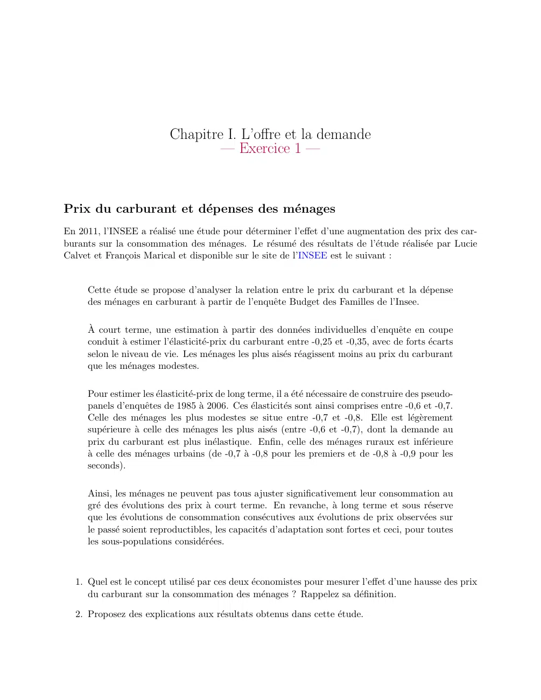

# Economie_I_exercice_01_01.pdf

[Ouvrir l’original](https://drive.google.com/open?id=1euZfRzj9iv2N0vXebsnl9g-7g_o_R3LA) · Les deux lectures automatiques du PDF divergent sur les pages indiquées. Leur fac-similé accompagne le texte.

**Pages présentant un écart entre les deux extractions** — 1.

## Page 1

~~~text
                           Chapitre I. L’offre et la demande
                                   — Exercice 1 —

Prix du carburant et dépenses des ménages
En 2011, l’INSEE a réalisé une étude pour déterminer l’effet d’une augmentation des prix des car-
burants sur la consommation des ménages. Le résumé des résultats de l’étude réalisée par Lucie
Calvet et François Marical et disponible sur le site de l’INSEE est le suivant :

     Cette étude se propose d’analyser la relation entre le prix du carburant et la dépense
     des ménages en carburant à partir de l’enquête Budget des Familles de l’Insee.

     À court terme, une estimation à partir des données individuelles d’enquête en coupe
     conduit à estimer l’élasticité-prix du carburant entre -0,25 et -0,35, avec de forts écarts
     selon le niveau de vie. Les ménages les plus aisés réagissent moins au prix du carburant
     que les ménages modestes.

     Pour estimer les élasticité-prix de long terme, il a été nécessaire de construire des pseudo-
     panels d’enquêtes de 1985 à 2006. Ces élasticités sont ainsi comprises entre -0,6 et -0,7.
     Celle des ménages les plus modestes se situe entre -0,7 et -0,8. Elle est légèrement
     supérieure à celle des ménages les plus aisés (entre -0,6 et -0,7), dont la demande au
     prix du carburant est plus inélastique. Enfin, celle des ménages ruraux est inférieure
     à celle des ménages urbains (de -0,7 à -0,8 pour les premiers et de -0,8 à -0,9 pour les
     seconds).

     Ainsi, les ménages ne peuvent pas tous ajuster significativement leur consommation au
     gré des évolutions des prix à court terme. En revanche, à long terme et sous réserve
     que les évolutions de consommation consécutives aux évolutions de prix observées sur
     le passé soient reproductibles, les capacités d’adaptation sont fortes et ceci, pour toutes
     les sous-populations considérées.

  1. Quel est le concept utilisé par ces deux économistes pour mesurer l’effet d’une hausse des prix
     du carburant sur la consommation des ménages ? Rappelez sa définition.

  2. Proposez des explications aux résultats obtenus dans cette étude.
~~~
