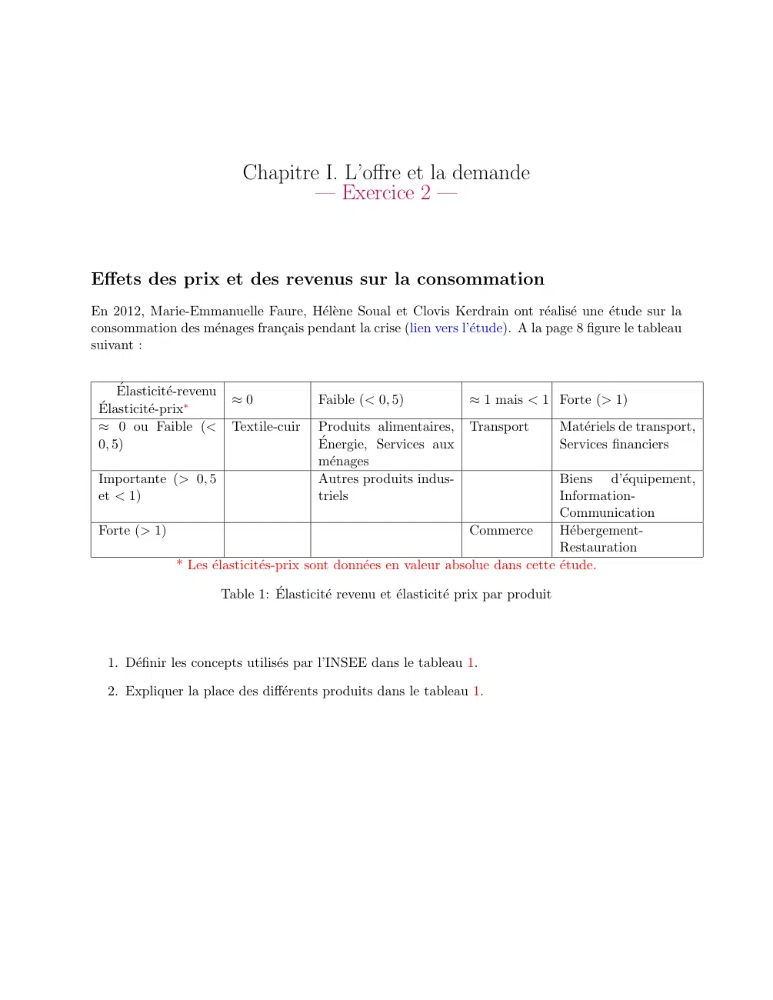

# Economie_I_exercice_01_02.pdf

[Ouvrir l’original](https://drive.google.com/open?id=19aLmK79CpKHiPlGjr8gSGez1_Q_GFMQE) · Les deux lectures automatiques du PDF divergent sur les pages indiquées. Leur fac-similé accompagne le texte.

**Pages présentant un écart entre les deux extractions** — 1.

## Page 1

~~~text
                               Chapitre I. L’offre et la demande
                                       — Exercice 2 —

Effets des prix et des revenus sur la consommation
En 2012, Marie-Emmanuelle Faure, Hélène Soual et Clovis Kerdrain ont réalisé une étude sur la
consommation des ménages français pendant la crise (lien vers l’étude). A la page 8 figure le tableau
suivant :

     Élasticité-revenu
                            ≈0              Faible (< 0, 5)             ≈ 1 mais < 1 Forte (> 1)
 Élasticité-prix∗
 ≈ 0 ou Faible (<           Textile-cuir    Produits alimentaires,      Transport          Matériels de transport,
 0, 5)                                      Énergie, Services aux                         Services financiers
                                            ménages
 Importante (> 0, 5                         Autres produits indus-               Biens d’équipement,
 et < 1)                                    triels                               Information-
                                                                                 Communication
 Forte (> 1)                                                      Commerce       Hébergement-
                                                                                 Restauration
             * Les élasticités-prix sont données en valeur absolue dans cette étude.

                           Table 1: Élasticité revenu et élasticité prix par produit

  1. Définir les concepts utilisés par l’INSEE dans le tableau 1.

  2. Expliquer la place des différents produits dans le tableau 1.
~~~
