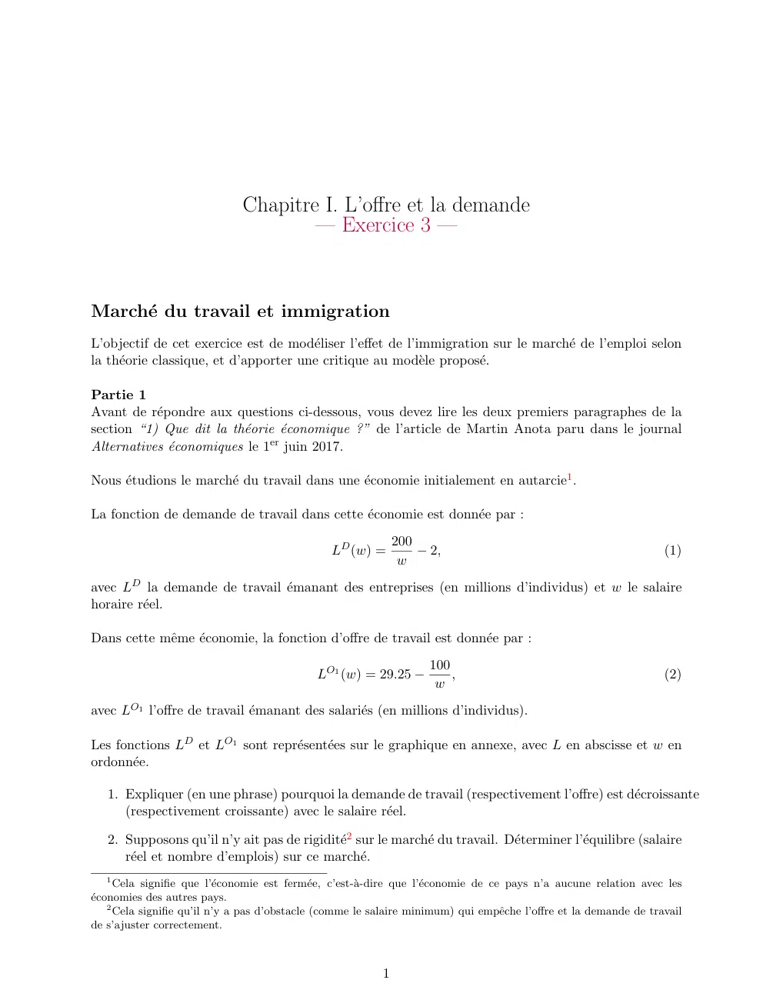
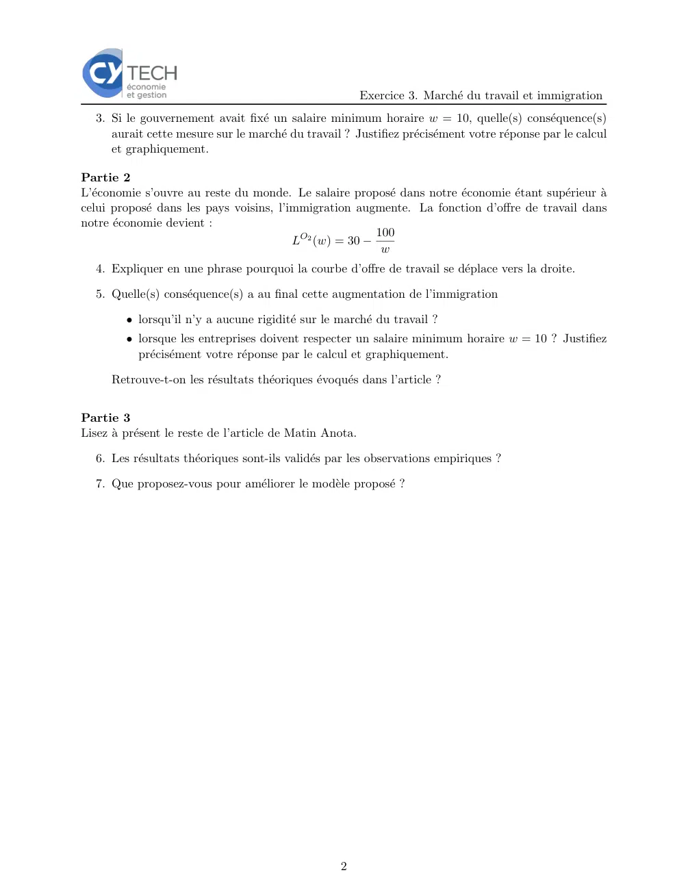
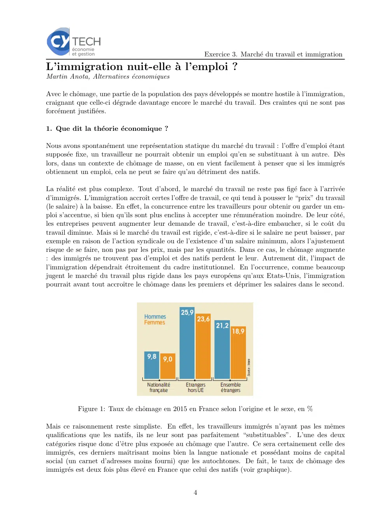
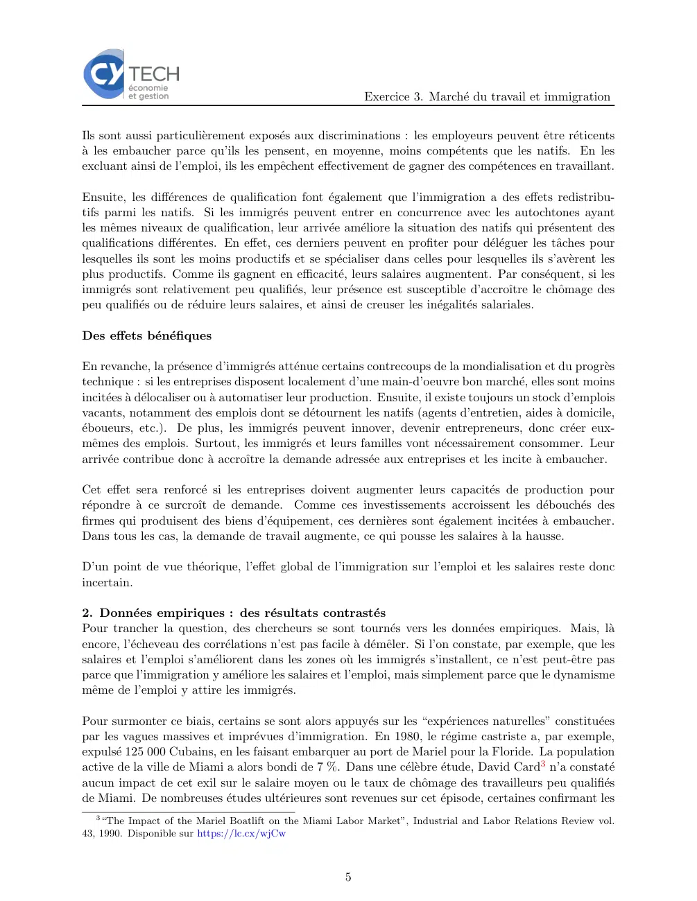
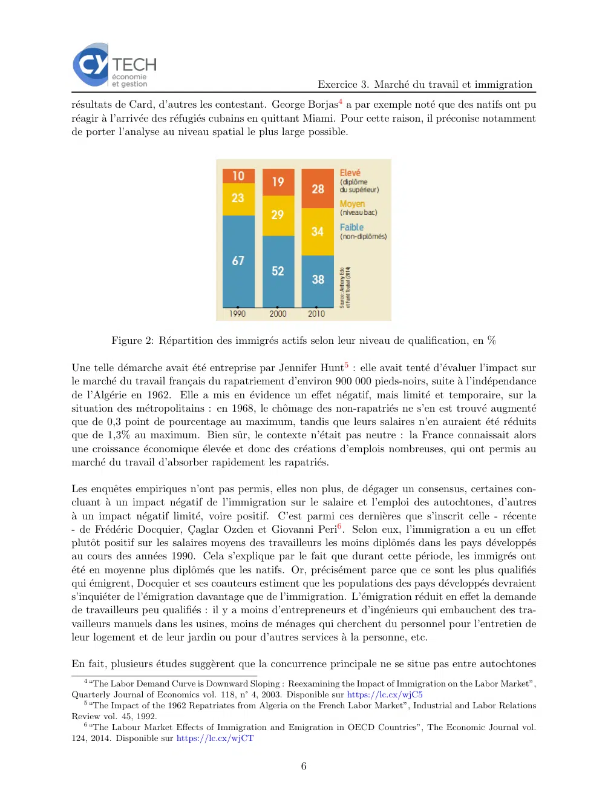
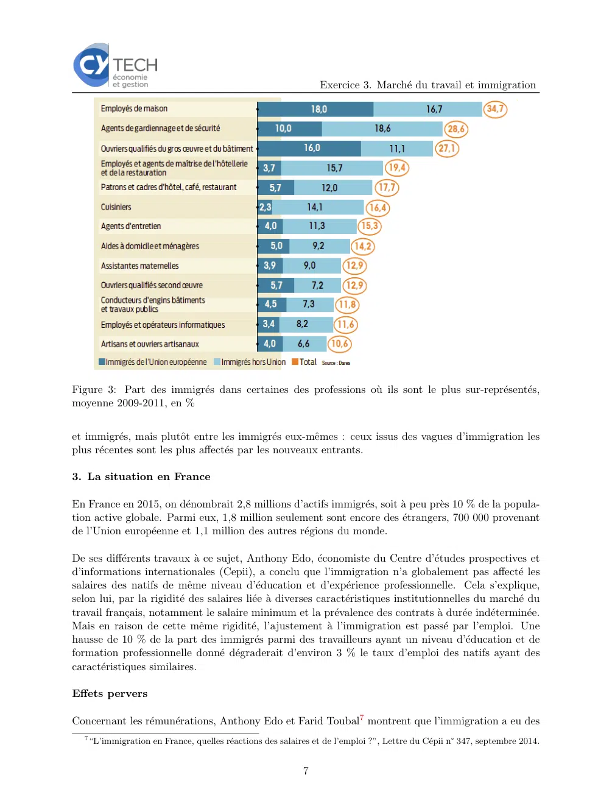
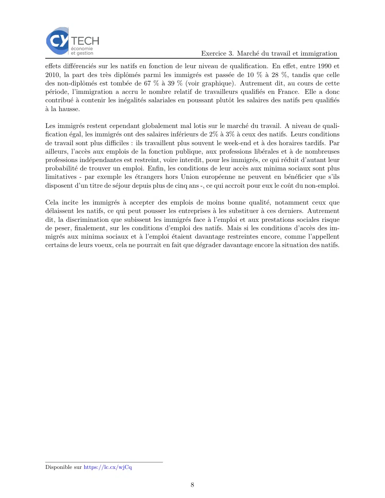

# Economie_I_exercice_01_03.pdf

[Ouvrir l’original](https://drive.google.com/open?id=16eIORdtUlDMsqtHr8UT_JQO60HyIXDN6) · Les deux lectures automatiques du PDF divergent sur les pages indiquées. Leur fac-similé accompagne le texte.

**Pages présentant un écart entre les deux extractions** — 1–2, 4–8.

## Page 1

~~~text
                              Chapitre I. L’offre et la demande
                                      — Exercice 3 —

Marché du travail et immigration
L’objectif de cet exercice est de modéliser l’effet de l’immigration sur le marché de l’emploi selon
la théorie classique, et d’apporter une critique au modèle proposé.

Partie 1
Avant de répondre aux questions ci-dessous, vous devez lire les deux premiers paragraphes de la
section “1) Que dit la théorie économique ?” de l’article de Martin Anota paru dans le journal
Alternatives économiques le 1er juin 2017.

Nous étudions le marché du travail dans une économie initialement en autarcie1 .

La fonction de demande de travail dans cette économie est donnée par :
                                                              200
                                                LD (w) =          − 2,                                             (1)
                                                               w
avec LD la demande de travail émanant des entreprises (en millions d’individus) et w le salaire
horaire réel.

Dans cette même économie, la fonction d’offre de travail est donnée par :
                                                                    100
                                             LO1 (w) = 29.25 −          ,                                          (2)
                                                                     w
avec LO1 l’offre de travail émanant des salariés (en millions d’individus).

Les fonctions LD et LO1 sont représentées sur le graphique en annexe, avec L en abscisse et w en
ordonnée.

   1. Expliquer (en une phrase) pourquoi la demande de travail (respectivement l’offre) est décroissante
      (respectivement croissante) avec le salaire réel.

   2. Supposons qu’il n’y ait pas de rigidité2 sur le marché du travail. Déterminer l’équilibre (salaire
      réel et nombre d’emplois) sur ce marché.
   1
      Cela signifie que l’économie est fermée, c’est-à-dire que l’économie de ce pays n’a aucune relation avec les
économies des autres pays.
    2
      Cela signifie qu’il n’y a pas d’obstacle (comme le salaire minimum) qui empêche l’offre et la demande de travail
de s’ajuster correctement.

                                                          1
~~~

## Page 2

~~~text
                                                          Exercice 3. Marché du travail et immigration
  3. Si le gouvernement avait fixé un salaire minimum horaire w = 10, quelle(s) conséquence(s)
     aurait cette mesure sur le marché du travail ? Justifiez précisément votre réponse par le calcul
     et graphiquement.

Partie 2
L’économie s’ouvre au reste du monde. Le salaire proposé dans notre économie étant supérieur à
celui proposé dans les pays voisins, l’immigration augmente. La fonction d’offre de travail dans
notre économie devient :
                                                        100
                                         LO2 (w) = 30 −
                                                         w
  4. Expliquer en une phrase pourquoi la courbe d’offre de travail se déplace vers la droite.

  5. Quelle(s) conséquence(s) a au final cette augmentation de l’immigration

         • lorsqu’il n’y a aucune rigidité sur le marché du travail ?
         • lorsque les entreprises doivent respecter un salaire minimum horaire w = 10 ? Justifiez
           précisément votre réponse par le calcul et graphiquement.

      Retrouve-t-on les résultats théoriques évoqués dans l’article ?

Partie 3
Lisez à présent le reste de l’article de Matin Anota.

  6. Les résultats théoriques sont-ils validés par les observations empiriques ?

  7. Que proposez-vous pour améliorer le modèle proposé ?

                                                    2
~~~

## Page 3

~~~text
                       Exercice 3. Marché du travail et immigration
Annexe

 w

                                                               LO1
11

                                                               LO2

10

 9

                                                               LD

 8

 7

         17   18                19                 20
                                                                       L

                   3
~~~

## Page 4

~~~text
                                                        Exercice 3. Marché du travail et immigration
L’immigration nuit-elle à l’emploi ?
Martin Anota, Alternatives économiques

Avec le chômage, une partie de la population des pays développés se montre hostile à l’immigration,
craignant que celle-ci dégrade davantage encore le marché du travail. Des craintes qui ne sont pas
forcément justifiées.

1. Que dit la théorie économique ?

Nous avons spontanément une représentation statique du marché du travail : l’offre d’emploi étant
supposée fixe, un travailleur ne pourrait obtenir un emploi qu’en se substituant à un autre. Dès
lors, dans un contexte de chômage de masse, on en vient facilement à penser que si les immigrés
obtiennent un emploi, cela ne peut se faire qu’au détriment des natifs.

La réalité est plus complexe. Tout d’abord, le marché du travail ne reste pas figé face à l’arrivée
d’immigrés. L’immigration accroı̂t certes l’offre de travail, ce qui tend à pousser le “prix” du travail
(le salaire) à la baisse. En effet, la concurrence entre les travailleurs pour obtenir ou garder un em-
ploi s’accentue, si bien qu’ils sont plus enclins à accepter une rémunération moindre. De leur côté,
les entreprises peuvent augmenter leur demande de travail, c’est-à-dire embaucher, si le coût du
travail diminue. Mais si le marché du travail est rigide, c’est-à-dire si le salaire ne peut baisser, par
exemple en raison de l’action syndicale ou de l’existence d’un salaire minimum, alors l’ajustement
risque de se faire, non pas par les prix, mais par les quantités. Dans ce cas, le chômage augmente
: des immigrés ne trouvent pas d’emploi et des natifs perdent le leur. Autrement dit, l’impact de
l’immigration dépendrait étroitement du cadre institutionnel. En l’occurrence, comme beaucoup
jugent le marché du travail plus rigide dans les pays européens qu’aux Etats-Unis, l’immigration
pourrait avant tout accroı̂tre le chômage dans les premiers et déprimer les salaires dans le second.

           Figure 1: Taux de chômage en 2015 en France selon l’origine et le sexe, en %

Mais ce raisonnement reste simpliste. En effet, les travailleurs immigrés n’ayant pas les mêmes
qualifications que les natifs, ils ne leur sont pas parfaitement “substituables”. L’une des deux
catégories risque donc d’être plus exposée au chômage que l’autre. Ce sera certainement celle des
immigrés, ces derniers maı̂trisant moins bien la langue nationale et possédant moins de capital
social (un carnet d’adresses moins fourni) que les autochtones. De fait, le taux de chômage des
immigrés est deux fois plus élevé en France que celui des natifs (voir graphique).

                                                    4
~~~

## Page 5

~~~text
                                                          Exercice 3. Marché du travail et immigration

Ils sont aussi particulièrement exposés aux discriminations : les employeurs peuvent être réticents
à les embaucher parce qu’ils les pensent, en moyenne, moins compétents que les natifs. En les
excluant ainsi de l’emploi, ils les empêchent effectivement de gagner des compétences en travaillant.

Ensuite, les différences de qualification font également que l’immigration a des effets redistribu-
tifs parmi les natifs. Si les immigrés peuvent entrer en concurrence avec les autochtones ayant
les mêmes niveaux de qualification, leur arrivée améliore la situation des natifs qui présentent des
qualifications différentes. En effet, ces derniers peuvent en profiter pour déléguer les tâches pour
lesquelles ils sont les moins productifs et se spécialiser dans celles pour lesquelles ils s’avèrent les
plus productifs. Comme ils gagnent en efficacité, leurs salaires augmentent. Par conséquent, si les
immigrés sont relativement peu qualifiés, leur présence est susceptible d’accroı̂tre le chômage des
peu qualifiés ou de réduire leurs salaires, et ainsi de creuser les inégalités salariales.

Des effets bénéfiques

En revanche, la présence d’immigrés atténue certains contrecoups de la mondialisation et du progrès
technique : si les entreprises disposent localement d’une main-d’oeuvre bon marché, elles sont moins
incitées à délocaliser ou à automatiser leur production. Ensuite, il existe toujours un stock d’emplois
vacants, notamment des emplois dont se détournent les natifs (agents d’entretien, aides à domicile,
éboueurs, etc.). De plus, les immigrés peuvent innover, devenir entrepreneurs, donc créer eux-
mêmes des emplois. Surtout, les immigrés et leurs familles vont nécessairement consommer. Leur
arrivée contribue donc à accroı̂tre la demande adressée aux entreprises et les incite à embaucher.

Cet effet sera renforcé si les entreprises doivent augmenter leurs capacités de production pour
répondre à ce surcroı̂t de demande. Comme ces investissements accroissent les débouchés des
firmes qui produisent des biens d’équipement, ces dernières sont également incitées à embaucher.
Dans tous les cas, la demande de travail augmente, ce qui pousse les salaires à la hausse.

D’un point de vue théorique, l’effet global de l’immigration sur l’emploi et les salaires reste donc
incertain.

2. Données empiriques : des résultats contrastés
Pour trancher la question, des chercheurs se sont tournés vers les données empiriques. Mais, là
encore, l’écheveau des corrélations n’est pas facile à démêler. Si l’on constate, par exemple, que les
salaires et l’emploi s’améliorent dans les zones où les immigrés s’installent, ce n’est peut-être pas
parce que l’immigration y améliore les salaires et l’emploi, mais simplement parce que le dynamisme
même de l’emploi y attire les immigrés.

Pour surmonter ce biais, certains se sont alors appuyés sur les “expériences naturelles” constituées
par les vagues massives et imprévues d’immigration. En 1980, le régime castriste a, par exemple,
expulsé 125 000 Cubains, en les faisant embarquer au port de Mariel pour la Floride. La population
active de la ville de Miami a alors bondi de 7 %. Dans une célèbre étude, David Card3 n’a constaté
aucun impact de cet exil sur le salaire moyen ou le taux de chômage des travailleurs peu qualifiés
de Miami. De nombreuses études ultérieures sont revenues sur cet épisode, certaines confirmant les
   3
     “The Impact of the Mariel Boatlift on the Miami Labor Market”, Industrial and Labor Relations Review vol.
43, 1990. Disponible sur https://lc.cx/wjCw

                                                      5
~~~

## Page 6

~~~text
                                                           Exercice 3. Marché du travail et immigration
résultats de Card, d’autres les contestant. George Borjas4 a par exemple noté que des natifs ont pu
réagir à l’arrivée des réfugiés cubains en quittant Miami. Pour cette raison, il préconise notamment
de porter l’analyse au niveau spatial le plus large possible.

         Figure 2: Répartition des immigrés actifs selon leur niveau de qualification, en %

Une telle démarche avait été entreprise par Jennifer Hunt5 : elle avait tenté d’évaluer l’impact sur
le marché du travail français du rapatriement d’environ 900 000 pieds-noirs, suite à l’indépendance
de l’Algérie en 1962. Elle a mis en évidence un effet négatif, mais limité et temporaire, sur la
situation des métropolitains : en 1968, le chômage des non-rapatriés ne s’en est trouvé augmenté
que de 0,3 point de pourcentage au maximum, tandis que leurs salaires n’en auraient été réduits
que de 1,3% au maximum. Bien sûr, le contexte n’était pas neutre : la France connaissait alors
une croissance économique élevée et donc des créations d’emplois nombreuses, qui ont permis au
marché du travail d’absorber rapidement les rapatriés.

Les enquêtes empiriques n’ont pas permis, elles non plus, de dégager un consensus, certaines con-
cluant à un impact négatif de l’immigration sur le salaire et l’emploi des autochtones, d’autres
à un impact négatif limité, voire positif. C’est parmi ces dernières que s’inscrit celle - récente
- de Frédéric Docquier, Çaglar Ozden et Giovanni Peri6 . Selon eux, l’immigration a eu un effet
plutôt positif sur les salaires moyens des travailleurs les moins diplômés dans les pays développés
au cours des années 1990. Cela s’explique par le fait que durant cette période, les immigrés ont
été en moyenne plus diplômés que les natifs. Or, précisément parce que ce sont les plus qualifiés
qui émigrent, Docquier et ses coauteurs estiment que les populations des pays développés devraient
s’inquiéter de l’émigration davantage que de l’immigration. L’émigration réduit en effet la demande
de travailleurs peu qualifiés : il y a moins d’entrepreneurs et d’ingénieurs qui embauchent des tra-
vailleurs manuels dans les usines, moins de ménages qui cherchent du personnel pour l’entretien de
leur logement et de leur jardin ou pour d’autres services à la personne, etc.

En fait, plusieurs études suggèrent que la concurrence principale ne se situe pas entre autochtones
   4
     “The Labor Demand Curve is Downward Sloping : Reexamining the Impact of Immigration on the Labor Market”,
Quarterly Journal of Economics vol. 118, n° 4, 2003. Disponible sur https://lc.cx/wjC5
   5
     “The Impact of the 1962 Repatriates from Algeria on the French Labor Market”, Industrial and Labor Relations
Review vol. 45, 1992.
   6
     “The Labour Market Effects of Immigration and Emigration in OECD Countries”, The Economic Journal vol.
124, 2014. Disponible sur https://lc.cx/wjCT

                                                       6
~~~

## Page 7

~~~text
                                                                 Exercice 3. Marché du travail et immigration

Figure 3: Part des immigrés dans certaines des professions où ils sont le plus sur-représentés,
moyenne 2009-2011, en %

et immigrés, mais plutôt entre les immigrés eux-mêmes : ceux issus des vagues d’immigration les
plus récentes sont les plus affectés par les nouveaux entrants.

3. La situation en France

En France en 2015, on dénombrait 2,8 millions d’actifs immigrés, soit à peu près 10 % de la popula-
tion active globale. Parmi eux, 1,8 million seulement sont encore des étrangers, 700 000 provenant
de l’Union européenne et 1,1 million des autres régions du monde.

De ses différents travaux à ce sujet, Anthony Edo, économiste du Centre d’études prospectives et
d’informations internationales (Cepii), a conclu que l’immigration n’a globalement pas affecté les
salaires des natifs de même niveau d’éducation et d’expérience professionnelle. Cela s’explique,
selon lui, par la rigidité des salaires liée à diverses caractéristiques institutionnelles du marché du
travail français, notamment le salaire minimum et la prévalence des contrats à durée indéterminée.
Mais en raison de cette même rigidité, l’ajustement à l’immigration est passé par l’emploi. Une
hausse de 10 % de la part des immigrés parmi des travailleurs ayant un niveau d’éducation et de
formation professionnelle donné dégraderait d’environ 3 % le taux d’emploi des natifs ayant des
caractéristiques similaires.

Effets pervers

Concernant les rémunérations, Anthony Edo et Farid Toubal7 montrent que l’immigration a eu des
  7
      “L’immigration en France, quelles réactions des salaires et de l’emploi ?”, Lettre du Cépii n° 347, septembre 2014.

                                                             7
~~~

## Page 8

~~~text
                                                         Exercice 3. Marché du travail et immigration
effets différenciés sur les natifs en fonction de leur niveau de qualification. En effet, entre 1990 et
2010, la part des très diplômés parmi les immigrés est passée de 10 % à 28 %, tandis que celle
des non-diplômés est tombée de 67 % à 39 % (voir graphique). Autrement dit, au cours de cette
période, l’immigration a accru le nombre relatif de travailleurs qualifiés en France. Elle a donc
contribué à contenir les inégalités salariales en poussant plutôt les salaires des natifs peu qualifiés
à la hausse.

Les immigrés restent cependant globalement mal lotis sur le marché du travail. A niveau de quali-
fication égal, les immigrés ont des salaires inférieurs de 2% à 3% à ceux des natifs. Leurs conditions
de travail sont plus difficiles : ils travaillent plus souvent le week-end et à des horaires tardifs. Par
ailleurs, l’accès aux emplois de la fonction publique, aux professions libérales et à de nombreuses
professions indépendantes est restreint, voire interdit, pour les immigrés, ce qui réduit d’autant leur
probabilité de trouver un emploi. Enfin, les conditions de leur accès aux minima sociaux sont plus
limitatives - par exemple les étrangers hors Union européenne ne peuvent en bénéficier que s’ils
disposent d’un titre de séjour depuis plus de cinq ans -, ce qui accroı̂t pour eux le coût du non-emploi.

Cela incite les immigrés à accepter des emplois de moins bonne qualité, notamment ceux que
délaissent les natifs, ce qui peut pousser les entreprises à les substituer à ces derniers. Autrement
dit, la discrimination que subissent les immigrés face à l’emploi et aux prestations sociales risque
de peser, finalement, sur les conditions d’emploi des natifs. Mais si les conditions d’accès des im-
migrés aux minima sociaux et à l’emploi étaient davantage restreintes encore, comme l’appellent
certains de leurs voeux, cela ne pourrait en fait que dégrader davantage encore la situation des natifs.

Disponible sur https://lc.cx/wjCq

                                                     8
~~~
