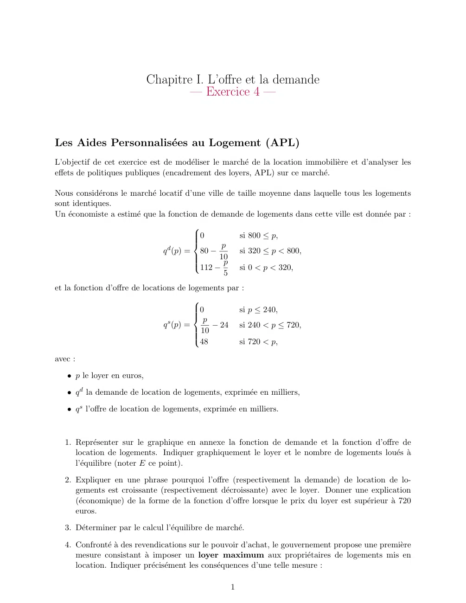
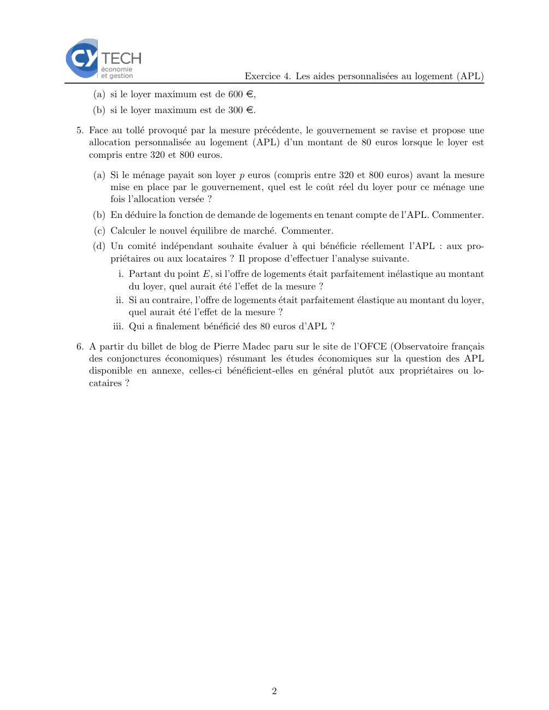
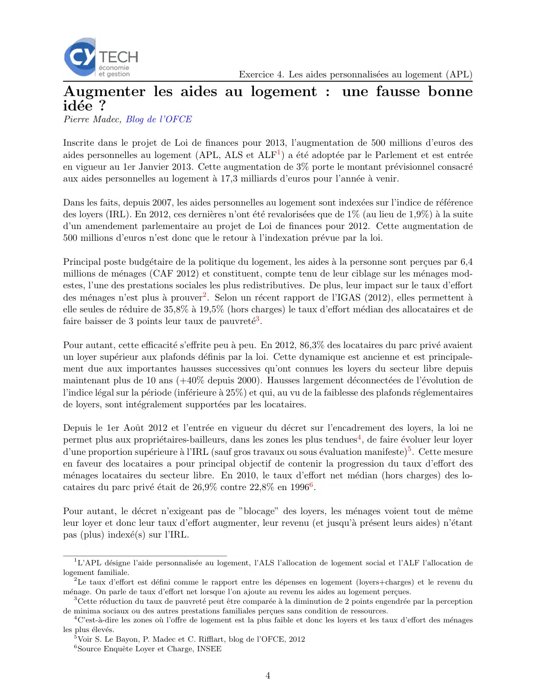
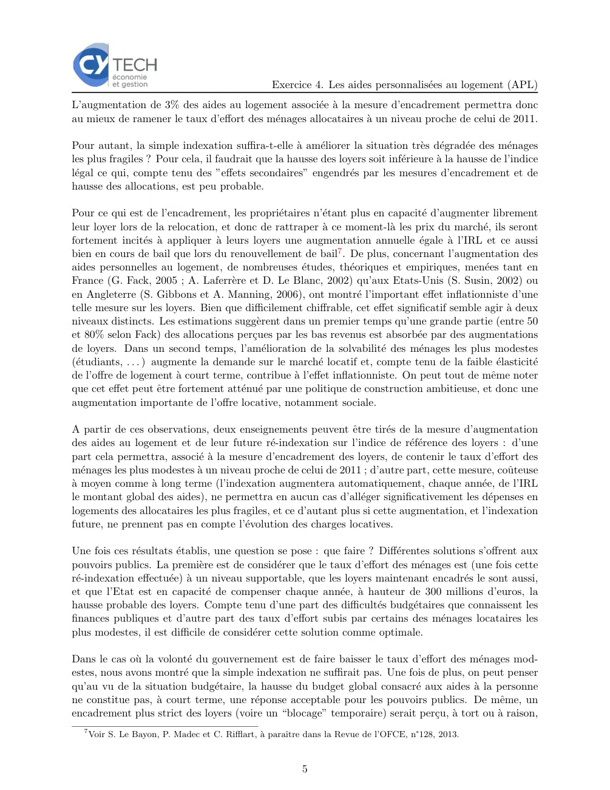
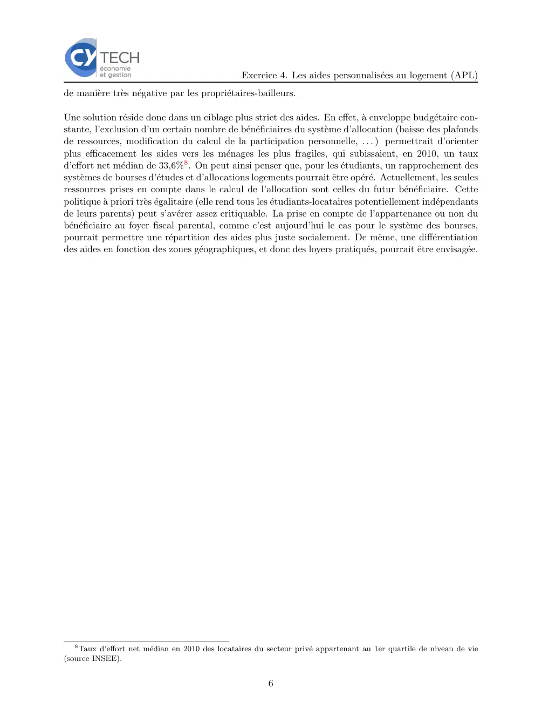

# Economie_I_exercice_01_04.pdf

[Ouvrir l’original](https://drive.google.com/open?id=10FbLfg4g-tOfXJ1-Zxq9bVUFhrtfwxDN) · Les deux lectures automatiques du PDF divergent sur les pages indiquées. Leur fac-similé accompagne le texte.

**Pages présentant un écart entre les deux extractions** — 1–2, 4–6.

## Page 1

~~~text
                            Chapitre I. L’offre et la demande
                                    — Exercice 4 —

Les Aides Personnalisées au Logement (APL)
L’objectif de cet exercice est de modéliser le marché de la location immobilière et d’analyser les
effets de politiques publiques (encadrement des loyers, APL) sur ce marché.

Nous considérons le marché locatif d’une ville de taille moyenne dans laquelle tous les logements
sont identiques.
Un économiste a estimé que la fonction de demande de logements dans cette ville est donnée par :
                                        
                                        
                                        
                                        0             si 800 ≤ p,
                                             p
                               q d (p) = 80 −          si 320 ≤ p < 800,
                                             10
                                        112 − p
                                        
                                        
                                                       si 0 < p < 320,
                                               5
et la fonction d’offre de locations de logements par :
                                          
                                          
                                          
                                          0        si p ≤ 240,
                                            p
                                          
                                q s (p) =      − 24 si 240 < p ≤ 720,
                                          
                                           10
                                          
                                          48       si 720 < p,

avec :
   • p le loyer en euros,

   • q d la demande de location de logements, exprimée en milliers,

   • q s l’offre de location de logements, exprimée en milliers.

  1. Représenter sur le graphique en annexe la fonction de demande et la fonction d’offre de
     location de logements. Indiquer graphiquement le loyer et le nombre de logements loués à
     l’équilibre (noter E ce point).

  2. Expliquer en une phrase pourquoi l’offre (respectivement la demande) de location de lo-
     gements est croissante (respectivement décroissante) avec le loyer. Donner une explication
     (économique) de la forme de la fonction d’offre lorsque le prix du loyer est supérieur à 720
     euros.

  3. Déterminer par le calcul l’équilibre de marché.

  4. Confronté à des revendications sur le pouvoir d’achat, le gouvernement propose une première
     mesure consistant à imposer un loyer maximum aux propriétaires de logements mis en
     location. Indiquer précisément les conséquences d’une telle mesure :

                                                   1
~~~

## Page 2

~~~text
                                          Exercice 4. Les aides personnalisées au logement (APL)
    (a) si le loyer maximum est de 600 e,
   (b) si le loyer maximum est de 300 e.

5. Face au tollé provoqué par la mesure précédente, le gouvernement se ravise et propose une
   allocation personnalisée au logement (APL) d’un montant de 80 euros lorsque le loyer est
   compris entre 320 et 800 euros.

    (a) Si le ménage payait son loyer p euros (compris entre 320 et 800 euros) avant la mesure
        mise en place par le gouvernement, quel est le coût réel du loyer pour ce ménage une
        fois l’allocation versée ?
   (b) En déduire la fonction de demande de logements en tenant compte de l’APL. Commenter.
    (c) Calculer le nouvel équilibre de marché. Commenter.
   (d) Un comité indépendant souhaite évaluer à qui bénéficie réellement l’APL : aux pro-
       priétaires ou aux locataires ? Il propose d’effectuer l’analyse suivante.
           i. Partant du point E, si l’offre de logements était parfaitement inélastique au montant
              du loyer, quel aurait été l’effet de la mesure ?
          ii. Si au contraire, l’offre de logements était parfaitement élastique au montant du loyer,
              quel aurait été l’effet de la mesure ?
         iii. Qui a finalement bénéficié des 80 euros d’APL ?

6. A partir du billet de blog de Pierre Madec paru sur le site de l’OFCE (Observatoire français
   des conjonctures économiques) résumant les études économiques sur la question des APL
   disponible en annexe, celles-ci bénéficient-elles en général plutôt aux propriétaires ou lo-
   cataires ?

                                                 2
~~~

## Page 3

~~~text
                                   Exercice 4. Les aides personnalisées au logement (APL)
Annexe

  p

900

800

700

600

500

400

300

200

100

 0
      5   10   15   20   25   30     35       40   45   50   55   60   65   70    75    80   q

                                          3
~~~

## Page 4

~~~text
                                                     Exercice 4. Les aides personnalisées au logement (APL)
Augmenter les aides au logement : une fausse bonne
idée ?
Pierre Madec, Blog de l’OFCE

Inscrite dans le projet de Loi de finances pour 2013, l’augmentation de 500 millions d’euros des
aides personnelles au logement (APL, ALS et ALF1 ) a été adoptée par le Parlement et est entrée
en vigueur au 1er Janvier 2013. Cette augmentation de 3% porte le montant prévisionnel consacré
aux aides personnelles au logement à 17,3 milliards d’euros pour l’année à venir.

Dans les faits, depuis 2007, les aides personnelles au logement sont indexées sur l’indice de référence
des loyers (IRL). En 2012, ces dernières n’ont été revalorisées que de 1% (au lieu de 1,9%) à la suite
d’un amendement parlementaire au projet de Loi de finances pour 2012. Cette augmentation de
500 millions d’euros n’est donc que le retour à l’indexation prévue par la loi.

Principal poste budgétaire de la politique du logement, les aides à la personne sont perçues par 6,4
millions de ménages (CAF 2012) et constituent, compte tenu de leur ciblage sur les ménages mod-
estes, l’une des prestations sociales les plus redistributives. De plus, leur impact sur le taux d’effort
des ménages n’est plus à prouver2 . Selon un récent rapport de l’IGAS (2012), elles permettent à
elle seules de réduire de 35,8% à 19,5% (hors charges) le taux d’effort médian des allocataires et de
faire baisser de 3 points leur taux de pauvreté3 .

Pour autant, cette efficacité s’effrite peu à peu. En 2012, 86,3% des locataires du parc privé avaient
un loyer supérieur aux plafonds définis par la loi. Cette dynamique est ancienne et est principale-
ment due aux importantes hausses successives qu’ont connues les loyers du secteur libre depuis
maintenant plus de 10 ans (+40% depuis 2000). Hausses largement déconnectées de l’évolution de
l’indice légal sur la période (inférieure à 25%) et qui, au vu de la faiblesse des plafonds réglementaires
de loyers, sont intégralement supportées par les locataires.

Depuis le 1er Août 2012 et l’entrée en vigueur du décret sur l’encadrement des loyers, la loi ne
permet plus aux propriétaires-bailleurs, dans les zones les plus tendues4 , de faire évoluer leur loyer
d’une proportion supérieure à l’IRL (sauf gros travaux ou sous évaluation manifeste)5 . Cette mesure
en faveur des locataires a pour principal objectif de contenir la progression du taux d’effort des
ménages locataires du secteur libre. En 2010, le taux d’effort net médian (hors charges) des lo-
cataires du parc privé était de 26,9% contre 22,8% en 19966 .

Pour autant, le décret n’exigeant pas de ”blocage” des loyers, les ménages voient tout de même
leur loyer et donc leur taux d’effort augmenter, leur revenu (et jusqu’à présent leurs aides) n’étant
pas (plus) indexé(s) sur l’IRL.

    1
      L’APL désigne l’aide personnalisée au logement, l’ALS l’allocation de logement social et l’ALF l’allocation de
logement familiale.
    2
      Le taux d’effort est défini comme le rapport entre les dépenses en logement (loyers+charges) et le revenu du
ménage. On parle de taux d’effort net lorsque l’on ajoute au revenu les aides au logement perçues.
    3
      Cette réduction du taux de pauvreté peut être comparée à la diminution de 2 points engendrée par la perception
de minima sociaux ou des autres prestations familiales perçues sans condition de ressources.
    4
      C’est-à-dire les zones où l’offre de logement est la plus faible et donc les loyers et les taux d’effort des ménages
les plus élevés.
    5
      Voir S. Le Bayon, P. Madec et C. Rifflart, blog de l’OFCE, 2012
    6
      Source Enquête Loyer et Charge, INSEE

                                                             4
~~~

## Page 5

~~~text
                                                    Exercice 4. Les aides personnalisées au logement (APL)
L’augmentation de 3% des aides au logement associée à la mesure d’encadrement permettra donc
au mieux de ramener le taux d’effort des ménages allocataires à un niveau proche de celui de 2011.

Pour autant, la simple indexation suffira-t-elle à améliorer la situation très dégradée des ménages
les plus fragiles ? Pour cela, il faudrait que la hausse des loyers soit inférieure à la hausse de l’indice
légal ce qui, compte tenu des ”effets secondaires” engendrés par les mesures d’encadrement et de
hausse des allocations, est peu probable.

Pour ce qui est de l’encadrement, les propriétaires n’étant plus en capacité d’augmenter librement
leur loyer lors de la relocation, et donc de rattraper à ce moment-là les prix du marché, ils seront
fortement incités à appliquer à leurs loyers une augmentation annuelle égale à l’IRL et ce aussi
bien en cours de bail que lors du renouvellement de bail7 . De plus, concernant l’augmentation des
aides personnelles au logement, de nombreuses études, théoriques et empiriques, menées tant en
France (G. Fack, 2005 ; A. Laferrère et D. Le Blanc, 2002) qu’aux Etats-Unis (S. Susin, 2002) ou
en Angleterre (S. Gibbons et A. Manning, 2006), ont montré l’important effet inflationniste d’une
telle mesure sur les loyers. Bien que difficilement chiffrable, cet effet significatif semble agir à deux
niveaux distincts. Les estimations suggèrent dans un premier temps qu’une grande partie (entre 50
et 80% selon Fack) des allocations perçues par les bas revenus est absorbée par des augmentations
de loyers. Dans un second temps, l’amélioration de la solvabilité des ménages les plus modestes
(étudiants, . . . ) augmente la demande sur le marché locatif et, compte tenu de la faible élasticité
de l’offre de logement à court terme, contribue à l’effet inflationniste. On peut tout de même noter
que cet effet peut être fortement atténué par une politique de construction ambitieuse, et donc une
augmentation importante de l’offre locative, notamment sociale.

A partir de ces observations, deux enseignements peuvent être tirés de la mesure d’augmentation
des aides au logement et de leur future ré-indexation sur l’indice de référence des loyers : d’une
part cela permettra, associé à la mesure d’encadrement des loyers, de contenir le taux d’effort des
ménages les plus modestes à un niveau proche de celui de 2011 ; d’autre part, cette mesure, coûteuse
à moyen comme à long terme (l’indexation augmentera automatiquement, chaque année, de l’IRL
le montant global des aides), ne permettra en aucun cas d’alléger significativement les dépenses en
logements des allocataires les plus fragiles, et ce d’autant plus si cette augmentation, et l’indexation
future, ne prennent pas en compte l’évolution des charges locatives.

Une fois ces résultats établis, une question se pose : que faire ? Différentes solutions s’offrent aux
pouvoirs publics. La première est de considérer que le taux d’effort des ménages est (une fois cette
ré-indexation effectuée) à un niveau supportable, que les loyers maintenant encadrés le sont aussi,
et que l’Etat est en capacité de compenser chaque année, à hauteur de 300 millions d’euros, la
hausse probable des loyers. Compte tenu d’une part des difficultés budgétaires que connaissent les
finances publiques et d’autre part des taux d’effort subis par certains des ménages locataires les
plus modestes, il est difficile de considérer cette solution comme optimale.

Dans le cas où la volonté du gouvernement est de faire baisser le taux d’effort des ménages mod-
estes, nous avons montré que la simple indexation ne suffirait pas. Une fois de plus, on peut penser
qu’au vu de la situation budgétaire, la hausse du budget global consacré aux aides à la personne
ne constitue pas, à court terme, une réponse acceptable pour les pouvoirs publics. De même, un
encadrement plus strict des loyers (voire un “blocage” temporaire) serait perçu, à tort ou à raison,
  7
      Voir S. Le Bayon, P. Madec et C. Rifflart, à paraı̂tre dans la Revue de l’OFCE, n°128, 2013.

                                                           5
~~~

## Page 6

~~~text
                                                 Exercice 4. Les aides personnalisées au logement (APL)
de manière très négative par les propriétaires-bailleurs.

Une solution réside donc dans un ciblage plus strict des aides. En effet, à enveloppe budgétaire con-
stante, l’exclusion d’un certain nombre de bénéficiaires du système d’allocation (baisse des plafonds
de ressources, modification du calcul de la participation personnelle, . . . ) permettrait d’orienter
plus efficacement les aides vers les ménages les plus fragiles, qui subissaient, en 2010, un taux
d’effort net médian de 33,6%8 . On peut ainsi penser que, pour les étudiants, un rapprochement des
systèmes de bourses d’études et d’allocations logements pourrait être opéré. Actuellement, les seules
ressources prises en compte dans le calcul de l’allocation sont celles du futur bénéficiaire. Cette
politique à priori très égalitaire (elle rend tous les étudiants-locataires potentiellement indépendants
de leurs parents) peut s’avérer assez critiquable. La prise en compte de l’appartenance ou non du
bénéficiaire au foyer fiscal parental, comme c’est aujourd’hui le cas pour le système des bourses,
pourrait permettre une répartition des aides plus juste socialement. De même, une différentiation
des aides en fonction des zones géographiques, et donc des loyers pratiqués, pourrait être envisagée.

   8
    Taux d’effort net médian en 2010 des locataires du secteur privé appartenant au 1er quartile de niveau de vie
(source INSEE).

                                                        6
~~~
