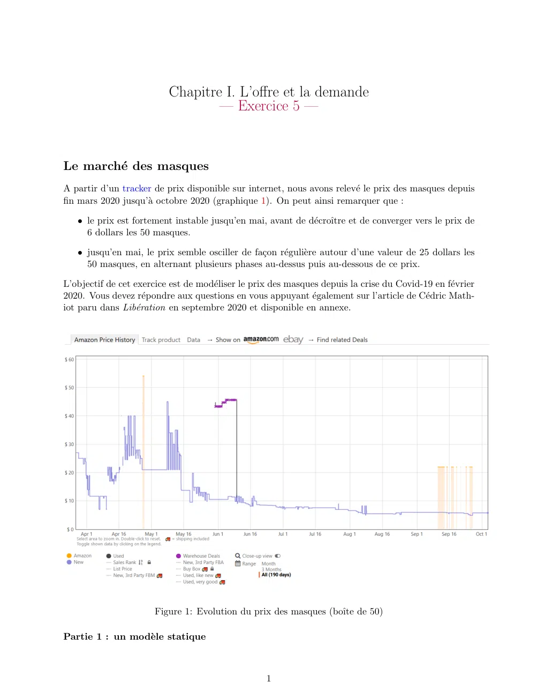
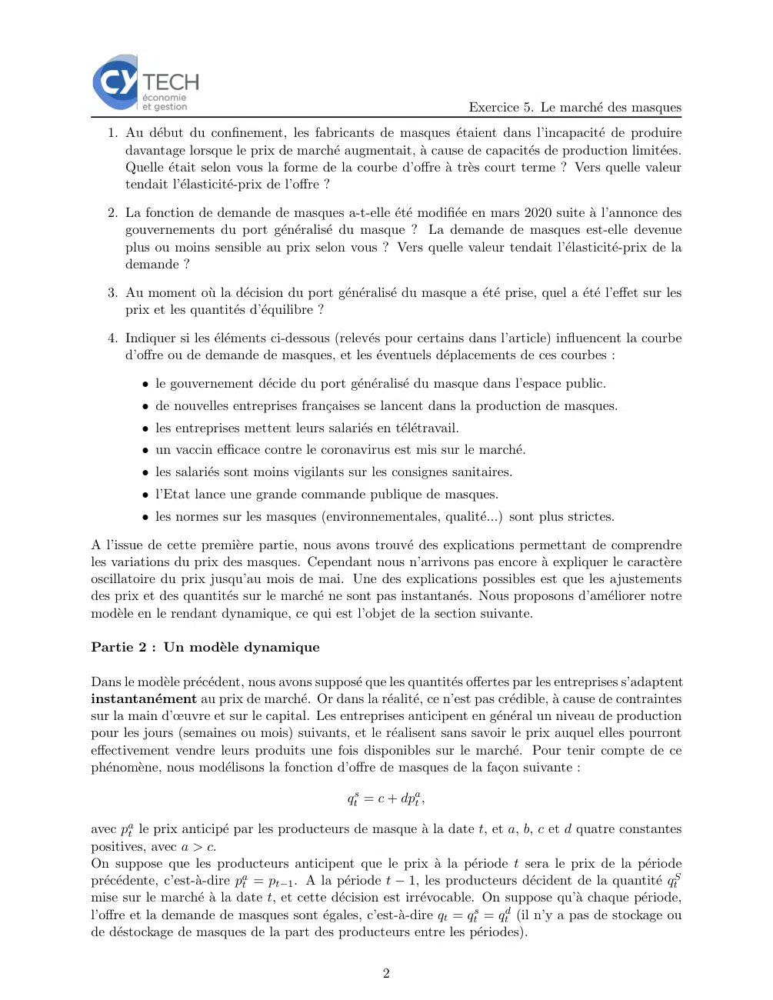
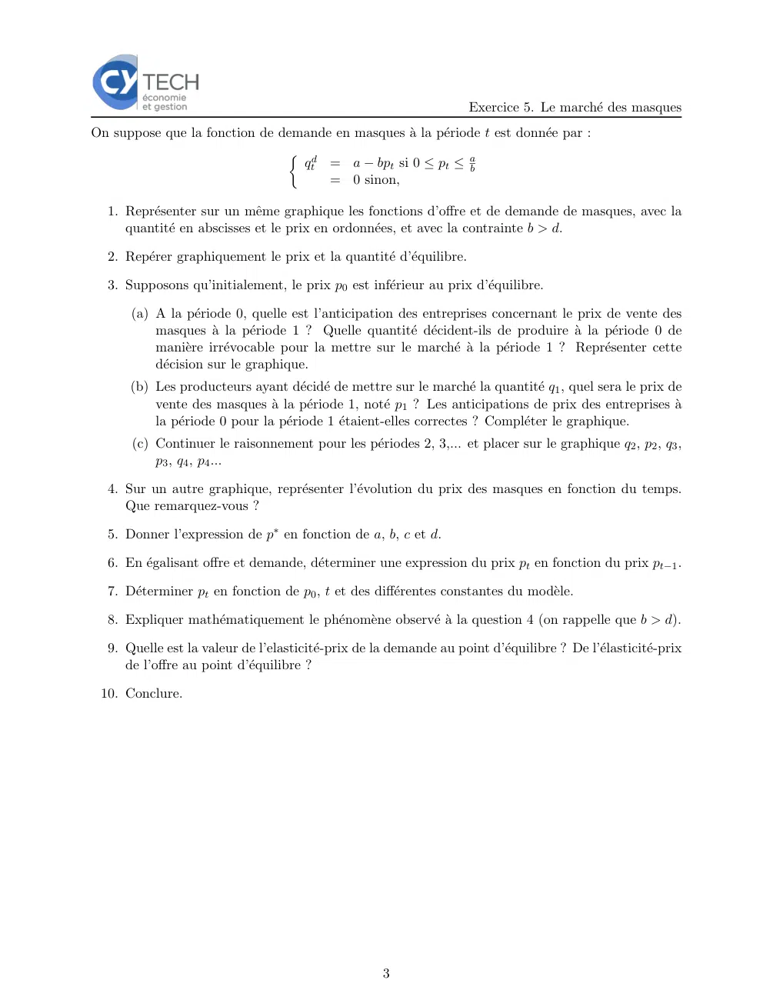
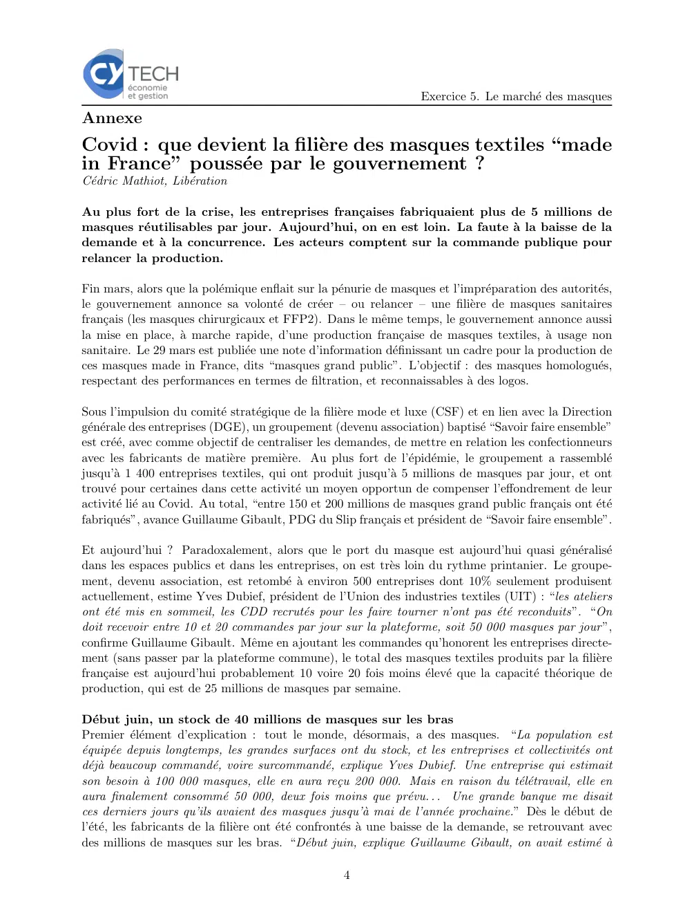
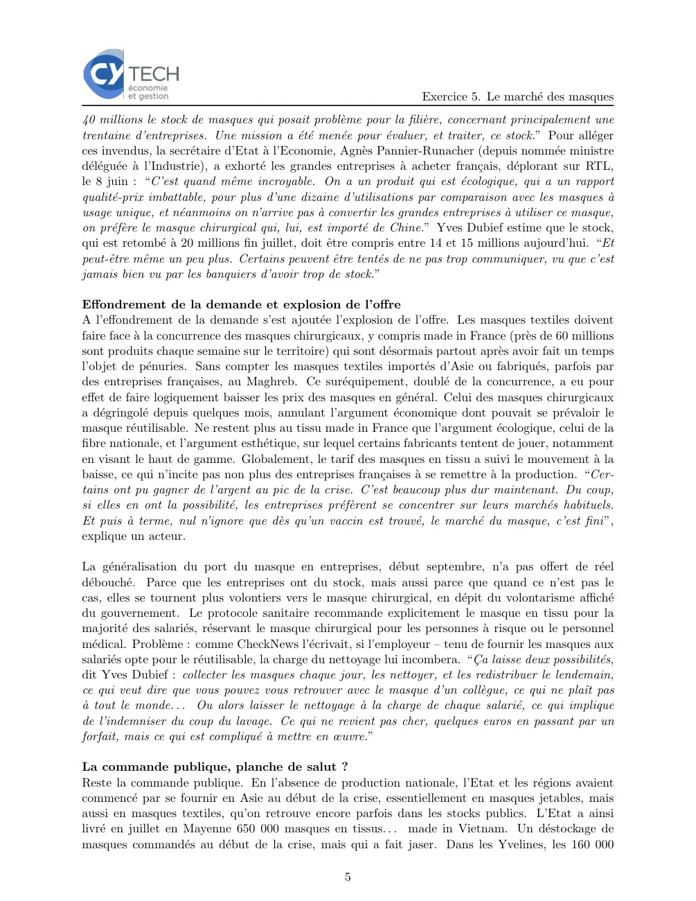
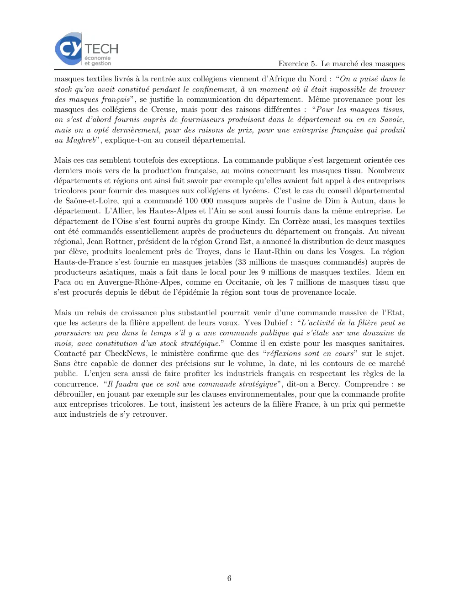

# Economie_I_exercice_01_05.pdf

[Ouvrir l’original](https://drive.google.com/open?id=1mnSHjyPpPgrxdMZPpXZ7QngKWFfLhDg0) · Les deux lectures automatiques du PDF divergent sur les pages indiquées. Leur fac-similé accompagne le texte.

**Pages présentant un écart entre les deux extractions** — 1–6.

## Page 1

~~~text
                          Chapitre I. L’offre et la demande
                                  — Exercice 5 —

Le marché des masques
A partir d’un tracker de prix disponible sur internet, nous avons relevé le prix des masques depuis
fin mars 2020 jusqu’à octobre 2020 (graphique 1). On peut ainsi remarquer que :

   • le prix est fortement instable jusqu’en mai, avant de décroı̂tre et de converger vers le prix de
     6 dollars les 50 masques.

   • jusqu’en mai, le prix semble osciller de façon régulière autour d’une valeur de 25 dollars les
     50 masques, en alternant plusieurs phases au-dessus puis au-dessous de ce prix.

L’objectif de cet exercice est de modéliser le prix des masques depuis la crise du Covid-19 en février
2020. Vous devez répondre aux questions en vous appuyant également sur l’article de Cédric Math-
iot paru dans Libération en septembre 2020 et disponible en annexe.

                       Figure 1: Evolution du prix des masques (boı̂te de 50)

Partie 1 : un modèle statique

                                                   1
~~~

## Page 2

~~~text
                                                                       Exercice 5. Le marché des masques
   1. Au début du confinement, les fabricants de masques étaient dans l’incapacité de produire
      davantage lorsque le prix de marché augmentait, à cause de capacités de production limitées.
      Quelle était selon vous la forme de la courbe d’offre à très court terme ? Vers quelle valeur
      tendait l’élasticité-prix de l’offre ?

   2. La fonction de demande de masques a-t-elle été modifiée en mars 2020 suite à l’annonce des
      gouvernements du port généralisé du masque ? La demande de masques est-elle devenue
      plus ou moins sensible au prix selon vous ? Vers quelle valeur tendait l’élasticité-prix de la
      demande ?

   3. Au moment où la décision du port généralisé du masque a été prise, quel a été l’effet sur les
      prix et les quantités d’équilibre ?

   4. Indiquer si les éléments ci-dessous (relevés pour certains dans l’article) influencent la courbe
      d’offre ou de demande de masques, et les éventuels déplacements de ces courbes :

         • le gouvernement décide du port généralisé du masque dans l’espace public.
         • de nouvelles entreprises françaises se lancent dans la production de masques.
         • les entreprises mettent leurs salariés en télétravail.
         • un vaccin efficace contre le coronavirus est mis sur le marché.
         • les salariés sont moins vigilants sur les consignes sanitaires.
         • l’Etat lance une grande commande publique de masques.
         • les normes sur les masques (environnementales, qualité...) sont plus strictes.

A l’issue de cette première partie, nous avons trouvé des explications permettant de comprendre
les variations du prix des masques. Cependant nous n’arrivons pas encore à expliquer le caractère
oscillatoire du prix jusqu’au mois de mai. Une des explications possibles est que les ajustements
des prix et des quantités sur le marché ne sont pas instantanés. Nous proposons d’améliorer notre
modèle en le rendant dynamique, ce qui est l’objet de la section suivante.

Partie 2 : Un modèle dynamique

Dans le modèle précédent, nous avons supposé que les quantités offertes par les entreprises s’adaptent
instantanément au prix de marché. Or dans la réalité, ce n’est pas crédible, à cause de contraintes
sur la main d’œuvre et sur le capital. Les entreprises anticipent en général un niveau de production
pour les jours (semaines ou mois) suivants, et le réalisent sans savoir le prix auquel elles pourront
effectivement vendre leurs produits une fois disponibles sur le marché. Pour tenir compte de ce
phénomène, nous modélisons la fonction d’offre de masques de la façon suivante :

                                               qts = c + dpat ,

avec pat le prix anticipé par les producteurs de masque à la date t, et a, b, c et d quatre constantes
positives, avec a > c.
On suppose que les producteurs anticipent que le prix à la période t sera le prix de la période
précédente, c’est-à-dire pat = pt−1 . A la période t − 1, les producteurs décident de la quantité qtS
mise sur le marché à la date t, et cette décision est irrévocable. On suppose qu’à chaque période,
l’offre et la demande de masques sont égales, c’est-à-dire qt = qts = qtd (il n’y a pas de stockage ou
de déstockage de masques de la part des producteurs entre les périodes).

                                                      2
~~~

## Page 3

~~~text
                                                                    Exercice 5. Le marché des masques
On suppose que la fonction de demande en masques à la période t est donnée par :

                                 qt = a − bpt si 0 ≤ pt ≤ ab
                                d

                                     = 0 sinon,

  1. Représenter sur un même graphique les fonctions d’offre et de demande de masques, avec la
     quantité en abscisses et le prix en ordonnées, et avec la contrainte b > d.

  2. Repérer graphiquement le prix et la quantité d’équilibre.

  3. Supposons qu’initialement, le prix p0 est inférieur au prix d’équilibre.

      (a) A la période 0, quelle est l’anticipation des entreprises concernant le prix de vente des
          masques à la période 1 ? Quelle quantité décident-ils de produire à la période 0 de
          manière irrévocable pour la mettre sur le marché à la période 1 ? Représenter cette
          décision sur le graphique.
      (b) Les producteurs ayant décidé de mettre sur le marché la quantité q1 , quel sera le prix de
          vente des masques à la période 1, noté p1 ? Les anticipations de prix des entreprises à
          la période 0 pour la période 1 étaient-elles correctes ? Compléter le graphique.
      (c) Continuer le raisonnement pour les périodes 2, 3,... et placer sur le graphique q2 , p2 , q3 ,
          p3 , q4 , p4 ...

  4. Sur un autre graphique, représenter l’évolution du prix des masques en fonction du temps.
     Que remarquez-vous ?

  5. Donner l’expression de p∗ en fonction de a, b, c et d.

  6. En égalisant offre et demande, déterminer une expression du prix pt en fonction du prix pt−1 .

  7. Déterminer pt en fonction de p0 , t et des différentes constantes du modèle.

  8. Expliquer mathématiquement le phénomène observé à la question 4 (on rappelle que b > d).

  9. Quelle est la valeur de l’elasticité-prix de la demande au point d’équilibre ? De l’élasticité-prix
     de l’offre au point d’équilibre ?

 10. Conclure.

                                                    3
~~~

## Page 4

~~~text
                                                                     Exercice 5. Le marché des masques
Annexe
Covid : que devient la filière des masques textiles “made
in France” poussée par le gouvernement ?
Cédric Mathiot, Libération

Au plus fort de la crise, les entreprises françaises fabriquaient plus de 5 millions de
masques réutilisables par jour. Aujourd’hui, on en est loin. La faute à la baisse de la
demande et à la concurrence. Les acteurs comptent sur la commande publique pour
relancer la production.

Fin mars, alors que la polémique enflait sur la pénurie de masques et l’impréparation des autorités,
le gouvernement annonce sa volonté de créer – ou relancer – une filière de masques sanitaires
français (les masques chirurgicaux et FFP2). Dans le même temps, le gouvernement annonce aussi
la mise en place, à marche rapide, d’une production française de masques textiles, à usage non
sanitaire. Le 29 mars est publiée une note d’information définissant un cadre pour la production de
ces masques made in France, dits “masques grand public”. L’objectif : des masques homologués,
respectant des performances en termes de filtration, et reconnaissables à des logos.

Sous l’impulsion du comité stratégique de la filière mode et luxe (CSF) et en lien avec la Direction
générale des entreprises (DGE), un groupement (devenu association) baptisé “Savoir faire ensemble”
est créé, avec comme objectif de centraliser les demandes, de mettre en relation les confectionneurs
avec les fabricants de matière première. Au plus fort de l’épidémie, le groupement a rassemblé
jusqu’à 1 400 entreprises textiles, qui ont produit jusqu’à 5 millions de masques par jour, et ont
trouvé pour certaines dans cette activité un moyen opportun de compenser l’effondrement de leur
activité lié au Covid. Au total, “entre 150 et 200 millions de masques grand public français ont été
fabriqués”, avance Guillaume Gibault, PDG du Slip français et président de “Savoir faire ensemble”.

Et aujourd’hui ? Paradoxalement, alors que le port du masque est aujourd’hui quasi généralisé
dans les espaces publics et dans les entreprises, on est très loin du rythme printanier. Le groupe-
ment, devenu association, est retombé à environ 500 entreprises dont 10% seulement produisent
actuellement, estime Yves Dubief, président de l’Union des industries textiles (UIT) : “les ateliers
ont été mis en sommeil, les CDD recrutés pour les faire tourner n’ont pas été reconduits”. “On
doit recevoir entre 10 et 20 commandes par jour sur la plateforme, soit 50 000 masques par jour ”,
confirme Guillaume Gibault. Même en ajoutant les commandes qu’honorent les entreprises directe-
ment (sans passer par la plateforme commune), le total des masques textiles produits par la filière
française est aujourd’hui probablement 10 voire 20 fois moins élevé que la capacité théorique de
production, qui est de 25 millions de masques par semaine.

Début juin, un stock de 40 millions de masques sur les bras
Premier élément d’explication : tout le monde, désormais, a des masques. “La population est
équipée depuis longtemps, les grandes surfaces ont du stock, et les entreprises et collectivités ont
déjà beaucoup commandé, voire surcommandé, explique Yves Dubief. Une entreprise qui estimait
son besoin à 100 000 masques, elle en aura reçu 200 000. Mais en raison du télétravail, elle en
aura finalement consommé 50 000, deux fois moins que prévu. . . Une grande banque me disait
ces derniers jours qu’ils avaient des masques jusqu’à mai de l’année prochaine.” Dès le début de
l’été, les fabricants de la filière ont été confrontés à une baisse de la demande, se retrouvant avec
des millions de masques sur les bras. “Début juin, explique Guillaume Gibault, on avait estimé à

                                                     4
~~~

## Page 5

~~~text
                                                                    Exercice 5. Le marché des masques
40 millions le stock de masques qui posait problème pour la filière, concernant principalement une
trentaine d’entreprises. Une mission a été menée pour évaluer, et traiter, ce stock.” Pour alléger
ces invendus, la secrétaire d’Etat à l’Economie, Agnès Pannier-Runacher (depuis nommée ministre
déléguée à l’Industrie), a exhorté les grandes entreprises à acheter français, déplorant sur RTL,
le 8 juin : “C’est quand même incroyable. On a un produit qui est écologique, qui a un rapport
qualité-prix imbattable, pour plus d’une dizaine d’utilisations par comparaison avec les masques à
usage unique, et néanmoins on n’arrive pas à convertir les grandes entreprises à utiliser ce masque,
on préfère le masque chirurgical qui, lui, est importé de Chine.” Yves Dubief estime que le stock,
qui est retombé à 20 millions fin juillet, doit être compris entre 14 et 15 millions aujourd’hui. “Et
peut-être même un peu plus. Certains peuvent être tentés de ne pas trop communiquer, vu que c’est
jamais bien vu par les banquiers d’avoir trop de stock.”

Effondrement de la demande et explosion de l’offre
A l’effondrement de la demande s’est ajoutée l’explosion de l’offre. Les masques textiles doivent
faire face à la concurrence des masques chirurgicaux, y compris made in France (près de 60 millions
sont produits chaque semaine sur le territoire) qui sont désormais partout après avoir fait un temps
l’objet de pénuries. Sans compter les masques textiles importés d’Asie ou fabriqués, parfois par
des entreprises françaises, au Maghreb. Ce suréquipement, doublé de la concurrence, a eu pour
effet de faire logiquement baisser les prix des masques en général. Celui des masques chirurgicaux
a dégringolé depuis quelques mois, annulant l’argument économique dont pouvait se prévaloir le
masque réutilisable. Ne restent plus au tissu made in France que l’argument écologique, celui de la
fibre nationale, et l’argument esthétique, sur lequel certains fabricants tentent de jouer, notamment
en visant le haut de gamme. Globalement, le tarif des masques en tissu a suivi le mouvement à la
baisse, ce qui n’incite pas non plus des entreprises françaises à se remettre à la production. “Cer-
tains ont pu gagner de l’argent au pic de la crise. C’est beaucoup plus dur maintenant. Du coup,
si elles en ont la possibilité, les entreprises préfèrent se concentrer sur leurs marchés habituels.
Et puis à terme, nul n’ignore que dès qu’un vaccin est trouvé, le marché du masque, c’est fini ”,
explique un acteur.

La généralisation du port du masque en entreprises, début septembre, n’a pas offert de réel
débouché. Parce que les entreprises ont du stock, mais aussi parce que quand ce n’est pas le
cas, elles se tournent plus volontiers vers le masque chirurgical, en dépit du volontarisme affiché
du gouvernement. Le protocole sanitaire recommande explicitement le masque en tissu pour la
majorité des salariés, réservant le masque chirurgical pour les personnes à risque ou le personnel
médical. Problème : comme CheckNews l’écrivait, si l’employeur – tenu de fournir les masques aux
salariés opte pour le réutilisable, la charge du nettoyage lui incombera. “Ça laisse deux possibilités,
dit Yves Dubief : collecter les masques chaque jour, les nettoyer, et les redistribuer le lendemain,
ce qui veut dire que vous pouvez vous retrouver avec le masque d’un collègue, ce qui ne plaı̂t pas
à tout le monde. . . Ou alors laisser le nettoyage à la charge de chaque salarié, ce qui implique
de l’indemniser du coup du lavage. Ce qui ne revient pas cher, quelques euros en passant par un
forfait, mais ce qui est compliqué à mettre en œuvre.”

La commande publique, planche de salut ?
Reste la commande publique. En l’absence de production nationale, l’Etat et les régions avaient
commencé par se fournir en Asie au début de la crise, essentiellement en masques jetables, mais
aussi en masques textiles, qu’on retrouve encore parfois dans les stocks publics. L’Etat a ainsi
livré en juillet en Mayenne 650 000 masques en tissus. . . made in Vietnam. Un déstockage de
masques commandés au début de la crise, mais qui a fait jaser. Dans les Yvelines, les 160 000

                                                    5
~~~

## Page 6

~~~text
                                                                   Exercice 5. Le marché des masques
masques textiles livrés à la rentrée aux collégiens viennent d’Afrique du Nord : “On a puisé dans le
stock qu’on avait constitué pendant le confinement, à un moment où il était impossible de trouver
des masques français”, se justifie la communication du département. Même provenance pour les
masques des collégiens de Creuse, mais pour des raisons différentes : “Pour les masques tissus,
on s’est d’abord fournis auprès de fournisseurs produisant dans le département ou en en Savoie,
mais on a opté dernièrement, pour des raisons de prix, pour une entreprise française qui produit
au Maghreb”, explique-t-on au conseil départemental.

Mais ces cas semblent toutefois des exceptions. La commande publique s’est largement orientée ces
derniers mois vers de la production française, au moins concernant les masques tissu. Nombreux
départements et régions ont ainsi fait savoir par exemple qu’elles avaient fait appel à des entreprises
tricolores pour fournir des masques aux collégiens et lycéens. C’est le cas du conseil départemental
de Saône-et-Loire, qui a commandé 100 000 masques auprès de l’usine de Dim à Autun, dans le
département. L’Allier, les Hautes-Alpes et l’Ain se sont aussi fournis dans la même entreprise. Le
département de l’Oise s’est fourni auprès du groupe Kindy. En Corrèze aussi, les masques textiles
ont été commandés essentiellement auprès de producteurs du département ou français. Au niveau
régional, Jean Rottner, président de la région Grand Est, a annoncé la distribution de deux masques
par élève, produits localement près de Troyes, dans le Haut-Rhin ou dans les Vosges. La région
Hauts-de-France s’est fournie en masques jetables (33 millions de masques commandés) auprès de
producteurs asiatiques, mais a fait dans le local pour les 9 millions de masques textiles. Idem en
Paca ou en Auvergne-Rhône-Alpes, comme en Occitanie, où les 7 millions de masques tissu que
s’est procurés depuis le début de l’épidémie la région sont tous de provenance locale.

Mais un relais de croissance plus substantiel pourrait venir d’une commande massive de l’Etat,
que les acteurs de la filière appellent de leurs vœux. Yves Dubief : “L’activité de la filière peut se
poursuivre un peu dans le temps s’il y a une commande publique qui s’étale sur une douzaine de
mois, avec constitution d’un stock stratégique.” Comme il en existe pour les masques sanitaires.
Contacté par CheckNews, le ministère confirme que des “réflexions sont en cours” sur le sujet.
Sans être capable de donner des précisions sur le volume, la date, ni les contours de ce marché
public. L’enjeu sera aussi de faire profiter les industriels français en respectant les règles de la
concurrence. “Il faudra que ce soit une commande stratégique”, dit-on a Bercy. Comprendre : se
débrouiller, en jouant par exemple sur les clauses environnementales, pour que la commande profite
aux entreprises tricolores. Le tout, insistent les acteurs de la filière France, à un prix qui permette
aux industriels de s’y retrouver.

                                                    6
~~~
