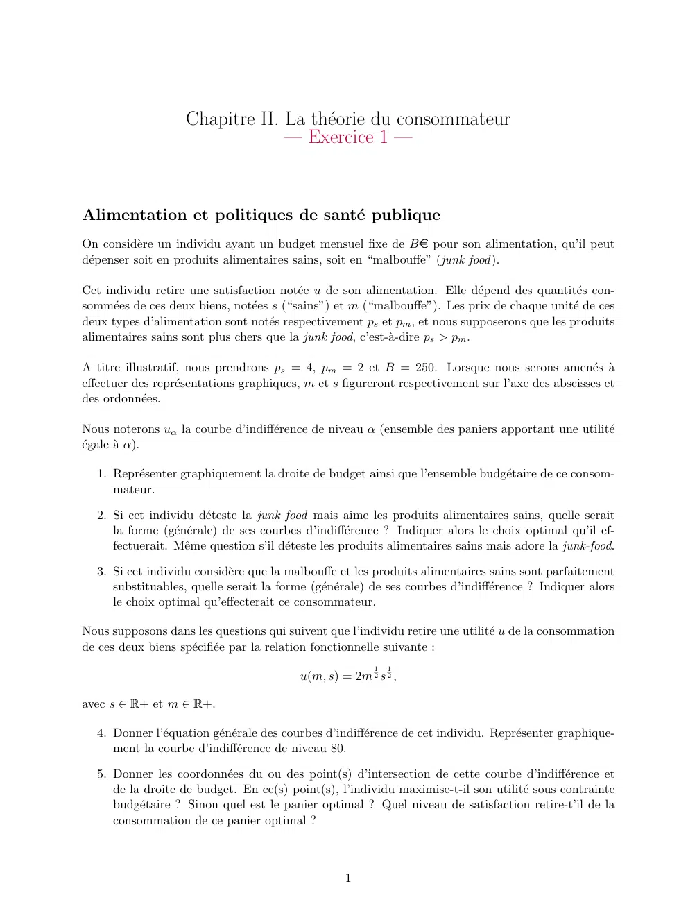
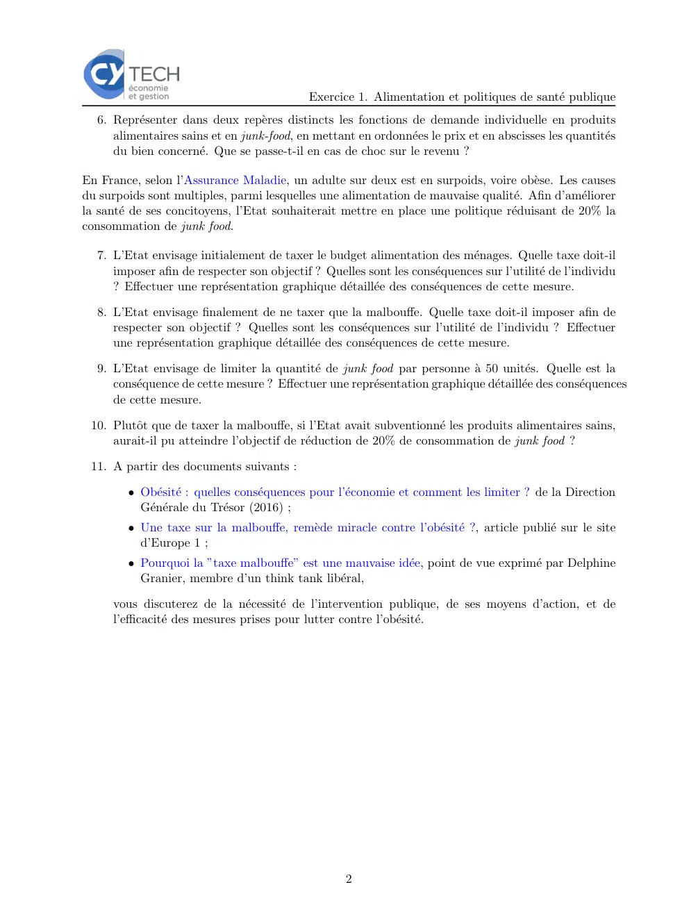

# Economie_I_exercice_02_01.pdf

[Ouvrir l’original](https://drive.google.com/open?id=1aaZDvSE6a1CxtTutVPdvUdegSK-NQbdX) · Les deux lectures automatiques du PDF divergent sur les pages indiquées. Leur fac-similé accompagne le texte.

**Pages présentant un écart entre les deux extractions** — 1–2.

## Page 1

~~~text
                   Chapitre II. La théorie du consommateur
                                — Exercice 1 —

Alimentation et politiques de santé publique
On considère un individu ayant un budget mensuel fixe de Be pour son alimentation, qu’il peut
dépenser soit en produits alimentaires sains, soit en “malbouffe” (junk food ).

Cet individu retire une satisfaction notée u de son alimentation. Elle dépend des quantités con-
sommées de ces deux biens, notées s (“sains”) et m (“malbouffe”). Les prix de chaque unité de ces
deux types d’alimentation sont notés respectivement ps et pm , et nous supposerons que les produits
alimentaires sains sont plus chers que la junk food, c’est-à-dire ps > pm .

A titre illustratif, nous prendrons ps = 4, pm = 2 et B = 250. Lorsque nous serons amenés à
effectuer des représentations graphiques, m et s figureront respectivement sur l’axe des abscisses et
des ordonnées.

Nous noterons uα la courbe d’indifférence de niveau α (ensemble des paniers apportant une utilité
égale à α).

  1. Représenter graphiquement la droite de budget ainsi que l’ensemble budgétaire de ce consom-
     mateur.

  2. Si cet individu déteste la junk food mais aime les produits alimentaires sains, quelle serait
     la forme (générale) de ses courbes d’indifférence ? Indiquer alors le choix optimal qu’il ef-
     fectuerait. Même question s’il déteste les produits alimentaires sains mais adore la junk-food.

  3. Si cet individu considère que la malbouffe et les produits alimentaires sains sont parfaitement
     substituables, quelle serait la forme (générale) de ses courbes d’indifférence ? Indiquer alors
     le choix optimal qu’effecterait ce consommateur.

Nous supposons dans les questions qui suivent que l’individu retire une utilité u de la consommation
de ces deux biens spécifiée par la relation fonctionnelle suivante :
                                                        1   1
                                         u(m, s) = 2m 2 s 2 ,

avec s ∈ R+ et m ∈ R+.

  4. Donner l’équation générale des courbes d’indifférence de cet individu. Représenter graphique-
     ment la courbe d’indifférence de niveau 80.

  5. Donner les coordonnées du ou des point(s) d’intersection de cette courbe d’indifférence et
     de la droite de budget. En ce(s) point(s), l’individu maximise-t-il son utilité sous contrainte
     budgétaire ? Sinon quel est le panier optimal ? Quel niveau de satisfaction retire-t’il de la
     consommation de ce panier optimal ?

                                                  1
~~~

## Page 2

~~~text
                                            Exercice 1. Alimentation et politiques de santé publique
  6. Représenter dans deux repères distincts les fonctions de demande individuelle en produits
     alimentaires sains et en junk-food, en mettant en ordonnées le prix et en abscisses les quantités
     du bien concerné. Que se passe-t-il en cas de choc sur le revenu ?

En France, selon l’Assurance Maladie, un adulte sur deux est en surpoids, voire obèse. Les causes
du surpoids sont multiples, parmi lesquelles une alimentation de mauvaise qualité. Afin d’améliorer
la santé de ses concitoyens, l’Etat souhaiterait mettre en place une politique réduisant de 20% la
consommation de junk food.

  7. L’Etat envisage initialement de taxer le budget alimentation des ménages. Quelle taxe doit-il
     imposer afin de respecter son objectif ? Quelles sont les conséquences sur l’utilité de l’individu
     ? Effectuer une représentation graphique détaillée des conséquences de cette mesure.

  8. L’Etat envisage finalement de ne taxer que la malbouffe. Quelle taxe doit-il imposer afin de
     respecter son objectif ? Quelles sont les conséquences sur l’utilité de l’individu ? Effectuer
     une représentation graphique détaillée des conséquences de cette mesure.

  9. L’Etat envisage de limiter la quantité de junk food par personne à 50 unités. Quelle est la
     conséquence de cette mesure ? Effectuer une représentation graphique détaillée des conséquences
     de cette mesure.

 10. Plutôt que de taxer la malbouffe, si l’Etat avait subventionné les produits alimentaires sains,
     aurait-il pu atteindre l’objectif de réduction de 20% de consommation de junk food ?

 11. A partir des documents suivants :

        • Obésité : quelles conséquences pour l’économie et comment les limiter ? de la Direction
          Générale du Trésor (2016) ;
        • Une taxe sur la malbouffe, remède miracle contre l’obésité ?, article publié sur le site
          d’Europe 1 ;
        • Pourquoi la ”taxe malbouffe” est une mauvaise idée, point de vue exprimé par Delphine
          Granier, membre d’un think tank libéral,

     vous discuterez de la nécessité de l’intervention publique, de ses moyens d’action, et de
     l’efficacité des mesures prises pour lutter contre l’obésité.

                                                   2
~~~
