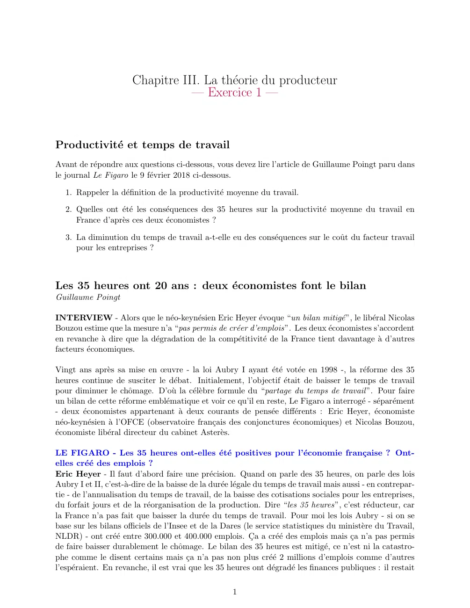
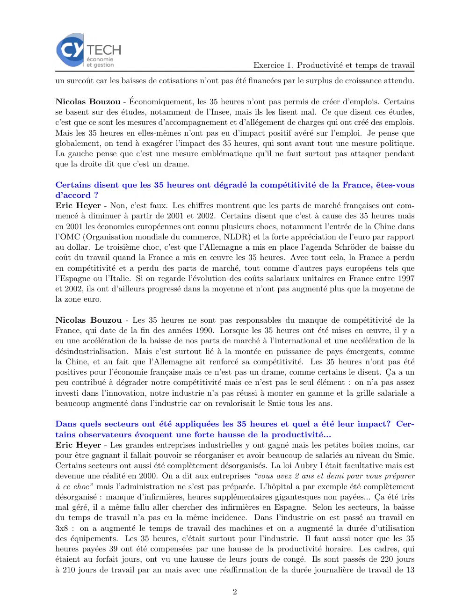
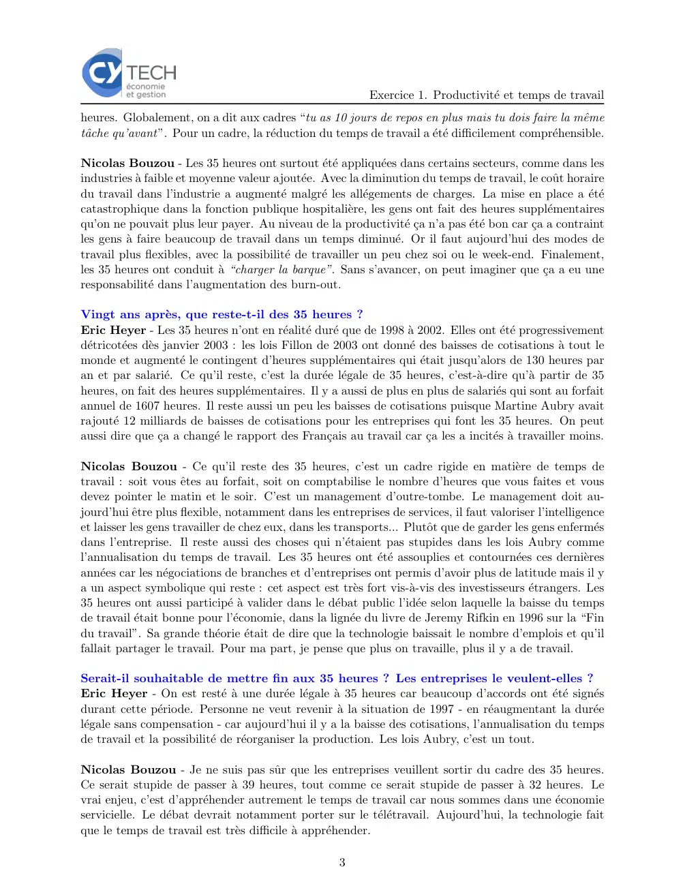

# Economie_I_exercice_03_01.pdf

[Ouvrir l’original](https://drive.google.com/open?id=1CrWraiZEUjPnRysqma1xaSQfAkWSmcrf) · Les deux lectures automatiques du PDF divergent sur les pages indiquées. Leur fac-similé accompagne le texte.

**Pages présentant un écart entre les deux extractions** — 1–3.

## Page 1

~~~text
                       Chapitre III. La théorie du producteur
                                  — Exercice 1 —

Productivité et temps de travail
Avant de répondre aux questions ci-dessous, vous devez lire l’article de Guillaume Poingt paru dans
le journal Le Figaro le 9 février 2018 ci-dessous.

   1. Rappeler la définition de la productivité moyenne du travail.

   2. Quelles ont été les conséquences des 35 heures sur la productivité moyenne du travail en
      France d’après ces deux économistes ?

   3. La diminution du temps de travail a-t-elle eu des conséquences sur le coût du facteur travail
      pour les entreprises ?

Les 35 heures ont 20 ans : deux économistes font le bilan
Guillaume Poingt

INTERVIEW - Alors que le néo-keynésien Eric Heyer évoque “un bilan mitigé”, le libéral Nicolas
Bouzou estime que la mesure n’a “pas permis de créer d’emplois”. Les deux économistes s’accordent
en revanche à dire que la dégradation de la compétitivité de la France tient davantage à d’autres
facteurs économiques.

Vingt ans après sa mise en œuvre - la loi Aubry I ayant été votée en 1998 -, la réforme des 35
heures continue de susciter le débat. Initialement, l’objectif était de baisser le temps de travail
pour diminuer le chômage. D’où la célèbre formule du “partage du temps de travail ”. Pour faire
un bilan de cette réforme emblématique et voir ce qu’il en reste, Le Figaro a interrogé - séparément
- deux économistes appartenant à deux courants de pensée différents : Eric Heyer, économiste
néo-keynésien à l’OFCE (observatoire français des conjonctures économiques) et Nicolas Bouzou,
économiste libéral directeur du cabinet Asterès.

LE FIGARO - Les 35 heures ont-elles été positives pour l’économie française ? Ont-
elles créé des emplois ?
Eric Heyer - Il faut d’abord faire une précision. Quand on parle des 35 heures, on parle des lois
Aubry I et II, c’est-à-dire de la baisse de la durée légale du temps de travail mais aussi - en contrepar-
tie - de l’annualisation du temps de travail, de la baisse des cotisations sociales pour les entreprises,
du forfait jours et de la réorganisation de la production. Dire “les 35 heures”, c’est réducteur, car
la France n’a pas fait que baisser la durée du temps de travail. Pour moi les lois Aubry - si on se
base sur les bilans officiels de l’Insee et de la Dares (le service statistiques du ministère du Travail,
NLDR) - ont créé entre 300.000 et 400.000 emplois. Ça a créé des emplois mais ça n’a pas permis
de faire baisser durablement le chômage. Le bilan des 35 heures est mitigé, ce n’est ni la catastro-
phe comme le disent certains mais ça n’a pas non plus créé 2 millions d’emplois comme d’autres
l’espéraient. En revanche, il est vrai que les 35 heures ont dégradé les finances publiques : il restait

                                                     1
~~~

## Page 2

~~~text
                                                           Exercice 1. Productivité et temps de travail
un surcoût car les baisses de cotisations n’ont pas été financées par le surplus de croissance attendu.

Nicolas Bouzou - Économiquement, les 35 heures n’ont pas permis de créer d’emplois. Certains
se basent sur des études, notamment de l’Insee, mais ils les lisent mal. Ce que disent ces études,
c’est que ce sont les mesures d’accompagnement et d’allégement de charges qui ont créé des emplois.
Mais les 35 heures en elles-mêmes n’ont pas eu d’impact positif avéré sur l’emploi. Je pense que
globalement, on tend à exagérer l’impact des 35 heures, qui sont avant tout une mesure politique.
La gauche pense que c’est une mesure emblématique qu’il ne faut surtout pas attaquer pendant
que la droite dit que c’est un drame.

Certains disent que les 35 heures ont dégradé la compétitivité de la France, êtes-vous
d’accord ?
Eric Heyer - Non, c’est faux. Les chiffres montrent que les parts de marché françaises ont com-
mencé à diminuer à partir de 2001 et 2002. Certains disent que c’est à cause des 35 heures mais
en 2001 les économies européennes ont connu plusieurs chocs, notamment l’entrée de la Chine dans
l’OMC (Organisation mondiale du commerce, NLDR) et la forte appréciation de l’euro par rapport
au dollar. Le troisième choc, c’est que l’Allemagne a mis en place l’agenda Schröder de baisse du
coût du travail quand la France a mis en œuvre les 35 heures. Avec tout cela, la France a perdu
en compétitivité et a perdu des parts de marché, tout comme d’autres pays européens tels que
l’Espagne ou l’Italie. Si on regarde l’évolution des coûts salariaux unitaires en France entre 1997
et 2002, ils ont d’ailleurs progressé dans la moyenne et n’ont pas augmenté plus que la moyenne de
la zone euro.

Nicolas Bouzou - Les 35 heures ne sont pas responsables du manque de compétitivité de la
France, qui date de la fin des années 1990. Lorsque les 35 heures ont été mises en œuvre, il y a
eu une accélération de la baisse de nos parts de marché à l’international et une accélération de la
désindustrialisation. Mais c’est surtout lié à la montée en puissance de pays émergents, comme
la Chine, et au fait que l’Allemagne ait renforcé sa compétitivité. Les 35 heures n’ont pas été
positives pour l’économie française mais ce n’est pas un drame, comme certains le disent. Ça a un
peu contribué à dégrader notre compétitivité mais ce n’est pas le seul élément : on n’a pas assez
investi dans l’innovation, notre industrie n’a pas réussi à monter en gamme et la grille salariale a
beaucoup augmenté dans l’industrie car on revalorisait le Smic tous les ans.

Dans quels secteurs ont été appliquées les 35 heures et quel a été leur impact? Cer-
tains observateurs évoquent une forte hausse de la productivité...
Eric Heyer - Les grandes entreprises industrielles y ont gagné mais les petites boı̂tes moins, car
pour être gagnant il fallait pouvoir se réorganiser et avoir beaucoup de salariés au niveau du Smic.
Certains secteurs ont aussi été complètement désorganisés. La loi Aubry I était facultative mais est
devenue une réalité en 2000. On a dit aux entreprises “vous avez 2 ans et demi pour vous préparer
à ce choc” mais l’administration ne s’est pas préparée. L’hôpital a par exemple été complètement
désorganisé : manque d’infirmières, heures supplémentaires gigantesques non payées... Ça été très
mal géré, il a même fallu aller chercher des infirmières en Espagne. Selon les secteurs, la baisse
du temps de travail n’a pas eu la même incidence. Dans l’industrie on est passé au travail en
3x8 : on a augmenté le temps de travail des machines et on a augmenté la durée d’utilisation
des équipements. Les 35 heures, c’était surtout pour l’industrie. Il faut aussi noter que les 35
heures payées 39 ont été compensées par une hausse de la productivité horaire. Les cadres, qui
étaient au forfait jours, ont vu une hausse de leurs jours de congé. Ils sont passés de 220 jours
à 210 jours de travail par an mais avec une réaffirmation de la durée journalière de travail de 13

                                                    2
~~~

## Page 3

~~~text
                                                           Exercice 1. Productivité et temps de travail
heures. Globalement, on a dit aux cadres “tu as 10 jours de repos en plus mais tu dois faire la même
tâche qu’avant”. Pour un cadre, la réduction du temps de travail a été difficilement compréhensible.

Nicolas Bouzou - Les 35 heures ont surtout été appliquées dans certains secteurs, comme dans les
industries à faible et moyenne valeur ajoutée. Avec la diminution du temps de travail, le coût horaire
du travail dans l’industrie a augmenté malgré les allégements de charges. La mise en place a été
catastrophique dans la fonction publique hospitalière, les gens ont fait des heures supplémentaires
qu’on ne pouvait plus leur payer. Au niveau de la productivité ça n’a pas été bon car ça a contraint
les gens à faire beaucoup de travail dans un temps diminué. Or il faut aujourd’hui des modes de
travail plus flexibles, avec la possibilité de travailler un peu chez soi ou le week-end. Finalement,
les 35 heures ont conduit à “charger la barque”. Sans s’avancer, on peut imaginer que ça a eu une
responsabilité dans l’augmentation des burn-out.

Vingt ans après, que reste-t-il des 35 heures ?
Eric Heyer - Les 35 heures n’ont en réalité duré que de 1998 à 2002. Elles ont été progressivement
détricotées dès janvier 2003 : les lois Fillon de 2003 ont donné des baisses de cotisations à tout le
monde et augmenté le contingent d’heures supplémentaires qui était jusqu’alors de 130 heures par
an et par salarié. Ce qu’il reste, c’est la durée légale de 35 heures, c’est-à-dire qu’à partir de 35
heures, on fait des heures supplémentaires. Il y a aussi de plus en plus de salariés qui sont au forfait
annuel de 1607 heures. Il reste aussi un peu les baisses de cotisations puisque Martine Aubry avait
rajouté 12 milliards de baisses de cotisations pour les entreprises qui font les 35 heures. On peut
aussi dire que ça a changé le rapport des Français au travail car ça les a incités à travailler moins.

Nicolas Bouzou - Ce qu’il reste des 35 heures, c’est un cadre rigide en matière de temps de
travail : soit vous êtes au forfait, soit on comptabilise le nombre d’heures que vous faites et vous
devez pointer le matin et le soir. C’est un management d’outre-tombe. Le management doit au-
jourd’hui être plus flexible, notamment dans les entreprises de services, il faut valoriser l’intelligence
et laisser les gens travailler de chez eux, dans les transports... Plutôt que de garder les gens enfermés
dans l’entreprise. Il reste aussi des choses qui n’étaient pas stupides dans les lois Aubry comme
l’annualisation du temps de travail. Les 35 heures ont été assouplies et contournées ces dernières
années car les négociations de branches et d’entreprises ont permis d’avoir plus de latitude mais il y
a un aspect symbolique qui reste : cet aspect est très fort vis-à-vis des investisseurs étrangers. Les
35 heures ont aussi participé à valider dans le débat public l’idée selon laquelle la baisse du temps
de travail était bonne pour l’économie, dans la lignée du livre de Jeremy Rifkin en 1996 sur la “Fin
du travail”. Sa grande théorie était de dire que la technologie baissait le nombre d’emplois et qu’il
fallait partager le travail. Pour ma part, je pense que plus on travaille, plus il y a de travail.

Serait-il souhaitable de mettre fin aux 35 heures ? Les entreprises le veulent-elles ?
Eric Heyer - On est resté à une durée légale à 35 heures car beaucoup d’accords ont été signés
durant cette période. Personne ne veut revenir à la situation de 1997 - en réaugmentant la durée
légale sans compensation - car aujourd’hui il y a la baisse des cotisations, l’annualisation du temps
de travail et la possibilité de réorganiser la production. Les lois Aubry, c’est un tout.

Nicolas Bouzou - Je ne suis pas sûr que les entreprises veuillent sortir du cadre des 35 heures.
Ce serait stupide de passer à 39 heures, tout comme ce serait stupide de passer à 32 heures. Le
vrai enjeu, c’est d’appréhender autrement le temps de travail car nous sommes dans une économie
servicielle. Le débat devrait notamment porter sur le télétravail. Aujourd’hui, la technologie fait
que le temps de travail est très difficile à appréhender.

                                                     3
~~~
