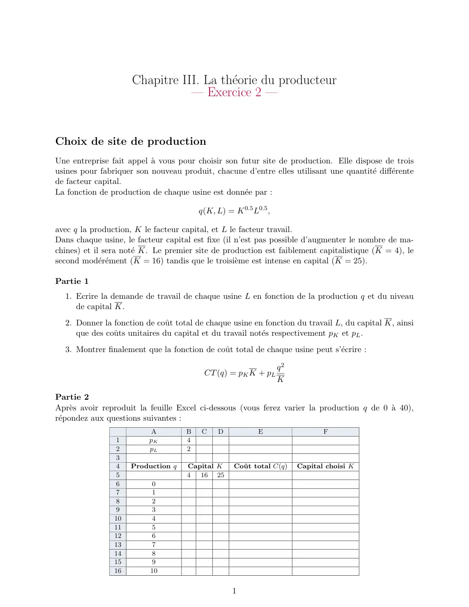
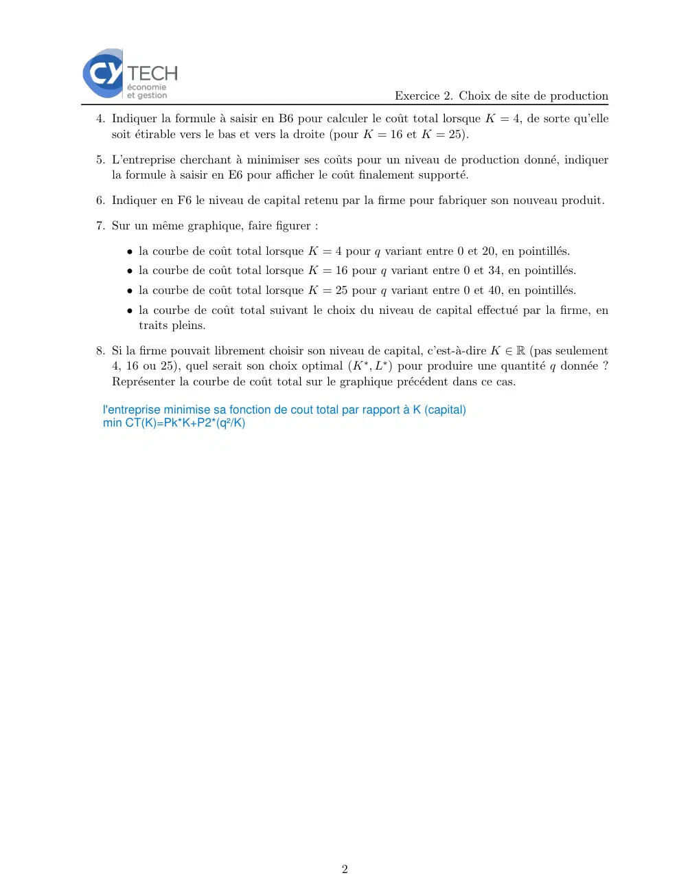

# Economie_I_exercice_03_02.pdf

[Ouvrir l’original](https://drive.google.com/open?id=1_EV5BR-PcLBgtL07F5jU1_bZvxbtDLCI) · Les deux lectures automatiques du PDF divergent sur les pages indiquées. Leur fac-similé accompagne le texte.

**Pages présentant un écart entre les deux extractions** — 1–2.

## Page 1

~~~text
                     Chapitre III. La théorie du producteur
                                — Exercice 2 —

Choix de site de production
Une entreprise fait appel à vous pour choisir son futur site de production. Elle dispose de trois
usines pour fabriquer son nouveau produit, chacune d’entre elles utilisant une quantité différente
de facteur capital.
La fonction de production de chaque usine est donnée par :

                                        q(K, L) = K 0.5 L0.5 ,

avec q la production, K le facteur capital, et L le facteur travail.
Dans chaque usine, le facteur capital est fixe (il n’est pas possible d’augmenter le nombre de ma-
chines) et il sera noté K. Le premier site de production est faiblement capitalistique (K = 4), le
second modérément (K = 16) tandis que le troisième est intense en capital (K = 25).

Partie 1
  1. Ecrire la demande de travail de chaque usine L en fonction de la production q et du niveau
     de capital K.
  2. Donner la fonction de coût total de chaque usine en fonction du travail L, du capital K, ainsi
     que des coûts unitaires du capital et du travail notés respectivement pK et pL .
  3. Montrer finalement que la fonction de coût total de chaque usine peut s’écrire :

                                                                 q2
                                         CT (q) = pK K + pL
                                                                 K

Partie 2
Après avoir reproduit la feuille Excel ci-dessous (vous ferez varier la production q de 0 à 40),
répondez aux questions suivantes :
                           A        B   C    D            E                  F
                 1        pK        4
                 2        pL        2
                 3
                 4   Production q   Capital K     Coût total C(q)    Capital choisi K
                 5                  4 16 25
                 6         0
                 7         1
                 8         2
                 9         3
                10         4
                11         5
                12         6
                13         7
                14         8
                15         9
                16        10

                                                  1
~~~

## Page 2

~~~text
                                                           Exercice 2. Choix de site de production
4. Indiquer la formule à saisir en B6 pour calculer le coût total lorsque K = 4, de sorte qu’elle
   soit étirable vers le bas et vers la droite (pour K = 16 et K = 25).

5. L’entreprise cherchant à minimiser ses coûts pour un niveau de production donné, indiquer
   la formule à saisir en E6 pour afficher le coût finalement supporté.

6. Indiquer en F6 le niveau de capital retenu par la firme pour fabriquer son nouveau produit.

7. Sur un même graphique, faire figurer :

     • la courbe de coût total lorsque K = 4 pour q variant entre 0 et 20, en pointillés.
     • la courbe de coût total lorsque K = 16 pour q variant entre 0 et 34, en pointillés.
     • la courbe de coût total lorsque K = 25 pour q variant entre 0 et 40, en pointillés.
     • la courbe de coût total suivant le choix du niveau de capital effectué par la firme, en
       traits pleins.

8. Si la firme pouvait librement choisir son niveau de capital, c’est-à-dire K ∈ R (pas seulement
   4, 16 ou 25), quel serait son choix optimal (K ∗ , L∗ ) pour produire une quantité q donnée ?
   Représenter la courbe de coût total sur le graphique précédent dans ce cas.

 l'entreprise minimise sa fonction de cout total par rapport à K (capital)
 min CT(K)=Pk*K+P2*(q²/K)

                                                2
~~~
