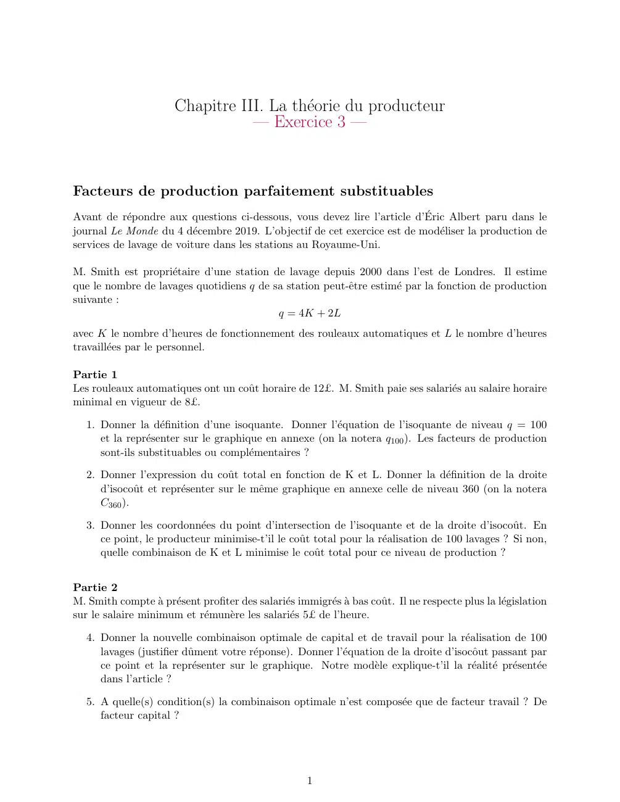
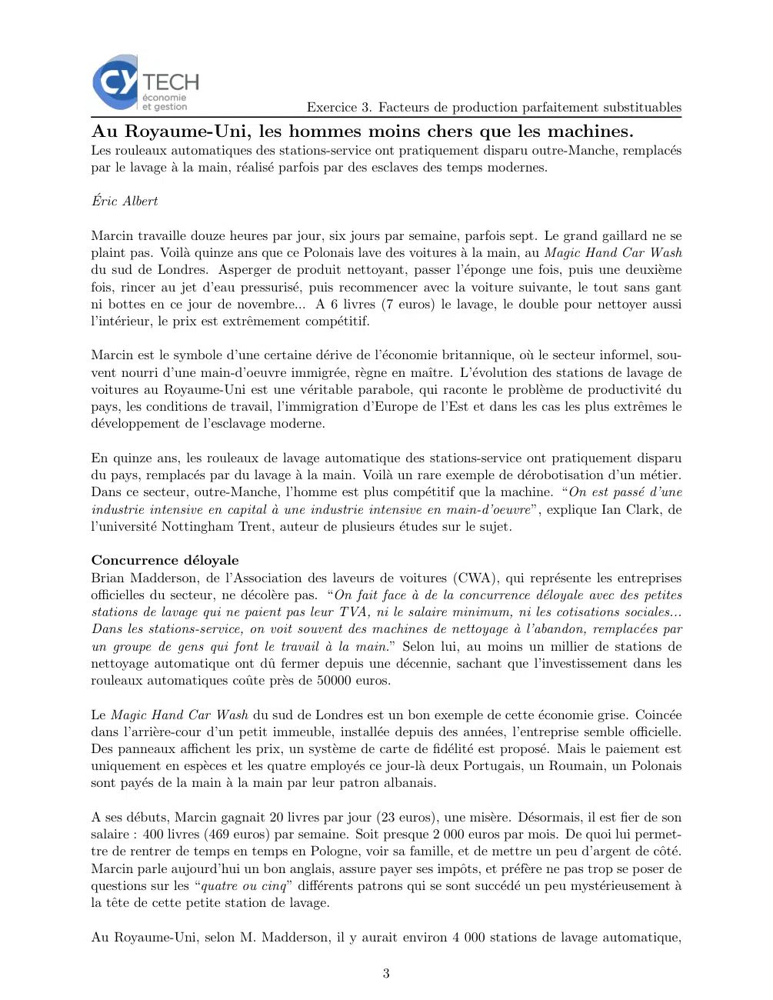
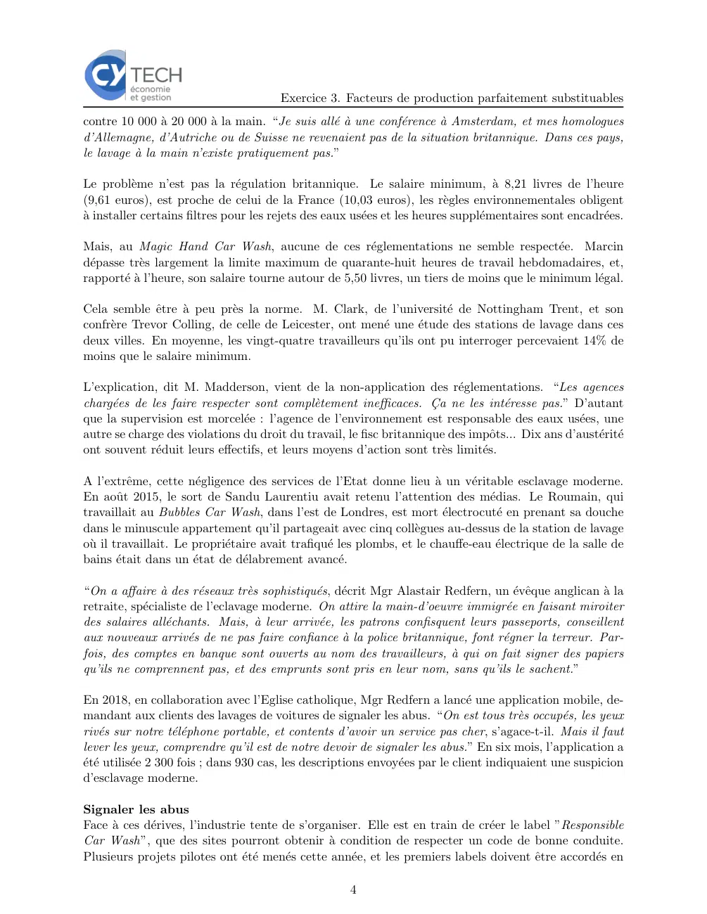
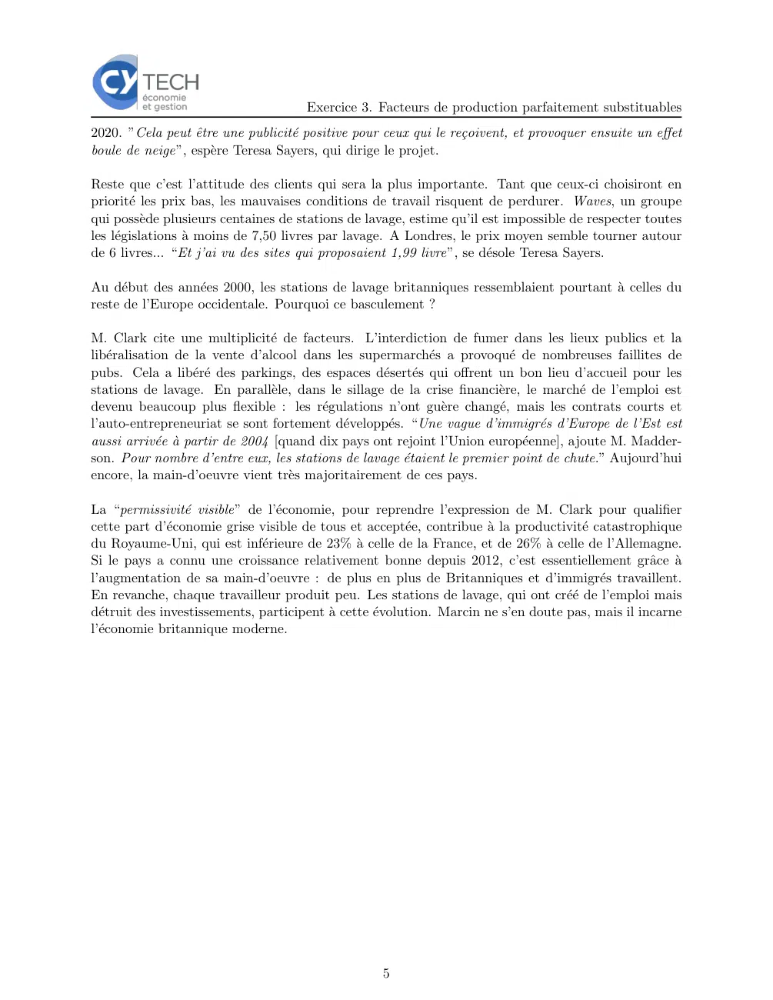

# Economie_I_exercice_03_03.pdf

[Ouvrir l’original](https://drive.google.com/open?id=1G_ou1DF0t2g-8FRy0k1B1tdxgfF4J1WB) · Les deux lectures automatiques du PDF divergent sur les pages indiquées. Leur fac-similé accompagne le texte.

**Pages présentant un écart entre les deux extractions** — 1, 3–5.

## Page 1

~~~text
                       Chapitre III. La théorie du producteur
                                  — Exercice 3 —

Facteurs de production parfaitement substituables
Avant de répondre aux questions ci-dessous, vous devez lire l’article d’Éric Albert paru dans le
journal Le Monde du 4 décembre 2019. L’objectif de cet exercice est de modéliser la production de
services de lavage de voiture dans les stations au Royaume-Uni.

M. Smith est propriétaire d’une station de lavage depuis 2000 dans l’est de Londres. Il estime
que le nombre de lavages quotidiens q de sa station peut-être estimé par la fonction de production
suivante :
                                          q = 4K + 2L
avec K le nombre d’heures de fonctionnement des rouleaux automatiques et L le nombre d’heures
travaillées par le personnel.

Partie 1
Les rouleaux automatiques ont un coût horaire de 12£. M. Smith paie ses salariés au salaire horaire
minimal en vigueur de 8£.

   1. Donner la définition d’une isoquante. Donner l’équation de l’isoquante de niveau q = 100
      et la représenter sur le graphique en annexe (on la notera q100 ). Les facteurs de production
      sont-ils substituables ou complémentaires ?

   2. Donner l’expression du coût total en fonction de K et L. Donner la définition de la droite
      d’isocoût et représenter sur le même graphique en annexe celle de niveau 360 (on la notera
      C360 ).

   3. Donner les coordonnées du point d’intersection de l’isoquante et de la droite d’isocoût. En
      ce point, le producteur minimise-t’il le coût total pour la réalisation de 100 lavages ? Si non,
      quelle combinaison de K et L minimise le coût total pour ce niveau de production ?

Partie 2
M. Smith compte à présent profiter des salariés immigrés à bas coût. Il ne respecte plus la législation
sur le salaire minimum et rémunère les salariés 5£ de l’heure.

   4. Donner la nouvelle combinaison optimale de capital et de travail pour la réalisation de 100
      lavages (justifier dûment votre réponse). Donner l’équation de la droite d’isocôut passant par
      ce point et la représenter sur le graphique. Notre modèle explique-t’il la réalité présentée
      dans l’article ?

   5. A quelle(s) condition(s) la combinaison optimale n’est composée que de facteur travail ? De
      facteur capital ?

                                                      1
~~~

## Page 2

~~~text
                            Exercice 3. Facteurs de production parfaitement substituables
Annexe 1 : Graphique

 L

70

60

50

40

30

20

10

 0
            5          10           15            20            25           30
                                                                                            K

                                         2
~~~

## Page 3

~~~text
                                     Exercice 3. Facteurs de production parfaitement substituables
Au Royaume-Uni, les hommes moins chers que les machines.
Les rouleaux automatiques des stations-service ont pratiquement disparu outre-Manche, remplacés
par le lavage à la main, réalisé parfois par des esclaves des temps modernes.

Éric Albert

Marcin travaille douze heures par jour, six jours par semaine, parfois sept. Le grand gaillard ne se
plaint pas. Voilà quinze ans que ce Polonais lave des voitures à la main, au Magic Hand Car Wash
du sud de Londres. Asperger de produit nettoyant, passer l’éponge une fois, puis une deuxième
fois, rincer au jet d’eau pressurisé, puis recommencer avec la voiture suivante, le tout sans gant
ni bottes en ce jour de novembre... A 6 livres (7 euros) le lavage, le double pour nettoyer aussi
l’intérieur, le prix est extrêmement compétitif.

Marcin est le symbole d’une certaine dérive de l’économie britannique, où le secteur informel, sou-
vent nourri d’une main-d’oeuvre immigrée, règne en maı̂tre. L’évolution des stations de lavage de
voitures au Royaume-Uni est une véritable parabole, qui raconte le problème de productivité du
pays, les conditions de travail, l’immigration d’Europe de l’Est et dans les cas les plus extrêmes le
développement de l’esclavage moderne.

En quinze ans, les rouleaux de lavage automatique des stations-service ont pratiquement disparu
du pays, remplacés par du lavage à la main. Voilà un rare exemple de dérobotisation d’un métier.
Dans ce secteur, outre-Manche, l’homme est plus compétitif que la machine. “On est passé d’une
industrie intensive en capital à une industrie intensive en main-d’oeuvre”, explique Ian Clark, de
l’université Nottingham Trent, auteur de plusieurs études sur le sujet.

Concurrence déloyale
Brian Madderson, de l’Association des laveurs de voitures (CWA), qui représente les entreprises
officielles du secteur, ne décolère pas. “On fait face à de la concurrence déloyale avec des petites
stations de lavage qui ne paient pas leur TVA, ni le salaire minimum, ni les cotisations sociales...
Dans les stations-service, on voit souvent des machines de nettoyage à l’abandon, remplacées par
un groupe de gens qui font le travail à la main.” Selon lui, au moins un millier de stations de
nettoyage automatique ont dû fermer depuis une décennie, sachant que l’investissement dans les
rouleaux automatiques coûte près de 50000 euros.

Le Magic Hand Car Wash du sud de Londres est un bon exemple de cette économie grise. Coincée
dans l’arrière-cour d’un petit immeuble, installée depuis des années, l’entreprise semble officielle.
Des panneaux affichent les prix, un système de carte de fidélité est proposé. Mais le paiement est
uniquement en espèces et les quatre employés ce jour-là deux Portugais, un Roumain, un Polonais
sont payés de la main à la main par leur patron albanais.

A ses débuts, Marcin gagnait 20 livres par jour (23 euros), une misère. Désormais, il est fier de son
salaire : 400 livres (469 euros) par semaine. Soit presque 2 000 euros par mois. De quoi lui permet-
tre de rentrer de temps en temps en Pologne, voir sa famille, et de mettre un peu d’argent de côté.
Marcin parle aujourd’hui un bon anglais, assure payer ses impôts, et préfère ne pas trop se poser de
questions sur les “quatre ou cinq” différents patrons qui se sont succédé un peu mystérieusement à
la tête de cette petite station de lavage.

Au Royaume-Uni, selon M. Madderson, il y aurait environ 4 000 stations de lavage automatique,

                                                   3
~~~

## Page 4

~~~text
                                       Exercice 3. Facteurs de production parfaitement substituables
contre 10 000 à 20 000 à la main. “Je suis allé à une conférence à Amsterdam, et mes homologues
d’Allemagne, d’Autriche ou de Suisse ne revenaient pas de la situation britannique. Dans ces pays,
le lavage à la main n’existe pratiquement pas.”

Le problème n’est pas la régulation britannique. Le salaire minimum, à 8,21 livres de l’heure
(9,61 euros), est proche de celui de la France (10,03 euros), les règles environnementales obligent
à installer certains filtres pour les rejets des eaux usées et les heures supplémentaires sont encadrées.

Mais, au Magic Hand Car Wash, aucune de ces réglementations ne semble respectée. Marcin
dépasse très largement la limite maximum de quarante-huit heures de travail hebdomadaires, et,
rapporté à l’heure, son salaire tourne autour de 5,50 livres, un tiers de moins que le minimum légal.

Cela semble être à peu près la norme. M. Clark, de l’université de Nottingham Trent, et son
confrère Trevor Colling, de celle de Leicester, ont mené une étude des stations de lavage dans ces
deux villes. En moyenne, les vingt-quatre travailleurs qu’ils ont pu interroger percevaient 14% de
moins que le salaire minimum.

L’explication, dit M. Madderson, vient de la non-application des réglementations. “Les agences
chargées de les faire respecter sont complètement inefficaces. Ça ne les intéresse pas.” D’autant
que la supervision est morcelée : l’agence de l’environnement est responsable des eaux usées, une
autre se charge des violations du droit du travail, le fisc britannique des impôts... Dix ans d’austérité
ont souvent réduit leurs effectifs, et leurs moyens d’action sont très limités.

A l’extrême, cette négligence des services de l’Etat donne lieu à un véritable esclavage moderne.
En août 2015, le sort de Sandu Laurentiu avait retenu l’attention des médias. Le Roumain, qui
travaillait au Bubbles Car Wash, dans l’est de Londres, est mort électrocuté en prenant sa douche
dans le minuscule appartement qu’il partageait avec cinq collègues au-dessus de la station de lavage
où il travaillait. Le propriétaire avait trafiqué les plombs, et le chauffe-eau électrique de la salle de
bains était dans un état de délabrement avancé.

“On a affaire à des réseaux très sophistiqués, décrit Mgr Alastair Redfern, un évêque anglican à la
retraite, spécialiste de l’eclavage moderne. On attire la main-d’oeuvre immigrée en faisant miroiter
des salaires alléchants. Mais, à leur arrivée, les patrons confisquent leurs passeports, conseillent
aux nouveaux arrivés de ne pas faire confiance à la police britannique, font régner la terreur. Par-
fois, des comptes en banque sont ouverts au nom des travailleurs, à qui on fait signer des papiers
qu’ils ne comprennent pas, et des emprunts sont pris en leur nom, sans qu’ils le sachent.”

En 2018, en collaboration avec l’Eglise catholique, Mgr Redfern a lancé une application mobile, de-
mandant aux clients des lavages de voitures de signaler les abus. “On est tous très occupés, les yeux
rivés sur notre téléphone portable, et contents d’avoir un service pas cher, s’agace-t-il. Mais il faut
lever les yeux, comprendre qu’il est de notre devoir de signaler les abus.” En six mois, l’application a
été utilisée 2 300 fois ; dans 930 cas, les descriptions envoyées par le client indiquaient une suspicion
d’esclavage moderne.

Signaler les abus
Face à ces dérives, l’industrie tente de s’organiser. Elle est en train de créer le label ”Responsible
Car Wash”, que des sites pourront obtenir à condition de respecter un code de bonne conduite.
Plusieurs projets pilotes ont été menés cette année, et les premiers labels doivent être accordés en

                                                     4
~~~

## Page 5

~~~text
                                      Exercice 3. Facteurs de production parfaitement substituables
2020. ”Cela peut être une publicité positive pour ceux qui le reçoivent, et provoquer ensuite un effet
boule de neige”, espère Teresa Sayers, qui dirige le projet.

Reste que c’est l’attitude des clients qui sera la plus importante. Tant que ceux-ci choisiront en
priorité les prix bas, les mauvaises conditions de travail risquent de perdurer. Waves, un groupe
qui possède plusieurs centaines de stations de lavage, estime qu’il est impossible de respecter toutes
les législations à moins de 7,50 livres par lavage. A Londres, le prix moyen semble tourner autour
de 6 livres... “Et j’ai vu des sites qui proposaient 1,99 livre”, se désole Teresa Sayers.

Au début des années 2000, les stations de lavage britanniques ressemblaient pourtant à celles du
reste de l’Europe occidentale. Pourquoi ce basculement ?

M. Clark cite une multiplicité de facteurs. L’interdiction de fumer dans les lieux publics et la
libéralisation de la vente d’alcool dans les supermarchés a provoqué de nombreuses faillites de
pubs. Cela a libéré des parkings, des espaces désertés qui offrent un bon lieu d’accueil pour les
stations de lavage. En parallèle, dans le sillage de la crise financière, le marché de l’emploi est
devenu beaucoup plus flexible : les régulations n’ont guère changé, mais les contrats courts et
l’auto-entrepreneuriat se sont fortement développés. “Une vague d’immigrés d’Europe de l’Est est
aussi arrivée à partir de 2004 [quand dix pays ont rejoint l’Union européenne], ajoute M. Madder-
son. Pour nombre d’entre eux, les stations de lavage étaient le premier point de chute.” Aujourd’hui
encore, la main-d’oeuvre vient très majoritairement de ces pays.

La “permissivité visible” de l’économie, pour reprendre l’expression de M. Clark pour qualifier
cette part d’économie grise visible de tous et acceptée, contribue à la productivité catastrophique
du Royaume-Uni, qui est inférieure de 23% à celle de la France, et de 26% à celle de l’Allemagne.
Si le pays a connu une croissance relativement bonne depuis 2012, c’est essentiellement grâce à
l’augmentation de sa main-d’oeuvre : de plus en plus de Britanniques et d’immigrés travaillent.
En revanche, chaque travailleur produit peu. Les stations de lavage, qui ont créé de l’emploi mais
détruit des investissements, participent à cette évolution. Marcin ne s’en doute pas, mais il incarne
l’économie britannique moderne.

                                                   5
~~~
