# Fiche-Economie.docx

[Ouvrir l’original](https://drive.google.com/open?id=1PjaiRByhTfWJNca_oaGM8eW7KpzmLI8w) · Texte structuré depuis le fichier original. Les mises en page complexes peuvent nécessiter une vérification.

**<u>Economie :</u>**

**<u>Chapitre 0 :</u>**

1.  **<u>Qu’est-ce que l’économie ?</u>**

Deux branches principales de l'économie :

\- **Microéconomie** (étudie le comportement des unités économiques individuelles).

\- **Macroéconomie** (traite des quantités économiques agrégées).

2.  **<u>La rareté, le choix et le coût d’opportunité :</u>**

Les 3 concepts de la Microéconomie sont :

**- la** **rareté**.

**- le choix.**

**- Le coût d'opportunité** (représente les avantages potentiels qu'un agent économique perd en choisissant une alternative en effectuant un choix. C'est la valeur de l'alternative abandonnée).

3.  **<u>Théories et Modèles :</u>**

Il y a 2 objectifs :

**- Explication** des phénomènes économiques.

--\> Hypothèse pour décrire où l'analyse sera effectuée. Les types de variables utilisées pour ce modèle peuvent être **endogènes** (expliqué par le modèle) ou **exogènes** (non expliquées par le modèle).

On **résout** ensuite le modèle pour tirer certaines **conclusions** et explications sur les phénomènes économiques observées.

**- Prédiction** économique.

On **test** ces théories pour savoir si les résultats du modèle sont vérifiés dans la réalité et éventuellement de mesurer la précision de ces prédictions.

**<u>Chapitre 1 :</u>**

1.  **<u>Le marché :</u>**

**Marché** : Ensemble d'acheteurs et de vendeurs qui, par leurs interactions, réelles ou potentielles, déterminent le prix d'un produit ou d'un ensemble de produits.

Les **interactions réelles** influent sur la détermination des prix, mais également les **interactions potentielles**.

**Opérations d'arbitrage** : correspond à acheter le bien sur un marché où le prix est moins élevé et le revendre sur un marché où le prix est plus élevé.

Pour délimiter un marché :

\- étendue géographique (Europe).

\- gamme de produits (citadine, berline).

2.  **<u>La courbe de demande et d’offre :</u>**

**Les acheteurs constituent la demande et les vendeurs l'offre.**

1.  **<u>La demande.</u>**

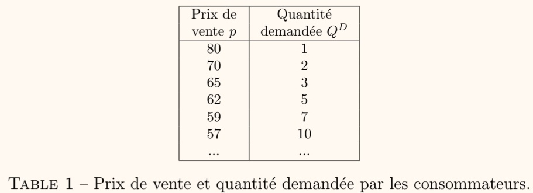

**Prix de réservation :** prix maximal qu'un consommateur est prêt à payer pour acquérir un bien. Au prix de réservation, le consommateur est indifférent entre acheter le bien et ne pas l'acheter.

La fonction de **demande** indique la quantité désirée par les consommateurs pour chaque niveau de prix.

*<u>Représentation graphique :</u>*

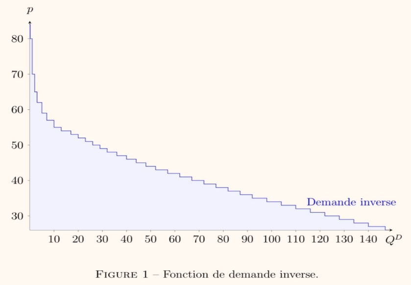

Les prix en ordonnées et les quantités en abscisse. Cela représente ainsi la **demande inverse** et non la demande.

Plus le prix est faible, plus la demande est grande en général.

*<u>Exceptions :</u>*

- **Biens Veblen** ou biens de luxe : La demande augmente si le prix augmente comme les œuvres d'art, les voitures de luxe, etc.

- **Biens Giffen** ou biens de première nécessité : Si on observe une hausse des prix de première nécessité, la consommation de ces derniers va paradoxalement augmenter comme le riz, le lait, etc.

  1.  **<u>L'offre.</u>**

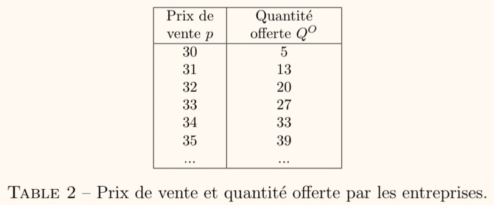

La **fonction d'offre** indique la quantité produite par les entreprises pour chaque niveau de prix.

*<u>Représentation graphique :</u>*

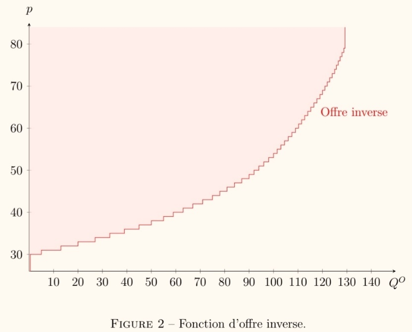

Les prix en ordonnées et les quantités en abscisse. Cela représente ainsi l'**offre inverse** et non l'offre.

Plus le prix est faible, plus l'offre est faible en général.

3.  **<u>L’équilibre du marché :</u>**

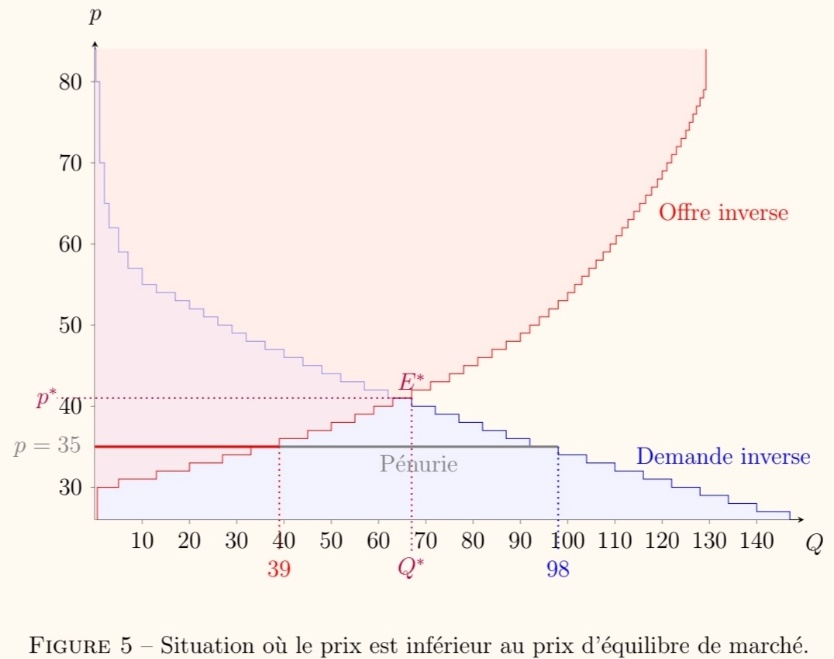

Le **prix d'équilibre** est le prix auquel la quantité désirée par les consommateurs d'un bien ou service égale la quantité produite par les entreprises de ce même bien ou service.

On note Q\* les quantité d'équilibre (quantité telle que l'offre soit égale à la demande) et E\* l'équilibre du marché (point de coordonnées (Q\*, p\*)).

4.  **<u>Les élasticités :</u>**

    1.  **<u>Le concept d’élasticité.</u>**

**Ratio de la variation des quantités consécutivement à une variation des prix :**

$$\frac{\mathrm{\Delta}Q}{\mathrm{\Delta}p}\ \mathrm{\Delta}\  = après - avant$$

Cette formule est sensible aux unités de mesure choisies.

Pour pallier à ce problème, les économistes utilisent le concept **d'élasticité**. On exprime le tout en pourcentage.

**L'élasticité** s'écrit ainsi :

$$\varepsilon = \ \frac{\frac{\mathrm{\Delta}Y}{Y}}{\frac{\mathrm{\Delta}X}{X}}\ avec\ \mathrm{\Delta}X = val\ fin - val\ déb\ et\ X = val\ de\ départ$$

**L'élasticité-prix de la demande** est le rapport de la variation relative de la quantité demandée par l’acheteur à la variation relative de prix.

$$\varepsilon^{D} = \ \frac{\frac{{\mathrm{\Delta}Q}^{D}}{Q^{D}}}{\frac{\mathrm{\Delta}p}{p}}$$

**L'élasticité-prix de l'offre** est le rapport de la variation relative de la quantité offerte par l’entreprise à la variation relative de prix.

$$\varepsilon^{O} = \ \frac{\frac{{\mathrm{\Delta}Q}^{O}}{Q^{O}}}{\frac{\mathrm{\Delta}p}{p}}$$

**L'élasticité-revenu de la demande** est le rapport de la variation relative de la quantité demandée à la variation relative des revenus.

$$\varepsilon^{R} = \ \frac{\frac{{\mathrm{\Delta}Q}^{D}}{Q^{D}}}{\frac{\mathrm{\Delta}R}{R}}$$

**L'élasticité-prix croisée de la demande** est le rapport de la variation relative de la quantité demandée en biens A à la variation relative du prix des biens B.

$$\varepsilon^{DC} = \ \frac{\frac{{\mathrm{\Delta}Q}_{A}^{D}}{Q_{A}^{D}}}{\frac{\mathrm{\Delta}p^{B}}{p^{B}}}$$

2.  **<u>Interpréter les élasticités.</u>**

Si X augmente de 1%, c'est-à-dire $\frac{\mathrm{\Delta}X}{X}$ = 1% :

$$\frac{\mathrm{\Delta}Y}{Y} = \varepsilon\%$$

ce qui signifie qu’une hausse de X de 1% entraîne une variation de Y de e%.

**FAIRE EXEMPLE 13 PAGE 16**

**<u>Chapitre 3 :</u>**

1.  **<u>La production :</u>**

C’est l’activité économique qui crée des biens et services en combinant un ou plusieurs facteurs de production, également appelés inputs.

Des **inputs** (ressources naturelles, terres agricoles, ressources énergétiques) sont nécessaires pour créer des **outputs** (biens et services).

Nous nous intéressons à 2 inputs :

- **Le travail** : ensemble des efforts humains déployés dans le processus de production, il peut être sous forme manuelle ou intellectuelle, répétitif ou créatif … Le travail est une variable **unidimensionnelle**

- **Le capital :** ensemble des biens utilisés au cours de plusieurs cycles de production -\> capital physique et non financier !

> Le capital regroupe des actifs physiques (outils, machines, ordinateurs…) qui ne sont pas transformés au cours du cycle de production. De la farine, du béton = ! du capital car ils sont transformés au cours d’un cycle de production. Mesure en unité de flux et non en unité de stock
>
> Il est nécessaire d’avoir des combinaisons de différents facteurs d’inputs pour produire des outputs. Chacune de ces combinaisons est appelé **technologie de production.**
>
> La transformation des inputs en outputs se traduisent par des fonctions de production.

**Fonction de production :** Elle indique la quantité maximale q qu’une firme peut produire pour toute combinaison d’inputs spécifiée.

q = f(K, L) avec L = facteur travail, K facteur capital et f = fonction de production

Les entreprises vont tenir compte de l’horizon temporel pour prendre des décisions concernant la production d’outputs en distinguant le **court terme** et le **long terme**.

Exemple : une demande de la part des consommateurs augmente, la réponse n’est pas la même à long terme et à court terme. A court terme, l’entreprise embauchera des salariés pour répondre à la demande rapidement et pour produire davantage (CDI,CDD). A long terme, l’entreprise va réfléchir à créer des machines, des usines pour répondre à cette demande.

A court terme, l’entreprise considère souvent le **facteur capital comme fixe** (au moins un facteur fixe).

A long terme, tous les **facteurs de production sont variables.**

2.  **<u>Productivité moyenne et productivité marginale :</u>**

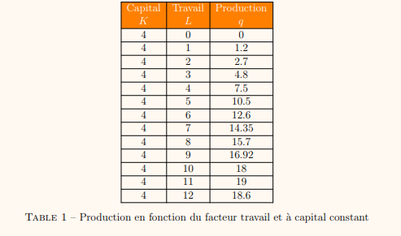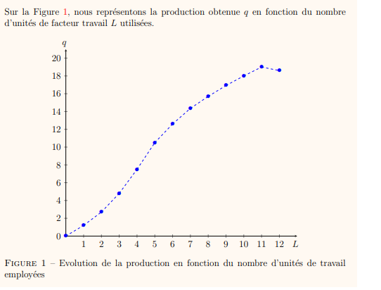

> Ici, augmenter le facteur de travail (salariés) augmente la production jusqu’à 11 salariés. Le 12e embauché diminue la productivité car il peut être contreproductif d’embaucher davantage de main d’œuvre pouvant entraîner de la gêne et une répartition des tâches difficiles -\> diminue l’efficacité des salariés.
>
> <u>A. A court terme avec comme seul facteur de production : le travail</u>
>
> **<u>2.1. Productivité moyenne (mesure l’efficacité de facteurs de production) :</u>**

Elle est notée PML et mesure le nombre d’unités produites par unité de facteur travail. Elle se calcule comme le ratio de la production q par la quantité de travail employée L :

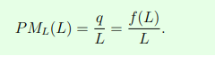

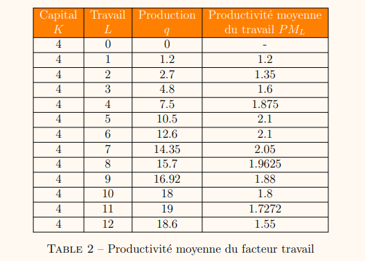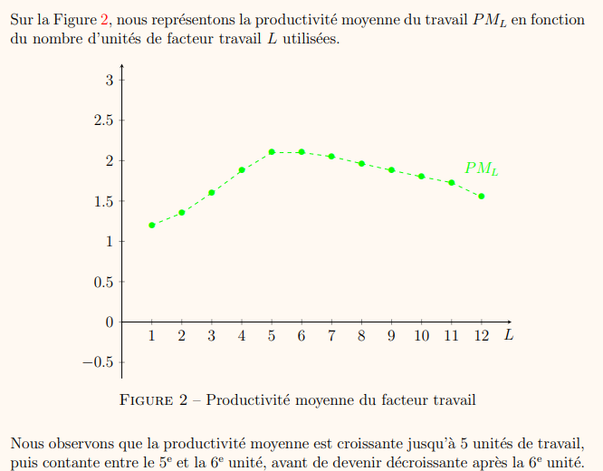

> **<u>2.2. Productivité marginale (mesure l’efficacité du travail (autres facteurs constants)) :</u>**
>
> Elle est notée PmL et mesure la variation de la production ∆q consécutive à une petite variation de la quantité de facteur travail ∆L. « augmentation de la production entre avant et après »
>
> 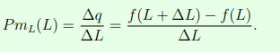
>
> 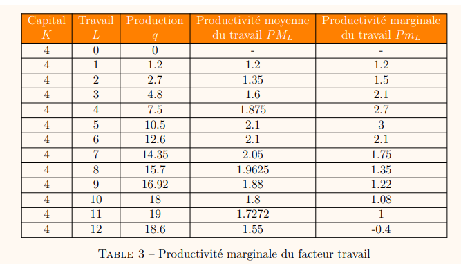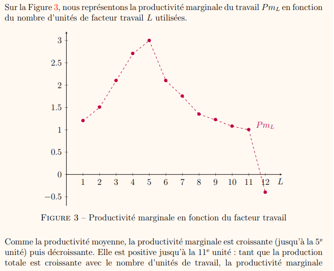
>
> 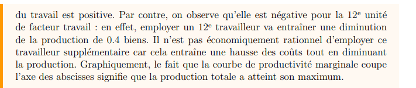
>
> Lorsque productivité marginale = productivité moyenne -\> production totale a atteint son maximum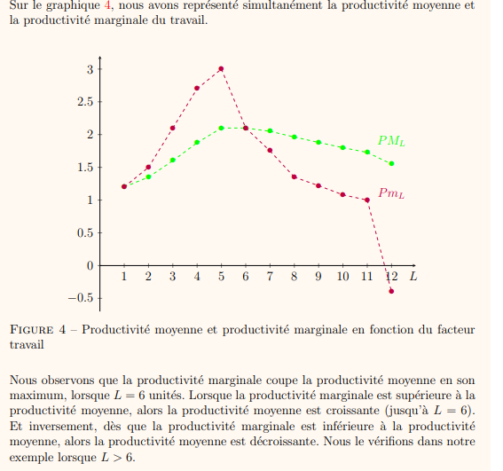

**Loi des rendements marginaux décroissants :** A partir d’un certain niveau de production, augmenter davantage l’utilisation d’un facteur de production augmente de – en – **rapidement** la production.

<u>B. Facteur de production \>=2 : le travail et le capital</u>

Productivité moyenne du travail : 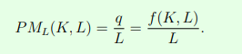

Productivité moyenne du capital : 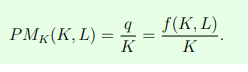

Productivité marginale du travail : 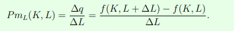

Productivité moyenne du capital :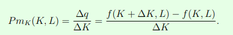

3.  **<u>Les rendements d’échelle :</u>**

Ils mesurent le taux auquel la production augmente lorsque les quantités de tous les facteurs de production augmentent dans les mêmes proportions. Peuvent être croissants, constants ou décroissants.

- Les rendements d’´échelle sont constants si, lorsqu’on multiplie tous les facteurs de production par un réel λ \> 1, alors la production est aussi multipliée par λ : f (λK, λL) = λf (K, L).

<!-- -->

- Même rendement en %

<!-- -->

- Les rendements d’´échelle sont croissants si, lorsqu’on multiplie tous les facteurs de production par un réel λ \> 1, alors la production est multipliée par plus que λ : f (λK, λL) \> λf (K, L).

<!-- -->

- Rendement en hausse en %

<!-- -->

- Les rendements d’´échelle sont décroissants si, lorsqu’on multiplie tous les facteurs de production par un réel λ \> 1, alors la production est multipliée par moins que λ : f (λK, λL) \< λf (K, L).

<!-- -->

- Rendement en baisse en %

La fonction de production Cobb-Douglas : 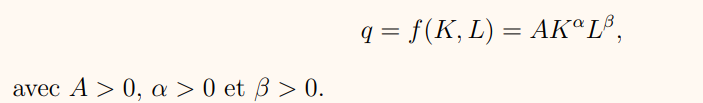

- Alpha+beta=1 -\> rendements d’échelle constants

- Alpha+beta\<1 -\> rendements d’échelle décroissants

- Alpha+beta\>1 -\> rendements d’échelle croissants

4.  <u>Les isoquantes :</u>

Fonction de Production : q = f(K, L)

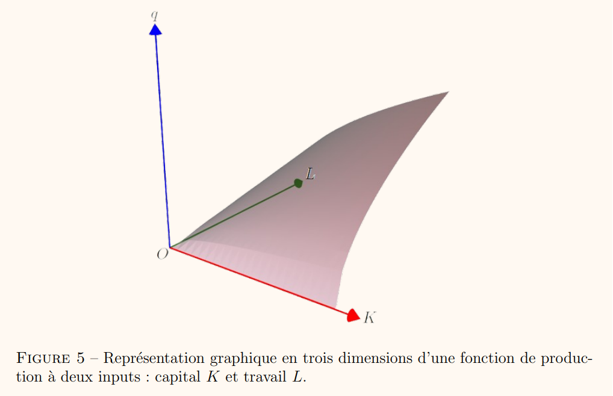 (pas important en 3 dimensions)

**Une isoquante** (ou courbe d’isoproduit) est une courbe qui représente l’ensemble des combinaisons de différents facteurs de production (capital et travail) qui permettent d’obtenir un même niveau de production.

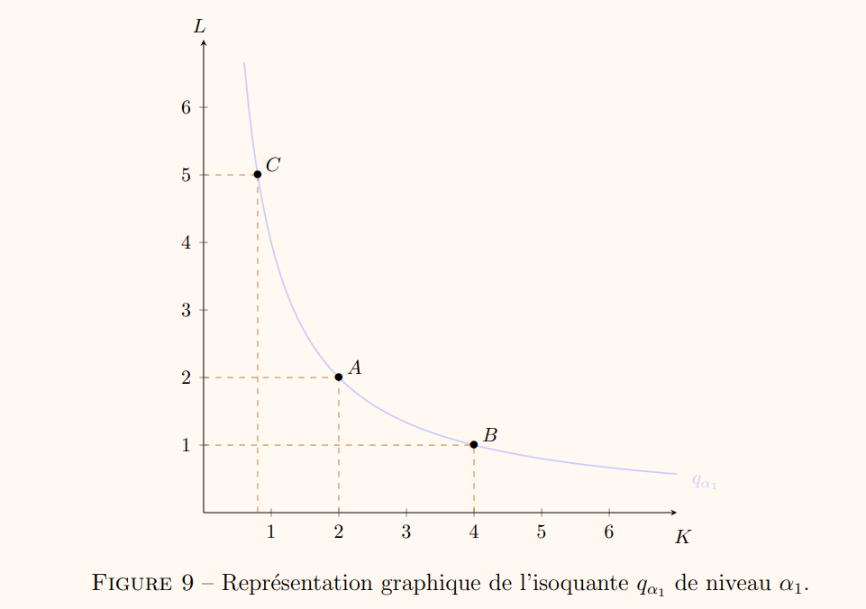

Rajouter des inputs (capital ou travail) permet d’augmenter la production

- 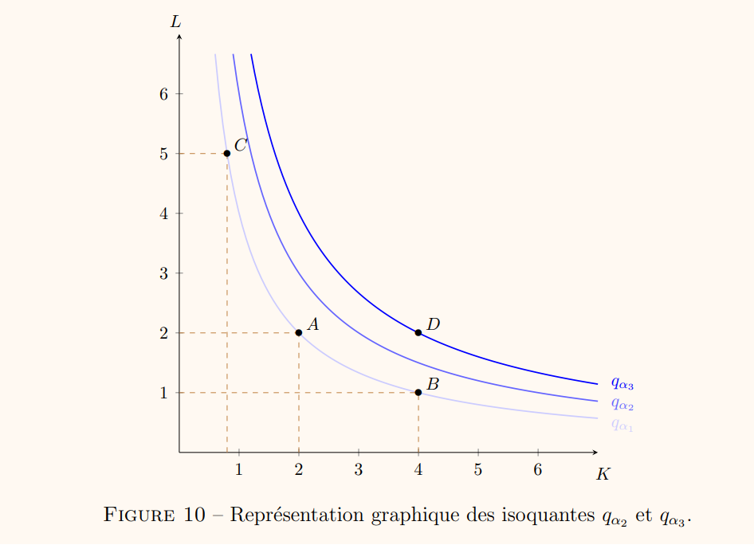

5.  <u>Le taux marginal de substitution technique :</u>

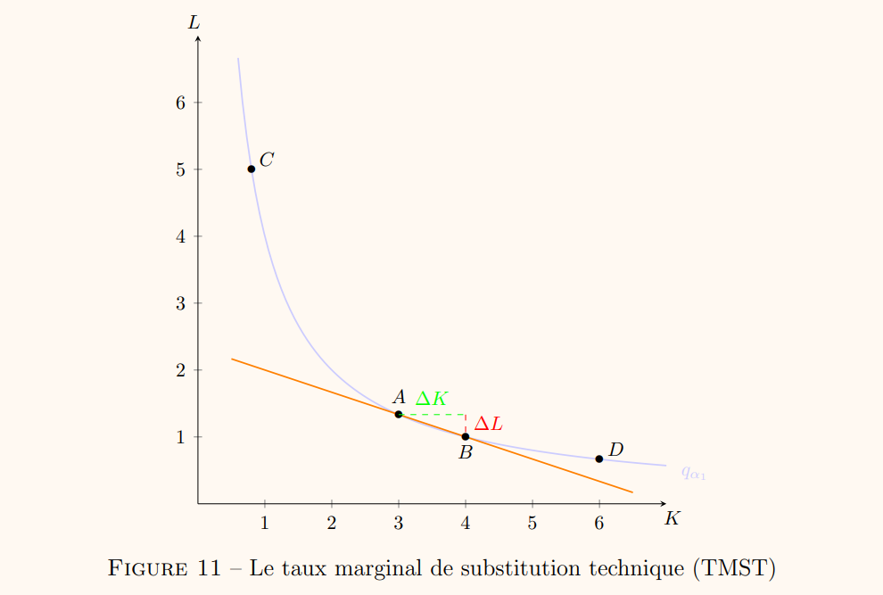

**Le taux marginal de substitution technique (TMST)** est la quantité de facteur travail que l’entreprise substitue (notée dL) pour la remplacer par une quantité supplémentaire de facteur capital dK tout en maintenant constante la production.

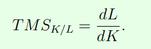 -\> toujours négatif

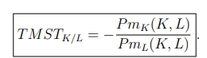

Le taux marginal de substitution technique (TMST) est égal au rapport des productivités marginales des facteurs capital et travail.

6.  <u>Facteurs de production parfaitement substituables et complémentaires :</u>

- Isoquantes = droites -\> facteurs de production parfaitement substituables

> -\> taux marginal de substitution technique est constant

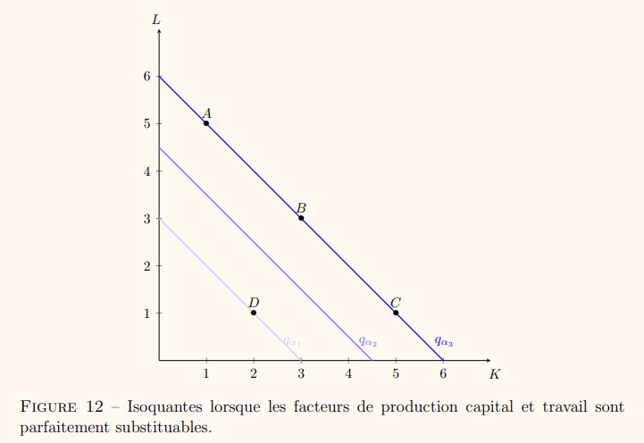

- Facteurs de production parfaitement complémentaires = combinaisons productives efficaces pour produire un bien ou un service respectivement en quantité

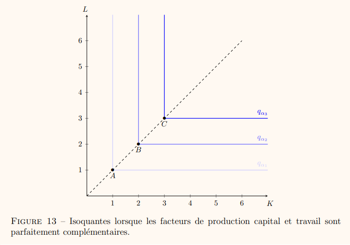

**Complémentaire :** Les biens complémentaires se consomment conjointement (café + sucre)

**Substituable :** Les biens substituables sont par exemple une forte augmentation du prix du café entraîne une augmentation de la demande de thé

7.  <u>Le coût total des inputs :</u>

Le coût total de production de l’entreprise s’écrit : 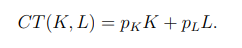

Avec L = facteur travail et PL = prix unitaire du travail

K = facteur capital et PK = prix unitaire du capital

Une **droite d’isocoût** de niveau β représente l’ensemble des combinaisons productives de facteur capital et travail qui ont exactement le même coût β. L’équation de la droite d’isocoût est :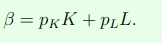

Aussi égal à : 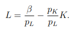

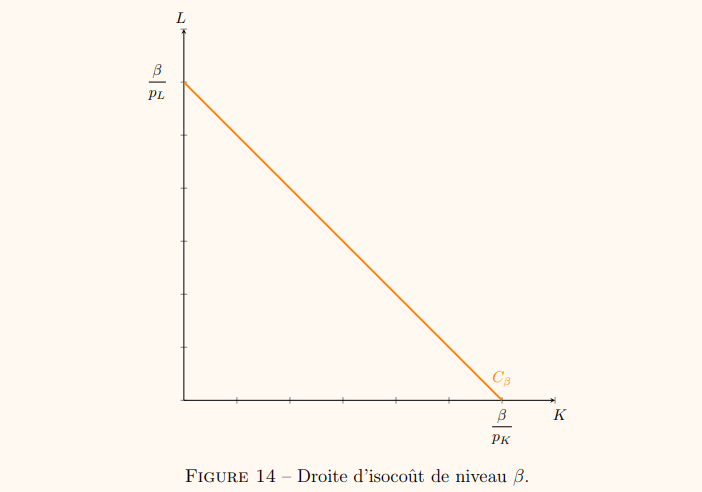

8.  <u>Le choix optimal de l’entreprise :</u>

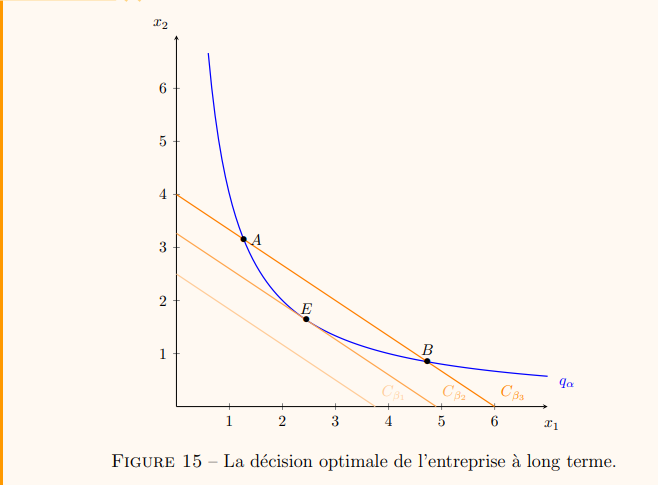 Le point E est le choix optimal de l’entreprise. Au point E, la droite d’isocoût est tangente à l’isoquante, cad, que la pente de la droite d’isocoût est identique à la pente de l’isoquante.

La combinaison productive optimale est telle que : 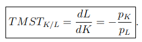
