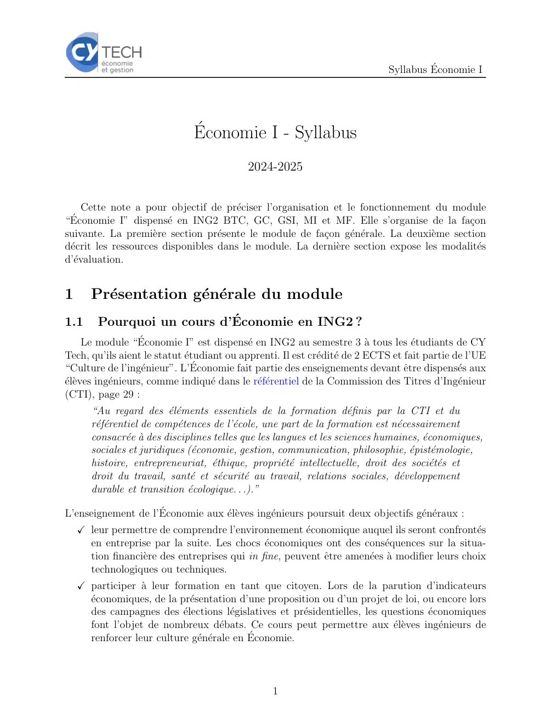
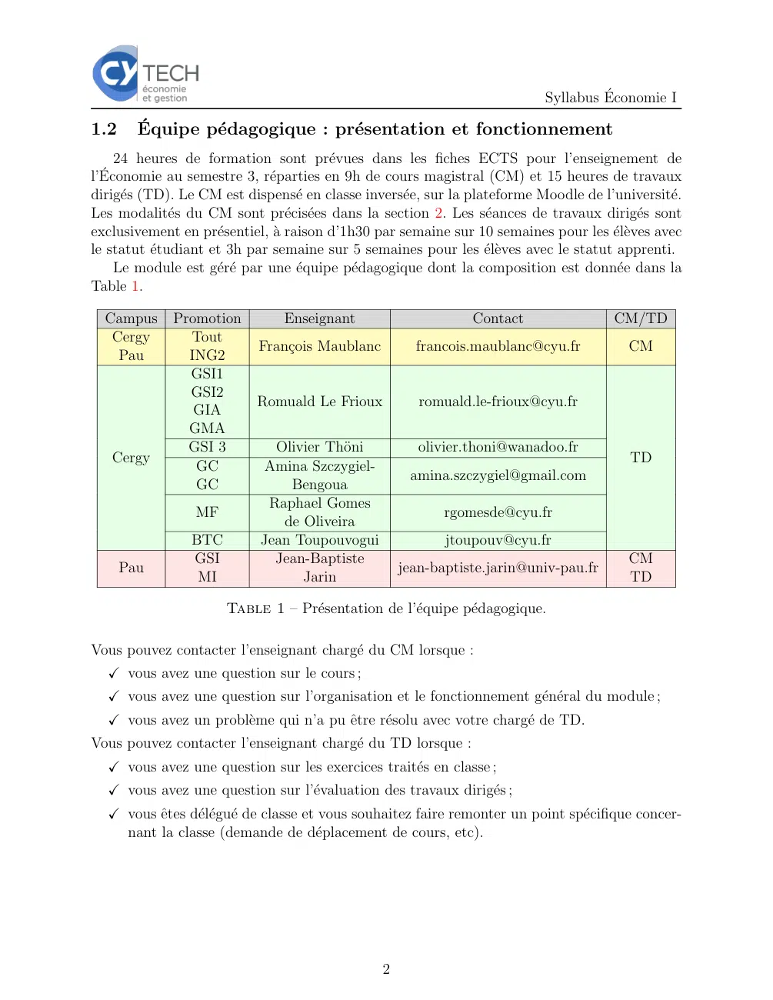
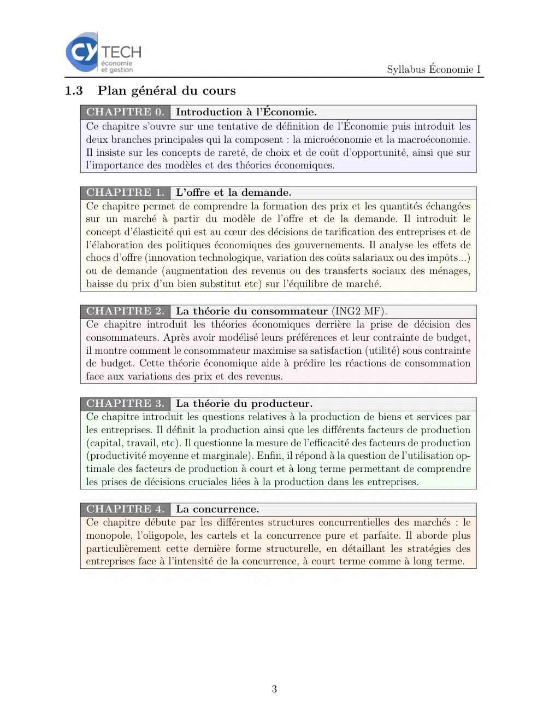
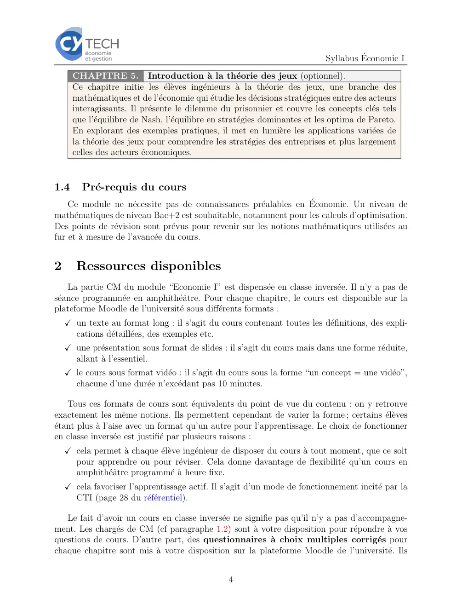
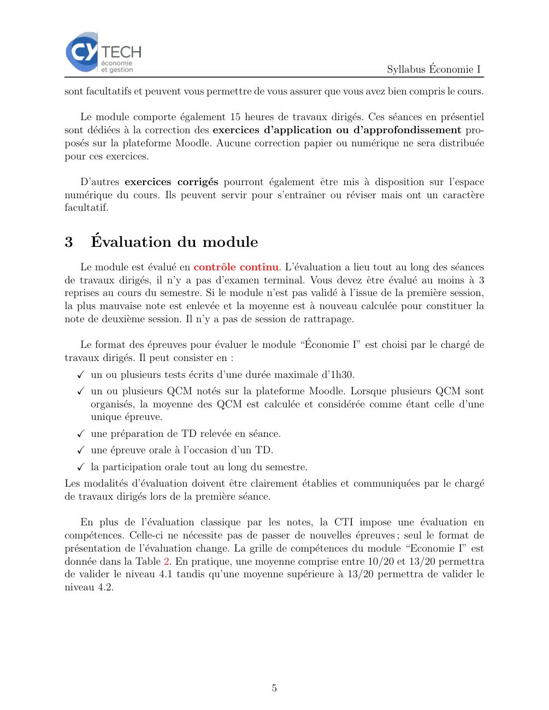
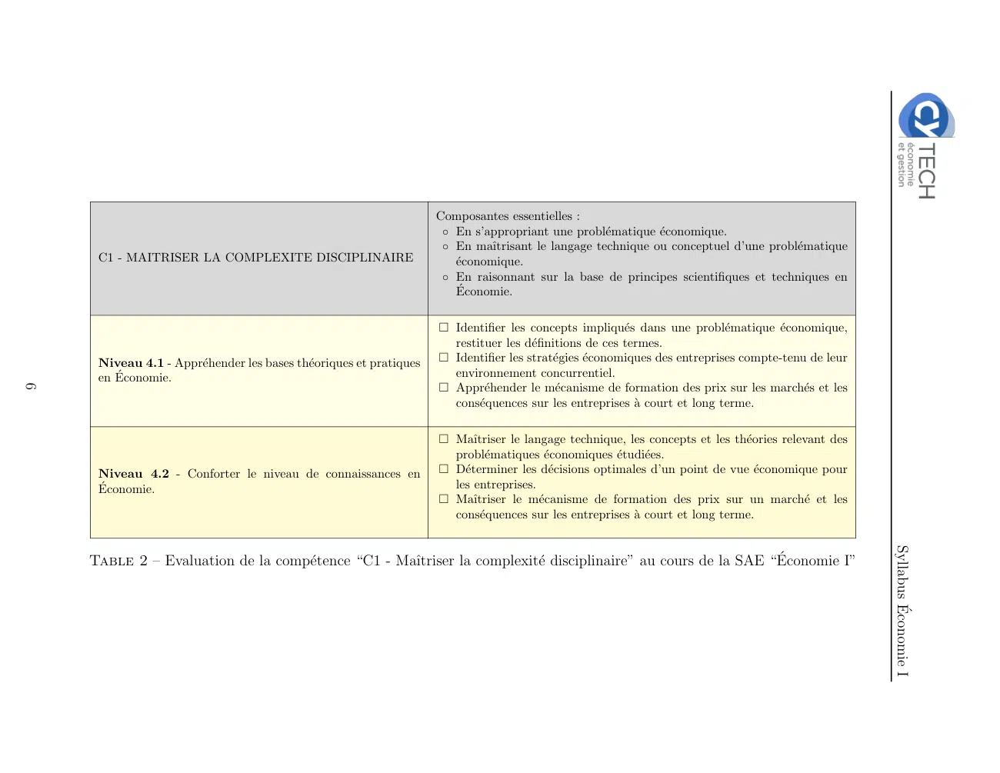

# Syllabus_Economie_I.pdf

[Ouvrir l’original](https://drive.google.com/open?id=1rQx7shGciyn5COO9sWC_5n8eN1m6vsgr) · Les deux lectures automatiques du PDF divergent sur les pages indiquées. Leur fac-similé accompagne le texte.

**Pages présentant un écart entre les deux extractions** — 1–6.

## Page 1

~~~text
                                                                             Syllabus Économie I

                               Économie I - Syllabus
                                           2024-2025

    Cette note a pour objectif de préciser l’organisation et le fonctionnement du module
“Économie I” dispensé en ING2 BTC, GC, GSI, MI et MF. Elle s’organise de la façon
suivante. La première section présente le module de façon générale. La deuxième section
décrit les ressources disponibles dans le module. La dernière section expose les modalités
d’évaluation.

1      Présentation générale du module
1.1     Pourquoi un cours d’Économie en ING2 ?
      Le module “Économie I” est dispensé en ING2 au semestre 3 à tous les étudiants de CY
Tech, qu’ils aient le statut étudiant ou apprenti. Il est crédité de 2 ECTS et fait partie de l’UE
“Culture de l’ingénieur”. L’Économie fait partie des enseignements devant être dispensés aux
élèves ingénieurs, comme indiqué dans le référentiel de la Commission des Titres d’Ingénieur
(CTI), page 29 :
       “Au regard des éléments essentiels de la formation définis par la CTI et du
       référentiel de compétences de l’école, une part de la formation est nécessairement
       consacrée à des disciplines telles que les langues et les sciences humaines, économiques,
       sociales et juridiques (économie, gestion, communication, philosophie, épistémologie,
       histoire, entrepreneuriat, éthique, propriété intellectuelle, droit des sociétés et
       droit du travail, santé et sécurité au travail, relations sociales, développement
       durable et transition écologique. . .).”

L’enseignement de l’Économie aux élèves ingénieurs poursuit deux objectifs généraux :
    ✓ leur permettre de comprendre l’environnement économique auquel ils seront confrontés
      en entreprise par la suite. Les chocs économiques ont des conséquences sur la situa-
      tion financière des entreprises qui in fine, peuvent être amenées à modifier leurs choix
      technologiques ou techniques.
    ✓ participer à leur formation en tant que citoyen. Lors de la parution d’indicateurs
      économiques, de la présentation d’une proposition ou d’un projet de loi, ou encore lors
      des campagnes des élections législatives et présidentielles, les questions économiques
      font l’objet de nombreux débats. Ce cours peut permettre aux élèves ingénieurs de
      renforcer leur culture générale en Économie.

                                                 1
~~~

## Page 2

~~~text
                                                                           Syllabus Économie I

1.2     Équipe pédagogique : présentation et fonctionnement
     24 heures de formation sont prévues dans les fiches ECTS pour l’enseignement de
l’Économie au semestre 3, réparties en 9h de cours magistral (CM) et 15 heures de travaux
dirigés (TD). Le CM est dispensé en classe inversée, sur la plateforme Moodle de l’université.
Les modalités du CM sont précisées dans la section 2. Les séances de travaux dirigés sont
exclusivement en présentiel, à raison d’1h30 par semaine sur 10 semaines pour les élèves avec
le statut étudiant et 3h par semaine sur 5 semaines pour les élèves avec le statut apprenti.
     Le module est géré par une équipe pédagogique dont la composition est donnée dans la
Table 1.

  Campus     Promotion          Enseignant                     Contact                CM/TD
   Cergy       Tout
                           François Maublanc         francois.maublanc@cyu.fr           CM
    Pau        ING2
               GSI1
               GSI2
                           Romuald Le Frioux           romuald.le-frioux@cyu.fr
                GIA
               GMA
               GSI 3          Olivier Thöni           olivier.thoni@wanadoo.fr
   Cergy                                                                                 TD
                GC           Amina Szczygiel-
                                                     amina.szczygiel@gmail.com
                GC              Bengoua
                             Raphael Gomes
                 MF                                        rgomesde@cyu.fr
                               de Oliveira
                BTC         Jean Toupouvogui               jtoupouv@cyu.fr
                GSI           Jean-Baptiste                                              CM
      Pau                                           jean-baptiste.jarin@univ-pau.fr
                 MI               Jarin                                                  TD

                      Table 1 – Présentation de l’équipe pédagogique.

Vous pouvez contacter l’enseignant chargé du CM lorsque :
  ✓ vous avez une question sur le cours ;
  ✓ vous avez une question sur l’organisation et le fonctionnement général du module ;
  ✓ vous avez un problème qui n’a pu être résolu avec votre chargé de TD.
Vous pouvez contacter l’enseignant chargé du TD lorsque :
  ✓ vous avez une question sur les exercices traités en classe ;
  ✓ vous avez une question sur l’évaluation des travaux dirigés ;
  ✓ vous êtes délégué de classe et vous souhaitez faire remonter un point spécifique concer-
    nant la classe (demande de déplacement de cours, etc).

                                                2
~~~

## Page 3

~~~text
                                                                              Syllabus Économie I

1.3     Plan général du cours
      CHAPITRE 0. Introduction à l’Économie.
      Ce chapitre s’ouvre sur une tentative de définition de l’Économie puis introduit les
      deux branches principales qui la composent : la microéconomie et la macroéconomie.
      Il insiste sur les concepts de rareté, de choix et de coût d’opportunité, ainsi que sur
      l’importance des modèles et des théories économiques.

      CHAPITRE 1. L’offre et la demande.
      Ce chapitre permet de comprendre la formation des prix et les quantités échangées
      sur un marché à partir du modèle de l’offre et de la demande. Il introduit le
      concept d’élasticité qui est au cœur des décisions de tarification des entreprises et de
      l’élaboration des politiques économiques des gouvernements. Il analyse les effets de
      chocs d’offre (innovation technologique, variation des coûts salariaux ou des impôts...)
      ou de demande (augmentation des revenus ou des transferts sociaux des ménages,
      baisse du prix d’un bien substitut etc) sur l’équilibre de marché.

      CHAPITRE 2. La théorie du consommateur (ING2 MF).
      Ce chapitre introduit les théories économiques derrière la prise de décision des
      consommateurs. Après avoir modélisé leurs préférences et leur contrainte de budget,
      il montre comment le consommateur maximise sa satisfaction (utilité) sous contrainte
      de budget. Cette théorie économique aide à prédire les réactions de consommation
      face aux variations des prix et des revenus.

      CHAPITRE 3. La théorie du producteur.
      Ce chapitre introduit les questions relatives à la production de biens et services par
      les entreprises. Il définit la production ainsi que les différents facteurs de production
      (capital, travail, etc). Il questionne la mesure de l’efficacité des facteurs de production
      (productivité moyenne et marginale). Enfin, il répond à la question de l’utilisation op-
      timale des facteurs de production à court et à long terme permettant de comprendre
      les prises de décisions cruciales liées à la production dans les entreprises.

      CHAPITRE 4. La concurrence.
      Ce chapitre débute par les différentes structures concurrentielles des marchés : le
      monopole, l’oligopole, les cartels et la concurrence pure et parfaite. Il aborde plus
      particulièrement cette dernière forme structurelle, en détaillant les stratégies des
      entreprises face à l’intensité de la concurrence, à court terme comme à long terme.

                                                  3
~~~

## Page 4

~~~text
                                                                             Syllabus Économie I
      CHAPITRE 5. Introduction à la théorie des jeux (optionnel).
      Ce chapitre initie les élèves ingénieurs à la théorie des jeux, une branche des
      mathématiques et de l’économie qui étudie les décisions stratégiques entre des acteurs
      interagissants. Il présente le dilemme du prisonnier et couvre les concepts clés tels
      que l’équilibre de Nash, l’équilibre en stratégies dominantes et les optima de Pareto.
      En explorant des exemples pratiques, il met en lumière les applications variées de
      la théorie des jeux pour comprendre les stratégies des entreprises et plus largement
      celles des acteurs économiques.

1.4     Pré-requis du cours
    Ce module ne nécessite pas de connaissances préalables en Économie. Un niveau de
mathématiques de niveau Bac+2 est souhaitable, notamment pour les calculs d’optimisation.
Des points de révision sont prévus pour revenir sur les notions mathématiques utilisées au
fur et à mesure de l’avancée du cours.

2      Ressources disponibles
    La partie CM du module “Economie I” est dispensée en classe inversée. Il n’y a pas de
séance programmée en amphithéâtre. Pour chaque chapitre, le cours est disponible sur la
plateforme Moodle de l’université sous différents formats :
    ✓ un texte au format long : il s’agit du cours contenant toutes les définitions, des expli-
      cations détaillées, des exemples etc.
    ✓ une présentation sous format de slides : il s’agit du cours mais dans une forme réduite,
      allant à l’essentiel.
    ✓ le cours sous format vidéo : il s’agit du cours sous la forme “un concept = une vidéo”,
      chacune d’une durée n’excédant pas 10 minutes.

    Tous ces formats de cours sont équivalents du point de vue du contenu : on y retrouve
exactement les même notions. Ils permettent cependant de varier la forme ; certains élèves
étant plus à l’aise avec un format qu’un autre pour l’apprentissage. Le choix de fonctionner
en classe inversée est justifié par plusieurs raisons :
    ✓ cela permet à chaque élève ingénieur de disposer du cours à tout moment, que ce soit
      pour apprendre ou pour réviser. Cela donne davantage de flexibilité qu’un cours en
      amphithéâtre programmé à heure fixe.
    ✓ cela favoriser l’apprentissage actif. Il s’agit d’un mode de fonctionnement incité par la
      CTI (page 28 du référentiel).

   Le fait d’avoir un cours en classe inversée ne signifie pas qu’il n’y a pas d’accompagne-
ment. Les chargés de CM (cf paragraphe 1.2) sont à votre disposition pour répondre à vos
questions de cours. D’autre part, des questionnaires à choix multiples corrigés pour
chaque chapitre sont mis à votre disposition sur la plateforme Moodle de l’université. Ils

                                                 4
~~~

## Page 5

~~~text
                                                                          Syllabus Économie I

sont facultatifs et peuvent vous permettre de vous assurer que vous avez bien compris le cours.

   Le module comporte également 15 heures de travaux dirigés. Ces séances en présentiel
sont dédiées à la correction des exercices d’application ou d’approfondissement pro-
posés sur la plateforme Moodle. Aucune correction papier ou numérique ne sera distribuée
pour ces exercices.

   D’autres exercices corrigés pourront également être mis à disposition sur l’espace
numérique du cours. Ils peuvent servir pour s’entraı̂ner ou réviser mais ont un caractère
facultatif.

3      Évaluation du module
    Le module est évalué en contrôle continu. L’évaluation a lieu tout au long des séances
de travaux dirigés, il n’y a pas d’examen terminal. Vous devez être évalué au moins à 3
reprises au cours du semestre. Si le module n’est pas validé à l’issue de la première session,
la plus mauvaise note est enlevée et la moyenne est à nouveau calculée pour constituer la
note de deuxième session. Il n’y a pas de session de rattrapage.

    Le format des épreuves pour évaluer le module “Économie I” est choisi par le chargé de
travaux dirigés. Il peut consister en :
    ✓ un ou plusieurs tests écrits d’une durée maximale d’1h30.
    ✓ un ou plusieurs QCM notés sur la plateforme Moodle. Lorsque plusieurs QCM sont
      organisés, la moyenne des QCM est calculée et considérée comme étant celle d’une
      unique épreuve.
    ✓ une préparation de TD relevée en séance.
    ✓ une épreuve orale à l’occasion d’un TD.
    ✓ la participation orale tout au long du semestre.
Les modalités d’évaluation doivent être clairement établies et communiquées par le chargé
de travaux dirigés lors de la première séance.

    En plus de l’évaluation classique par les notes, la CTI impose une évaluation en
compétences. Celle-ci ne nécessite pas de passer de nouvelles épreuves ; seul le format de
présentation de l’évaluation change. La grille de compétences du module “Economie I” est
donnée dans la Table 2. En pratique, une moyenne comprise entre 10/20 et 13/20 permettra
de valider le niveau 4.1 tandis qu’une moyenne supérieure à 13/20 permettra de valider le
niveau 4.2.

                                               5
~~~

## Page 6

~~~text
                                                                    Composantes essentielles :
                                                                     ◦ En s’appropriant une problématique économique.
                                                                     ◦ En maı̂trisant le langage technique ou conceptuel d’une problématique
     C1 - MAITRISER LA COMPLEXITE DISCIPLINAIRE                        économique.
                                                                     ◦ En raisonnant sur la base de principes scientifiques et techniques en
                                                                       Économie.

                                                                    □ Identifier les concepts impliqués dans une problématique économique,
                                                                      restituer les définitions de ces termes.
     Niveau 4.1 - Appréhender les bases théoriques et pratiques   □ Identifier les stratégies économiques des entreprises compte-tenu de leur
     en Économie.                                                    environnement concurrentiel.
6

                                                                    □ Appréhender le mécanisme de formation des prix sur les marchés et les
                                                                      conséquences sur les entreprises à court et long terme.

                                                                    □ Maı̂triser le langage technique, les concepts et les théories relevant des
                                                                      problématiques économiques étudiées.
     Niveau 4.2 - Conforter le niveau de connaissances en           □ Déterminer les décisions optimales d’un point de vue économique pour
     Économie.                                                       les entreprises.
                                                                    □ Maı̂triser le mécanisme de formation des prix sur un marché et les
                                                                      conséquences sur les entreprises à court et long terme.

                                                                                                                                                    Syllabus Économie I
    Table 2 – Evaluation de la compétence “C1 - Maı̂triser la complexité disciplinaire” au cours de la SAE “Économie I”
~~~
