# CM1--  Modèle linéaire et estimateur des moindres carrés.pdf

[Ouvrir l’original](https://drive.google.com/open?id=1xN7RS2PCx7LdI4rYv5EAK1A9sd_NWfix) · Les pages signalées comprennent du texte reconnu automatiquement ou des éléments graphiques. Le fac-similé permet de vérifier chaque lecture.

**Pages avec fac-similé ou lecture OCR** — 3, 8, 14, 17, 43.

**Pages présentant un écart entre les deux extractions** — 21, 26, 38, 40–42, 46–49, 53.

## Page 1

~~~text
Ingénieurs 2ème année : Parcours Mathématique & Informatique

               Modèle linéaire et extensions

CM 1:    Modèle linéaire et estimation des moindres carrés ordinaires

         Nisrine FORTIN-CAMDAVANT & Naamane LAIB
~~~

## Page 2

~~~text
1   Introduction

2   Formulation du problème

3   Hypothèses du modèle

4   Processus de la modélisation
      Estimation des paramètres du modèle
      Prédictions et résidus
      Propriétés des estimateurs MCO

5   Qualité de l’ajustement
      Interprétation géométrique et analyse de la variance
      Le coefficient de détermination
~~~

## Page 3

~~~text
Introduction
~~~

## Page 4

~~~text
La régression linéaire est une méthode statistique utilisée pour établir un lien
entre
 ↝ une variable continue Y
 ↝ et une variable X ou plusieurs autres variables X1 , X2 , . . . , Xp continues.

     X (Xj , j = 1, . . . , p) est appelée variable :
        ∥ explicative, exogène ou indépendante.
     Y est appelée variable :
        ∥ réponse, à expliquer, à prédire, endogène ou dépendante.

On note f la fonction reliant Y aux variables explicatives :

                                   Y = f (X1 , X2 , . . .) .

La régression est dite linéaire lorsque la fonction f est linéaire.

                                              4
~~~

## Page 5

~~~text
  Introduction   Formulation du problème   Hypothèses du modèle   Processus de la modélisation   Qualité de l’ajustement

                 Les deux variables X et Y ne jouent pas un rôle symétrique.

                 Si X n’est pas aléatoire, mais fixée (contrôlée par l’expérimentateur), on
                 parle alors de Modèle linéaire plutôt que de régression linéaire.

                 Le domaine d’excellence du modèle linéaire est l’expérimentation.

         Pour chaque unité expérimentale (une parcelle, un gâteau, une voiture,. . .),
           ↝ on fixe une valeur de X = x (une dose d’engrais, une température de
             cuisson, une taille de cylindrée,. . .),
                      ::::::::::::::::

           ↝ à l’issue de l’expérience (culture, préparation, test,.
                                                               ::
                                                                     . .),

           ↝ on explique, analyse, prévoit la valeur de Y : le rendement, le degré de
             cuisson, la consommation d’essence,. . ..
                       ::::::::::::::::::::

5/53
~~~

## Page 6

~~~text
  Introduction   Formulation du problème   Hypothèses du modèle   Processus de la modélisation          Qualité de l’ajustement

           Cas       Unité expérimentale               Variable explicative                      Variable expliquée
             1               Parcelle                   Quantité d’azote                       Rendement
             2               Gâteau                  Température de cuisson                 degré de cuisson
             3               Voiture                  Taille de la cylindrée              Consommation essence

       ↝ Dans le cas 1, on s’intéresse à expliquer le                              Utiliser le modèle pour :
                                                                                   :::::::::::::::::::
         rendement d’une parcelle par rapport à la                                                    - Analyser
         dose d’engrais utilisé
                                                                                                      - Prévoir
                                                                                                      - Optimiser
       ↝ Dans le cas 2 : on s’intéresse à l’influence de
         la température de cuisson de gâteau sur leur                                     6
         degré de cuisson apprécié par un jury.

       ↝ Dans le cas 3, on évalue l’influence du à la
         taille de la cylindrée d’une voiture sur la
         consommation en essence.

6/53
~~~

## Page 7

~~~text
  Introduction                Formulation du problème   Hypothèses du modèle   Processus de la modélisation   Qualité de l’ajustement

                                                                       Exemple 1 : Consommation des voitures
                                                     i                   Modèle    Prix Cylindrée Puissance Poids Consommation
                                                    1           Daihatsu Cuore 11600          846        32 650            5,7
 Question :                                         2    Suzuki Swift 1.0 GLS 12490           993        39 790            5,8
 Peut-on expliquer la                               3    Fiat Panda Mambo L 10450             899        29 730            6,1
                                                    4          VW Polo 1.4 60 17140          1390        44 955            6,5
 consommation Y des                                 5      Opel Corsa 1.2i Eco 14825         1195        33 895            6,8
                                                    6        Subaru Vivio 4WD 13730           658        32 740            6,8
 véhicules à partir de p = 4                        7            Toyota Corolla 19490        1331        55 1010           7,1
 variables exogènes :                               8            Ferrari 456 GT 285000       5474       325 1690          21,3
                                                    9           Mercedes S 600 183900        5987       300 2250          18,7
       1     le prix, X1                            10      Maserati Ghibli GT 92500         2789       209 1485          14,5
                                                    11     Opel Astra 1.6i 16V 25000         1597        74 1080           7,4
                                                    12    Peugeot 306 XS 108 22350           1761        74 1100           9,0
       2     la cylindrée, X2                       13 Renault Safrane 2.2. V 36600          2165       101 1500          11,7
                                                    14       Seat Ibiza 2.0 GTI 22500        1983        85 1075           9,5
       3     la puissance, X3                       15      VW Golt 2.0 GTI 3 1580           1984        85 1155           9,5
                                                    16     Citroen ZX Volcane 28750          1998        89 1140           8,8
       4     le poids, X4 ?                         17 Fiat Tempra 1.6 Liberty 22600         1580        65 1080           9,3
                                                    18      Fort Escort 1.4i PT 20300        1390        54 1110           8,6
                                                    19 Honda Civic Joker 1.4 19900           1396        66 1140           7,7
 On dispose de n=31                                 20            Volvo 850 2.5 39800        2435       106 1370          10,8
 observations.                                      21   Ford Fiesta 1.2 Zetec 19740         1242        55 940            6,6
                                                    22 Hyundai Sonata 3000 38990             2972       107 1400          11,7
                                                    23         Lancia K 3.0 LS 50800         2958       150 1550          11,9
       M                                            24     Mazda Hachtback V 36200           2497       122 1330          10,8
           od
             èle                                    25        Mitsubishi Galant 31990        1998        66 1300           7,6
                   à                                26    Opel Omega 2.5i V6 47700           2496       125 1670          11,3
                       es                           27         Peugeot 806 2.0 36950         1998        89 1560          10,8
                          t   im
                                er                  28      Nissan Primera 2.0 26950         1997        92 1240           9,2
                                                    29       Seat Alhambra 2.0 36400         1984        85 1635          11,6
                                                    30     Toyota Previa salon 50900         2438        97 1800          12,8
                                                    31    Volvo 960 Kombi aut 49300          2473       125 1570          12,7

                                     Consommation = a0 + a1 X1 + a2 X2 + a3 X3 + a4 X4 + ε
7/53
~~~

## Page 8

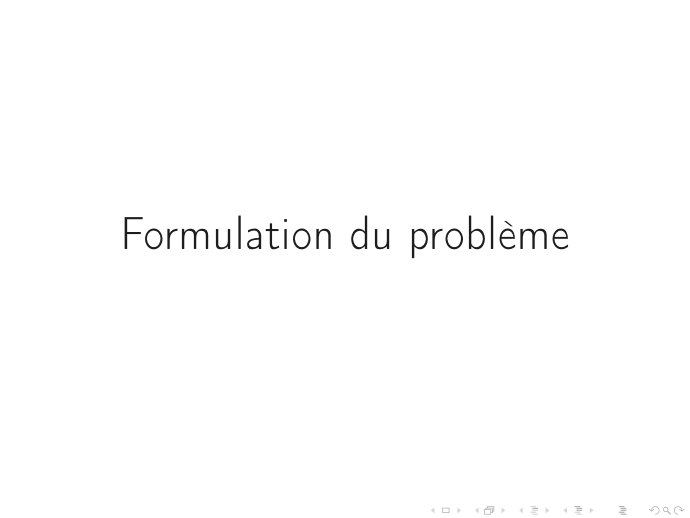

~~~text
Formulation du problème
~~~

## Page 9

~~~text
  Introduction   Formulation du problème   Hypothèses du modèle   Processus de la modélisation   Qualité de l’ajustement

  Formulation du problème

            2 À partir d’un échantillon de n observations, on souhaite expliquer une
                 variable Y en fonction d’autres variables explicatives

           → On formule cette relation par un modèle
                    ↝ Sous forme d’équations
                    ↝ Sous forme matricielle
           → On précise le vocabulaire nécessaire à utiliser

            2 On définit des hypothèses sur le modèle pour pouvoir valider les résultats
              des estimations

           → Ces hypothèses pèsent sur les propriétés des estimateurs et sur les lois de
             distributions.

9/53
~~~

## Page 10

~~~text
                           La formulation du du modèle
           Cadre d’étude

                                           V.A à expliquer              Variables explicatives
2 Y une variable expliquée
  (caractère non contrôlé).                      Y           Cste :1n   X1    X2     ...   Xp

                                                 y1             1       x11   x12    ...   x1p

2 X1 , X2 , . . . , Xp variables                 y2             1       x21   x22    ...   x2p
  explicatives (caractères                        ⋮
  contrôlés)
                                                  ⋮             1

                                                  .
2 Un échantillon de n
                                                 yi             1                    xij
  observations i.i.d
    → yi est la valeur observée pour             yn             1       xn1   xn2    ...   xnp
        l’individu i, i=1,. . .,n
      → C’est une réalisation d’une                                                   ↑
        variable aléatoire Yi
      → xij est la valeur fixée pour                                                Variable Xj
        l’individu i et la variable Xj ,
        j = 1, . . . , p
~~~

## Page 11

~~~text
         Écriture du modèle sous forme d’équations
Pour chaque individu i = 1, . . . , n, et à chaque valeur xi1 , xi2 , . . . , xip peut
correspondre plusieurs valeurs de Yi modélisées par la variable aléatoire :

                ∀i = 1, . . . , n, Yi = a0 + a1 xi1 + a2 xi2 + . . . + ap xip + εi

  ↝ a0 + a1 xi1 + a2 xi2 + . . . + ap xip est la partie déterministe du modèle.
  ↝ εi est la partie aléatoire. (Part de variabilité de Yi qui n’est pas expliquée
    par le lien linéaire).
      Le résidu εi quantifie les écarts entre les valeurs réellement observées et
      les valeurs prédites par le modèle. Il résume les informations manquantes
      qui permettent d’expliquer les valeurs de Y à l’aide des p variables Xj .
  ↝ a0 , a1 , a2 , . . . , ap coefficients du modèle, constantes (valeurs fixes dans la
    population). Ce sont les p + 1 paramètres inconnus du modèle.
~~~

## Page 12

~~~text
                   Écriture du modèle sous forme matricielle
Y1   =         a0 + a1 x11 + a2 x12 + . . . + ap x1p + ε1 XX
                                                           X
                                                           X
                                                             L’ensemble des équations associées à
                                                           X
Y2   =         a0 + a1 x21 + a2 x22 + . . . + ap x2p + ε2 XX
                                                           X
                                                           X
                                                             chacune des observations, s’écrit
                                                           X
                                                           X
                                                           X
 ⋮   =                              ⋮                      X
                                                           X
                                                             matriciellement :
Yi   =          a0 + a1 xi1 + a2 xi2 + . . . + ap xip + εi X
                                                           X
                                                           X
                                                           X
                                                           X
                                                           X
                                                           X        Y = X           a + ε.
 ⋮   =                              ⋮                      X
                                                           X       ®       ®       ®     ®
                                                           X
                                                           X
                                                           X
Yn   =         a0 + a1 xn1 + a2 xn2 + . . . + ap xnp + εn XX
                                                                   n×1   n×(p+1) (p+1)×1 n×1

         ⎛ Y1 ⎞                              ⎛ 1 X11 . . . X1j . . . X1p ⎞ ⎛ a0 ⎞ ⎛ ε1 ⎞
         ⎜ ⋮ ⎟                               ⎜ 1                                                 ⋮                                          ⋮                        ⋮                                        ⋮                                           ⋮ ⎟⎜ ⋮ ⎟ ⎜ ⋮ ⎟
         ⎜                         ⎟         ⎜                                                                                                                                                                                                                                     ⎟⎜                        ⎟ ⎜                       ⎟
         ⎜ Yi ⎟                          =   ⎜ 1 Xi1 . . . Xij . . . Xip ⎟ ⎜ ai ⎟ + ⎜ εi ⎟
         ⎜                         ⎟         ⎜                                                                                                                                                                                                                                     ⎟⎜                        ⎟ ⎜                       ⎟
         ⎜ ⋮ ⎟                               ⎜ 1                                                 ⋮                                          ⋮                        ⋮                                        ⋮                                           ⋮ ⎟⎜ ⋮ ⎟ ⎜ ⋮ ⎟
         ⎝ Yn ⎠                              ⎝ 1 Xn1 . . . X                                                                                                                                          . . . Xnp                                                                    ⎠   ⎝           ap        ⎠   ⎝           εn ⎠
                                                                                                                                                                       nj
         ´¹¹ ¹ ¹ ¹ ¹ ¹ ¸ ¹ ¹ ¹ ¹ ¹ ¹ ¶       ´¹¹ ¹ ¹ ¹ ¹ ¹ ¹ ¹ ¹ ¹ ¹ ¹ ¹ ¹ ¹ ¹ ¹ ¹ ¹ ¹ ¹ ¹ ¹ ¹ ¹ ¹ ¹ ¹ ¹ ¹ ¹ ¹ ¹ ¹ ¹ ¹ ¹ ¹ ¹ ¹ ¹ ¹ ¹ ¹ ¹ ¹ ¹ ¹ ¹ ¹ ¹ ¹ ¹ ¹ ¹ ¹ ¹ ¸¹¹ ¹ ¹ ¹ ¹ ¹ ¹ ¹ ¹ ¹ ¹ ¹ ¹ ¹ ¹ ¹ ¹ ¹ ¹ ¹ ¹ ¹ ¹ ¹ ¹ ¹ ¹ ¹ ¹ ¹ ¹ ¹ ¹ ¹ ¹ ¹ ¹ ¹ ¹ ¹ ¹ ¹ ¹ ¹ ¹ ¹ ¹ ¹ ¹ ¹ ¹ ¹ ¹ ¹ ¹ ¹ ¹ ¶ ´¹¹ ¹ ¹ ¹ ¹ ¸¹¹ ¹ ¹ ¹ ¹ ¶ ´¹¹ ¹ ¹ ¹ ¹ ¸¹¹ ¹ ¹ ¹ ¹¶
                     Y                                                                                                                  X                                                                                                                     a                                                   ε

                                                ′
     a = (a0 . . . ai . . . ap ) est le vecteur des coefficients du modèle.
                                                                                                                                       ′
     La première colonne 1n = (1 . . . 1 . . . 1) représente la constante.

                                                                                                                                            12
~~~

## Page 13

~~~text
Écriture du modèle sous forme matricielle – Exemple 1
                         5, 7                                     1                                         11600                                                                        846                                         32                                                650                                                                                   ε1
  ⎛                      5, 8 ⎞ ⎛ 1                                                                         12490                                                                        993                                         39                                                790 ⎞                                                                      ⎛                            ⎞
  ⎜                                                                                                                                                                                                                                                                                                                                                                          ε2
  ⎜                      6, 1 ⎟                ⎟ ⎜
                                                    ⎜ 1                                                     10450                                                                        899                                         29                                                730 ⎟                                  ⎟                                   ⎜          ε3                ⎟
  ⎜                      6, 5 ⎟                     ⎜                                                                                                                                                                                                                                  955 ⎟                                                                      ⎜                            ⎟
  ⎜                                            ⎟ ⎜ 1                                                        17140 1390                                                                                                               44                                                                                       ⎟                                   ⎜          ε4                ⎟
  ⎜                      6, 8 ⎟ ⎜ 1                                                                                                                                                                                                                                                    895 ⎟                                                                      ⎜                            ⎟
  ⎜                                            ⎟    ⎜
                                                                                                            14825 1195                                                                                                               33                                                                                                                           ⎜          ε5                ⎟
  ⎜                      6, 8 ⎟ ⎜ 1                                                                         13730                                                                        658                                         32                                                740 ⎟                                  ⎟                                   ⎜
                                                                                                                                                                                                                                                                                                                                                                  ⎜          ε6                ⎟
                                                                                                                                                                                                                                                                                                                                                                                               ⎟
  ⎜                                            ⎟    ⎜                                                                                                                                                                                55 1010 ⎟                                                                                                                    ⎜                            ⎟
  ⎜                      7, 1 ⎟ ⎜ 1                                                                         19490 1331                                                                                                                                                                                                        ⎟                                   ⎜          ε7                ⎟
  ⎜             21, 3 ⎟                             ⎜ 1 285000 5474 325 1690 ⎟                                                                                                                                                                                                                                                                                    ⎜                            ⎟
  ⎜                                            ⎟ ⎜                                                                                                                                                                                                                                                                            ⎟                                   ⎜          ε8                ⎟
  ⎜             18, 7 ⎟                             ⎜ 1 183900 5987 300 2250 ⎟                                                                                                                                                                                                                                                                                    ⎜           ⋮                ⎟
  ⎜                                            ⎟ ⎜                                                                                                                                                                                                                                                                            ⎟                                   ⎜                            ⎟
  ⎜             14, 5 ⎟                             ⎜ 1                                                     92500                                                               2789                                        209                                               1485                                            ⎟                                   ⎜                            ⎟
  ⎜                      7, 4 ⎟                     ⎜                                                                                                                                                                                74 1080 ⎟                                                                                                                    ⎜                            ⎟
  ⎜                                            ⎟ ⎜ 1                                                        25000 1597                                                                                                                                                                                                        ⎟                                   ⎜                            ⎟
  ⎜                                            ⎟    ⎜                                                                                                                                                                                74 1100 ⎟                                                                                                                    ⎜                            ⎟
  ⎜                      9, 0 ⎟ ⎜ 1                                                                         22350 1761                                                                                                                                                                                                        ⎟                                   ⎜                            ⎟
  ⎜             11, 7 ⎟                             ⎜                                                       36600 2165 101 1500 ⎟                                                                                                                                                                                                                 a0
  ⎜
  ⎜
                                               ⎟ ⎜ 1                                                                                                                                                                                                                                                                          ⎟     ⎛                         ⎞ ⎜ ⎜
                                                                                                                                                                                                                                                                                                                                                                                               ⎟
                                                                                                                                                                                                                                                                                                                                                                                               ⎟
  ⎜                      9, 5 ⎟                ⎟ ⎜
                                                    ⎜ 1                                                     22500                                                               1983                                                 85                                       1075                                            ⎟
                                                                                                                                                                                                                                                                                                                              ⎟     ⎜ a1 ⎟ ⎜                                                   ⎟
  ⎜                      9, 5 ⎟                     ⎜ 1                                                                                                                                                                                                                                                                       ⎟     ⎜                         ⎟ ⎜           ⋮                  ⎟
  ⎜                                            ⎟    ⎜                                                                1580                                                       1984                                                 85
                                                                                                                                                                                                                                     89 1140 ⎟
                                                                                                                                                                                                                                                                              1155                                                  ⎜ a2 ⎟ ⎜                                                   ⎟
  ⎜                      8, 8 ⎟ = ⎜ 1                                                                       28750 1998                                                                                                                                                                                                        ⎟     ⎜                         ⎟+⎜          ε16                 ⎟
  ⎜                      9, 3 ⎟                     ⎜                                                                                                                                                                                65 1080 ⎟                                                                                      ⎜                         ⎟ ⎜                              ⎟
  ⎜                                            ⎟ ⎜ 1                                                        22600 1580                                                                                                                                                                                                        ⎟     ⎜ a3 ⎟ ⎜                                                   ⎟
  ⎜                      8, 6 ⎟                     ⎜                                                                                                                                                                                54 1110 ⎟                                                                                      ⎜                         ⎟ ⎜ ⎜             ⋮              ⎟
                                                                                                                                                                                                                                                                                                                                                                                               ⎟
  ⎜                                            ⎟ ⎜ 1                                                        20300 1390                                                                                                                                                                                                        ⎟     ⎝                         ⎠ ⎜                              ⎟
  ⎜                      7, 7 ⎟                     ⎜ 1                                                     19900                                                               1396                                                 66                                       1140                                            ⎟                                   ⎜                            ⎟
  ⎜                                            ⎟ ⎜                                                                                                                                                                                                                                                                            ⎟                   a4              ⎜             ⋮              ⎟
  ⎜             10, 8 ⎟                             ⎜ 1                                                                                                                                                                                                                                                                       ⎟
                                                                                                                                                                                                                                                                                                                                    ´¹¹ ¹ ¹ ¹ ¹ ¹ ¸¹¹ ¹ ¹ ¹ ¹ ¹ ¶ ⎜                            ⎟
  ⎜                                            ⎟    ⎜                                                       39800                                                               2435                                        106                                               1370
  ⎜                      6, 6 ⎟ ⎜ 1                                                                         19740 1242                                                                                                               55                                                940 ⎟                                  ⎟                                   ⎜
                                                                                                                                                                                                                                                                                                                                                                  ⎜             ⋮              ⎟
                                                                                                                                                                                                                                                                                                                                                                                               ⎟
  ⎜             11, 7 ⎟                             ⎜ 1                                                                                                                                                                                                                                                                       ⎟                    a
                                                                                                                                                                                                                                                                                                                                                                  ⎜                            ⎟
  ⎜                                            ⎟ ⎜                                                          38990                                                               2972                                        107                                               1400                                            ⎟                                   ⎜                            ⎟
  ⎜             11, 9 ⎟                             ⎜                                                       50800 2958 150 1550 ⎟                                                                                                                                                                                                                                 ⎜                            ⎟
  ⎜                                            ⎟ ⎜ 1                                                                                                                                                                                                                                                                          ⎟                                   ⎜                            ⎟
  ⎜             10, 8 ⎟ ⎜ 1                    ⎟    ⎜                                                       36200 2497 122 1330 ⎟                                                                                                                                                                                                                                 ⎜             ⋮              ⎟
  ⎜                                                                                                                                                                                                                                                                                                                           ⎟                                   ⎜                            ⎟
  ⎜                      7, 6 ⎟                     ⎜ 1                                                     31990                                                               1998                                                 66                                       1300                                            ⎟                                   ⎜                            ⎟
  ⎜                                            ⎟ ⎜                                                                                                                                                                                                                                                                            ⎟                                   ⎜                            ⎟
  ⎜             11, 3 ⎟ ⎜ 1                                                                                 47700 2496 125 1670 ⎟                                                                                                                                                                                                                                 ⎜                            ⎟
  ⎜             10, 8 ⎟                             ⎜ 1                                                                                                                                                                                                                                                                       ⎟                                   ⎜             ⋮              ⎟
  ⎜                                            ⎟ ⎜                                                          36950                                                               1998                                                 89                                       1560                                            ⎟                                   ⎜                            ⎟
  ⎜                      9, 2 ⎟                     ⎜                                                                                                                                                                                92 1240 ⎟                                                                                                                    ⎜                            ⎟
  ⎜                                            ⎟ ⎜ 1                                                        26950 1997                                                                                                                                                                                                        ⎟                                   ⎜                            ⎟
  ⎜             11, 6 ⎟ ⎜ 1                    ⎟    ⎜                                                       36400 1984                                                                                                               85 1635 ⎟                                                                                                                    ⎜                            ⎟
  ⎜                                                                                                                                                                                                                                                                                                                           ⎟                                                  ⋮
  ⎝             12, 8 ⎠ ⎝ 1                                                                                 50900 2438                                                                                                               97 1800 ⎠                                                                                                                    ⎝          ε31               ⎠
                12, 7                                             1                                         49300 2473 125 1570
  ´¹¹ ¹ ¹ ¹ ¹ ¹ ¹ ¹ ¹ ¹ ¹ ¸¹¹ ¹ ¹ ¹ ¹ ¹ ¹ ¹ ¹ ¹ ¹ ¶ ´¹¹ ¹ ¹ ¹ ¹ ¹ ¹ ¹ ¹ ¹ ¹ ¹ ¹ ¹ ¹ ¹ ¹ ¹ ¹ ¹ ¹ ¹ ¹ ¹ ¹ ¹ ¹ ¹ ¹ ¹ ¹ ¹ ¹ ¹ ¹ ¹ ¹ ¹ ¹ ¹ ¹ ¹ ¹ ¹ ¹ ¹ ¹ ¹ ¹ ¹ ¹ ¹ ¹ ¹ ¹ ¹ ¹ ¹ ¹ ¹ ¹ ¹ ¹ ¹ ¹ ¹ ¸¹¹ ¹ ¹ ¹ ¹ ¹ ¹ ¹ ¹ ¹ ¹ ¹ ¹ ¹ ¹ ¹ ¹ ¹ ¹ ¹ ¹ ¹ ¹ ¹ ¹ ¹ ¹ ¹ ¹ ¹ ¹ ¹ ¹ ¹ ¹ ¹ ¹ ¹ ¹ ¹ ¹ ¹ ¹ ¹ ¹ ¹ ¹ ¹ ¹ ¹ ¹ ¹ ¹ ¹ ¹ ¹ ¹ ¹ ¹ ¹ ¹ ¹ ¹ ¹ ¹ ¹ ¶                              ´¹¹ ¹ ¹ ¹ ¹ ¹ ¹ ¹ ¸¹ ¹ ¹ ¹ ¹ ¹ ¹ ¹ ¹ ¶
                                                                                                                                                                                                                                                                                                                                                                               ε
                             Y                                                                                                                                                                      X

                                                                                                                                                                                                                         13
~~~

## Page 14

~~~text
Hypothèses du modèle
~~~

## Page 15

~~~text
  Introduction   Formulation du problème    Hypothèses du modèle   Processus de la modélisation    Qualité de l’ajustement

  Hypothèses du modèle

         Les conditions standards imposées aux εi , i = 1, . . . , n sont :

                                             (H1) : E (εi ) = 0, ∀i = 1, . . . , n.

         L’hypothèse (H1) indique que les erreurs sont centrées.

                                           (H2) : Var (εi ) = σ 2 , ∀i = 1, . . . , n.

         L’hypothèse (H2) est l’hypothèse d’homoscédasticité (homogénéité des
         variances). La variance σ 2 est un paramètre du modèle qu’il faudra estimer.

                         (H3) : Cov (εi , εk ) = 0, ∀i = 1, . . . , n, ∀k = 1, . . . , n, i ≠ k.

         Sous l’hypothèse (H3), les termes d’erreur εi sont non corrélés. C’est une
         hypothèse d’exogénéité Ô⇒ Cov(Xi , εi ) = 0.

15/53
~~~

## Page 16

~~~text
  Introduction   Formulation du problème   Hypothèses du modèle   Processus de la modélisation     Qualité de l’ajustement

  Hypothèses du modèle en écriture matricielle

         Sous les conditions (H1), (H2) et (H3), on a alors :
           X
           X
           X ↝                    =    0n ,                       ♯   vecteur nul de dimension n
           X
           X
           X
                      E(ε)
           X
           X
           X
           X
           X ↝                    =    E (Xa + ε) = Xa,
           X                                                      ♯ E(Y) ∈ R
                                                                             n
           X
           X
           X
                      E(Y)
           X
           X
           X
           X
           X
           X
           X ↝
           X          Var(ε)      =    Var(Y) = σ 2 In ,          ♯ In matrice identité de dimension n × n

         Dans la suite de ce chapitre, on suppose que
                 (H4) : n > p + 1 et rang(X) = p + 1. (La matrice X est de plein rang).
                 On a donc plus d’observations que de variables et il n’existe pas de relation linéaire entre
                 les variables explicatives Xj (pas de multicolinéarité).

                 Dans certains cas le modèle peut être sans constante, a0 = 0 et X ∈ Rn×p .
                 Dans ce cas, il faut faire attention aux degrés de liberté pour les tests (voit tableau
                 ANOVA)

16/53
~~~

## Page 17

~~~text
Processus de la modélisation
~~~

## Page 18

~~~text
    Les étapes à suivre pour établir un modèle linéaire sont les suivantes :

1   Estimation des paramètres (CM 1)
2   Mesure de la qualité d’ajustement (CM 1)
3   Étude de la validité du modèle (CM 2)
     a.   Si les hypothèses sur les erreurs non vérifiées STOP
     b.   Si observations aberrantes/influentes
           i.    Correction/suppression
           ii.   Retour à l’étape 1
4   Inférence statistique (CM 3)
     a.   Test de significativité globale
     b.   Test de significativité des coefficients (individuelle ou par bloc)
5   Évaluation de la mulicolinéarité (CM 4)
6   Sélection de variables (CM 4)
     a.   Modèle restreint
     b.   Réitération des étapes 1,2,3, 4
~~~

## Page 19

~~~text
Processus de la modélisation
  Estimation des paramètres du modèle
~~~

## Page 20

~~~text
  Introduction   Formulation du problème   Hypothèses du modèle   Processus de la modélisation   Qualité de l’ajustement

  Estimation des paramètres du modèle linéaire

            2 À partir de l’échantillon (aléatoire) de n observations (xi1 , . . . , xip , yi ),
              i = 1, . . . , n on veut estimer les paramètres a0 , a1 , . . . , ap .

                        On cherche les valeurs de ai de façon à approcher au mieux la valeur
                        de yi par une relation linéaire en fonction de xi1 , . . . ; xip :

                                                     yi ≈ a0 + a1 xi1 + . . . + ap xip .

            2 On utilise la méthode des moindres carrés qui,
                        ne nécessite pas d’hypothèse supplémentaires sur la distribution de εi
                        contrairement à la méthode du maximum de vraisemblance qui est
                        fondée sur la normalité de εi .

            2 La méthode des MCO Ô⇒ un estimateur âj des coefficients.
                                Ð→ Ces derniers ont une variance en fonction de σ2 (variance des εi ).
                                Ð→ Le paramètre σ2 est inconnu.
                                Ð→ On doit donc également donner une estimation de σ2 .
20/53
~~~

## Page 21

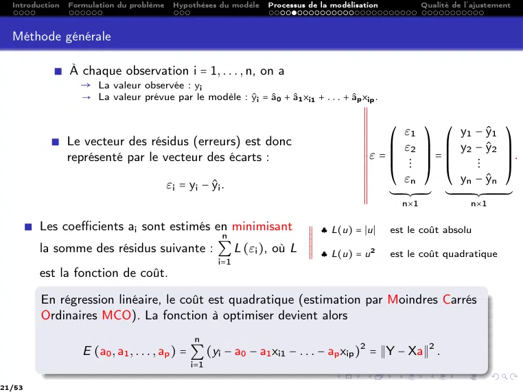

~~~text
  Introduction   Formulation du problème    Hypothèses du modèle   Processus de la modélisation                           Qualité de l’ajustement

  Méthode générale

             ∎ À chaque observation i = 1, . . . , n, on a
                → La valeur observée : yi
                    → La valeur prévue par le modèle : ŷi = â0 + â1 xi1 + . . . + âp xip .
                                                                                           X
                                                                                           X
                                                                                           X
                                                                                           X
                                                                                           X
                                                                                           X
                                                                                           X
                                                                                           X
            ∎ Le vecteur des résidus (erreurs) est donc
                                                                                           X
                                                                                           X
                                                                                           X  ⎛ ε1 ⎞ ⎛ y1 − ŷ1 ⎞
                                                                                           X
                                                                                           X
                                                                                           X  ⎜ ε2 ⎟ ⎜ y2 − ŷ2 ⎟
              représenté par le vecteur des écarts :                                       X
                                                                                           X
                                                                                           Xε=⎜                     ⎟=⎜                                                       ⎟.
                                                                                           X
                                                                                           X  ⎜ ⋮ ⎟ ⎜                                              ⋮                          ⎟
                                                                                           X
                                                                                           X
                                                                                           X  ⎝ εn ⎠ ⎝ yn − ŷn ⎠
                                           εi = yi − ŷi .                                 X
                                                                                           X
                                                                                           X
                                                                                           X
                                                                                           X
                                                                                           X  ´¹¹ ¹ ¹ ¹ ¹ ¸¹¹ ¹ ¹ ¹ ¹¶ ´¹¹ ¹ ¹ ¹ ¹ ¹ ¹ ¹ ¹ ¹ ¹ ¹ ¹ ¸¹¹ ¹ ¹ ¹ ¹ ¹ ¹ ¹ ¹ ¹ ¹ ¹ ¹ ¶
                                                                                           X
                                                                                           X            n×1                                       n×1

        ∎ Les coefficients ai sont estimés en minimisant                     X
                                                                             X
                                                                             X ♣ L(u) = ∣u∣               est le coût absolu
                                                         n                   X
                                                                             X
                                                                             X
                                                                             X
                                                                             X
          la somme des résidus suivante : ∑ L (εi ), où L                    X
                                                                             X
                                                                             X            2
                                                        i=1                  X ♣ L(u) = u
                                                                             X                            est le coût quadratique
          est la fonction de coût.

           En régression linéaire, le coût est quadratique (estimation par Moindres Carrés
           Ordinaires MCO). La fonction à optimiser devient alors
                                                  n
                    E (a0 , a1 , . . . , ap ) = ∑ (yi − a0 − a1 xi1 − . . . − ap xip )2 = ∥Y − Xa∥2 .
                                                 i=1

21/53
~~~

## Page 22

~~~text
  Introduction   Formulation du problème   Hypothèses du modèle     Processus de la modélisation                Qualité de l’ajustement

  Quelques rappels – Voir aussi cours Optimisation déterministe

         Soit z ∈ Rq et t ∈ Rq .               !!! Le prime [ ' ] signifie transposée et non dérivée !!!
                                                              q
                                                                              ′          ′
            ↝ Le produit scalaire euclidien : ⟨z, t⟩ = ∑ zi ti = t z = z t
                                                              i=1
                                                                     q
                                                                                  2
            ↝ La norme euclidienne de z : ∥z∥2 = ⟨z, z⟩ = ∑ zi .
                                                                    i=1
            ↝ Soit g ∶ Rq → R une fonction différentiable. On définit le gradient de g comme étant le
              vecteur des dérivées partielles de g :

                                                                                                            ′
                                                      ∂ (g (z))           ∂g (z)                   ∂g (z)
                                    gradg (z) = (                                            ...          )
                                                         ∂z1               ∂z2                      ∂zq

                                                          ′
            ↝ Soit c ∈ Rq . Par rapport à z : grad(c z) = c.
                                                                      ′
            ↝ Si la matrice A est symétrique alors, grad (z Az) = 2Az par rapport à z.
            ↝ Si la matrice A est symétrique, b ∈ Rq et α ∈ R, on appelle fonction quadratique la
              fonction q définie pour z ∈ Rq ,

                                                                          ′           1 ′
                                                      q(z) = α + b z +                  z Az
                                                                                      2

                        grad(q(z)) = b + Az.
                        La matrice hessienne est A.
                        q est convexe si et seulement si la matrice A est semi définie positive.
22/53
~~~

## Page 23

~~~text
  Introduction   Formulation du problème   Hypothèses du modèle   Processus de la modélisation       Qualité de l’ajustement

  Quelques calculs – Voir aussi cours Optimisation déterministe

         X
         X
         X ∥Y − Xa∥2        =    ⟨Y − Xa, Y − Xa⟩                               ♯ Définition de la norme euclidienne
         X
         X
         X
         X
         X
         X
         X
         X
         X                  =    ⟨Y − Xa, Y⟩ − ⟨Y − Xa, Xa⟩                     ♯ Linéarité selon la seconde variable
         X
         X
         X
         X
         X
         X
         X
         X
         X                  =    ⟨Y, Y⟩ − ⟨Xa, Y⟩ − ⟨Y, Xa⟩ + ⟨Xa, Xa⟩          ♯ Linéarité selon la première variable
         X
         X
         X
         X
         X
         X
         X
         X
         X                  =    ⟨Y, Y⟩ − ⟨Xa, Y⟩ − ⟨Xa, Y⟩ + ⟨Xa, Xa⟩          ♯ Symétrie
         X
         X
         X
         X
         X
         X
         X
         X
         X                  =    ∥Y∥2 − Y′ (Xa) − X′ (Ya) + (Xa)′ (Xa)
         X
         X                                                                      ♯ Définition du produit scalaire euclidien
         X
         X
         X
         X
         X
         X
         X
         X
         X                  =    ∥Y∥2 − 2X′ Ya + a′ (X′ X) a                    ♯ Propriété de la transposée
         X
         X
         X
         X

23/53
~~~

## Page 24

~~~text
  Introduction   Formulation du problème   Hypothèses du modèle   Processus de la modélisation           Qualité de l’ajustement

  Estimation des moindres carrés ordinaires MCO

          Formulation du problème d’optimisation
         On cherche le vecteur â ∈ Rp+1 tel que

          â =                      ∥Y − Xa∥ = arg min (∥Y∥2 − 2Y Xa + a X Xa)
                                                     2                                               ′          ′   ′
                     arg min
                 (a0 ,...,ap )∈Rp+1 ´¹¹ ¹ ¹ ¹ ¹ ¹ ¹ ¹ ¸¹ ¹ ¹ ¹ ¹ ¹ ¹ ¹ ¹ ¶ (a0 ,...,ap )∈Rp+1
                                       E (a0 ,...,ap )

                           ↝ La fonction E ∶ Rp+1 → R est une fonction quadratique où
                                                                               ′                 ′
                                                   α = ∥Y∥2 , b ′ = −2Y X et A = X X
                                              ′
                               car A = 2X X est symétrique.
                           ↝ La fonction E est convexe, en effet A est définie positive.
                           ↝ La fonction E réalise son minimum en son point critique.

24/53
~~~

## Page 25

~~~text
  Introduction   Formulation du problème   Hypothèses du modèle              Processus de la modélisation       Qualité de l’ajustement

          Résolution du problème d’optimisation

         ♣ Calculons les points critiques de E :
           ::::::::::::::::::::::::::::

                            â est un point critique de E ⇐⇒ grad (E (â)) = 0p+1 .
         X
         X
         X                                        ⎛                                                    ⎞
         X
         X
         X
         X
         X                                        ⎜                ′           ′             ′         ⎟
         X
         X ↝        grad (E (a))       =          ⎜
                                             grad ⎜ ∥Y∥ −2
                                                         2
                                                                           a+a        (X X)           a⎟
         X
         X
                                                                 YX                                    ⎟
         X
         X                                        ⎜ ±           ±                                      ⎟
         X
         X                                        ⎝constante                          ´¹ ¹ ¹ ¸¹ ¹ ¹ ¶
         X                                                                       matrice symétrique ⎠
                                                             vecteur ligne
         X
         X
         X
         X
         X
         X
                                                        ′                ′
         X
         X                             =     −2X Y + 2 (X X) a
         X
         X
         X
         X
         X
                                                ′                ′                            ′             ′
         ↝ grad (E (a)) = 0 ⇔ −2X Y + 2 (X X) a = 0 ⇔ (X X) a = X Y.
                                                    ′
         À condition que la matrice X X soit inversible (ok par hypothèse de rang plein),
         â est un point critique de E si et seulement si

                                                                     ′       −1    ′
                                                            â = (X X)            X Y.

         ♣ Optimum  de E : Comme E est strictement convexe alors â est l’unique
           :::::::::::::
         minimum global de la fonction E .
25/53
~~~

## Page 26

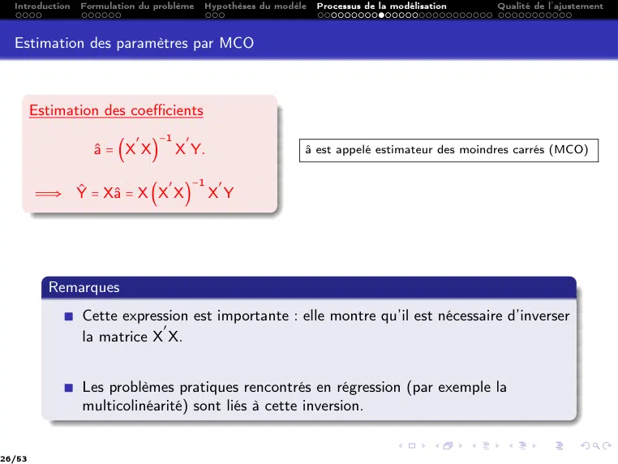

~~~text
  Introduction   Formulation du problème    Hypothèses du modèle   Processus de la modélisation   Qualité de l’ajustement

  Estimation des paramètres par MCO

        Estimation des coefficients
                            ′   −1     ′
                   â = (X X)         X Y.                     â est appelé estimateur des moindres carrés (MCO)

                                  ′        −1   ′
        Ô⇒ Ŷ = Xâ = X (X X)                   XY

          Remarques
             ∎ Cette expression est importante : elle montre qu’il est nécessaire d’inverser
                           ′
               la matrice X X.

             ∎ Les problèmes pratiques rencontrés en régression (par exemple la
               multicolinéarité) sont liés à cette inversion.

26/53
~~~

## Page 27

~~~text
  Introduction   Formulation du problème                                                                                       Hypothèses du modèle                                                                                                                      Processus de la modélisation                                                                                                                                                                                                  Qualité de l’ajustement

  Le coin calcul !

         ↝ Matrice des sommes des produits croisés entre les variables exogènes (Elle
         est symétrique) (son inverse est donc symétrique.)

                         ⎛ 1                                                                        1                                         ...                                   1                                       ...                                                   1 ⎞
                                                                                                                                                                                                                                                                                                                                  1 X11                                                                               . . . X1j                                                                     . . . X1p ⎞
                         ⎜ X11                                                             X21                                                . . . Xi1 . . . Xn1 ⎟ ⎛
                         ⎜ ⋮                                                                                                                                                                                                                                                                                                                                                   ⋮                                               ⋮                              ⋮                                              ⋮                                               ⋮ ⎟
            ′            ⎜                                                                             ⋮                                      ...                                     ⋮                                     ...                                                      ⋮ ⎟                        ⎟⎜
                                                                                                                                                                                                                                                                                                                    ⎜ 1
                                                                                                                                                                                                                                                                                                                                                                                                                                                                                                                                                                                         ⎟
           X X      =    ⎜                                                                                                                                                                                                                                                                                      ⎟⎜ 1                                                 Xi1                                              ...                                Xij                                        ...                                            Xip ⎟
                         ⎜ X1j                                                              X                                                 .       .       .               X                                             .       .       .                              X                                    ⎟⎜                                                                                                                                                                                                                                                                       ⎟
                         ⎜                                                                              2j                                                                                ij                                                                                           nj                       ⎟⎜ 1                                                           ⋮                                               ⋮                              ⋮                                              ⋮                                               ⋮                           ⎟
                         ⎜ ⋮                                                                           ⋮                                      ...                                     ⋮                                     ...                                                      ⋮ ⎟⎝                                                                                                                                                                                                                                                                                                ⎠
                         ⎝ X1p                                                                                                                                                                                                                                                                                                    1                                X                                                  .       .       .                 X                                           .       .       .                            X
                                                                                           X2p                                                . . . Xip                                                                     . . . Xnp ⎠                                                                                                                                        n1                                                                               nj                                                                                           np
                                                                                                                                                                                                                                                                                                                    ´¹¹ ¹ ¹ ¹ ¹ ¹ ¹ ¹ ¹ ¹ ¹ ¹ ¹ ¹ ¹ ¹ ¹ ¹ ¹ ¹ ¹ ¹ ¹ ¹ ¹ ¹ ¹ ¹ ¹ ¹ ¹ ¹ ¹ ¹ ¹ ¹ ¹ ¹ ¹ ¹ ¹ ¹ ¹ ¹ ¹ ¹ ¹ ¹ ¹ ¹ ¹ ¹ ¹ ¹ ¹ ¹ ¹ ¹ ¹ ¹ ¹ ¹ ¹ ¹ ¹¸ ¹ ¹ ¹ ¹ ¹ ¹ ¹ ¹ ¹ ¹ ¹ ¹ ¹ ¹ ¹ ¹ ¹ ¹ ¹ ¹ ¹ ¹ ¹ ¹ ¹ ¹ ¹ ¹ ¹ ¹ ¹ ¹ ¹ ¹ ¹ ¹ ¹ ¹ ¹ ¹ ¹ ¹ ¹ ¹ ¹ ¹ ¹ ¹ ¹ ¹ ¹ ¹ ¹ ¹ ¹ ¹ ¹ ¹ ¹ ¹ ¹ ¹ ¹ ¹ ¹ ¶
                         ´¹¹ ¹ ¹ ¹ ¹ ¹ ¹ ¹ ¹ ¹ ¹ ¹ ¹ ¹ ¹ ¹ ¹ ¹ ¹ ¹ ¹ ¹ ¹ ¹ ¹ ¹ ¹ ¹ ¹ ¹ ¹ ¹ ¹ ¹ ¹ ¹ ¹ ¹ ¹ ¹ ¹ ¹ ¹ ¹ ¹ ¹ ¹ ¹ ¹ ¹ ¹ ¹ ¹ ¹ ¹ ¹ ¹ ¹ ¹ ¹ ¹ ¹ ¹ ¹ ¹ ¹ ¹ ¹ ¹ ¸ ¹ ¹ ¹ ¹ ¹ ¹ ¹ ¹ ¹ ¹ ¹ ¹ ¹ ¹ ¹ ¹ ¹ ¹ ¹ ¹ ¹ ¹ ¹ ¹ ¹ ¹ ¹ ¹ ¹ ¹ ¹ ¹ ¹ ¹ ¹ ¹ ¹ ¹ ¹ ¹ ¹ ¹ ¹ ¹ ¹ ¹ ¹ ¹ ¹ ¹ ¹ ¹ ¹ ¹ ¹ ¹ ¹ ¹ ¹ ¹ ¹ ¹ ¹ ¹ ¹ ¹ ¹ ¹ ¹ ¹¶                                                                                                                                    X
                                                                                                                                                              X′

                                                                                                                n                                                                                                     n
                         ⎛ n                                                                              ∑ Xi1                                                          ...                                     ∑ Xip                                                                                    ⎞
                         ⎜                                                                                                                                                                                                                                                                                ⎟
                         ⎜ n                                                                               i=1                                                                                                   i=1                                                                                      ⎟
                         ⎜                                                                                  n                                                                                                     n                                                                                       ⎟
                         ⎜                                                                                                               2                                                                                                                                                                ⎟
                    =    ⎜ ∑ Xi1                                                                          ∑ Xi1                                                          ...                                     ∑ Xi1 × Xip                                                                              ⎟
                         ⎜ i=1                                                                                                                                                                                                                                                                            ⎟
                         ⎜                                                                                 i=1                                                                                                   i=1                                                                                      ⎟
                         ⎜                                                                                                                                                                                        n                                                                                       ⎟
                         ⎜                                                                                                                                                                                                                     2                                                          ⎟
                         ⎝ ⋮                                                                               ...                                                           ⋱                                       ∑ Xip                                                                                    ⎠
                                                                                                                                                                                                                 i=1                                                                                                (p+1,p+1)

                                          1 ′
         ↝ Si les variables sont centrées   (X X) = matrice de variance covariance
                                          n
                                                     1
         ↝ Si les variables sont centrées et réduites (X′ X) = matrice de corrélation
                                                     n

27/53
~~~

## Page 28

~~~text
  Introduction   Formulation du problème                                                                             Hypothèses du modèle                                                                            Processus de la modélisation                                                                                                                    Qualité de l’ajustement

  Le coin calcul !

                                                                                                                                                                                                                                                                                                                                  n
                                                                                                                                                                                                                                                                                                                                                    ⎛ ∑ Yi       ⎞
                      ⎛ 1                                                                        1                                         ...                                   1                                       ...                                                   1 ⎞                                                                  ⎜ i=1        ⎟
                                                                                                                                                                                                                         . . . Xn1 ⎟ ⎛ 1 ⎞ ⎜                                                                                                                     ⎟
                                                                                                                                                                                                                                                                                                                               Y
                      ⎜ X11                                                             X21                                                . . . Xi1                                                                                                                                                                                                ⎜ n          ⎟
                   ′  ⎜ ⋮                                                                                                                                                                                                                                                         ⋮ ⎟                            ⎜ Y ⎟ ⎜                                         ⎟
                      ⎜                                                                             ⋮                                      ...                                     ⋮                                     ...                                                                                 ⎟ ⎜ 2 ⎟ ⎜ ∑ Yi Xi1                                  ⎟
                  X Y=⎜                                                                                                                                                                                                                                                                                      ⎟ ⎜ ⋮ ⎟ = ⎜ i=1                                     ⎟
                      ⎜ X1j                                                              X2j                                               ...                             Xij                                           ...                                            Xnj ⎟                                    ⎜                             ⎟ ⎜               ⎟
                      ⎜                                                                                                                                                                                                                                                                                      ⎟⎜ ⋮ ⎟ ⎜                                     ⋮      ⎟
                      ⎜ ⋮                                                                           ⋮                                      ...                                     ⋮                                     ...                                                      ⋮ ⎟⎝                                                         ⎠ ⎜               ⎟
                      ⎝ X1p                                                                                                                                                                                                                                                                                                     Y                   ⎜ n          ⎟
                                                                                        X2p                                                . . . Xip                                                                     . . . Xnp ⎠                                                                                              n                 ⎜            ⎟
                                                                                                                                                                                                                                                                                                                 ´¹¹ ¹ ¹ ¹ ¹ ¹ ¹ ¸¹ ¹ ¹ ¹ ¹ ¹ ¹ ¹ ¶ ⎝ ∑ Yi Xip   ⎠
                      ´¹¹ ¹ ¹ ¹ ¹ ¹ ¹ ¹ ¹ ¹ ¹ ¹ ¹ ¹ ¹ ¹ ¹ ¹ ¹ ¹ ¹ ¹ ¹ ¹ ¹ ¹ ¹ ¹ ¹ ¹ ¹ ¹ ¹ ¹ ¹ ¹ ¹ ¹ ¹ ¹ ¹ ¹ ¹ ¹ ¹ ¹ ¹ ¹ ¹ ¹ ¹ ¹ ¹ ¹ ¹ ¹ ¹ ¹ ¹ ¹ ¹ ¹ ¹ ¹ ¹ ¹ ¹ ¹ ¹ ¸ ¹ ¹ ¹ ¹ ¹ ¹ ¹ ¹ ¹ ¹ ¹ ¹ ¹ ¹ ¹ ¹ ¹ ¹ ¹ ¹ ¹ ¹ ¹ ¹ ¹ ¹ ¹ ¹ ¹ ¹ ¹ ¹ ¹ ¹ ¹ ¹ ¹ ¹ ¹ ¹ ¹ ¹ ¹ ¹ ¹ ¹ ¹ ¹ ¹ ¹ ¹ ¹ ¹ ¹ ¹ ¹ ¹ ¹ ¹ ¹ ¹ ¹ ¹ ¹ ¹ ¹ ¹ ¹ ¹ ¹¶                 Y                    i=1        (p+1,1)
                                                                                                                                             X′

                                             1 ′
         ↝ Si les variables sont centrées       (X Y) = matrice vecteur des covariances (Y,
                                             n
         X). (Cov(Y, 1n ), Cov(Y, X1 ), . . . , Cov(Y, Xp )
                                                         1
         ↝ Si les variables sont centrées et réduites (X′ Y) = matrice de corrélation
                                                         n
         entre (Y, X)

28/53
~~~

## Page 29

~~~text
  Introduction   Formulation du problème   Hypothèses du modèle     Processus de la modélisation           Qualité de l’ajustement

  Estimateur MCO – Exemple 1

         Pour notre exemple 1 sur la consommation,
         ::::::::::::::::::::::::::::::::::

                                                                                                       X
                                                                                                       X
       ⎛     31            1356425              64904              3010            38940           ⎞   X
                                                                                                       X
                                                                                                       X      (X′ X)11 = 31.
       ⎜     1356425       1, 50317E + 11       4548968325         238826625       2082249275      ⎟   X
                                                                                                       X
                                                                                                       X
   ′   ⎜                                                                                           ⎟   X
                                                                                                       X
       ⎜                                                                                           ⎟   X
                                                                                                       X     On retrouve le
  X X= ⎜     64904         4548968325           175725810          8609270         91977255        ⎟   X
                                                                                                       X
                                                                                                       X
       ⎜                                                                                           ⎟   X
                                                                                                       X     nombre
       ⎜                                                                                           ⎟   X
                                                                                                       X
       ⎜     3010          238826625            8609270            436506          4366165         ⎟   X
                                                                                                       X     d’observations.
       ⎝                                                                                           ⎠   X
                                                                                                       X
             38940         2082249275           91977255           4366165         52817950            X
                                                                                                       X

                                                                   ⎛ 2, 456294054 ⎞
                                                 ′      −1    ′    ⎜ 2, 04205E − 05 ⎟
                                                                   ⎜                ⎟
                                           â = (X X)        X Y = ⎜ −0, 000500593 ⎟
                                                                   ⎜                ⎟
                                                                   ⎜ 0, 024994476 ⎟
                                                                   ⎝ 0, 004160583 ⎠

29/53
~~~

## Page 30

~~~text
  Introduction   Formulation du problème   Hypothèses du modèle    Processus de la modélisation   Qualité de l’ajustement

  Estimateur MCO – Exemple 2

                                                                           X
                                                                           X
                                                                           X
 On considère le tableau des données suivantes :                           X
                                                                           X
                                                                           X
                                                                           X
                                                                           X
                                                                           X
             n0 observation            X1        X2      Y
                                                                           X
                                                                           X
                                                                           X
                                                                           X          Ici, on a p = 2 et n = 4.
                                                                           X
                                                                           X
                                       −1        −1    −4
                      1
                                                                           X
                                                                           X
                                                                           X
                                                                           X On a :
                                                                           X
                      2                −1         1     2                  X
                                                                           X
                                                                           X
                                                                           X
                      3                 1        −1     0                  X
                                                                           X        ⎛ 1 −1 −1 ⎞
                                                                           X
                                                                           X        ⎜ 1 −1        1 ⎟    ′
                                                                                                              ⎛ 0 ⎞
                                                                           X
                                                                           X  X  =  ⎜               ⎟, X Y = ⎜ 4 ⎟
                      4                 1         1     2                  X        ⎜ 1      1  −1  ⎟
                                                                           X
                                                                           X                                  ⎝ 8 ⎠
                  moyenne               0         0     0                  X
                                                                           X        ⎝ 1      1    1 ⎠
                                                                           X
                                                                           X
                                                                           X
                  variance              1         1     6                  X
                                                                           X
                                                                           X
                                                                           X
                                                                           X                   ⎛ 4 0 0 ⎞
                 Cov(Xj , Y)            1         2                        X               ′
                                                                           X
                                                                           X
                                                                           X             XX=⎜ 0 4 0 ⎟
                  r(Xj , Y)          .408      .816                        X
                                                                           X
                                                                           X                   ⎝ 0 0 4 ⎠
                                                                           X
                                                                           X
                                                                           X
                                                                           X
                                                                           X

                                                                         ⎛ 0 ⎞
                                               â = (X′ X)        X′ Y = ⎜ 1 ⎟
                                                             −1

                                                                         ⎝ 2 ⎠

30/53
~~~

## Page 31

~~~text
  Introduction   Formulation du problème   Hypothèses du modèle   Processus de la modélisation   Qualité de l’ajustement

  Estimateur MCO – Exemple 2

         X′ X = 4Id, Ce cas est très particulier.

                 Les prédicteurs sont centrés (ce qui est toujours possible) et non corrélés
                 entre eux.
                                                              1
                                                     (X′ X) = Id.
                                                           −1
                                                              4
                 Le modèle peut donc s’écrire, en notant Y    ̂i la valeur prédite pour
                 l’observation i, i = 1, . . . , 4 :

                                                      Ŷi = 0 + 1Xi1 + 2Xi2 .

31/53
~~~

## Page 32

~~~text
Processus de la modélisation
       Prédictions et résidus
~~~

## Page 33

~~~text
  Introduction   Formulation du problème   Hypothèses du modèle   Processus de la modélisation         Qualité de l’ajustement

  Prédictions et résidus

           ↝ Le modèle théorique : Y = Xa + ε.

           ↝ Une fois que le vecteur des coefficients a a été estimé, nous pouvons
             reconstruire nos données à l’aide de notre modélisation.
                        Le vecteur des n valeurs prédites ou des valeurs ajustées (fitted
                        values) s’écrit :
                                                                                p
                                    ̂ = X̂
                                    Y    a ou encore              ̂i = ̂
                                                                  Y    a0 + ∑ ̂
                                                                              aj Xij (i = 1, . . . , n)
                                                                               j=1

                        Le vecteur des résidus observés (residuals) :
                                       ̂
                              ε̂ = Y − Y      ou encore                      ̂i
                                                                  ε̂i = Yi − Y       (v .a.) (i = 1, . . . , n)

                   ̂i est un estimateur de E(Yi ) et non de Yi .
         Remarque. Y

33/53
~~~

## Page 34

~~~text
     Écriture du modèle sous forme matricielle – Exemple 1
                       5, 7                                     1                                         11600                                                                        846                                         32                                                650                                                                                                                                                            ε̂1
⎛                      5, 8 ⎞ ⎛ 1                                                                         12490                                                                        993                                         39                                                790 ⎞                                                                                                                                                   ⎛      ε̂2               ⎞
⎜                      6, 1 ⎟                     ⎜ 1                                                     10450                                                                        899                                         29                                                730 ⎟                                                                                                                                                   ⎜                        ⎟
⎜                                            ⎟ ⎜                                                                                                                                                                                                                                                                            ⎟                                                                                                                ⎜      ε̂3               ⎟
⎜                      6, 5 ⎟                     ⎜                                                                                                                                                                                                                                  955 ⎟                                                                                                                                                   ⎜                        ⎟
⎜                                            ⎟ ⎜ 1                                                        17140 1390                                                                                                               44                                                                                       ⎟                                                                                                                ⎜      ε̂4               ⎟
⎜                      6, 8 ⎟ ⎜ 1                                                                         14825 1195                                                                                                               33                                                895 ⎟                                                                                                                                                   ⎜      ε̂5               ⎟
⎜                                            ⎟    ⎜                                                                                                                                                                                                                                  740 ⎟                                                                                                                                                   ⎜                        ⎟
⎜                      6, 8 ⎟ ⎜ 1                                                                         13730                                                                        658                                         32                                                                                       ⎟                                                                                                                ⎜      ε̂6               ⎟
⎜                                            ⎟    ⎜                                                                                                                                                                                55 1010 ⎟                                                                                                                                                                                                 ⎜                        ⎟
⎜                      7, 1 ⎟ ⎜ 1                                                                         19490 1331                                                                                                                                                                                                        ⎟                                                                                                                ⎜      ε̂7               ⎟
⎜             21, 3 ⎟                             ⎜ 1 285000 5474 325 1690 ⎟                                                                                                                                                                                                                                                                                                                                                                 ⎜                        ⎟
⎜                                            ⎟ ⎜                                                                                                                                                                                                                                                                            ⎟                                                                                                                ⎜      ε̂8               ⎟
⎜             18, 7 ⎟                             ⎜ 1 183900 5987 300 2250 ⎟                                                                                                                                                                                                                                                                                                                                                                 ⎜        ⋮               ⎟
⎜                                            ⎟ ⎜                                                                                                                                                                                                                                                                            ⎟                                                                                                                ⎜                        ⎟
⎜             14, 5 ⎟                             ⎜ 1                                                     92500                                                               2789                                        209                                               1485                                            ⎟                                                                                                                ⎜                        ⎟
⎜                      7, 4 ⎟                     ⎜                                                                                                                                                                                74 1080 ⎟                                                                                                                                                                                                 ⎜                        ⎟
⎜                                            ⎟ ⎜ 1                                                        25000 1597                                                                                                                                                                                                        ⎟                                                                                                                ⎜                        ⎟
⎜                                            ⎟    ⎜                                                                                                                                                                                74 1100 ⎟                                                                                                                                                                                                 ⎜                        ⎟
⎜                      9, 0 ⎟ ⎜ 1                                                                         22350 1761                                                                                                                                                                                                        ⎟                                                                                                                ⎜                        ⎟
⎜             11, 7 ⎟ ⎜ 1                    ⎟    ⎜                                                       36600 2165 101 1500 ⎟                                                                                                                                                                                                                                                                                                              ⎜                        ⎟
⎜                                                                                                                                                                                                                                                                                                                           ⎟                                                                                                                ⎜                        ⎟
⎜                      9, 5 ⎟                     ⎜ 1                                                     22500                                                               1983                                                 85                                       1075                                            ⎟                                                            2,                45                                ⎜                        ⎟
⎜                                            ⎟ ⎜                                                                                                                                                                                                                                                                            ⎟     ⎛                                                                                                     ⎞ ⎜                           ⎟
⎜                      9, 5 ⎟                     ⎜ 1                                                              1580                                                       1984                                                 85                                       1155                                            ⎟                   2,               045E                       −              05                                ⎜      ⋮                 ⎟
⎜                      8, 8 ⎟                     ⎜ 1                                                                                                                                                                                                                                                                       ⎟     ⎜                                          −0,                                                        ⎟ ⎜                           ⎟
⎜                                            ⎟=⎜                                                          28750                                                               1998                                                 89                                       1140                                            ⎟     ⎜                                                      0005                                           ⎟+⎜       ε̂16                ⎟
⎜                                            ⎟    ⎜                                                                                                                                                                                65 1080 ⎟                                                                                      ⎜                                                    0, 024 ⎟ ⎜                                                                     ⎟
⎜                      9, 3 ⎟ ⎜ 1                                                                         22600 1580                                                                                                                                                                                                        ⎟     ⎝                                                                                                          ⎜                        ⎟
⎜
⎜                      8, 6 ⎟ ⎜ 1            ⎟    ⎜                                                       20300 1390                                                                                                               54 1110 ⎟                                                                                ⎟                                                          0, 004 ⎠ ⎜                                            ⎜         ⋮              ⎟
                                                                                                                                                                                                                                                                                                                                                                                                                                                                      ⎟
⎜                      7, 7 ⎟                     ⎜ 1                                                     19900                                                               1396                                                 66                                       1140                                            ⎟     ´¹¹ ¹ ¹ ¹ ¹ ¹ ¹ ¹ ¹ ¹ ¹ ¹ ¹ ¹ ¹ ¹ ¹ ¹ ¹ ¹ ¹ ¹ ¹ ¹ ¹ ¸¹ ¹ ¹ ¹ ¹ ¹ ¹ ¹ ¹ ¹ ¹ ¹ ¹ ¹ ¹ ¹ ¹ ¹ ¹ ¹ ¹ ¹ ¹ ¹ ¹ ¹ ¶ ⎜                        ⎟
⎜                                            ⎟ ⎜                                                                                                                                                                                                                                                                            ⎟                                                                                                                ⎜                        ⎟
⎜             10, 8 ⎟                             ⎜ 1                                                     39800                                                               2435                                        106                                               1370                                            ⎟                              estimateurs                                                                       ⎜         ⋮              ⎟
⎜                                            ⎟    ⎜                                                                                                                                                                                                                                  940 ⎟                                                                                                                                                   ⎜                        ⎟
⎜                      6, 6 ⎟ ⎜ 1                                                                         19740 1242                                                                                                               55                                                                                       ⎟                                                                                                                ⎜         ⋮              ⎟
⎜             11, 7 ⎟                             ⎜                                                       38990 2972 107 1400 ⎟                                                                                                                                                                                                                                                                                                              ⎜                        ⎟
⎜                                            ⎟ ⎜ 1                                                                                                                                                                                                                                                                          ⎟                                                                                                                ⎜                        ⎟
⎜             11, 9 ⎟                             ⎜                                                       50800 2958 150 1550 ⎟                                                                                                                                                                                                                                                                                                              ⎜                        ⎟
⎜                                            ⎟ ⎜ 1                                                                                                                                                                                                                                                                          ⎟                                                                                                                ⎜                        ⎟
⎜             10, 8 ⎟                             ⎜ 1                                                     36200                                                               2497                                        122                                               1330                                            ⎟                                                                                                                ⎜         ⋮              ⎟
⎜                                            ⎟ ⎜                                                                                                                                                                                                                                                                            ⎟                                                                                                                ⎜                        ⎟
⎜                      7, 6 ⎟                     ⎜ 1                                                     31990                                                               1998                                                 66                                       1300                                            ⎟                                                                                                                ⎜                        ⎟
⎜                                            ⎟ ⎜                                                                                                                                                                                                                                                                            ⎟                                                                                                                ⎜                        ⎟
⎜             11, 3 ⎟ ⎜ 1                                                                                 47700 2496 125 1670 ⎟                                                                                                                                                                                                                                                                                                              ⎜                        ⎟
⎜             10, 8 ⎟                             ⎜ 1                                                                                                                                                                                                                                                                       ⎟                                                                                                                ⎜         ⋮              ⎟
⎜                                            ⎟ ⎜                                                          36950                                                               1998                                                 89                                       1560                                            ⎟                                                                                                                ⎜                        ⎟
⎜                                            ⎟    ⎜                                                                                                                                                                                92 1240 ⎟                                                                                                                                                                                                 ⎜                        ⎟
⎜                      9, 2 ⎟ ⎜ 1                                                                         26950 1997                                                                                                                                                                                                        ⎟                                                                                                                ⎜                        ⎟
⎜             11, 6 ⎟ ⎜ 1                    ⎟    ⎜                                                       36400 1984                                                                                                               85 1635 ⎟                                                                                                                                                                                                 ⎜                        ⎟
⎜                                                                                                                                                                                                                                                                                                                           ⎟                                                                                                                ⎜                        ⎟
⎝             12, 8 ⎠ ⎝ 1                                                                                 50900 2438                                                                                                               97 1800 ⎠                                                                                                                                                                                                 ⎝          ⋮             ⎠
              12, 7                                             1                                         49300 2473 125 1570                                                                                                                                                                                                                                                                                                                       ε̂31
´¹¹ ¹ ¹ ¹ ¹ ¹ ¹ ¹ ¹ ¹ ¹ ¸¹¹ ¹ ¹ ¹ ¹ ¹ ¹ ¹ ¹ ¹ ¹ ¶ ´¹¹ ¹ ¹ ¹ ¹ ¹ ¹ ¹ ¹ ¹ ¹ ¹ ¹ ¹ ¹ ¹ ¹ ¹ ¹ ¹ ¹ ¹ ¹ ¹ ¹ ¹ ¹ ¹ ¹ ¹ ¹ ¹ ¹ ¹ ¹ ¹ ¹ ¹ ¹ ¹ ¹ ¹ ¹ ¹ ¹ ¹ ¹ ¹ ¹ ¹ ¹ ¹ ¹ ¹ ¹ ¹ ¹ ¹ ¹ ¹ ¹ ¹ ¹ ¹ ¹ ¹ ¸¹¹ ¹ ¹ ¹ ¹ ¹ ¹ ¹ ¹ ¹ ¹ ¹ ¹ ¹ ¹ ¹ ¹ ¹ ¹ ¹ ¹ ¹ ¹ ¹ ¹ ¹ ¹ ¹ ¹ ¹ ¹ ¹ ¹ ¹ ¹ ¹ ¹ ¹ ¹ ¹ ¹ ¹ ¹ ¹ ¹ ¹ ¹ ¹ ¹ ¹ ¹ ¹ ¹ ¹ ¹ ¹ ¹ ¹ ¹ ¹ ¹ ¹ ¹ ¹ ¹ ¹ ¶                                                                                                       ´¹¹ ¹ ¹ ¹ ¹ ¹ ¹ ¹ ¸¹ ¹ ¹ ¹ ¹ ¹ ¹ ¹ ¹ ¶
          observée                                                                                                                                                                                X                                                                                                                                                                                                                                                   ε̂

                                                                                                                                                                                                                                                     34
~~~

## Page 35

~~~text
Écriture du modèle sous forme matricielle – Exemple 1
           Consommation   Prédiction    Résidu observé
                      Y            Ŷ                ε̂
                    5,7      5,7739            -0,0739
                    5,8      6,4759            -0,6759
                    6,1      5,9817             0,1183
                    6,5      7,1836            -0,6836
                    6,8      6,7094             0,0906
                    6,8      6,2859             0,5141
                    7,1      7,7649            -0,6649
                   21,3     20,6905             0,6095
                   18,7     20,0742            -1,3742
                   14,5     14,3514             0,1486
                    7,4      8,5104            -1,1104
                    9,0      8,4574             0,5426
                   11,7     10,8852             0,8148
                    9,5      8,5202             0,9798
                    9,5      9,0380             0,4620
                    8,8      9,0108            -0,2108
                    9,3      8,2449             1,0551
                    8,6      8,1430             0,4570
                    7,7      8,5565            -0,8565
                   10,8     10,3995             0,4005
                    6,6      7,5233            -0,9233
                   11,7     10,2640             1,4360
                   11,9     12,2110            -0,3110
                   10,8     10,5284             0,2716
                    7,6      9,1678            -1,5678
                   11,3     12,2534            -0,9534
                   10,8     10,9257            -0,1257
                    9,2      9,4656            -0,2656
                   11,6     11,1335             0,4665
                   12,8     12,1888             0,6112
                   12,7     11,8815             0,8185

                             35
~~~

## Page 36

~~~text
                                 Exemple 2

On utilise les données de l’exemple 2, on obtient :

                   n0 observation    X1     X2    Y    ̂
                                                       Y    ̂
                                                            ϵ
                         1           −1     −1   −4   −3   −1
                         2           −1      1    2    1    1
                         3            1     −1    0   −1    1
                         4            1      1    2    3   −1

                                       36
~~~

## Page 37

~~~text
Processus de la modélisation
    Propriétés des estimateurs MCO
~~~

## Page 38

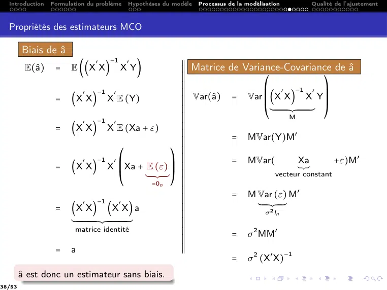

~~~text
  Introduction   Formulation du problème                Hypothèses du modèle                      Processus de la modélisation                                        Qualité de l’ajustement

  Propriétés des estimateurs MCO

        Biais de â
                                     ′        −1        ′                                                          X
                                                                                                                   X
                                                                                                                   X
         E(â)    =    E ((X X)                     X Y)                                                           X
                                                                                                                   X Matrice de Variance-Covariance de â
                                                                                                                   X
                                                                                                                   X
                                                                                                                   X
                                                                                                                   X
                                                                                                                   X
                                                                                                                   X                   ⎛                                                    ⎞
                                    ′                         −1 ′
                                                                                                                   X
                                                                                                                   X
                                                                                                                   X                   ⎜ ′ −1 ′ ⎟
                  =    (X X) X E (Y)                                                                               X
                                                                                                                   X
                                                                                                                   X Var(â) = Var ⎜(X X) X Y⎟
                                                                                                                   X
                                                                                                                   X
                                                                                                                   X                   ⎜                                                    ⎟
                                                                                                                   X
                                                                                                                   X
                                                                                                                   X                   ⎝´¹¹ ¹ ¹ ¹ ¹ ¹ ¹ ¹ ¹ ¹ ¹ ¹¸¹ ¹ ¹ ¹ ¹ ¹ ¹ ¹ ¹ ¹ ¹ ¹ ¶ ⎠
                                                                                                                   X
                                                                                                                   X
                                                                                                                   X                                             M
                  =
                                    ′
                       (X X) X E (Xa + ε)
                                                              −1 ′                                                 X
                                                                                                                   X
                                                                                                                   X
                                                                                                                   X
                                                                                                                   X
                                                                                                                   X
                                                                                                                   X
                                                                                                                   X          = MVar(Y)M′
                                                                                                                   X
                                                                                                                   X
                                                                                                                   X
                                                                                                                   X
                                                                                    ⎛                            ⎞ X
                                                                                                                   X
                                                                                                                   X
                                                                                                                   X
                                    ′                         −1 ′
                                                                                                                 ⎟ X
                                                                                                                   X          = MVar(                              Xa                         +ε)M′
                  =    (X X) X ⎜                                                    ⎜          Xa        + E (ε) ⎟ X
                                                                                                                   X
                                                                                                                   X                                               ¯
                                                                                                           ²⎠ X    X
                                                                                                                   X                           vecteur constant
                                                                                    ⎝                              X
                                                                                                                   X
                                                                                                            =0n    X
                                                                                                                   X
                                                                                                                   X
                                                                                                                   X
                                                                                                                   X
                                                                                                                   X          = M Var (ε) M′
                                    ′                                                ′                             X
                                                                                                                   X
                                                                                                                   X
                  =    (X X) (X X) a
                                                              −1
                                                                                                                   X
                                                                                                                   X                ´¹¹ ¹ ¹ ¹ ¸¹ ¹ ¹ ¹ ¹¶
                                                                                                                   X
                                                                                                                   X
                                                                                                                   X                      σ 2 In
                       ´¹¹ ¹ ¹ ¹ ¹ ¹ ¹ ¹ ¹ ¹ ¹ ¹ ¹ ¹ ¹ ¹ ¹ ¹ ¹ ¸¹¹ ¹ ¹ ¹ ¹ ¹ ¹ ¹ ¹ ¹ ¹ ¹ ¹ ¹ ¹ ¹ ¹ ¹ ¹ ¶           X
                                                                                                                   X
                                                                                                                   X
                                                                                                                   X
                                                                                                                   X
                                                                                                                   X
                        matrice identité
                                                                                                                   X
                                                                                                                   X
                                                                                                                   X          = σ 2 MM′
                                                                                                                   X
                                                                                                                   X
                                                                                                                   X
                  =    a                                                                                           X
                                                                                                                   X
                                                                                                                   X
                                                                                                                              = σ 2 (X′ X)
                                                                                                                                                          −1

        â est donc un estimateur sans biais.
38/53
~~~

## Page 39

~~~text
  Introduction     Formulation du problème   Hypothèses du modèle     Processus de la modélisation           Qualité de l’ajustement

  Variance du résidu

          La matrice de variances-covariances de â fait intervenir la variance théorique σ 2
          du résidu.
                              ↝ Cette variance est inconnue, elle est donc estimée.
                                                             n
                                                                  2
                              ↝ On l’estime à partir de ∑ εi .
                                                            i=1

        Estimation de la variance
                             n                              n est le nombre d’individus
                                   2
                            ∑ εi                            p est le nombre de variables
                            i=1
                 σ̂ 2 =                 .                   n − (p + 1) est le nombre de degrés de liberté en
                          n − (p + 1)                       comptant la constante.

            ; On reprend l’exemple 1 de consommation :
                                                                        31
                           n = 31, p = 4, ddl = 31 − 5 = 26, ∑ ε̂2i = 17, 3648,                      σ̂ 2 = 0, 667 .
                                                                        i=1

            ; On reprend l’exemple 2 :
                                                                              4
                                  n = 4, p = 2, ddl = 4 − 2 − 1 = 1, ∑ ε̂2i = 4,              ,       σ̂ 2 = 4 .
39/53
~~~

## Page 40

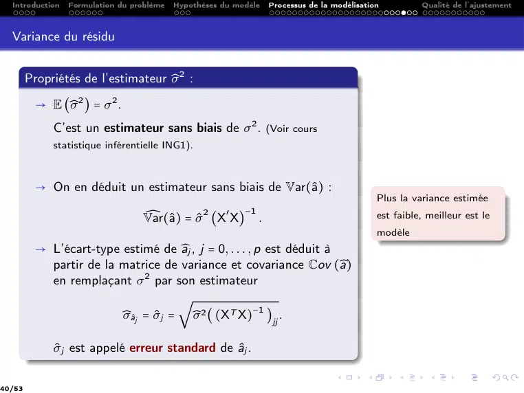

~~~text
  Introduction   Formulation du problème   Hypothèses du modèle   Processus de la modélisation         Qualité de l’ajustement

  Variance du résidu

        Propriétés de l’estimateur ̂
                                   σ2 :

         → E (̂
              σ2 ) = σ2 .
             C’est un estimateur sans biais de σ 2 . (Voir cours
             statistique inférentielle ING1).

         → On en déduit un estimateur sans biais de Var(â) :
                                                                                             Plus la variance estimée
                                  ̂
                                  Var(â) = σ̂ 2 (X′ X) .
                                                       −1
                                                                                             est faible, meilleur est le
                                                                                             modèle
         → L’écart-type estimé de âj , j = 0, . . . , p est déduit à
           partir de la matrice de variance et covariance Cov (̂      a)
           en remplaçant σ 2 par son estimateur
                                    √
                        ̂
                        σâj = σ̂j = ̂σ 2 ( (XT X)−1 )jj .

             σ̂j est appelé erreur standard de âj .

40/53
~~~

## Page 41

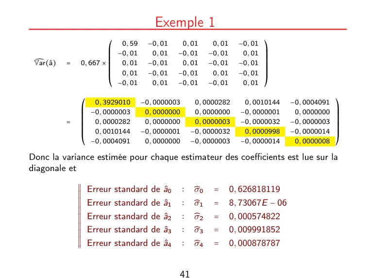

~~~text
                                       Exemple 1
                        ⎛ 0, 59      −0, 01    0, 01        0, 01     −0, 01   ⎞
                        ⎜ −0, 01      0, 01   −0, 01       −0, 01      0, 01   ⎟
                        ⎜                                                      ⎟
 ̂                      ⎜                                                      ⎟
 Var(â)   =   0, 667 × ⎜ 0, 01      −0, 01    0, 01       −0, 01     −0, 01   ⎟
                        ⎜                                                      ⎟
                        ⎜ 0, 01      −0, 01   −0, 01                  −0, 01   ⎟
                        ⎜                                   0, 01              ⎟
                        ⎝ −0, 01      0, 01   −0, 01       −0, 01      0, 01   ⎠

               ⎛ 0, 3929010        −0, 0000003        0, 0000282       0, 0010144    −0, 0004091   ⎞
               ⎜ −0, 0000003        0, 0000000        0, 0000000      −0, 0000001     0, 0000000   ⎟
               ⎜                                                                                   ⎟
               ⎜                                                                                   ⎟
           =   ⎜ 0, 0000282         0, 0000000        0, 0000003      −0, 0000032    −0, 0000003   ⎟
               ⎜                                                                                   ⎟
               ⎜ 0, 0010144        −0, 0000001       −0, 0000032                     −0, 0000014   ⎟
               ⎜                                                       0, 0000998                  ⎟
               ⎝ −0, 0004091        0, 0000000       −0, 0000003      −0, 0000014     0, 0000008   ⎠

Donc la variance estimée pour chaque estimateur des coefficients est lue sur la
diagonale et
               X
               X
               X                                 ∶    ̂     =
               X
               X
               X
                 Erreur standard de â0               σ0            0, 626818119
               X
               X
               X Erreur standard de â1          ∶    ̂
                                                      σ1    =       8, 73067E − 06
               X
               X
               X
               X
               X
               X Erreur standard de â2          ∶    ̂
                                                      σ2    =       0, 000574822
               X
               X
               X
               X
               X
               X Erreur standard de â3          ∶    ̂
                                                      σ3    =       0, 009991852
               X
               X
               X
               X
               X
               X                                 ∶    ̂     =
               X Erreur standard de â4               σ4            0, 000878787

                                              41
~~~

## Page 42

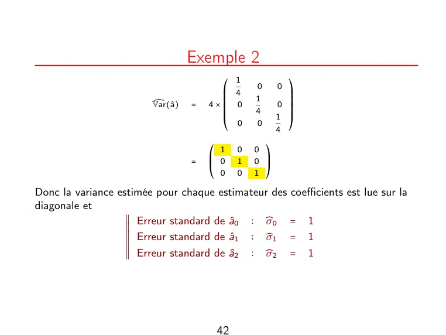

~~~text
                                  Exemple 2
                                          1
                                        ⎛       0       0 ⎞
                                        ⎜ 4               ⎟
                                        ⎜       1         ⎟
                        ̂
                        Var(â)   =   4×⎜
                                        ⎜ 0             0 ⎟
                                                          ⎟
                                        ⎜       4         ⎟
                                        ⎜               1 ⎟
                                        ⎝ 0     0         ⎠
                                                        4

                                      ⎛ 1   0   0   ⎞
                                  =   ⎜ 0           ⎟
                                      ⎜     1   0   ⎟
                                      ⎝ 0   0   1   ⎠

Donc la variance estimée pour chaque estimateur des coefficients est lue sur la
diagonale et
                   X
                   X
                   X Erreur standard de â0 ∶ ̂σ0 = 1
                   X
                   X
                   X
                   X
                   X
                   X Erreur standard de â   ∶ ̂
                                               σ1 = 1
                   X
                   X
                   X
                                           1
                   X
                   X
                   X Erreur standard de â2 ∶ ̂
                   X                           σ2 = 1

                                       42
~~~

## Page 43

~~~text
Qualité de l’ajustement
~~~

**Lecture OCR à contrôler**

~~~text
Qualité de l'ajustement
~~~

## Page 44

~~~text
  Introduction   Formulation du problème   Hypothèses du modèle   Processus de la modélisation   Qualité de l’ajustement

  Qualité de l’ajustement

            ◻ Le problème des moindres carrés peut être formulé géométriquement
              comme une projection orthogonale sur l’espace engendré par le vecteur
              des constantes et les vecteurs des variables explicatives.
            ◻ L’évaluation globale de l’ajustement d’un modèle se basera sur la
              variabilité

                    ⧫ Totale du modèle
                    ⧫ Expliquée par le modèle
                    ⧫ Non expliquée par le modèle
            ◻ Une fois le modèle ajusté, un indicateur de qualité de l’ajustement est le
              coefficient de détermination.
                   → Il exprime la proportion de variabilité de Y qui est retranscrite par le
                     modèle.

            ◻ Lorsqu’on souhaite comparer la pertinence de deux modèles n’ayant pas le
              même nombre de variables explicatives, on doit adapter cet indicateur.

44/53
~~~

## Page 45

~~~text
   Qualité de l’ajustement
Interprétation géométrique et analyse de la variance
~~~

## Page 46

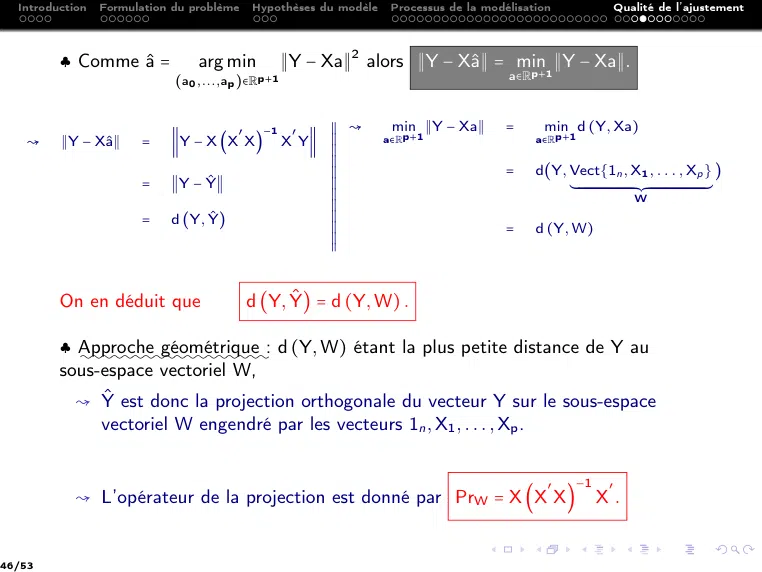

~~~text
  Introduction   Formulation du problème       Hypothèses du modèle    Processus de la modélisation                                                     Qualité de l’ajustement

         ♣ Comme â =            arg min              ∥Y − Xa∥2 alors ∥Y − Xâ∥ = min ∥Y − Xa∥.
                             (a0 ,...,ap   )∈Rp+1                                          a∈Rp+1

                                           ′     −1    ′
                                                           X
                                                           X
                                                           X ↝         min ∥Y − Xa∥        =          min d (Y, Xa)
   ↝     ∥Y − Xâ∥     =    ∥Y − X (X X)              X Y∥ X
                                                           X
                                                           X
                                                           X
                                                                      a∈Rp+1                    a∈Rp+1
                                                           X
                                                           X
                                                           X
                                                           X
                                                           X
                                                           X
                                                           X
                                                           X                               =    d(Y, Vect{1n , X1 , . . . , Xp } )
                       =    ∥Y − Ŷ∥                       X
                                                           X
                                                           X
                                                           X
                                                           X                                         ´¹¹ ¹ ¹ ¹ ¹ ¹ ¹ ¹ ¹ ¹ ¹ ¹ ¹ ¹ ¹ ¹ ¹ ¹ ¹ ¹ ¹ ¹ ¹ ¹ ¹ ¹ ¹ ¹ ¹ ¹ ¹¸ ¹ ¹ ¹ ¹ ¹ ¹ ¹ ¹ ¹ ¹ ¹ ¹ ¹ ¹ ¹ ¹ ¹ ¹ ¹ ¹ ¹ ¹ ¹ ¹ ¹ ¹ ¹ ¹ ¹ ¹ ¹ ¶
                                                           X
                                                           X
                                                           X                                                                                                          W
                                                           X
                                                           X
                                                           X
                       =    d (Y, Ŷ)                      X
                                                           X
                                                           X
                                                           X
                                                           X                               =    d (Y, W)
                                                           X
                                                           X
                                                           X
                                                           X

         On en déduit que                      d (Y, Ŷ) = d (Y, W) .

         ♣ Approche  géométrique : d (Y, W) étant la plus petite distance de Y au
           ::::::::::::::::::
         sous-espace vectoriel W,
           ↝ Ŷ est donc la projection orthogonale du vecteur Y sur le sous-espace
             vectoriel W engendré par les vecteurs 1n , X1 , . . . , Xp .

                                                                                                        ′                   −1                      ′
           ↝ L’opérateur de la projection est donné par PrW = X (X X)                                                                      X.

46/53
~~~

## Page 47

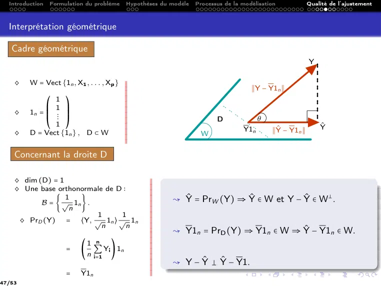

~~~text
  Introduction   Formulation du problème   Hypothèses du modèle   Processus de la modélisation            Qualité de l’ajustement

  Interprétation géométrique

   Cadre géométrique
                                                                                                          Y

    ♢    W = Vect {1n , X1 , . . . , Xp } X
                                          X
                                          X
                                          X
                                          X
                                          X                                          ∥Y − Y1n ∥
                                          X
                                          X
                                          X
              ⎛ 1 ⎞                       X
                                          X
                                          X
                                          X
                                          X
                                          X
              ⎜ 1 ⎟                       X
                                          X
    ♢    1n = ⎜    ⎟                      X
                                          X
              ⎜ ⋮ ⎟                       X
                                          X
              ⎝ 1 ⎠                       X
                                          X
                                          X
                                                                         D              θ
                                          X
                                          X
                                          X                                                                   Ŷ
    ♢    D = Vect {1n } , D ⊂ W           X
                                          X                                       Y1n       ∥Ŷ − Y1n ∥
                                          X
                                          X
                                          X
                                                                   W
                                          X
                                          X
    Concernant la droite D

    ♢ dim (D) = 1                                 X
                                                  X
                                                  X
                                                  X
                                                  X
                                                  X
    ♢ Une base orthonormale de D ∶                X
                                                  X
                                                  X
                                                  X
                  1
           B = { √ 1n } .
                                                  X
                                                  X
                                                  X
                                                  X      ↝ Ŷ = PrW (Y) ⇒ Ŷ ∈ W et Y − Ŷ ∈ W– .
                   n                              X
                                                  X
                                                  X
                                                  X
                                                  X
                                                  X
                          1     1                 X
                                                  X
                                                  X
     ♢ PrD (Y) = ⟨Y, √ 1n ⟩ √ 1n                  X
                                                  X
                           n       n              X
                                                  X
                                                  X
                                                  X
                                                  X
                                                  X      ↝ Y1n = PrD (Y) ⇒ Y1n ∈ W ⇒ Ŷ − Y1n ∈ W.
                                                  X
                                                  X
                                                  X
                           ⎛1 n    ⎞              X
                                                  X
                                                  X
                      =        ∑ Yi 1n            X
                                                  X
                                                  X
                           ⎝ n i=1 ⎠              X
                                                  X
                                                  X
                                                  X
                                                  X
                                                  X
                                                  X
                                                  X
                                                  X
                                                         ↝ Y − Ŷ – Ŷ − Y1.
                                                  X
                                                  X
                                                  X
                      =    Y1n                    X
47/53
~~~

## Page 48

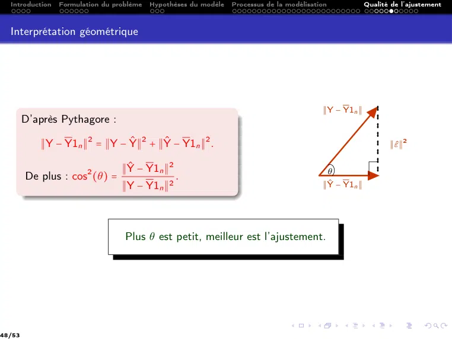

~~~text
  Introduction   Formulation du problème   Hypothèses du modèle   Processus de la modélisation            Qualité de l’ajustement

  Interprétation géométrique

                                                                                            ∥Y − Y1n ∥
        D’après Pythagore :

           ∥Y − Y1n ∥2 = ∥Y − Ŷ∥2 + ∥Ŷ − Y1n ∥2 .                                                              ∥ε̂∥2

                                  ∥Ŷ − Y1n ∥2                                                   θ
        De plus : cos2 (θ) =                      .
                                  ∥Y − Y1n ∥2                                               ∥Ŷ − Y1n ∥

                                   Plus θ est petit, meilleur est l’ajustement.

48/53
~~~

## Page 49

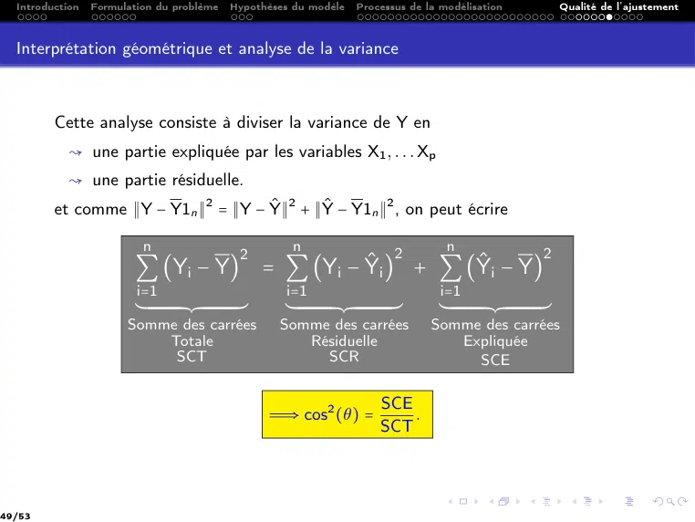

~~~text
  Introduction   Formulation du problème                               Hypothèses du modèle                              Processus de la modélisation                                                            Qualité de l’ajustement

  Interprétation géométrique et analyse de la variance

         Cette analyse consiste à diviser la variance de Y en
           ↝ une partie expliquée par les variables X1 , . . . Xp
           ↝ une partie résiduelle.
         et comme ∥Y − Y1n ∥2 = ∥Y − Ŷ∥2 + ∥Ŷ − Y1n ∥2 , on peut écrire

                            n                                                            n                                                   2           n                                               2
                                                                            2
                         ∑ (Yi − Y) = ∑ (Yi − Ŷi ) + ∑ (Ŷi − Y)
                         i=1                                                          i=1                                                             i=1
                         ´¹¹ ¹ ¹ ¹ ¹ ¹ ¹ ¹ ¹ ¹ ¹ ¹ ¹¸¹ ¹ ¹ ¹ ¹ ¹ ¹ ¹ ¹ ¹ ¹ ¹ ¹ ¹¶     ´¹¹ ¹ ¹ ¹ ¹ ¹ ¹ ¹ ¹ ¹ ¹ ¹ ¹ ¹¸¹ ¹ ¹ ¹ ¹ ¹ ¹ ¹ ¹ ¹ ¹ ¹ ¹ ¹ ¹¶    ´¹¹ ¹ ¹ ¹ ¹ ¹ ¹ ¹ ¹ ¹ ¹ ¹ ¹¸¹ ¹ ¹ ¹ ¹ ¹ ¹ ¹ ¹ ¹ ¹ ¹ ¹ ¹¶
                       Somme des carrées                                             Somme des carrées                                               Somme des carrées
                           Totale                                                       Résiduelle                                                      Expliquée
                            SCT                                                           SCR                                                             SCE

                                                                                                                                      SCE
                                                                                    Ô⇒ cos2 (θ) =                                         .
                                                                                                                                      SCT

49/53
~~~

## Page 50

~~~text
Qualité de l’ajustement
  Le coefficient de détermination
~~~

## Page 51

~~~text
  Introduction   Formulation du problème   Hypothèses du modèle   Processus de la modélisation    Qualité de l’ajustement

  Le coefficient de détermination

                       X
                       X
                       X On peut évaluer la qualité de la régression multiple en utilisant le rapport
                       X
                       X
                       X
                       X
                       X
                       X de la variance expliquée SCE par la régression sur la variance totale SCT.
                       X
                       X
                       X
                       X Le coefficient de détermination, noté R2 , donne un indicateur de la
                       X
                       X
                       X qualité de l’ajustement.
                       X
                       X

                                                             Le coefficient de détermination
                                                                                                 SCE
                                                                               R2 = cos2 (θ) =
                                                                                                 SCT

            2 R2 = 1 ⇔ θ = 0 ⇔ Y ∈ W ⇔ Y = Xa. ,, Modèle parfait.,,
                                    π
            2 R2 ≈ 0 ⇔ θ =            ⇔ résidus très élevés. / Modèle de régression linéaire
                                    2
                 inadapté.//
            2 R2 est proche de 1 signifie que Y est bien expliquée par les variables
              X1 , . . . , Xp . ♡♡

51/53
~~~

## Page 52

~~~text
                                              Exemple 1
                                                                 2             2             2
                 i     Y − Y1n    Y − Ŷ     Ŷ − Y1n   (Yi − Y)      (Yi − Ŷi )   (Ŷi − Y)
                1          -4,3    -0,1         -4,18        18,1             0,0         17,5
                2          -4,2    -0,7         -3,47        17,3             0,5         12,1
                3          -3,9     0,1         -3,97        14,9             0,0         15,8
                4          -3,5    -0,7         -2,77        11,9             0,5           7,7
                5          -3,2     0,1         -3,24        10,0             0,0         10,5
                6          -3,2     0,5         -3,66        10,0             0,3         13,5
                7          -2,9    -0,7         -2,18          8,2            0,4           4,8
                8         11,3      0,6         10,73       128,7             0,4        115,3
                9           8,7    -1,4         10,11        76,5             1,9        102,4
               10           4,5     0,1          4,39        20,7             0,0         19,3
               11          -2,6    -1,1         -1,44          6,5            1,2           2,1
               12          -1,0     0,5         -1,49          0,9            0,3           2,2
               13           1,7     0,8          0,93          3,0            0,7           0,9
               14          -0,5     1,0         -1,43          0,2            1,0           2,1
Y = 9, 954.    15          -0,5     0,5         -0,91          0,2            0,2           0,8
               16          -1,2    -0,2         -0,94          1,3            0,0           0,9
               17          -0,7     1,1         -1,70          0,4            1,1           2,9
               18          -1,4     0,5         -1,81          1,8            0,2           3,3
               19          -2,3    -0,9         -1,39          5,1            0,7           2,0
               20           0,8     0,4          0,44          0,7            0,2           0,2
               21          -3,4    -0,9         -2,43        11,3             0,9           5,9
               22           1,7     1,4          0,30          3,0            2,1           0,1
               23           1,9    -0,3          2,25          3,8            0,1           5,1
               24           0,8     0,3          0,57          0,7            0,1           0,3
               25          -2,4    -1,6         -0,78          5,5            2,5           0,6
               26           1,3    -1,0          2,29          1,8            0,9           5,3
               27           0,8    -0,1          0,97          0,7            0,0           0,9
               28          -0,8    -0,3         -0,48          0,6            0,1           0,2
               29           1,6     0,5          1,17          2,7            0,2           1,4
               30           2,8     0,6          2,23          8,1            0,4           5,0
               31           2,7     0,8         1,926          7,5            0,7           3,7

 SCT    SCR     SCE      SCR+SCE              R2        R2 est proche de 1. La variabilité de la
382,1   17,4   364,8        382,1          0,954        consommation est expliquée à 95% par le
                                                        prix, la cylindrée, la puissance et le poids.
~~~

## Page 53

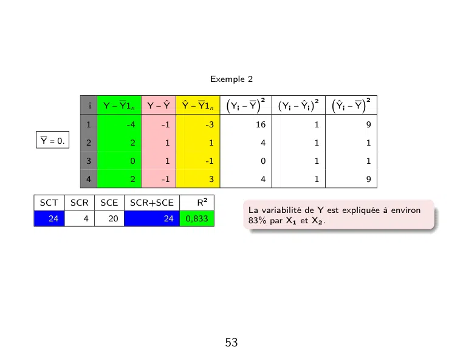

~~~text
                                               Exemple 2

                                                            2                 2               2
               i   Y − Y1n    Y − Ŷ   Ŷ − Y1n    (Yi − Y)     (Yi − Ŷi )       (Ŷi − Y)

           1             -4      -1          -3            16             1               9
Y = 0.     2             2        1            1           4              1               1

           3             0        1          -1            0              1               1

           4             2       -1            3           4              1               9

SCT      SCR       SCE   SCR+SCE          R2
                                                        La variabilité de Y est expliquée à environ
 24        4        20            24   0,833            83% par X1 et X2 .
~~~
