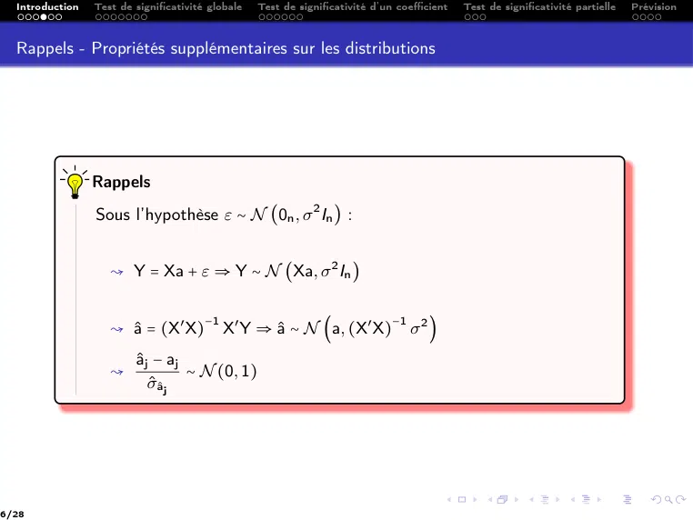
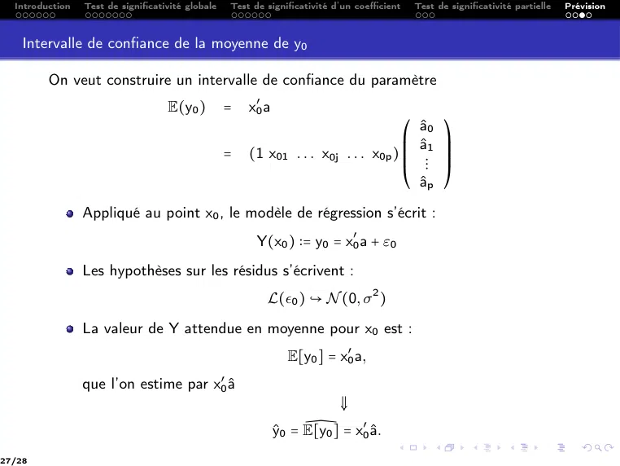
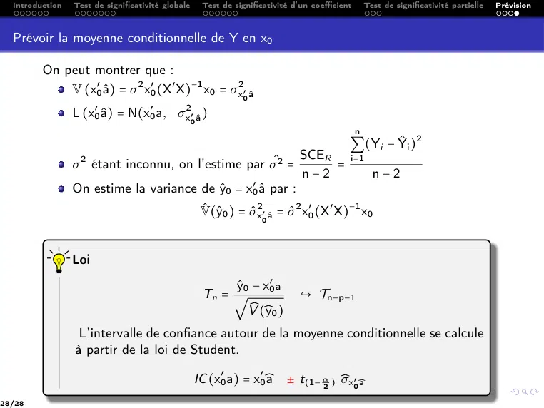

# CM3 -- Significativité d’un modèle linéaire multiple.pdf

[Ouvrir l’original](https://drive.google.com/open?id=199lSyRUTUxuJJVtMEBPWioEm_atcio2u) · Les pages signalées comprennent du texte reconnu automatiquement ou des éléments graphiques. Le fac-similé permet de vérifier chaque lecture.

**Pages avec fac-similé ou lecture OCR** — 3, 9, 16, 22, 25.

**Pages présentant un écart entre les deux extractions** — 6, 21, 27–28.

## Page 1

~~~text
Ingénieurs 2ème année : Parcours Mathématique & Informatique

               Modèle linéaire et extensions

     CM 3:    Significativité d’un modèle linéaire multiple

         Nisrine FORTIN-CAMDAVANT & Naamane LAIB
~~~

## Page 2

~~~text
1   Introduction

2   Test de significativité globale

3   Test de significativité d’un coefficient

4   Test de significativité partielle

5   Prévision
~~~

## Page 3

~~~text
Introduction
~~~

## Page 4

~~~text
X
X
X
X
X
X
X
X
X   2 La modèle étant établi à partir d’un échantillon d’une population, il faut
X
X
X
X
X
X     déterminer dans quelle mesure, on peut extrapoler le modèle obtenu sur un
X
X
X
X
X
X
      échantillon à l’ensemble de la population
X
X
X
X
X
X
X
X
X        → C’est cette généralisation (ou extrapolation) de l’échantillon à la population que
X
X
X           l’on appelle inférence statistique
X
X
X
X
X
X
X
X
X
X
X
X
X
X
X
X
X
X   2 On va tester la significativité globale, partielle et ponctuelle du modèle
X
X
X
X
X
X
X
X
X
X
X        → Nullité de tous les coefficients
X
X
X
X
X        → Nullité partielle des coefficients
X
X
X
X
X        → Nullité d’un coefficient
X
X
X
X
X
X
X
X
X
X
X
X   2 Pour faire ces tests, il est nécessaire de faire une hypothèse supplémentaire :
X
X
X
X
X
X
X
X
X                                         ε ∼ N (0n , σ 2 In )
X
X
X
X
~~~

## Page 5

~~~text
Rappels - Propriétés supplémentaires sur les distributions
~~~

## Page 6

~~~text
  Introduction   Test de significativité globale   Test de significativité d’un coefficient   Test de significativité partielle   Prévision

  Rappels - Propriétés supplémentaires sur les distributions

                 Rappels
                 Sous l’hypothèse ε ∼ N (0n , σ 2 In ) :

                    ↝ Y = Xa + ε ⇒ Y ∼ N (Xa, σ 2 In )

                    ↝ â = (X′ X)            X′ Y ⇒ â ∼ N (a, (X′ X)               σ2 )
                                        −1                                     −1

                         âj − aj
                    ↝             ∼ N (0, 1)
                            σ̂âj

6/28
~~~

## Page 7

~~~text
  Introduction   Test de significativité globale   Test de significativité d’un coefficient   Test de significativité partielle   Prévision

  Rappels – Tests statistiques

                 Étapes d’un test statistique
                    1    Identifier des hypothèses H0 (hypothèse nulle) et H1 (hypothèse
                         alternative).
                     2   Définir une statistique de test T, dont la loi sous H0 est différente
                         sous H1 .
                     3   Choisir un risque de première espèce α (5%, 10%, . . .).
                     4   Définir la zone de rejet W de H0 , en fonction de α, en utilisant la
                         loi de T sous H0 .
                     5   Calculer la valeur t de la statistique de test T.
                     6   Conclure au rejet de H0 si t ∈ W ou à son acceptation dans le cas
                         contraire.

7/28
~~~

## Page 8

~~~text
  Introduction   Test de significativité globale   Test de significativité d’un coefficient   Test de significativité partielle   Prévision

  Rappels – Tests statistiques

         La p-valeur
         Pour réaliser ce test, on peut également :
           ↝ Regarder la p-valeur aussi appelée niveau de signification du test :
                                                   Si p-valeur ≤ α , on rejette H0 .
           ↝ Dans le cas d’un test bilatéral H0 contre H1 , on a :

                                                    p-valeur = P (∣T1 ∣ > ∣t∣ ∣ H0 )

                 On rejette H0 si p-valeur ≤ α .

8/28
~~~

## Page 9

~~~text
Test de significativité globale
~~~

## Page 10

~~~text
  Introduction   Test de significativité globale   Test de significativité d’un coefficient   Test de significativité partielle   Prévision

  Évaluation globale de la régression

         X
         X
         X
         X
         X
         X Le coefficient de détermination R2 permet d’évaluer la qualité de l’ajustement. Il
         X
         X
         X
         X
         X traduit l’information emmenée par la régression de Y par les p variables
         X
         X
         X
         X
         X explicatives Xj sur un échantillon de taille n choisi dans une population.
         X
         X
         X

                 Source des variations         Somme des carrés             Degré de liberté         Carré moyen
                                               SC                           DDL                      CM
                                                        n             2                                     SCE
                 Expliquée                     SCE = ∑ (Ŷi − Y)            p                        CME =
                                                        i=1                                                  p

                                                         n                                                       SCR
                                                                       2
                 Résiduelle                    SCR = ∑ (Yi − Ŷi )          n-(p+1)                  CMR =
                                                        i=1                                                     n−p−1
                                                         n             2
                 Totale                        SCT = ∑ (Yi − Y)             n−1
                                                        i=1

                                            Table 1 – Analyse de la variance

10/28
~~~

## Page 11

~~~text
  Introduction    Test de significativité globale   Test de significativité d’un coefficient   Test de significativité partielle   Prévision

  Évaluation globale de la régression

                                                              X
                                                              X
                                                              X
        Le rapport de Fisher :                                X
                                                              X
                                                              X Relation entre F et R2 :
                                                              X
                                                              X
                                                              X
                                                              X
                                                              X
                          CME                                 X
                                                              X             CME       R2 n − p − 1
                                                                        F=        =
                    F=
                                                              X
                                                              X
                                                              X
                          CMR                                 X
                                                              X
                                                              X             CMR 1 − R2       p

             2 Le coefficient R2 permet de mesurer l’ajustement du modèle.
             2 La statistique de Fisher F permet de tester la significativité du modèle.
            X
            X
            X           SCE
            X
            X
            X    R2 =       , SCT = SCE + SCR donc
            X
            X
            X           SCT
            X
            X
            X
            X
            X
            X    1    SCE + SCR     SCR
            X
            X
            X       =           =1+
            X
            X
            X    R2     SCE         SCE
            X
            X
            X
            X
            X
            X
            X
            X
            X    1      SCR        1 − R2   SCR
            X
            X
            X       −1=     , soit        =     . Ainsi
            X
            X    R2
                        SCE          R2     SCE
            X
            X
            X
            X
            X
            X
            X
            X
            X    CME   R2 n − p − 1
            X
            X
            X        =              .
            X
            X    CMR 1 − R2   p

11/28
~~~

## Page 12

~~~text
  Introduction   Test de significativité globale   Test de significativité d’un coefficient   Test de significativité partielle   Prévision

  Le coin curiosité

         Proposition
         Dans le modèle gaussien, la statistique

                                                            n − p − 1 R2
                                                      F=
                                                                p    1 − R2
         suit, sous H0 ∶ a1 = ⋯ = ap = 0, une loi de Fisher à p et n-p-1 degrés de liberté.

12/28
~~~

## Page 13

~~~text
  Introduction   Test de significativité globale   Test de significativité d’un coefficient   Test de significativité partielle   Prévision

  Le rapport de Fisher – Exemple 1

         On reprend l’exemple 1.
                    Source des variations          Somme des carrés           Degré de liberté         Carré moyen
                                                   SC                         DDL                      CM

                    Expliquée                      SCE = 364, 8               4                        CME = 91, 2

                    Résiduelle                     SCR = 17, 4                26                       CMR = 0, 7

                    Totale                         SCT = 382, 1               30

                                            Table 2 – Analyse de la variance

                    F               136,5412521
                   R2               0,954558563
                    n                      31
                   p                        4
              R2 n − p − 1
                                    136,5412521
            1 − R2   p

13/28
~~~

## Page 14

~~~text
  Introduction   Test de significativité globale   Test de significativité d’un coefficient   Test de significativité partielle   Prévision

  Test de significativité globale de la régression
            X
            X
            X
            X
            X
            X       Le test de Fisher F permet d’évaluer la significativité globale de la
            X
            X
            X       régression, on teste si tous les coefficients du modèles sont nuls (le
            X
            X
            X
            X
            X
            X       modèle est donc non explicatif).
            X
            X

           ⎧
           ⎪ H         ∶ a1 = a2 = ⋯ = ap = 0                           ↝ Tous les coefficients sont nuls et a0
           ⎪ 0
           ⎪                                                              quelconque
           ⎨
           ⎪
           ⎪
           ⎩ H1
           ⎪           ∶    ∃j ∈ {1, . . . , p}, aj ≠ 0
                                                                        ↝ Au moins un coefficient est significatif

    Test de l’hypothèse de non-regression
                                                                          X
                                                                          X
                                                                          X       Règle de décision
                                                                          X
                                                                          X
                                                                          X
                                                                          X
                                                                          X
                                                                          X
        Sous l’hypothèse H0 :                                             X
                                                                          X
                       CME
                                                                          X
                                                                          X
                                                                          X             Si F > fα (p; n − p − 1) alors on
                                                                          X
                  F=                                                      X
                                                                          X
                                                                          X             accepte H1 avec un risque α.
                       CMR                                                X
                                                                          X
                                                                          X
        suit une loi de Fisher de paramètres                              X
                                                                          X
                                                                          X
                                                                          X
        p et n-p-1, F ∼ F(p, n − p − 1)                                   X
                                                                          X
                                                                          X             Sinon on garde H0
                                                                          X
                                                                          X
                                                                          X
                                                                          X
                                                                          X
                                                                          X
                                                                          X
                                                                          X
                                                                          X
14/28
~~~

## Page 15

~~~text
                  Quantiles d’ordre 0.95 de la loi de Fisher (Risque α = 5%)

          1       2        3       4        5       6        7       8       9        10
     1    161.4   199.5    215.7   224.6    230.2   234.0    236.8   238.9   240.5    241.9
     2    18.51   19.00    19.16   19.25    19.30   19.33    19.35   19.37   19.38    19.40
     3    10.13   9.552    9.277   9.117    9.013   8.941    8.887   8.845   8.812    8.786
     4    7.709   6.944    6.591   6.388    6.256   6.163    6.094   6.041   5.999    5.964
     5    6.608   5.786    5.409   5.192    5.050   4.950    4.876   4.818   4.772    4.735
     6    5.987   5.143    4.757   4.534    4.387   4.284    4.207   4.147   4.099    4.060
     7    5.591   4.737    4.347   4.120    3.972   3.866    3.787   3.726   3.677    3.637
     8    5.318   4.459    4.066   3.838    3.687   3.581    3.500   3.438   3.388    3.347
     9    5.117   4.256    3.863   3.633    3.482   3.374    3.293   3.230   3.179    3.137
     10   4.965   4.103    3.708   3.478    3.326   3.217    3.135   3.072   3.020    2.978
     11   4.844   3.982    3.587   3.357    3.204   3.095    3.012   2.948   2.896    2.854
     12   4.747   3.885    3.490   3.259    3.106   2.996    2.913   2.849   2.796    2.753
     13   4.667   3.806    3.411   3.179    3.025   2.915    2.832   2.767   2.714    2.671
     14   4.600   3.739    3.344   3.112    2.958   2.848    2.764   2.699   2.646    2.602
     15   4.543   3.682    3.287   3.056    2.901   2.790    2.707   2.641   2.588    2.544
     16   4.494   3.634    3.239   3.007    2.852   2.741    2.657   2.591   2.538    2.494
     17   4.451   3.592    3.197   2.965    2.810   2.699    2.614   2.548   2.494    2.450
     18   4.414   3.555    3.160   2.928    2.773   2.661    2.577   2.510   2.456    2.412
     19   4.381   3.522    3.127   2.895    2.740   2.628    2.544   2.477   2.423    2.378
     20   4.351   3.493    3.098   2.866    2.711   2.599    2.514   2.447   2.393    2.348
     21   4.325   3.467    3.072   2.840    2.685   2.573    2.488   2.420   2.366    2.321
     22   4.301   3.443    3.049   2.817    2.661   2.549    2.464   2.397   2.342    2.297
     23   4.279   3.422    3.028   2.796    2.640   2.528    2.442   2.375   2.320    2.275
     24   4.260   3.403    3.009   2.776    2.621   2.508    2.423   2.355   2.300    2.255
     25   4.242   3.385    2.991   2.759    2.603   2.490    2.405   2.337   2.282    2.236
     26   4.225   3.369    2.975   2.743    2.587   2.474    2.388   2.321   2.265    2.220
     27   4.210   3.354    2.960   2.728    2.572   2.459    2.373   2.305   2.250    2.204
     28   4.196   3.340    2.947   2.714    2.558   2.445    2.359   2.291   2.236    2.190
     29   4.183   3.328    2.934   2.701    2.545   2.432    2.346   2.278   2.223    2.177

Pour notre exemple : F = 136, 5412521 et le quantile f4,26,0.95 = 2.743 donc F > f4,26,0.95 . On
accepte alors l’hypothèse H1 avec un risque α = 0.05.
~~~

## Page 16

~~~text
Test de significativité d’un coefficient
~~~

**Lecture OCR à contrôler**

~~~text
Test de significativité d'un coefficient
~~~

## Page 17

~~~text
  Introduction   Test de significativité globale   Test de significativité d’un coefficient   Test de significativité partielle   Prévision

                 loi du test individuel
                     On sait que :
                         ↝ E[̂aj ] = aj .
                            ↝ σ̂a2 = (X′ X)−1  2
                                           jj σ .
                                    j

                     En utilisant les hypothèses sur les résidus et les rappels (1), on a :

                                                                                     2
                                                                aj ) ≡ N (aj , σ̂a ).
                                                              L(̂
                                                                                      j

                                                                                                            ∥ε̂∥2
                     La variance σ 2 étant inconnue, on l’estime par σ
                                                                      ̂2 = CMR (=                                 ).
                                                                                                           n−p−1
                     Ce qui conduit à l’estimation de la variance de ̂
                                                                      aj :

                                                                  2                  2
                                                                ̂̂a = (X X )jj      ̂ .
                                                                           ′   −1
                                                                σ                   σ
                                                                   j

                     Du fait de ce remplacement, la loi de ̂
                                                            aj standardisée n’est plus une loi normale
                      centrée réduite mais une loi de Student à n − p − 1 degrés de liberté. Soit

                                                                ⎛̂
                                                                 aj − aj ⎞
                                                            L              ≡ Tν=n−p−1 .
                                                                ⎝ σ̂̂aj ⎠

17/28
~~~

## Page 18

~~~text
  Introduction   Test de significativité globale   Test de significativité d’un coefficient   Test de significativité partielle   Prévision

  Test de significativité d’un coefficient

            X
            X
            X
            X
            X
            X       Sous l’hypothèse de normalité du résidu, la statistique de Student permet
            X
            X
            X       de tester l’apport de chaque variable dans le modèle. On teste alors
            X
            X
            X
            X
            X
            X       individuellement la nullité ou non du coefficient aj pour j = 1, . . . , p.
            X
            X

             ⎧
             ⎪ H         ∶    aj = 0
             ⎪ 0
             ⎪                                ↝ La variable Xj n’apporte pas de contribution au modèle
             ⎨
             ⎪
             ⎪
             ⎩ H1
             ⎪           ∶    aj ≠ 0

                                                                        X
                                                                        X
                                                                        X
                                                                        X
                                                                        X
   Test de significativité d’un coefficient                             X
                                                                        X
                                                                        X
                                                                        X
                                                                        X          Règle de décision
                                                                        X
                                                                        X
                                                                        X
    Sous l’hypothèse H0 :                                               X
                                                                        X
                                                                        X
                  âj                                                   X
                                                                        X
                                                                        X                Si ∣Tj ∣ > t1−α/2;n−p−1 alors on
            Tj =                                                        X
                                                                        X
                                                                        X
                  σ̂j                                                   X
                                                                        X                accepte H1 avec un risque α.
                                                                        X
                                                                        X
    suit une loi de Student de paramètre                                X
                                                                        X
                                                                        X                sinon on garde H0
    n-p-1, Tj ∼ T (n − p − 1)
                                                                        X
                                                                        X
                                                                        X
                                                                        X
                                                                        X
                                                                        X
                                                                        X
                                                                        X
18/28
~~~

## Page 19

~~~text
X
X
X
X Si T est une variable aléatoire suivant la loi de Student à
X
X
X degrés de liberté ν, la table donne, pour α fixé, la valeur
X
X
X t1−α/2 telle que
X
X
X
X                        P (∣T∣ ≥ t1−α/2 ) = α.
X
X
X
X
X
X Ainsi, t 1−α/2 est le quantile d’ordre 1 − α/2 de la loi de
X
X
X Student à degrés de liberté ν.
X
X
  α     0,900    0,500     0,300     0,200    0,100     0,050     0,020     0,010     0,001
  1     0,1584   1,0000    1,9626    3,0777   6,3138    12,7062   31,8205   63,6567   636,6193
  2     0,1421   0,8165    1,3862    1,8856   2,9200    4,3027    6,9646    9,9248    31,5991
  3     0,1366   0,7649    1,2498    1,6377   2,3534    3,1824    4,5407    5,8409    12,9240
  4     0,1338   0,7407    1,1896    1,5332   2,1318    2,7764    3,7469    4,6041    8,6103
  5     0,1322   0,7267    1,1558    1,4759   2,0150    2,5706    3,3649    4,0321    6,8688
  6     0,1311   0,7176    1,1342    1,4398   1,9432    2,4469    3,1427    3,7074    5,9588
  7     0,1303   0,7111    1,1192    1,4149   1,8946    2,3646    2,9980    3,4995    5,4079
  8     0,1297   0,7064    1,1081    1,3968   1,8595    2,3060    2,8965    3,3554    5,0413
  9     0,1293   0,7027    1,0997    1,3830   1,8331    2,2622    2,8214    3,2498    4,7809
  10    0,1289   0,6998    1,0931    1,3722   1,8125    2,2281    2,7638    3,1693    4,5869
  11    0,1286   0,6974    1,0877    1,3634   1,7959    2,2010    2,7181    3,1058    4,4370
   ⋮     ⋮        ⋮         ⋮         ⋮        ⋮         ⋮         ⋮         ⋮         ⋮
   ⋮     ⋮        ⋮         ⋮         ⋮        ⋮         ⋮         ⋮         ⋮         ⋮
   ⋮     ⋮        ⋮         ⋮         ⋮        ⋮         ⋮         ⋮         ⋮         ⋮
   ⋮     ⋮        ⋮         ⋮         ⋮        ⋮         ⋮         ⋮         ⋮         ⋮
  22    0,1271   0,6858    1,0614    1,3212   1,7171    2,0739    2,5083    2,8188    3,7921
  23    0,1271   0,6853    1,0603    1,3195   1,7139    2,0687    2,4999    2,8073    3,7676
  24    0,1270   0,6848    1,0593    1,3178   1,7109    2,0639    2,4922    2,7969    3,7454
  25    0,1269   0,6844    1,0584    1,3163   1,7081    2,0595    2,4851    2,7874    3,7251
  26    0,1269   0,6840    1,0575    1,3150   1,7056    2,0555    2,4786    2,7787    3,7066
   ⋮     ⋮        ⋮         ⋮         ⋮        ⋮         ⋮         ⋮         ⋮         ⋮
   ⋮     ⋮        ⋮         ⋮         ⋮        ⋮         ⋮         ⋮         ⋮         ⋮

                                    α = 5%; n = 31, p = 4
~~~

## Page 20

~~~text
  Introduction   Test de significativité globale    Test de significativité d’un coefficient    Test de significativité partielle   Prévision

  Significativité individuelle des coefficients du modèle – Exemple 1

                                             Le prix            La cylindrée        La puissance             Le poids

                                                   X1                 X2                   X3                   X4

                   âj                   2, 042 ×10     −5
                                                               -5,006 ×10    −4
                                                                                    2,499 ×10     −2
                                                                                                          4,161 ×10−3

                   σ̂j                    8,731×10−6            5,748 ×10−4         9,992 ×10−3           8,787 ×10−4
                          âj
                   Tj =                       2,339                 -0.871               2,501                 4,734
                          σ̂j

                   Le t-théorique            2,0555                2,0555               2,0555                2,0555

                 ∣T2 ∣ < 2.0555 : la variable cylindrée n’est pas significative dans ce modèle.

                 ∣T1 ∣ > 2.0555, ∣T3 ∣ > 2.0555 et ∣T4 ∣ > 2.0555, donc les variables prix, puissance et poids
                 sont individuellement significatifs dans ce modèle.

20/28
~~~

## Page 21

~~~text
  Introduction   Test de significativité globale   Test de significativité d’un coefficient   Test de significativité partielle   Prévision

  Intervalle de confiance de aj

         De la loi de ̂
                      aj standardisée :

                                                         ̂
                                                         aj − aj
                                                    L(           ) ≡ Tν=n−p−1
                                                           ̂
                                                           σ̂aj
         on déduit les bornes de l’intervalle de aj :

                                           ̂
                                           aj ± t ν ̂
                                                    σ̂aj ,          où      ν = n − p − 1.

                 Intervalle de confiance
                 Un intervalle de confiance pour les paramètres aj est donné par

                                        [âj − σ̂âj t1−α/2;n−p−1 ; âj + σ̂âj t1−α/2;n−p−1 ]

                 où t1−α/2;n−p−1 est la valeur critique dans la table de Student à (n-p-1)
                 d.d.l. pour un niveau de confiance α et σ̂âj est la variance estimée de âj .

21/28
~~~

## Page 22

~~~text
Test de significativité partielle
~~~

## Page 23

~~~text
  Introduction   Test de significativité globale   Test de significativité d’un coefficient   Test de significativité partielle   Prévision

  Test sur un sous-ensemble de coefficients (Test entre modèles emboîtés)

            X
            X
            X
            X
            X
            X       Le test précédent permet de tester l’un après l’autre la nullité de chaque
            X
            X
            X       coefficient. Le test suivant permet de tester la nullité simultanée de
            X
            X
            X
            X
            X
            X       plusieurs coefficients de régression.
            X
            X
         On cherche à tester la nullité des q ≤ p premiers paramètres :

                                           ⎧
                                           ⎪ H         ∶    a1 = . . . = aq = 0
                                           ⎪
                                           ⎪ 0
                                           ⎨
                                           ⎪
                                           ⎪
                                           ⎪
                                           ⎩ H1        ∶    ∃k ∈ {1, . . . q}, ak ≠ 0

         Cela revient à comparer deux modèles.
           ↝ le modèle complet à p régresseurs (modèle 1) pour lequel on évalue la
             somme des carrés des résidus SCR1,
           ↝ le modèle réduit à p − q régresseurs (modèle 0) pour lequel on évalue la
             somme des carrés des résidus SCR0.

23/28
~~~

## Page 24

~~~text
  Introduction   Test de significativité globale   Test de significativité d’un coefficient   Test de significativité partielle   Prévision

  Test entre modèles emboîtés

   Test de significativité partielle                   X
                                                       X
                                                       X
                                                       X
                                                       X
                                                       X
                                                       X
                                                       X
                                                       X
                                                         Règle de décision
   Sous l’hypothèse H0 :                               X
                                                       X
                                                       X
                                                       X
                                                       X
                                                       X
          (SCR0 − SCR1 )/q        ∥Ŷ0 − Ŷ∥2 /q       X
                                                       X
   Fobs =                   =                          X
                                                       X
                                                       X     Si Fobs > fq, n−p−1 (1 − α) alors
          SCR1 /(n − p − 1)   ∥Y − Ŷ∥ /(n − p − 1)
                                      2                X
                                                       X
                                                       X
                                                       X
                                                       X
                                                       X
                                                             on accepte H1 avec un risque
                                                       X
                                                       X
   suit une loi de Fisher de paramètres q et n − p − 1 X
                                                             α.
                                                       X
                                                       X
                                                       X
                                                       X
                                                       X
                                                       X     sinon on garde H0
                                                       X
                                                       X
                                                       X
                   Fobs ∼ F(q, n − p − 1)              X
                                                       X

            1 Dans les cours suivants !
           JAN

                 Ce test est utile pour faire de la modélisation pas à pas et sélectionner
                 un ensemble optimal de régresseurs nécessaires à la reconstruction de
                 Y.

24/28
~~~

## Page 25

~~~text
Prévision
~~~

## Page 26

~~~text
  Introduction   Test de significativité globale   Test de significativité d’un coefficient   Test de significativité partielle   Prévision

  Prévision d’une valeur future

         Une fois le modèle ajusté, on souhaite prévoir la valeur de y0 pour une nouvelle
         observation :
                                  x′0 = (1, x01 , . . . , x0j , . . . , x0p ).
          Deux possibilités :
                            ↝ Construire un intervalle de la valeur prédite y0 par le modèle,
                              de niveau 1 − α i.e., trouver A et B telle que

                                                                P(A ≤ y0 ≤ B) = 1 − α.

                            ↝ Ou construire un intervalle de confiance de E(y0 ) ,

                                                              P(A ≤ E(y0 ) ≤ B) = 1 − α.

                                                                                     ̂
                            ↝ Dans les deux cas y0 et E(Y0 ) sont estimées par ŷ0 = E(y 0 ).

26/28
~~~

## Page 27

~~~text
  Introduction   Test de significativité globale   Test de significativité d’un coefficient   Test de significativité partielle   Prévision

    Intervalle de confiance de la moyenne de y0

         On veut construire un intervalle de confiance du paramètre
                                    E(y0 )         =   x′0 a
                                                                                    ⎛ â0 ⎞
                                                                                    ⎜ â1 ⎟
                                                   =   (1 x01 . . . x0j . . . x0p ) ⎜     ⎟
                                                                                    ⎜ ⋮ ⎟
                                                                                    ⎝ âp ⎠

                 Appliqué au point x0 , le modèle de régression s’écrit :
                                                         Y(x0 ) ∶= y0 = x′0 a + ε0
                 Les hypothèses sur les résidus s’écrivent :
                                                           L(ϵ0 ) ↪ N (0, σ 2 )
                 La valeur de Y attendue en moyenne pour x0 est :
                                                                  E[y0 ] = x′0 a,
                 que l’on estime par x′0 â
                                                                           ⇓
                                                                     ̂
                                                               ŷ0 = E[y0 ] = x′0 â.
27/28
~~~

## Page 28

~~~text
  Introduction   Test de significativité globale       Test de significativité d’un coefficient       Test de significativité partielle   Prévision

  Prévoir la moyenne conditionnelle de Y en x0

         On peut montrer que :
             V (x′0 â) = σ 2 x′0 (X′ X)−1 x0 = σx2′ â
                                                                 0

                 L (x′0 â) = N(x′0 a, σx2′ â )
                                                   0
                                                                                                  n
                                                                                              ∑(Yi − Ŷi )
                                                                                                                    2

                                                            SCER i=1
                 σ 2 étant inconnu, on l’estime par σˆ2 =       =
                                                            n−2      n−2
                 On estime la variance de ŷ0 = x0 â par :
                                                 ′

                                                       V̂(ŷ0 ) = σ̂x2′0 â = σ̂ 2 x′0 (X′ X)−1 x0

                 Loi
                                                            ŷ0 − x′0 a
                                                       Tn = √                    ↪ Tn−p−1
                                                               V̂ (̂
                                                                   y0 )
                  L’intervalle de confiance autour de la moyenne conditionnelle se calcule
                 à partir de la loi de Student.

                                                   IC (x′0 a) = x′0̂
                                                                   a ± t(1− α2 ) ̂
                                                                                 σx′0̂a
28/28
~~~
