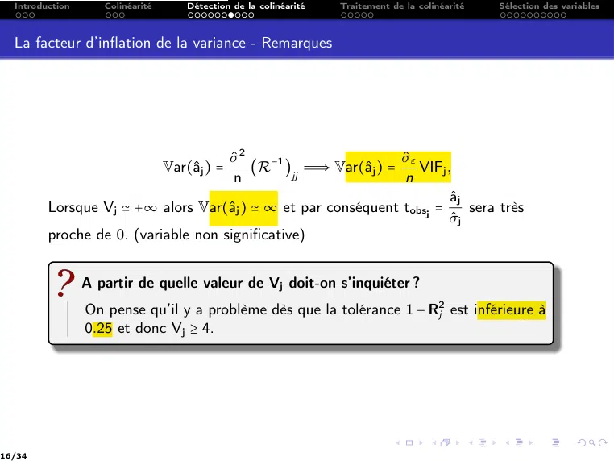

# CM4 -- Pratiques de la régression linéaire multiple .pdf

[Ouvrir l’original](https://drive.google.com/open?id=1bqHIfSPkga3llkgjG39TYjtw-f69IURa) · Les pages signalées comprennent du texte reconnu automatiquement ou des éléments graphiques. Le fac-similé permet de vérifier chaque lecture.

**Pages avec fac-similé ou lecture OCR** — 3, 20, 25.

**Pages présentant un écart entre les deux extractions** — 16.

## Page 1

~~~text
Ingénieurs 2ème année : Parcours Mathématique & Informatique

               Modèle linéaire et extensions

     CM 4:     Pratiques de la régression linéaire multiple

         Nisrine FORTIN-CAMDAVANT & Naamane LAIB
~~~

## Page 2

~~~text
1   Introduction

2   Colinéarité

3   Détection de la colinéarité

4   Traitement de la colinéarité
      Critère du R2
      Critères AIC et BIC

5   Sélection des variables
      Procédures de sélection
      Techniques basées sur le critère AIC
      Techniques basées sur le F partiel de Fisher
~~~

## Page 3

~~~text
Introduction
~~~

## Page 4

~~~text
    Les étapes à suivre pour établir un modèle linéaire sont les suivantes :

1   Estimation des paramètres (CM1 - Thématique 1)
2   Mesure de la qualité d’ajustement (CM1 - Thématique 1)
3   Étude de la validité du modèle (CM1 - Thématique 2)
     a.   Si les hypothèses sur les erreurs non vérifiées STOP
     b.   Si observations aberrantes/influentes
           i.    Correction/suppression
           ii.   Retour à l’étape 1
4   Inférence statistique (CM 1 - Thématique 3)
     a.   Test de significativité globale
     b.   Test de significativité des coefficients (individuelle ou par bloc)
5   Évaluation de la mulicolinéarité (CM2 - Thématique 1)
6   Sélection de variables (CM2 - Thématique 1)
     a.   Modèle restreint
     b.   Réitération des étapes 1,2,3, 4
~~~

## Page 5

~~~text
 ↝ Dans le cours précédent, l’accent a été mis sur l’étude de la qualité des
   estimateurs et des prédicteurs en minimisant l’erreur quadratique
   moyenne.

 ↝ Le modèle ainsi obtenu peut être bon pour expliquer les données au sens
   d’une déviance minimale (ou d’un R2 maximale).

Cependant ce modèle peut contenir un nombre important de variables pouvant
introduire des colinéarités.
    Le bon modèle est celui qui conduit aux prédictions les plus fiables.

    Cela nous amène à
       1   Faire une sélection de variables pertinentes et choisir un modèle
           final en utilisant un critère de choix et un algorithme de
           recherche.
       2   Faire un diagnostic a postériori pour vérifier les hypothèses du
           modèle.
~~~

## Page 6

~~~text
                        La colinéarité
♠ Les valeurs de deux variables ou plus sont liées entre elles : on parle des
  problèmes de colinéarité.

♠ Il y a donc des variables redondantes parmi les Xj .
~~~

## Page 7

~~~text
  Introduction      Colinéarité   Détection de la colinéarité   Traitement de la colinéarité   Sélection des variables

  Colinéarité

            2 Certaines variables exogènes sont redondantes, elles emmènent le même
                 type d’information :

                 C’est le problème de la colinéarité
                 Les variables explicatives se gênent mutuellement dans la régression.

            2 On peut définir la colinéarité comme la corrélation entre une des exogènes
              avec une combinaison linéaire des autres exogènes.

                                                       X
                                                       X
                                                       X
                                                       X
                                                         Le coefficient de corrélation entre Xj et Xk :
                                                       X
                                                       X
                                                       X
                                                       X
                                                       X
                                                       X                       Cov(Xj , Xk )
                                                       X
                                                       X
                                                       X             rXj ,Xk =
                                                       X
                                                                                             .
                                                       X
                                                       X
                                                       X
                                                                                 σXj σXk

7/34
~~~

## Page 8

~~~text
  Introduction      Colinéarité        Détection de la colinéarité       Traitement de la colinéarité     Sélection des variables

                 Pourquoi la colinéarité est un problème ?
                   1   Si la colinéarité est parfaite (rXj ,Xk = 1                j ≠ k) :

                                   rang(X′ X) < p + 1                ⇒     (X′ X)−1       n’existe pas.

                       Le calcul des estimateurs

                                  ̂
                                  a = (X′ X)−1 X′ Y,           ̂
                                                               σ̂a2 = ̂
                                                                      σ 2 (X′ X)−1       est impossible.
                   2   Si la colinéarité est forte (rXj ,Xk ≃ 1               ∀ j ≠ k), alors :

                                                                                  1
                                   det(X′ X) ≃ 0 ⇒             (X′ X)−1 =               Com′ (X′ X)
                                                                              det(X′ X)

                       La matrice inverse X′ X contient alors des valeurs très élevées.
                                                           ̂
                                                           aj
                   3   Dès lors, le test de Student tobs =      pour tester la significativité
                                                           ̂
                                                           σ̂aj
                       des coefficients présentent de très faibles valeurs.
                       La variable paraît non significative et elle est éliminée.

8/34
~~~

## Page 9

~~~text
                  Conséquences de la colinéarité

     Les variances des estimateurs sont exagérées ;

     Les coefficients sont extrêmement instables.

Une modification faible dans les données entraîne une forte modification de
l’estimation (en particulier, un changement d’échantillon peut modifier les
résultats)

     Contradiction entre test de Student et de Fisher.

Le test de Student peut donner que les coefficients ne sont pas significatifs
malgré que le test de Fisher montre l’existence des coefficients significatifs.

                                         9
~~~

## Page 10

~~~text
        Détection de la colinéarité
On s’intéresse à quelques techniques de détection de la colinéairité
  1   Le test de KLEIN
  2   Le facteur d’inflation de la variance VIF
  3   Cohérence des signes
~~~

## Page 11

~~~text
  Introduction    Colinéarité   Détection de la colinéarité   Traitement de la colinéarité   Sélection des variables

  Test de KLEIN

         Le test de KLEIN est une technique de détection simple : il repose sur le
         principe suivant :
                   X
                   X
                   X
                   X
                   X
                   X
                        1 Calcul du coefficient de détermination R2
                   X
                   X
                   X
                   X
                   X
                   X
                        2 Calcul des corrélations croisées entre les variables explicatives
                   X
                   X
                   X
                   X
                   X
                   X
                   X
                   X
                   X                          rj1 ,j2 = cor(Xj1 , Xj2 )        avec j1 ≠ j2 .
                   X
                   X
                   X
                   X
                   X
                   X
                   X
                   X
                   X    3 Il y a présomption de colinéarité s’il existe un couple de variables
                   X
                   X
                   X
                   X
                   X
                   X
                            Xja , Xjb tel que
                   X
                   X
                   X
                   X
                   X                                           R2 < r2ja ,jb .
                   X
                   X
                   X
                   X
                   X

         Dans la pratique, une simple proximité des valeurs R2 et r2ja ,jb doit nous alerter.

11/34
~~~

## Page 12

~~~text
  Introduction   Colinéarité       Détection de la colinéarité    Traitement de la colinéarité   Sélection des variables

  Exemple 1

                                     Matrice des corrélations croisées C
                                    :::::::::::::::::::::::::::
                                           Prix       Cylindrée      Puissance          Poids
                           Prix             1           0.92           0.93             0.95
                         Cylindrée         0.92           1            0.96             0.86
                         Puissance         0.93         0.96             1              0.85
                           Poids           0.95         0.86           0.85               1

                                Matrice des corrélations croisées au carré C2
                               :::::::::::::::::::::::::::::::::::
                                           Prix       Cylindrée      Puissance          Poids
                           Prix             1           0.84           0.86             0.90
                         Cylindrée         0.84           1            0.91             0.74
                         Puissance         0.86         0.91             1              0.73
                           Poids           0.90         0.74           0.73               1

         On a R2 = 0.9295 ∼ r2puissance, cylindrée .
         Les variables Puissance et Cylindrée ne paraissent pas pertinentes pour
         expliquer la consommation des véhicules.
12/34
~~~

## Page 13

~~~text
  Introduction      Colinéarité   Détection de la colinéarité   Traitement de la colinéarité   Sélection des variables

  Test de multicolinéarité

         Le test de Klein détecte la colinéarité bivariée. Pour évaluer la multicolinéarité,
           ↝ il faudrait effectuer la régression de chaque variable Xj avec les autres
             (p − 1) variables,
           ↝ puis étudier le coefficient de détermination R2j associé.

         La source principale d’instabilité dans l’estimation de a est la muliticolinéarité.
         Comme
                                        Var(â) = (X′ X) σ 2
                                                        −1

                 Si les prédicteurs sont très corrélés entre eux, X′ X est mal conditionnée et
                 Var(â) aura des termes élevés.
                 Dans ce cas, les paramètres du modèle seront estimés avec imprésisions et
                 les prédictions pourront être entachées d’erreurs considérables même si le
                 coefficient de détermination R2 a une valeur élevée.

         Il est donc important de mesurer l’effet de la colinéarité entre les prédicteurs,
         cela s’effectue au moyen des facteurs d’inflation de la variance.

13/34
~~~

## Page 14

~~~text
  Introduction   Colinéarité   Détection de la colinéarité      Traitement de la colinéarité   Sélection des variables

  La facteur d’inflation de la variance

         Il sera commode pour la suite de supposer que toutes les variables sont
         centrées et réduites. Ce qui ne change pas le coefficient de détermination R2 ni
         les valeurs prévues et que l’on effectue donc une régression sans constante :
           ′
         X̃ X̃ est donc une matrice de taille p et a un vecteur à p composantes. On donc

                                                   X̃ X̃ = nR
                                                     ′

         où R est la matrice de corrélation entre les prédicteurs.

 La matrice de variance-covariance des estimateurs                X
                                                                  X
                                                                  X                           1
                                                                  X
                                                                  X
                                                                  X             (R−1 )jj =
 des coefficients (a1 , . . . , ap ) est                          X
                                                                  X                        1 − R2j
                                                                  X
                                                                  X
                                                                  X
                                                                  X
                                                                  X
                                                                  X
                                        −1
                                                                  X
                                                                  X R2j est le coefficient de
                  Var(a) = σ 2 (X̃ X̃)
                                   ′
                                                                  X
                                                                  X
                                                                  X
                                                                  X
                                                                  X
                                                                  X
                                                                    détermination de la régression de Xj
                                                                  X
                                                                  X
                                                                  X sur les autres variables.
                                                                  X
                                                                  X
                                                                  X
                     σ 2 −1             σ2                        X
                                                                  X
    donc Var(a) =       R et Var(aj ) =    (R−1 )jj               X
                                                                  X
                     n                  n                         X
                                                                  X
                                                                  X
                                                                  X
                                                                  X
                                                                  X
                                                                  X
                                                                  X
                                                                  X
 (R−1 )jj est le jème terme diagonal de R−1 .                     X
                                                                  X
                                                                  X
                                                                  X
                                                                  X
14/34
~~~

## Page 15

~~~text
  Introduction      Colinéarité   Détection de la colinéarité     Traitement de la colinéarité   Sélection des variables

  La facteur d’inflation de la variance

                 Facteur d’inflation de la variance VIF
                 On appelle facteur d’inflation de la variance (Variance Inflation Factor)
                 (VIF), la quantité
                                                              1
                                         Vj ∶= VIFj =              , 1 ≤ j ≤ p.
                                                           1 − R2j

                 Le terme 1 − R2j est appelé tolérance.
                 Problème dès que R2j ≃ 1 ⇒ Vj ≃ +∞

         Plus Xj est "linéairement" proche de ces variables, plus Rj est proche de 1 et
         plus la variance de l’estimateur de aj est élevée ;

15/34
~~~

## Page 16

~~~text
  Introduction      Colinéarité       Détection de la colinéarité   Traitement de la colinéarité   Sélection des variables

  La facteur d’inflation de la variance - Remarques

                                     σ̂ 2                         σ̂ε
                                          (R−1 )jj Ô⇒ Var(âj ) =
                                  Var(âj ) =                         VIFj ,
                                      n                            n
                                                                            âj
         Lorsque Vj ≃ +∞ alors Var(âj ) ≃ ∞ et par conséquent tobsj =          sera très
                                                                           σ̂j
         proche de 0. (variable non significative)

                 A partir de quelle valeur de Vj doit-on s’inquiéter ?
                 On pense qu’il y a problème dès que la tolérance 1 − R2j est inférieure à
                 0.25 et donc Vj ≥ 4.

16/34
~~~

## Page 17

~~~text
  Introduction   Colinéarité      Détection de la colinéarité     Traitement de la colinéarité   Sélection des variables

  Exemple 1

                               Inverse de la matrice des corrélations : C−1
                               ::::::::::::::::::::::::::::::::::

                                          Prix        Cylindrée       Puissance          Poids
                       Prix             19.79          -1.45            -7.51           -11.09
                       Cylindrée         -1.45         12.87            -9.80            -1.36
                       Puissance         -7.51         -9.80           14.89              2.86
                       Poids            -11.09         -1.36             2.86           10.23

         Les VIF se trouvent sur la diagonale principale.
         On constante que toutes les variables posent problème (Vj ≥ 4).

17/34
~~~

## Page 18

~~~text
  Introduction      Colinéarité   Détection de la colinéarité   Traitement de la colinéarité   Sélection des variables

  Cohérence des signes

          X
          X
          X Cette approche consiste à comparer les signes des coefficients de la régression
          X
          X
          X
          X
          X
          X
            avec les signes des corrélations simples entre les variables Xj et la variable prédite
          X
          X
          X Y.
          X
          X
          X
                 Repérer les signes des coefficients estimés âj
                 Calculer les corrélations croisées

                                        rY,Xj = corr(Xj , Y)     ∀ j = 1, . . . , p.

                 Cohérence des signes
                 Il y a présomption de colinéarité s’il existe des situations où

                                             signe(âj ) ≠ signe(rY,Xj ).

18/34
~~~

## Page 19

~~~text
  Introduction   Colinéarité   Détection de la colinéarité   Traitement de la colinéarité   Sélection des variables

  Exemple 1

                  Comparaison des corrélations individuelles et des coefficients
                  :::::::::::::::::::::::::::::::::::::::::::::::

                                                       âj          rY,Xj
                               prix                0.000034       0.942597
                               cylindree           0.001208       0.908790
                               puissance           -0.003742      0.888304
                               poids               0.003728       0.944740

         On remarque qu’il y a un conflit pour la variable puissance.

19/34
~~~

## Page 20

~~~text
Traitement de la colinéarité
~~~

## Page 21

~~~text
  Introduction      Colinéarité    Détection de la colinéarité   Traitement de la colinéarité   Sélection des variables

         Il existe plusieurs pistes pour traiter la colinéarité. On note principalement :

            1    La régression ridge qui vise à rendre l’inverse de la matrice (X′ X) plus
                 stable.
            2    La régression sur les composantes principales

         Dans ce qui suit, nous traitons plus particulièrement la sélection de variables.

         Sélection par optimisation-Objectif :
         ::::::::::::::::::::::::::::
                 Trouver un sous-ensemble de q variables explicatives (q ≤ p) qui soient,
                 autant que possible, pertinentes et non-redondantes pour expliquer Y.

                 Deux problèmes :
                    1   Comment choisir ces q variables ?
                    2   Quel critère faut-il utiliser ?

21/34
~~~

## Page 22

~~~text
  Introduction   Colinéarité   Détection de la colinéarité    Traitement de la colinéarité   Sélection des variables

  Critère R2

         Le coefficient de détermination R2 exprime la part de la variance expliquée par
         le modèle et mesure la qualité globale du modèle, mais il a le défaut
         d’augmenter automatiquement lorsqu’on ajoute de nouvelles variables
         explicatives, par exemple

                                       R2Y.(X1 ,X2 ) < R2Y.(X1 ,X2 ,X3 )

         même si X3 est une variable qui n’apporte aucune information.

         La solution optimale selon R2 est donc le modèle complet :

         Il ne peut donc servir qu’à comparer deux modèles de même niveau c’est-à-dire
         avec le même nombre de variables.

         C’est pourquoi on introduit le coefficient de détermination ajusté, qui corrige ce
         défaut.

22/34
~~~

## Page 23

~~~text
  Introduction      Colinéarité    Détection de la colinéarité       Traitement de la colinéarité   Sélection des variables

  Critère du R2a - Coefficient de détermination ajusté

         Le coefficient de détermination ajusté, noté R2a défini par :
                                         SCR/(n − p − 1)      n−1
                             R2a = 1 −                   =1−       (1 − R2 ).
                                          SCT/(n − 1)        n−p−1
         Il tient compte de degrés de liberté (donc du nombre de variables introduits
         dans le modèle). Le rapport
                 SCR(n − p − 1)/SCT(n − 1) introduit une pénalisation liée au nombre de
                 paramètres à estimer. On a :
                                                                 (n − 1)CMR
                                                  R2a = 1 −
                                                                     SCT
                 Dans la comparaison de deux modèles ayant la même SCT, on observe que

                                          R2a > R2a,q            ⇔    CMR < CMRq

                 CMR et CMRq désignant respectivement l’erreur quadratique moyenne du
                 modèle complet et celle d’un modèle à q variables explicatives.

         Maximiser le R2a revient donc à minimiser l’erreur quadratique moyenne.
23/34
~~~

## Page 24

~~~text
  Introduction   Colinéarité   Détection de la colinéarité   Traitement de la colinéarité   Sélection des variables

  Critères AIC et BIC

         Les critères AIC (Akaike Information Criterion) et BIC (Bayesian Information
         Criterion) sont deux critères de vraisemblance pénalisées définis par :
                                                      SCRq
                                AIC       =    n ln        + 2(q + 1)
                                                        n
                                                      SCRq
                                BIC       =    n ln        + ln(n)(q + 1)
                                                        n
         où SCRq est la somme des carrées résiduelle du modèle Mq à q ≤ p variables
         explicatives.

         Ces deux critères s’appuient sur la même idée que pour le coefficient de
         détermination ajusté, on doit minimiser les critères AIC ou BIC.

24/34
~~~

## Page 25

~~~text
Sélection des variables
~~~

## Page 26

~~~text
          Procédures de sélection
Un problème de complexité : Le nombre de modèles à considérer est
                                 p
                                ∑ Cq = 2 − 1
                                      p   p

                                q=1

Ce nombre croît exponentiellement avec p variables. En pratique, on utilise
donc des heuristiques dont les plus simples sont les procédures pas à pas
ascendante ou descendante.
~~~

## Page 27

~~~text
  Introduction      Colinéarité   Détection de la colinéarité   Traitement de la colinéarité   Sélection des variables

  Procédures de sélection

                 Test de tous les modèles impossible
                                           ♠ Méthodes pas à pas ♠
                                           :::::::::::::::::::::

                 Élimination successive ou Ajout successif de variables explicatives

            1    La méthode descendante (Backward) consiste à éliminer la variable la
                 moins significative parmi les p. On recalcule alors la régression puis on
                 recommence jusqu’à être satisfait.

            2    La méthode ascendante (Forward) procède en sens inverse : on part de la
                 meilleure régression à une seule variable puis on ajoute la variable la plus
                 significative.

27/34
~~~

## Page 28

~~~text
  Introduction        Colinéarité   Détection de la colinéarité   Traitement de la colinéarité   Sélection des variables

  Méthode descendante avec critère AIC

         Trouver le modèle optimal qui minimise le critère l’AIC :

            1    Étape initiale : Calculer le critère AIC en présence de toutes les variables,
                 ::::::::::::
            2    Étape 1 :
                 ::::::::
                  a     Supprimer les variables dans le modèle complet Mp une à une et
                        calculer le critère AIC avec les p-1 variables restantes.
                  b     Éliminer la variable dont la suppression a permis de diminuer le
                        critère AIC.
            3    Répéter à chaque ::::  k ≥ 1 ::
                                  étape:::::
                  a     Éliminer les variables du modèle Mp−k+1 une à une et calculer le
                        critère AIC avec les p-k variables restantes.
                  b     Éliminer la variable dont la suppression a permis de diminuer le
                        critère AIC.
            4    Continuer ainsi tant que la suppression d’une variable améliore le critère.

28/34
~~~

## Page 29

~~~text
  Introduction      Colinéarité    Détection de la colinéarité   Traitement de la colinéarité   Sélection des variables

                          Modèle courant                             AIC    Suppr d’1 va (AIC)
             1 prix + cylindrée + puissance + poids                 -18,69  puiss → - 20,6188
                            Modèle : M4                                      prix → - 20,0081
                                                                            cylind→ - 17,4625
                                                                            poids → - 12,1155
             2            prix + cylindrée + poids                 -20,6188   prix → -21,9986
                                Modèle : M3                                 cylind → -17,6000
                                                                             poids → -13,3381
             3                cylindrée + poids                   - 21,9986 cylind → -13,3049
                                 Modèle : M2                                 poids → - 0,2785

                 Le modèle M4 avec toutes les variables nous donne AIC = −18, 69
                 L’étape 1 : La suppression de puissance ⇒ une diminution du critère
                 (−20, 6188).
                 On retient le modèle M3 sans la variable puissance avec AIC = −20, 6188.
                 L’étape 2, suppression de prix ⇒ une diminution du critère (−21, 9986).
                 On retient le modèle M2 sans la variable prix (et puissance) avec un
                 AIC = −21, 9986.
                 L’étape 3, on constate qu’aucune suppression de variable n’améliore le
                 modèle courant.
29/34
~~~

## Page 30

~~~text
  Introduction      Colinéarité    Détection de la colinéarité   Traitement de la colinéarité   Sélection des variables

  Techniques basées sur le F partiel de Fisher

                 S’appuyer sur les propriétés inférentielles de la régression
                   1    Ajouter une variable si le tobs de Student (ou t2obs = F-partiel)
                        dans la régression passe le seuil critique à 5%
                          ↝ le coefficient associé est significativement différent de 0.
                    2   Supprimer une variable si le tobs de Student est en deçà du seuil
                        critique
                          ↝ le coefficient n’est pas significatif.

30/34
~~~

## Page 31

~~~text
              Sélection Ascendante ( Forward Selection)
                         basée sur le F-partiel

Repérer à chaque étape, la variable
 ↝ proposant un tobs de Student le plus élevé en valeur absolue (ou dont le
   carré est le plus élevé),
 ↝ de l’ajouter si le coefficient est significatif,
 ↝ et de continuer ainsi tant que les ajouts sont possibles.

  1   On commence par p régressions simples.
  2   Si une variable a été ajoutée, on poursuit avec p − 1 régressions à 2
      variables, etc.
  3   L’ajout d’une variable dépend de la significativité du coefficient de la
      variable choisie, il dépend donc du risque α défini par l’utilisateur.

        Si on souhaite obtenir peu de variables, on fixe un risque faible.
~~~

## Page 32

~~~text
  Introduction   Colinéarité      Détection de la colinéarité   Traitement de la colinéarité   Sélection des variables

  Exemple 1

         Le processus de sélection appliqué aux données de consommation de véhicules
         avec 27 observations (observations atypiques supprimées), avec un risque de
         5%, donne :

          Étape Modèle courant (cte = constante)                   R2  Evaluation t2obs = F (p-valeur)
            1               y = cte                                 -        poids→ 207,63 (0,0000)
                                                                              prix → 199,19 (0,0000)
                                                                        cylindrée → 118,60 (0,0000)
                                                                        puissance → 93,53 (0,0000)
             2                 y = poids + cte                  0,8925    cylindrée →11,66 (0,0023)
                                                                          puissance → 7,42 (0,0118)
                                                                                 prix → 6,32 (0,0190)
             3       y = poids + cylindrée + cte                0,9277           prix → 0,53 (0,4721)
                                                                          puissance → 0,01 (0,9288)

32/34
~~~

## Page 33

~~~text
  Introduction      Colinéarité   Détection de la colinéarité   Traitement de la colinéarité   Sélection des variables

  Exemple 1

                 Étape
                 :::::::
                         1 : Parmi les 4 régressions simples, la variable poids a un
                 t2obs = F = 207, 63 le plus élevé. Elle est très significative
                 (avec un p-value largement en-deçà du niveau que l’on s’est fixé). 5%).

                                  ⇒        La variable poids est donc intégrée.

                 Étape 2:
                 :::::::
                  ↝ Nous essayons de voir quelle est la variable qu’on pourrait lui ajouter.
                  ↝ Nous effectuons 3 régressions à 2 variables (poids et une autre) :
                  ↝ Cylindrée se révèle être la plus intéressante, avec un F = 11, 66,
                  ↝ Elle est significative à 5%. On l’intègre dans le modèle.
                 Étape 3:
                 :::::::
                  ↝ Nous avons 2 régressions à 3 variables (poids, cylindrée et une autre)
                    à tester.
                  ↝ La variable la plus intéressante prix avec un F = 0, 53, n’est plus
                    significative (p-value > 5%)
                  ↝ On s’en tient donc au modèle à 2 variables : poids et cylindrée.

33/34
~~~

## Page 34

~~~text
  Introduction      Colinéarité   Détection de la colinéarité   Traitement de la colinéarité   Sélection des variables

                 Consommation des véhicules
                 Pour l’exemple de consommation des véhicules, après avoir effectué une
                 détection de valeurs aberrantes/influentes, nous avons travaillé avec un
                 échantillon à 27 observations. l’optimisation du AIC et la sélection For-
                 ward basée sur le F -partiel donnent des résultats identiques.
                 Le modèle à privilégier pour mieux expliquer la consommation des vé-
                 hicules sera en fonction du poids et la cylindrée du véhicule.

34/34
~~~
