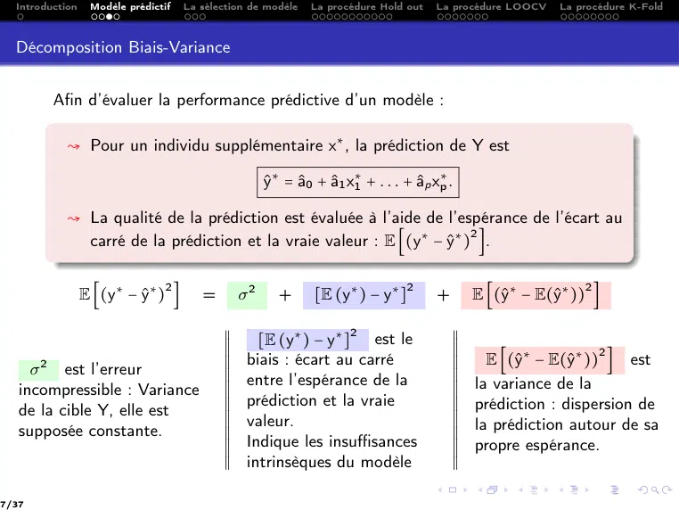
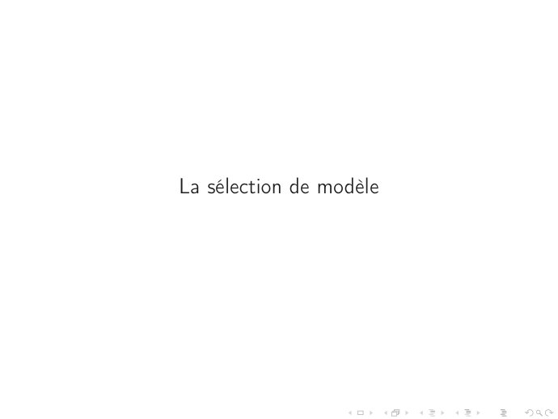

# CM5 -- Sélection de modèle par validation croisée.pdf

[Ouvrir l’original](https://drive.google.com/open?id=1dfr_4OkiMrznGV99rl808HOLVvsBSwOj) · Les pages signalées comprennent du texte reconnu automatiquement ou des éléments graphiques. Le fac-similé permet de vérifier chaque lecture.

**Pages avec fac-similé ou lecture OCR** — 3, 9, 12, 30.

**Pages présentant un écart entre les deux extractions** — 7.

## Page 1

~~~text
Ingénieurs 2ème année : Parcours Mathématique & Informatique

               Modèle linéaire et extensions

      CM 5:    Sélection de modèles par validation croisée

         Nisrine FORTIN-CAMDAVANT & Naamane LAIB
~~~

## Page 2

~~~text
1   Introduction

2   Modèle prédictif

3   La sélection de modèle

4   La procédure Hold out

5   La procédure LOOCV

6   La procédure K-Fold
~~~

## Page 3

~~~text
Introduction
~~~

## Page 4

~~~text
  Introduction   Modèle prédictif   La sélection de modèle   La procédure Hold out   La procédure LOOCV   La procédure K-Fold

         La sélection de modèles est un aspect important du travail du statisticien et il
         existe aujourd’hui de nombreux critères pour ce faire.

                 L’objectif : obtenir un modèle qui colle bien aux données tout en restant
                 parcimonieux (avec un nombre limité de paramètres.)
                 On peut toujours améliorer l’ajustement d’un modèle en augmentant sa
                 complexité.

                        Sur-ajustement
                         Augmenter la complexité en rajoutant des observations ou des va-
                         riables est une stratégie appelée le sur-ajustement. Le sur-ajustement
                         peut s’avérer contre-productive, car il donne un modèle lourd avec
                         des composantes difficiles à bien estimer et à interpréter.

                 Le rôle d’un critère de sélection de modèles est donc de faire un
                 compromis entre qualité de l’ajustement et parcimonie du modèle.
                 Un bon modèle a des paramètres facilement interprétables et permet de
                 bien prédire la variable d’intérêt.

4/37
~~~

## Page 5

~~~text
Compromis entre la qualité de l’ajustement et un
               modèle prédictif
~~~

## Page 6

~~~text
  Introduction   Modèle prédictif   La sélection de modèle   La procédure Hold out   La procédure LOOCV   La procédure K-Fold

  Modèle prédictif

         Favoriser un modèle prédictif : (particulièrement lorsque p>n)

            ♠ conduit à rechercher des modèles parcimonieux, c’est-à-dire avec un
              nombre volontairement restreint de variables explicatives pour réduire la
              variance.

            ♠ Le modèle ainsi obtenu peut favoriser des estimateurs biaisés au profit
              d’une variance plus faible.

            ♠ Un bon modèle n’est donc plus celui qui explique le mieux les données au
              sens d’un R2 maximum mais celui conduisant aux prévisions les plus
              fiables.

6/37
~~~

## Page 7

~~~text
  Introduction    Modèle prédictif   La sélection de modèle   La procédure Hold out     La procédure LOOCV   La procédure K-Fold

  Décomposition Biais-Variance

         Afin d’évaluer la performance prédictive d’un modèle :

           ↝ Pour un individu supplémentaire x∗ , la prédiction de Y est

                                                     ŷ∗ = â0 + â1 x∗1 + . . . + âp x∗p .

           ↝ La qualité de la prédiction est évaluée à l’aide de l’espérance de l’écart au
             carré de la prédiction et la vraie valeur : E [(y∗ − ŷ∗ ) ].
                                                                       2

                 E [(y∗ − ŷ∗ ) ]                              [E (y∗ ) − y∗ ]                  E [(ŷ∗ − E(ŷ∗ )) ]
                                2                                                 2                              2
                                        =       σ2      +                               +

                                            X
                                            X
                                            X      [E (y∗ ) − y∗ ] est le
                                                                  2                         X
                                                                                            X
                                                                                            X
                                            X
                                            X
                                            X                                               X
                                                                                            X
                                                                                            X
                                            X                                               X     E [(ŷ∗ − E(ŷ∗ )) ] est
                                                                                                                     2
                                            X
                                            X
                                            X
                                                 biais : écart au carré                     X
                                                                                            X
                                                                                            X
     σ 2 est l’erreur                       X
                                            X                                               X
                                                                                            X
   incompressible : Variance                X
                                            X
                                            X
                                                 entre l’espérance de la                    X
                                                                                            X
                                                                                            X   la variance de la
                                            X
                                            X
                                            X    prédiction et la vraie                     X
                                                                                            X
                                                                                            X
   de la cible Y, elle est                  X
                                            X
                                            X                                               X
                                                                                            X
                                                                                            X
                                                                                                prédiction : dispersion de
                                            X
                                            X
                                            X    valeur.                                    X
                                                                                            X
                                                                                            X   la prédiction autour de sa
   supposée constante.                      X
                                            X
                                            X                                               X
                                                                                            X
                                                                                            X
                                            X
                                            X
                                            X
                                                 Indique les insuffisances                  X
                                                                                            X
                                                                                            X
                                                                                                propre espérance.
                                            X
                                            X
                                            X    intrinsèques du modèle                     X
                                                                                            X
                                                                                            X

7/37
~~~

## Page 8

~~~text
  Introduction   Modèle prédictif   La sélection de modèle   La procédure Hold out   La procédure LOOCV   La procédure K-Fold

  Principe de la régularisation

                                     E [(y∗ − ŷ∗ ) ] = σ 2 + biais2 + Variance
                                                       2

                 Principe de la régularisation
                    2 Accepter une légère augmentation du biais et obtenir une
                         réduction proportionnelle de la variance.
                    2 Réguler la modélisation en imposant des contraintes sur les
                      paramètres estimés de la régression contraintes sur les valeurs
                      que pourront prendre les estimateurs des coefficients pour éviter
                      qu’elles soient totalement instables. (Voir CM3 – prochainement)
                    2 La qualité de la prédiction du modèle sera meilleure puisqu’on
                      diminue l’erreur de prédiction espérée.

8/37
~~~

## Page 9

~~~text
La sélection de modèle
~~~

## Page 10

~~~text
  Introduction   Modèle prédictif   La sélection de modèle   La procédure Hold out   La procédure LOOCV   La procédure K-Fold

  La sélection de modèles

            2 La sélection de modèles est une procédure statistique qui consiste à
                 choisir, dans une famille, le modèle qui s’ajuste le mieux à un jeu de
                 données.
            2 Certains critères s’appliquent aux modèles à but prédictif, tel le critère de
              validation croisée.

                 La validation croisée
                         Le critère de validation croisée mesure l’erreur d’un modèle en
                         évaluant les performances prédictives de celui-ci.
                         L’idée de la validation croisée est de ne pas utiliser l’ensemble des
                         données pour construire le modèle.
                         Certaines données sont retirées, un modèle est ajusté sous ces
                         données réduites.
                         L’écart entre les données retirées et leur prédiction par le modèle
                         ajusté mesure la performance prédictive du modèle. Plus ce
                         critère est petit et plus le modèle est efficace pour la prédiction.

10/37
~~~

## Page 11

~~~text
  Introduction   Modèle prédictif   La sélection de modèle   La procédure Hold out   La procédure LOOCV   La procédure K-Fold

                 Présentation générale de la procédure de la validation croisée
                 La validation croisée est une méthode statistique qui partitionne les
                 données en deux groupes :
                     1   Un groupe Ωapp pour l’entrainement du modèle, on note
                         ℓapp = card(Ωapp ).
                                Les données d’entrainement permettent d’estimer le modèle.
                     2   Un groupe Ωtest pour la validation du modèle, on note
                         ℓtest = card(Ωtest ).
                                Les données de validation permettent de mesurer son erreur
                                d’ajustement sur les données.

11/37
~~~

## Page 12

~~~text
La procédure Hold out
~~~

## Page 13

~~~text
  Introduction   Modèle prédictif   La sélection de modèle   La procédure Hold out   La procédure LOOCV   La procédure K-Fold

  La procédure Hold out

         La procédure de Hod out repose sur le principe suivant :
                  X
                  X
                  X
                  X
                  X
                  X
                      1 Séparer l’échantillon en deux parties, une pour estimer le modèle

                  X
                  X
                  X      (Ωapp ), l’autre pour estimer l’erreur de prévision (Ωtest ).
                  X
                  X
                  X
                  X
                  X
                  X                                         n     3n
                  X
                  X
                  X
                      2 Le choix courant pour ℓ
                                                    app est    ou
                  X
                  X
                  X                                         2      4
                  X
                  X
                  X
                  X
                  X
                  X
                      3 Calculer ℓ
                                    test erreurs de prévision.
                  X
                  X
                  X
                  X
                  X
                  X
                      4 Leur moyenne est une estimation de l’erreur test.

         Estimation de l’erreur théorique
         L’erreur théorique du modèle est estimée par l’écart moyen entre les valeurs
         prédites et les valeurs observées de la variable réponse des données de
         l’ensemble de validation :
                                                          1                  2
                                               ε̂HO =           ∑ (Yi − Ŷi )
                                                        ℓtest i∈Ωtest

13/37
~~~

## Page 14

~~~text
  Introduction   Modèle prédictif   La sélection de modèle   La procédure Hold out   La procédure LOOCV   La procédure K-Fold

  La procédure Hold out

         Avantages :
         ::::::::::
                 Très simple à mettre en oeuvre.
                 Un seul ajustement à effectuer par modèle.
         Inconvénients
         ::::::::::::
                       :
                 La taille de l’échantillon d’apprentissage rend l’estimation moins précise
                 puisqu’on n’utilise pas les n observations.
                 Cela conduit à une sur-estimation de l’erreur test par rapport à celle issue
                 d’une estimation sur n individus.

                 X
                 X
                 X    L’évaluation sur un seul échantillon test rend l’estimation de l’erreur très
                 X
                 X
                 X    variable (la variance est élevée), on peut donc
                 X
                 X
                 X
                 X
                 X
                 X
                 X
                 X
                 X
                 X
                 X
                          1   Recommencer la procédure Hold-out plusieurs fois (5 ou 10 fois).
                 X
                 X
                 X
                 X
                 X
                 X
                          2   Considérer plusieurs séparations aléatoires de l’échantillon, toujours
                 X
                 X
                 X            de même taille.
                 X
                 X
                 X
                 X
                 X
14/37
~~~

## Page 15

~~~text
  Introduction   Modèle prédictif   La sélection de modèle   La procédure Hold out   La procédure LOOCV   La procédure K-Fold

  Exemple 1

         On considère l’exemple de la consommation des véhicules sans les valeurs
         atypiques (27 observations). On se propose de comparer les deux modèles, M1
         (avec les quatre variables explicatives) et M2 (avec les variables poids et
         puissance retenues par sélection des variables – Voir CM2 - Thématique 1).

                 Prédictif
                 Vérifier lequel des deux modèle est plus prédictif. On procède par vali-
                 dation croisée sur les deux modèles.

15/37
~~~

## Page 16

~~~text
  Introduction   Modèle prédictif    La sélection de modèle   La procédure Hold out   La procédure LOOCV   La procédure K-Fold

  Exemple 1 – Modèle M1

                      i                  Modèle Prix Cylindrée Puissance Poids Consommation
                     1           Daihatsu Cuore 11600      846        32 650            5,7
                     2    Suzuki Swift 1.0 GLS 12490       993        39 790            5,8
                     3    Fiat Panda Mambo L 10450         899        29 730            6,1
                     4          VW Polo 1.4 60 17140      1390        44 955            6,5
                     5      Opel Corsa 1.2i Eco 14825     1195        33 895            6,8
                     6        Subaru Vivio 4WD 13730       658        32 740            6,8
                     7            Toyota Corolla 19490    1331        55 1010           7,1
                     8      Opel Astra 1.6i 16V 25000     1597        74 1080           7,4
                     9     Peugeot 306 XS 108 22350       1761        74 1100           9,0
                     10 Renault Safrane 2.2. V 36600      2165       101 1500          11,7
                     11       Seat Ibiza 2.0 GTI 22500    1983        85 1075           9,5
                     12      VW Golt 2.0 GTI 3 1580       1984        85 1155           9,5
                     13     Citroen ZX Volcane 28750      1998        89 1140           8,8
                     14 Fiat Tempra 1.6 Liberty 22600     1580        65 1080           9,3
                     15      Fort Escort 1.4i PT 20300    1390        54 1110           8,6
                     16 Honda Civic Joker 1.4 19900       1396        66 1140           7,7
                     17            Volvo 850 2.5 39800    2435       106 1370          10,8
                     18 Ford Fiesta 1.2 Zetec 19740       1242        55 940            6,6
                     19 Hyundai Sonata 3000 38990         2972       107 1400          11,7
                     20         Lancia K 3.0 LS 50800     2958       150 1550          11,9
                     21    Mazda Hachtback V 36200        2497       122 1330          10,8
                     22    Opel Omega 2.5i V6 47700       2496       125 1670          11,3
                     23         Peugeot 806 2.0 36950     1998        89 1560          10,8
                     24      Nissan Primera 2.0 26950     1997        92 1240           9,2
                     25       Seat Alhambra 2.0 36400     1984        85 1635          11,6
                     26     Toyota Previa salon 50900     2438        97 1800          12,8
                     27 Volvo 960 Kombi aut 49300         2473       125 1570          12,7

                                    Erreur résiduelle du modèle M1 : ε̂M1 = 0.6512
16/37
~~~

## Page 17

~~~text
  Introduction   Modèle prédictif    La sélection de modèle   La procédure Hold out   La procédure LOOCV   La procédure K-Fold

  Exemple 1 – Modèle M2

                                i                  Modèle Cylindrée Poids Consommation
                               1           Daihatsu Cuore       846 650            5,7
                               2    Suzuki Swift 1.0 GLS        993 790            5,8
                               3    Fiat Panda Mambo L          899    29          6,1
                               4          VW Polo 1.4 60       1390    44          6,5
                               5      Opel Corsa 1.2i Eco      1195 895            6,8
                               6        Subaru Vivio 4WD        658 740            6,8
                               7            Toyota Corolla     1331 1010           7,1
                               8      Opel Astra 1.6i 16V      1597 1080           7,4
                               9     Peugeot 306 XS 108        1761    74          9,0
                               10 Renault Safrane 2.2. V       2165 1500          11,7
                               11       Seat Ibiza 2.0 GTI     1983 1075           9,5
                               12      VW Golt 2.0 GTI 3       1984 1155           9,5
                               13     Citroen ZX Volcane       1998 1140           8,8
                               14 Fiat Tempra 1.6 Liberty      1580 1080           9,3
                               15      Fort Escort 1.4i PT      139 1110           8,6
                               16 Honda Civic Joker 1.4        1396 1140           7,7
                               17            Volvo 850 2.5     2435 106           10,8
                               18 Ford Fiesta 1.2 Zetec        1242 940            6,6
                               19 Hyundai Sonata 3000          2972 1400          11,7
                               20         Lancia K 3.0 LS      2958 150           11,9
                               21    Mazda Hachtback V         2497 1330          10,8
                               22    Opel Omega 2.5i V6        2496 1670          11,3
                               23         Peugeot 806 2.0    19989 1560           10,8
                               24      Nissan Primera 2.0      1997 1240           9,2
                               25       Seat Alhambra 2.0      1984 1635          11,6
                               26     Toyota Previa salon      2438 1800          12,8
                               27 Volvo 960 Kombi aut          2473 1570          12,7

                                    Erreur résiduelle du modèle M2 : ε̂M2 = 0.6315
17/37
~~~

## Page 18

~~~text
  Introduction   Modèle prédictif    La sélection de modèle   La procédure Hold out   La procédure LOOCV   La procédure K-Fold

  Exemple 1 – Hold Out – M1

         Étape 1 : Séparation de l’échantillon : apprentissage - test

         On découpe notre jeu de données en deux ensembles Ωapp avec ℓapp = 20
         observations et on teste sur Ωtest qui contient les ℓtest = 7 observations
         restantes. On procède par choix aléatoire de 20 observation.
                                               Ωapp
                                    Observations d’apprentissage
                                    Subaru Vivio 4WD
                                    Nissan Primera 2.0
                                    VW Golt 2.0 GTI
                                    Seat Ibiza 2.0 GTI
                                    Hyundai Sonata 3000                           Ωtest
                                    Lancia K 3.0 LS                       Observations de test
                                    VW Polo 1.4 60                       Daihatsu Cuore
                                    Renault Safrane 2.2                  Suzuki Swift 1.0 GL
                                    Volvo 850 2.5                        Opel Corsa 1.2i Eco
                                    Mazda Hachtback V                    Toyota Corolla
                                    Fiat Tempra 1.6 Lib                  Opel Astra 1.6i 16V
                                    Citroen ZX Volcane                   Ford Fiesta 1.2 Zet
                                    Fort Escort 1.4i PT                  Peugeot 806 2.0
                                    Honda Civic Joker 1
                                    Toyota Previa salon
                                    Seat Alhambra 2.0
                                    Fiat Panda Mambo L
                                    Opel Omega 2.5i V6
                                    Volvo 960 Kombi aut
                                    Peugeot 306 XS 108

18/37
~~~

## Page 19

~~~text
  Introduction   Modèle prédictif   La sélection de modèle   La procédure Hold out   La procédure LOOCV   La procédure K-Fold

  Exemple 1 – Hold Out – M1

         Étape 2 : Ajustement du modèle sur les observations de Ωapp

         On ajuste le modèle linéaire sur notre groupe d’apprentissage.
                               Observations d’apprentissage
                               Subaru Vivio 4WD
                               Nissan Primera 2.0
                               VW Golt 2.0 GTI
                               Seat Ibiza 2.0 GTI
                               Hyundai Sonata 3000
                               Lancia K 3.0 LS
                               VW Polo 1.4 60
                               Renault Safrane 2.2                      Erreur résiduelle 0,6533
                               Volvo 850 2.5
                               Mazda Hachtback V                        R2                 0.9138
                               Fiat Tempra 1.6 Lib
                               Citroen ZX Volcane
                               Fort Escort 1.4i PT                      R2a                0.8965
                               Honda Civic Joker 1
                               Toyota Previa salon
                               Seat Alhambra 2.0
                               Fiat Panda Mambo L
                               Opel Omega 2.5i V6
                               Volvo 960 Kombi aut
                               Peugeot 306 XS 108

19/37
~~~

## Page 20

~~~text
  Introduction   Modèle prédictif   La sélection de modèle   La procédure Hold out   La procédure LOOCV   La procédure K-Fold

  Exemple 1 – Hold Out – M1

                                    Étape 3 : Prédiction sur Ωtest

         On calcule les prédictions sur l’ensemble test.
                                    Observations de test Yi Ŷi         résidu : Yi − Ŷi
                                    Daihatsu Cuore       5.7 6.046149 -0.3461487
                                    Suzuki Swift 1.0 GL 5.8 6.659708 -0.8597084
                                    Opel Corsa 1.2i Eco 6.8 7.305154 -0.5051543
                                    Toyota Corolla       7.1 7.962000 -0.8619999
                                    Opel Astra 1.6i 16V 7.4 8.628591 -1.2285914
                                    Ford Fiesta 1.2 Zet 6.6 7.664915 -1.0649150
                                    Peugeot 806 2.0      10.8 11.078033 -0.2780330

         On trouve

                                                    1                2
                                      ε̂HO-M1 =         ∑ (Yi − Ŷi ) = 0, 653989326
                                                    7 i∈Ωtest

20/37
~~~

## Page 21

~~~text
  Introduction   Modèle prédictif   La sélection de modèle   La procédure Hold out   La procédure LOOCV   La procédure K-Fold

  Exemple 1 – Hold Out – M2

         On garde les mêmes ensembles d’apprentissage et de test et on réitère les
         mêmes étapes sur le modèle M2. On obtient
                                       Observations de test Ŷi      Yi Yi − Ŷi
                                       Daihatsu Cuore       5,429468 5,7 0,270532
                                       Suzuki Swift 1.0 GL 6,252849 5,8 -0,452849
                                       Opel Corsa 1.2i Eco 6,99067 6,8 -0,19067
                                       Toyota Corolla       7,687012 7, -0,587012
                                       Opel Astra 1.6i 16V 8,351073 7,4 -0,951073
                                       Ford Fiesta 1.2 Zet 7,255001 6,6 -0,655001
                                       Peugeot 806 2.0      11,03906 10,8 -0,23906

         On trouve

                                                    1                2
                                      ε̂HO-M2 =         ∑ (Yi − Ŷi ) = 0, 292844823
                                                    7 i∈Ωtest

21/37
~~~

## Page 22

~~~text
  Introduction   Modèle prédictif   La sélection de modèle   La procédure Hold out   La procédure LOOCV   La procédure K-Fold

  Remarque

                 Comparaison

                                                        ε̂HO-M2 < ε̂HO-M1
                 Le modèle M2 avec deux variables explicatives se distingue alors par son
                 aspect prédictif.

22/37
~~~

## Page 23

~~~text
 La procédure LOOCV
La procédure Leave-One-Out Cross-Validation
~~~

## Page 24

~~~text
  Introduction    Modèle prédictif   La sélection de modèle   La procédure Hold out   La procédure LOOCV   La procédure K-Fold

  La procédure LOOCV

         La procédure de LOOCV repose sur le principe suivant :
                  X
                  X
                  X
                  X
                  X
                  X
                      1 Mettre de côté une observation.

                  X
                  X
                  X
                  X
                  X
                  X
                      2 Estimer le modèle sur les n-1 autres observations Ω
                                                                             app .
                  X
                  X
                  X
                  X
                  X
                  X
                      3 Calculer le risque de prévision sur l’observation mise de côté.
                  X
                  X
                  X
                  X
                  X
                  X   4 Le processus est répété pour chaque observation de l’échantillon.
                  X
                  X
                  X
                  X
                  X
                  X   5 Leur moyenne est une estimation de l’erreur test.
                  X
                  X
                  X

         Estimation de l’erreur théorique
         L’erreur théorique du modèle est estimée par l’écart moyen entre les valeurs
         prédites et les valeurs observées de la variable réponse des données de
         l’ensemble de validation :

                                                                          (−i)
                                                                               2
                                                              1 n
                                               ε̂LOOCV =        ∑ (Yi − Ŷi )
                                                              n i=1
           (−i)
         Ŷi  est la prédiction de la ième observation par le modèle estimée sans la ième
         observation.

24/37
~~~

## Page 25

~~~text
  Introduction   Modèle prédictif   La sélection de modèle   La procédure Hold out   La procédure LOOCV      La procédure K-Fold

  La procédure LOOCV

         Avantages
         ::::::::::
                   :
                 Chaque échantillon d’apprentissage a une taille n - 1, très proche de la
                 vraie taille n de l’échantillon total. Ainsi le risque estimé sera peu biaisé.
         Inconvénients
         ::::::::::::
                       :
                 Peut être très couteux à mettre en oeuvre car il nécessite en toute
                 généralité n ajustements de chaque modèle testé.

                 X
                 X
                 X    Propriété : Le calcul des résidus peut être allégé sans faire n régressions
                 X
                 X
                 X    linéaire, en utilisant l’égalité suivante :
                 X
                 X
                 X
                 X
                 X
                 X                                                       2
                                                      1 n (Yi − Ŷi )
                 X
                 X                                                                               −1
                                                                                 hi = (X (X′ X)       X′ )
                 X
                 X
                 X                     ε̂LOOCV =        ∑              ,
                 X
                 X
                 X
                 X                                    n i=1 (1 − hi )2                                    ii
                 X
                 X

25/37
~~~

## Page 26

~~~text
  Introduction   Modèle prédictif   La sélection de modèle   La procédure Hold out   La procédure LOOCV   La procédure K-Fold

  Exemple 1 – LOOCV – M1

         Pour i=1,. . .,27, on répéte les opérations suivantes :
            1    On enlève l’observation i.
            2    On ajuste le modèle sans la ième observation.
            3    On calcule la prédiction de ième observation à l’aide du modèle ajusté.
            4    On calcule les écarts entre la valeur observée Yi et la valeur prédite avec le
                                                     (−i)
                 modèle sans la ième observation Ŷi .

26/37
~~~

## Page 27

~~~text
  Introduction   Modèle prédictif   La sélection de modèle   La procédure Hold out   La procédure LOOCV   La procédure K-Fold

  Exemple 1 – LOOCV – M1
                                                                                     Y i − Yi
                                                                                 (−i)        (−i)
                                 i               Modèle Yi observée            Ŷi
                                1        Daihatsu Cuore        5,70             5,73        0,03
                                2   Suzuki Swift 1.0 GL        5,80             6,07        0,27
                                3 Fiat Panda Mambo L           6,10             6,16        0,06
                                4       VW Polo 1.4 60         6,50             7,81        1,31
                                5   Opel Corsa 1.2i Eco        6,80             6,86        0,06
                                6    Subaru Vivio 4WD          6,80             9,01        2,21
                                7        Toyota Corolla        7,10             7,46        0,36
                                8   Opel Astra 1.6i 16V        7,40             8,45        1,05
                                9 Peugeot 306 XS 108           9,00             9,25        0,25
                                10  Renault Safrane 2.2       11,70            12,50        0,80
                                11    Seat Ibiza 2.0 GTI       9,50            10,51        1,01
                                12     VW Golt 2.0 GTI         9,50             9,55        0,05
                                13  Citroen ZX Volcane         8,80             8,94        0,14
                                14 Fiat Tempra 1.6 Lib         9,30            10,41        1,11
                                15  Fort Escort 1.4i PT        8,60             8,86        0,26
                                16 Honda Civic Joker 1         7,70             8,10        0,40
                                17        Volvo 850 2.5       10,80            10,80        0,00
                                18   Ford Fiesta 1.2 Zet       6,60             7,20        0,60
                                19 Hyundai Sonata 3000        11,70            11,79        0,09
                                20      Lancia K 3.0 LS       11,90            12,36        0,46
                                21 Mazda Hachtback V          10,80            10,87        0,07
                                22 Opel Omega 2.5i V6         11,30            12,60        1,30
                                23      Peugeot 806 2.0       10,80            10,85        0,05
                                24   Nissan Primera 2.0        9,20             9,28        0,08
                                25   Seat Alhambra 2.0        11,60            11,86        0,26
                                26  Toyota Previa salon       12,80            12,81        0,01
                                27 Volvo 960 Kombi aut        12,70            13,95        1,25

                                                       1 27        (−i)
                                                                        2
                                    ε̂LOOCV-M1 =         ∑ (Yi − Ŷi ) = 0, 50164931
                                                      27 i=1

27/37
~~~

## Page 28

~~~text
  Introduction   Modèle prédictif   La sélection de modèle   La procédure Hold out   La procédure LOOCV   La procédure K-Fold

  Exemple 1 – LOOCV – M2
                                                                                     Y i − Yi
                                                                                 (−i)        (−i)
                                 i               Modèle Yi observée            Ŷi
                                1        Daihatsu Cuore        5,70             5,80        0,10
                                2   Suzuki Swift 1.0 GL        5,80             6,06        0,26
                                3 Fiat Panda Mambo L           6,10             6,18        0,08
                                4       VW Polo 1.4 60         6,50             7,67        1,17
                                5   Opel Corsa 1.2i Eco        6,80             6,84        0,04
                                6    Subaru Vivio 4WD          6,80             8,90        2,10
                                7        Toyota Corolla        7,10             7,49        0,39
                                8   Opel Astra 1.6i 16V        7,40             8,39        0,99
                                9 Peugeot 306 XS 108           9,00             9,13        0,13
                                10  Renault Safrane 2.2       11,70            12,31        0,61
                                11    Seat Ibiza 2.0 GTI       9,50            10,04        0,54
                                12     VW Golt 2.0 GTI         9,50             9,60        0,10
                                13  Citroen ZX Volcane         8,80             8,94        0,14
                                14 Fiat Tempra 1.6 Lib         9,30            10,33        1,03
                                15  Fort Escort 1.4i PT        8,60             8,77        0,17
                                16 Honda Civic Joker 1         7,70             8,21        0,51
                                17        Volvo 850 2.5       10,80            10,80        0,00
                                18   Ford Fiesta 1.2 Zet       6,60             7,09        0,49
                                19 Hyundai Sonata 3000        11,70            11,72        0,02
                                20      Lancia K 3.0 LS       11,90            12,09        0,19
                                21 Mazda Hachtback V          10,80            10,83        0,03
                                22 Opel Omega 2.5i V6         11,30            12,35        1,05
                                23      Peugeot 806 2.0       10,80            10,88        0,08
                                24   Nissan Primera 2.0        9,20             9,37        0,17
                                25   Seat Alhambra 2.0        11,60            11,70        0,10
                                26  Toyota Previa salon       12,80            12,82        0,02
                                27 Volvo 960 Kombi aut        12,70            13,90        1,20

                                                   1 27         (−i)
                                                                     2
                                ε̂LOOCV-M2 =          ∑ (Yi − Ŷi ) = 0, 433126316
                                                   27 i=1

28/37
~~~

## Page 29

~~~text
  Introduction   Modèle prédictif   La sélection de modèle   La procédure Hold out   La procédure LOOCV   La procédure K-Fold

  Remarque

                 Comparaison

                                                   ε̂LOOCV-M2 < ε̂LOOCV-M1
                 Le modèle M2 avec deux variables explicatives se distingue alors par son
                 aspect prédictif.

29/37
~~~

## Page 30

~~~text
La procédure K-Fold
~~~

## Page 31

~~~text
  Introduction   Modèle prédictif   La sélection de modèle   La procédure Hold out   La procédure LOOCV   La procédure K-Fold

  La procédure K-Fold

         La procédure de K-Fold repose sur le principe suivant :
                  X
                  X
                  X
                  X
                  X
                  X
                      1 Couper l’échantillon en K parties égales (ou à peu près) de taille
                  X
                  X
                  X      respective n/K : Ω1 , Ω2 , . . . , ΩK .
                  X
                  X
                  X
                  X
                  X
                  X
                  X
                  X
                  X
                      2  Estimer le modèle sur des observations de K-1 groupes
                  X
                  X
                  X      Ωapp = Ω2 ∪ Ω3 ∪ . . . ΩK .
                  X
                  X
                  X
                  X
                  X
                  X
                  X
                      3 Tester le modèle sur le groupe restant Ω
                                                                   test = Ω1 .
                  X
                  X
                  X
                  X
                  X
                  X   4 Calculer le risque de prévision, ε̂ sur les observations de Ω .
                  X
                  X
                  X
                                                                1                     1
                  X
                  X
                  X
                  X
                  X
                      5  Réitérer ces opérations en considérant Ωtest = Ωi et Ωapp le
                  X
                  X
                  X      complémentaire de Ωtest dans Ω, pour i = 2, . . . , K.
                  X
                  X
                  X
                  X
                  X
                  X   6 En déduire ε̂ , i = 2, . . . , K
                  X
                  X
                  X                   i
                  X
                  X
                  X
                  X
                  X   7  Calculer K estimations de l’erreur théorique de prévision.
         Estimation de l’erreur théorique
         L’erreur théorique du modèle est estimée par :

                                             1 K                        1                 2
                                    ε̂KF =     ∑ ε̂i ,       ε̂i =           ∑ (Yj − Ŷj )
                                             K i=1                   card(Ωi j∈Ωi
31/37
~~~

## Page 32

~~~text
  Introduction   Modèle prédictif   La sélection de modèle   La procédure Hold out   La procédure LOOCV   La procédure K-Fold

  Exemple 1 – K-Fold avec K=3 – M1

                             Étape 1 : séparation en 3 groupes
         on construit de façon aléatoire 3 groupes :
                          Ω1                  Ω2                   Ω3
                          Volvo 960 Kombi aut Mazda Hachtback V    Subaru Vivio 4WD
                          Peugeot 306 XS 108 Fiat Tempra 1.6 Lib   Nissan Primera 2.0
                          Toyota Corolla      Citroen ZX Volcane   VW Golt 2.0 GTI
                          Daihatsu Cuore      Fort Escort 1.4i PT  Seat Ibiza 2.0 GTI
                          Opel Corsa 1.2i Eco Honda Civic Joker 1  Hyundai Sonata 3000
                          Suzuki Swift 1.0 GL Toyota Previa salon  Lancia K 3.0 LS
                          Opel Astra 1.6i 16V Seat Alhambra 2.0 VW Polo 1.4 60
                          Peugeot 806 2.0     Fiat Panda Mambo L Renault Safrane 2.2
                          Ford Fiesta 1.2 Zet Opel Omega 2.5i V6   Volvo 850 2.5

32/37
~~~

## Page 33

~~~text
  Introduction   Modèle prédictif   La sélection de modèle   La procédure Hold out   La procédure LOOCV       La procédure K-Fold

  Exemple 1 – K-Fold avec K=3 – M1

                 Étape 2.1 : Estimation du modèle sur Ωapp = Ω1 ∪ Ω2 et
                                 prédiction sur Ωtest = Ω3
                    Ω1 ∪ Ω2                                             Yi − Ŷi (Yi − Ŷi )
                                                                                                          2
                                        Ω3                  Yi Ŷi
                    Subaru Vivio 4WD    Volvo 960 Kombi aut 12,7 11,731 0,969 0,939
                    Nissan Primera 2.0  Peugeot 306 XS 108 9     8,736 0,264 0,070
                    VW Golt 2.0 GTI     Toyota Corolla      7,1 7,938 -0,838 0,702
                    Seat Ibiza 2.0 GTI  Daihatsu Cuore      5,7 5,962 -0,262 0,068
                    Hyundai Sonata 3000 Opel Corsa 1.2i Eco 6,8 7,354 -0,554 0,307
                    Lancia K 3.0 LS     Suzuki Swift 1.0 GL 5,8 6,635 -0,835 0,698
                    VW Polo 1.4 60      Opel Astra 1.6i 16V 7,4 8,543 -1,143 1,307
                    Renault Safrane 2.2 Peugeot 806 2.0     10,8 11,022 -0,222 0,049
                    Volvo 850 2.5       Ford Fiesta 1.2 Zet 6,6 7,582 -0,982 0,964
                    Mazda Hachtback V
                    Fiat Tempra 1.6 Lib
                    Citroen ZX Volcane
                    Fort Escort 1.4i PT
                    Honda Civic Joker 1
                    Toyota Previa salon
                    Seat Alhambra 2.0
                    Fiat Panda Mambo L
                    Opel Omega 2.5i V6                           ε̂1    =        0,567187138

33/37
~~~

## Page 34

~~~text
  Introduction   Modèle prédictif   La sélection de modèle   La procédure Hold out   La procédure LOOCV       La procédure K-Fold

  Exemple 1 – K-Fold avec K=3 – M1

                 Étape 2.2 : Estimation du modèle sur Ωapp = Ω2 ∪ Ω3 et
                                 prédiction sur Ωtest = Ω1
                     Ω2 ∪ Ω3                                            Yi − Ŷi (Yi − Ŷi )
                                                                                                          2
                                         Ω1                  Yi Ŷi
                     Mazda Hachtback V Subaru Vivio 4WD      6,8 5,09 1,71       2,93
                     Fiat Tempra 1.6 Lib Nissan Primera 2.0  9,2 9,48 -0,28 0,08
                     Citroen ZX Volcane VW Golt 2.0 GTI      9,5 9,47 0,03       0,00
                     Fort Escort 1.4i PT Seat Ibiza 2.0 GTI  9,5 8,97 0,53       0,28
                     Honda Civic Joker 1 Hyundai Sonata 3000 11,7 12,84 -1,14 1,30
                     Toyota Previa salon Lancia K 3.0 LS     11,9 12,45 -0,55 0,30
                     Seat Alhambra 2.0   VW Polo 1.4 60      6,5 7,76 -1,26 1,58
                     Fiat Panda Mambo L Renault Safrane 2.2 11,7 10,85 0,85      0,73
                     Opel Omega 2.5i V6 Volvo 850 2.5        10,8 11,18 -0,38 0,14
                     Volvo 960 Kombi aut
                     Peugeot 306 XS 108
                     Toyota Corolla
                     Daihatsu Cuore
                     Opel Corsa 1.2i Eco
                     Suzuki Swift 1.0 GL
                     Opel Astra 1.6i 16V
                     Peugeot 806 2.0
                     Ford Fiesta 1.2 Zet                          ε̂2   =        0,815316963

34/37
~~~

## Page 35

~~~text
  Introduction   Modèle prédictif   La sélection de modèle   La procédure Hold out   La procédure LOOCV   La procédure K-Fold

  Exemple 1 – K-Fold avec K=3 – M1

                 Étape 2.3 : Estimation du modèle sur Ωapp = Ω1 ∪ Ω3 et
                                 prédiction sur Ωtest = Ω2
                  Ω1 ∪ Ω3                                                  Yi − Ŷi (Yi − Ŷi )
                                                                                                           2
                                      Ω2                  Yi         Ŷi
                  Subaru Vivio 4WD    Mazda Hachtback V 10,8         10,72 0,08     0,01
                  Nissan Primera 2.0  Fiat Tempra 1.6 Lib 9,3        8,22 1,08      1,17
                  VW Golt 2.0 GTI     Citroen ZX Volcane 8,8         9,16 -0,36 0,13
                  Seat Ibiza 2.0 GTI  Fort Escort 1.4i PT 8,6        8,02 0,58      0,34
                  Hyundai Sonata 3000 Honda Civic Joker 1 7,7        8,16 -0,46 0,21
                  Lancia K 3.0 LS     Toyota Previa salon 12,8       12,88 -0,08 0,01
                  VW Polo 1.4 60      Seat Alhambra 2.0   11,6 11,22 0,38 0,14
                  Renault Safrane 2.2 Fiat Panda Mambo L 6,1         5,71 0,39      0,15
                  Volvo 850 2.5       Opel Omega 2.5i V6 11,3        12,45 -1,15 1,32
                  Volvo 960 Kombi aut
                  Peugeot 306 XS 108
                  Toyota Corolla
                  Daihatsu Cuore
                  Opel Corsa 1.2i Eco
                  Suzuki Swift 1.0 GL
                  Opel Astra 1.6i 16V
                  Peugeot 806 2.0
                  Ford Fiesta 1.2 Zet                                ε̂3   =        0,386675319

35/37
~~~

## Page 36

~~~text
  Introduction   Modèle prédictif   La sélection de modèle   La procédure Hold out   La procédure LOOCV   La procédure K-Fold

  Exemple 1 – K-Fold avec K=3 – M1

                                                             1 3
                                            ε̂3-Fold-M1 =      ∑ ε̂i = 0, 589726473
                                                             3 i=1

36/37
~~~

## Page 37

~~~text
  Introduction   Modèle prédictif   La sélection de modèle   La procédure Hold out   La procédure LOOCV   La procédure K-Fold

  Exemple 1 – K-Fold avec K=3 – M2

         On reprend les mêmes groupes et on procède de la même façon et on trouve

                                                             1 3
                                            ε̂3-Fold-M2 =      ∑ ε̂i = 0, 406747162
                                                             3 i=1

                 Comparaison

                                                     ε̂3-Fold-M2 < ε̂3-Fold-M1
                 Le modèle M2 avec deux variables explicatives se distingue alors par
                 son aspect prédictif. Les 3 procédures confirme le caractère prédictif du
                 modèle M2 par rapport à M1.

37/37
~~~
