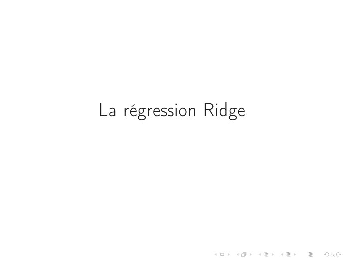
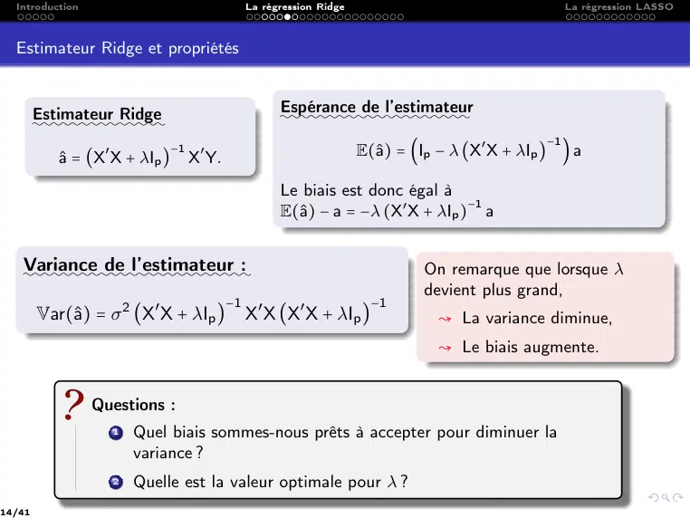
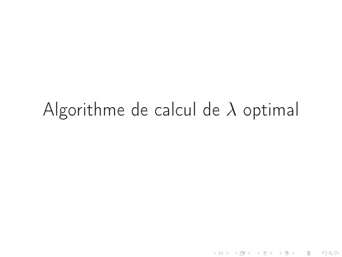
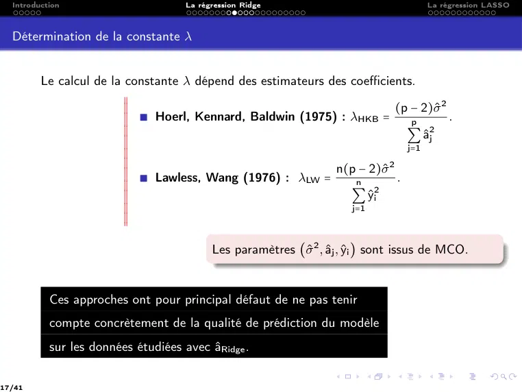
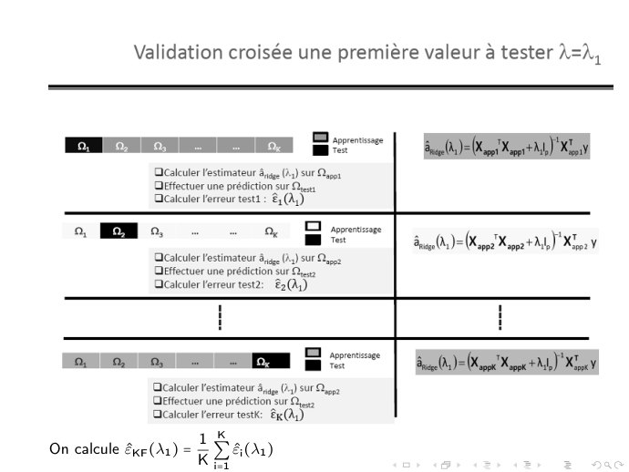
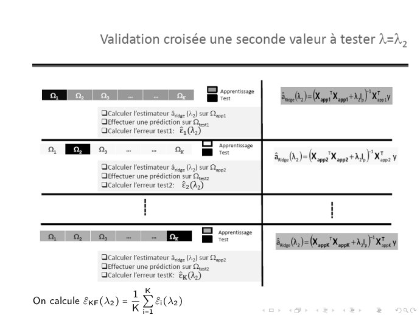
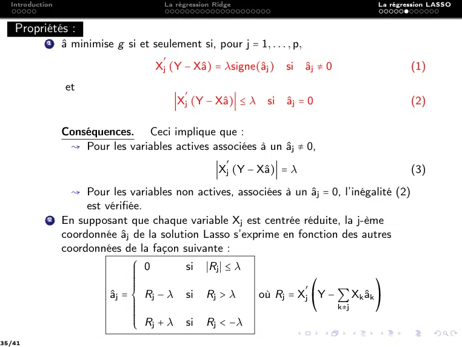

# CM6 -Régression régularisée -- Ridge et Lasso.pdf

[Ouvrir l’original](https://drive.google.com/open?id=14b4hlo9hXZEzT9ydEvQXdVcqY0q0cX3J) · Les pages signalées comprennent du texte reconnu automatiquement ou des éléments graphiques. Le fac-similé permet de vérifier chaque lecture.

**Pages avec fac-similé ou lecture OCR** — 3, 6, 9, 16, 21, 23–24.

**Pages présentant un écart entre les deux extractions** — 4, 14, 17, 22, 35–37.

## Page 1

~~~text
Ingénieurs 2ème année : Parcours Mathématique & Informatique

               Modèle linéaire et extensions

    Réduction de la dimension dans les modèles linéaires

  CM 6 : Régression régularisée : Pénalisation Ridge et Lasso

               Nisrine FORTIN & Naamane LAIB
~~~

## Page 2

~~~text
1   Introduction

2   La régression Ridge
      Estimateur Ridge
      Algorithme de calcul de λ optimal
      λ optimal par validation croisée K-Fold

3   La régression LASSO
      Algorithme de descente par coordonnées
      Algorithme Stagwise
~~~

## Page 3

~~~text
Introduction
~~~

## Page 4

~~~text
  Introduction                     La régression Ridge                                        La régression LASSO

         Pour un échantillon de taille n, on cherche les paramètres estimés

                                      â = (â0 , â1 , . . . , âp )
                                                                              1
         qui minimise l’erreur quadratique moyenne MSE : MSE =                  ∥Y − Xa∥2 .
                                                                              n
                                                                                      −1
           ↝ Estimateur des moindres carrés ordinaires :            âMCO = (X′ X)         X′ Y.

                                                                        σ̂ 2
           ↝ Variance de l’estimateur des MCO : Var (âj ) =                 VIFj .
                                                                         n

4/41
~~~

## Page 5

~~~text
  Introduction                      La régression Ridge                              La régression LASSO

         Estimateur MCO
         Si p > n, la matrice X′ X n’est pas inversible donc l’estimateur des moindres
         carrés ne sera pas unique. Problème de dimensionnalité !

         Facteur d’inflation VIF
                                                             1
                                             VIFj =
                                                          1 − R2j
         R2j : coefficient de détermination de la régression de Xj sur les p-1 autres
         exogènes. Problème : R2j ≈ 1 ⇒ VIFj ≈ +∞ . (Colinéarité) Variances instables !

         Variance estimée de l’erreur
                                                   SCR
                                             σ̂ 2 =
                                                 n−p−1
         Indicateur de qualité de la régression, divisé par les degrés de liberté.
         Problème : p ≈ n ⇒ σ̂ 2 ≈ +∞. p>n (dimensionnalité !)

5/41
~~~

## Page 6

~~~text
Motivations
~~~

## Page 7

~~~text
  Introduction                         La régression Ridge                           La régression LASSO

                                         Motivations

            ♠ Rechercher des modèles parcimonieux → réduire le nombre des variables
                 explicatives, réduire la multicolinéarité et rendre le modèle facile à
                 interpréter. (Régression LASSO)

            ♠ Contrôler la variance → ajouter une contrainte sur les coefficients pour
              réduire la variance et la rendre stable au détriment du biais. (Régression
              Ridge)

            ♠ Rechercher un modèle parcimonieux avec une variance stable.

7/41
~~~

## Page 8

~~~text
  Introduction                      La régression Ridge                         La régression LASSO

       On peut distinguer 2 types de régularisation
          X
          X
          X
          X
          X ∎ Régression   Ridge
          X
          X
          X
               :::::::::::::
          X
          X
          X       ∎  Ajouter  une contrainte sur les coefficients pour maitriser l’amplitude
          X
          X
          X
          X
          X
          X          de leurs valeurs (Éviter qu’elles partent dans tous les sens !)
          X
          X
          X
          X
          X
          X                                  ⎧  min ∥Y − Xa∥2
          X
          X                                  ⎪
                                             ⎪
                                             ⎪
          X
          X
          X                        (Ridge)   ⎨
          X
          X
          X                                  ⎪
          X
          X                                  ⎪
                                             ⎪ sous la contrainte      ∥a∥2 ≤ c
          X
          X                                  ⎩
          X
          X
          X
          X
          X
          X
          X
          X       ∎ Accepter une légère augmentation du biais pour obtenir une réduction
          X
          X
          X
          X
          X
          X
                     plus que proportionnelle de la variance.
          X
          X
          X
          X
          X
          X ∎  Régression  LASSO
          X
          X
          X
               :::::::::::::::
          X
          X
          X       ∎ Similaire à la Ridge mais on utilise la norme 1. (La parcimonie - Voir
          X
          X
          X
          X
          X
          X
                     cours Compressive Sensing Semestre2.)
          X
          X
          X
          X
          X                                  ⎧
                                             ⎪  min ∥Y − Xa∥2
          X
          X
          X                                  ⎪
                                             ⎪
          X
          X
          X                        (Lasso) ⎨
          X
          X
          X                                  ⎪
                                             ⎪
          X
          X                                  ⎪
                                             ⎩ sous la contrainte      ∥a∥1 ≤ c
          X
          X
          X
          X
          X
          X       ∎ Dispositif de sélection de variables en annulant certains coefficients
          X
          X
          X
          X          (méthode parcimonieuse). Intérêt : facilité d’interprétation.

8/41
~~~

## Page 9

~~~text
La régression Ridge
~~~

## Page 10

~~~text
  Introduction                        La régression Ridge                         La régression LASSO

  La régression Ridge

                 Principe général
                   2 Rétrécir les plages de valeurs que peuvent prendre les paramètres
                      estimés âj , on parle alors de "shrinkage".
                                      ⎧
                                      ⎪   c →0          ⇒   aj Ð→ 0
                                      ⎪
                                      ⎪
                                      ⎨
                                      ⎪
                                      ⎪
                                      ⎪ c → +∞
                                      ⎩                 ⇒   aRidge Ð→ aMCO

                   2 Les variables doivent être centrées et réduites pour éviter que les
                     variables à forte variance aient trop d’influence.
                   2 La variable Y doit être centrée pour évacuer la constante de la
                     régression.

10/41
~~~

## Page 11

~~~text
  Introduction                       La régression Ridge                       La régression LASSO

  La régression Ridge

         Formalisme
         Résoudre un problème sans contrainte, en pénalisant la contrainte. (Introduire
         une fonction de pénalité).
                                                              2
                                                    n   ⎛  p
                                                              ⎞     p
                         (Ridge) :         min ∑ yi − ∑ aj xij + λ ∑ a2j
                                                    i=1 ⎝     ⎠
                                         a1 ,...,ap
                                                          j=1      j=1

          λ est un paramètre positif (coefficient de pénalité) qui permet de contrôler
         l’impact de la pénalité.

11/41
~~~

## Page 12

~~~text
  Introduction                        La régression Ridge                        La régression LASSO

  La régression Ridge

            2 L’inclusion de λ rend le problème non singulier même si X′ X n’est pas
                 inversible. Motivation initiale de la régression Ridge.

            2 Il faut ajuster le paramètre de régularisation 0 < λ < ∞.
                ; λ → 0 : Régression MCO.
                ; λ → +∞ : Modèle nul.

            2 Si deux prédicteurs sont fortement corrélés, leurs coefficients seront
              similaires.

                  ; Utile si le but est la sélection de groupe de variables exogènes
                    redondantes.
                  ; Pas utile pour faire de la sélection d’une variable dans un groupe de
                    variables redondantes.

12/41
~~~

## Page 13

~~~text
  Introduction                         La régression Ridge                          La régression LASSO

  Estimateur Ridge

                  Le problème de la régression Ridge
                  Déterminer des estimations solutions du problème non contraint (Ridge).

                 X
                 X On travaille avec des variables centrées et réduites et on se propose alors
                 X
                 X
                 X
                 X
                 X de chercher
                 X
                 X
                 X
                 X
                 X
                 X
                 X
                 X
                 X                                       â = arg minp f (a)
                 X
                 X
                 X                                                a∈R
                 X
                 X
                 X
                 X
                 X
                 X
                 X
                 X
                 X
                 X
                 X
                 X
                 X
                 X où a = (a1 , . . . , ap ) et f (a) = ∥Y − Xa∥22 + λ∥a∥22 .
                 X
                 X
                 X
                 X

13/41
~~~

## Page 14

~~~text
  Introduction                                La régression Ridge                                   La régression LASSO

  Estimateur Ridge et propriétés

        Estimateur Ridge                            Espérance de l’estimateur
                                                    ::::::::::::::::::::
        ::::::::::::::
                                                                                               −1
                            −1
           â = (X′ X + λIp )    X′ Y.                              E(â) = (Ip − λ (X′ X + λIp ) ) a

                                                    Le biais est donc égal à
                                                                                −1
                                                    E(â) − a = −λ (X′ X + λIp ) a

   Variance de l’estimateur :
   ::::::::::::::::::::::::                                                  On remarque que lorsque λ
                                                                             devient plus grand,
                                         −1                           −1
        Var(â) = σ 2 (X′ X + λIp )           X′ X (X′ X + λIp )               ↝ La variance diminue,
                                                                               ↝ Le biais augmente.

                 Questions :
                   1   Quel biais sommes-nous prêts à accepter pour diminuer la
                       variance ?
                   2   Quelle est la valeur optimale pour λ ?
14/41
~~~

## Page 15

~~~text
Packages sur R

      Différents packages sur R
        ♣ La fonction lm.ridge du package MASS.
        ♣ La fonction glmnet avec l’option alpha=0 du package glmnet.
        ♣ Vérifier si les variables explicatives et la variables à expliquer sont
          centrées et/normalisées

      Dans glmnet, par défaut, les variables explicatives et à expliquer sont
      toutes recentrées et renormalisées, mais les coefficients en sortie sont
      bien dans l’échelle d’origine.
~~~

## Page 16

~~~text
Algorithme de calcul de λ optimal
~~~

**Lecture OCR à contrôler**

~~~text
Algorithme de calcul de À optimal
~~~

## Page 17

~~~text
  Introduction                       La régression Ridge                               La régression LASSO

  Détermination de la constante λ

         Le calcul de la constante λ dépend des estimateurs des coefficients.
                        X
                        X
                        X
                        X
                        X
                        X                                                  (p − 2)σ̂ 2
                        X
                        X  ∎ Hoerl, Kennard, Baldwin (1975) : λHKB =                   .
                        X
                        X
                        X
                                                                              p
                        X
                        X
                        X
                                                                                 2
                                                                             ∑ âj
                        X
                        X
                        X
                        X
                        X
                        X
                                                                             j=1
                        X
                        X
                        X                                    n(p − 2)σ̂  2
                        X
                        X
                        X  ∎ Lawless, Wang (1976) : λLW =                  .
                        X
                        X
                        X
                                                                 n
                        X
                        X
                        X                                       ∑   ŷ 2
                        X
                        X
                        X
                                                                       i
                        X
                        X
                        X
                                                                j=1
                        X
                        X
                                           Les paramètres (σ̂ 2 , âj , ŷi ) sont issus de MCO.

           Ces approches ont pour principal défaut de ne pas tenir
           compte concrètement de la qualité de prédiction du modèle
           sur les données étudiées avec âRidge .

17/41
~~~

## Page 18

~~~text
  Introduction                         La régression Ridge                        La régression LASSO

  Chemin de régularisation Ridge

         On appelle chemin de régularisation de la régression ridge l’ensemble des
         fonctions λ ↦ âj,Ridge (λ) pour j = 1, . . . , p.

         On peut faire varier λ et regarder l’évolution (de la stabilité) des coefficients
         (Ridge coefficients paths). On peut

                 X
                 X
                 X
                 X
                 X
                 X
                     1   Utiliser la méthode graphique pour déterminer λ, chercher une plage
                 X
                 X
                 X       de valeurs où les variations sont stables.
                 X
                 X
                 X
                 X
                 X
                 X
                 X
                 X
                 X
                 X
                 X
                 X
                 X
                 X
                 X
                     2   Utiliser la performance prédictive du modèle pour déterminer λ.
                 X

18/41
~~~

## Page 19

~~~text
  Introduction                        La régression Ridge              La régression LASSO

  Détermination de la constante λ

                   1. Utiliser la méthode graphique pour déterminer λ

            1    Fixer une plage de valeurs de λ.
            2    Construire le modèle avec différentes valeurs de λ.

   Cette méthode consiste à tracer un diagramme               X
                                                              X
                                                              X
                                                              X
                                                              X
   d’évolution des coefficients âRidge en fonction de λ      X
                                                              X
                                                              X
                                                              X
                                                              X
                                                              X
                                                              X
                                                              X
                                                              X
                     ♠♠♠♠♠♠♠♠♠♠♠♠♠♠♠                          X
                                                              X
                                                              X
                                                              X
                                                              X
          On remarquera que plus la valeur du                 X
                                                              X
                                                              X
          paramètre de pénalisation grandit, plus les
                                                              X
                                                              X
                                                              X
                                                              X
                                                              X
                                                              X
          valeurs des coefficients à estimer s’annulent.      X
                                                              X
                                                              X
                                                              X
                                                              X
                                                              X
                                                              X
                                                              X
                                                              X
                                                              X
                                                              X
          La valeur de λ peut être choisie comme la           X
                                                              X
                                                              X
          valeur la plus petite avant laquelle tous les
                                                              X
                                                              X
                                                              X
                                                              X
                                                              X
                                                              X
          coefficients « plongent » vers 0. (Les              X
                                                              X
                                                              X
          coefficients commencent à se stabiliser)            X
                                                              X
                                                              X
19/41
~~~

## Page 20

~~~text
  Introduction                         La régression Ridge                          La régression LASSO

  Détermination de la constante λ

                 2. Utiliser la performance prédictive pour déterminer λ

            1    Fixer une plage de valeurs de λ.
            2    Construire le modèle sur un échantillon d’apprentissage Ωapp .
            3    L’évaluer sur un échantillon test Ωtest .
            4    Choisir le paramètre λ qui minimise le critère d’erreur en test.

20/41
~~~

## Page 21

~~~text
λ optimal par validation croisée
            K-Fold
~~~

**Lecture OCR à contrôler**

~~~text
À optimal par validation croisée

K-Fold
~~~

## Page 22

~~~text
  Introduction                    La régression Ridge                         La régression LASSO

  Algorithme de VC K-Fold pour le calcul de λ optimal

         Algorithme 1 Algorithme général du calcul de λ par K-Fold
            Données : Partitionner Ω = Ω1 ∪ Ω2 ∪ . . . ∪ ΩK
            Choisir un ensemble de m valeurs de λ à tester
            Début Pour ℓ = 1 ∶ m
                 Début Pour i = 1 ∶ K
                        Poser Ωtest = Ωi
                        Pour λ = λℓ , estimer âRidge (λ) sur Ωapp = Ω∣Ωi
                        Calculer les prédictions sur Ωtest : ŷtest = xtest â(λ)
                        Calculer le résidu des prévisions
                                    1                        2
                          ε̂i =            ∑ (yj − ŷtestj )
                                card(Ωi ) j∈Ωi
                 Fin Pour i
                                                                                1 K
                Calculer la moyenne des résidus des groupes : ε̂KF (λ) = ∑ ε̂i
                                                                                K i=1
            Fin Pour ℓ
          Choisir la valeur optimale pour λ : λoptimal = arg min ε̂KF
                                                                   λ

22/41
~~~

## Page 23

~~~text
                          1 K
On calcule ε̂KF (λ1 ) =     ∑ ε̂i (λ1 )
                          K i=1
~~~

**Lecture OCR à contrôler**

~~~text
Validation croisée une première valeur à tester À

EEE D:

caleuler Festimateur je (3) SUF Dos
Hfectuer une prédiction su
Ocaleuler l'erreur testt : 8, (

a,

a, 0, Dave

calculer lestimateur à, (3) SUF une
Dffectuer une prédiction sur Ses
OcalculerFerreurtest2: &(2y)

a se

efectuer une prédiction sur Da
calculer Ferreurtestk: &q Ay}

K
On calcule £xr (A1) = z Yar)

Sal) Enr) Koni

Snag )= Pas Kappa + M Xe

BOs) Po K+) Koc ¥
~~~

## Page 24

~~~text
                          1 K
On calcule ε̂KF (λ2 ) =     ∑ ε̂i (λ2 )
                          K i=1
~~~

**Lecture OCR à contrôler**

~~~text
Validation croisée une seconde valeur à tester A=A,,

es =

saa) = gt Xap?) XB

prédit
AcaeuterFerrur test: Eu

ER ©

. oo

Acalculer l'stimateur due (3) SUF ua
Oeffectuer une prédiction Sur Durs

Sn) (gs Moa A) Ko ¥
Qcalculer l'erreur test2: EC)

D sense
— Bla) = Wap Xe AL) Xe
Qcalculer l'erreur testk: & (Ap)

K

Daa)

On calcule éxe(A2) = z
~~~

## Page 25

~~~text
On continue les calculs avec les m valeurs de λ puis on sélectionne la valeur de
λ qui nous donne le plus petit résidu des tests.
~~~

## Page 26

~~~text
  Introduction                                La régression Ridge                                                                                     La régression LASSO

  Remarques

         Le schéma de validation croisée pour choisir la valeur "optimale" de λ,
         nécessite donc une série de calculs pour évaluer les performances en validation
         croisée. Calculs a priori très lourds.
           ∎ Pour chaque valeur de λ = λ1 , . . . , λm , on doit calculer K estimateurs ridge
               → K × m calculs "fastidieux" et couteux pour l’inverse de la matrice Zℓj .

                            Pour ℓ = 1, . . . , m
                                  Pour i = 1, . . . , K
                                                                                                                                                 −1
                                        â(λℓ ) = ( X′appi Xappi + λℓ Ip ) X′appi Y
                                                     ´¹¹ ¹ ¹ ¹ ¹ ¹ ¹ ¹ ¹ ¹ ¹ ¹ ¹ ¹ ¹ ¹ ¹ ¹ ¹ ¹ ¹ ¹¸¹ ¹ ¹ ¹ ¹ ¹ ¹ ¹ ¹ ¹ ¹ ¹ ¹ ¹ ¹ ¹ ¹ ¹ ¹ ¹ ¹ ¹ ¶
                                                                                                 Zℓi

            ∎ Pour chaque valeur λ = λℓ ,
                   Utiliser m fois le même groupe d’apprentissage et le même groupe de
                   test,
                   la seule chose qui change est λ.
                   Utiliser une décomposition en valeurs singulières de Xappi :
                    Xappi = Ui ΣV′i
                         Ui matrice orthogonale, n × p.
                         Vi matrice orthogonale, p × p.
                         Σ matrice des valeurs singulières dj de X′ X, p × p
26/41
~~~

## Page 27

~~~text
  Introduction                                La régression Ridge                                    La régression LASSO

  X
  X
  X
  X Zℓi      =   X′app i Xapp i + λℓ Ip
  X
  X
  X
  X
  X
  X                             ′
  X
  X
  X          =   (Ui Σi V′i ) Ui Σi V′i + λℓ Ip
  X
  X
  X
  X
  X
  X
  X
  X
  X          =
                                ′
                 (Vi Σ′i U′i ) Ui Σi V′i + λℓ Ip
  X
  X
  X
  X
  X
  X
  X
  X
  X
  X
  X          =   Vi Σ′i U′i Ui Σi V′i + λℓ Ip                                   ♯ car Ui est orthogonale
  X
  X
  X                     ±
  X
  X
  X                       =Ip
  X
  X
  X
  X
  X
  X
  X
  X
  X          =   Vi Σ′i Σi V′i + λℓ Ip
  X
  X                                                                             ♯ car Vi est orthogonale
  X
  X
  X                                 ®′
  X
  X
  X                                  =Vi Vi
  X
  X
  X
  X
  X
  X
  X
  X
  X          =   Vi diag (d21 , . . . , d2p ) V′i + λℓ Vi V′i                   ♯ car Σi matrice des valeurs singulières
  X
  X
  X
  X
  X
  X
  X
  X
  X
  X
  X
  X          =   Vi (diag (d21 , . . . , d2p ) + λℓ Ip )V′i                     ♯ Factorisation à droite et à gauche
  X
  X
  X
  X
  X
  X
  X
  X
  X
  X
  X
  X          =   Vi (diag (d21 , . . . , d2p ) + diag (λℓ , . . . , λℓ ) )V′i
  X
  X
  X
  X
  X
  X
  X
  X
  X
  X
  X          =   Vi diag (d2j + λℓ ) V′i , j = 1, . . . , p

27/41
~~~

## Page 28

~~~text
Comme le paramètre λℓ est strictement positif alors d2j + λℓ > 0. Par
conséquent, la matrice diag (d2j + λℓ ) est inversible et

                                            −1              1
                       (diag (d2j + λℓ ))        = diag ( 2      )
                                                         dj + λℓ

Il s’en suit que

                                          −1            −1            1
           Z−1                        ′
            ℓi = (Vi diag (dj + λℓ ) Vi )
                            2
                                                 = (V′i )    diag ( 2      ) V−1
                                                                              i .
                                                                   dj + λℓ

  ↝ V est orthogonale donc V−1   ′
                            i = Vi .
                                    −1
  ↝ V est orthogonale donc (V′i )        = Vi
Donc

                                              1
                            Z−1
                             ℓi = Vi diag ( 2      ) V′i .
                                           dj + λℓ
~~~

## Page 29

~~~text
X
X
X âRidge (λℓ )   =   Z−1  ′
                       ℓi Xapp i y                                       Ui , Vi et ∆λℓ sont
X
X
X
X
X
X                                                                        calculés une seule fois à
X
X
X
X                                 1                      ′
                                       ) V′i (Ui Σi V′i ) y
X                                                                        partir de Zℓi .
X
X                 =   Vi diag ( 2
X
X
X                              dj + λℓ                                   L’obtention des
X
X
X
X
X
X                                                                        différentes estimations
X
X
X
X
X                 =   Vi diag ( 2
                                  1
                                      ) V′i Vi Σ′i U′i y                 âRidge (λ) pour
X
X
X
X
X                              dj + λℓ ±                                 différentes valeurs de λ
X
X
X                                           Ip
X
X
X
                                                                         revient à effectuer de
X
X
X                                                                        simples produits
X
X
X                                 1
X
X
X                 =   Vi diag ( 2      ) diag (dj ) U′i y                matriciels.
X
X
X                              dj + λℓ
X
X
X                                                                        Facile et rapide.
X
X
X
X
X
X                                 dj
X
X
X
X                 =   Vi diag ( 2      ) U′i y
X
X
X                              dj + λℓ
X
X
X
X
                                     ⎛ dj ⎞
        ↝ On note ∆λℓ = diag
                                     ⎝ d2j + λℓ ⎠
        ↝ On en déduit que
                                         âRidge (λℓ ) = Vi ∆λℓ U′i y.
~~~

## Page 30

~~~text
  Introduction      La régression Ridge   La régression LASSO

                 La régression LASSO

30/41
~~~

## Page 31

~~~text
  Introduction                        La régression Ridge                         La régression LASSO

  La régression LASSO

                 Principe général
                   2 Même principe que la régression Ridge, sauf que la régularisation
                      utilise cette fois-ci la norme L1 .
                   2 Avantages par rapport à la régression Ridge :
                       1 LASSO peut faire office de dispositif de sélection de

                         variables en annulant certains coefficients aj .
                       2 Les variables associées à a = 0 sont exclues du modèle
                                                    j
                         prédictif.
                   2 Les variables doivent être centrées et réduites pour éviter que les
                     variables à forte variance aient trop d’influence.
                   2 La variable y doit être centrée pour évacuer la constante de la
                     régression.

31/41
~~~

## Page 32

~~~text
  Introduction                      La régression Ridge                       La régression LASSO

  La régression LASSO

         Formalisme
         Résoudre un problème sans contrainte, en pénalisant la contrainte. (Introduire
         une fonction de pénalité).
                                                              2
                                                    n ⎛   p
                                                             ⎞     p
                        (LASSO) :         min ∑ yi − ∑ aj xij + λ ∑ ∣aj ∣
                                                   i=1 ⎝     ⎠
                                        a1 ,...,ap
                                                         j=1      j=1

32/41
~~~

## Page 33

~~~text
  Introduction                          La régression Ridge                          La régression LASSO

  La régression LASSO

        X
        X
        X        2 Les variables Xj n’étant pas toutes pertinentes, l’objectif est d’éliminer les
        X
        X
        X
        X
        X           variables inutiles et uniquement celles-ci.
        X
        X
        X
        X
        X
        X        2 L’idée du LASSO est donc non pas de faire une régression linéaire classique
        X
        X
        X          (multiple), mais une régression régularisée qui rend nuls certains coefficients
        X
        X
        X
        X
        X
        X          de l’estimation de a.
        X
        X
        X
        X
        X        2 Cette méthode d’estimation introduite par Tibshirani (1996) est définie
        X
        X
        X
        X
        X          comme étant un minimiseur du critère des moindres carrés pénalisés par la
        X
        X
        X          norme ℓ1 du vecteur. On parle de pénalité ℓ1 ou de pénalité LASSO.
        X
        X
        X
        X
        X
        X

                                        g ∶ a ↦ ∥Y − Xa∥22 + λ∥a∥1

                  La fonction g est convexe mais non différentiable !
                  La fonction g n’admet pas nécessairement une solution unique !
                  L’estimateur LASSO n’a pas de forme explicite.

33/41
~~~

## Page 34

~~~text
  Introduction                       La régression Ridge                        La régression LASSO

         L’existence d’une solution est garantie par la convexité de la norme ℓ2 et la
         norme ℓ1 . Mais comme la fonction ℓ1 n’est pas différentiable alors la fonction g
         ne l’est pas, la solution n’est pas nécessairement unique.

         Le problème de régression LASSO n’a pas de solution analytique. Des
         méthodes numériques sont utilisées afin d’optimiser le critère. Dans ce cours,
         on s’intéresse à deux algorithmes :
            1    Descente par coordonnées.
            2    Forward Stagewise regression.

34/41
~~~

## Page 35

~~~text
  Introduction                          La régression Ridge                           La régression LASSO

   Propriétés :
            1    â minimise g si et seulement si, pour j = 1, . . . , p,
                                        ′
                                      Xj (Y − Xâ) = λsigne(âj )     si    âj ≠ 0            (1)
                 et                           ′
                                            ∣Xj (Y − Xâ)∣ ≤ λ   si   âj = 0                  (2)

                 Conséquences. Ceci implique que :
                  ↝ Pour les variables actives associées à un âj ≠ 0,
                                                         ′
                                                      ∣Xj (Y − Xâ)∣ = λ                       (3)
                   ↝ Pour les variables non actives, associées à un âj = 0, l’inégalité (2)
                      est vérifiée.
            2    En supposant que chaque variable Xj est centrée réduite, la j-ème
                 coordonnée âj de la solution Lasso s’exprime en fonction des autres
                 coordonnées de la façon suivante :
                                 ⎧
                                 ⎪  0       si ∣Rj ∣ ≤ λ
                                 ⎪
                                 ⎪
                                 ⎪
                                 ⎪
                                 ⎪
                                 ⎪
                                 ⎪                                  ′ ⎛             ⎞
                           âj = ⎨ Rj − λ si Rj > λ       où Rj = Xj Y − ∑ Xk âk
                                 ⎪
                                 ⎪
                                 ⎪                                    ⎝             ⎠
                                 ⎪
                                 ⎪
                                 ⎪
                                                                           k≠j
                                 ⎪
                                 ⎪  R + λ   si R   <  −λ
                                 ⎩ j             j

35/41
~~~

## Page 36

~~~text
        Algorithme de descente par coordonnées

↝ Utiliser la propriété 2) si on connait toutes les coordonnées de â sauf la
   j-ème coordonnée, âj .

↝ On initialise â avec une certaine valeur â(0) , puis on met à jour chaque
  coordonnée itérativement jusqu’à convergence, autrement dit jusqu’à ce
  que la fonction g ne décroit plus avec une tolérance fixée.
~~~

## Page 37

~~~text
  Introduction                          La régression Ridge                              La régression LASSO

  Algorithme de descente par coordonnées pour la régression LASSO

                                                         ′ ⎛           ⎞
            1    Pour j = 1, . . . , p, on calcule Rj = Xj Y − ∑ Xk âk et on met à jour âj .
                                                           ⎝   k≠j     ⎠

            2    Si ∣g (â) − g (â(0) )∣ < ε, la convergence est atteinte et l’algorithme s’arrête,
                 sinon, on retourne à 1 avec â(0) ← â.

         Puisque g est convexe alors la descente par coordonnées converge
         nécessairement vers un minimum global. Il s’agit de la méthode utilisée dans
         glmnet pour la résolution LASSO.

                 Proposition :
                                                                      ⎛      λ ⎞
                 La fonction aj ↦ g (a) réalise son minimum en aj = Rj 1 −          avec
                                                                      ⎝    2∣Rj ∣ ⎠
                                                                                         +
                        ⎛
                        ′           ⎞  ⎛      λ ⎞         ⎛      λ      ⎞
                 Rj = Xj Y − ∑ Xk ak et 1 −          = sup 1 −       ,0
                        ⎝           ⎠  ⎝    2∣Rj ∣ ⎠      ⎝    2∣Rj ∣ ⎠
                             k≠j                              +

37/41
~~~

## Page 38

~~~text
  Introduction                    La régression Ridge          La régression LASSO

         Algorithme 2 Algorithme de descente de coordonnées
            Variables : X, Y, λ > 0
            Début
                Initialiser a = ainit
                     Répéter
                          Pour j allant de 1 à p
                                             ′ ⎛           ⎞
                              Calculer Rj = Xj Y − ∑ Xk ak
                                               ⎝   k≠j     ⎠
                                             ⎛      λ ⎞
                             Calculer aj = Rj 1 −
                                             ⎝    2∣Rj ∣ ⎠
                                                         +
                           Fin Pour j
                       Jusque Convergence de a
                    Retourner a
                 Fin j

38/41
~~~

## Page 39

~~~text
  Introduction                         La régression Ridge                             La régression LASSO

                 On fait une évaluation sur une grille Λ = (λ1 , . . . , λm ) de valeurs rangées
                 par ordre décroissant.
                 On initialise avec ainit = 0p et λ = λ1 et on réitère l’algorithme 2 pour
                 k = 2, . . . , m en considérant λ = λk et ainit = ak−1

         coin UseR : package glmnet
                 fit=glmnet(x,y)
                 plot(fit)
                 coef(fit,s=1) # affiche les coefficients pour un λ

39/41
~~~

## Page 40

~~~text
                         Algorithme Stagewise

Cette méthode se déroule de la façon suivante :
  1   Effectuer la régression avec la variable la plus corrélée avec Y.
  2   Calculer le résidu obtenu avec cette régression.
  3   Considérer ensuite ce résidu comme une nouvelle variable dépendante
      (joue le rôle de Y) et sélectionner, parmi les variables explicatives
      restantes, celle qui est la plus corrélée avec ce résidu.
  4   Réitérer le processus jusqu’à ce que plus aucune variables explicative ne
      soit corrélée significativement avec le résidu mis à jour.
~~~

## Page 41

~~~text
  Introduction                       La régression Ridge                       La régression LASSO

         Algorithme 3 Algorithme Forward Stagewise
            Variables : X, Y, λ > 0, τ > 0.
            Initialisation : ainit = 0p , Résidu : r = Y
            Tant que le critère d’arrêt n’est pas satisfait,
                Trouver le prédicteur Xj , (j = 1, . . . , p) le plus corrélé avec r

                                           Xm = arg max ∣⟨Xj , r ⟩∣

                    Mise à jour :
                          Du coefficient : am ← am + δm , δm = τ × signe (⟨Xm , r ⟩)
                          Du résidu : r ← r − δm Xm ,
                 Fin Tant que

         L’algorithme Stgaewise est une procédure de petits pas.

41/41
~~~
