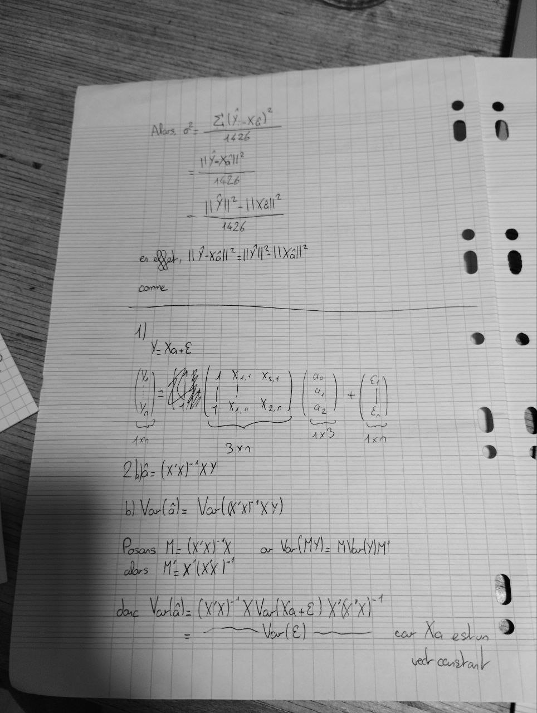

# Correction Exo 1 DS 24 (1).jpg

[Ouvrir l’original](https://drive.google.com/open?id=1w5YZSMKw66WQp0cAc5ZsKUeCFdUr8iTu) · Les pages signalées comprennent du texte reconnu automatiquement ou des éléments graphiques. Le fac-similé permet de vérifier chaque lecture.

**Pages avec fac-similé ou lecture OCR** — 1.

~~~text
ls ot ZA U2xe)
4426

XIE
= AGL
PARCS
1426

= a, PIE Na

_ -=SÈS

= 2 RESTE
DEEE |
ARR LAS Nw Ce

io —— ———

= (xx XY

3x0

> el ar'yy)

(MY. Mbeya!

| EE Te
le)

oe
[ Ge el
LE con
—

Sour Xa shu 2
tell
~~~
