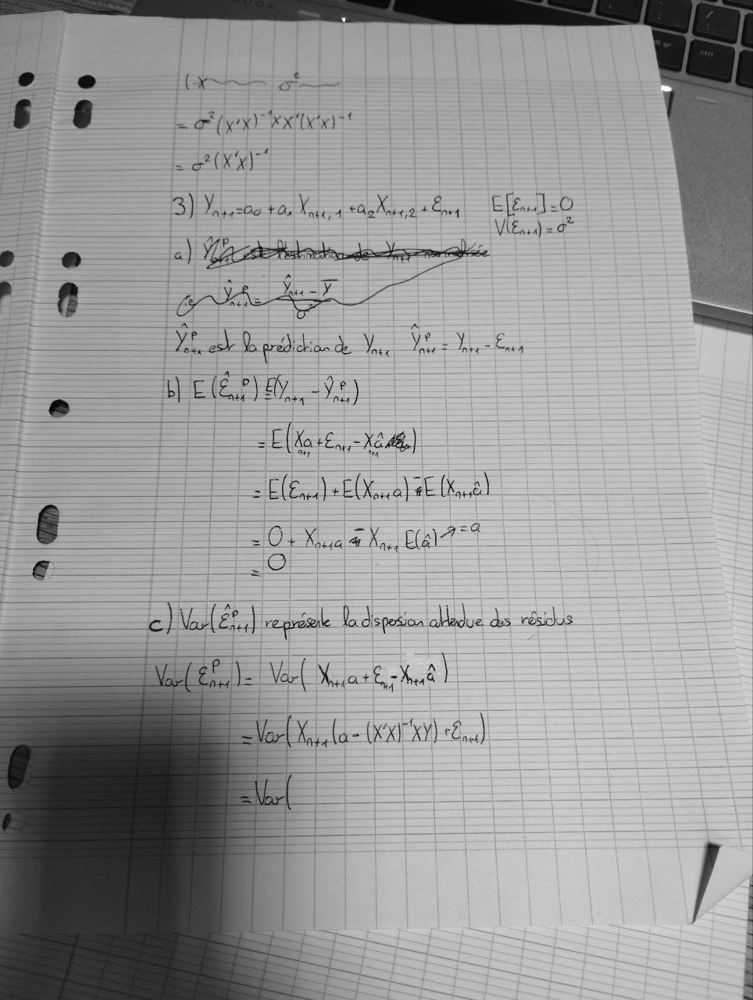

# Correction Exo 1 DS 24 (2).jpg

[Ouvrir l’original](https://drive.google.com/open?id=1hKz6RUwO7Bpcbfy4jluqQdqdwvd4qM15) · Les pages signalées comprennent du texte reconnu automatiquement ou des éléments graphiques. Le fac-similé permet de vérifier chaque lecture.

**Pages avec fac-similé ou lecture OCR** — 1.

~~~text
oe e 4
6 6 = yey RX
= SX)

SE a td. — leat D

VE) =

ni, y 2.
6

5 -SSS5eeners

_p >= S=SSSlari nia ae.

7 SSS meee ee
iS)

= = =

=== Fes reprise La dispesion dledue ds résicis

Mr ual |

F(a (xx XY) ré)
~~~
