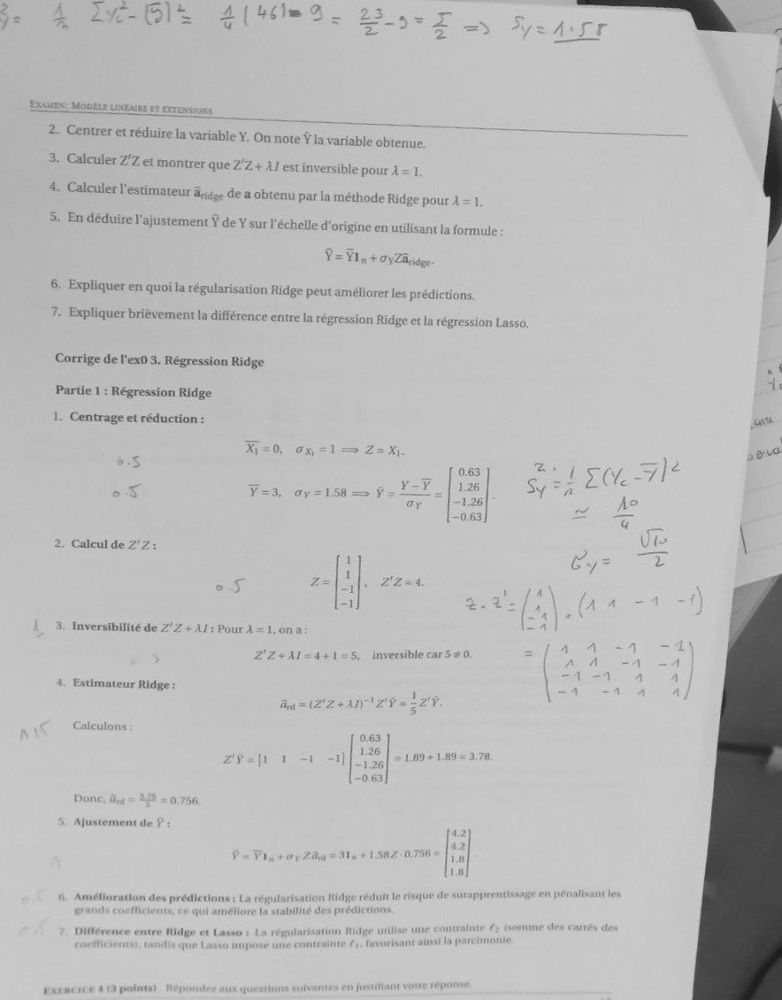

# Correction Exo 3 DS 24.jpg

[Ouvrir l’original](https://drive.google.com/open?id=1xO_51B1tf0b30nwy5y6eQtfaKhqcHV4i) · Les pages signalées comprennent du texte reconnu automatiquement ou des éléments graphiques. Le fac-similé permet de vérifier chaque lecture.

**Pages avec fac-similé ou lecture OCR** — 1.

~~~text
Co

Centrer et réduire la variable

Y. On note ¥ia variable obtenue

Calculer 2'Z et montrer que 2/2 + AJ est inversible pour À = 1

Calculer l'estimateur age de a obtenu par la méthode Ridge pour À = 1

En déduire l'ajustement ¥ de Y sur l'échelle d'origine en utilisant Ja formule

Yi, + 0yZa,

pliquer en quoi la régularisation Ridge peut améliorer les prédictions

Expliquer brièvement la différence entre la régression Ridge et la régression Lasso.

ige de l'ex0

. Régression Ridge

Partie 1 : Régression Ridge

1

Centrage et réduction :

F=0, ox =1— Z=x
s 2: } 7 |
y-¥ Sy =:
< F=3, oy=158 = ÿ = — 1 1
Ul
cul de Z'Z: —
Calcul de 2'Z ie
z=|1|, z2-4
| : -
Et 2-2
Inversibilité de Z°Z + 11 : Pour À = 1, on à ,
2!Z+A1=4+1=5, inversible car5 +0. È
stimateur Ridge \
E Ridg rot

Ajustement de
~~~
