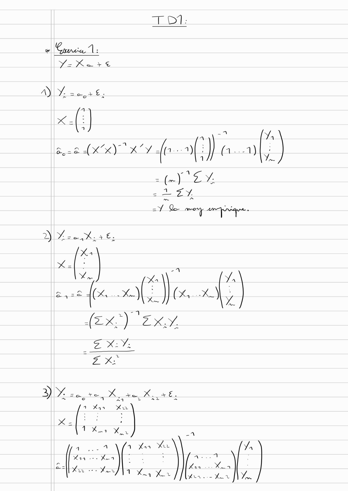
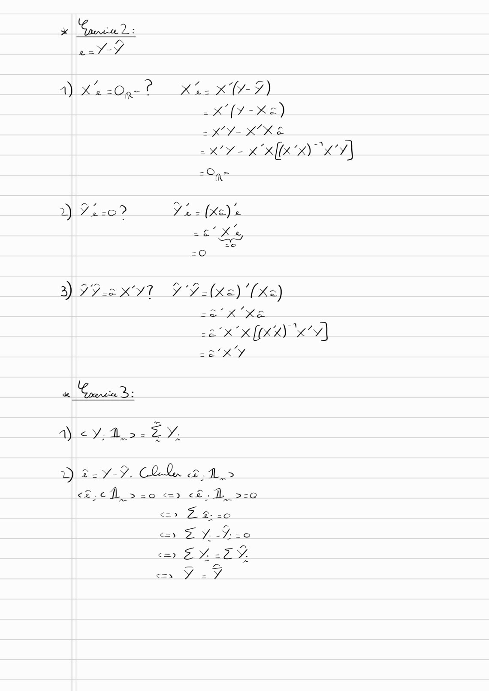
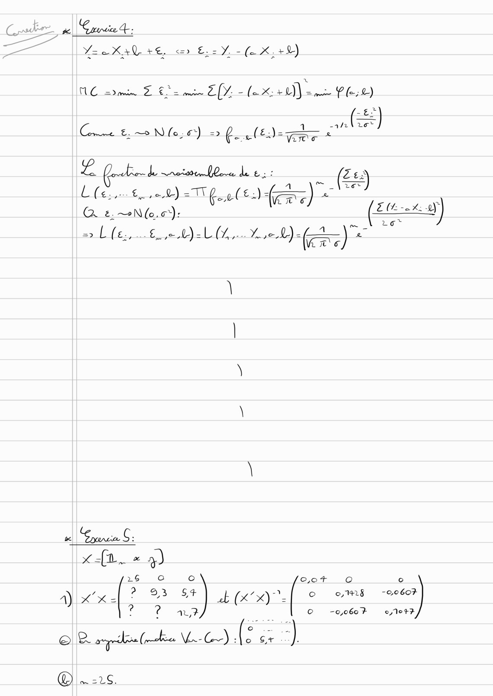
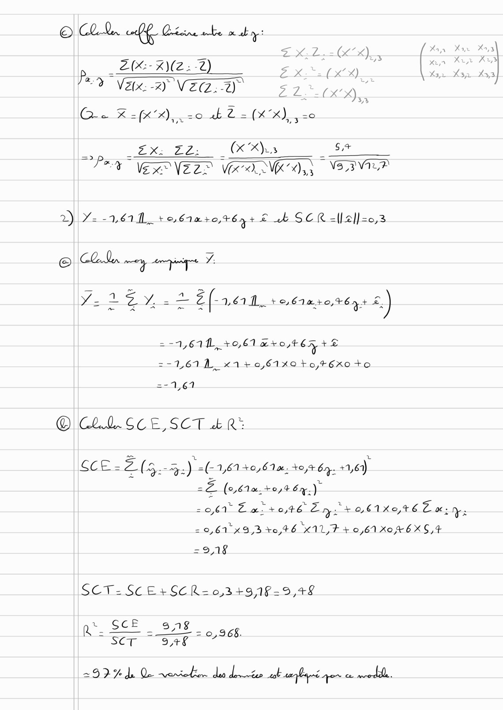
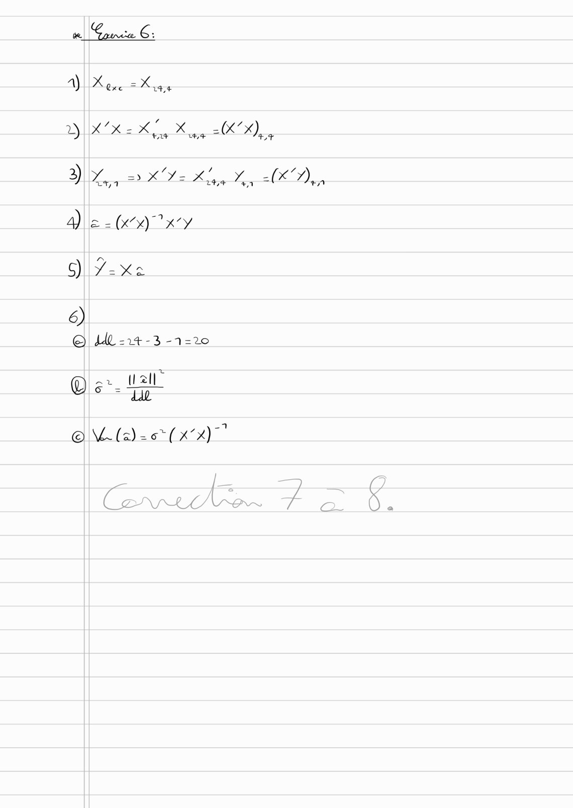
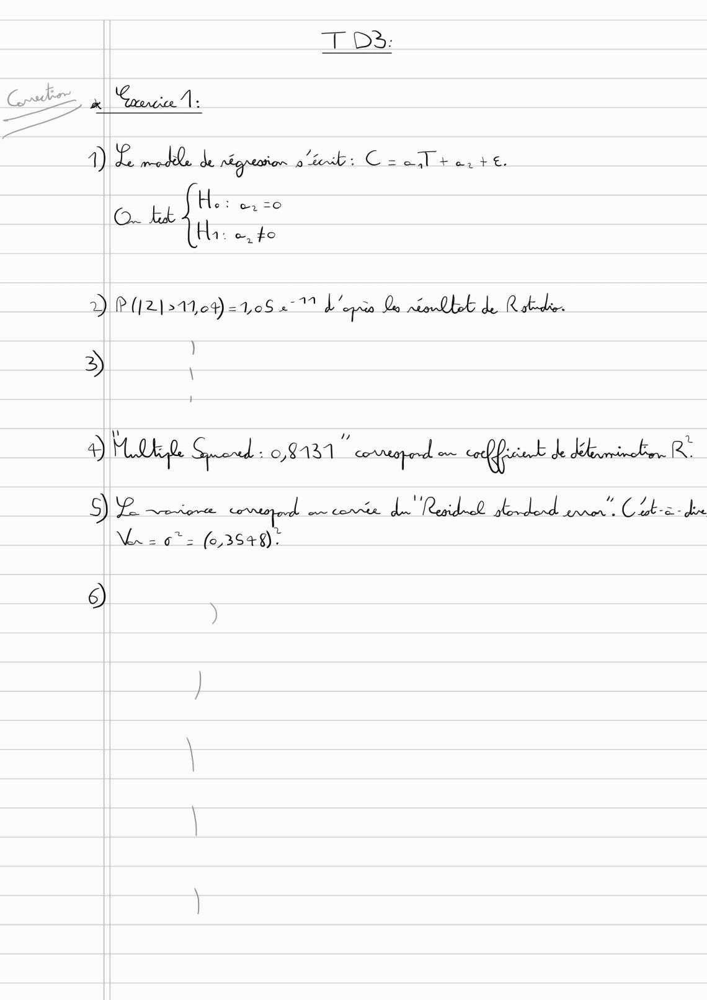
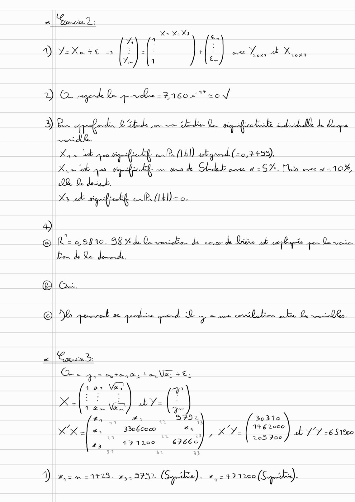
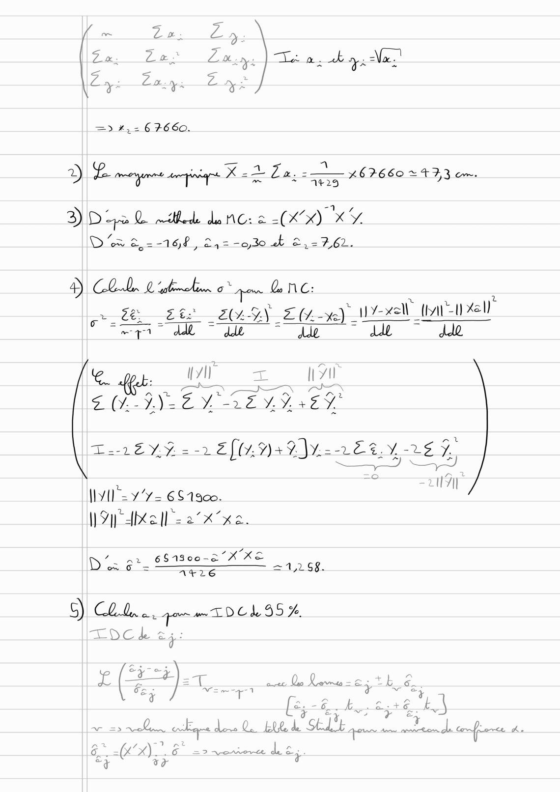
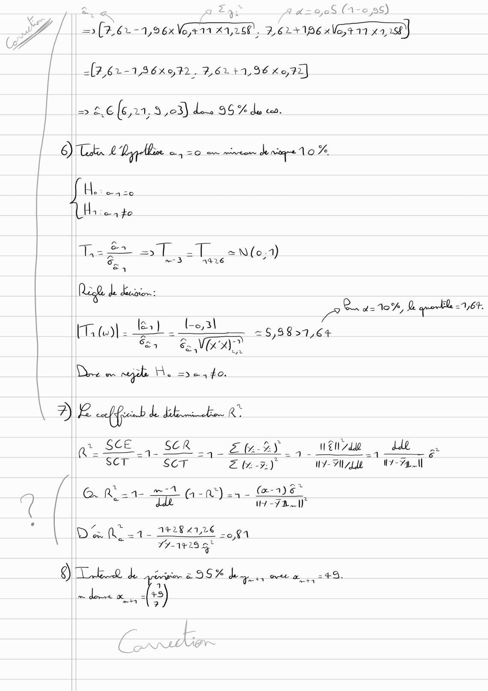
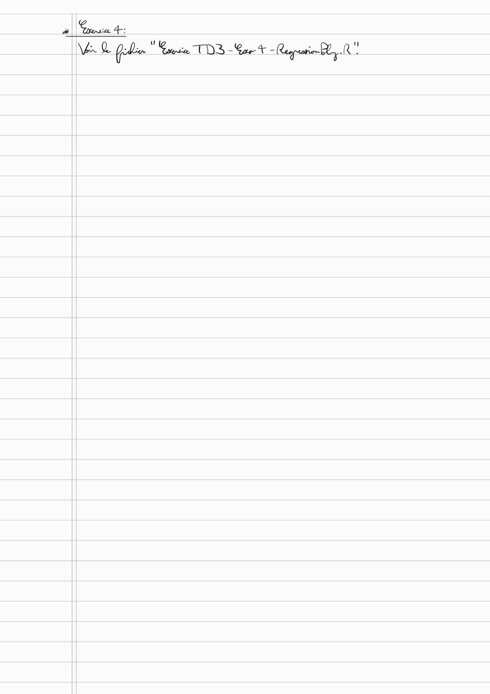

# Corrections TDs_241025_225212 (1).pdf

[Ouvrir l’original](https://drive.google.com/open?id=1jfSMv3mCFhWztgdeJkZukTa9K_inZFcg) · Les pages signalées comprennent du texte reconnu automatiquement ou des éléments graphiques. Le fac-similé permet de vérifier chaque lecture.

**Pages avec fac-similé ou lecture OCR** — 1–10.

## Page 1

**Lecture OCR à contrôler**

~~~text
« Grane 1:
Re
A) Ys 20+:
a
a(x)" x as of: Ja. al? |
ET.
er
SOS Du ne ns
Deeks €

ah ral “ce A

(EX) "ZX,
EX
DT

BY cave, x x er.

1 Xan Kar
Kf) |
TX Xa A
ar u
~~~

## Page 2

**Lecture OCR à contrôler**

~~~text
ER Sn Xe)
x fY=xz)
= xXY- XXE
aXe x fe) |
2Oq=
2) 7-07 Viz (xe)2

2e Xs,
26
=O

Se ee i) i)
= x'xe
2 x xx) |
x)

a nage 3:
a) cy, >= ZY.

1) 2-Y-9, COQ 2.4 >
<2.c >-0o <=) <£.D >-0
<= ZB: -0
«y FY S20
<> E%.2Y.
as VY.
~~~

## Page 3

**Lecture OCR à contrôler**

~~~text
= #K Enice 4:
YzeXaQ re, <2) €.2% - (Xk)

NU 2 7 (7 NA AD) P(:2)

oN Jie
ale (= )

CSN PEMCAE

£ ae Zs)
L (ee 0) - Tele) =) su
CRU ee HESS

» Lee DL

Be. ne Ce
x-{2. x .

26 © © O04 (e] ©
2) x { 2 93 ad (X! x)? (: ous -0,060F
2 a A? © -co6o? 0,104?
© Re anyrtlinn (mobic Ve) (SE
@.=2s.
~~~

## Page 4

**Lecture OCR à contrôler**

~~~text
© C22. of Gén wbe oc 4 y:
oe ZX, = (CX), —.
L Z(X:- K\(2.-2 2 fe) = Xs, ee X33

FOND NET 52040.
Ga K 2x), 20 ab 2 = (XX), , <0

- Ex: 22 (Xs $4
Pat VEO VES VO Va VRP

2) Y= 1,62 1, $e 610+0,464+ € ub SCR =ll2l]=0,3

CoS cone VW.
© mney, qi 7:
Y 2 Z. Y= + 2-690. + 61a 40,464 + a)
=-1,611L_+0,61 HO, Fb +E
== L612 _ x14 0,61%0 +0,46x0 +0

==1,61

© CLu.SCE,SCT ER:

= à =
SCE =2(5.-5.) (16140612. 40,4 by. +16)
2Z (061m, 40/4 6%.)
2061 Eur ret Zn + 0,61 k0,t6 Lai,

20,61 X93 +046 KIL,F + 0,61 X06XS,4

=9,18
SCT-:SCE+SCR-023+91F-9,+2

+. SCE S518
Res SCT 9,48 = 07968:
~~~

## Page 5

**Lecture OCR à contrôler**

~~~text
wl Genie. 6:
ZN |b.
DY X= KL, Ky KH),

YX 4 2 Ke Kaw hy KD

4) a - (x) x’y

6) ¥2Xe

© Mh laec (XX)

a

OD
~~~

## Page 6

**Lecture OCR à contrôler**

~~~text
G st ik Enr À:

1) Le mode de nigneaion Mies; C= oT tar te.

HE
— rate o, fo

D) PZ) 217,04) =105 2°77 L'ae Do niobok de Rat-des

)

3)

4) Mile Spend: PB cree cfa de deminer R

SE weionee acorn de Reside deded error. Cutra-d
Was = (23S+$).

9
~~~

## Page 7

**Lecture OCR à contrôler**

~~~text
x M anite) :
nY 2 a

4) Y2Xa te span }. : eee Ko tk Kine
Yas \a co

2) On megerle Le 4 vel 7,160.2" =o
DR. ph Dibra some she D siuifobis cdd bo Doe
wei dhe

Kamm ch es sig RE en RE) sab grerd (=0,7-+59),
Xam “ab 7 age kf om a de CEE t 2G 7s, NM ee = 10%,

QO, derek.
Xa ade sigeifrsch on (LE) =o.

4)

@ Vs 29810. 98 4d Ce ut. de corto de ie Lt sap ape gor De sree:
Bon de Qe dd.

@ GC.

Ca EC onsite:

(Gun are core to VE +E,

12 ve a
al 47. ("| —

Aa . 3792 \

/ : 7 14 62000

KK af Bebooee te TAROT
ts 471200 67660 °

34 3 33

1) xs m 2123. x, 9792 (Sapatee). #, 2492290 (Spek).
~~~

## Page 8

**Lecture OCR à contrôler**

~~~text
m Ze. Zy
La: Lee Zt: mare a, ha, Va,"
Zy: 2 oss Z. GE

=> #4,- 67660.

.. ya a 2 nu
2) Le mes sncpinigns X => La, == 467660 2473 om

DID pa Oe Hd da nz a =(XX) XY.
Ge S=296P Bsa tout S27 62.

DC. 2 ‘ubomclinn o* spon Ga NC:
Ra sears ie SNE U4. x) - xl RUE el

7 eg dl au de “di db
ly! +r Jil
ff: =u A 2

LS
LOIY- EYE V9:

Ti22Y%=-22/(N+9JY-2È2.Y NGF
ad 21 = ct 7] =

W976 $1900.
MEL

“Kn

7 nr 6$1800-8°X XE
D où SS — =1,2 58.

5) Ble. zon wm EDCLSS 2.
LOC &ÿ
£ (EA) hans mbes he,
aay = CET 3 kL. LA
=> vale “hd sel ep a

One, a3? => seniors de 2.
~~~

## Page 9

**Lecture OCR à contrôler**

~~~text
= Za 7 f= 2,08 (1-095)

af 62-1,96x oun a 2B Eien
| =(7,62-136x972, 7,61 +1,96 x 071)

|
= 5,6 (6,21, 3,03) dee 95 % du co.

|
| 6) Lt £ Dpllie à, 20 am race devipe 10 %

| pe ae
Hoon to

Tia Ge oT. Tete)
a3 A426

Ue
6,

Qu A gb i
4 =1o%, Q FL = 1,64.
Ta 4= 10%,

DE
re =6,38>2,€+

[Th (u)} = teal
SR A. =35e,40.

DR caffe ds de bee R°
1027 dd

ae SCE , SCR za - ET i ;
SCT SCT EAU Wize WY

_ @e-aye~

à A At).
a Gens eo

- Fn
Die, (at = BEER AU2E Lo ga

77-1285

Oo cc
is. 3)
~~~

## Page 10

**Lecture OCR à contrôler**

~~~text
anis. 4

VD Padlin " Satie TDR ue + - Reppin Hy"
~~~
