# Corrections TDs_241123_144923.pdf

[Ouvrir l’original](https://drive.google.com/open?id=1FYKRmdz5NEEj3AnXkwNsuTwyhKdomrM4) · Les pages signalées comprennent du texte reconnu automatiquement ou des éléments graphiques. Le fac-similé permet de vérifier chaque lecture.

**Pages avec fac-similé ou lecture OCR** — 1–16.

## Page 1

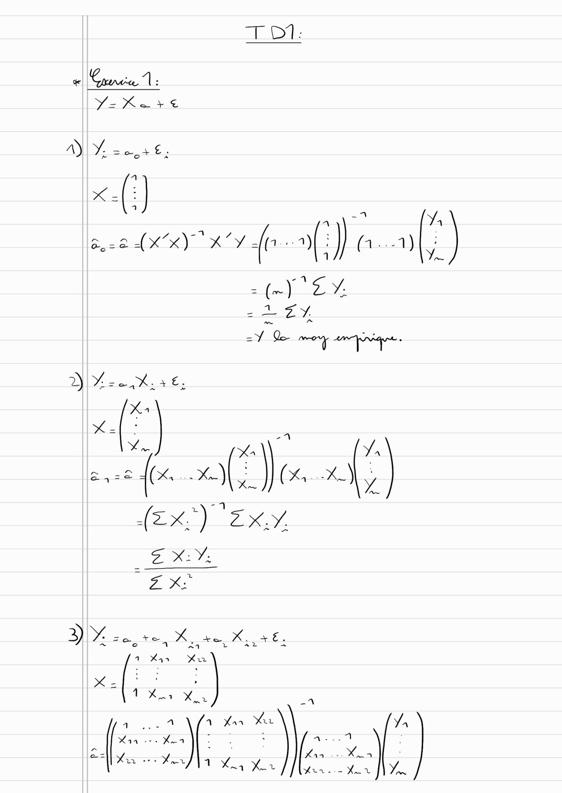

**Lecture OCR à contrôler**

~~~text
e) DR ET
FH
= ra
622 (x, (Ne
(ZX) 2x.

L So Maye
5x.

3) DA 2e *e, Axe, X,,+ €.

a Xan Xn
xf) |
TX Xa Ee
3
eae a

7
Ae)
~~~

## Page 2

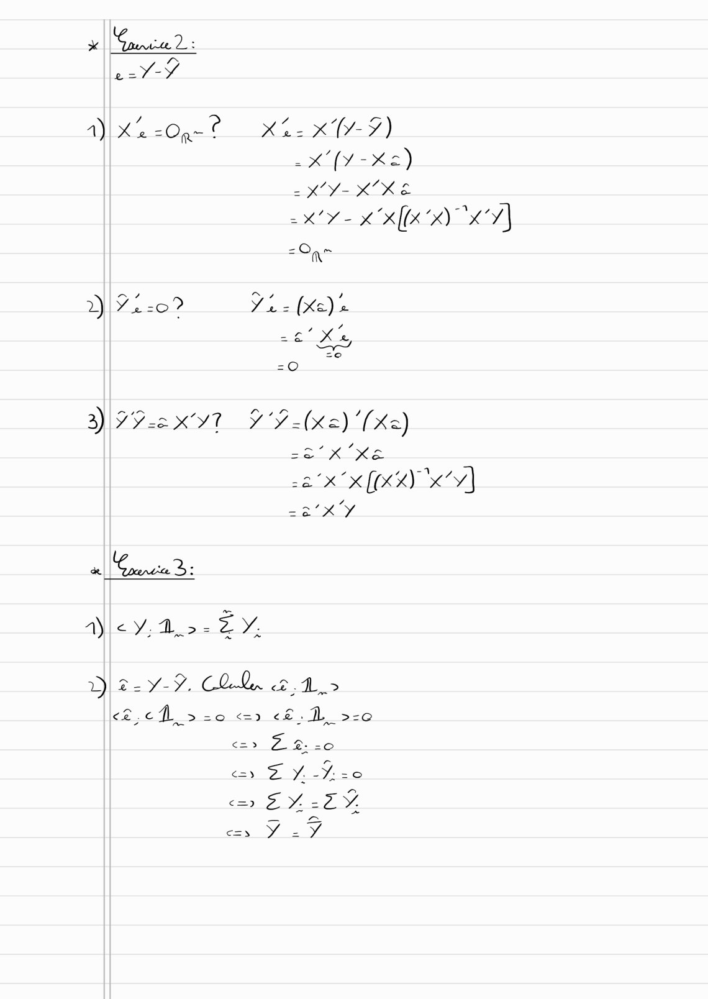

**Lecture OCR à contrôler**

~~~text
* Nr
TT
ax -opt xx y)
-x'fy-x:)

= XY- XXE
Nés rime

Op
Yaz (Xe)

Bray
om
rie)

2) Yio?

¥'Y.(X2)"[Xz)
=e°XK "Xe
a XX (KK) XY]
ne

3) 99-2xY7

AILART
1) cy, 2 o-Z2Y.

D2-y-9. CAL, 2.4, >
«2 c > =o <=) <£ 7 _ >-0
<=> Z 5: -0
PV 0
cr EY-TY
=v.
~~~

## Page 3

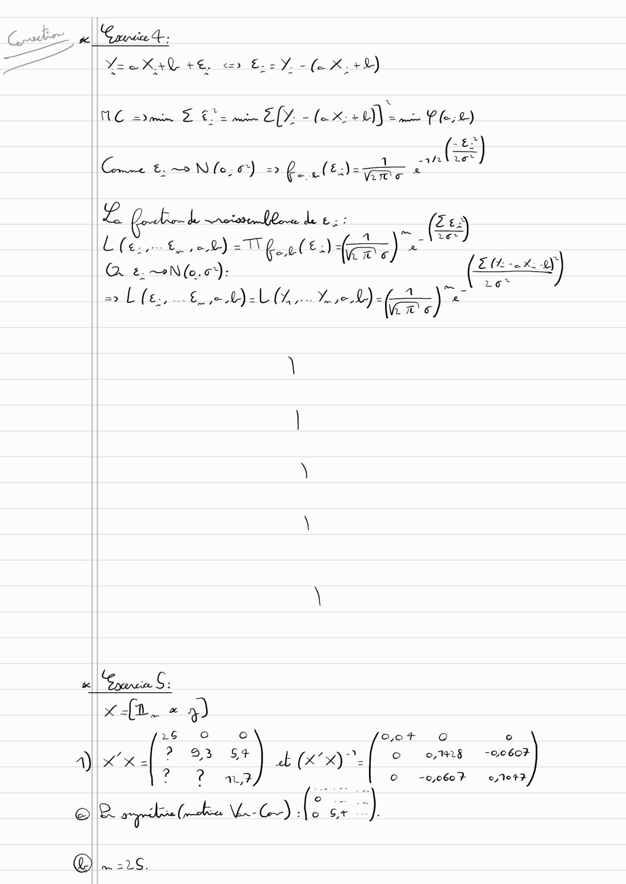

**Lecture OCR à contrôler**

~~~text
oO, à Grane:

Yoo KaG +€, = €.2¥.- (2X, +h)

AC armin SL Cha mein EfY. lex + amr Post)

es
ARTE )

CE 5
= No.6) => Q ds rs

es fee Ie es Ze)
ete dt) = TT LUS
@ ë&: —N(o.c): 6 aaa eae Fe) *

sal fe, £0 PC L)- LCA, > amer on (= yy

ze 7 BE)

we | Fons S:

x-{1. « 4)
; US a © o,0o+ (e]
2) at {? “oS *) A (x x)” (: ons =)
i ¢ A? © -c0607 0,104?
OR vpbetohe VO) AS or”
® ee -1s.
~~~

## Page 4

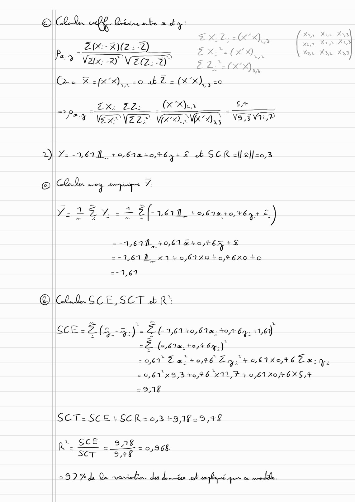

**Lecture OCR à contrôler**

~~~text
© C22. of Cricine abe a ab 9:
ee as ie 69, mae x
2% KZ. À HONTE oe on hoa

Pay Vite a VE ZL (KX)

.. XK =(K*X), =0 ab 2 = (XX), ,=0

on Ks B22 _(K% us SA
Pay Vex N\zz: GONE, VS VAT

2)|>- 2,611. route ++ £ ub SCR =(!2})=0,3

wee 2 ys 2-61. roro +6 + x)

=-1,614, +0,61 aro tbA +e

=- L612 x14 0,61%0 +0,46x0 +0

=-1,61

© CL CCE, SCT £ RY

> = À
ais CRIER) = Z(1,61+0,61». 40/4 64. +167)
2 (0,610, +0,4 6%.)
= 0,67 Zz aire Za 0,61 X0,t%€ Lx: TV:
= 0,61 X93 40,46 X11,7+0,61x0#6X6,4

= 9,18

SCT= SC E+ SE R=0,34+3°=9,48

cs
pe eee SE sas.

SCT 9,+8

297% de Oe vale de de tol plié que cx med.
~~~

## Page 5

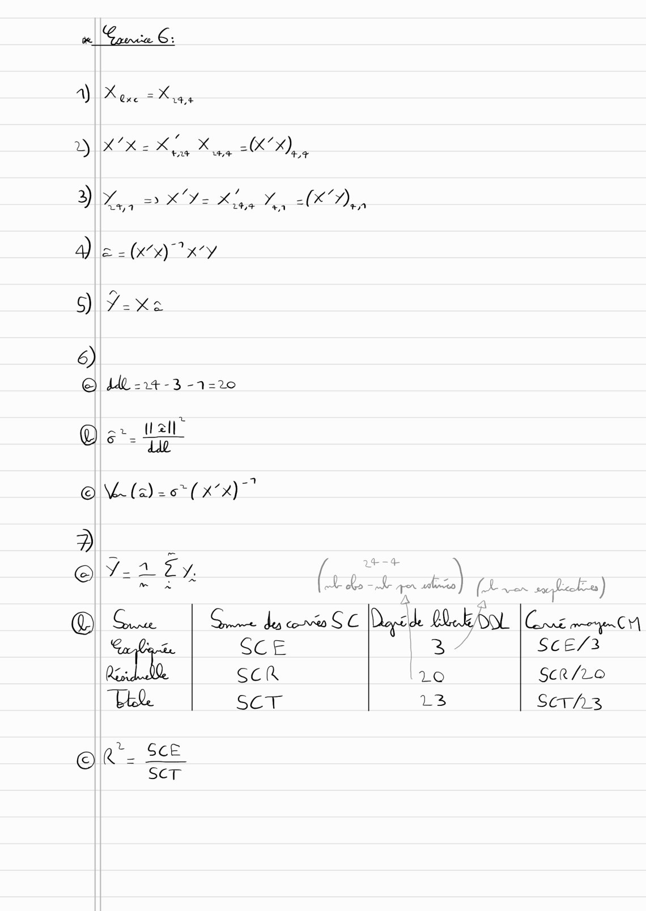

**Lecture OCR à contrôler**

~~~text
ares G:
2) Xe. - Kvere

DK 2 Koy Ke XX),

DII4 D = xy à OMe

A) a= (x)? x’
6) ¥=Xe

6)

© ddd -14-3 -1=20

Do.
@\¥-22y. (oedema) pre = supcte)
© Gee | Su bewSC Due Bo Crete cn
co CCE 2 SCE/3
7 an 10 ScR/LO
Thi SCT ie ScTNZ
~~~

## Page 6

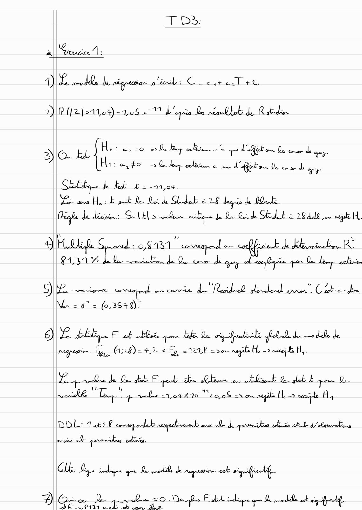

**Lecture OCR à contrôler**

~~~text
x Meroe
4) Le model. de ségpasion sévit: Cr tir.

1) PU 2)>14,04)=105 2 7 dep Le not de Ride.

soul nr Et rent
oc > A oe te Le ce de oy.
Skbkgs de hak £ = -21,04.
Le ame Hy k mit Le ai de Skoda & 28 dois de Put.
Deg de dicinon: Se UE > elem ibe de De Où L SEULE à 2940 om mile H,

4) MUR £08131 œéaped Le LÉ (2,
9131 % de be Let de Qe ce de Gey wb coc lapice qu D bin Pres
Ne o*= (0,358).

LP Hbge Fab bé pou biden Ou og fpeabive LA de del de

apte Obes Gn?)-47 < FQ, =1278 sew agi He => exept H,.

L gd de Oo dk Fpenk ali Rim on trot Con db E que Qe
te, Le poke 2104410 “eo,0$ => ow aegibe He => cxcarte A.

DDL: 1.428 crntrperdek napedtiresb ue he de qurenbis vdi EE di harmrcbions

À Gras Le pre =O. De an Fab ide que M med ah agp.

HR -0, 131 à
~~~

## Page 7

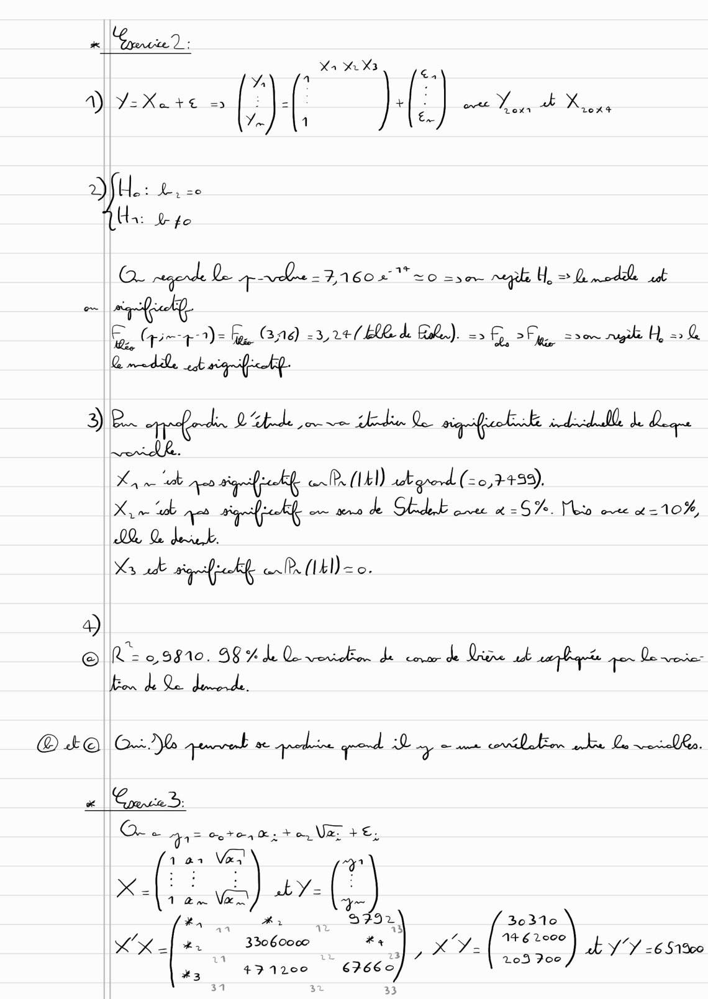

**Lecture OCR à contrôler**

~~~text
x meee

Xa Xe X3
#\ (2 <-
1) yxeren[).{ }() oe Hors À Kron
Yn) \ €

2) LE XL, =0
H.. À fo

(ow i) es = yo regle CA > 2. dk ad

Fes

Cc a. of (Gre -3,r4+/ bed Gh). = 6, a Fg, vo nyt HX

Éd rte
3) oe eee ae

En wn ab pee sige feck RL) ast grord (=0,2-452),
Xow ih ges wgeifecck om one de Se ears Sh. NieaWevecuse= 10%,
QO, Q desk.

Xo sub ptet RU) =.
4)

© R= 29910. BGA de Qe vericbion de cover de Mie ab explants pon De
Bon de Qe dde.

« pans 3:

(GE are cetera, ten VE + €

PR a
x-[ ae ) ab Y= EL),

has , 399% 30310
2 14 620
XX =| +: ete y XV TES] LE VY -6 51800

“ 471200 63660) oe

*3
34 3 33
~~~

## Page 8

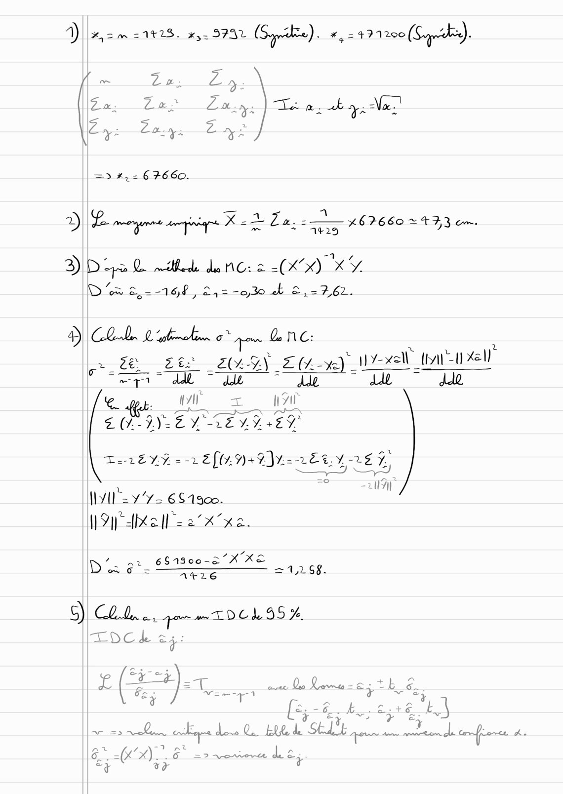

**Lecture OCR à contrôler**

~~~text
DY xem 22828. 22970 (Gb). «2471200 (Cd).

a vara
Za: LR Zur
Z y: Za ys Z es He

La, aby, Ve,"

=> k,= 67660.

2) Le mount pige X = Zn, == 467660 ~ 47,3 om
DD: L td de nor 2 (XX

ID ne Jef ou ds. 26.

4) COL Lola 0° pom bo MVC: .
À £& £t Zr. Ue Et x) - xl (batt <a
7er dd du Ade dd dd

e_ LEUR _E [EUR
LES EY LEYS + ey

[VI = v7 = 6 $1900.
MEL os 2% xa.

“Kn

# à co-5 XXE
D gt ee 21268.
D CLL a gam am EOEM 95%
Mock Buda
£ = =a mei Da Patni th A
“à dd | wey
ms EL. cet
1s yey
~~~

## Page 9

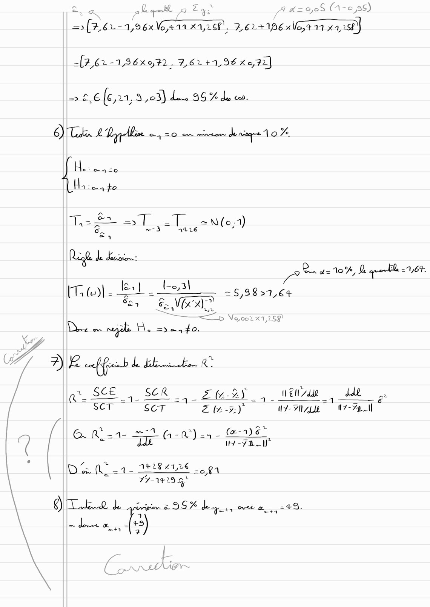

**Lecture OCR à contrôler**

~~~text
a 2% gonkh À Zi 1 x=0,eS (1-095)

a(Per- 1,96xVoRA AIM), 262+ 196 le x4)
=(7,62-1,36x%9,72, 2611196 x0,71)
wo f,6 (6,21, 505) dee 95% daa cot,
6) Lt £ Dypllim =, =0 om inten de niegre 10 7.
I 5k
Hae to

Wes cs Seat -1 N (0,1)

Z

Ss,
(eR teh, theme
(Th ()| - ie Een =$,98>7,64

= CAUCETR
; Dee om nl A. pesto.
AL caf foci de dite

a. SCE, SCR Et.) PR Wendie, dde
SCT SCT Etes) Wye 17-74

—> Vo,co1 x1,158

@ Raa 271 |E- eM) ane SDE
= dde Cash) ns WW -FR WS

ear
Die (ae ECR COA
77-1429 G*

DL 0 cc ee
ie. |}

SAV

=
~~~

## Page 10

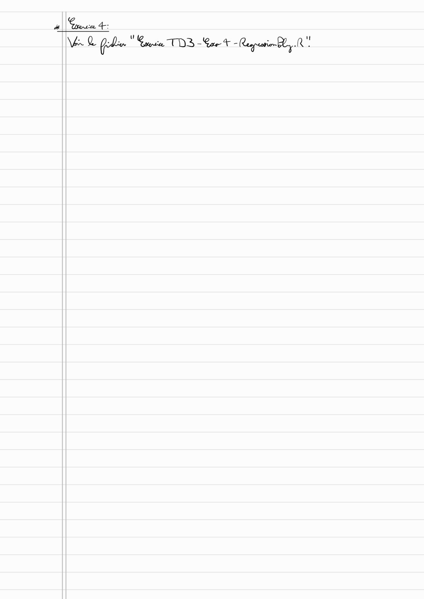

**Lecture OCR à contrôler**

~~~text
a ons 4:
Ve D Pin "Run TDS Gee + Region
~~~

## Page 11

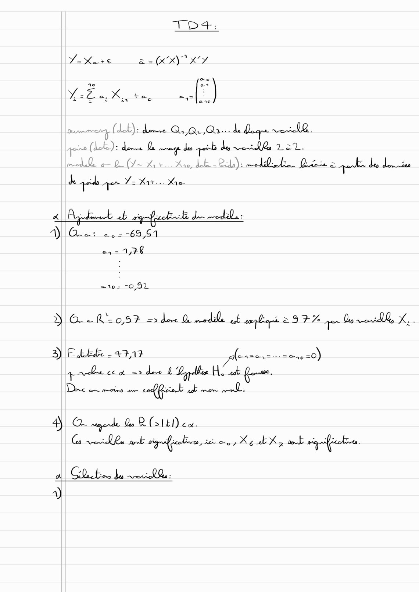

**Lecture OCR à contrôler**

~~~text
TO+:
a-RXTXxY

YzXere

e
1e on
lose

Y 8. X,, tee
Don (LE) EE Qs Qe Gand. eo AUD,

pe (Lele): dae D eg de poid de ere D

male D Gee 4, LL do): module Qrase & que de done

db pom Y= Kat... Xro.
4 ab a et de medals:

À (GS ao = 769,51
176

10: -0 97

D G-K-057 => dec Q med of pla 297% ror dore X,.

D'ELER 49,13 ersesnseno)
qe cca de L Log Mla He at pou.
D cof Giceck dt men dl.

4) Qe negorde Le R (LEI) co.
Great rule its oo, Xe bhp at recto

ANGLE Mae.
4)
~~~

## Page 12

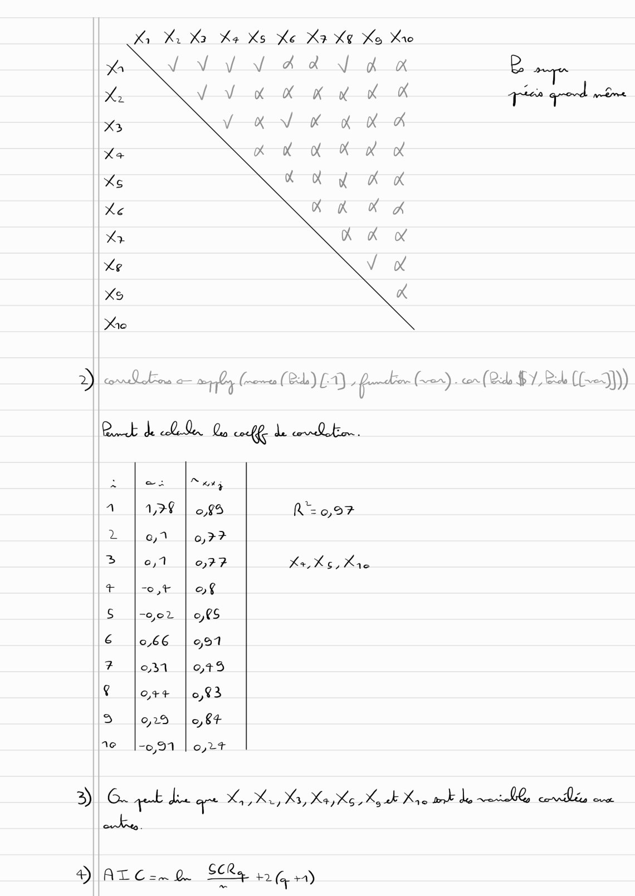

**Lecture OCR à contrôler**

~~~text
x x. x2 Ke Xs He X3 xe Ko Xe

RIR RN AR A RR

2) ent a ay fly (momen (Cite) [-1} fete (er) cor (Orde $Y, Bede (C}))

BE de lel, Qu cof L eration.

~ on fe: ny

1 | 1/78 | 099 R= 0,97
2 e,1 0,7?

= e,1 77 Ka Ko, Ke
as + | of

S |-e,e2 | oS

€ c,66 c,21

7 [031 |o,+5

T lore |o,93

5 lors |o,84

16 |-0,91 | ott

3). G. yet de qe LA Na, hao heck hoe tok de coll curés ve.
he

DIAL Cm Om Se 13 +1)
~~~

## Page 13

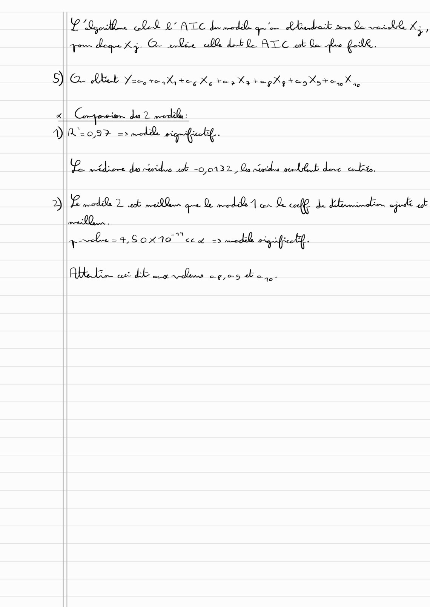

**Lecture OCR à contrôler**

~~~text
LS LL LATE de ede qu'en Rundait see Qe vere K,,
apo dequ ky. Q- allie Mh LR ATC wt Qe fo EM.

5) OL Cet Yor re ak tog Ke rey Xa taprytegXgre,%

do 2 medal:

JR. 0,9? = dd suetf.
Po the dal Le ne DL, letl ee

DL dd 2 ob mule que D med com D co de His oué ut
un.
powebe =4,S 0x10 ce x => medal oi feck.

ARE. et dE eu Lome ages Les
~~~

## Page 14

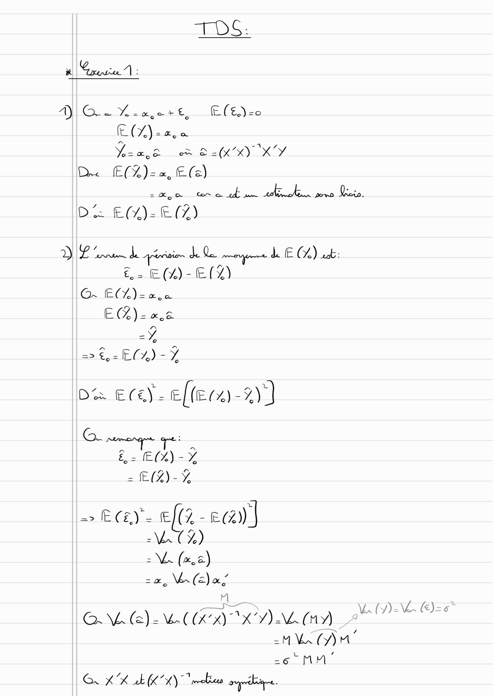

**Lecture OCR à contrôler**

~~~text
| Gocensice 1 :

AIG VY eee (EN 20
(NCA Er
Yoo ad 0ù 82%) XY
iva ECL)-x, (2)
= Xoo nt Wart ens
De EM)=-£%)

De dd Le)
-EG-E TR
CG E%L)= 0.0
E@)-

oe.

ec

b
L 5

=> 2%) -¥

Da EC). Efe) -2)]
aes
f= E(4)-%
= fE(Z)-%

a2 ECE) el(Z, - ea) |

AAA)
Sr
sa, ks (e)al
we MY bec
OVA) KR XN Many 8”
MMA)"
ze MM"

G KK ALKA) mel née.
~~~

## Page 15

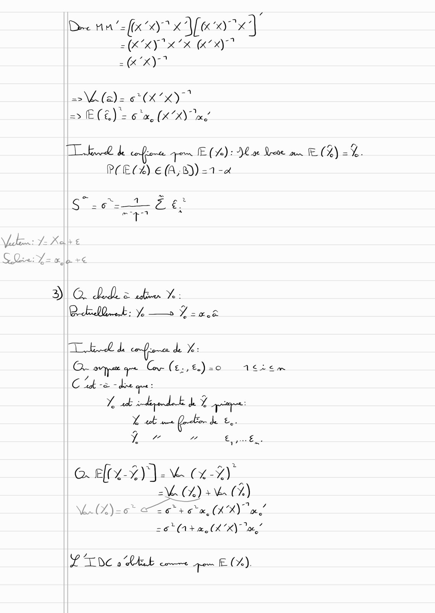

**Lecture OCR à contrôler**

~~~text
De nu ‘= [(x SOAK Ve 7x1 ‘
=(K’KY XX GX)
= GX)"

Vk (a): «(Rx
SEC) ca (XX ne

|B ee crie pom E (4): De Lreoe som (2) =.
PECL) € (A; D) -1 -x
arcs 2 È €
En

Vielen: Y- Xdh €
Ce: Y= elo +

3) Q. LA & bu X:
Bite lnk: ye —» Y = x8

Tbk de coffees de %:
Ce Cv (£;,£.) =0 1£iem
C sat -& -dine que:
Ye sb independeke de Xp:
Lotus fete E.
y_~ a CAE

1 =

eZ) KY
=\ (%) AL (%)
VL Aas Lets ote, (HA) x
ze (1+ (KK) 0,”

L LDC à RE ee pee E (4)
~~~

## Page 16

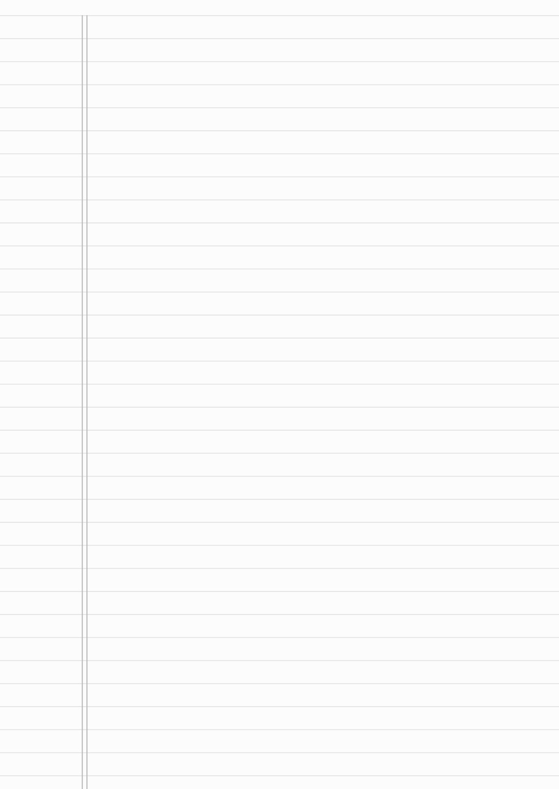

Page de cahier lignée, sans texte.
