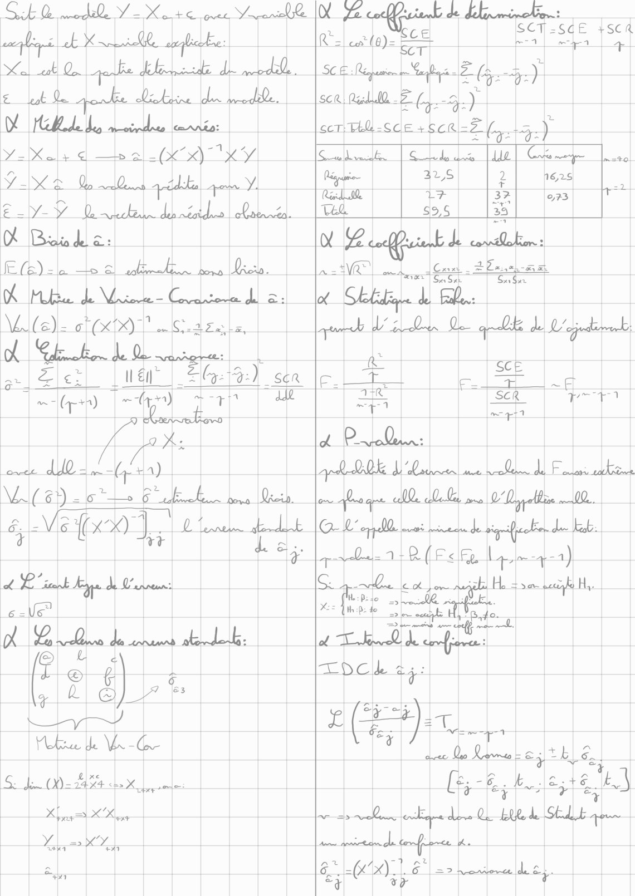
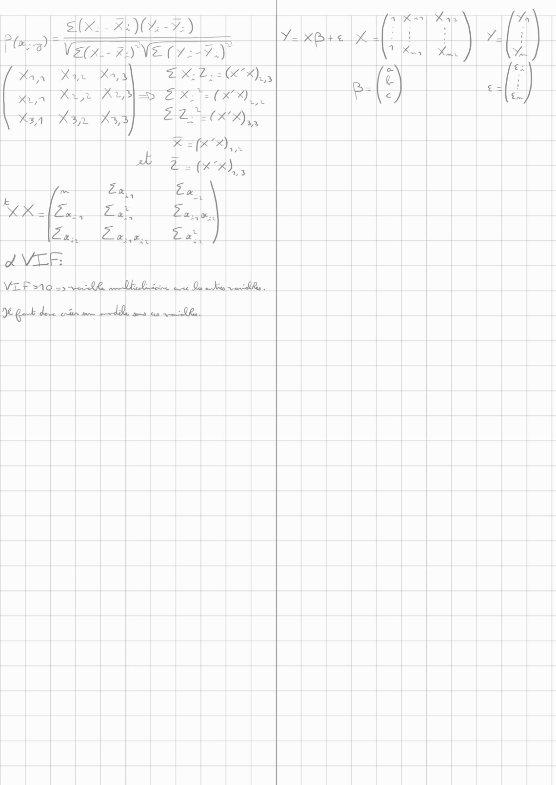
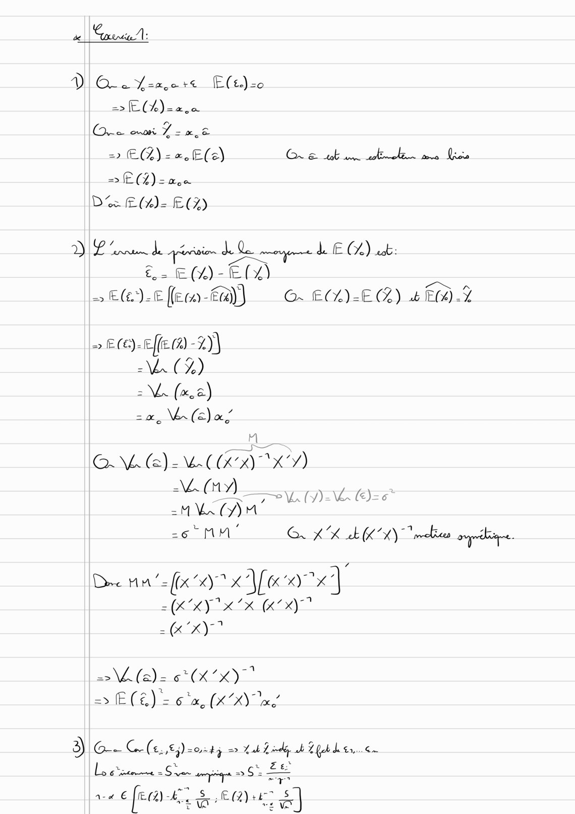
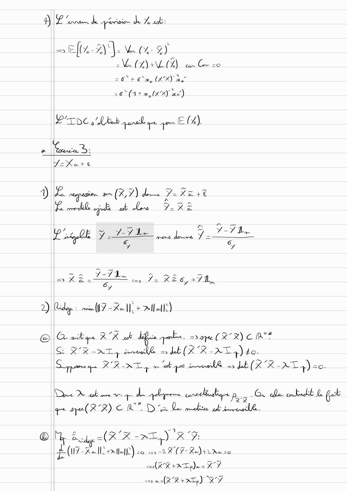
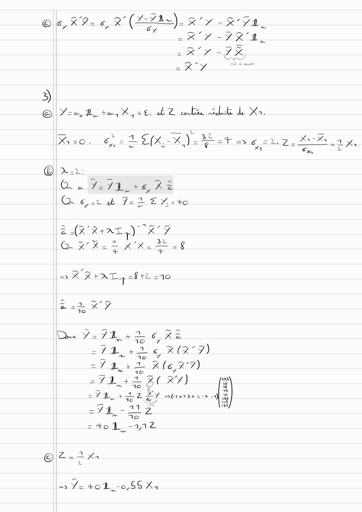

# Fiche_241206_222300.pdf

[Ouvrir l’original](https://drive.google.com/open?id=18Y_qHXMjMMZyXgI166P2RshufreLxBpA) · Les pages signalées comprennent du texte reconnu automatiquement ou des éléments graphiques. Le fac-similé permet de vérifier chaque lecture.

**Pages avec fac-similé ou lecture OCR** — 1–5.

## Page 1

**Lecture OCR à contrôler**

~~~text
SE R mode Y= Xo rc que VronR
Le LE |

Xe ut Oo gerbe delice JAI
€ Lot De Et, LL. LD. |
DE GEL Le, lle landtio:

yi Kals d —te al (xx) x
Ya 2 9.0 4=b Y|

BAY VO leche dsl Qt
OX Bi del 2:

ER) Li Li |
OK be de. Mt - Lil.
NA(a)- OT

Et. de D
E lei én” La

dt Oe
ee ee ce

Aree

cei |
ay 6 EE La
ern). compte

PAPE

ES Vo

à Le eens stds
fe don

ANG 2 @)7 ®

Care

152) _ SER
~ JR

ae
Ca

Hu de Ge |

S. dn 00-2454 Lx]

XX |

Mr Py

| &L

ù 2
Sap SdE {sca
co leutfa)e EA | les | +

SCE épunion rm eZ (a) ]
sce Run 2 fe. AY
6cT: Th -SCE +SCRi=2 ne

sui | Slide dace [de | Er
ae | 32S] & 1625 _

LF
Veh

43,6
ù ee

avery

of

es [|
| =p | |
d PLQL..
Arb QDS L'une ue Lee de Fotos tahiti
ve ro gee ed ab, sno Delfin 00. |
OU ppd es winters de sgh de feb.
apdln  R(Es fe Ly mya)
c. le cot a pom nie se tif |
me: ne |__|

Eu

or a eue |

a RE LE
LOC ea:
LED
t\ Es ee a |
[| Lakes) |
|_| ae oe ERA
el ree dE OL pue de SELLE qu
~~~

## Page 2

**Lecture OCR à contrôler**

~~~text
ay ASE
1 XE
~~~

## Page 3

**Lecture OCR à contrôler**

~~~text
ae. Coane:

DIO. Yen a+ Flt) <0
= E(L)-a.a
Ce 7 7.2
= ECL) ==, E(e) CE tt me ls
el) sae
De Ess ECG)

D Lana de pinion de Le mu de € 02) a
£2. EM)-E(%) =
> E(e)-Eflem-ta)) ©. ECL)-E(Z) 4 0.7

= e@)-effe @ -%))
C7)
= (xs)
zx, VA Ce) al

a
OMe) CKD XY)
(ny) |
LDLC)
AAA ey
-6" MM! G AR sk KA) mel oryodbioge.

Dec 14 ‘= f(x “x Ve xx] ‘
= CLE eue
= (KX)

VAT (X20)
=> Æ fe) Ex (XX) x

3) Ge G(£,,€4)=0285 o> Lak Lindley sh 1 feb de br, <=
à. à ~ Ze
Lo gate =S rer pique > 6 LE

=
a2 € [ema raid ea
~~~

## Page 4

**Lecture OCR à contrôler**

~~~text
DL nn de génies de Ze ab:

= Ef%-2)}-4% %- 9)
EN ATEAVIVAION Ce
=O" + 6m, (XX) xe”

= 6° (1+ we (KX) xe’)
Proc »'LEeb pere qe porn E C4).
# rca D:

Y=X%eare

D Ride: min (IY Kel, + All elle)

© O wikae xe de qakns, = ape (XR) CM
SE RR AT rea = hb (XK -XT 4) to.
Spar gn K KAT 4 met 400 imine as Lab (XK -AT 4) <0.

Dee bone dre craie Pag G dde enkedit L fk
gre qe RR) CRD Le be ile.

OÙ Eu (RK -ALY RG

$ (U7 Koll. melt) LR (Ÿ Keira
cA XK +AT pe K'Ÿ
co (XK FAT) KY
~~~

## Page 5

**Lecture OCR à contrôler**

~~~text
3)

— = zu
Kiso. 62 DEK)
Dad:
(GES 7-71.+6 KE
Q. 6,22 & 722 £ 7-40
BAK RAL) RY
~e A À 32
Qa. x Xa ZS XX. = = 8
=X X+ATL4 =F rd =10
aot XY
Dee V=71 22g BE
_ © 16 7 =
Hp (T7)
LM Fe 7
sr 4. 42. K (6X7)
_ LS 16 Se
5
TL eae KY)
SYD + RL ET otrerser-s +)
294-207
+ 70
+0 217
AREAS EN
CR

o> Ÿ-40 1,-0,55 X4
~~~
