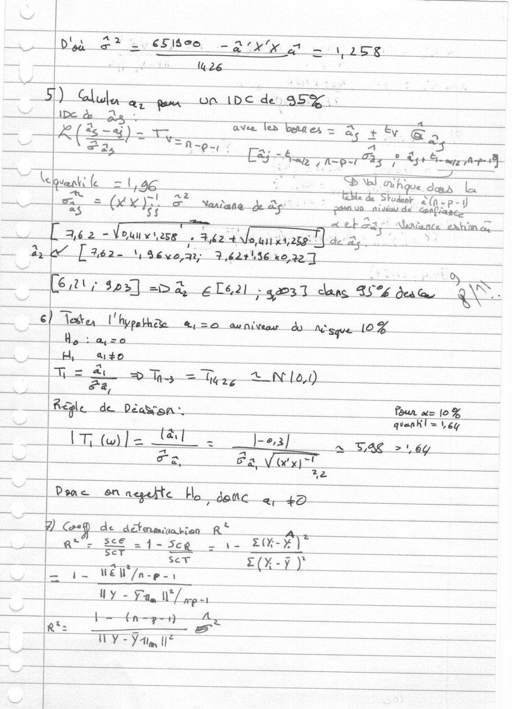
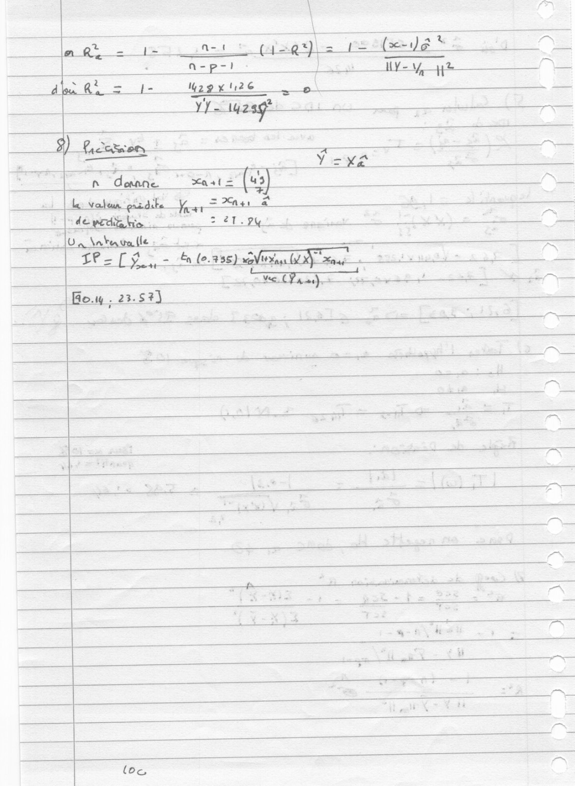
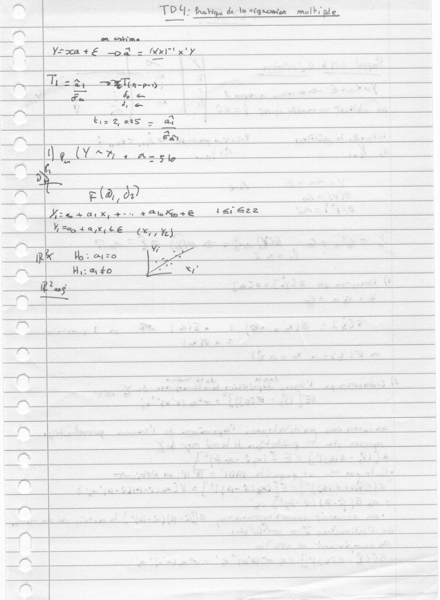
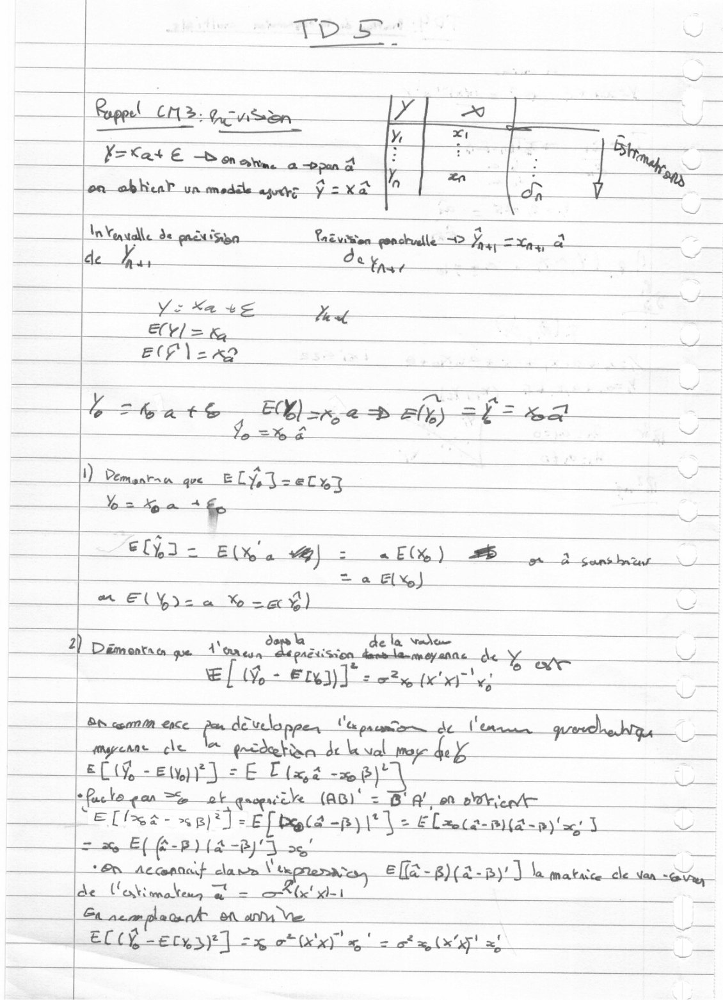
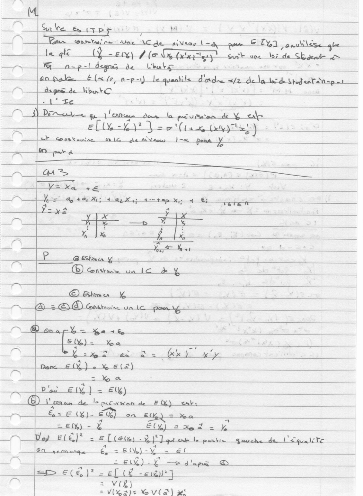
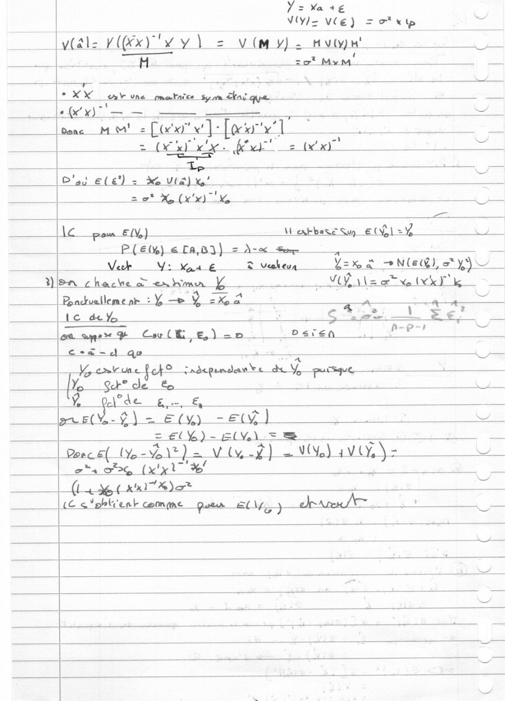

# ML_organized.pdf

[Ouvrir l’original](https://drive.google.com/open?id=1zr4S1pLH9KO2UDj9qTbPf9xXaD7vUT0v) · Les pages signalées comprennent du texte reconnu automatiquement ou des éléments graphiques. Le fac-similé permet de vérifier chaque lecture.

**Pages avec fac-similé ou lecture OCR** — 1–6.

## Page 1

**Lecture OCR à contrôler**

~~~text
Poser Buebieee, — Pee ot Li 10
5) Glule ar pen oa IDC de 35% {

A

Ibe à
+ — ae
KES) he
… 2. LR - 0:

ave les beara ex = as + Ev. Cry

Eay- i Kine ee

so _ SA ‘SO aha Le Lu
D qe
LM | sé æ Norah $ a

€) Tete l'hypathe M5 aw niveau do nome 10

He: ace

au; u+o

Rs À, er . ANA

fa
ot lex ae Pour a= 10%

- quankl = ey
Cr tuile ER En see
e CES Fa, VX

= Done on negefte Ha donc a +0

de det ce é. R°
at” 36e 1-5 - 1e FOEET
is ST E(X-ÿ)
We i. Well [nap a4
Hh i 2 EEE

eae
TY = YA Te
~~~

## Page 2

**Lecture OCR à contrôler**

~~~text
+ ” 1
n_doœnne ast = (43)
| te: Valens “pizdibe Ye 4, = 7e à

de pedi bis. ne ‘tre
[Ua \atugaifle : : :

ef o ‘by (6.935) Vie LD) nu =

à 4
wate
ow . 23.57)
j
— : be :
ms
à JL
Ee
ÈS
:
2 ie ;
+ es +
rs POP —
nae 7
à
“ ke (os
= i L b
;
. ü

loa
~~~

## Page 3

**Lecture OCR à contrôler**

~~~text
TOY: Pratique de Vo régnemien molbi ple

en_enkima

LL.

Yom tr 252 - hd Wee

Fa As
8 aoe °
EX G22 es à
=
FS sa,

ee

ca

ae

+ Ale Mp + € tar S22 Zi *

[He +aix, +.

| Wren tan, te ex, y

_ pe th: co aa
a Hira to ee
PS
an’ ;
! x =
, PPRARE PET Es i
A = a pit ni +
a ai A
t ees
i PS =
TS : =
>
œ “al $ to
=
P is x Lite bg
—
~~~

## Page 4

**Lecture OCR à contrôler**

~~~text
Rognl_ cn. pousan

X=Kas € aay re ”

——|enobhcaP_un mode age fous

\nVenudle de pact inpa ILE Ds D A =
du. Bs
Yo Ke us z Sa
Er = x, "+
EOP \ 2K?

— #4 bee Hi ee (are aly) = meee

1) Demunrsn que E LY, Vo el%y

ann a 2
e(ÿ3 - E(X'a wel : AE) 6 3 a
= a Ely)
em ElY 2a x Ÿ) Z

LS

) Dé 4 pu. dela Ve te y
ax ve
5 EL, - En] + Let te?

———_+® eu l'a pan de d'en me
ds Sun (Wa
EC(% - ely) j= £ Ex a
tfacle gan ot
Pelle xp)? = Ef ace ENCRES ENTREE we
omy Ef fe. pla “45
+ On NAGAR HEE | A &ff2-g)(a-p)') lam arco cle stead,
de (RAS pee = ls! d-1

ef an Ve.
EL (É-ers3}] 2% ot (x'x) ag | zat Lex! a a
~~~

## Page 5

**Lecture OCR à contrôler**

~~~text
_M

)

Sur Ve ITR ; M

)

Keer _tonrwtan' ne Une AC de piveay La pe El, V\ége_ glee

ae te gl (Ÿ eu (eG Gay! Senge tee de chu re
FR__a-p-| degn de Wbabc =

pee eee ere -p- \ « N

vo Pepe deb bk O 2
CR eee A
a FFE yf enn cone = es

A put à
a A>
a
VE a es
| es ae + dr Xi tae Xp 4 tap xy 4 €; re
Y=,2 a
= y|x rhe
: Se
y sa. à
= X_ J {

agra;
Diag Ely ) = «t
© \'eman_ de le revision de E (4) ent
dE Era) en £6) = Xa .
ze) - Ÿ Elyj 2 xx 2 = k
PSN ELÈ) = [tam 3 i Suche del Cqualite
Sens 0, — BAY) WY at
AN = eM). a AE rs
em ee)? [IE -œu]

CT

ane
VX 2): Yo Vla) set
~~~

## Page 6

**Lecture OCR à contrôler**

~~~text
Y= Ka +€
V(YZ VCE) = oF x lp A

ly(ale W(x) Y 2 v (M y) 2 Hv

H zot Mem.

Le
XX sv une mmataice sam ai qe

ONE = Ly
dence M M'_= Cou x] Loco x" 1"
2 OC xl. fe 2 x) =
Te oS
Blas ele) = Xe Vid) Xe!
a ze x, (xx) Ve
AC pou El) ientbase Su E CL: Y

__ Pet} eTa,B3}) = A-x Sr

Vek Ys Vas € T Veekeua Yene a NOE SR

Hon chache ex man Yo : Vi Wee Mo (Xk Sk
ven ra CE KA SENS Ps,
ea ape Cul, €) oo _beïen pase! be
ane Qe

Vg ermbeune fof © radepemdane a Y Saeed
Y, SH cle te
% on b= &

(yy -e.s) L

ee. EY) = S is
Ponce Wool") =, Vly ag) = Ye) avy) = LU

oh. (xx 7%" ?
kil X) SE ae

LC g*pblienk comme ques El) ka. '
~~~
