# MecCorr-RLogistique-2024-2025.pdf

[Ouvrir l’original](https://drive.google.com/open?id=1FoQWP_NPA_5qq3yLiv9WQH3OiurZBT8I) · Les pages signalées comprennent du texte reconnu automatiquement ou des éléments graphiques. Le fac-similé permet de vérifier chaque lecture.

**Pages avec fac-similé ou lecture OCR** — 1–6, 9–14.

## Page 1

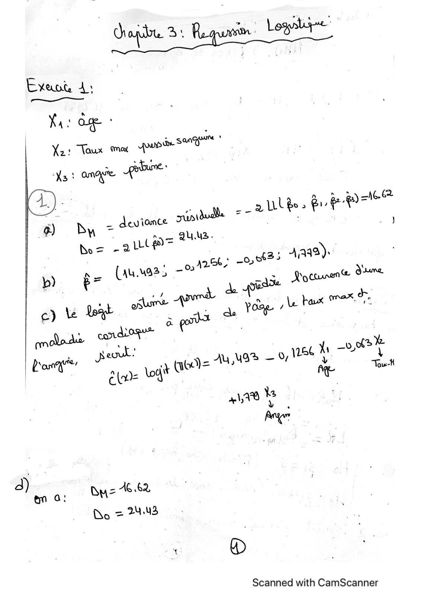

**Lecture OCR à contrôler**

~~~text
Evxaut A:
ae
X21 Taux ma gov Sea

Yas ange ORME:

® Du = deviance rude = - |
= 2uu2.
Bo = a ill a= | >
| 2e Oot?! 3,342) |
b) BF (au.waas -0 ee, |
4 de out Cure nu
y Le Wy! Are. ANT Page Le Fa PU
: a
adode cordioge® | “4
| _—L
A AY Was — 0, 1186 1 0
L'an ! we Log (nod) = 5 “he,
| Ree
Ÿ
41,4% 'k
Ang
à = A EX
Bye:
em a:
Do = 24-43

®

Scanned with CamScanner

à wl Be 5 ev Po al
~~~

## Page 2

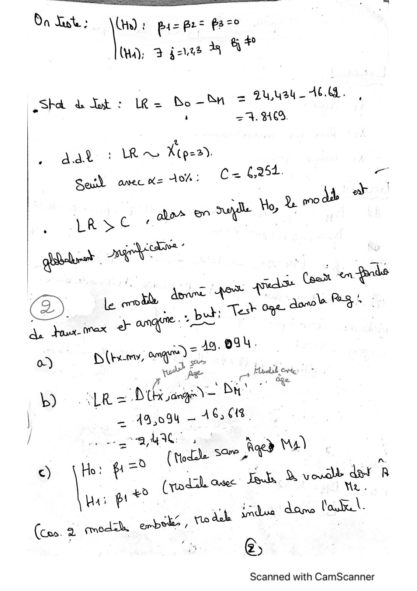

**Lecture OCR à contrôler**

~~~text
Da Lot : ire ! pi Pee pa =0
= 40
(ho: 7 faved à LE

Sha & Tat : LR= Bo-SH = auusuy_ A4. ,
| ‘ =. 40.

aat : R~ Kiger).
Sas avec Ks 10%: fix, £954. -

ow
. ; ood
ator on sie Ho à °
LRSC «

à a.
| _ 5, (pom nr pr
Ae dows max 7 ange: BR
0) D (rem, ang) L |

whe anne dee
Dhs Bi”
AQ 094 — 16,618.

gra MACs Red Vu)

b) «LR

i

Scanned with CamScanner
~~~

## Page 3

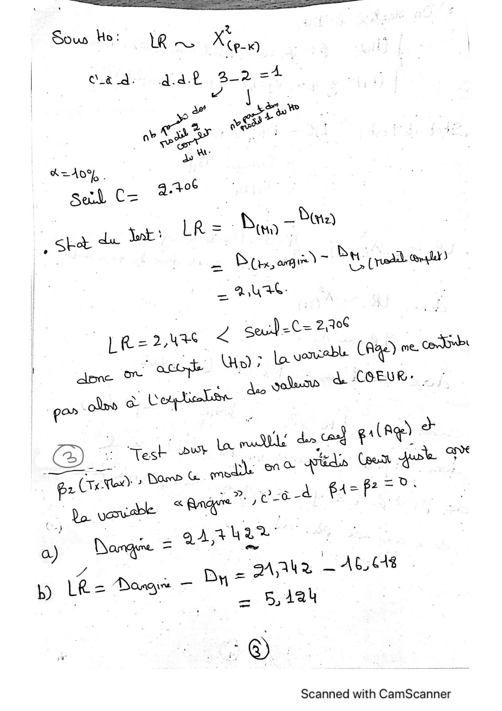

**Lecture OCR à contrôler**

~~~text
Sous Ho: 1e A

z
Neng

ous tly uy AP, 3-2, =4
Y

|
a” ese
"2 ves
eae pace
= AD .
Sul C= 2.4 .
| D
ea de er. LPS Bu 7 9
- 2 SO agie)~ OM, (roll)
AU EC:
. = ¢
G Z seu) C= 2,0 |
ac aa aa, La variable ras
on” at jus & COEUR:
pos ne a Cepia

lo
(3). Stack DOr mee vie Gen que %

Tec qu se md

pr « Rage? ee à - d f1= PET
| Be vase
‘ A AuaR
Narqre = * |
» DE Mas ME JAAUX — AGE

: @) |

Scanned with CamScanner
~~~

## Page 4

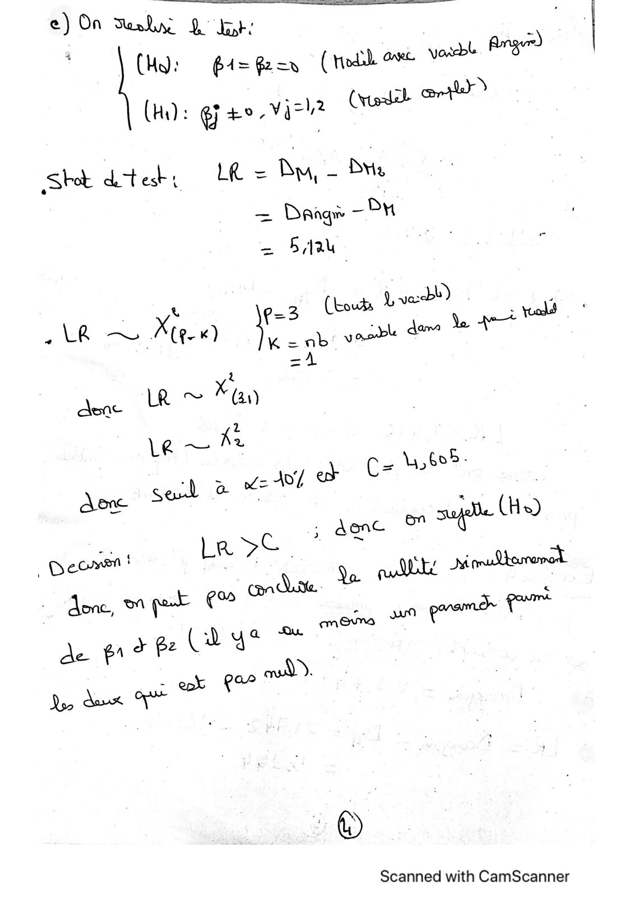

**Lecture OCR à contrôler**

~~~text
e) On Suabn D Et: :
CH: @4= Geen (ted ove ~
(Hi): ] $0 LWqel2 (yall cot

Sot detest: LR = Du, - Du

= Daag - PH
= Bau

| va<bl) ,
& e=3 (hours
« Le D Xe) tua

KkK=ab acd dans le 47

ee LR © Ka
Le ~ fe
hog fe 107 ew |

don seal 2 © ; :

on ot Lane ® sage (H )

eo à R | | |

Decent! ve ME: q À
me, ei ait
de ero pe GRAS \

aod.
- apr
pe due qe À

C= \4,605-

7

Scanned with CamScanner
~~~

## Page 5

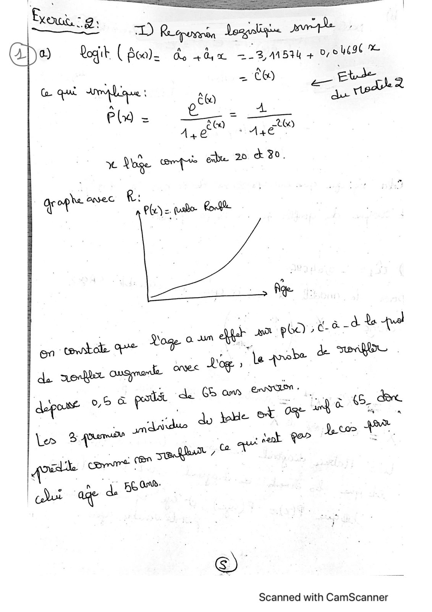

**Lecture OCR à contrôler**

~~~text
Bronx, - ;
ESS oe os pre
a)  Qogit (Beale de sd 2-3, 41594 + O70 UC %
- CE) Che.
. ae ee a
el a lient C60 rs
eld = ee = TT
A, d Ase
< Voge ( L edu 20 & 30.

grophe Onyec R: Plo) = cas Crone

rie

gy a pea ea EE
Le robe de we

En Tan :

Voge. à un
en towel qe OF
À. pu ONS i ones Log.»

dep“ RE SP ok Be ge 6. de
dy te dos

© | .

Scanned with CamScanner
~~~

## Page 6

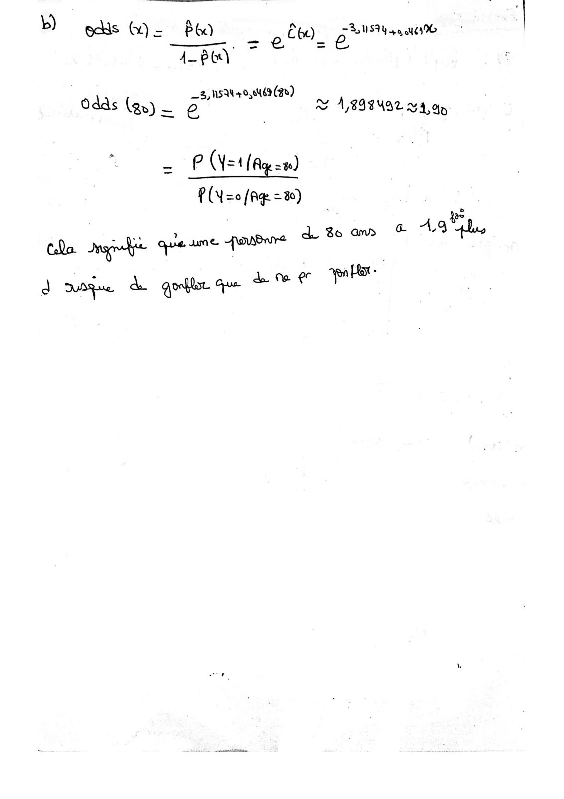

**Lecture OCR à contrôler**

~~~text
b) ods G = Boo = Êbe)_ AE en

—.7@t =
4— Bor)
3, NSW0,0469 (80)
Odds (gx) = 2 © A/898492 waa

= Pp (Y=4 [Ay =æ)
£ (=o (Ag = &)

| Fe
à 4 d 3e a F A, lie
Qo. Jase te que une. AObnrE

- r TUE
J mie à qodie ge ve
~~~

## Page 7

~~~text
                                                table de Loi de
en vérité Z suit loi de khi deux avec 1 d.d.l
mais comme n=100 donc elle suit loi normale     khi deux jusqua
selon la table de khi deux                      n=80
                                                  =100
~~~

## Page 8

~~~text
1.96

       On a même valeur pour C, car
       la taille d'échantillon est
       toujours n et le risque aussi n'a
       pas changé.. C=1.96
~~~

## Page 9

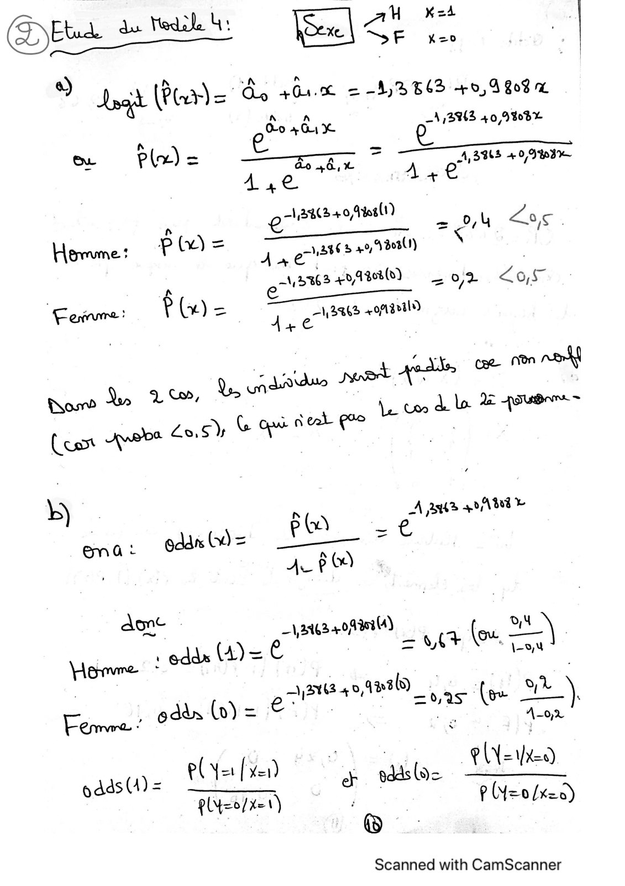

**Lecture OCR à contrôler**

~~~text
(DE du led 4:
————

AM KoA
DE ke
*) Legit (Paris Ss Gu. = -§4)3 B63 +0 A 809 À
on g, x A 13943 40,9%08%
SAS
8 . _ & ———__.
om Plus ax 7 21,388 40,943
Age +
grain sm Pay
eo
Horune: p Lo = is erates 20e |
A eo 5362204808) à Los
Fame: ? (x) =

CC
3862 Ot Br)
Aye

pes non n SN
Qn VS Qh unaidde 2H Lek ee
Row ‘
(oo Pb LoS) & ae set ge a

b) IN Ge € pe Abid &
ena:  dddx = Die =
AL PO
ace 12863400004)
H . edds (4)= 0 = ht \™ (ou 2
Komen od = €

pdds (4) = eC y= fr)

= PMP nas ee HL )

‘au
: g(N-1 \xX=0)
a sddsloe

= = pO - o/x=5)
Ply=o/x \) {=
®

Scanned with CamScanner
~~~

## Page 10

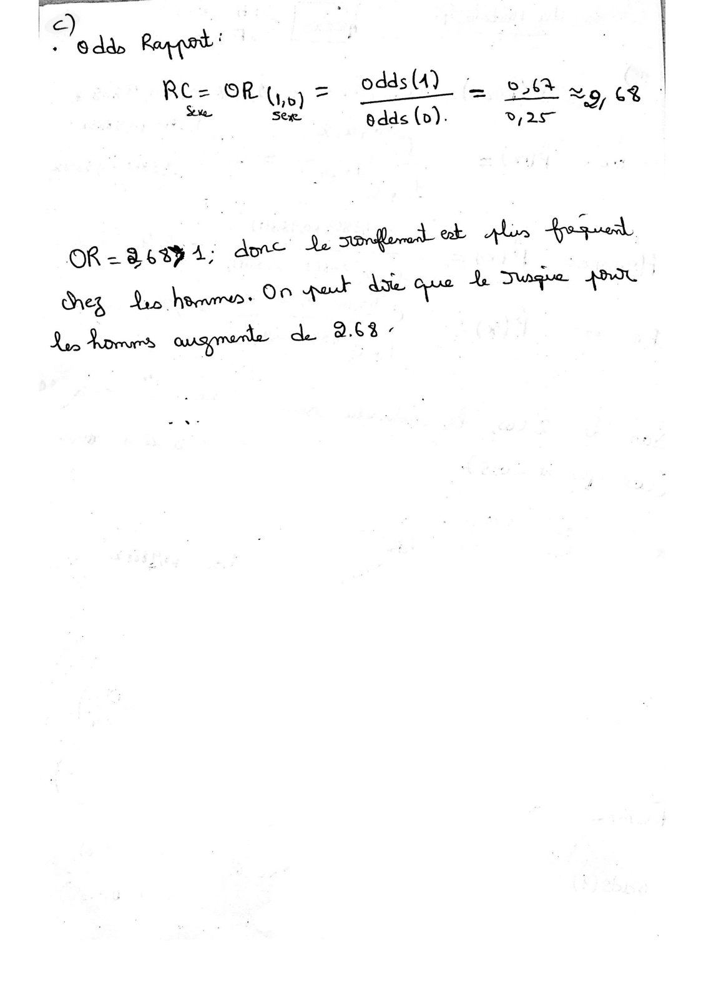

**Lecture OCR à contrôler**

~~~text
| RTE Rar gant |

odds(4)_ oa
Res OR G, b) 7 = eS

Bay SE
See. odds (vb). 25

OR= BE Fe a die Qe Juge AN |
Lo here: On at oe
des

de 263-
Les Romus ouspmetle
~~~

## Page 11

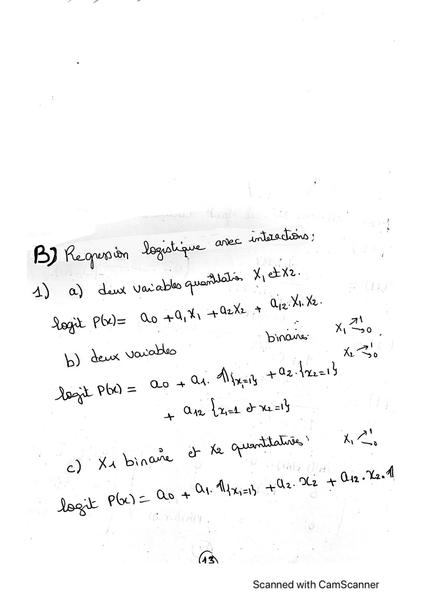

**Lecture OCR à contrôler**

~~~text
aan 3
EX.
A) a) dw saab pe x
6 ) Qiz: ÿ Xe.
Sage pod= :
Dino
\p) dex Vaxobo n oa.
oor PHO = % + au. Arai ACPA PAT

Qo + X1 402% A :
| x 0,

Ora, let ww eu

ey wo
Je fa orties

4

+

c) XA ‘ey none

wi Ji à
(eus PAS At 4G2-%2 + 42,

Je POV =

(EN

Scanned with CamScanner
~~~

## Page 12

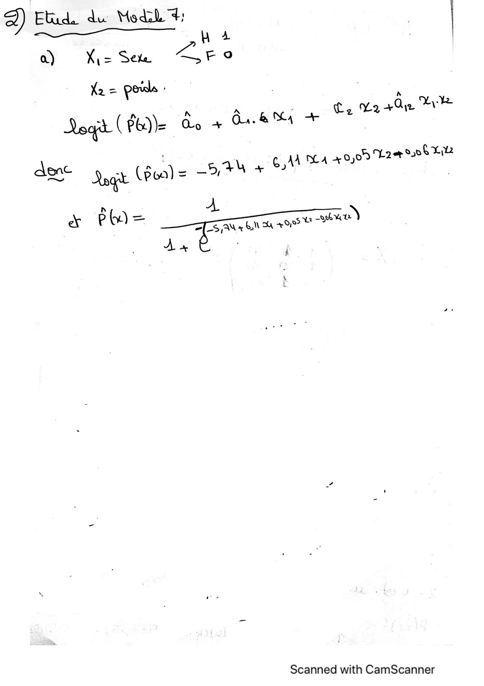

**Lecture OCR à contrôler**

~~~text
É) | Etud. du Mods 4
a) Xi= Sete fe,
X2 = poids j
Loaf (PB) Qo + Cr. & A +

denc

h 4
FO
Ye

A
Ce V2 +0 LA

+) gay tia 4,009 Lae 006 HB
= — 1

gt cr
7 N

Nn
x FO Eee
— |

\

Scanned with CamScanner
~~~

## Page 13

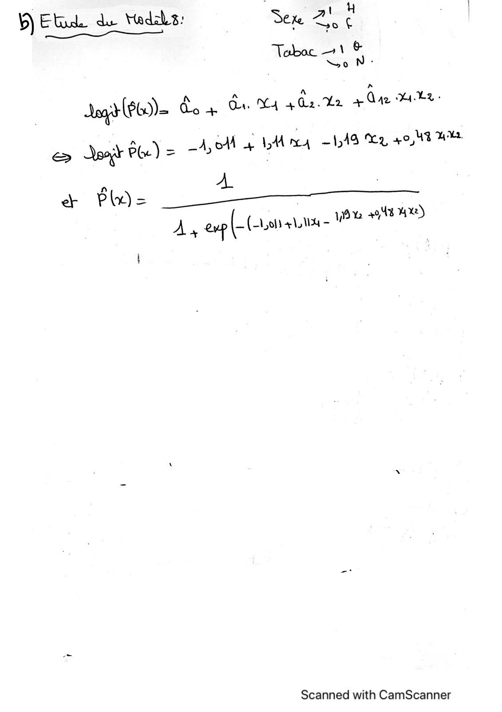

**Lecture OCR à contrôler**

~~~text
ÿ) Etide du Hadabs: Ser 2 !
ee 2
Tobac 1
oo N :

Joy (Pb) Qo + du. M4 a Ga Ve. + Qu DIRE

S Jo Plu

+ Plr)=

y= A ob 4 LM ma 148 Er 40,43 WH

96 +948 4%)

À; ep is (0414 -

Scanned with CamScanner
~~~

## Page 14

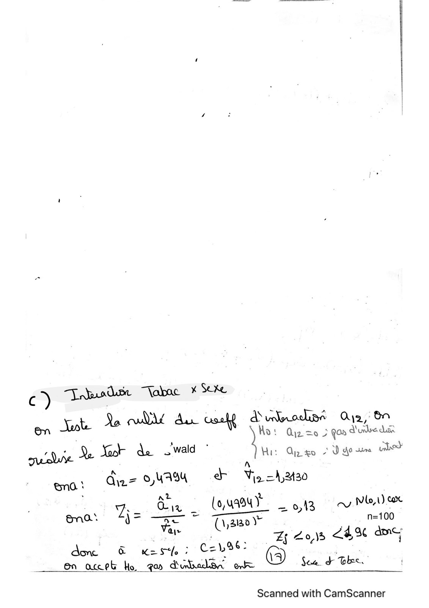

~~~text
wald

       n=100
~~~

**Lecture OCR à contrôler**

~~~text
c) husdue Tabac * Sexe
ald csaht a unlococliae Qy2, On
& Jute Xo Bai Ho: Quiz =0 à Qos Pee di
in D, Nook de wald ° tas Qin eo oD eis cabo
guobe & * Ire
die 0, YAS d Vo -À,2%30

one ‘ k .
û L,U Wx
in dix (0,uae4) = 0,13 cy NLVE
‘ = te TTY _
Bna* T= FE (ame) n=100
~ :

mer ox Eh eas ASE OY
donc & Kes. 2 Czhb3s: ;
en accept bo ga d'ubalsn ewe @ See d Thee.

Scanned with CamScanner
~~~
