# MesCorr-2023.pdf

[Ouvrir l’original](https://drive.google.com/open?id=1UIbTcjSkzQCeIzTNIgCMV2IUUrPFlp2j) · Les pages signalées comprennent du texte reconnu automatiquement ou des éléments graphiques. Le fac-similé permet de vérifier chaque lecture.

**Pages avec fac-similé ou lecture OCR** — 1–12.

## Page 1

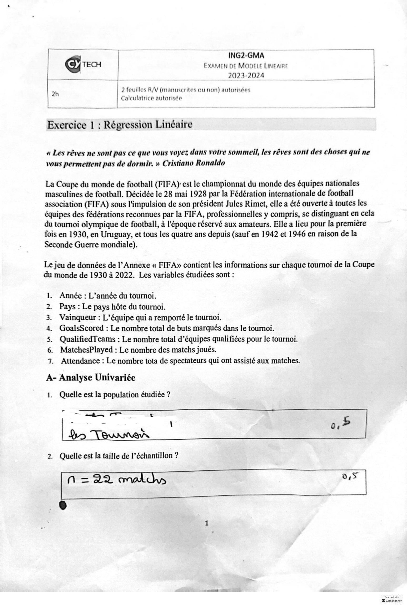

**Lecture OCR à contrôler**

~~~text
ING2-GMA a |
EXAMEN DE MODELE LINEAIRE
2023-2024

]
|
2h 2 feuilles R/V (manuscrites ou non) autorisées
Calculatrice autorisée

Exercice 1 : Régression Linéaire

« Les rêves ne sont pas ce que vous voyez dans votre sommeil, les rêves sont des choses qui ne
vous permettent pas de dormir. » Cristiano Ronaldo

La Coupe du monde de football (FIFA) est le championnat du monde des équipes nationales
masculines de football. Décidée le 28 mai 1928 par la Fédération internationale de football
association (FIFA) sous l'impulsion de son président Jules Rimet, elle a été ouverte à toutes les
équipes des fédérations reconnues par la FIFA, professionnelles y compris, se distinguant en cela
du tournoi olympique de football, à l'époque réservé aux amateurs. Elle a lieu pour la première
fois en 1930, en Uruguay, et tous les quatre ans depuis (sauf en 1942 et 1946 en raison de la
Seconde Guerre mondiale).

Le jeu de données de I’ Annexe « FIFA» contient les informations sur chaque tournoi de la Coupe
du monde de 1930 à 2022. Les variables étudiées sont :

1. Année : L’année du tournoi.

2. Pays : Le pays hôte du tournoi.

3. Vainqueur : L’équipe qui a remporté le tournoi.

4. GoalsScored : Le nombre total de buts marqués dans le tournoi.

5. QualifiedTeams : Le nombre total d’équipes qualifiées pour le tournoi.
6. MatchesPlayed : Le nombre des matchs joués.

7. Attendance : Le nombre tota de spectateurs qui ont assisté aux matches.

A- Analyse Univariée

Quelle est la population étudiée ?

2. Quelle est la taille de l’échantillon ?
(Naa o.S
~~~

## Page 2

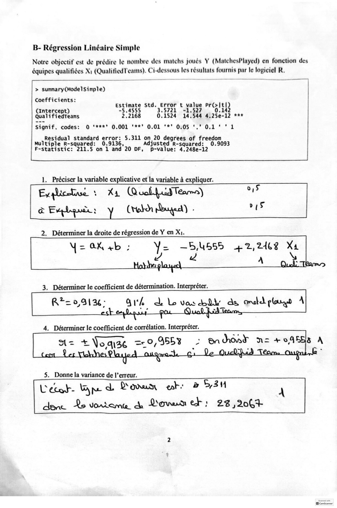

**Lecture OCR à contrôler**

~~~text
B- Régression Linéaire Simple

Notre objectif est de prédire le nombre des matchs joués Y (MatchesPlayed) en fonction des
équipes qualifiées X1 ee. me Ci-dessous les résultats fournis par le logiciel R.

> OTT TRE RY

Coefficients:

Estimate Std. Error t value Prcel tl)
(intercept) -5.4555 3.5721 -1.527 0.142
Quali fiedteams 2.2168 011524 14.544 4.25e-12 ***

Signif. codes: © ‘es2° 6.001 ***’ 0.01 ‘*° 0:05 ‘." 0,1‘ ° 1

Residual standard error: 5.311 on 20 degrees of freedom
Multiple R-squared: 0.9136, Adjusted R-squared: 0.9093
F-statistic: 211.5 on 1 and 20 DF, p-value: 4.248e-12

1. Préciser la variable explicative et la variable à expliquer.
~~~

## Page 3

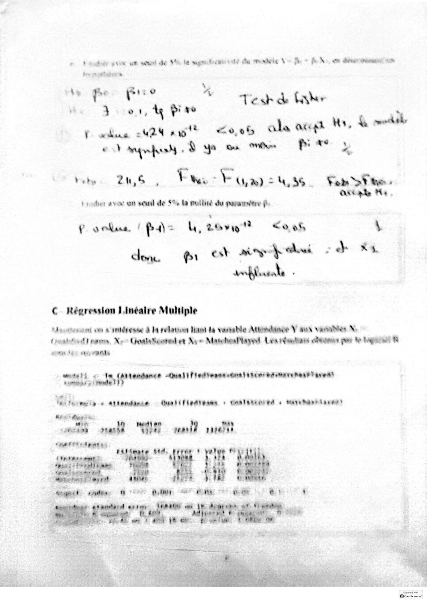

**Lecture OCR à contrôler**

~~~text
nds pve un sou de 66 le sagem te de mmndeie V~ fi + PN: om étre mé tn

ty stages ©

be | sd pre % é ae (ake
a 3 +01, 4 pi re Tesh & =
00% als accgh My, we

T. wise 2424 at
re OE RER. PA y

to: 206: Fr Ph Une. Cas.
AKC ake Ma.
t poteer avec an seul de $% la pullité du paramètre ff:

P vokue / az LU, Love" <0 06 \
dem. fir peed : d Xs
aoffsele -

+

C Régression Linéatre Multiple

Meoterant om s intdresse à da relation liant la vervable Attordaage Y aux vanes X
rond} pare. Xo GualsSeored et Ny = MatohosPhayed Les nisetians cles pe fe bgt 8

oom fa) ow FRAIS
8 iemnes MALT Hed ears cOma atc nr émane het) ue

muteti < 1
CCE]

Ves termes © attendance — Quali fiedtenms + daslitinreé « marrant anne

ER vol nie ll 20?

ES à: ihe

CN aE EO

et ae €

PL NUE Bons
IP Re)
“ee, PORTES
A6 PA ES NMS cam vou 1/6 dE
~~~

## Page 4

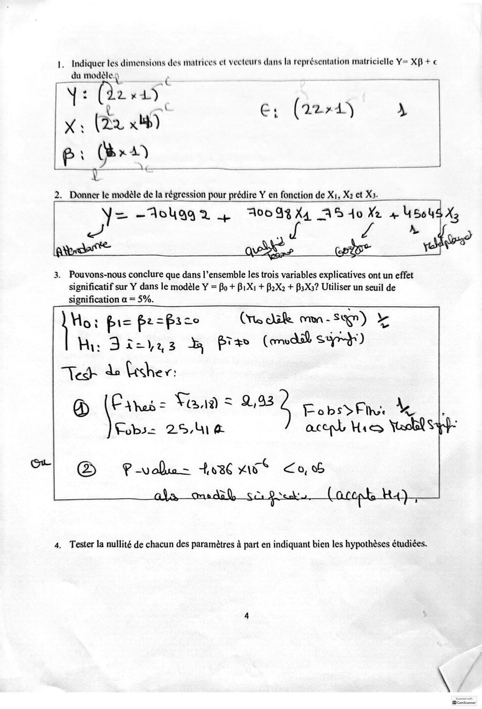

**Lecture OCR à contrôler**

~~~text
1. Indiquer les dimensions des matrices et vecteurs dans la représentation matricielle Y= XB + €
du modèle.) ,
sah Aa) {

Y 4 C2 0h
es (22 x bb)
p . (x4)

Ÿ émai à 4

€: (224) oY

2. Donner le modèle de la régression pour prédire Y en fonction de Xi, X2 et X3.
Y= -Aolgg2 + 094X4 AS do Xe + 4504S X,

J z x wo

3. Pouvons-nous conclure que dans l’ensemble les trois variables explicatives ont un effet
significatif sur Y dans le modèle Y = Bo + B1X1 + B2X2 + B3X3? Utiliser un seuil de

signification a = 5%.
(Tle dale mn - SM) &
Ted do lisher:

Ho: pi= fpr=fpice
@ (Fais Fans nee Eee

Hi: gas à prs (med Sun)
Pobs= 25,44 aceph His Yala S

| @  Cwalax tic “iw? Co,

4, Tester la nullité de chacun des paramètres à part en indiquant bien les hypothèses étudiées.
~~~

## Page 5

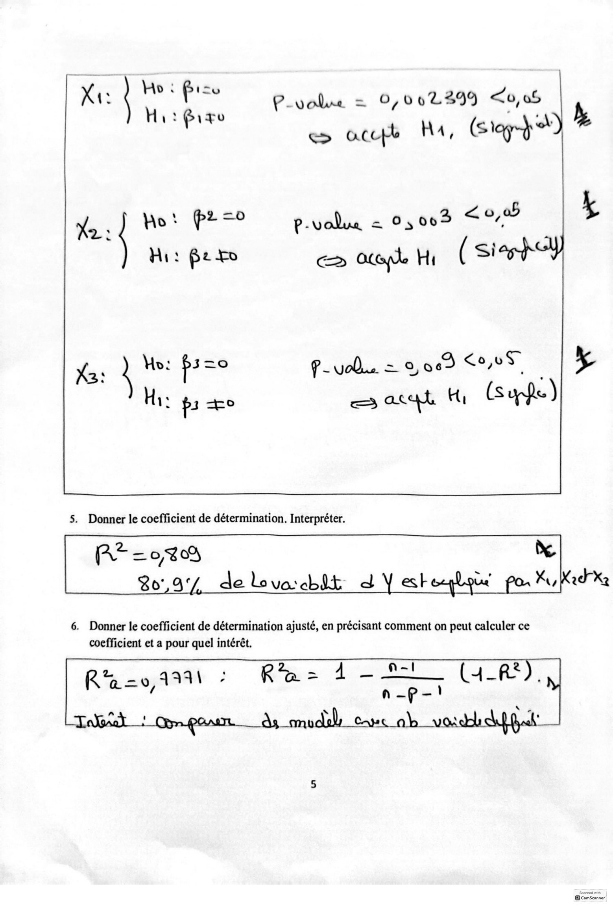

**Lecture OCR à contrôler**

~~~text
Xt: Ho: Pise P_volue = 0,0022899 <0, 0S
Hit igo ( | A) Ls
e> accpe HA, Slog}

6. Donner le coefficient de détermination ajusté, en précisant comment on peut calculer ce
coefficient et a pour quel intérêt.
~~~

## Page 6

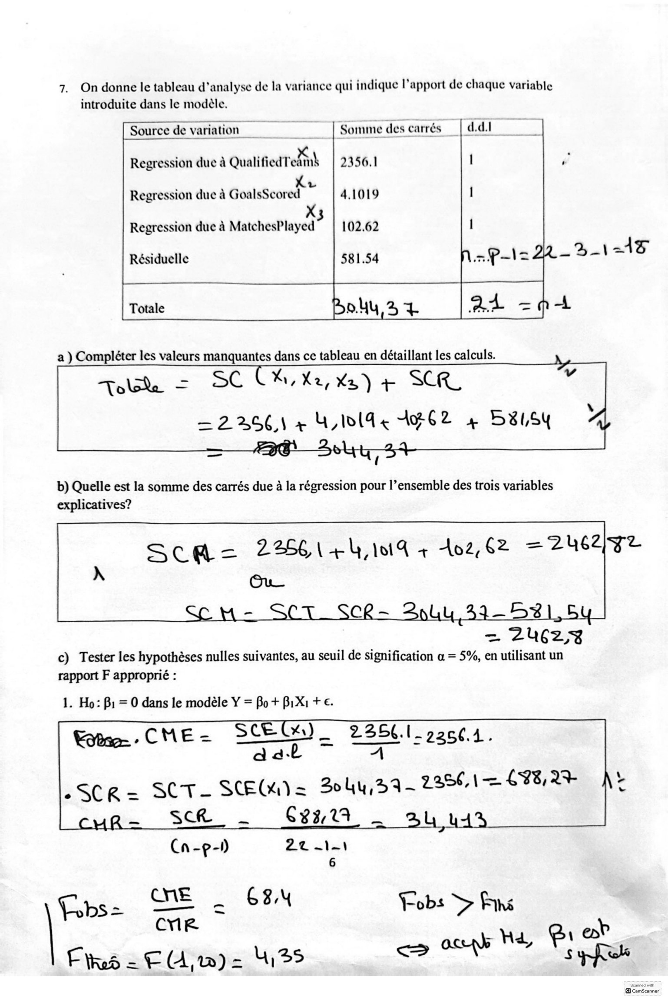

**Lecture OCR à contrôler**

~~~text
7. On donne le tableau d'analyse de la variance qui indique l'apport de chaque variable
introduite dans le modèle.

Somme des carrés ddl

Source de variation
Rs ifedt SA
Regression due à QualifiedTeams | 2356.1 I
À XL
Regression due à GoalsScored 4.1019 1

3
Regression due à MatchesPlayed 102.62 1

%_\ AS

Résiduelle 581.54

| Totale od. NE

a ) Compléter les valeurs manquantes dans ce tableau en détaillant les calculs.

Tolske = SC CK, Xe, Xz) + SER.
= 2256) + W111 4 1062 4 B8USY

(

b) Quelle est la somme des carrés due à la régression pour l’ensemble des trois variables
explicatives?

= ZU(ÇZY%
c) Tester les hypothèses nulles suivantes, au seuil de signification a = 5%, en utilisant un
rapport F approprié :

1. Ho: Bi = 0 dans le modèle Y = Bo + BiX1 + €.

Eos: CME =

SCEGQ)_ 225.1 72601.
DE pes

2SCR= SCT- SENS Bo Gy, 9 — 22561 C8, 24
SGk. … Gran

Cn-p-) Ze cit
6

cv

Yobs = QE a 6x Fobs > Fins
ck win omy ex?
Fires = EU) = 4135 ce 04 Mr, mé
~~~

## Page 7

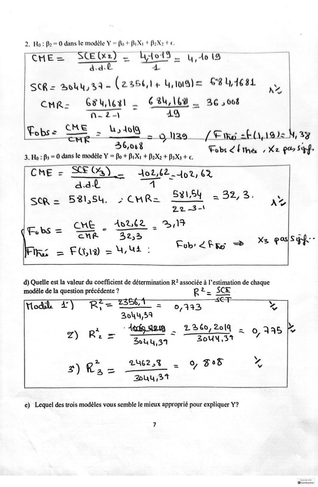

**Lecture OCR à contrôler**

~~~text
2. Ho: B2 = 0 dans le modèle Y = fo + BiXi + BrX2 + €.

HES SETS ARE = 4,40
à. a. 4

SCR = Boy, 39 - (235614 Una) 6841681

ht
CuR- Grlleil — CBU 16% _ 36 , 008
Nn 2) 49
Pobs = cus > La 5 A019,

en RU Nag / Em 20,19) 4, 39
46,068 ; ‘

3. Ho : Bs = 0 dans le modèle Y = Bo + BiX1 + BaXa + BsXs + €. Fobs fine , Xz Po Sepp,

Cue = SOG) _

dat

sca = 521,54, > CHR= Sets = 32,3. Fe

22-3-\

= TONER 10262 3,14
(UNE EU 228

EQ) = MU : bete = =f

Jo2,62 ot, 62
A

LA

Sy:

él
l

d) Quelle est la valeur du coefficient de détermination R? associée à l’estimation de chaque
modèle de la question précédente ? R 2. SCE

0

= 0,333
Johy,39

‘Ande sam . 2260,2014 | 0,135 A

_

S04 4,34 Zouy or

246253 . 9, S08
LE TE.
Duy 37

e) Lequel des trois modèles vous semble le mieux approprié pour expliquer Y?

7
~~~

## Page 8

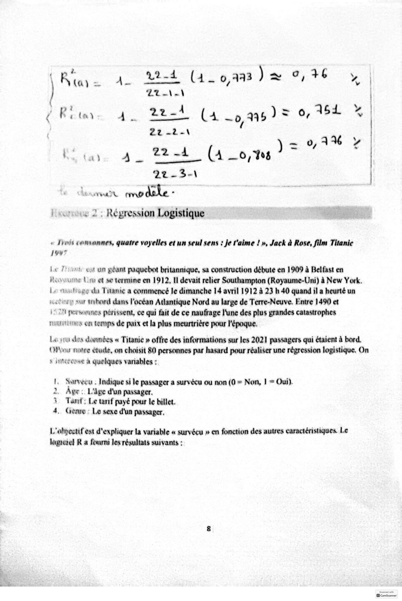

**Lecture OCR à contrôler**

~~~text
\

(Rite de cee (i_oam)æ 9,36 y |
| Tt\e) |
Riu. 4. 24 (4 oas)e 0,164 X |
22 -2-\ |

|

- 01% 7
Fi tar 4. Soh (4 0,18? à

—

22-3-\
Luna cmp dalle .

| move 2: Réyression Logistique

« 1rois Comvonnes, quatre voyelles et un seul sens : je t'aime ! », Jack à Rose, film Titanic
1947

Le Jos ost un géant paquebot britannique, sa construction débute en 1909 à Belfast en
Posume Lu et se termine en 1912. Il devait relier Southampton (Royaume-Uni) à New York.
Lo osutioge du Titanic a commencé le dimanche 14 avril 1912 à 23 h 40 quand il a heurté un
.ctory sur trhard dans l'océan Atlantique Nord au large de Terre-Neuve. Entre 1490 et

| 2 persunnes périssent, ce qui fait de ce naufrage l'une des plus grandes catastrophes
nauerunes on temps de paix et la plus meurtrière pour l'époque.

Le sou des données « Titanic » offre des informations sur les 2021 passagers qui étaient à bord.
Oro node etude, on choisit 80 personnes par hasard pour réaliser une régression logistique. On
sintetrose à quelques variables :

Survéeu . Indique si le passager a survécu ou non (0 = Non, 1 = Oui).
Age: L'âge d'un passager.

Tant : Le tarif payé pour le billet.

Grave : Le sexe d'un passager,

dB 0 bo —

L'abpestif est d'expliquer la variable « survécu » en fonction des autres caractéristiques. Le
lagetel R a fourni les résultats suivants :
~~~

## Page 9

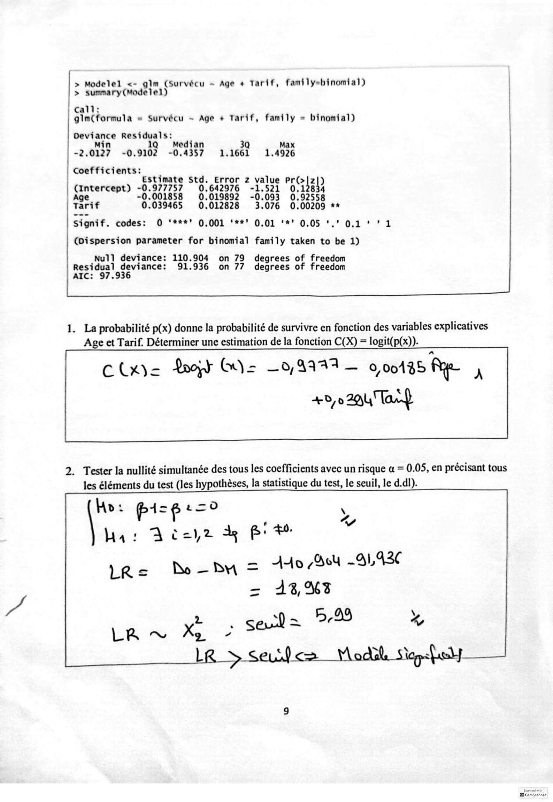

**Lecture OCR à contrôler**

~~~text
> Modelel <- gim (Survécu - Age + Tarif, family-binomial)
> sumnary(Modelel)

call:
gim(formula = Survécu ~ Age + Tarif, family = binomial)

Deviance Residuals:
Min 1Q Median 3Q Max
-2.0127 -0.9102 -0.4357 1.1661 1.4926

coefficients:

| Estimate Std. Error z value PRGIE )
(intercept) 2: 977757 0.642976 -1.521 12834

| Age 001858 0.019892 -0.093 0.92558
Tarif x 039465 0.012828 3.076 0.00209 **

Stgnif. codes: © ‘***" 0,001 ‘##2 0.01 ‘*’ 0.05 '.° 0.1 ‘ ? 1

(Dispersion parameter for binomial family taken to be 1)

Null] deviance: 110.904 on 79 degrees of freedom
Le: dhe deviance: 91.936 on 77 degrees of freedom
AIC:

1. La probabilité p(x) donne la probabilité de survivre en fonction des variables explicatives
Age et Tarif. Déterminer une estimation de la fonction C(X) = logit(p(x)).

C Layee Poop Gy = —0,4949 — 0,00485 Rie À

40,0 294 Tart

2. Tester la nullité simultanée des tous les coefficients avec un risque a = 0.05, en précisant tous
les éléments du test (les hypothèses, la statistique du test, le seuil, le d.dl).

cI Ado 7d _-91,42C

= 173,%3

\

«
~~~

## Page 10

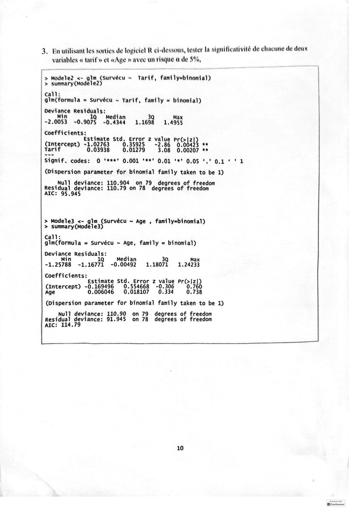

**Lecture OCR à contrôler**

~~~text
3. En utilisant les sorties de logiciel R ci-dessous, tester la significativité de chacune de deux
variables « tarif » et «Age » avec un risque a de 5%,

> Modele2 <- glm (Survécu ~ Tarif, family=binomial)
> summary(Modele2)

call:
gim(formula = Survécu ~ Tarif, family = binomial)

Deviance ab : Dé 43 5

Min Q Median Q Max
-2.0053 -0.9075 -0.4344 1.1698 1.4955
sich |

stimate Std. Error z value PGIE À

Cinvercept) “i 02763 0.35925 -2.86 00423 **

rif .03938 0.01279 3.08 0.00207 **
Signif. codes: O ‘***’ 0.001 ‘**’ 0.01 ‘*' 0.05 ‘,' 0.1 ‘ * 1

(Dispersion parameter for binomial family taken to be 1)

Null] deviance: 110.904 on 79 degrees of freedom
pcs ar tél 110.79 on 78 degrees of freedom

> Modele3 <- gis, (Survécu ~ Age , family=binomial)
> summary (Modele3)

Call:
gim(formula = Survécu ~ Age, family = binomial)

perience Residuals:
Q Median 3Q Max
-1. 25788 -1.16771 -0.00492 1.18071 1.24233

Coefficients:
Estimate Std. Error z value prt lzi
julie a 169496 0.554668 -0.306 0.760
0.006046 0.018107 0.334 0.738

i PR parameter for binomial family taken to be 1)
Null] deviance: 110.90 on 79 degrees of freedom

Residual deviance: 91.945 on 78 degrees of freedom
AIC:

10
~~~

## Page 11

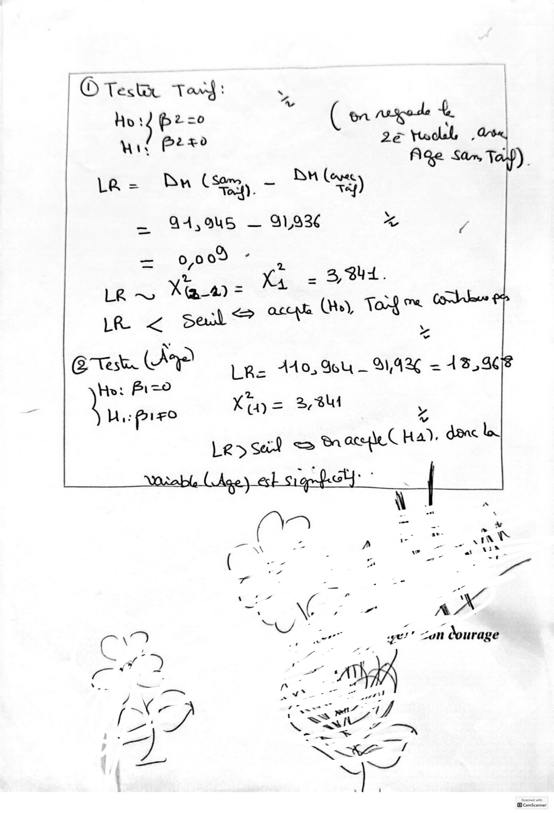

**Lecture OCR à contrôler**

~~~text
© Testi Tan : \

LE ns i ( on qed 4 |
WT Pre? ie ESS
Age San Ta )
_ B
La = By (sem - Days)
— 94,9u5 — 9193 A /

Test. (A
(e an Le= A410, 9b — 91,426 = 1396

X= 38u

Hi: Paix x
v
Les sa? = BracyieC Ha). à
- e tat à |
ae Ve
— x
pe ~ Te
LT : Le ; 7 & ET
‘ 4 a
É Se \( 7 T AX
an Ne - - ne
a a | ge!" con courage
=, > | - Gi
/ V Fées. | - ae: ge J
= age, wt’
val cae
7 LES LR
KE !

Scanned with
~~~

## Page 12

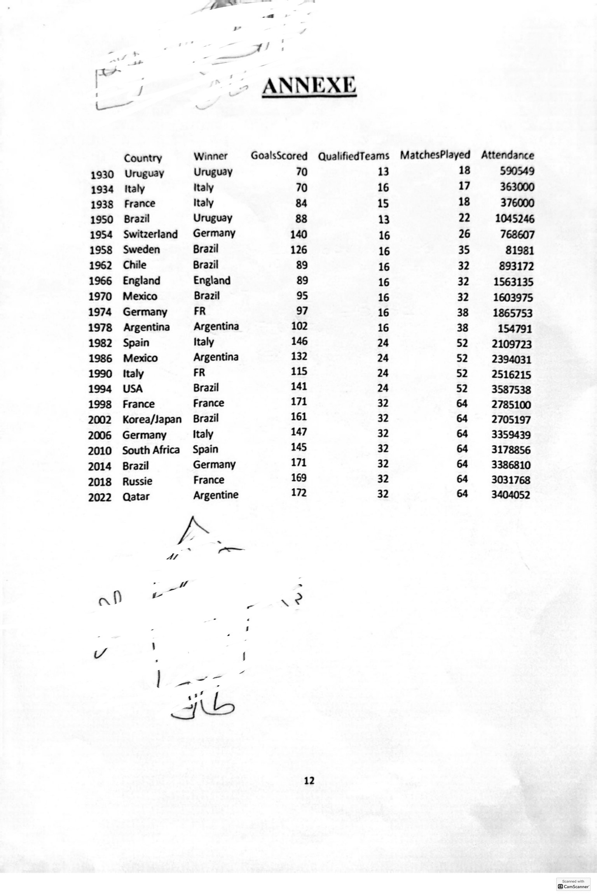

**Lecture OCR à contrôler**

~~~text
D, LA)
ZS . ANNEXE
7 Ase

Country Winner GoalsScored QualifiedTeams MatchesPlayed Attendance

1930 Uruguay Uruguay 70 13 18 590549
1934 Italy Italy 70 16 17 363000
1938 France Italy 84 15 18 376000
1950 Brazil Uruguay 88 13 22 1045246
1954 Switzerland Germany 140 16 26 768607
1958 Sweden Brazil 126 16 35 81981
1962 Chile Brazil 89 16 32 893172
1966 England England 89 16 32 1563135
1970 Mexico Brazil 95 16 32 1603975
1974 Germany FR 97 16 38 1865753
1978 Argentina Argentina 102 16 38 154791
1982 Spain Italy 146 24 52 2109723
1986 Mexico Argentina 132 24 S2 2394031
1990 Italy FR 115 24 52 2516215
1994 USA Brazil 141 24 52 3587538
1998 France France 171 32 64 2785100
2002 Korea/Japan Brazil 161 32 64 2705197
2006 Germany Italy 147 32 64 3359439
2010 South Africa Spain 145 32 64 3178856
2014 Brazil Germany 171 32 64 3386810
2018 Russie France 169 32 64 3031768
2022 Qatar Argentine 172 32 64 3404052
a ~—
- ow =
A fn & - + à
i
Y ! i
peser
s

12
~~~
